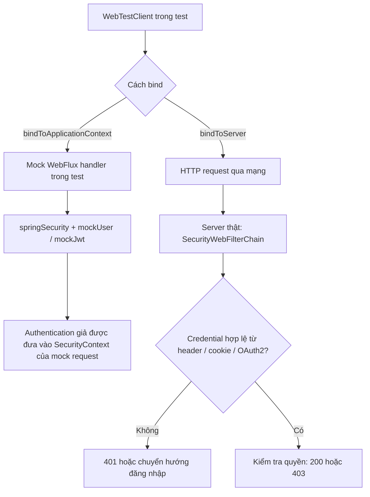

# Giới hạn mutator giả lập đối với máy chủ chạy ngoài tiến trình test

Khi kiểm thử Spring Security trên **Spring WebFlux**, `WebTestClient` có thể gửi request tới ứng dụng ngay trong test context hoặc tới một máy chủ HTTP đang chạy trên cổng thật. Cả hai cùng dùng API `get()`, `post()`, `exchange()` và `expectStatus()`, nhưng cách **giả lập danh tính** rất khác nhau.

Các mutator trong **spring-security-test**, ví dụ `mockUser()`, `mockJwt()`, `mockOAuth2Login()` và `mockOpaqueToken()`, có thể đưa một `Authentication` giả lập vào môi trường **mock server do test kiểm soát**. Khi `WebTestClient` dùng `bindToServer()` để kết nối qua HTTP tới một ứng dụng đang chạy độc lập, test **không có quyền sửa trực tiếp `SecurityContext` ở phía máy chủ**. Để kiểm tra máy chủ đó, request phải mang chứng thực thực sự mà ứng dụng chấp nhận: HTTP Basic, Bearer JWT, opaque token, session cookie hoặc luồng OAuth2/OIDC thật.

Đây là bài trong chương **Thiết lập WebTestClient** của module **SPRING_SECURITY_TESTING**. Mục tiêu là kiểm chứng xác thực, phân quyền và bảo vệ HTTP trên Servlet/Reactive mà không nhầm một principal giả lập với một người dùng đã được server từ xa xác thực. Ví dụ chính dùng WebFlux và WebTestClient; phần cuối đối chiếu với MockMvc ở Servlet.

## 1. Ranh giới quyết định: ai sở hữu quá trình xử lý HTTP?

WebTestClient có ba cách thiết lập thường gặp:

| Cách tạo client | Đích xử lý request | Test có trực tiếp gắn mock SecurityContext phía server? | Mục đích phù hợp |
| --- | --- | --- | --- |
| `bindToController(...)` hoặc `bindToRouterFunction(...)` | WebFlux mock server dựng từ controller/router | Có thể, nếu áp dụng các configurer và bộ lọc Spring Security phù hợp | Test hành vi controller/router với principal giả |
| `bindToApplicationContext(context)` | WebFlux handler chain của ứng dụng ngay trong test context | **Có**, khi dùng `springSecurity()` và mock security mutator tương ứng | Test SecurityWebFilterChain, authentication giả và authorization trong context |
| `bindToServer().baseUrl("http://...")` | Request đi qua HTTP tới server đang nghe cổng | **Không**, HTTP không truyền được đối tượng SecurityContext từ test JVM | Test giao thức thực, filter chain và cách server chấp nhận credentials |

Một `@SpringBootTest(webEnvironment = RANDOM_PORT)` vẫn có thể chạy **cùng JVM** với test, nhưng khi client dùng `bindToServer()`, request đi qua HTTP thật. Ranh giới quan trọng là cách kết nối và đối tượng server mà test có thể điều khiển, không chỉ là hai tiến trình có chung JVM hay không. Nếu server thực sự ở một container, một máy khác hoặc môi trường staging, ranh giới này càng rõ.



**Không được coi `mutateWith(mockJwt())` là cách ký JWT và gửi Bearer token tới server xa.** Tương tự, `mockUser("alice")` không tạo username/password, `mockOAuth2Login()` không chạy Authorization Code flow, và `mockOpaqueToken()` không gọi introspection endpoint thật.

## 2. Mutator giả lập thực sự làm gì?

Trong test có mock server WebFlux được Spring Security tích hợp, các configurer của `SecurityMockServerConfigurers` hỗ trợ những tình huống sau:

- `mockUser("alice")`: mô phỏng người dùng đã xác thực và các role/authority tương ứng.
- `mockJwt()`: mô phỏng `JwtAuthenticationToken` để kiểm thử quyền truy cập theo claim/authority. Nó **không** ký JWT hoặc gọi `ReactiveJwtDecoder` để xác minh chữ ký.
- `mockOpaqueToken()`: mô phỏng principal/authorities của một opaque token đã được chấp nhận. Nó **không** gọi `ReactiveOpaqueTokenIntrospector`.
- `mockOAuth2Login()` và `mockOidcLogin()`: mô phỏng người dùng OAuth2/OIDC đã đăng nhập. Chúng **không** chứng minh redirect, callback, token exchange, nonce hoặc ID-token validation.
- `csrf()`: hỗ trợ mô phỏng CSRF token hợp lệ trong mock server test. Nó **không** thay thế việc lấy và gửi CSRF token/cookie hợp lệ theo giao thức với server từ xa.

Các công cụ này có giá trị lớn vì giúp kiểm tra nhanh quy tắc truy cập, ví dụ một endpoint yêu cầu role `AUDITOR` hay scope `reports:read`. Nhưng kết quả test chỉ chứng minh behavior **khi đã có Authentication được test gắn sẵn**.

Hãy phân biệt hai câu hỏi:

1. **Authorization:** “Với principal đã xác thực có những authority này, server cho phép hay từ chối endpoint?” — mock mutator rất phù hợp.
2. **Authentication:** “Server có thực sự chấp nhận password, JWT signature/issuer/audience, opaque-token introspection hay OAuth2 login callback không?” — cần gửi chứng thực và chạy cơ chế xác thực thật.

## 3. Ứng dụng WebFlux làm ví dụ

Để quan sát rõ cả hai kiểu test, ta dùng một WebFlux API thực tế được bảo vệ bằng **HTTP Basic**. Cơ chế này đơn giản để tạo request HTTP có credential thật, đồng thời giúp thấy rằng mutator giả vẫn có thể cấp Authentication trong test nội bộ. Trong module **SPRING_SECURITY_TESTING**, tư duy tương tự được áp dụng cho JWT/OAuth2/OIDC, nhưng lúc đó credential và bộ xác minh khác.

Dependency Spring Boot 3.x minh họa:

```gradle
dependencies {
    implementation("org.springframework.boot:spring-boot-starter-webflux")
    implementation("org.springframework.boot:spring-boot-starter-security")

    testImplementation("org.springframework.boot:spring-boot-starter-test")
    testImplementation("org.springframework.security:spring-security-test")
}
```

Cấu hình sau là **chính sách ứng dụng minh họa**, không phải cấu hình nới lỏng riêng cho test. `/health` công khai, `/api/me` cần đăng nhập và `/api/reports` cần role `AUDITOR`:

```java
import org.springframework.context.annotation.Bean;
import org.springframework.context.annotation.Configuration;
import org.springframework.security.config.Customizer;
import org.springframework.security.config.annotation.web.reactive.EnableWebFluxSecurity;
import org.springframework.security.config.web.server.ServerHttpSecurity;
import org.springframework.security.core.userdetails.MapReactiveUserDetailsService;
import org.springframework.security.core.userdetails.User;
import org.springframework.security.core.userdetails.UserDetails;
import org.springframework.security.web.server.SecurityWebFilterChain;

@Configuration
@EnableWebFluxSecurity
class WebFluxSecurityConfig {

    @Bean
    SecurityWebFilterChain securityWebFilterChain(ServerHttpSecurity http) {
        return http
            .authorizeExchange(exchanges -> exchanges
                .pathMatchers("/health").permitAll()
                .pathMatchers("/api/reports").hasRole("AUDITOR")
                .pathMatchers("/api/me").authenticated()
                .anyExchange().denyAll())
            .httpBasic(Customizer.withDefaults())
            .formLogin(ServerHttpSecurity.FormLoginSpec::disable)
            .build();
    }

    @Bean
    MapReactiveUserDetailsService testUsers() {
        UserDetails alice = User.withUsername("alice")
            .password("{noop}correct-pass")
            .roles("USER")
            .build();

        UserDetails auditor = User.withUsername("auditor")
            .password("{noop}audit-pass")
            .roles("AUDITOR")
            .build();

        return new MapReactiveUserDetailsService(alice, auditor);
    }
}
```

Trong ví dụ, `{noop}` chỉ nhằm giữ tài khoản dễ quan sát trong một ứng dụng huấn luyện; môi trường thật cần `PasswordEncoder` thích hợp như BCrypt và secret management phù hợp. Phần `formLogin(...disable)` phản ánh chủ đích API dùng HTTP Basic, không phải thao tác tắt bảo vệ để test qua được. CSRF vẫn do SecurityWebFilterChain quản lý theo cấu hình, nên nếu mở rộng sang POST/PUT/DELETE phải kiểm thử CSRF tương ứng.

Controller mẫu:

```java
import java.security.Principal;

import reactor.core.publisher.Mono;
import org.springframework.web.bind.annotation.GetMapping;
import org.springframework.web.bind.annotation.RestController;

@RestController
class ExampleApiController {

    @GetMapping("/health")
    Mono<String> health() {
        return Mono.just("ok");
    }

    @GetMapping("/api/me")
    Mono<String> me(Principal principal) {
        return Mono.just(principal.getName());
    }

    @GetMapping("/api/reports")
    Mono<String> reports() {
        return Mono.just("audit-report");
    }
}
```

Ứng dụng có `@SpringBootApplication` thông thường và quét được các lớp này. Để tập trung vào WebTestClient, các ví dụ test dưới đây sử dụng chính `WebFluxSecurityConfig` và `ExampleApiController`, không tạo thêm filter chain thay thế chỉ dành cho test.

## 4. Kiểu A: WebTestClient gắn vào ApplicationContext — mock mutator hoạt động

Đây là kiểu kiểm thử phù hợp nếu ta cần câu trả lời: “Principal với role cụ thể có được vào endpoint không?”

```java
import org.junit.jupiter.api.BeforeEach;
import org.junit.jupiter.api.Test;
import org.springframework.beans.factory.annotation.Autowired;
import org.springframework.boot.test.context.SpringBootTest;
import org.springframework.context.ApplicationContext;
import org.springframework.test.web.reactive.server.WebTestClient;

import static org.springframework.security.test.web.reactive.server.SecurityMockServerConfigurers.mockUser;
import static org.springframework.security.test.web.reactive.server.SecurityMockServerConfigurers.springSecurity;

@SpringBootTest(webEnvironment = SpringBootTest.WebEnvironment.MOCK)
class InProcessSecurityTests {

    @Autowired
    ApplicationContext context;

    WebTestClient client;

    @BeforeEach
    void setUp() {
        client = WebTestClient.bindToApplicationContext(context)
            .apply(springSecurity())
            .configureClient()
            .build();
    }

    @Test
    void mockUserCanAccessAuthorizedRoute() {
        client.mutateWith(mockUser("auditor").roles("AUDITOR"))
            .get().uri("/api/reports")
            .exchange()
            .expectStatus().isOk()
            .expectBody(String.class).isEqualTo("audit-report");
    }

    @Test
    void mockUserWithoutRequiredRoleGets403() {
        client.mutateWith(mockUser("alice").roles("USER"))
            .get().uri("/api/reports")
            .exchange()
            .expectStatus().isForbidden();
    }

    @Test
    void anonymousMockServerRequestGets401() {
        client.get().uri("/api/me")
            .exchange()
            .expectStatus().isUnauthorized();
    }
}
```

Các điểm đáng chú ý:

- `bindToApplicationContext(context)` cho phép test sử dụng WebFlux handler chain **trong context**, không mở cổng mạng.
- `.apply(springSecurity())` tích hợp các filter bảo mật tương ứng với mock server.
- `.mutateWith(mockUser(...))` đưa authentication giả vào **ngữ cảnh yêu cầu mock**. Không có HTTP Basic `Authorization` header trong request, nên bài test **không kiểm tra mật khẩu**.
- Test `403` chứng minh `hasRole("AUDITOR")` chặn người đã xác thực nhưng thiếu role.
- `WebTestClient` có thể được tạo lại sau mỗi test để tránh vô tình giữ mutator đã áp dụng vào client dùng ở ca khác.

Một phép thử thành công với `mockUser("auditor")` chưa chắc chứng minh `MapReactiveUserDetailsService` chấp nhận mật khẩu của auditor. Ta có thể thay mật khẩu trong user store thành giá trị khác mà ca mockUser vẫn 200 — vì nó đã bỏ qua bước HTTP Basic authentication.

### Ví dụ mockJwt() còn làm lộ rõ hơn giới hạn

Ngay cả khi SecurityWebFilterChain **chỉ bật HTTP Basic** như ứng dụng mẫu, một test trong context vẫn có thể tạo Authentication JWT giả để kiểm tra authorization:

```java
import org.springframework.security.core.authority.SimpleGrantedAuthority;
import static org.springframework.security.test.web.reactive.server.SecurityMockServerConfigurers.mockJwt;

// Đặt trong lớp InProcessSecurityTests ở trên.
@Test
void mockJwtProvesOnlyRoleBasedAuthorization() {
    client.mutateWith(mockJwt()
            .authorities(new SimpleGrantedAuthority("ROLE_AUDITOR")))
        .get().uri("/api/reports")
        .exchange()
        .expectStatus().isOk();
}
```

Kết quả 200 ở đây **không chứng minh API đã hỗ trợ xác thực Bearer JWT**. Ứng dụng mẫu không có `oauth2ResourceServer().jwt()`; mock mutator cung cấp Authentication giả và đi qua phần phân quyền. Nếu gửi chuỗi `Authorization: Bearer xxx` vào ứng dụng Basic-only đang chạy thật, nó không tự trở thành JWT đã được xác minh.

## 5. Kiểu B: bindToServer() — HTTP request phải có credential thực

Bài test tiếp theo khởi động ứng dụng trên cổng ngẫu nhiên rồi dùng WebTestClient tạo **HTTP connection thật**. Vì client không bind vào mock WebFlux handler, ta không có kênh đưa `mockUser()` vào server-side SecurityContext. Hãy dùng HTTP Basic credentials mà server biết:

```java
import org.junit.jupiter.api.BeforeEach;
import org.junit.jupiter.api.Test;
import org.springframework.boot.test.context.SpringBootTest;
import org.springframework.boot.test.web.server.LocalServerPort;
import org.springframework.test.web.reactive.server.WebTestClient;

@SpringBootTest(webEnvironment = SpringBootTest.WebEnvironment.RANDOM_PORT)
class RealHttpSecurityTests {

    @LocalServerPort
    int port;

    WebTestClient remote;

    @BeforeEach
    void setUp() {
        remote = WebTestClient.bindToServer()
            .baseUrl("http://127.0.0.1:" + port)
            .build();
    }

    @Test
    void requestWithoutCredentialIs401() {
        remote.get().uri("/api/me")
            .exchange()
            .expectStatus().isUnauthorized();
    }

    @Test
    void validBasicCredentialAuthenticatesAlice() {
        remote.get().uri("/api/me")
            .headers(headers ->
                headers.setBasicAuth("alice", "correct-pass"))
            .exchange()
            .expectStatus().isOk()
            .expectBody(String.class).isEqualTo("alice");
    }

    @Test
    void wrongPasswordIs401() {
        remote.get().uri("/api/me")
            .headers(headers ->
                headers.setBasicAuth("alice", "wrong-pass"))
            .exchange()
            .expectStatus().isUnauthorized();
    }

    @Test
    void authenticatedAliceWithoutAuditorRoleIs403() {
        remote.get().uri("/api/reports")
            .headers(headers ->
                headers.setBasicAuth("alice", "correct-pass"))
            .exchange()
            .expectStatus().isForbidden();
    }

    @Test
    void realAuditorCredentialCanReadReports() {
        remote.get().uri("/api/reports")
            .headers(headers ->
                headers.setBasicAuth("auditor", "audit-pass"))
            .exchange()
            .expectStatus().isOk()
            .expectBody(String.class).isEqualTo("audit-report");
    }
}
```

`@LocalServerPort` cung cấp cổng của web server thật. `setBasicAuth()` tạo một header HTTP Basic từ username/password, để **server tự xác thực** qua cấu hình bảo mật hiện hữu. Đây là bằng chứng có giá trị hơn cho luồng HTTP Basic so với `mockUser()`.

```text
@Test                          HTTP                         WebFlux server
  | GET /api/me                                              |
  | Authorization: Basic base64(alice:correct-pass)          |
  |--------------------------------------------------------->|
  |                           AuthenticationWebFilter        |
  |                           ReactiveUserDetailsService     |
  |                           PasswordEncoder                |
  |<---------------------------------------------------------|
  | 200 "alice"                                              |
```

Dù server đang ở cùng JVM với `@SpringBootTest(RANDOM_PORT)`, request vẫn đi qua HTTP socket. Không có cơ chế chuẩn nào cho việc truyền một `SecurityContext` Java object qua HTTP chỉ vì client và server nằm gần nhau. Một server chạy **ngoài tiến trình test** trong Docker, Kubernetes hoặc staging cũng nhận đúng kiểu HTTP request này.

### Những gì không nên làm với remote client

Đoạn sau dễ gây hiểu nhầm:

```java
WebTestClient remote = WebTestClient.bindToServer()
    .baseUrl("https://staging.example.test")
    .build();

// KHÔNG dùng như một cách “đăng nhập” vào staging:
// remote.mutateWith(mockUser("auditor"))
// remote.mutateWith(mockJwt())
```

Các mock security configurer của Spring Security Test được thiết kế cho **mock server cùng test**, không phải API có khả năng đăng nhập xuyên tiến trình. Với client dùng `bindToServer`, một mock mutator có thể bị từ chối bởi cách thiết lập client hoặc không mang lại Authentication phía server; không nên phụ thuộc vào một thông báo lỗi cố định cho mọi phiên bản. Điều quyết định là **server không nhận được credential hợp lệ chỉ từ một mock principal trên máy test**.

Một `exchangeFilterFunction` hoặc `defaultHeader` đặt ở client **có thể sửa HTTP request thực**; đó là cơ chế khác với việc cài Authentication giả vào server. Ví dụ `headers.setBearerAuth(validToken)` thêm header bearer thật, còn `mockJwt()` thì không ký ra `validToken`.

## 6. Khi máy chủ từ xa dùng JWT thay cho HTTP Basic

Với Resource Server Reactive, production thường có cấu hình tương tự:

```java
@Bean
SecurityWebFilterChain jwtSecurity(ServerHttpSecurity http) {
    return http
        .authorizeExchange(exchanges -> exchanges
            .pathMatchers("/api/reports")
                .hasAuthority("SCOPE_reports:read")
            .anyExchange().authenticated())
        .oauth2ResourceServer(oauth2 ->
            oauth2.jwt(Customizer.withDefaults()))
        .build();
}
```

Đây là **cấu hình thay thế** cho ví dụ HTTP Basic, không đăng ký hai filter chain trùng phạm vi trong cùng ứng dụng mẫu. Resource Server phải có `ReactiveJwtDecoder` tin cậy khóa ký và kiểm tra issuer, thời hạn, audience khi chính sách yêu cầu.

WebTestClient remote sẽ gửi JWT có chữ ký thật qua HTTP:

```java
// signedJwt lấy từ test issuer/JWT fixture mà server tin cậy;
// đó là JWT đã ký, chưa hết hạn, đúng audience và issuer.
String signedJwt = tokenFixture.validJwtFor("alice", "reports:read");

WebTestClient remote = WebTestClient.bindToServer()
    .baseUrl("http://127.0.0.1:" + port)
    .build();

remote.get().uri("/api/reports")
    .headers(headers -> headers.setBearerAuth(signedJwt))
    .exchange()
    .expectStatus().isOk();
```

`tokenFixture` trong đoạn này là phụ thuộc test cần được triển khai (ví dụ fixture ký RSA bằng private key, decoder của server dùng public key tương ứng); đoạn mã minh họa **cách gửi token** chứ không giả vờ tạo JWT thật từ một mock mutator. Không dùng chuỗi `"alice"` hoặc payload Base64URL chưa ký làm Bearer token hợp lệ.

Bộ kiểm thử từ xa nên có ít nhất các ca đối chứng:

| Request | Kết quả thông thường | Khẳng định đúng |
| --- | --- | --- |
| Không có `Authorization` | 401 | Endpoint cần authentication |
| Token ký hợp lệ, đúng issuer/audience, có scope cần thiết | 200 | Xác thực và phân quyền cùng đạt |
| Token sai chữ ký hoặc sai issuer | 401 | JWT bị từ chối tại decoder/validator |
| Token hợp lệ nhưng thiếu `reports:read` | 403 | Xác thực được nhưng thiếu authority |
| Token hết hạn | 401 | Thời hạn được thực thi |

Cần giữ token sai issuer **đúng chữ ký và còn hạn** để biết nguyên nhân từ chối đến từ issuer, thay vì từ một lỗi khác. Không gỡ validator hoặc tắt kiểm tra issuer trong production chỉ để fixture test qua được; hãy tạo token từ issuer test đã cấu hình tương ứng.

### Opaque token và OAuth2/OIDC

- Với **opaque token**, gửi chuỗi bearer thực; server tự gọi introspection endpoint. `mockOpaqueToken()` không chứng minh response `active=false` bị từ chối. Có thể cấu hình test Authorization Server với introspection endpoint HTTP cục bộ.
- Với **OAuth2 Login/OIDC**, server cần trải qua redirect, authorization response, token exchange và session/cookie thực. `mockOAuth2Login()`/`mockOidcLogin()` không tạo phiên đăng nhập ở server ngoài. Đối với remote E2E, test cần hoàn tất flow bằng browser/test IdP hoặc lấy cookie từ phiên đăng nhập được tạo hợp lệ.
- Với **HTTP Basic**, `setBasicAuth()` là đủ để tạo credential HTTP; nhưng test vẫn chỉ chứng minh server chấp nhận user/password theo cấu hình cụ thể, không chứng minh các cơ chế JWT/OIDC khác.

Đừng chuyển một `@WithMockUser` ở phía test JVM thành giả định rằng request remote đã đăng nhập. Annotation này tạo ngữ cảnh thử nghiệm phù hợp với hệ test tích hợp của Spring Security, không phải một giao thức xác thực truyền qua mạng.

## 7. Kiểm thử session và CSRF từ xa: cần cookie/token thật

Nếu remote app dùng form login thay vì HTTP Basic/Bearer, trạng thái xác thực có thể được lưu trong session. Để gọi endpoint được bảo vệ, WebTestClient phải gửi **cookie phiên đã nhận từ server**. Một chuỗi tự đặt `"SESSION=fake"` không tự tạo `SecurityContext` hợp lệ.

Với CSRF, điều quan trọng không chỉ là tên header mà còn là token hợp lệ **gắn với session hoặc repository của server**:

```text
(1) Client gửi GET /login hoặc GET /form
(2) Server cấp session và thông tin CSRF theo cấu hình
(3) Client giữ cookie phiên và CSRF token hợp lệ
(4) Client gửi POST cùng cookie và CSRF token ở vị trí server chờ
(5) Server kiểm tra CSRF rồi mới xử lý hành động
```

Cách phân phối CSRF khác nhau tùy `ServerCsrfTokenRepository` và front-end. Nếu server dùng `CookieServerCsrfTokenRepository`, browser có thể gửi cookie XSRF-TOKEN và header X-XSRF-TOKEN; nếu dùng repository dựa trên session, test cần lấy token theo cách ứng dụng thực sự xuất ra. Hãy kiểm tra contract của ứng dụng, đừng giả định một header mặc định luôn đúng.

Trong test nội bộ có thể dùng:

```java
import static org.springframework.security.test.web.reactive.server.SecurityMockServerConfigurers.csrf;

client.mutateWith(csrf())
    .post().uri("/api/action")
    .exchange()
    .expectStatus().is2xxSuccessful();
```

Ví dụ chỉ minh họa cách gọi mock CSRF mutator, giả định `/api/action` có tồn tại và được phép với authentication hiện tại. Test remote muốn xác minh CSRF thật phải tự thu thập cookie/token server cấp rồi gửi chúng qua HTTP, hoặc dùng một test browser tương ứng. Không sửa production `ServerHttpSecurity` để `.csrf(...disable)` chỉ vì test chưa gửi đúng token.

## 8. Ma trận chọn cách kiểm thử

| Điều muốn kiểm chứng | Kiểu client đề xuất | Dữ liệu thử |
| --- | --- | --- |
| User role `USER` không được vào tài nguyên `AUDITOR` | `bindToApplicationContext` + `mockUser()` | Principal/authorities giả |
| API phân quyền dựa trên claim JWT đã xác thực | Mock server + `mockJwt()` | JWT claims giả, không ký |
| JwtDecoder từ chối token sai issuer/chữ ký | `bindToServer` hoặc integration server chạy decoder thật | JWT đã ký, header Bearer |
| Opaque introspection `active=false` bị từ chối | HTTP server + mock introspection endpoint | Bearer opaque token thực, phản hồi upstream |
| OAuth2/OIDC callback và session được tạo đúng | Integration HTTP/browser và Authorization Server test | State, code, token, cookie thực |
| Mật khẩu HTTP Basic đúng/sai | `bindToServer` | HTTP Basic header thật |
| CSRF request POST được bảo vệ | Mock server để kiểm tra rule; HTTP/browser để kiểm tra giao thức | Mock `csrf()` hoặc token/cookie do server cấp |
| Staging đã deploy có cùng chính sách 401/403 | `bindToServer` trỏ URL staging | Credentials test có thật, kiểm soát scope/role |

Khi test remote, những assertion `expectStatus().isUnauthorized()`, `isForbidden()` và `isOk()` vẫn hoạt động như khi bind vào context. Phần khác nhau là **cách tạo điều kiện authentication** cho server. Một assertion 200 duy nhất không chứng minh toàn bộ hệ thống an toàn; nên có cả trường hợp bị từ chối.

## 9. Những lỗi dễ gặp và cách nhận biết

### Lỗi 1: Có mockJwt nhưng remote vẫn trả 401

Nguyên nhân điển hình: `mockJwt()` không gửi JWT thật tới server. Hãy tạo token đã ký phù hợp với issuer/public key mà Resource Server tin cậy, rồi dùng `setBearerAuth(token)`.

### Lỗi 2: Test trong context trả 200 nhưng staging trả 403

Có thể quyền trong mock principal khác authority server thực sinh từ token. Ví dụ test cấp thẳng `SCOPE_reports:read` trong khi production token chỉ có `reports:view`. Kiểm tra claim, authority mapping, scope và policy thật; không nới rule production để khớp giả định sai trong test.

### Lỗi 3: Cấu hình `springSecurity()` bị thiếu ở mock server

Khi tự xây WebTestClient bằng `bindToApplicationContext`, cần áp dụng đúng test configurer của Spring Security để filter chain và security mock mutator tham gia request. Nếu bỏ bước này, test có thể không phản ánh đúng cách SecurityWebFilterChain xử lý. Kiểm tra test setup và thứ tự áp dụng configurer trước khi sửa business code.

### Lỗi 4: Dùng `@WithMockUser` nhưng chờ Authentication trên một service khác

`@WithMockUser` không phân phối SecurityContext tới container, máy khác hay HTTP server khác. Chỉ những gì được mã hóa vào HTTP request và được máy chủ xử lý theo giao thức mới ảnh hưởng tới authentication của server đó.

### Lỗi 5: Cookie/CSRF tự tạo không khớp server

Cookie phiên hết hạn, CSRF token sai repository hoặc token thuộc phiên khác có thể tạo 401, 403 hoặc redirect. Ghi lại cặp request/response test sau khi loại bỏ thông tin nhạy cảm để xác định đúng bước lỗi.

### Lỗi 6: Dùng `@SpringBootTest(RANDOM_PORT)` nhưng nghĩ mutator sẽ tự chạy

`RANDOM_PORT` chỉ bảo đảm khởi động web server trên cổng thật. Nó không cho phép client network gửi Java Authentication object xuyên HTTP. Muốn mock SecurityContext, dùng setup mock server gắn vào ApplicationContext. Muốn test xác thực thực, dùng credentials trên network.

### Lỗi 7: Thay cấu hình bảo mật để các test pass

Ví dụ bỏ resource server/JWT validation, tắt CSRF hoặc đặt `permitAll()` cho protected endpoint. Khi làm vậy, suite đang kiểm tra một cấu hình khác production. Hãy cấu hình test fixture (khóa ký, JWT, IDP, cookies, session) để đi qua chính sách bảo mật thực sự.

### Đối chiếu với MockMvc trên Servlet

Trong ứng dụng Servlet, `MockMvc` có request postprocessor `SecurityMockMvcRequestPostProcessors.user()` và `jwt()` để đặt danh tính giả lập vào mock request. Chúng có cùng giới hạn khái niệm: chỉ kiểm tra hành vi sau khi đã được gắn `Authentication`, không chứng minh một server HTTP độc lập đã chấp nhận thông tin đăng nhập. Muốn kiểm thử Servlet server qua mạng, hãy dùng HTTP client thật và gửi Basic/Bearer/cookie hợp lệ như với WebTestClient `bindToServer()`.

## 10. Bài tập thực hành

1. Tạo ứng dụng WebFlux Basic như mục 3. Dùng `bindToApplicationContext` và `mockUser("auditor")` để gọi `/api/reports`. Chứng minh test 200 dù không gửi header Basic.
2. Với chính ứng dụng đó, dùng `bindToServer` và `setBasicAuth("auditor","audit-pass")`. Giải thích tại sao phép thử này kiểm tra thêm `ReactiveUserDetailsService` và mật khẩu.
3. Thử đổi password thành `"wrong-pass"`. Kiểm chứng HTTP 401 và phân biệt với HTTP 403 khi Alice xác thực đúng nhưng thiếu role `AUDITOR`.
4. Trong test mock server, cấp `ROLE_AUDITOR` thông qua `mockJwt()`. Nêu vì sao test có thể 200 dù ứng dụng chỉ bật HTTP Basic, chưa cấu hình JWT Resource Server.
5. Tạo Resource Server JWT test tin khóa RSA cục bộ. Gửi JWT đúng issuer/đủ scope qua `setBearerAuth()`, rồi lần lượt sửa issuer, exp và scope để kiểm chứng 401/403.
6. Trỏ WebTestClient tới một server test khác tiến trình. Viết assertion cho anonymous 401, credential thật 200, thiếu quyền 403. Không sử dụng `@WithMockUser` như điều kiện xác thực cho server xa.
7. Với một endpoint POST có CSRF, so sánh `mutateWith(csrf())` ở mock server với luồng lấy token/cookie của server thực. Giải thích vì sao có thể không dùng cùng một fixture.
8. Nếu server dùng OAuth2/OIDC, thiết kế hai nhóm test: `mockOAuth2Login()` kiểm tra authorization nội bộ và flow HTTP thật kiểm tra redirect/state/callback/token; nêu bằng chứng mỗi nhóm thu được.

## 11. Ghi nhớ

- **Mock security mutator thao tác trên môi trường test có mock server**, không phải một giao thức đăng nhập từ xa.
- **`bindToApplicationContext` và `bindToServer` có cùng API assertion nhưng khác ranh giới authentication.** Với server HTTP thật, hãy gửi credential mà server biết xác minh.
- **`mockUser()`, `mockJwt()`, `mockOpaqueToken()`, `mockOAuth2Login()` giúp kiểm chứng authorization nhanh.** Chúng không tự xác minh password, JWT signature, introspection hoặc OAuth2 callback.
- **HTTP 401 và 403 có ý nghĩa khác nhau.** 401 thường biểu thị request chưa được xác thực; 403 thường biểu thị principal đã xác thực nhưng thiếu quyền. Cần đối chiếu exception handling và authentication entry point của ứng dụng.
- **Giữ nguyên chính sách production trong integration test.** Tạo đúng JWT đã ký, tài khoản test, test Identity Provider và cookie/CSRF hợp lệ để quan sát hành vi thật.
- **Biết chính xác “ai xử lý request” trước khi dùng mutator.** Đây là câu hỏi quyết định giá trị của phép thử bảo mật.

Trong **SPRING_SECURITY_TESTING**, khi một phép thử WebTestClient cho kết quả 200, hãy xác định liệu **server đã tự xác thực chứng thực từ HTTP** hay **test đã gắn sẵn Authentication trong mock context**. Hai kết quả phục vụ những mục tiêu khác nhau và cần được trình bày rõ ràng trong bộ kiểm thử.

