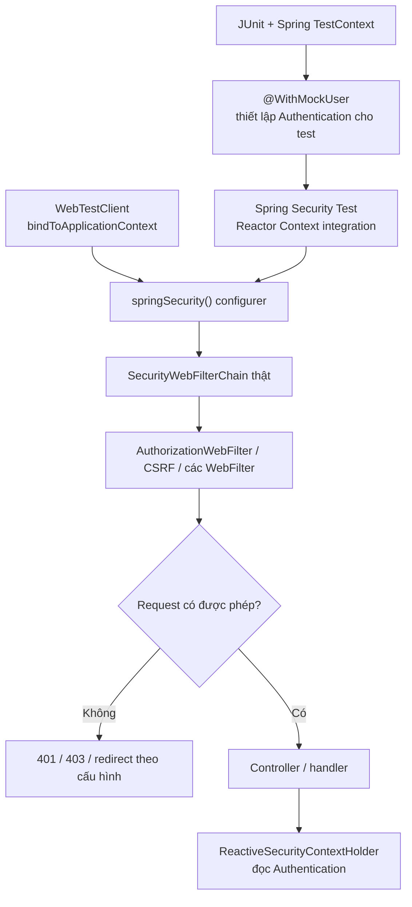

# @WithMockUser trong bộ test có hạ tầng Reactive phù hợp

> **Chương:** Danh tính Reactive  
> **Module:** `SPRING_SECURITY_TESTING`  
> **Phạm vi:** Kiểm thử xác thực, phân quyền và bảo vệ HTTP bằng `spring-security-test` trong ứng dụng Spring WebFlux. Tập trung vào cách `@WithMockUser` hoạt động với Spring TestContext, `ReactiveSecurityContextHolder`, `SecurityWebFilterChain`, `WebTestClient` và Reactive Method Security; so sánh với MockMvc/Servlet và các helper JWT/OAuth2/OIDC.

## 1. Vì sao @WithMockUser cần đúng hạ tầng Reactive?

Trong ứng dụng Servlet, ta thường thấy `SecurityContextHolder` lưu `SecurityContext` gắn với thread đang xử lý HTTP request. Nhưng trong WebFlux, một request có thể đi qua nhiều thread trong quá trình xử lý bất đồng bộ. **Reactor Context**, gắn với luồng subscription, mới là nơi Spring Security Reactive truyền thông tin xác thực qua pipeline. Thành phần đọc ngữ cảnh này là `ReactiveSecurityContextHolder`.

`@WithMockUser` giúp kiểm thử một người dùng đã xác thực mà không cần thực hiện login. Tuy nhiên, chỉ gắn annotation lên phương thức JUnit chưa bảo đảm request WebFlux sẽ thấy người dùng đó. Test cần đúng ba thành phần:

1. **Spring TestContext cùng hỗ trợ Spring Security Test** xử lý `@WithMockUser` và chuẩn bị `SecurityContext` cho test, bao gồm tích hợp với Reactor Context khi kiểm thử reactive.
2. **Application context WebFlux** chứa controller/service và cấu hình `SecurityWebFilterChain` mà ứng dụng sử dụng.
3. **`WebTestClient` tích hợp Spring Security** khi bind vào application context; request phải đi qua web filters và được kết nối với thông tin xác thực giả lập của test.

Nếu thiếu các mắt xích trên, test có thể trả `401` dù đã có `@WithMockUser`, hoặc trả `200` vì filter chain không được áp dụng nên tạo cảm giác phân quyền đã được kiểm chứng.

### 1.1. Luồng xử lý trong bài kiểm thử



**Điểm giới hạn:** `@WithMockUser` cung cấp `Authentication` đã xác thực. Nó không kiểm tra `ReactiveUserDetailsService` có tìm được user, mật khẩu có đúng không, HTTP Basic có đọc credential không, JWT có chữ ký đúng hay OIDC provider có xác thực người dùng hay không. Những phần đó cần bài kiểm thử riêng với request/token và bean xác thực thật.

## 2. Ba loại ngữ cảnh cần phân biệt

| Khái niệm | Trong Servlet | Trong Reactive WebFlux |
| --- | --- | --- |
| Luồng request | Servlet filters và `DispatcherServlet` | Web filters và `DispatcherHandler` |
| Security chain | `SecurityFilterChain` | `SecurityWebFilterChain` |
| Đọc SecurityContext khi xử lý request | `SecurityContextHolder` | `ReactiveSecurityContextHolder.getContext()` |
| HTTP test client | `MockMvc` | `WebTestClient` |
| Cài principal giả lập theo request | `user()`, `jwt()`, `oauth2Login()` | `mockUser()`, `mockJwt()`, `mockOAuth2Login()` |
| Cài principal qua annotation | `@WithMockUser` với Spring Security Test | `@WithMockUser` với hỗ trợ Reactor Context của Spring Security Test |
| Method security | `@EnableMethodSecurity` | `@EnableReactiveMethodSecurity` |

Một `Mono<T>` không chạy toàn bộ tác vụ ngay lúc phương thức được gọi; logic thực thi khi có subscription. Reactor Context gắn với quá trình subscription đó, không phải một biến toàn cục trong JVM.

Vì vậy, trong service/handler reactive, tránh kiểu:

```java
// KHÔNG dùng làm nguồn danh tính tin cậy bên trong pipeline WebFlux:
Authentication auth = SecurityContextHolder.getContext()
    .getAuthentication();
```

Thay bằng truy cập ngữ cảnh Reactive:

```java
Mono<String> currentUsername() {
    return ReactiveSecurityContextHolder.getContext()
        .map(SecurityContext::getAuthentication)
        .map(Authentication::getName);
}
```

Nếu chưa có `SecurityContext` trong Reactor Context, `getContext()` có thể hoàn thành rỗng; cần thiết kế endpoint/authorization để xử lý trạng thái chưa xác thực. Chỉ vì trong test thread đã có `SecurityContextHolder` không có nghĩa mọi thao tác bất đồng bộ đều mang cùng identity. Các luồng tự tạo ngoài Reactor, như `CompletableFuture.supplyAsync(...)`, không tự động thừa hưởng Reactor Context.

## 3. Dependency và bộ test tích hợp WebFlux tối thiểu

Ví dụ Gradle dùng các starter tương ứng (kết hợp phiên bản Spring Boot/Spring Security tương thích với dự án):

```groovy
dependencies {
    implementation("org.springframework.boot:spring-boot-starter-webflux")
    implementation("org.springframework.boot:spring-boot-starter-security")

    testImplementation("org.springframework.boot:spring-boot-starter-test")
    testImplementation("org.springframework.security:spring-security-test")
    testImplementation("io.projectreactor:reactor-test")
}
```

Ứng dụng cần chạy theo **WebFlux** trong ví dụ này. Nếu vô tình thêm Servlet MVC starter và ứng dụng được Boot chọn chạy theo Servlet, `WebTestClient` vẫn có thể được dùng ở một số trường hợp, nhưng đó không còn là bài kiểm thử `SecurityWebFilterChain` Reactive như mục tiêu của bài.

### 3.1. SecurityWebFilterChain thực được kiểm chứng

Thiết kế API minh họa:

- `GET /api/public`: ai cũng có thể gọi.
- `GET /api/me`: phải xác thực, trả về tên từ `ReactiveSecurityContextHolder`.
- `GET /api/reports`: yêu cầu `ROLE_ANALYST`.
- `POST /api/reports`: yêu cầu `ROLE_ANALYST` **và** CSRF token hợp lệ vì ví dụ giữ CSRF mặc định.

```java
@Configuration
class ReactiveApiSecurity {

    @Bean
    SecurityWebFilterChain springSecurityFilterChain(
            ServerHttpSecurity http) {
        return http
            .authorizeExchange(exchanges -> exchanges
                .pathMatchers("/api/public").permitAll()
                .pathMatchers(HttpMethod.GET, "/api/reports")
                    .hasRole("ANALYST")
                .pathMatchers(HttpMethod.POST, "/api/reports")
                    .hasRole("ANALYST")
                .anyExchange().authenticated())
            .httpBasic(Customizer.withDefaults())
            .formLogin(ServerHttpSecurity.FormLoginSpec::disable)
            .build();
    }
}
```

Ở đây `formLogin` được tắt để ca anonymous trên API yêu cầu xác thực thể hiện `401 Unauthorized` qua HTTP Basic. Ứng dụng dùng form login hoặc `oauth2Login` có thể trả redirect `302` thay vì `401`, tùy entry point. Bài test phải dựa vào cấu hình thực.

CSRF **đang được giữ**, nên một `POST` không có token sẽ bị chặn kể cả khi người dùng đã xác thực và có role phù hợp. Không tắt CSRF chỉ để test pass. Nếu ứng dụng stateless chỉ nhận Bearer token qua header và có chính sách tắt CSRF hợp lý, hãy test đúng chính sách của ứng dụng đó.

### 3.2. Controller đọc identity từ Reactor Context

```java
record CreateReportRequest(String title) {}

@Service
class ReportWriter {
    Mono<Void> save(String title) {
        // Điểm tích hợp repository/service trong ứng dụng thật.
        return Mono.empty();
    }
}

@RestController
@RequestMapping("/api")
class ReportsController {
    private final ReportWriter writer;

    ReportsController(ReportWriter writer) {
        this.writer = writer;
    }

    @GetMapping("/public")
    Mono<Map<String, String>> publicInfo() {
        return Mono.just(Map.of("message", "public"));
    }

    @GetMapping("/me")
    Mono<Map<String, String>> me() {
        return ReactiveSecurityContextHolder.getContext()
            .map(SecurityContext::getAuthentication)
            .map(authentication ->
                Map.of("username", authentication.getName()));
    }

    @GetMapping("/reports")
    Mono<Map<String, String>> reports() {
        return Mono.just(Map.of("result", "visible"));
    }

    @PostMapping("/reports")
    Mono<ResponseEntity<Void>> create(
            @RequestBody Mono<CreateReportRequest> body) {
        return body
            .flatMap(request -> writer.save(request.title()))
            .thenReturn(ResponseEntity.noContent().build());
    }
}
```

Mẫu `ReportWriter` dùng `Mono.empty()` để code minh họa tự chứa; trong ứng dụng thật, thay bằng lưu dữ liệu bất đồng bộ. Khi kiểm thử luồng bị từ chối, mock lớp này để chứng minh **không có side effect** nếu WebFilter chặn request.

### 3.3. Cấu hình WebTestClient đúng cách

```java
@SpringBootTest(webEnvironment = SpringBootTest.WebEnvironment.MOCK)
class ReactiveIdentitySecurityIT {

    @Autowired
    ApplicationContext context;

    WebTestClient client;

    @BeforeEach
    void setUp() {
        client = WebTestClient.bindToApplicationContext(context)
            .apply(SecurityMockServerConfigurers.springSecurity())
            .configureClient()
            .build();
    }
}
```

Đây là lớp test nền cho các phương thức trong mục tiếp theo. `@SpringBootTest` nạp application context, `bindToApplicationContext` cho phép WebTestClient gọi WebFlux handler trong bộ test, còn `springSecurity()` kết nối các WebFilter bảo mật với test. Không cần mở cổng HTTP thật.

Các static import thường dùng:

```java
import static org.springframework.security.test.web.reactive.server.SecurityMockServerConfigurers.csrf;
import static org.springframework.security.test.web.reactive.server.SecurityMockServerConfigurers.mockUser;
import static org.springframework.security.test.web.reactive.server.SecurityMockServerConfigurers.springSecurity;
import static org.mockito.Mockito.*;
```

Có thể thay lời gọi đầy đủ `SecurityMockServerConfigurers.springSecurity()` bằng `springSecurity()` khi đã static import. Các lớp test/annotation thuộc `org.springframework.boot.test.context.SpringBootTest`, `org.junit.jupiter.api`, `org.springframework.test.web.reactive.server.WebTestClient` và `org.springframework.security.test.context.support.WithMockUser`.

## 4. Bộ test @WithMockUser cho phép, từ chối và đọc danh tính

Thêm các phương thức test sau vào `ReactiveIdentitySecurityIT`. Các method chạy trong Spring TestContext có listener xử lý `@WithMockUser`.

### 4.1. Người dùng có role được phép gọi API

```java
@Test
@WithMockUser(username = "lan", roles = "ANALYST")
void analystCanReadReports() {
    client.get()
        .uri("/api/reports")
        .exchange()
        .expectStatus().isOk()
        .expectBody()
        .jsonPath("$.result").isEqualTo("visible");
}
```

Annotation tạo một `Authentication` đã xác thực với tên `lan` và authority `ROLE_ANALYST`. Spring Security phân quyền `hasRole("ANALYST")` bằng cách kiểm tra `ROLE_ANALYST` (với tiền tố role mặc định). Test không phải cung cấp password hoặc HTTP Basic header.

### 4.2. Thiếu role phải bị từ chối

```java
@Test
@WithMockUser(username = "minh", roles = "VIEWER")
void authenticatedViewerIsForbidden() {
    client.get()
        .uri("/api/reports")
        .exchange()
        .expectStatus().isForbidden();
}
```

Người dùng đã xác thực nhưng không có `ROLE_ANALYST` nên nhận `403`. Hãy có cả test **được phép** và **bị từ chối**; test chỉ toàn `403` có thể “xanh” ngay cả khi cấu hình chặn nhầm mọi người.

### 4.3. Không có @WithMockUser: kiểm tra anonymous

```java
@Test
void anonymousIsUnauthorized() {
    client.get()
        .uri("/api/reports")
        .exchange()
        .expectStatus().isUnauthorized();
}

@Test
void publicRouteDoesNotRequireLogin() {
    client.get()
        .uri("/api/public")
        .exchange()
        .expectStatus().isOk();
}
```

Kết quả `401` phụ thuộc cấu hình HTTP Basic và việc tắt form login trong ví dụ. Nếu cấu hình thật dùng trình duyệt và login redirect, phải kiểm tra `302` và URL đích thay vì áp đặt `401`.

### 4.4. Handler đọc đúng username từ ReactiveSecurityContextHolder

```java
@Test
@WithMockUser(username = "hoa", roles = "ANALYST")
void reactiveContextContainsMockIdentity() {
    client.get()
        .uri("/api/me")
        .exchange()
        .expectStatus().isOk()
        .expectBody()
        .jsonPath("$.username").isEqualTo("hoa");
}
```

Đây là bằng chứng trực tiếp rằng danh tính giả lập đi từ Spring Security Test qua WebTestClient/WebFilter đến Reactor Context của controller. Nếu controller tự đọc `SecurityContextHolder.getContext()` từ một ThreadLocal, test có thể có kết quả không ổn định khi pipeline đổi scheduler; hãy dùng Reactive API.

### 4.5. Không gộp role và authority

Hai annotation sau có ý nghĩa khác nhau:

```java
@WithMockUser(roles = "ANALYST")
// Authority: ROLE_ANALYST

@WithMockUser(authorities = "SCOPE_reports:read")
// Authority: SCOPE_reports:read
```

Nếu filter sử dụng `hasAuthority("SCOPE_reports:read")`, vai trò `ROLE_ANALYST` không tự động tương đương. Nếu ứng dụng có converter ánh xạ claim JWT hoặc role OIDC sang authorities, `@WithMockUser` **không chạy converter ấy**; nó chỉ cung cấp danh sách authorities được chỉ định. Muốn kiểm thử converter, cần test riêng đường xử lý JWT/OAuth2 tương ứng.

## 5. CSRF trong test Reactive: @WithMockUser không thay CSRF token

Một người dùng đã xác thực chưa chắc được phép gửi POST. Với cấu hình mặc định của Spring Security WebFlux, CSRF bảo vệ các phương thức HTTP thay đổi trạng thái. Trong ví dụ, `POST /api/reports` cần role và CSRF.

### 5.1. Đúng role nhưng thiếu CSRF → 403, không gọi service

Thêm vào lớp test một mock cho dependency:

```java
@MockitoBean
ReportWriter writer;
```

`@MockitoBean` có trong Spring Framework 6.2+; dự án Spring Boot cũ hơn có thể dùng `@MockBean` tương ứng. Dùng cách phù hợp với phiên bản đang triển khai.

```java
@Test
@WithMockUser(username = "lan", roles = "ANALYST")
void writeWithoutCsrfIsForbidden() {
    client.post()
        .uri("/api/reports")
        .contentType(MediaType.APPLICATION_JSON)
        .bodyValue("{\"title\":\"weekly\"}")
        .exchange()
        .expectStatus().isForbidden();

    verifyNoInteractions(writer);
}
```

WebFilter kiểm tra CSRF từ chối trước khi controller gọi `ReportWriter`. Vì vậy test vừa kiểm tra HTTP status vừa kiểm tra không xảy ra hành động nghiệp vụ.

### 5.2. Đúng role và CSRF hợp lệ → đi tiếp

```java
@Test
@WithMockUser(username = "lan", roles = "ANALYST")
void writeWithCsrfIsAccepted() {
    when(writer.save("weekly")).thenReturn(Mono.empty());

    client.mutateWith(csrf())
        .post()
        .uri("/api/reports")
        .contentType(MediaType.APPLICATION_JSON)
        .bodyValue("{\"title\":\"weekly\"}")
        .exchange()
        .expectStatus().isNoContent();

    verify(writer).save("weekly");
}
```

`csrf()` là helper của `SecurityMockServerConfigurers`: nó tạo CSRF token hợp lệ cho request trong hạ tầng kiểm thử. Nó không chứng minh trình duyệt thực nhận token từ cookie/form và gửi lại đúng header; nếu đó là hợp đồng cần kiểm chứng, hãy thêm integration test qua HTTP thực.

Đừng bỏ `csrf()` khỏi test âm tính chỉ vì thiếu role cũng có thể dẫn đến `403`: thứ tự từ chối có thể khiến test chỉ chạm lớp CSRF, không thực sự kiểm tra authorization. Để kiểm tra **thiếu role** ở một POST, gửi CSRF hợp lệ và dùng `roles = "VIEWER"`; để kiểm tra **thiếu CSRF**, gửi role đủ và bỏ token.

## 6. @WithMockUser, mockUser() và mockAuthentication() khác nhau thế nào?

| Kỹ thuật | Phạm vi đặt danh tính | Nên dùng khi | Không kiểm chứng |
| --- | --- | --- | --- |
| `@WithMockUser` trên test method | Danh tính cho một phương thức test qua TestContext | Test HTTP hoặc Reactive Method Security có cùng identity | Mật khẩu, authentication provider, JWT/OIDC login thật |
| `@WithMockUser` trên lớp | Mặc định cho nhiều test trong lớp | Nhiều test dùng một nhóm quyền | Anonymous thực nếu không override |
| `client.mutateWith(mockUser("lan"))` | WebTestClient đã gắn danh tính cho các request phát từ client được mutate | Test nhiều user trong cùng phương thức, setup riêng từng client | Đăng nhập HTTP thật |
| `mockAuthentication(authentication)` | Cấp một `Authentication` tự xây | Custom principal, custom authorities hoặc token phù hợp test | Provider đã tạo authentication đó |
| `mockJwt()`, `mockOAuth2Login()`, `mockOidcLogin()` | Giả lập trạng thái JWT/OAuth2/OIDC cho test | Authorization/controller theo loại principal thực tế | Chữ ký token, bearer decoder hoặc OAuth2/OIDC callback |

Ví dụ một bài test so sánh hai identity trong cùng phương thức:

```java
@Test
void perRequestMockUserMakesAuthorizationClear() {
    client.mutateWith(mockUser("lan").roles("ANALYST"))
        .get().uri("/api/reports")
        .exchange().expectStatus().isOk();

    client.mutateWith(mockUser("minh").roles("VIEWER"))
        .get().uri("/api/reports")
        .exchange().expectStatus().isForbidden();
}
```

`mockUser()` thuộc `SecurityMockServerConfigurers`, có ý nghĩa tương tự `@WithMockUser` nhưng cấu hình ngay tại WebTestClient. Test trên không cần annotation; cách dùng mutator giúp mỗi request group có danh tính rõ ràng. Nếu dùng cả annotation và mutator cùng lúc, người đọc khó thấy nguồn identity nào đang có hiệu lực; nên ưu tiên một cách cho từng mục tiêu.

### 6.1. Dùng @WithAnonymousUser khi annotation ở cấp lớp

```java
@WithMockUser(roles = "ANALYST")
class ReportsSecurityTests {

    @Test
    void allowedForDefaultUser() {
        // WebTestClient bound to reactive application context...
    }

    @Test
    @WithAnonymousUser
    void anonymousOverridesClassUser() {
        // Request vào endpoint cần login bị từ chối.
    }
}
```

`@WithAnonymousUser` giúp test một request anonymous dù trên lớp đang có `@WithMockUser`. Trong ví dụ này chỉ trình bày cấu trúc annotation; để thực thi cần định nghĩa WebTestClient và assertion cụ thể như mục 4.

### 6.2. Thời điểm tạo SecurityContext trong lifecycle test

`@WithMockUser` mặc định được áp dụng trước phương thức test theo sự kiện `TEST_METHOD`; context có thể sẵn trong `@BeforeEach`. Nếu cần tạo ngữ cảnh **sau** phần khởi tạo `@BeforeEach`, có thể dùng:

```java
@Test
@WithMockUser(
    username = "lan",
    setupBefore = TestExecutionEvent.TEST_EXECUTION)
void testWithIdentityEstablishedJustBeforeInvocation() {
    // ...
}
```

Chỉ thay thời điểm khi thật sự có nhu cầu về vòng đời. Đừng dùng cách này để che lỗi context propagation hoặc điều kiện chạy bất đồng bộ. Spring Security Test phải được đăng ký trong Spring TestContext; nếu tự đặt `@TestExecutionListeners` với chế độ thay toàn bộ listener mặc định, có thể vô tình loại listener tạo SecurityContext hoặc listener tích hợp Reactor.

## 7. Reactive Method Security: kiểm tra Mono/Flux bằng StepVerifier

Ngoài HTTP filters, Spring Security có thể kiểm tra quyền ở tầng service. Trong ứng dụng WebFlux, bật:

```java
@Configuration
@EnableReactiveMethodSecurity
class ReactiveMethodSecurityConfig {
}
```

Ví dụ service bảo vệ một phép đọc:

```java
@Service
class ReportSummaryService {

    @PreAuthorize("hasAuthority('SCOPE_reports:read')")
    public Mono<String> readSummary() {
        return Mono.just("Quarterly summary");
    }
}
```

Trong Spring TestContext có Reactor Context test integration, `@WithMockUser` có thể cung cấp `Authentication` cho publisher được subscribe trong test:

```java
@SpringBootTest
class ReportSummarySecurityIT {

    @Autowired
    ReportSummaryService service;

    @Test
    @WithMockUser(authorities = "SCOPE_reports:read")
    void allowedWhenScopeMatches() {
        StepVerifier.create(service.readSummary())
            .expectNext("Quarterly summary")
            .verifyComplete();
    }

    @Test
    @WithMockUser(roles = "ANALYST")
    void forbiddenWhenOnlyRoleIsPresent() {
        StepVerifier.create(service.readSummary())
            .expectError(AccessDeniedException.class)
            .verify();
    }
}
```

Đoạn test này kiểm tra **đúng method security** và phân biệt authority `SCOPE_reports:read` với `ROLE_ANALYST`. Nó không tự kiểm tra WebFlux HTTP status vì không có request WebTestClient. Một lỗi `AccessDeniedException` trong pipeline không mặc nhiên đồng nghĩa HTTP `403` nếu không có WebFlux exception translation và response handling thực.

Lưu ý điều kiện để có bằng chứng đáng tin cậy: bean service phải được Spring quản lý để `@PreAuthorize` được áp dụng; không dùng `new ReportSummaryService()` rồi tưởng Spring AOP đã chặn. Nếu test không dùng Spring Extension/TestContext, annotation `@WithMockUser` đứng một mình không bảo đảm có reactive security context cho publisher.

### 7.1. Kiểm tra Reactor Context bằng StepVerifier

Khi cần quan sát danh tính trực tiếp:

```java
@Test
@WithMockUser(username = "lan")
void securityContextAvailableDuringReactiveSubscription() {
    Mono<String> currentName =
        ReactiveSecurityContextHolder.getContext()
            .map(SecurityContext::getAuthentication)
            .map(Authentication::getName);

    StepVerifier.create(currentName)
        .expectNext("lan")
        .verifyComplete();
}
```

Ví dụ giả định lớp test đã tích hợp Spring Security Test với Reactor Context. Nó không chứng minh quyền HTTP endpoint, chỉ kiểm tra rằng thông tin xác thực có trong Reactor Context khi publisher được subscribe. Đây là phép thử chẩn đoán tốt khi method security test hoạt động khác mong đợi.

## 8. Khi nào WebFlux slice test có thể gây hiểu nhầm?

`@WebFluxTest(ReportsController.class)` nạp một **lát cắt web**, thay vì toàn bộ application context. Nó có thể không tự nạp cấu hình `ReactiveApiSecurity` do ứng dụng định nghĩa, hoặc có các mặc định bảo mật khác với production. Khi test authorization, cần bảo đảm đúng chain được kiểm chứng:

```java
@WebFluxTest(controllers = ReportsController.class)
@Import(ReactiveApiSecurity.class)
class ReportsWebFluxSliceTest {

    @Autowired
    ApplicationContext context;

    @MockitoBean
    ReportWriter writer;

    WebTestClient client;

    @BeforeEach
    void setUp() {
        client = WebTestClient.bindToApplicationContext(context)
            .apply(SecurityMockServerConfigurers.springSecurity())
            .configureClient()
            .build();
    }

    @Test
    @WithMockUser(roles = "ANALYST")
    void authorizedReaderCanCallReports() {
        client.get().uri("/api/reports")
            .exchange().expectStatus().isOk();
    }
}
```

Đây là một lựa chọn nhanh để kiểm tra controller và chain được import. Nếu security configuration thực có nhiều WebFilters, `ReactiveAuthenticationManager`, custom authorization logic hoặc các bean được tạo bởi auto-configuration khác, `@SpringBootTest` thích hợp hơn cho kiểm thử tích hợp đầy đủ.

Trong một số trường hợp, WebFlux slice có mặc định bảo mật nhưng không phải chính sách thật của ứng dụng. Việc test trả `401` hoặc `403` chưa đủ chứng minh role matcher mong muốn đang hoạt động; hãy có ca `200` với đúng role, ca `403` với sai role, và kiểm tra chain đúng được nạp.

### 8.1. Không nhầm bindToApplicationContext với bindToServer

`WebTestClient.bindToApplicationContext(context)` gọi ứng dụng trong quy trình test tích hợp context. Các mutator như `mockUser()` và annotation `@WithMockUser` được hỗ trợ bởi Spring Security test integration ở đây.

`WebTestClient.bindToServer()` gọi một HTTP server thật qua mạng. Một `@WithMockUser` được tạo **trong JUnit process** không tự được chuyển đến HTTP server như credential. Nếu server ở process khác hoặc request qua network connector, test cần gửi header/cookie/token theo giao thức thật và kiểm tra cơ chế xác thực tương ứng.

Ngay cả khi test server chạy trong cùng JVM với cổng ngẫu nhiên, không được giả định Spring TestContext ở thread chạy test sẽ tự truyền `SecurityContext` qua kết nối HTTP. Dùng `@WithMockUser` đúng là cho test context-bound hoặc method security; dùng HTTP Basic, session login, Bearer token hay cơ chế test server đã cấu hình nếu muốn kiểm chứng network boundary.

## 9. Cẩn thận với JWT, OAuth2/OIDC và danh tính custom

Khi ứng dụng dùng nhiều loại xác thực, kiểu principal và cách tạo authorities khác nhau:

| Mục tiêu kiểm thử | Kỹ thuật phù hợp | Giới hạn |
| --- | --- | --- |
| HTTP role rule với danh tính đã xác thực | `@WithMockUser(roles = "ANALYST")` hoặc `mockUser()` | Không kiểm tra cách login cung cấp role |
| Claim/authority JWT được dùng bởi controller | `mockJwt()`, có thể đặt claims/authorities cụ thể | Không giải mã Bearer token hoặc xác minh chữ ký |
| JWT Bearer thật phải được xác minh | Gửi `Authorization: Bearer <signed JWT>`, dùng `ReactiveJwtDecoder` và JWKS test thật | Cần fixture khóa/test IdP; không dùng `mockJwt()` để kết luận chữ ký đúng |
| OAuth2 login principal ở WebFlux | `mockOAuth2Login()` và principal tùy chỉnh | Không chạy authorization-code redirect và token exchange |
| OIDC principal cùng ID Token claims trong controller | `mockOidcLogin()` với `OidcUser` phù hợp | Không xác minh OIDC ID Token hoặc callback thật |
| Xác thực username/password | Header HTTP Basic hoặc form login phù hợp, `ReactiveUserDetailsService` và password encoder thật, dữ liệu phụ thuộc được mock | `@WithMockUser` bỏ qua bước kiểm tra password |

Một resource server chỉ bật JWT có thể có endpoint được phép khi test gắn `@WithMockUser`, dù production yêu cầu Bearer token và không chấp nhận request thiếu token. Điều này **không có nghĩa filter chain bị tắt**: annotation đã cung cấp sẵn Authentication cho test. Do đó luôn ghép hai nhóm test: **test phân quyền với principal giả** và **test xác thực qua giao thức thật**.

Nếu code ứng dụng cast principal thành `Jwt`, `OidcUser` hoặc principal custom, `@WithMockUser` mặc định tạo principal kiểu `User` và có thể dẫn đến lỗi kiểu dữ liệu. Hãy dùng helper phù hợp (`mockJwt()`, `mockOidcLogin()` hoặc custom authentication), đồng thời có unit/integration test xác nhận mapper/converter tạo principal thực tế.

## 10. Lỗi thường gặp và cách chẩn đoán

| Hiện tượng | Nguyên nhân cần kiểm tra | Hướng xử lý |
| --- | --- | --- |
| Có `@WithMockUser` nhưng HTTP vẫn `401` | WebTestClient chưa áp dụng `springSecurity()`; test không chạy với Spring TestContext; client gọi server ngoài | Bind vào application context, bật test integration hoặc gửi credential thật qua HTTP |
| Test trả `200` cho user thiếu quyền | Không có `SecurityWebFilterChain` thật, test bind thẳng controller, route matcher sai | Nạp đúng chain; có cả test đúng/sai role |
| `@PreAuthorize` không chặn Mono | Chưa bật `@EnableReactiveMethodSecurity` hoặc bean không qua Spring proxy | Bật method security, dùng bean từ context |
| StepVerifier không thấy identity | Thiếu Reactor Context test listener/integration, subscription ngoài phạm vi test, bị mất context ở boundary tự tạo | Kiểm tra Spring Security Test và cách subscription được thực hiện |
| Đúng role nhưng POST trả `403` | Thiếu CSRF token | Dùng `mutateWith(csrf())` cho ca kiểm tra authorization và giữ ca riêng thiếu CSRF |
| Sai role nhưng POST cũng `403` | Request đã bị CSRF chặn trước | Thêm CSRF hợp lệ khi muốn kiểm tra đúng nguyên nhân thiếu role |
| `roles = "ADMIN"` không khớp `hasAuthority("ADMIN")` | Role sinh authority `ROLE_ADMIN` | Đặt `authorities = "ADMIN"` hoặc sửa policy cho nhất quán |
| Reactive code đọc được user trong test nhưng sai ngoài production | Dựa vào `SecurityContextHolder` ThreadLocal, không vào Reactor Context | Chuyển sang `ReactiveSecurityContextHolder` hoặc argument resolver phù hợp |
| Test JWT chạy xanh nhưng token sai chữ ký vẫn được nhận | Dùng `mockJwt()` hoặc `@WithMockUser` | Thêm test Bearer token được ký thật + decoder/JWKS |
| WebFlux slice chạy xanh nhưng tích hợp thực lỗi | Slice thiếu custom filter, manager hoặc security config | Import đúng cấu hình hoặc dùng full context integration |
| `@WithMockUser` không áp dụng trong `@BeforeEach` như mong đợi | `setupBefore` khác mặc định; test lifecycle bị tùy chỉnh | Kiểm tra listener và thời điểm TEST_METHOD/TEST_EXECUTION |

Để chẩn đoán lỗi quyền, có thể bật log DEBUG cho `org.springframework.security` trong môi trường test, kiểm tra filter chain và authorization decision; tránh log raw access token, cookie phiên và thông tin nhạy cảm. Khi kết quả bất ngờ, xem test thực sự đang dùng `SecurityWebFilterChain`, `SecurityContext` và principal loại nào.

## 11. Bài thực hành

Xây dựng ứng dụng Spring WebFlux với bốn endpoint ở mục 3 và viết bộ test theo yêu cầu:

1. Nạp application context Reactive với `SecurityWebFilterChain`, tích hợp WebTestClient bằng `springSecurity()`.
2. Dùng `@WithMockUser(username = "lan", roles = "ANALYST")` để gọi `GET /api/me` và `GET /api/reports`; kiểm tra body, status và username từ Reactor Context.
3. Dùng `@WithMockUser(roles = "VIEWER")` cho `GET /api/reports`, xác minh `403`; bỏ annotation để xác minh anonymous `401`.
4. Với `POST /api/reports`, kiểm tra hai nguyên nhân từ chối riêng: role đúng nhưng thiếu CSRF, CSRF đúng nhưng thiếu role. Ca thành công phải chứng minh `ReportWriter.save(...)` được gọi.
5. Đổi một test sang `mockUser("lan").roles("ANALYST")` để thấy danh tính được gắn theo WebTestClient; thêm test cấp hai danh tính khác nhau trong cùng phương thức.
6. Bật `@EnableReactiveMethodSecurity` và bảo vệ service bằng `@PreAuthorize("hasAuthority('SCOPE_reports:read')")`; dùng StepVerifier kiểm tra cho phép/từ chối.
7. Thêm test Bearer JWT bằng `mockJwt()` và một test decoder với token thật để chỉ ra chính xác sự khác nhau về phạm vi chứng minh.
8. Thử chuyển client từ `bindToApplicationContext` sang `bindToServer` và giải thích vì sao annotation trên JUnit không tự tạo identity qua network.

**Tiêu chí đạt:** Bộ test có ít nhất một kết quả cho phép và một kết quả từ chối với chain thật, không bỏ sót CSRF, không dựa vào ThreadLocal để mang danh tính qua Reactor pipeline, và trình bày rõ phần nào do `@WithMockUser` giả lập so với phần nào được xác minh qua HTTP Basic, JWT hoặc OAuth2/OIDC.

**Ghi nhớ:** `@WithMockUser` là công cụ hữu ích để đặt một `Authentication` có sẵn trong bộ test WebFlux, với điều kiện Spring Security Test, Reactor Context và WebTestClient được kết nối đúng. Nó giúp chứng minh **authorization và hành vi Reactive khi đã có danh tính**, còn cơ chế **tạo danh tính từ credential/token thực** phải được kiểm tra bằng request và các thành phần xác thực phù hợp.
