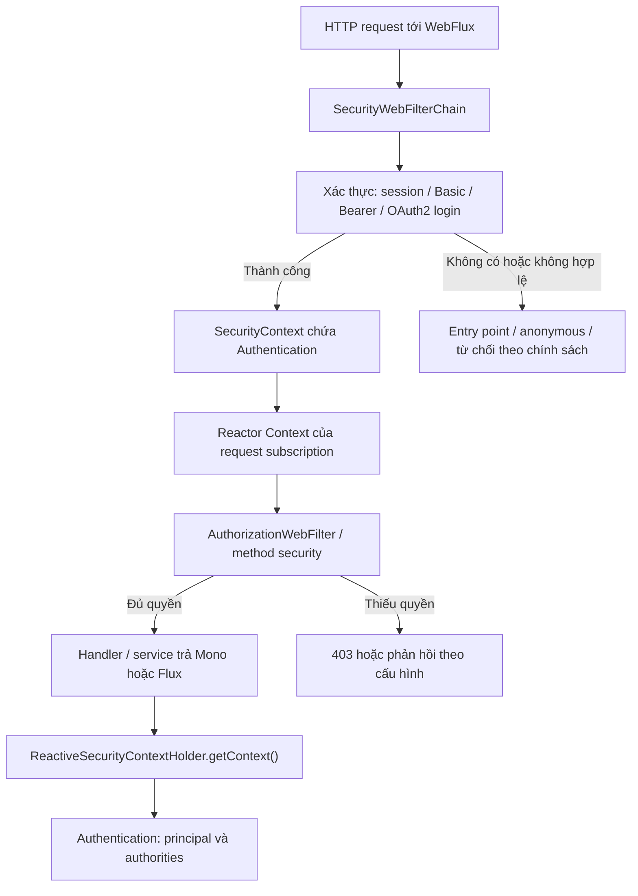
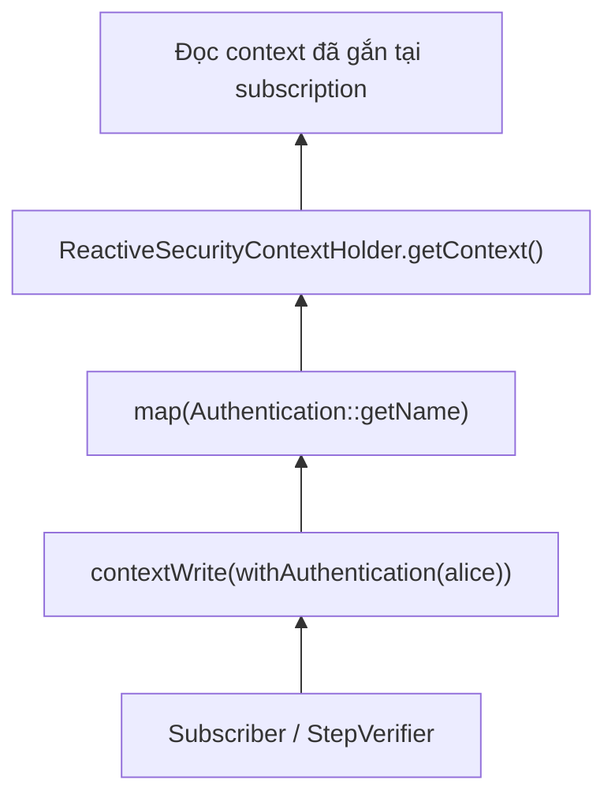

# ReactiveSecurityContextHolder và Reactor Context

Trong ứng dụng Spring MVC truyền thống, lập trình viên thường dùng `SecurityContextHolder.getContext()` để đọc người dùng hiện tại. Cách này dựa trên một chiến lược lưu context thường gắn với `ThreadLocal`. Nhưng một request **WebFlux** có thể đi qua nhiều luồng thực thi, nhiều toán tử bất đồng bộ và nhiều bước không cùng thread. Nếu một service reactive tiếp tục đọc danh tính bằng `SecurityContextHolder` như trong mã Servlet, nó có thể nhận `null`, một principal ngoài dự kiến hoặc một trạng thái không phản ánh request đang xử lý.

Trong chương **Danh tính Reactive** của module **SPRING_SECURITY_TESTING**, cơ chế cần nắm là **`ReactiveSecurityContextHolder` đọc SecurityContext từ Reactor Context của subscription**. Bài này giải thích context nằm ở đâu, được truyền qua chuỗi `Mono`/`Flux` như thế nào, tại sao context khác `ThreadLocal`, và cách xác minh chính sách xác thực/phân quyền thực tế bằng `StepVerifier` và `WebTestClient`. Phạm vi module bao gồm `spring-security-test`, `@WithMockUser`, `SecurityContext`, MockMvc trên Servlet và JWT/OAuth2/OIDC giả lập; ở bài này, các ví dụ runtime tập trung vào **Reactive/WebFlux**.

## 1. Một danh tính, hai mô hình lưu context

| Vấn đề | Servlet/imperative thường gặp | Reactive/WebFlux |
|---|---|---|
| Nơi code đọc identity | `SecurityContextHolder.getContext()` | `ReactiveSecurityContextHolder.getContext()` |
| Cơ chế truyền state thông dụng | `ThreadLocal` theo request/thread, có cơ chế bảo vệ và cleanup | **Reactor Context** theo subscriber/subscription |
| Giá trị đọc được | `SecurityContext` đồng bộ | `Mono<SecurityContext>` |
| Truyền qua bước async | Phải xử lý việc chuyển/khôi phục context khi chuyển thread | Reactor Context đi theo **cùng một chuỗi reactive subscription**, kể cả khi đổi scheduler đúng cách |
| Test đơn vị | Có thể thiết lập `SecurityContextHolder` theo luồng test | Gắn context bằng `contextWrite(...)` hoặc `StepVerifierOptions.withInitialContext(...)` |
| Test HTTP | `MockMvc` + Spring Security Test | `WebTestClient` + `mockUser()`/`mockJwt()`/`mockOidcLogin()` |

Hai API không thể hoán đổi tùy tiện. `SecurityContextHolder` không tự động trở thành kho danh tính toàn cục cho mọi pipeline WebFlux. Ngược lại, `ReactiveSecurityContextHolder.getContext()` tạo một publisher để lấy context **khi có subscription**, chứ không phải hàm lấy ngay một đối tượng trong thời điểm gọi method.

### Cấu trúc của Reactor Context

`reactor.util.context.Context` là một tập key/value gắn với subscriber; nó được dùng để mang metadata qua các toán tử Reactor mà không cần thêm tham số vào mọi method. `ContextView` cung cấp cách **đọc** context; `Context` cung cấp thao tác tạo phiên bản mới khi cần thêm hoặc bỏ key.

```java
Mono<String> example = Mono.deferContextual(context -> {
    String requestId = context.getOrDefault("requestId", "unknown");
    return Mono.just("requestId=" + requestId);
});

StepVerifier.create(
        example.contextWrite(ctx -> ctx.put("requestId", "req-101")))
    .expectNext("requestId=req-101")
    .verifyComplete();
```

`deferContextual` đọc dữ liệu từ Reactor Context **tại lúc subscribe**. Nó không giống biến toàn cục: hai subscription có thể có hai `requestId` khác nhau dù cùng dùng một instance `Mono`.

Spring Security lưu thông tin bảo mật trong Reactor Context theo cấu trúc nội bộ của nó, thường thông qua publisher `Mono<SecurityContext>`. Vì vậy **không nên** tự lấy một key nội bộ rồi ép kiểu `SecurityContext`. Hãy dùng API công khai `ReactiveSecurityContextHolder`.

## 2. SecurityContext xuất hiện trong WebFlux từ đâu?

Trong HTTP request đã đi qua cấu hình Spring Security WebFlux, các web filter xử lý xác thực và đưa context vào chuỗi reactive. Tùy cơ chế (session login, HTTP Basic, Bearer JWT, OAuth2/OIDC Login), Spring Security có thể tải context đã lưu từ `ServerSecurityContextRepository`, tạo authentication sau khi xác thực hoặc kết hợp hai đường này.



Sơ đồ là mô hình khái niệm, không quy định thứ tự tuyệt đối của mọi WebFilter ở mọi phiên bản. Trong Spring Security WebFlux có các thành phần như `ReactorContextWebFilter` giúp đưa context từ repository vào Reactor Context; các authentication filters và authorization filters xử lý các giai đoạn khác. Nếu một custom filter được đặt trước cơ chế tạo context, việc đọc context ở đó có thể cho kết quả rỗng.

**SecurityContext** chứa `Authentication`. Một authentication thường có:

- `getName()`: tên đại diện cho principal.
- `getPrincipal()`: user, JWT principal hoặc một kiểu khác.
- `getAuthorities()`: tập `GrantedAuthority` được dùng trong phân quyền.
- `isAuthenticated()`: trạng thái của đối tượng authentication theo cơ chế triển khai.
- `getCredentials()` và `getDetails()`: dữ liệu có thể nhạy cảm hoặc phụ thuộc phương thức xác thực; tránh ghi trực tiếp ra log.

Đừng dùng riêng `Authentication.isAuthenticated()` để suy ra user đã login: một `AnonymousAuthenticationToken` có thể có `isAuthenticated() == true`. Khi cần chính sách truy cập, nên để Spring Security xử lý `authenticated()`, `hasRole(...)`, `hasAuthority(...)` hoặc biểu thức method security phù hợp.

## 3. Đọc Authentication bằng ReactiveSecurityContextHolder

API cơ bản trả `Mono<SecurityContext>`:

```java
Mono<Authentication> authentication =
        ReactiveSecurityContextHolder.getContext()
                .map(SecurityContext::getAuthentication);

Mono<String> currentName =
        authentication.map(Authentication::getName);
```

Đây là pipeline **lazy**. Khi method chạy để xây dựng `currentName`, nó chưa cần biết ai là người dùng. Khi Spring WebFlux subscribe để gửi response, context của request mới được truy xuất.

Ví dụ một service trả tên user hiện tại:

```java
@Service
class CurrentIdentityService {

    Mono<String> currentUsername() {
        return ReactiveSecurityContextHolder.getContext()
                .map(SecurityContext::getAuthentication)
                .map(Authentication::getName)
                .switchIfEmpty(Mono.error(
                    new IllegalStateException(
                        "Security context is unavailable")));
    }
}
```

Ở đây, `switchIfEmpty` giúp phát hiện việc test/service chạy **ngoài context bảo mật**. Nó không nhằm thay thế HTTP authentication entry point; controller bảo vệ bằng `SecurityWebFilterChain` phải có chính sách từ chối request chưa được phép trước khi gọi logic nghiệp vụ. Nếu ứng dụng chọn chính sách khác cho context rỗng, hãy xử lý theo contract thay vì mặc định ném lỗi runtime.

### Tránh đọc context bằng blocking code

Không dùng:

```java
// Tránh làm như sau trong reactive handler/service:
SecurityContext context = ReactiveSecurityContextHolder
        .getContext()
        .block();
String username = context.getAuthentication().getName();
```

`block()` tạo subscription khác và chặn thread. Trong WebFlux, nó có thể bị từ chối trên event-loop hoặc làm mất tính nối tiếp của Reactor Context và gây `null` khi context không có. Ngay cả khi chạy được, việc tự subscribe/block tách khỏi request subscription khiến kết quả khó kiểm soát.

Thay bằng:

```java
Mono<String> username =
        ReactiveSecurityContextHolder.getContext()
                .map(SecurityContext::getAuthentication)
                .map(Authentication::getName);
```

Sau đó dùng `flatMap`/`map` để chuyển giá trị đến thao tác tiếp theo, giữ toàn bộ công việc trong một reactive chain.

## 4. contextWrite và hướng truyền Reactor Context

Một điểm dễ gây nhầm: **context được truyền từ subscriber về phía upstream trong quá trình subscription**. `contextWrite` tạo/bổ sung context mà các toán tử **upstream của vị trí đó** có thể đọc.

```java
Authentication alice = new UsernamePasswordAuthenticationToken(
        "alice", "n/a",
        List.of(new SimpleGrantedAuthority("ROLE_READER")));

Mono<String> source =
        ReactiveSecurityContextHolder.getContext()
                .map(SecurityContext::getAuthentication)
                .map(Authentication::getName);

Mono<String> withAlice = source.contextWrite(
        ReactiveSecurityContextHolder.withAuthentication(alice));

StepVerifier.create(withAlice)
        .expectNext("alice")
        .verifyComplete();
```

`withAuthentication(...)` tạo dữ liệu cần thiết để Reactor Context chứa một security context với authentication đã cấp. Đây là tiện ích **rất hữu ích trong test**. Không tạo một authentication có quyền quản trị từ input chưa xác thực của người dùng trong production chỉ để “điền context”.

### Sơ đồ hướng truyền



Chú ý sự khác nhau giữa **hướng truyền context** và **hướng phát tín hiệu dữ liệu**. Khi người dùng subscribe, context đi về phía source; các giá trị `onNext` từ source lại đi xuống các toán tử và subscriber.

Trong một chuỗi phức tạp, đặt `contextWrite` sai vị trí có thể khiến một toán tử không nhìn thấy dữ liệu. Cách dễ kiểm soát là tạo pipeline chứa toàn bộ phần cần đọc danh tính, rồi đặt `contextWrite` ở ngoài:

```java
Mono<String> pipeline =
        ReactiveSecurityContextHolder.getContext()
                .map(SecurityContext::getAuthentication)
                .map(Authentication::getName)
                .flatMap(name -> Mono.just("Hello, " + name))
                .contextWrite(
                    ReactiveSecurityContextHolder.withAuthentication(alice));
```

### withSecurityContext và clearContext

Nếu test đã có đối tượng `SecurityContext`:

```java
SecurityContext context = new SecurityContextImpl(alice);

Mono<String> secured =
        ReactiveSecurityContextHolder.getContext()
                .map(ctx -> ctx.getAuthentication().getName())
                .contextWrite(
                    ReactiveSecurityContextHolder.withSecurityContext(
                        Mono.just(context)));
```

`ReactiveSecurityContextHolder.withSecurityContext(Mono<? extends SecurityContext>)` đưa publisher chứa context vào Reactor Context. Có thể dùng `ReactiveSecurityContextHolder.clearContext()` để xóa dữ liệu security context khỏi context tại phạm vi mong muốn; nó tạo một phép biến đổi context, không làm “đăng xuất” toàn bộ người dùng khỏi session hoặc xóa state của `ServerSecurityContextRepository`.

## 5. Context là theo subscription, không phải biến toàn cục

Một instance `Mono` có thể được nhiều subscriber dùng, nhưng mỗi subscriber có context riêng:

```java
Mono<String> currentUsername =
        ReactiveSecurityContextHolder.getContext()
                .map(SecurityContext::getAuthentication)
                .map(Authentication::getName);

Authentication alice = new UsernamePasswordAuthenticationToken(
        "alice", "n/a", List.of(
            new SimpleGrantedAuthority("ROLE_READER")));
Authentication bob = new UsernamePasswordAuthenticationToken(
        "bob", "n/a", List.of(
            new SimpleGrantedAuthority("ROLE_READER")));

StepVerifier.create(currentUsername.contextWrite(
            ReactiveSecurityContextHolder.withAuthentication(alice)))
        .expectNext("alice")
        .verifyComplete();

StepVerifier.create(currentUsername.contextWrite(
            ReactiveSecurityContextHolder.withAuthentication(bob)))
        .expectNext("bob")
        .verifyComplete();
```

Đây là kiểm thử **cách ly identity giữa hai subscription**. Không cần thay đổi static field hay gọi `SecurityContextHolder.setContext(...)`. Khi chạy request song song, context của request A không được tự động trở thành context của request B.

Một rủi ro cần tránh là cache dữ liệu phụ thuộc identity trong đối tượng có thể dùng lại giữa nhiều user:

```java
// Rủi ro: kết quả đầu tiên có thể bị cache và chia sẻ cho subscriber khác.
Mono<String> cachedName =
        ReactiveSecurityContextHolder.getContext()
                .map(ctx -> ctx.getAuthentication().getName())
                .cache();
```

Nếu `cachedName` là field singleton được dùng bởi nhiều request, subscriber sau có thể nhận **tên subscriber đầu tiên**, dù Reactor Context của request sau đúng. Vấn đề nằm ở **cache dữ liệu nhận dạng**, không phải Reactor Context tự động rò rỉ. Không dùng `cache()`, `share()` hoặc hot publisher có vòng đời toàn cục cho kết quả chứa user/permissions nếu không có khóa và phạm vi cache phù hợp.

## 6. Chuyển scheduler có làm mất security context?

`publishOn` và `subscribeOn` có thể đổi thread chạy các giai đoạn của pipeline. Nếu còn nằm trong **cùng subscription Reactor** và không tự tách luồng, Reactor Context được truyền theo subscriber:

```java
Mono<String> result =
        ReactiveSecurityContextHolder.getContext()
                .map(SecurityContext::getAuthentication)
                .map(Authentication::getName)
                .publishOn(Schedulers.parallel())
                .map(name -> name.toUpperCase(Locale.ROOT))
                .contextWrite(
                    ReactiveSecurityContextHolder.withAuthentication(alice));

StepVerifier.create(result)
        .expectNext("ALICE")
        .verifyComplete();
```

Vì vậy phát biểu “đổi thread là Reactor SecurityContext chắc chắn bị mất” là **không chính xác**. Một pipeline Reactor vẫn giữ context qua các toán tử scheduler theo cơ chế context propagation của nó.

Nhưng những chuyển tiếp sau có thể tách khỏi subscription hoặc thay cơ chế lưu context:

| Cách thực hiện | Điều cần lưu ý |
|---|---|
| `publishOn`/`subscribeOn` trong cùng `Mono`/`Flux` | Reactor Context vẫn có thể truy cập qua `ReactiveSecurityContextHolder` |
| Gọi `subscribe()` thủ công trong service | Tạo subscription độc lập, không mặc định có context của request |
| Gọi `block()` giữa request reactive | Chặn luồng và có thể tạo subscription không mang context mong đợi |
| Dùng `CompletableFuture.supplyAsync(...)` hoặc tự khởi động thread | Không tự động chuyển Reactor Context sang task bất kỳ |
| Đọc `SecurityContextHolder` tại một callback dùng scheduler khác | Dữ liệu ThreadLocal không phải nguồn tin cậy cho identity của pipeline Reactive |
| Dùng hot/shared/cached publisher | Kết quả phụ thuộc identity có thể bị chia sẻ giữa subscriber |

Các cơ chế context propagation bổ sung như Micrometer/Reactor hooks có thể hỗ trợ một số trường hợp chuyển đổi ThreadLocal, nhưng phụ thuộc cấu hình và phiên bản. **Giải pháp nền tảng cho code WebFlux là sử dụng Reactor Context và ReactiveSecurityContextHolder trong cùng chuỗi publisher**.

## 7. Cấu hình WebFlux Security và controller mẫu

Xét một API trả về danh tính hiện tại, chỉ cho phép user có authority `ROLE_READER`:

```java
import java.util.List;
import org.springframework.context.annotation.Bean;
import org.springframework.context.annotation.Configuration;
import org.springframework.security.config.Customizer;
import org.springframework.security.config.annotation.web.reactive
        .EnableWebFluxSecurity;
import org.springframework.security.config.web.server.ServerHttpSecurity;
import org.springframework.security.web.server.SecurityWebFilterChain;

@Configuration
@EnableWebFluxSecurity
class IdentitySecurityConfig {

    @Bean
    SecurityWebFilterChain webFluxSecurity(ServerHttpSecurity http) {
        return http
                .authorizeExchange(exchange -> exchange
                    .pathMatchers("/api/me").hasRole("READER")
                    .anyExchange().denyAll())
                .httpBasic(Customizer.withDefaults())
                .build();
    }
}
```

`hasRole("READER")` theo cấu hình role prefix thông thường kiểm tra authority `ROLE_READER`. Nếu policy sử dụng scope JWT, có thể thay bằng `hasAuthority("SCOPE_profile.read")` và test đúng converter từ claim thành authority.

Controller đọc context bằng Reactor API:

```java
import java.util.List;
import org.springframework.security.core.Authentication;
import org.springframework.security.core.GrantedAuthority;
import org.springframework.security.core.context.SecurityContext;
import org.springframework.security.core.context.ReactiveSecurityContextHolder;
import org.springframework.web.bind.annotation.GetMapping;
import org.springframework.web.bind.annotation.RestController;
import reactor.core.publisher.Mono;

@RestController
class IdentityController {

    record IdentityView(String name, List<String> authorities) {}

    @GetMapping("/api/me")
    Mono<IdentityView> me() {
        return ReactiveSecurityContextHolder.getContext()
                .map(SecurityContext::getAuthentication)
                .map(authentication -> new IdentityView(
                    authentication.getName(),
                    authentication.getAuthorities().stream()
                        .map(GrantedAuthority::getAuthority)
                        .toList()));
    }
}
```

Ví dụ giả định Java 17+, Spring WebFlux và Spring Security. Controller trả về `Mono<IdentityView>`, không gọi `subscribe()` hoặc `block()`. Khi WebFlux thực hiện subscription trong request có bảo vệ, `getContext()` đọc `Authentication` đã được hệ thống cung cấp.

**Phân quyền ở filter chain và đọc tên trong controller là hai phép kiểm tra khác nhau.** Một API có thể bị chặn bằng HTTP `401` hoặc `403` trước khi controller chạy. Test phải bao gồm ca có quyền và bị từ chối; nếu chỉ test controller độc lập mà không đưa vào SecurityWebFilterChain, không thể khẳng định endpoint được bảo vệ.

## 8. WebTestClient kiểm tra context trong request được phép và bị từ chối

Một ví dụ kiểm thử WebFlux theo slice:

```java
import org.junit.jupiter.api.Test;
import org.springframework.beans.factory.annotation.Autowired;
import org.springframework.boot.test.autoconfigure.web.reactive.WebFluxTest;
import org.springframework.context.annotation.Import;
import org.springframework.test.web.reactive.server.WebTestClient;

import static org.springframework.security.test.web.reactive.server
        .SecurityMockServerConfigurers.mockUser;

@WebFluxTest(controllers = IdentityController.class)
@Import(IdentitySecurityConfig.class)
class IdentityWebFluxTest {

    @Autowired WebTestClient client;

    @Test
    void anonymousRequestIsRejected() {
        client.get().uri("/api/me")
                .exchange()
                .expectStatus().isUnauthorized();
    }

    @Test
    void authenticatedUserWithoutRoleIsForbidden() {
        client.mutateWith(mockUser("bob").roles("GUEST"))
                .get().uri("/api/me")
                .exchange()
                .expectStatus().isForbidden();
    }

    @Test
    void readerReceivesOwnIdentity() {
        client.mutateWith(mockUser("alice").roles("READER"))
                .get().uri("/api/me")
                .exchange()
                .expectStatus().isOk()
                .expectBody()
                .jsonPath("$.name").isEqualTo("alice")
                .jsonPath("$.authorities[0]")
                    .isEqualTo("ROLE_READER");
    }
}
```

Trong fixture này, `httpBasic()` và policy `hasRole("READER")` khiến anonymous thường nhận 401, user đã xác thực thiếu role nhận 403, và user đủ quyền nhận 200. Nếu ứng dụng chọn form login, entry point riêng hoặc custom access-denied handler, status mong đợi có thể khác: hãy test theo **security contract của ứng dụng thật**.

`mockUser("alice").roles("READER")` tạo một `Authentication` giả để đi qua Spring Security Test. Khi WebTestClient được gắn đúng application context và security web filters, context của request sẽ được chuẩn bị để controller đọc qua `ReactiveSecurityContextHolder`.

Nếu tự dựng client từ context, có thể cấu hình rõ:

```java
WebTestClient client = WebTestClient
        .bindToApplicationContext(applicationContext)
        .apply(springSecurity())
        .configureClient()
        .build();
```

`springSecurity()` là configurer tương ứng của Spring Security Test cho Reactive WebTestClient. Không dùng một WebTestClient chỉ trỏ thẳng controller mà bỏ qua security filters rồi kết luận API đã được bảo vệ.

### Kiểm thử SecurityContext thay vì chỉ HTTP status

Ca thành công ở trên không chỉ assert 200: body `name=alice` là bằng chứng controller thực sự đọc Authentication của request. Ca user thiếu role phải bị chặn dù Authentication tồn tại. Như vậy, ta phân biệt được:

- **Authentication**: client test đã cấp principal `alice` cho request.
- **Authorization**: policy cho phép `ROLE_READER` và từ chối `ROLE_GUEST`.
- **Context propagation**: controller đọc được danh tính `alice` trong reactive handler.

Nên assert role/authorities hoặc dữ liệu thuộc principal khi mục tiêu là kiểm tra context. Một response 200 từ controller trả constant `"OK"` chưa chứng minh Reactor Context đã truyền đúng.

## 9. StepVerifier: kiểm thử service ngoài HTTP filter chain

Khi test service reactive trực tiếp, không có HTTP exchange hay WebFilter tự động cung cấp SecurityContext. Hãy gắn một Authentication có kiểm soát vào subscription:

```java
import java.util.List;
import org.junit.jupiter.api.Test;
import org.springframework.security.authentication
        .UsernamePasswordAuthenticationToken;
import org.springframework.security.core.Authentication;
import org.springframework.security.core.authority.SimpleGrantedAuthority;
import org.springframework.security.core.context.ReactiveSecurityContextHolder;
import reactor.core.publisher.Mono;
import reactor.test.StepVerifier;

class CurrentIdentityServiceTest {

    private final CurrentIdentityService service =
            new CurrentIdentityService();

    @Test
    void currentUsernameReadsReactorContext() {
        Authentication alice =
                new UsernamePasswordAuthenticationToken(
                    "alice",
                    "n/a",
                    List.of(new SimpleGrantedAuthority("ROLE_READER")));

        Mono<String> result = service.currentUsername()
                .contextWrite(
                    ReactiveSecurityContextHolder.withAuthentication(
                        alice));

        StepVerifier.create(result)
                .expectNext("alice")
                .verifyComplete();
    }

    @Test
    void missingContextIsReported() {
        StepVerifier.create(service.currentUsername())
                .expectError(IllegalStateException.class)
                .verify();
    }
}
```

Ví dụ service mục 3 chủ động phát lỗi khi không có context. Nếu method của ứng dụng quy ước không có user thì trả `Mono.empty()`, hãy dùng `verifyComplete()` không có `expectNext` cho ca rỗng. Quan trọng là **mong đợi được khai báo**; đừng làm test pass bằng cách tự điền quyền mặc định cho mọi request.

Ngoài `contextWrite`, `StepVerifierOptions.withInitialContext(...)` cho phép tạo initial Reactor Context để kiểm thử các operator có phụ thuộc context:

```java
var options = StepVerifierOptions.create()
        .withInitialContext(
            ReactiveSecurityContextHolder.withAuthentication(alice));

StepVerifier.create(service.currentUsername(), options)
        .expectNext("alice")
        .verifyComplete();
```

Hai cách cùng phù hợp. Với test một pipeline, `contextWrite` thường dễ đọc; với nhiều assertion cùng context, `withInitialContext` thể hiện rõ trạng thái bắt đầu của subscriber. Các ví dụ cần thêm dependency `reactor-test` nếu dự án chưa có qua test starter.

## 10. Test context vẫn có hiệu lực khi đổi scheduler

Khi nghi ngờ danh tính biến mất vì `publishOn`, viết test có chủ đích:

```java
@Test
void authenticationSurvivesReactorSchedulerHop() {
    Authentication alice = new UsernamePasswordAuthenticationToken(
            "alice", "n/a", List.of(
                new SimpleGrantedAuthority("ROLE_READER")));

    Mono<String> identity = ReactiveSecurityContextHolder
            .getContext()
            .map(ctx -> ctx.getAuthentication().getName())
            .publishOn(Schedulers.parallel())
            .flatMap(name -> Mono.just(name + " via scheduler"))
            .contextWrite(
                ReactiveSecurityContextHolder.withAuthentication(alice));

    StepVerifier.create(identity)
            .expectNext("alice via scheduler")
            .verifyComplete();
}
```

Kết quả được kỳ vọng vì cùng một reactive subscription vẫn có Reactor Context. Nếu ứng dụng có đoạn gọi `CompletableFuture` hoặc `subscribe()` riêng bên trong service, hãy kiểm tra **điểm tách subscription**, không quy lỗi cho mỗi `publishOn`.

### Kết hợp dữ liệu context ứng dụng với danh tính

Reactor Context còn có thể mang request ID để logging/tracing:

```java
Mono<String> auditSummary =
        Mono.deferContextual(view -> {
            String requestId = view.getOrDefault(
                    "requestId", "missing-request-id");
            return ReactiveSecurityContextHolder.getContext()
                    .map(SecurityContext::getAuthentication)
                    .map(auth -> requestId + ":" + auth.getName());
        })
        .contextWrite(ctx -> ctx.put("requestId", "req-42"))
        .contextWrite(
            ReactiveSecurityContextHolder.withAuthentication(alice));

StepVerifier.create(auditSummary)
        .expectNext("req-42:alice")
        .verifyComplete();
```

`Mono.deferContextual` đọc metadata của application; `ReactiveSecurityContextHolder.getContext()` đọc SecurityContext qua API Spring Security. Không dựa vào việc tìm một key nội bộ của Spring Security trong `ContextView`.

## 11. JWT/OAuth2/OIDC giả lập trong Reactive Test

Người học **SPRING_SECURITY_TESTING** có thể cần nhiều principal tùy loại authentication:

| Bối cảnh | Công cụ Reactive Spring Security Test | Kiểu dữ liệu được giả lập |
|---|---|---|
| User đơn giản | `mockUser()` | Username + authorities/roles |
| Resource Server dùng JWT | `mockJwt()` | `JwtAuthenticationToken` với JWT/authorities do test thiết lập |
| Resource Server opaque token | `mockOpaqueToken()` | Principal/authorities từ token opaque giả |
| OAuth2 login | `mockOAuth2Login()` | OAuth2 authenticated principal |
| OIDC login | `mockOidcLogin()` | OIDC principal và ID token claims giả |

Ví dụ policy cần authority `SCOPE_profile.read`:

```java
import static org.springframework.security.test.web.reactive.server
        .SecurityMockServerConfigurers.mockJwt;

client.mutateWith(mockJwt()
        .jwt(jwt -> jwt.subject("alice")
                .claim("scope", "profile.read"))
        .authorities(
            new SimpleGrantedAuthority("SCOPE_profile.read")))
    .get().uri("/api/profile")
    .exchange()
    .expectStatus().isOk();
```

Ví dụ trên giả định route và authorization rule của ứng dụng cho phép authority đó. `mockJwt()` thường **cấp authentication giả** và bỏ qua bước parser/signature/JWKS/issuer validation thật của một JWT. Vì vậy test này phù hợp khi cần xác nhận **authorization sau khi đã có identity**, không chứng minh Bearer token production sẽ được decoder chấp nhận.

Với OIDC login:

```java
import static org.springframework.security.test.web.reactive.server
        .SecurityMockServerConfigurers.mockOidcLogin;

client.mutateWith(mockOidcLogin()
        .idToken(token -> token.subject("alice")
                .claim("email", "alice@example.test")))
    .get().uri("/account")
    .exchange()
    .expectStatus().isOk();
```

`mockOidcLogin()` không thực hiện authorization redirect, token exchange hay xác minh ID token. Nếu mục tiêu là **OAuth2/OIDC Login thật**, cần integration test với mock IdP qua filter chain và callback; còn nếu mục tiêu bài này là **Reactor Context chứa OIDC Authentication**, helper trên là phù hợp.

### @WithMockUser trong test Reactive

`@WithMockUser` có thể được tích hợp với Spring Security Test context thông qua các test execution listeners phù hợp, gồm cơ chế dành cho Reactor Context trong các loại test được hỗ trợ. Tuy nhiên, không nên mặc định rằng đặt annotation lên **mọi direct-service StepVerifier** sẽ tự gắn authentication vào subscription.

Đối với test HTTP WebFlux, `client.mutateWith(mockUser(...))` làm phạm vi identity của từng request rõ ràng. Với test `Mono`/`Flux` độc lập, hãy gắn `ReactiveSecurityContextHolder.withAuthentication(...)` hoặc initial context như mục 9. Dùng `@WithMockUser` khi test infrastructure của dự án có xử lý đúng Reactor context và có test readback chứng minh điều đó.

## 12. ServerSecurityContextRepository không phải Reactor Context

Hai thành phần này liên quan nhưng có phạm vi khác nhau:

| Thành phần | Chịu trách nhiệm | Phạm vi |
|---|---|---|
| `ServerSecurityContextRepository` | Tải/lưu security context gắn với exchange, ví dụ qua web session | Qua request/response theo cơ chế lưu của ứng dụng |
| `Reactor Context` | Truyền metadata trong chuỗi publisher đang được subscribe | Một subscription và các toán tử phù hợp |
| `ReactiveSecurityContextHolder` | API đọc/ghi phần security context của Reactor Context | Một đoạn reactive chain |
| `SecurityContextHolder` | API imperative, thường dùng ThreadLocal | Một luồng/chiến lược imperative |

Khi ứng dụng dùng WebSession, security context có thể được repository tải ở request sau. Khi request được xử lý, các web filter lại đưa context phù hợp vào Reactor Context để handler/service đọc. **Gọi `ReactiveSecurityContextHolder.clearContext()` trong một pipeline không tự xóa session đã lưu**. Nếu muốn logout, dùng cơ chế logout/repository và handler phù hợp để xóa trạng thái xác thực qua các request.

Ngược lại, một test `contextWrite(withAuthentication(alice))` có thể thành công dù không có `ServerSecurityContextRepository` nào lưu alice. Test đó xác minh propagation **trong subscription**, không chứng minh đăng nhập sẽ tồn tại sang một HTTP request mới.

## 13. Những lỗi thực tế dễ bị chẩn đoán sai

| Triệu chứng | Nguyên nhân có thể | Cách kiểm chứng |
|---|---|---|
| `ReactiveSecurityContextHolder.getContext()` trả `Mono.empty()` | Không có context tại subscription, filter chain không chạy, direct-service test thiếu context | Test bằng `contextWrite`, kiểm WebTestClient có gắn Spring Security |
| `SecurityContextHolder.getContext().getAuthentication()` là null | Đọc ThreadLocal trong reactive handler hoặc scheduler khác | Đổi sang `ReactiveSecurityContextHolder.getContext()` |
| HTTP test 200 nhưng controller không đọc được user | Test route trả constant, filter thiếu, hoặc principal không được truyền | Trả username/authority từ SecurityContext và assert nội dung |
| Anonymous request vẫn có Authentication | Anonymous authentication filter có thể cung cấp token | Dựa vào authorization policy, không chỉ `isAuthenticated()` của token |
| User A xuất hiện trong phản hồi user B | Cache/hot publisher dùng chung dữ liệu identity, singleton lưu user | Bỏ cache giá trị theo user hoặc phân vùng cache đúng |
| Identity có trong service đầu nhưng mất ở callback tự tạo | `subscribe()` hoặc luồng bất đồng bộ độc lập tạo subscription mới | Giữ chain bằng `flatMap`/`then` và return publisher |
| Sau khi dùng `publishOn` test lỗi | Có thể là đoạn khác dùng ThreadLocal hoặc tách subscription | Viết test StepVerifier chỉ có `publishOn` để làm đối chứng |
| Test dùng `mockJwt()` pass nhưng Bearer token thật bị 401 | Mock bỏ qua token validation/JWKS | Test decoder và HTTP Bearer header thật riêng |
| `@PreAuthorize` không từ chối khi gọi trực tiếp | Method security chưa bật, tự gọi trong cùng bean hoặc test không đi qua proxy | Bật reactive method security, kiểm gọi qua Spring bean |
| Đăng nhập thành công nhưng request kế tiếp anonymous | Session/security context repository/cookie bị thiếu | Integration test hai HTTP requests cùng session |

Trong môi trường WebFlux, log tên thread không đủ để xác định request thuộc user nào. Nếu cần chẩn đoán, dùng correlation ID và cơ chế context propagation đã kiểm soát; không log credentials, full JWT hay thông tin nhạy cảm từ `Authentication`.

## 14. Reactive method security cũng dùng Reactor Context

HTTP authorization kiểm tra path/method; **method security** bảo vệ những lời gọi nghiệp vụ. Với Spring Security Reactive có thể bật:

```java
@Configuration
@EnableReactiveMethodSecurity
class ReactiveMethodSecurityConfig {
}
```

Ví dụ service:

```java
@Service
class ReactiveReportService {

    @PreAuthorize("hasAuthority('SCOPE_reports.read')")
    Mono<String> fetchReport(String id) {
        return Mono.just("report:" + id);
    }
}
```

Lời gọi phải đi qua **Spring proxy** có method security, và reactive return type phải phù hợp cơ chế bảo vệ của phiên bản Spring Security. Gọi `new ReactiveReportService()` hay tự gọi phương thức trên cùng bean có thể bỏ qua proxy, làm test cho kết quả sai.

Đối với service return `Mono`/`Flux`, phương thức được bảo vệ có thể cần identity trong Reactor Context khi subscribe. Trong unit test dùng bean thực qua Spring ApplicationContext, đặt `contextWrite(withAuthentication(...))` trên publisher trả về để kiểm tra các quyền:

```java
Mono<String> allowed = reportService.fetchReport("42")
        .contextWrite(
            ReactiveSecurityContextHolder.withAuthentication(
                readerAuthentication));

StepVerifier.create(allowed)
        .expectNext("report:42")
        .verifyComplete();
```

Với `readerAuthentication` chứa `SCOPE_reports.read`, case được phép thành công; với authentication khác, mong đợi lỗi access denied theo method security. Không chỉ kiểm test `return Mono.just(...)` của service vì bản thân body đó không chứa phép kiểm quyền.

## 15. Quy trình kiểm tra một lỗi Reactive identity

Khi nhận báo cáo “WebFlux mất SecurityContext”, đừng bắt đầu bằng cách copy ThreadLocal sang một static field. Áp dụng từng bước:

1. **Xác minh loại ứng dụng:** đang dùng WebFlux `SecurityWebFilterChain`, không nhầm với Servlet `SecurityFilterChain`/`HttpSecurity`.
2. **Xác minh điểm xác thực:** request đi qua chain nào, có auth manager/filter nhận dạng user/token không, entry point trả gì?
3. **Xác minh authorization:** đường dẫn, HTTP method, role/authority có đúng policy; anonymous/thiếu quyền có bị từ chối không?
4. **Tách thử nghiệm HTTP và direct Mono:** WebTestClient để kiểm chain; StepVerifier + `contextWrite` để kiểm service.
5. **Kiểm giá trị có nghĩa:** trả user ID/name/authority có kiểm soát từ `ReactiveSecurityContextHolder`; tránh chỉ assert status.
6. **Kiểm điểm tách subscription:** tìm các lời gọi `subscribe()`, `block()`, `toFuture()` rồi chạy ở executor riêng, hoặc hot publisher/cache.
7. **Kiểm session nếu cần:** thử request thứ hai cùng cookie/WebSession; context trong một pipeline không chứng minh session persistence.
8. **Đối chiếu token mock với token thật:** mock JWT/OIDC để kiểm authorization; kiểm JWKS/issuer/token validation riêng nếu yêu cầu là xác thực thực tế.

Một test tổng quát nên kiểm theo ma trận:

| Identity đầu vào | HTTP authorization | Controller/service thấy | Kết quả kỳ vọng của fixture |
|---|---|---|---|
| Chưa xác thực | `hasRole("READER")` | Không được chạy handler được bảo vệ | `401` khi dùng Basic entry point |
| User `bob` có `ROLE_GUEST` | Không đủ quyền | Không trả dữ liệu của `/api/me` | `403` |
| User `alice` có `ROLE_READER` | Được phép | `getContext()` cho name=alice | `200` + body có alice |
| Direct service không context | Không có HTTP filter | Publisher security context rỗng | `Mono.empty()` hoặc lỗi do service quy định |
| Direct service với `withAuthentication(alice)` | Không có HTTP filter | Publisher thấy alice | Emit alice |
| Hai subscribers khác principal | Cùng source Mono, context riêng | Mỗi subscriber thấy user của mình | Không trộn tên/permissions |

Các status 401/403 chỉ là kỳ vọng cho fixture với `httpBasic()` trong bài; một hệ thống có form/OIDC login hoặc error handler riêng có thể dùng 302/JSON error khác. Sự khác nhau **nguyên nhân** mới là điều test cần chứng minh.

## 16. Bài thực hành tự kiểm tra

Giả sử ứng dụng WebFlux quản lý hồ sơ người dùng với endpoint `GET /api/me` và `GET /api/reports/42`. Endpoint đầu yêu cầu authentication; endpoint thứ hai yêu cầu authority `SCOPE_reports.read`. Có thêm một service reactive ghi audit record kèm user hiện tại.

Thực hiện:

1. Tạo `SecurityWebFilterChain` và `IdentityController` trả tên cùng authorities từ `ReactiveSecurityContextHolder.getContext()`. Không gọi `SecurityContextHolder.getContext()` trong reactive handler.
2. Viết WebTestClient test ẩn danh bị từ chối, user thiếu scope bị từ chối, user có scope đọc được dữ liệu.
3. Dùng `mockJwt()` cấp subject và authority đọc báo cáo; chứng minh controller/service nhìn thấy đúng subject. Ghi rõ lý do test này không kiểm tra JWT signature/issuer.
4. Viết StepVerifier test cho direct service: case không context, case `withAuthentication(alice)` và case `withAuthentication(bob)` cùng một publisher source.
5. Chèn `publishOn(Schedulers.parallel())` vào pipeline; chứng minh identity vẫn đúng khi giữ cùng subscription.
6. Tạo một ví dụ sai bằng `subscribe()` bên trong service; giải thích nó tách subscription và refactor sang `flatMap`/`then` để toàn bộ công việc nằm trong publisher trả về.
7. Phân tích vì sao dùng `cache()` trên `Mono<String>` lấy username rồi lưu làm singleton có thể khiến kết quả user A được chia sẻ cho user B.
8. Bật reactive method security cho `getReport()`; kiểm cả `SCOPE_reports.read` được phép và thiếu scope bị từ chối thông qua Spring proxy.
9. Nếu có login WebSession, gửi hai request theo cùng session để xác minh repository lưu identity khác với việc tự `contextWrite` chỉ trên một subscription.

**Tiêu chí hoàn thành:** Test chứng minh ba điều độc lập: **HTTP security bảo vệ endpoint**, **Reactor Context mang đúng danh tính đến handler/service ở thời điểm subscribe**, và **mỗi subscriber/request được cách ly identity**. Một test có `@WithMockUser` hoặc `mockJwt()` trả 200 chỉ chứng minh kết quả của principal giả lập; để kiểm tra cơ chế JWT/OIDC thật phải bổ sung test token validation và login/token exchange ở tầng tương ứng.
