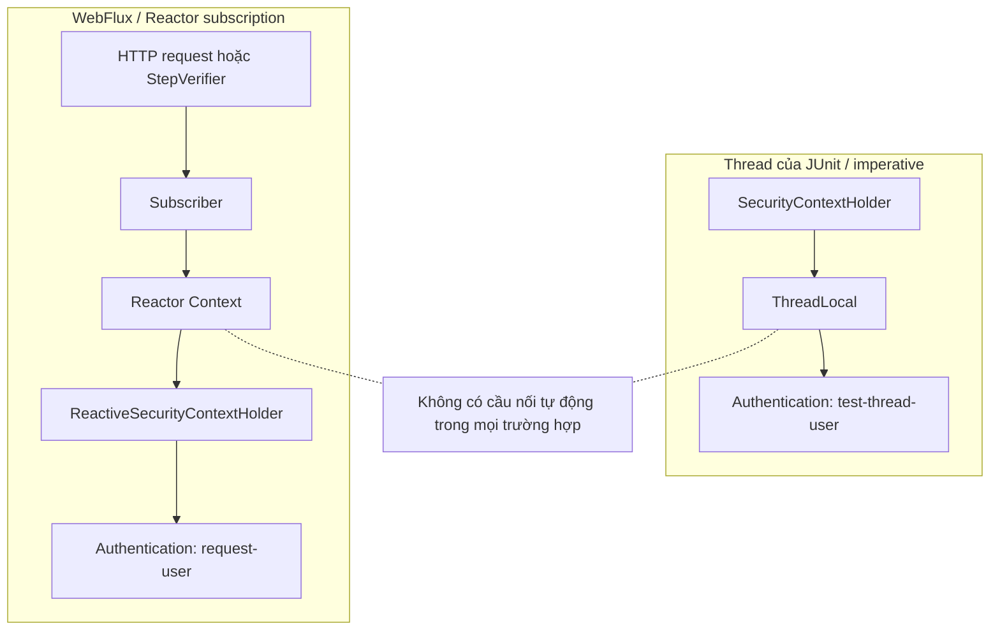
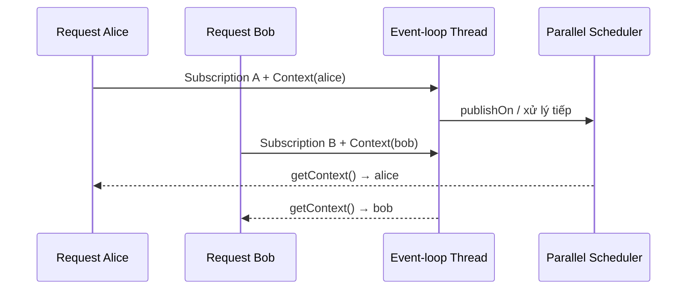

# Phân biệt ngữ cảnh phản ứng với SecurityContextHolder của luồng test

Một bài kiểm thử Spring WebFlux có thể cho kết quả khó hiểu: `@WithMockUser(username = "alice")` hoặc `SecurityContextHolder.getContext().setAuthentication(...)` cho thấy test thread có người dùng `alice`, nhưng bên trong `Mono`/`Flux`, lời gọi `ReactiveSecurityContextHolder.getContext()` lại trả về rỗng. Tình huống ngược lại cũng có thể xảy ra: endpoint Reactive nhận đúng `Authentication` của request, trong khi kiểm tra `SecurityContextHolder.getContext()` trên test thread không thấy danh tính ấy.

Đây không mặc nhiên là lỗi Spring Security. **Hai API sử dụng hai cơ chế giữ ngữ cảnh khác nhau**:

- `SecurityContextHolder` trong mô hình Servlet/imperative, mặc định lưu `SecurityContext` bằng `ThreadLocal` của **luồng thực thi**.
- `ReactiveSecurityContextHolder` trong Spring WebFlux lưu và truy xuất `SecurityContext` thông qua **Reactor `Context` gắn với subscriber** của chuỗi phản ứng.

Bài học thuộc chương **Danh tính Reactive** của module **SPRING_SECURITY_TESTING**: kiểm chứng xác thực, phân quyền và bảo vệ HTTP thực tế bằng `spring-security-test` trên Servlet/Reactive, sử dụng `MockMvc`, `WebTestClient`, `@WithMockUser`, `SecurityContext`, JWT/OAuth2/OIDC giả lập. Mục tiêu cụ thể là biết **đọc danh tính ở đúng ngữ cảnh**, **đưa danh tính vào test đúng cách**, và **phát hiện các test xanh giả** do nhầm `ThreadLocal` của thread chạy test với ngữ cảnh của request/subscription.

## 1. Hai loại ngữ cảnh có vòng đời khác nhau

### 1.1. SecurityContextHolder: mô hình gắn với thread

Trong ứng dụng Servlet truyền thống, code thường viết:

```java
Authentication authentication =
        SecurityContextHolder.getContext().getAuthentication();

String username = authentication.getName();
```

Với chiến lược mặc định `MODE_THREADLOCAL`, `SecurityContextHolder` truy cập context được đặt trong `ThreadLocal` của thread hiện tại. Khi filter chain Servlet thực thi trên thread thích hợp, Spring Security quản lý việc nạp/đặt/dọn context theo request.

Ở test imperative, đoạn sau đặt một `Authentication` trực tiếp lên **thread đang chạy lệnh test**:

```java
Authentication alice =
        UsernamePasswordAuthenticationToken.authenticated(
                "alice",
                "N/A",
                AuthorityUtils.createAuthorityList("ROLE_USER"));

SecurityContext context =
        SecurityContextHolder.createEmptyContext();
context.setAuthentication(alice);
SecurityContextHolder.setContext(context);

try {
    assertThat(SecurityContextHolder.getContext()
            .getAuthentication()
            .getName()).isEqualTo("alice");
} finally {
    SecurityContextHolder.clearContext();
}
```

Assertion này đúng về **ThreadLocal hiện tại**. Nó chưa chứng minh publisher Reactive đang mang `alice`.

### 1.2. ReactiveSecurityContextHolder: mô hình gắn với subscriber

Spring WebFlux xử lý request bằng chuỗi `Publisher`. Một request có thể chạy qua nhiều luồng xử lý mà vẫn thuộc **một subscription**, hoặc nhiều request có thể dùng chung một số event-loop threads mà vẫn phải giữ danh tính hoàn toàn tách biệt.

Với Reactor, dữ liệu gắn theo subscription được truyền bằng `reactor.util.context.Context`. Spring Security dùng nó để đặt `Mono<SecurityContext>` và cho phép đọc bằng:

```java
Mono<SecurityContext> context =
        ReactiveSecurityContextHolder.getContext();

Mono<String> username =
        ReactiveSecurityContextHolder.getContext()
                .map(SecurityContext::getAuthentication)
                .map(Authentication::getName);
```

`getContext()` trả về **`Mono<SecurityContext>`**, không trả `SecurityContext` tức thì. Khi publisher chưa được subscribe, bạn không thể suy ra danh tính nào sẽ xuất hiện lúc thực thi.

### Sơ đồ hai phạm vi



| Tiêu chí | `SecurityContextHolder` | `ReactiveSecurityContextHolder` |
|---|---|---|
| Chìa khóa truy xuất | Thread hiện tại | Subscriber/chuỗi Reactor |
| Dạng API | Đồng bộ: `SecurityContext` | Reactive: `Mono<SecurityContext>` |
| Nơi lưu mặc định | `ThreadLocal` | Reactor `Context` |
| `publishOn` đổi thread | ThreadLocal có thể khác hoặc rỗng | Reactor Context tiếp tục theo subscriber |
| Phù hợp | Servlet và code imperative có hợp đồng quản lý context | WebFlux và logic `Mono`/`Flux` |
| Cách thiết lập trong unit test | `SecurityContextHolder.setContext(...)` | `contextWrite(ReactiveSecurityContextHolder.withAuthentication(...))` |
| Mock HTTP thường dùng | `MockMvc` + `user()`/`@WithMockUser` | `WebTestClient` + `mockUser()`/`mockJwt()` |
| Điều không được kết luận | Thread test có `alice` thì request WebFlux cũng có `alice` | Context Reactive có `bob` thì ThreadLocal test cũng có `bob` |

**Không cố sửa vấn đề bằng `SecurityContextHolder.MODE_GLOBAL` hoặc `MODE_INHERITABLETHREADLOCAL`.** Những chiến lược này không thay thế nguyên tắc truyền Reactor Context và có thể gây rủi ro lẫn danh tính giữa các request/test chạy song song.

## 2. Vì sao Reactive không thể dựa vào ThreadLocal?

Giả sử một server xử lý hai người dùng Alice và Bob. Event loop có thể lần lượt thực thi một phần công việc của cả hai trên cùng thread; sau đó xử lý I/O bất đồng bộ và tiếp tục trên thread khác.



`ThreadLocal` không gắn với request, nên một value đặt trên thread A không có bảo đảm tự xuất hiện khi chuỗi tiếp tục trên thread B. Ngược lại, nếu code tự quản lý ThreadLocal sai, nó có thể vô tình để lại danh tính từ công việc trước đó trên một thread được tái sử dụng.

Reactor `Context` được thiết kế để đi theo chuỗi subscriber. Operator `publishOn`/`subscribeOn` trong pipeline Reactor thông thường **không làm mất Reactor Context**, dù thread thực thi đổi. Nhưng việc thoát ra một API ngoài Reactor như `new Thread(...)`, `CompletableFuture.supplyAsync(...)` hoặc tự gọi `.subscribe()` tạo subscription độc lập có thể làm mất mối liên hệ nếu không có cơ chế truyền context có chủ đích.

Điều này dẫn đến hai quy tắc:

1. Code Reactive muốn lấy danh tính hiện tại nên đọc từ `ReactiveSecurityContextHolder` hoặc dùng principal đã được framework truyền vào.
2. Code test Reactive nên đặt danh tính vào **Reactor Context của subscription/request đang kiểm**, thay vì chỉ đặt trên `SecurityContextHolder` của thread JUnit.

## 3. Đọc danh tính đúng cách trong service Reactive

Một service WebFlux tối giản:

```java
@Service
public class ReactiveIdentityService {

    public Mono<String> currentUsername() {
        return ReactiveSecurityContextHolder.getContext()
                .map(SecurityContext::getAuthentication)
                .filter(authentication ->
                        authentication != null
                                && authentication.isAuthenticated()
                                && !(authentication
                                    instanceof AnonymousAuthenticationToken))
                .map(Authentication::getName)
                .switchIfEmpty(Mono.error(
                        new AccessDeniedException(
                                "Không có người dùng đã xác thực")));
    }
}
```

Các import:

```java
import org.springframework.security.access.AccessDeniedException;
import org.springframework.security.authentication.AnonymousAuthenticationToken;
import org.springframework.security.core.Authentication;
import org.springframework.security.core.context.SecurityContext;
import org.springframework.security.core.context.ReactiveSecurityContextHolder;
import org.springframework.stereotype.Service;
import reactor.core.publisher.Mono;
```

Khi context Reactive có authentication hợp lệ, service trả `Mono<String>` chứa username. Khi subscription không có context phù hợp, service phát `AccessDeniedException`.

Trong hệ thống thật, quyền truy cập endpoint vẫn cần được bảo vệ bằng `SecurityWebFilterChain` và, nếu có, method security. Tự kiểm tra `isAuthenticated()` không thay thế đầy đủ logic authorization; `AnonymousAuthenticationToken` cần được xử lý theo chính sách, và có những kiểu principal khác như JWT/OIDC.

### Sai lầm thường gặp: đọc ThreadLocal bên trong `Mono`

```java
// Dễ sai trong WebFlux: ThreadLocal thuộc thread nào đang chạy?
public Mono<String> currentUsernameWrong() {
    return Mono.fromSupplier(() ->
            SecurityContextHolder.getContext()
                    .getAuthentication()
                    .getName());
}
```

Nếu context trên thread thực thi rỗng, code có thể ném `NullPointerException`. Nếu thread bị tái sử dụng và có dữ liệu không phù hợp, code còn có nguy cơ đọc sai danh tính. Việc test JUnit vô tình chạy `Mono.fromSupplier` trên chính thread đã được đặt `SecurityContextHolder` có thể làm ví dụ này **trông như hoạt động đúng**; khi `publishOn` hoặc request WebFlux thực tế thay đổi lịch chạy, giả định đó không còn đáng tin.

### Một lựa chọn hợp lệ khác: truyền principal tường minh

Ở nhiều endpoint, Spring WebFlux/Spring Security có thể cấp `Principal` hoặc `Authentication` dưới dạng argument hay publisher. Nếu service cần danh tính để xử lý một thao tác cụ thể, có thể truyền tham số đã được xác minh từ controller thay vì truy cập global holder:

```java
@GetMapping("/me")
Mono<String> me(Mono<Principal> principal) {
    return principal.map(Principal::getName);
}
```

Cách này thể hiện dependency một cách rõ ràng, có thể giúp test service thuần dễ hơn. Tuy nhiên, policy ở filter/method security và logic kiểm tra quyền trên tài nguyên vẫn cần chạy đúng.

## 4. Unit test bằng StepVerifier: chủ động cấp Reactor Context

`reactor-test` cung cấp `StepVerifier` để subscribe publisher và kiểm kết quả. Với service ở mục 3, hãy cấp Authentication vào Reactor Context tại **subscription**:

```java
class ReactiveIdentityServiceTest {

    private final ReactiveIdentityService service =
            new ReactiveIdentityService();

    @Test
    void returnsPrincipalFromReactiveContext() {
        Authentication alice =
                UsernamePasswordAuthenticationToken.authenticated(
                        "alice",
                        "N/A",
                        AuthorityUtils.createAuthorityList(
                                "ROLE_USER"));

        Mono<String> tested =
                service.currentUsername()
                        .contextWrite(
                                ReactiveSecurityContextHolder
                                        .withAuthentication(alice));

        StepVerifier.create(tested)
                .expectNext("alice")
                .verifyComplete();
    }

    @Test
    void missingReactiveContextIsDenied() {
        StepVerifier.create(service.currentUsername())
                .expectError(AccessDeniedException.class)
                .verify();
    }
}
```

Import test chính:

```java
import org.junit.jupiter.api.Test;
import org.springframework.security.authentication.UsernamePasswordAuthenticationToken;
import org.springframework.security.core.Authentication;
import org.springframework.security.core.authority.AuthorityUtils;
import org.springframework.security.core.context.ReactiveSecurityContextHolder;
import org.springframework.security.access.AccessDeniedException;
import reactor.core.publisher.Mono;
import reactor.test.StepVerifier;
```

`contextWrite(ReactiveSecurityContextHolder.withAuthentication(alice))` bổ sung Authentication vào **Reactor Context nhìn từ các operator phía upstream**. Publisher `currentUsername()` được subscribe với context chứa Alice, nên đọc đúng `alice` dù JUnit thread không hề gọi `SecurityContextHolder.setContext(...)`.

### 4.1. Thiết lập context bằng `withSecurityContext`

Nếu đã có `SecurityContext`, dùng:

```java
SecurityContext context = new SecurityContextImpl(alice);

Mono<String> tested =
        service.currentUsername()
                .contextWrite(
                        ReactiveSecurityContextHolder
                                .withSecurityContext(
                                        Mono.just(context)));

StepVerifier.create(tested)
        .expectNext("alice")
        .verifyComplete();
```

`withAuthentication(authentication)` là đường tắt phù hợp khi chỉ có `Authentication`. `withSecurityContext(Mono<? extends SecurityContext>)` phù hợp khi cần đưa một publisher context tùy chỉnh.

Có thể dùng `StepVerifierOptions` để tạo initial Reactor Context thay vì thêm `.contextWrite(...)` vào publisher:

```java
Context reactorContext =
        ReactiveSecurityContextHolder.withAuthentication(alice);

StepVerifierOptions options =
        StepVerifierOptions.create()
                .withInitialContext(reactorContext);

StepVerifier.create(service.currentUsername(), options)
        .expectNext("alice")
        .verifyComplete();
```

Tùy phong cách test, `contextWrite` thường dễ đọc hơn vì thấy rõ context áp dụng trực tiếp lên publisher được kiểm thử.

### 4.2. Đặt context ở assembly time có đủ không?

Reactor Context được đọc tại **subscription**, không phải chỉ tại thời điểm tạo biến `Mono`:

```java
Mono<String> pipeline = service.currentUsername();
// Chưa thực thi và chưa có danh tính.

Mono<String> asAlice =
        pipeline.contextWrite(
                ReactiveSecurityContextHolder
                        .withAuthentication(alice));

StepVerifier.create(asAlice)
        .expectNext("alice")
        .verifyComplete();
```

Không cần đặt một `ThreadLocal` trước dòng `Mono<String> pipeline = ...`. Mỗi subscription có thể nhận context khác nhau; nếu publisher không giữ state sai cách, điều này cho phép dùng cùng logic cho nhiều người dùng.

## 5. Bài test xanh giả khi chỉ đặt SecurityContextHolder

Ví dụ test sau tự tạo một principal và đặt vào `SecurityContextHolder`:

```java
@Test
void threadLocalAuthenticationDoesNotSupplyReactorContext() {
    Authentication alice =
            UsernamePasswordAuthenticationToken.authenticated(
                    "alice",
                    "N/A",
                    AuthorityUtils.createAuthorityList(
                            "ROLE_USER"));

    SecurityContext imperative =
            SecurityContextHolder.createEmptyContext();
    imperative.setAuthentication(alice);
    SecurityContextHolder.setContext(imperative);

    try {
        // PASS: chỉ chứng minh thread JUnit có Alice.
        assertThat(SecurityContextHolder.getContext()
                .getAuthentication()
                .getName()).isEqualTo("alice");

        // Service sử dụng ReactiveSecurityContextHolder, và test này
        // không cấp Reactor Context cho subscription.
        StepVerifier.create(service.currentUsername())
                .expectError(AccessDeniedException.class)
                .verify();
    } finally {
        SecurityContextHolder.clearContext();
    }
}
```

Ví dụ giả định đây là unit test thuần, **không có Spring Test listener nào chủ động nối SecurityContext của test sang Reactor Context**. Trong bộ test Spring Security được thiết lập đầy đủ, `ReactorContextTestExecutionListener` có thể tham gia hỗ trợ các annotation security test; không nên suy rộng hành vi của unit test thuần ở trên thành khẳng định rằng `@WithMockUser` luôn không hoạt động trên WebFlux.

Vấn đề cốt lõi không nằm ở annotation, mà ở **nguồn dữ liệu mà code ứng dụng đọc**. Nếu bạn đặt Alice trên ThreadLocal nhưng kiểm logic đọc Reactor Context, cần có một cơ chế truyền context rõ ràng hoặc annotation/test config được Spring Security hỗ trợ.

### 5.1. Vì sao `block()` có thể che lỗi?

Một test viết:

```java
SecurityContextHolder.getContext()
        .setAuthentication(alice);

String username = service.currentUsernameWrong().block();
assertThat(username).isEqualTo("alice");
```

có thể xanh vì publisher dùng `Mono.fromSupplier` và `.block()` được thực thi ngay trên thread JUnit có ThreadLocal Alice. Trong WebFlux thật, code có thể chạy sau `publishOn`, ở thread khác hoặc với nhiều request xen kẽ. Điều đó khiến kết quả test không đại diện cho request thật.

**Không dùng `.block()` trên event-loop của ứng dụng WebFlux** để lấy danh tính hoặc gọi I/O. Nếu cần kiểm kết quả trong test, `StepVerifier` thể hiện rõ subscription và terminal signal mà không vô tình giả định kiểu chạy đồng bộ của production.

## 6. Tạo endpoint WebFlux thực để kiểm chứng request context

Một ví dụ đơn giản:

```java
@RestController
@RequestMapping("/api/identity")
public class ReactiveIdentityController {

    private final ReactiveIdentityService service;

    public ReactiveIdentityController(
            ReactiveIdentityService service) {
        this.service = service;
    }

    @GetMapping("/me")
    public Mono<String> me() {
        return service.currentUsername();
    }
}
```

Cấu hình Security WebFlux:

```java
@Configuration
@EnableWebFluxSecurity
public class ReactiveSecurityConfiguration {

    @Bean
    SecurityWebFilterChain securityWebFilterChain(
            ServerHttpSecurity http) {

        return http
                .authorizeExchange(exchanges -> exchanges
                        .pathMatchers(
                                "/api/identity/me")
                        .authenticated()
                        .anyExchange().denyAll())
                .httpBasic(Customizer.withDefaults())
                .build();
    }
}
```

Import cơ bản:

```java
import org.springframework.context.annotation.Bean;
import org.springframework.context.annotation.Configuration;
import org.springframework.security.config.Customizer;
import org.springframework.security.config.annotation.web.reactive.EnableWebFluxSecurity;
import org.springframework.security.config.web.server.ServerHttpSecurity;
import org.springframework.security.web.server.SecurityWebFilterChain;
import org.springframework.web.bind.annotation.GetMapping;
import org.springframework.web.bind.annotation.RequestMapping;
import org.springframework.web.bind.annotation.RestController;
import reactor.core.publisher.Mono;
```

Trong production, việc bật HTTP Basic hay form login tùy thiết kế. Ví dụ chọn HTTP Basic để request không có danh tính nhận `401 Unauthorized` rõ ràng khi kiểm thử; đồng thời kết hợp authorize rules để endpoint yêu cầu đăng nhập.

Spring Security WebFlux nạp security context ở phía server trong quá trình xử lý request thông qua các WebFilter và `ServerSecurityContextRepository` phù hợp, rồi đưa context vào Reactor chain. Không yêu cầu controller chủ động đọc `SecurityContextHolder` từ ThreadLocal.

## 7. WebTestClient: mockUser tạo danh tính đúng request Reactive

Với Spring Boot WebFlux đã có các bean từ mục 6, test HTTP có thể viết:

```java
@SpringBootTest
@AutoConfigureWebTestClient
class ReactiveIdentityHttpIT {

    @Autowired
    WebTestClient client;

    @Test
    void mockUserBelongsToReactiveRequest() {
        client.mutateWith(
                    mockUser("alice").roles("USER"))
                .get()
                .uri("/api/identity/me")
                .exchange()
                .expectStatus().isOk()
                .expectBody(String.class)
                .isEqualTo("alice");
    }

    @Test
    void anonymousRequestIsRejected() {
        client.get()
                .uri("/api/identity/me")
                .exchange()
                .expectStatus().isUnauthorized();
    }

    @Test
    void anotherRequestUsesItsOwnPrincipal() {
        client.mutateWith(mockUser("bob").roles("USER"))
                .get()
                .uri("/api/identity/me")
                .exchange()
                .expectStatus().isOk()
                .expectBody(String.class)
                .isEqualTo("bob");
    }
}
```

Static import:

```java
import static org.springframework.security.test.web.reactive.server
        .SecurityMockServerConfigurers.mockUser;
```

Các import khác đến từ JUnit Jupiter, Spring Boot Test, `org.springframework.test.web.reactive.server.WebTestClient` và `org.springframework.beans.factory.annotation.Autowired`.

`mockUser("alice")` thuộc `SecurityMockServerConfigurers` và gắn security test support vào request/server tương ứng. Trong thiết lập đúng, nó cung cấp authentication cho **Reactor Context của request**, nên `ReactiveIdentityService` trả về Alice. `@AutoConfigureWebTestClient` trong dự án Spring Boot WebFlux thường tích hợp test client với application context; nếu tự dựng client bằng `WebTestClient.bindToApplicationContext(...)`, cần áp dụng cấu hình `springSecurity()` vào builder trước khi mutate.

### 7.1. Nếu tự tạo WebTestClient

```java
WebTestClient client =
        WebTestClient.bindToApplicationContext(context)
                .apply(springSecurity())
                .configureClient()
                .build();

client.mutateWith(mockUser("alice"))
        .get()
        .uri("/api/identity/me")
        .exchange()
        .expectStatus().isOk();
```

Import:

```java
import static org.springframework.security.test.web.reactive.server
        .SecurityMockServerConfigurers.springSecurity;
```

Ví dụ này giả định `context` là `ApplicationContext` của ứng dụng WebFlux có đủ security config. Nếu bind client tới một controller độc lập, phải dựng/ghép filter chain đúng cách; thiếu Spring Security Test support có thể khiến `.mutateWith(mockUser(...))` không ảnh hưởng server như kỳ vọng.

### 7.2. Không gửi mock context sang server ngoài mạng

`mockUser()`/`mockJwt()` giúp kiểm thử **server được bind trong Spring test runtime**. Nếu `WebTestClient` là HTTP client gọi server độc lập qua URL, việc biến đổi `mockUser` ở phía client không tạo header hoặc session xác thực hợp lệ mà server đó tự hiểu.

Khi kiểm tích hợp qua HTTP thật, hãy gửi:

```java
client.get()
        .uri("/api/identity/me")
        .headers(headers ->
                headers.setBearerAuth(signedTestJwt))
        .exchange()
        .expectStatus().isOk();
```

Ví dụ trên chỉ chạy khi server dùng JWT Resource Server và `signedTestJwt` được ký bằng khóa test có thể xác minh. Đây là lớp kiểm thử khác với `mockUser`, cần decoder, validators và authorities converter thật.

## 8. @WithMockUser trong WebFlux test: điều kiện để hoạt động

`@WithMockUser` rất phổ biến trong Servlet tests và cũng có thể dùng trong bài test Reactive khi **Spring Security Test listeners và WebFlux test integration được cài đặt đúng**.

Ví dụ minh họa:

```java
@SpringBootTest
@AutoConfigureWebTestClient
class AnnotationBasedReactiveIT {

    @Autowired
    WebTestClient client;

    @Test
    @WithMockUser(username = "alice", roles = "USER")
    void annotationCanProvideMockAuthentication() {
        client.get()
                .uri("/api/identity/me")
                .exchange()
                .expectStatus().isOk()
                .expectBody(String.class)
                .isEqualTo("alice");
    }
}
```

Ở thiết lập Spring Security Test chuẩn, `WithSecurityContextTestExecutionListener` chuẩn bị security context cho test, và `ReactorContextTestExecutionListener` hỗ trợ ngữ cảnh Reactor khi cần. Tuy nhiên, việc `@WithMockUser` đặt giá trị trong `SecurityContextHolder` trên **thread test** không có nghĩa mọi publisher hoặc HTTP server độc lập sẽ tự có danh tính tương tự. Cấu hình annotation/listener, client binding và thời điểm tạo subscription vẫn quyết định phạm vi hiệu lực.

Khi bài test muốn chứng minh một **request cụ thể** có principal nào, `.mutateWith(mockUser("..."))` thường rõ ràng hơn:

```java
client.mutateWith(mockUser("alice")).get()
        .uri("/api/identity/me")
        .exchange()
        .expectStatus().isOk();

client.mutateWith(mockUser("bob")).get()
        .uri("/api/identity/me")
        .exchange()
        .expectStatus().isOk();
```

Nếu chỉ cần kiểm service publisher, `.contextWrite(ReactiveSecurityContextHolder.withAuthentication(...))` là cách rõ ràng và độc lập với HTTP test framework nhất.

### Vì sao không dùng ThreadLocal assertion để kiểm WebFlux request?

Ví dụ một test có annotation:

```java
@WithMockUser(username = "alice")
@Test
void wrongEvidence() {
    assertThat(
            SecurityContextHolder.getContext()
                    .getAuthentication()
                    .getName()
    ).isEqualTo("alice");
}
```

Test chỉ chứng minh **môi trường test/JUnit thread** đã được listener chuẩn bị theo annotation. Nó không hề gọi WebFlux controller, SecurityWebFilterChain hoặc Reactor publisher. Hãy assert kết quả HTTP với `WebTestClient`, hoặc chạy publisher bằng `StepVerifier` có Reactor Context để chứng minh danh tính được sử dụng ở đúng nơi.

## 9. ContextWrite, thứ tự operator và subscription

Reactor Context được truyền theo hướng từ **subscriber xuống phía các operator upstream** khi subscribe. Do đó, một vị trí `.contextWrite(...)` phù hợp nằm **sau** publisher cần đọc context trong chain:

```java
Mono<String> username =
        ReactiveSecurityContextHolder.getContext()
                .map(ctx ->
                        ctx.getAuthentication().getName());

StepVerifier.create(
            username.contextWrite(
                    ReactiveSecurityContextHolder
                            .withAuthentication(alice)))
        .expectNext("alice")
        .verifyComplete();
```

Một thiết lập đặt quá sớm ở một nhánh khác, hoặc đặt trên publisher độc lập không phải là tổ tiên context của đoạn cần đọc, có thể làm test không thấy authentication. Khi pipeline phức tạp, đặt `.contextWrite(...)` ở ranh giới subscription đang test hoặc dùng `StepVerifierOptions.withInitialContext(...)` để thấy rõ toàn bộ chain nào được cấp context.

### 9.1. Context chỉ tồn tại khi có subscriber

```java
Mono<String> description =
        service.currentUsername()
                .map(name -> "Hello " + name);

// Ở đây chưa có request/user cụ thể.
```

Phải subscribe (thông qua `StepVerifier`, `WebTestClient` hoặc một subscriber thật) với Reactor Context thích hợp thì mới đọc được danh tính. Dựng biến `Mono` bên ngoài test method không khóa nó vĩnh viễn với người dùng đang có trong `SecurityContextHolder` tại thời điểm dựng.

### 9.2. Hai subscriber có thể dùng hai danh tính trên cùng logic

```java
Authentication alice = auth("alice");
Authentication bob = auth("bob");

Mono<String> logic = service.currentUsername();

Mono<String> asAlice = logic.contextWrite(
        ReactiveSecurityContextHolder
                .withAuthentication(alice));

Mono<String> asBob = logic.contextWrite(
        ReactiveSecurityContextHolder
                .withAuthentication(bob));

StepVerifier.create(Flux.merge(asAlice, asBob).collectList())
        .assertNext(names -> assertThat(names)
                .containsExactlyInAnyOrder("alice", "bob"))
        .verifyComplete();
```

`auth(...)` là helper của test:

```java
private Authentication auth(String username) {
    return UsernamePasswordAuthenticationToken.authenticated(
            username,
            "N/A",
            AuthorityUtils.createAuthorityList("ROLE_USER"));
}
```

Hai publisher con được cấp context riêng. Kết quả không nên phụ thuộc thứ tự scheduler thực thi. Test `containsExactlyInAnyOrder` phù hợp vì `Flux.merge` không hứa thứ tự đầu ra cố định.

### 9.3. publishOn không phải lý do bỏ Reactor Context

```java
Mono<String> result =
        Mono.just("start")
                .publishOn(Schedulers.parallel())
                .flatMap(ignored ->
                        service.currentUsername())
                .contextWrite(
                        ReactiveSecurityContextHolder
                                .withAuthentication(alice));

StepVerifier.create(result)
        .expectNext("alice")
        .verifyComplete();
```

Dù `publishOn` thay thread thực thi đoạn downstream, Reactor Context vẫn gắn với subscriber. Nếu đổi thành code đọc `SecurityContextHolder` bên trong `flatMap`, có thể thấy `null` hoặc một giá trị không mong muốn tùy ThreadLocal trên thread mới.

## 10. Các ranh giới làm mất context và cách xử lý

Ngữ cảnh Reactive không tự động được truyền sang **mọi** cơ chế bất đồng bộ của Java:

```java
// Thiết kế không an toàn: không chắc ThreadLocal hay Reactor Context
// nào được nhìn thấy trong CompletableFuture.
return Mono.fromFuture(
        CompletableFuture.supplyAsync(() ->
                SecurityContextHolder.getContext()
                        .getAuthentication()
                        .getName()));
```

Nếu cần gọi một thư viện imperative trong WebFlux, đọc danh tính ở bên **trong publisher đã được gắn Reactor Context** và truyền giá trị tường minh:

```java
public Mono<String> loadReport() {
    return ReactiveSecurityContextHolder.getContext()
            .map(SecurityContext::getAuthentication)
            .map(Authentication::getName)
            .flatMap(username ->
                    Mono.fromCallable(() ->
                            blockingReportClient.loadFor(username))
                        .subscribeOn(
                                Schedulers.boundedElastic()));
}
```

`blockingReportClient` là collaborator giả định; đặt lệnh blocking trên `boundedElastic` để tránh chặn event loop. Điều quan trọng là **truyền `username` được lấy từ authentication đúng subscription** vào cổng imperative, thay vì yêu cầu cổng ấy tự đoán ThreadLocal của worker thread.

Các tình huống cần kiểm tra kỹ:

| Tình huống | Reactor Context trong chain? | Cách làm rõ |
|---|---|---|
| `map`/`flatMap` Reactor bình thường | Có trong phạm vi chain/subscriber | Đọc bằng `ReactiveSecurityContextHolder` |
| `publishOn`/`subscribeOn` Reactor | Có, trong chain chuẩn | Không dùng ThreadLocal làm nguồn identity |
| `Mono.defer`/`deferContextual` trong chain | Có nếu subscriber được cấp context | Dùng contextWrite/StepVerifier khi test |
| Tự `new Thread(...)` | Không đảm bảo | Truyền principal/ID có chủ đích |
| `CompletableFuture.supplyAsync` ngoài Reactor | Không đảm bảo | Truyền dữ liệu hoặc dùng bridge có kiểm soát |
| Gọi `.subscribe()` tách ra từ service | Tạo subscription độc lập, có thể mất correlation | Compose chuỗi bằng `flatMap`, trả `Mono`/`Flux` cho caller |
| Dùng `.block()` giữa WebFlux event loop | Có thể lỗi blocking hoặc tạo boundary khó kiểm soát | Dùng pipeline reactive, test bằng StepVerifier |
| Dùng `Context` khác với key trùng/ghi đè | Có thể thay đổi context hiệu lực | Đặt các key theo contract, tránh sửa key Security không có lý do |
| Dùng framework có automatic context propagation | Phụ thuộc cấu hình và phiên bản | Test rõ hành vi propagation, không giả định ThreadLocal luôn được đồng bộ |

Cơ chế automatic context propagation của Reactor/Micrometer có thể hỗ trợ truyền một số ThreadLocal qua Context trong điều kiện đã cấu hình. Nó **không làm `SecurityContextHolder` và `ReactiveSecurityContextHolder` trở thành cùng một API**, cũng không cho phép bỏ qua SecurityWebFilterChain và boundary của request.

## 11. Mock JWT/OIDC trong WebFlux: vẫn phải đi qua Reactive context

Khi ứng dụng WebFlux nhận JWT từ OAuth2 Resource Server, test nhanh có thể cung cấp JWT giả lập:

```java
client.mutateWith(
            mockJwt()
                .jwt(jwt -> jwt
                    .subject("alice")
                    .claim("tenant_id", "tenant-a"))
                .authorities(
                    new SimpleGrantedAuthority(
                        "SCOPE_reports.read")))
        .get()
        .uri("/api/identity/me")
        .exchange()
        .expectStatus().isOk()
        .expectBody(String.class)
        .isEqualTo("alice");
```

Static import:

```java
import static org.springframework.security.test.web.reactive.server
        .SecurityMockServerConfigurers.mockJwt;
```

Test này kiểm tra **cách WebFlux dùng JWT Authentication đã được giả lập** và quyền được gắn vào Reactor Context. Nó không kiểm xác minh chữ ký JWT, issuer/audience hay decoder thật.

Tương tự, ứng dụng WebFlux có OAuth2/OIDC login có thể dùng:

```java
client.mutateWith(
            mockOidcLogin()
                .idToken(token ->
                    token.claim("sub", "alice")))
        .get()
        .uri("/api/identity/me")
        .exchange()
        .expectStatus().isOk();
```

Hoặc `mockOAuth2Login()` khi chỉ cần principal OAuth2. Chúng dựng principal để kiểm logic ứng dụng, không thực hiện redirect/login ngoài mạng. Test chữ ký/validator thật cần gửi Bearer JWT ký thật qua HTTP với `ReactiveJwtDecoder` và validators/converter production.

### 11.1. Authority và danh tính là hai khía cạnh khác nhau

Trong `JwtAuthenticationToken`, `getName()` thường lấy subject hoặc principal claim theo converter. Authorities có thể đến từ scope và role mappings, ví dụ `SCOPE_reports.read`. Một bài test chỉ assert username là `alice` vẫn có thể bỏ sót converter làm mất quyền.

Khi cần kiểm cả danh tính và phân quyền:

1. Gọi endpoint đọc principal với mock JWT có `sub=alice`.
2. Gọi endpoint được bảo vệ yêu cầu `SCOPE_reports.read` với JWT có scope đọc và thiếu scope.
3. Kiểm response `200`/`403` theo rule.
4. Khi muốn chứng minh converter production, gửi **JWT ký thật** và assert cách raw claims trở thành authorities qua `ReactiveJwtDecoder`/converter thật.
5. Với API đọc/ghi dữ liệu riêng tư, thêm kiểm tra không vượt quyền đối tượng và không thay đổi DB dù status bị từ chối.

Không đồng nhất `@WithMockUser(roles="ADMIN")` của request test với scope của access token dùng để gọi API bên ngoài.

## 12. WebFlux SecurityContextRepository và việc lưu danh tính giữa các request

Trong WebFlux, `ServerSecurityContextRepository` quyết định cách load/save `SecurityContext` ở ranh giới request. Chính sách lưu có thể dùng web session hoặc không lưu state tùy cơ chế xác thực.

Một WebFlux application dùng login/session:

- Request đăng nhập xác thực thành công.
- Security context được lưu theo cấu hình repository.
- Request kế tiếp có session/cookie phù hợp sẽ được load context và gắn vào Reactor chain.

Một API stateless Bearer:

- Mỗi request mang Bearer token.
- Filter xác minh token, tạo authentication và đưa vào Reactor chain.
- Không nên coi request kế tiếp không có token là đã được xác thực chỉ vì một ThreadLocal từng chứa danh tính.

Vì vậy có **hai bài test độc lập**:

| Mục đích | Test cần làm |
|---|---|
| Đọc identity trong **một** request | `WebTestClient.mutateWith(mockUser(...))` + assert endpoint |
| Lưu/khôi phục login/session **qua nhiều** request | Chạy login flow hoặc HTTP Basic/session theo cấu hình thật, giữ cookie/session, kiểm request kế tiếp |

Mock user ở request test thường không phải bằng chứng về session persistence hoặc login flow. Nếu test tự gắn lại `mockUser("alice")` vào **mọi** request, kết quả xanh không chứng minh server từng lưu authentication.

Trong test dùng session, phải tách request thứ hai **không có mock security mutation**, chỉ mang session cookie hoặc session binding hợp lệ từ request thứ nhất. Với API stateless, thử request thứ hai không có Bearer và xác nhận bị từ chối.

## 13. Cách gỡ lỗi khi Reactive context bị rỗng

Khi thấy `ReactiveSecurityContextHolder.getContext()` không trả authentication, hãy kiểm theo thứ tự:

1. **Đúng loại ứng dụng chưa?** WebFlux dùng `SecurityWebFilterChain`; MVC/Servlet dùng `SecurityFilterChain`. Không lắp cấu hình Servlet rồi mặc định cho rằng nó bảo vệ WebFlux.
2. **Test đang kiểm request hay service publisher?** Nếu service trực tiếp, dùng `contextWrite(...)`; nếu HTTP Reactive, dùng WebTestClient được bind với Spring Security.
3. **Đã `.apply(springSecurity())` chưa?** Cần đặc biệt chú ý khi tự dựng WebTestClient thay vì dùng client do Boot auto-configure.
4. **Có đang dùng `SecurityContextHolder` trong code Reactive không?** Đổi sang `ReactiveSecurityContextHolder` hoặc inject principal đúng ranh giới.
5. **Context được gắn vào đúng subscription chưa?** Kiểm `.contextWrite(...)` nằm ở chuỗi mà `StepVerifier` thực sự subscribe.
6. **Có tách luồng bằng `.subscribe()` hoặc `CompletableFuture` không?** Compose lại bằng `flatMap` hoặc truyền identity rõ ràng khi ra khỏi Reactor.
7. **Có filter chain nào khác bắt URL không?** Kiểm `securityMatcher`/ordering và matcher thực tế trong Spring Security WebFlux.
8. **Lỗi xuất hiện chỉ khi `publishOn`?** Rất có thể code đang phụ thuộc ThreadLocal; Reactor Context chuẩn vẫn đi qua scheduler chuyển thread.
9. **Có test song song làm rò rỉ global SecurityContextHolder không?** Dọn ThreadLocal và tránh global mode; mỗi subscription cần context riêng.
10. **Có đang mock quá nhiều bean bảo mật không?** Nếu mock filter/service/authentication manager, test có thể xanh mà request production không được xác thực.

### Logging chẩn đoán có kiểm soát

Trong môi trường test, có thể log **chỉ principal name hoặc kiểu Authentication**, tránh log token và claims nhạy cảm:

```java
Mono<String> identity =
        ReactiveSecurityContextHolder.getContext()
                .map(SecurityContext::getAuthentication)
                .doOnNext(authentication ->
                        log.debug("auth type={}, name={}",
                                authentication.getClass()
                                        .getSimpleName(),
                                authentication.getName()))
                .map(Authentication::getName);
```

Không dùng việc log `SecurityContextHolder.getContext()` trên thread JUnit để xác định danh tính của request. Trong trường hợp cần debug sâu, có thể ghi thêm correlation ID của request/subscription và vị trí của operator, nhưng tránh in access token, session ID hoặc thông tin người dùng không cần thiết.

## 14. Ma trận kiểm thử đúng ranh giới

| Ca | Test setup | Điều cần assert | Lỗi được phát hiện |
|---|---|---|---|
| S1: Service có context Alice | `StepVerifier` + `withAuthentication(alice)` | `alice` | Service đọc sai source danh tính |
| S2: Service thiếu context | `StepVerifier` không cấp context | `AccessDeniedException` | Service ngầm cho anonymous đi tiếp |
| S3: Test thread có Alice nhưng Reactor không có | Đặt `SecurityContextHolder`, không cấp context Reactive (unit test không listener) | Service vẫn bị từ chối | Trộn ThreadLocal với subscriber context |
| S4: Publisher đổi scheduler | `publishOn(parallel)` + contextWrite Alice | `alice` | Code lệ thuộc thread chạy |
| S5: Hai subscriber | `Flux.merge` với Alice/Bob context riêng | Nhận cả Alice, Bob | Dùng shared mutable global identity |
| H1: HTTP mock user Alice | `WebTestClient.mutateWith(mockUser("alice"))` | `200`, body Alice | WebFlux security test context |
| H2: HTTP anonymous | Không mock user và không credential | `401` với cấu hình HTTP Basic | Route được bảo vệ |
| H3: HTTP JWT mock scope thiếu | `mockJwt()` thiếu authority cần thiết | `403` ở endpoint có rule scope | HTTP authorization |
| H4: JWT ký thật sai issuer | Header Bearer + ReactiveJwtDecoder thật | `401` | Token validator |
| H5: Login qua session | Request đăng nhập rồi request thứ hai chỉ dùng session | User vẫn được nhận dạng | Repository/session persistence |
| H6: API stateless | Request tiếp theo không Bearer | `401` | Không rò rỉ auth giữa request |
| H7: Không vượt quyền đối tượng | User A đọc/sửa ID của User B | Từ chối và DB không đổi | Phân quyền dữ liệu thực tế |

Nên có **đối chứng dương** cho các case âm tính. Ví dụ khi test thiếu scope nhận `403`, đồng thời test JWT có scope chính xác nhận `200`; nếu không, có thể route luôn bị chặn vì cấu hình khác. Khi test subscriber không có context bị từ chối, phải có test cấp context nhận username đúng.

## 15. Bài thực hành có đáp án gợi ý

### Bài 1 — Tìm lỗi trong test

Xét code:

```java
@Test
void shouldSeeAlice() {
    SecurityContextHolder.getContext()
            .setAuthentication(auth("alice"));

    assertThat(service.currentUsernameWrong().block())
            .isEqualTo("alice");
}
```

**Câu hỏi:** Test trên chứng minh được điều gì? Nó có kiểm được Reactive Security Context không?

**Đáp án:** Nó chỉ chứng minh publisher bị viết theo kiểu `SecurityContextHolder` đã đọc được ThreadLocal trên thread thực thi lúc `.block()`. Nó không kiểm cách WebFlux mang authentication qua Reactor Context. Cần sửa service đọc `ReactiveSecurityContextHolder`, sau đó dùng `StepVerifier` với `.contextWrite(withAuthentication(...))`.

### Bài 2 — Đổi thread nhưng không đổi danh tính

Viết test:

```java
Mono<String> result =
        service.currentUsername()
                .publishOn(Schedulers.parallel())
                .contextWrite(
                        ReactiveSecurityContextHolder
                                .withAuthentication(
                                        auth("alice")));

StepVerifier.create(result)
        .expectNext("alice")
        .verifyComplete();
```

**Câu hỏi:** `publishOn` có làm mất context của Alice không?

**Đáp án:** Không trong pipeline Reactor chuẩn; `Reactor Context` thuộc subscriber nên vẫn có thể được đọc ở các operator trong phạm vi. Nếu code dùng ThreadLocal thay thế, kết quả có thể sai khi scheduler đổi thread.

### Bài 3 — WebTestClient và mock JWT

Một endpoint yêu cầu scope `reports.read`. Hãy viết hai test:

```java
// Ca dương: JWT mock có scope đọc.
client.mutateWith(
            mockJwt().authorities(
                    new SimpleGrantedAuthority(
                            "SCOPE_reports.read")))
        .get()
        .uri("/api/reports")
        .exchange()
        .expectStatus().isOk();

// Ca âm: JWT mock thiếu scope đọc.
client.mutateWith(
            mockJwt().authorities(
                    new SimpleGrantedAuthority(
                            "SCOPE_reports.export")))
        .get()
        .uri("/api/reports")
        .exchange()
        .expectStatus().isForbidden();
```

Chạy được nếu endpoint/cấu hình WebFlux tương ứng đã tồn tại. Hai test đo **authorization từ authorities đã chuẩn bị**; muốn chứng minh signature, issuer/audience hay JWT converter production, cần thêm test Bearer token ký thật.

### Bài 4 — Hai request không được dùng chung identity

Một test WebFlux cần lần lượt kiểm Alice và Bob. Hãy dùng hai request với hai `mockUser` khác nhau và assert nội dung response. Sau đó thực hiện một request **không có authentication** và assert bị từ chối. Nếu server trả lại Alice/Bob cho request vô danh, cần xem lại quản lý SecurityContextRepository, session cookie, cache hoặc rò rỉ shared state.

### Bài 5 — Phân quyền dữ liệu thật

Thêm API `GET /api/documents/{id}`. Tạo tài liệu của Alice và Bob trong database test, rồi dùng `mockUser("alice")` gọi ID của Bob. Kiểm:

- Status bị từ chối theo contract (`403` hoặc `404`).
- Response không chứa nội dung/metadata bí mật của Bob.
- Các query repository và service thực đã kiểm owner/tenant.
- Một request cùng URL với `mockUser("bob")` thành công.
- Nếu có thao tác ghi, assert DB/event giữ nguyên khi request bị từ chối.

**Điểm chính:** Reactive context cung cấp danh tính, còn **phân quyền đối tượng** phải được hệ thống ứng dụng thực thi và được test riêng.

## 16. Tài liệu đối chiếu

- [Spring Security — Reactive Security Context](https://docs.spring.io/spring-security/reference/reactive/authorization/method.html): các cơ chế method security trên Reactive Publisher và Reactor Context.
- [Spring Security — WebFlux Security](https://docs.spring.io/spring-security/reference/reactive/configuration/webflux.html): `SecurityWebFilterChain` và cách bảo vệ các request WebFlux.
- [Spring Security — Testing WebFlux](https://docs.spring.io/spring-security/reference/reactive/test/web/index.html): tích hợp `WebTestClient`, `springSecurity()` và các security test configurers.
- [Spring Security — Reactive OAuth2 Testing](https://docs.spring.io/spring-security/reference/reactive/test/web/oauth2.html): `mockJwt`, `mockOAuth2Login`, `mockOidcLogin` và các ngữ cảnh bảo mật giả lập.
- [Spring Security API — ReactiveSecurityContextHolder](https://docs.spring.io/spring-security/site/docs/current/api/org/springframework/security/core/context/ReactiveSecurityContextHolder.html): `getContext`, `withAuthentication`, `withSecurityContext`.
- [Project Reactor — Adding a Context to a Reactive Sequence](https://projectreactor.io/docs/core/release/reference/advancedFeatures/context.html): ngữ nghĩa của Reactor `Context`, `contextWrite` và subscriber.

Để kiểm thử danh tính Reactive đáng tin, hãy làm rõ **ai cung cấp authentication**, **nó được gắn vào subscription/request nào**, và **code đọc từ đâu**. Đọc `SecurityContextHolder` trên thread JUnit chỉ quan sát ThreadLocal của test; đọc `ReactiveSecurityContextHolder` trong `Mono`/`Flux` kiểm tra ngữ cảnh phản ứng. `StepVerifier` và `WebTestClient` cho phép cấp và quan sát đúng ngữ cảnh ấy; các ca phân quyền và token thật vẫn cần được kiểm chứng qua filter/validator/resource layer phù hợp.
