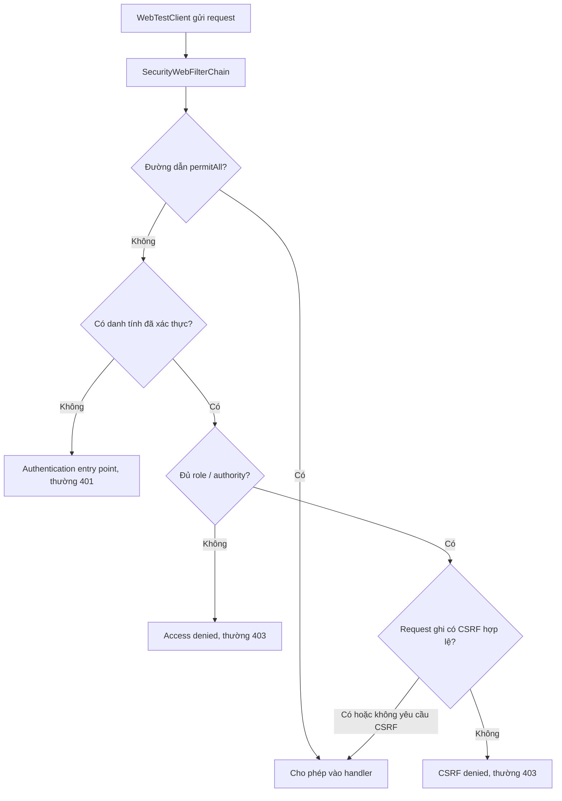

# Các ca anonymous, không có danh tính và thiếu quyền theo chính sách ứng dụng

Trong chương **Danh tính Reactive** của module **SPRING_SECURITY_TESTING**, người học kiểm chứng xác thực, phân quyền và bảo vệ HTTP bằng `spring-security-test` trên ứng dụng Servlet và Reactive. Với `WebTestClient`, `SecurityWebFilterChain` và `ReactiveSecurityContextHolder`, cần phân biệt ba tình huống dễ bị đánh đồng: **request anonymous**, **Reactor context không chứa danh tính**, và **request đã xác thực nhưng thiếu quyền**. Chúng có thể dẫn đến các quyết định bảo mật khác nhau và cần các phép kiểm thử riêng.

Ví dụ một API báo cáo có chính sách: đường dẫn công khai cho mọi người; báo cáo riêng chỉ cho người có `ROLE_ANALYST`; thao tác ghi yêu cầu thêm CSRF token nếu ứng dụng bật CSRF. Test chỉ chứng minh một người dùng giả lập truy cập thành công là chưa đủ. Phải có các ca từ chối để chắc chắn tài nguyên không bị lộ cho người chưa đăng nhập hoặc người đăng nhập nhưng không đủ quyền.

Bài này dùng **Spring WebFlux** làm trọng tâm, minh họa test HTTP với `WebTestClient` và test logic phụ thuộc `ReactiveSecurityContextHolder` bằng `StepVerifier`. Các ví dụ JWT/OAuth2/OIDC giả lập, `@WithMockUser` và `MockMvc` được đặt đúng vai trò để không nhầm giữa hai stack bảo mật.

## 1. Ba tình huống cần phân biệt

| Tình huống | Điều đang xảy ra | Dấu hiệu trong kiểm thử | Kỳ vọng điển hình đối với endpoint bảo vệ |
| --- | --- | --- | --- |
| **Anonymous** | Request chưa xác thực; hạ tầng Spring Security có thể đại diện nó bằng anonymous authentication | Gửi HTTP không có thông tin xác thực | Thường `401` khi cần đăng nhập; `200` tại endpoint `permitAll` |
| **Không có danh tính trong Reactor context** | Không tìm thấy `SecurityContext` hoặc `Authentication` trong luồng xử lý đang xét | Gọi service trực tiếp mà không gắn `ReactiveSecurityContextHolder` | Logic cần người dùng phải dừng hoặc báo lỗi theo hợp đồng |
| **Đã xác thực nhưng thiếu quyền** | Có authentication hợp lệ nhưng authority không đáp ứng rule | Gắn `mockUser()` với role không phù hợp | Thường `403 Forbidden` |

**Anonymous và context trống không phải hai tên gọi hoàn toàn đồng nghĩa.** Một request không mang credential có thể được Spring Security biểu diễn bằng `AnonymousAuthenticationToken` khi đi qua filter chain. Ngược lại, một `Mono` được chạy độc lập trong unit test có thể không có `SecurityContext` nào trong Reactor context. Cả hai đều không đủ điều kiện để vượt qua chính sách yêu cầu người dùng đã xác thực.

Ngoài ra, `AnonymousAuthenticationToken` có thể có `isAuthenticated() == true` như một thuộc tính kỹ thuật của đối tượng authentication. Vì thế, **không được chỉ kiểm tra `isAuthenticated()` để kết luận một người dùng thật đã đăng nhập**. Hãy dùng chính sách `authenticated()` của Spring Security hoặc cơ chế nhận diện anonymous thích hợp như `AuthenticationTrustResolver`.

## 2. Xây dựng chính sách HTTP minh bạch

Giả sử ứng dụng có các endpoint:

- `GET /api/public`: công khai.
- `GET /api/reports/42`: chỉ `ROLE_ANALYST` được xem.
- `POST /api/reports`: chỉ `ROLE_ANALYST` được tạo; CSRF được bật.
- `GET /api/account`: bất kỳ người dùng **đã xác thực** nào đều được vào, không yêu cầu role cụ thể.

Luồng quyết định có thể mô tả như sau:



Mã HTTP chỉ có ý nghĩa khi gắn với cấu hình thực tế:

| Rule Spring Security | Ý nghĩa | Điều cần test |
| --- | --- | --- |
| `permitAll()` | Endpoint cho phép cả anonymous truy cập | Không gửi credential vẫn trả dữ liệu được công khai |
| `authenticated()` | Yêu cầu danh tính đã xác thực | Anonymous bị chặn; người dùng đã xác thực được qua nếu không có rule khác |
| `hasRole("ANALYST")` | Yêu cầu authority `ROLE_ANALYST` | `ROLE_VIEWER` bị từ chối, `ROLE_ANALYST` được chấp nhận |
| `hasAuthority("SCOPE_reports.read")` | Yêu cầu đúng authority OAuth2 scope | Không dùng `ROLE_ANALYST` thay thế trừ khi policy cho phép |
| CSRF trên request ghi | Yêu cầu token CSRF khi bảo vệ CSRF có hiệu lực | Đủ role nhưng thiếu CSRF vẫn bị chặn |

Trong ví dụ, chỉ bật **HTTP Basic** làm cơ chế xác thực interactive và tắt form login để các ca GET chưa xác thực trả `401` rõ ràng. Một hệ thống có form login có thể trả `302` tới trang đăng nhập; custom authentication entry point/access-denied handler cũng có thể thay đổi status hoặc body. Không nên ép mọi ứng dụng luôn trả cùng một mã nếu hợp đồng HTTP khác nhau.

## 3. Bộ cấu hình và controller minh họa cho WebFlux

Đây là ví dụ tự chứa để đặt cạnh test. Định nghĩa `SecurityWebFilterChain` sử dụng `authorizeExchange`; CSRF để mặc định bật, HTTP Basic được cấu hình và form login tắt:

```java
import org.springframework.context.annotation.Bean;
import org.springframework.context.annotation.Configuration;
import org.springframework.http.HttpStatus;
import org.springframework.http.ResponseEntity;
import org.springframework.security.config.Customizer;
import org.springframework.security.config.annotation.web.reactive.EnableWebFluxSecurity;
import org.springframework.security.config.web.server.ServerHttpSecurity;
import org.springframework.security.web.server.SecurityWebFilterChain;
import org.springframework.web.bind.annotation.GetMapping;
import org.springframework.web.bind.annotation.PathVariable;
import org.springframework.web.bind.annotation.PostMapping;
import org.springframework.web.bind.annotation.RestController;

@RestController
class ReportController {
    @GetMapping("/api/public")
    String publicInfo() {
        return "public";
    }

    @GetMapping("/api/account")
    String account() {
        return "account";
    }

    @GetMapping("/api/reports/{id}")
    String report(@PathVariable String id) {
        return "report:" + id;
    }

    @PostMapping("/api/reports")
    ResponseEntity<String> createReport() {
        return ResponseEntity.status(HttpStatus.CREATED)
                .body("created");
    }
}

@Configuration
@EnableWebFluxSecurity
class ReportSecurityConfig {
    @Bean
    SecurityWebFilterChain securityWebFilterChain(
            ServerHttpSecurity http) {
        return http
                .authorizeExchange(exchanges -> exchanges
                    .pathMatchers("/api/public").permitAll()
                    .pathMatchers("/api/account").authenticated()
                    .pathMatchers("/api/reports", "/api/reports/**")
                        .hasRole("ANALYST")
                    .anyExchange().denyAll())
                .httpBasic(Customizer.withDefaults())
                .formLogin(ServerHttpSecurity.FormLoginSpec::disable)
                .build();
    }
}
```

Điểm đáng chú ý:

- `hasRole("ANALYST")` tự áp dụng tiền tố `ROLE_` theo mặc định; `mockUser("alice").roles("ANALYST")` tạo authority đúng với policy.
- `GET /api/account` chỉ yêu cầu authentication: người có `ROLE_VIEWER` vẫn truy cập được, còn anonymous phải bị chặn.
- Các rule HTTP xét request tới handler; một endpoint có thể còn kiểm tra method security ở service hoặc giới hạn dữ liệu theo tenant.
- Với `POST /api/reports`, CSRF filter có thể từ chối **trước** khi permission rule được thực hiện. Để test riêng role, cần gửi CSRF hợp lệ.

Trong môi trường thật, dùng security configuration ứng dụng của bạn. Đoạn trên chỉ tạo hợp đồng minh họa, không thay thế kiểm thử các bean bảo mật production.

## 4. Thiết lập `WebTestClient` gắn Spring Security

Để test dùng đúng các WebFilter trong application context, cần tạo client bằng `bindToApplicationContext(...)` và áp dụng `SecurityMockServerConfigurers.springSecurity()`:

```java
import static org.springframework.security.test.web.reactive.server
        .SecurityMockServerConfigurers.springSecurity;

import org.springframework.context.ApplicationContext;
import org.springframework.test.web.reactive.server.WebTestClient;

WebTestClient client = WebTestClient.bindToApplicationContext(context)
        .apply(springSecurity())
        .configureClient()
        .build();
```

`context` ở đây là `ApplicationContext` chứa controller, router và `SecurityWebFilterChain` của WebFlux. Khi dùng `@WebFluxTest`, cần bảo đảm test slice nạp đúng security configuration; có thể dùng `@Import(ReportSecurityConfig.class)`. Khi dùng `@SpringBootTest`, cần xác định WebFlux thực sự là stack ứng dụng đang được kiểm thử.

`springSecurity()` gắn khả năng dùng mock security context vào pipeline reactive. Nó **không tự tạo chính sách**. Nếu test vô tình bind một controller độc lập mà không chạy security WebFilters, kết quả `200` không chứng minh endpoint đã được bảo vệ.

## 5. Bộ kiểm thử HTTP: anonymous, thiếu quyền và đủ quyền

Ví dụ dưới dùng `@WebFluxTest` cùng JUnit 5. Giả định `ReportController` và `ReportSecurityConfig` trong mục 3 có thể được import từ test package:

```java
import static org.springframework.security.test.web.reactive.server
        .SecurityMockServerConfigurers.csrf;
import static org.springframework.security.test.web.reactive.server
        .SecurityMockServerConfigurers.mockUser;
import static org.springframework.security.test.web.reactive.server
        .SecurityMockServerConfigurers.springSecurity;

import org.junit.jupiter.api.BeforeEach;
import org.junit.jupiter.api.Test;
import org.springframework.beans.factory.annotation.Autowired;
import org.springframework.boot.test.autoconfigure.web.reactive.WebFluxTest;
import org.springframework.context.ApplicationContext;
import org.springframework.context.annotation.Import;
import org.springframework.test.web.reactive.server.WebTestClient;

@WebFluxTest(controllers = ReportController.class)
@Import(ReportSecurityConfig.class)
class ReactiveIdentityHttpTest {

    @Autowired
    ApplicationContext context;

    WebTestClient client;

    @BeforeEach
    void setUp() {
        client = WebTestClient.bindToApplicationContext(context)
                .apply(springSecurity())
                .configureClient()
                .build();
    }

    @Test
    void anonymous_duocXemTaiNguyenCongKhai() {
        client.get()
                .uri("/api/public")
                .exchange()
                .expectStatus().isOk()
                .expectBody(String.class).isEqualTo("public");
    }

    @Test
    void anonymous_khongDuocXemBaoCao() {
        client.get()
                .uri("/api/reports/42")
                .exchange()
                .expectStatus().isUnauthorized();
    }

    @Test
    void anonymous_khongDuocVaoAccount() {
        client.get()
                .uri("/api/account")
                .exchange()
                .expectStatus().isUnauthorized();
    }

    @Test
    void viewer_daDangNhap_duocVaoAccount() {
        client.mutateWith(mockUser("bob").roles("VIEWER"))
                .get()
                .uri("/api/account")
                .exchange()
                .expectStatus().isOk();
    }

    @Test
    void viewer_daDangNhap_nhungThieuQuyenXemBaoCao() {
        client.mutateWith(mockUser("bob").roles("VIEWER"))
                .get()
                .uri("/api/reports/42")
                .exchange()
                .expectStatus().isForbidden();
    }

    @Test
    void analyst_duocXemBaoCao() {
        client.mutateWith(mockUser("alice").roles("ANALYST"))
                .get()
                .uri("/api/reports/42")
                .exchange()
                .expectStatus().isOk()
                .expectBody(String.class).isEqualTo("report:42");
    }

    @Test
    void analyst_thieuCsrf_khongDuocTaoBaoCao() {
        client.mutateWith(mockUser("alice").roles("ANALYST"))
                .post()
                .uri("/api/reports")
                .exchange()
                .expectStatus().isForbidden();
    }

    @Test
    void viewer_coCsrf_nhungThieuRole_vanBiTuChoi() {
        client.mutateWith(mockUser("bob").roles("VIEWER"))
                .mutateWith(csrf())
                .post()
                .uri("/api/reports")
                .exchange()
                .expectStatus().isForbidden();
    }

    @Test
    void analyst_duRoleVaCsrf_duocTaoBaoCao() {
        client.mutateWith(mockUser("alice").roles("ANALYST"))
                .mutateWith(csrf())
                .post()
                .uri("/api/reports")
                .exchange()
                .expectStatus().isCreated()
                .expectBody(String.class).isEqualTo("created");
    }
}
```

Ở đây `client` gốc không mang authentication giả. Mỗi ca cần quyền đều tạo client biến thể bằng `mutateWith(mockUser(...))`; cách này giúp các test anonymous không vô tình kế thừa role từ test khác.

Với cấu hình HTTP Basic và form login đã nêu, `401` là kết quả của request chưa xác thực đến endpoint bảo vệ; `403` là kết quả của người đã xác thực nhưng thiếu quyền hoặc request bị CSRF từ chối. Nếu project có nhiều `SecurityWebFilterChain`, test phải bảo đảm URL đang chạy qua chain dự kiến.

## 6. Khi nào cần test “không có danh tính” riêng?

Test HTTP không gửi `Authorization` hay cookie chứng minh **hành vi với request chưa xác thực**, nhưng không chứng minh `ReactiveSecurityContextHolder.getContext()` luôn trả `Mono.empty()` ở mọi vị trí. Filter chain có thể biểu diễn request đó bằng anonymous authentication.

Khi muốn kiểm thử **một lớp service trực tiếp đọc reactive security context**, nên xác định rõ hợp đồng cho trường hợp không có context và trường hợp context chứa anonymous authentication. Ví dụ service chỉ nhận danh tính người dùng thực, không chấp nhận anonymous:

```java
import org.springframework.security.access.AccessDeniedException;
import org.springframework.security.authentication.AuthenticationTrustResolver;
import org.springframework.security.authentication.AuthenticationTrustResolverImpl;
import org.springframework.security.core.Authentication;
import org.springframework.security.core.context.ReactiveSecurityContextHolder;
import reactor.core.publisher.Mono;

final class CurrentIdentity {

    private final AuthenticationTrustResolver trustResolver =
            new AuthenticationTrustResolverImpl();

    Mono<String> requiredUsername() {
        return ReactiveSecurityContextHolder.getContext()
                .flatMap(context -> Mono.justOrEmpty(
                        context.getAuthentication()))
                .filter(this::isRealUser)
                .switchIfEmpty(Mono.error(
                        new AccessDeniedException("Authentication required")))
                .map(Authentication::getName);
    }

    private boolean isRealUser(Authentication authentication) {
        return authentication != null
                && authentication.isAuthenticated()
                && !trustResolver.isAnonymous(authentication);
    }
}
```

Trong chính sách này, cả `null`/thiếu context lẫn `AnonymousAuthenticationToken` đều bị từ chối. `AuthenticationTrustResolver` là công cụ giúp nhận diện anonymous; chỉ dựa vào `isAuthenticated()` có thể gây nhầm lẫn với loại authentication này. Method trên minh họa kiểm tra danh tính; bài toán phân quyền còn cần authorities, scope hoặc điều kiện tài nguyên tương ứng.

## 7. Dùng `StepVerifier` kiểm thử từng trạng thái Reactor context

Với Reactor, security context đi theo **subscription context**, không phải mặc định được lưu trong thread-local cho mọi đoạn xử lý. Unit test có thể gắn hoặc xóa context trực tiếp trên publisher cần kiểm thử:

```java
import java.util.List;
import org.junit.jupiter.api.Test;
import org.springframework.security.access.AccessDeniedException;
import org.springframework.security.authentication.AnonymousAuthenticationToken;
import org.springframework.security.authentication.UsernamePasswordAuthenticationToken;
import org.springframework.security.core.Authentication;
import org.springframework.security.core.authority.SimpleGrantedAuthority;
import org.springframework.security.core.context.ReactiveSecurityContextHolder;
import org.springframework.security.core.context.SecurityContextImpl;
import reactor.core.publisher.Mono;
import reactor.test.StepVerifier;

class CurrentIdentityTest {
    private final CurrentIdentity service = new CurrentIdentity();

    @Test
    void contextTrong_biTuChoi() {
        StepVerifier.create(service.requiredUsername()
                .contextWrite(ReactiveSecurityContextHolder.clearContext()))
            .expectError(AccessDeniedException.class)
            .verify();
    }

    @Test
    void coSecurityContextNhungKhongCoAuthentication_biTuChoi() {
        StepVerifier.create(service.requiredUsername()
                .contextWrite(
                        ReactiveSecurityContextHolder.withSecurityContext(
                                Mono.just(new SecurityContextImpl()))))
            .expectError(AccessDeniedException.class)
            .verify();
    }

    @Test
    void anonymousAuthentication_biTuChoi() {
        Authentication anonymous = new AnonymousAuthenticationToken(
                "test-key",
                "anonymousUser",
                List.of(new SimpleGrantedAuthority("ROLE_ANONYMOUS")));

        StepVerifier.create(service.requiredUsername()
                .contextWrite(
                        ReactiveSecurityContextHolder.withAuthentication(
                                anonymous)))
            .expectError(AccessDeniedException.class)
            .verify();
    }

    @Test
    void coAuthenticationHopLe_traTenNguoiDung() {
        Authentication alice = new UsernamePasswordAuthenticationToken(
                "alice",
                "unused",
                List.of(new SimpleGrantedAuthority("ROLE_ANALYST")));

        StepVerifier.create(service.requiredUsername()
                .contextWrite(
                        ReactiveSecurityContextHolder.withAuthentication(
                                alice)))
            .expectNext("alice")
            .verifyComplete();
    }
}
```

Dependency `reactor-test` (thường được đưa vào test scope của dự án WebFlux/Spring Boot) cung cấp `StepVerifier`; nếu chưa có, cần thêm dependency test tương ứng.

Ba test độc lập chứng minh:

1. `clearContext()` khiến publisher không tìm được security context: service báo lỗi theo hợp đồng.
2. Có `SecurityContext` nhưng `getAuthentication()` trả `null`: service cũng báo lỗi, không phát sinh lỗi ánh xạ giá trị `null`.
3. Có `AnonymousAuthenticationToken` nhưng vẫn không phải người dùng thật: service báo lỗi.
4. Có authentication hợp lệ và không phải anonymous: service trả tên người dùng.

Đây là unit test **logic reactive context**, không chứng minh HTTP status `401` hay `403`. Việc biến `AccessDeniedException` thành HTTP response phụ thuộc vào filter chain, entry point và cách exception đi qua pipeline HTTP. Muốn khẳng định status, phải viết test `WebTestClient` như mục trước.

## 8. Thiếu quyền khác với thiếu danh tính

Một người dùng có thể đăng nhập thành công nhưng chưa có authority truy cập tài nguyên. Với API chỉ cho `ROLE_ANALYST`:

```java
client.mutateWith(mockUser("bob").roles("VIEWER"))
        .get()
        .uri("/api/reports/42")
        .exchange()
        .expectStatus().isForbidden();
```

Đây là ca `403` vì authentication `bob` tồn tại và có `ROLE_VIEWER`, nhưng không có `ROLE_ANALYST`. Nếu test dùng `mockUser("bob").roles("ANALYST")` rồi vẫn mong `403`, cần bổ sung điều kiện nghiệp vụ khác (chẳng hạn tenant) hoặc sửa kỳ vọng cho đúng chính sách.

Trong Spring Security, hai API dễ nhầm:

```java
// Tạo ROLE_ANALYST, khớp hasRole("ANALYST")
mockUser("alice").roles("ANALYST");

// Tạo authority tên nguyên văn "ANALYST", không giống ROLE_ANALYST
mockUser("alice").authorities(
        new SimpleGrantedAuthority("ANALYST"));
```

Với OAuth2 JWT resource server, ứng dụng có thể kiểm tra `SCOPE_reports.read`. Hãy dùng `mockJwt()` và authorities phù hợp thay vì giả định `ROLE_ANALYST` và `SCOPE_reports.read` có cùng ý nghĩa:

```java
import static org.springframework.security.test.web.reactive.server
        .SecurityMockServerConfigurers.mockJwt;

client.mutateWith(mockJwt()
        .jwt(jwt -> jwt
                .subject("alice")
                .claim("tenantId", "tenant-a"))
        .authorities(new SimpleGrantedAuthority(
                "SCOPE_reports.read")))
    .get()
    .uri("/api/reports/42")
    .exchange()
    .expectStatus().isOk();
```

Assertion `200` của ví dụ cuối **chỉ đúng khi** rule của test context yêu cầu scope tương ứng; với `ReportSecurityConfig` ở mục 3, request này vẫn bị `403` vì rule đòi `ROLE_ANALYST`. `mockJwt()` cung cấp authentication giả lập; nó không xác minh chữ ký, `exp`, `aud` hay `iss` của token thật.

## 9. Ma trận kiểm thử cho chính sách ứng dụng

Với filter chain HTTP Basic và các endpoint của mục 3:

| Request | Danh tính được mô phỏng | Kỳ vọng | Mục tiêu |
| --- | --- | --- | --- |
| `GET /api/public` | Không có credential | `200` | `permitAll` hoạt động |
| `GET /api/account` | Không có credential | `401` | `authenticated` từ chối request chưa xác thực |
| `GET /api/account` | `ROLE_VIEWER` | `200` | Người đăng nhập đủ điều kiện `authenticated` |
| `GET /api/reports/42` | Không có credential | `401` | Báo cáo không công khai |
| `GET /api/reports/42` | `ROLE_VIEWER` | `403` | Đã xác thực nhưng thiếu role |
| `GET /api/reports/42` | `ROLE_ANALYST` | `200` | Role đúng được phép |
| `POST /api/reports` | `ROLE_ANALYST`, thiếu CSRF | `403` | Bảo vệ CSRF trên request ghi |
| `POST /api/reports` | `ROLE_VIEWER`, có CSRF | `403` | Từ chối do role, đã loại trừ lỗi CSRF |
| `POST /api/reports` | `ROLE_ANALYST`, có CSRF | `201` | Đủ cả role và CSRF |

Nếu test GET anonymous trả `302` hoặc `403` thay vì `401`, cần xem lại entry point, form login, nhiều filter chain và handler tùy chỉnh. Nếu POST anonymous thiếu CSRF trả `403`, chưa thể kết luận rule phân quyền đúng hay sai: CSRF có thể đã chặn request trước khi kiểm tra authentication. Khi cần kiểm tra phân quyền của POST, phải cấp CSRF hợp lệ trong test.

## 10. Cẩn thận với context và tính độc lập của bài test

Trong WebFlux, `ReactiveSecurityContextHolder` sử dụng Reactor context. Một số cách viết dễ gây lỗi hoặc làm mất danh tính:

- Đọc `SecurityContextHolder.getContext()` như một thread-local bên trong chuỗi Reactive rồi mặc định đó là principal của request đang chạy.
- Tự gọi `subscribe()` tách khỏi pipeline có context được gắn, làm mất khả năng truyền security context mong muốn.
- Lấy authentication tại một thời điểm rồi lưu vào singleton/service field dùng chung cho nhiều request.
- Tái sử dụng một `WebTestClient` đã mutate bằng quyền admin cho các test anonymous.
- Dùng `@WithMockUser` và `mutateWith(mockUser(...))` cùng lúc mà không xác định nguồn authentication nào được dùng.

Ưu tiên đọc identity **tại lúc subscription** từ `ReactiveSecurityContextHolder`, chuyển cùng publisher qua các phép biến đổi Reactor và gắn identity cho từng test. Trong tích hợp HTTP, sử dụng `WebTestClient` cùng `SecurityWebFilterChain` giúp kiểm chứng quyền tại ranh giới request; trong logic service, dùng `StepVerifier` và `contextWrite` để kiểm tra phản ứng khi context có hoặc không có danh tính.

## 11. Các trường hợp nâng cao nên bổ sung khi có chính sách riêng

**Phân quyền theo tenant hoặc chủ sở hữu:** ngay cả `ROLE_ANALYST` cũng có thể chỉ được xem tài nguyên của `tenant-a`. Thêm ca đúng role nhưng sai tenant phải bị chặn, và xác minh service/repository không trả dữ liệu tenant khác.

**Phân quyền theo method:** khi dùng `@PreAuthorize` với service Reactive, ứng dụng cần bật `@EnableReactiveMethodSecurity` và method phải chạy qua Spring proxy. Test service không đi qua proxy có thể bỏ qua rule dù HTTP test vẫn chạy.

**Token giả lập và token thật:** `mockJwt()`, `mockOpaqueToken()`, `mockOAuth2Login()` giúp mô phỏng identity để kiểm tra quyền. Để xác minh decoder, introspection, issuer, audience hoặc hạn token, gửi Bearer token qua HTTP và cấu hình `ReactiveJwtDecoder`/`ReactiveOpaqueTokenIntrospector` phù hợp.

**Anonymous với chính sách riêng:** nếu ứng dụng chủ động cho phép anonymous truy cập một số endpoint hoặc kiểm tra `anonymous()`, cần test cả người chưa xác thực và người đã đăng nhập. Đừng suy diễn rằng `permitAll()` và `anonymous()` là như nhau: `permitAll()` cho phép cả hai nhóm, trong khi `anonymous()` có ý nghĩa chỉ chấp nhận anonymous theo chính sách tương ứng.

**Anonymous authentication và kiểm tra thủ công:** vì `AnonymousAuthenticationToken` có thể báo `isAuthenticated()` là `true`, các service tự viết cần dùng `AuthenticationTrustResolver` hoặc chính sách tương đương. Không tự suy rằng `principal.getName()` bằng `"anonymousUser"` luôn là dấu hiệu chắc chắn; tên có thể được cấu hình khác.

**Kết quả HTTP phụ thuộc cấu hình:** `401`/`403` trong bài là kỳ vọng cho security chain mẫu. Authentication entry point, CSRF, form login, exception handling và nhiều chain có thể thay đổi cách trả lỗi. Test nên khẳng định policy cụ thể của ứng dụng đang chạy.

## 12. Những lỗi kiểm thử thường gặp

**Chỉ kiểm tra `200` cho người có role.** Không chứng minh được anonymous hoặc người thiếu quyền bị chặn. Cần đủ cặp được phép/bị từ chối.

**Nhầm thiếu quyền với chưa đăng nhập.** Một người dùng `ROLE_VIEWER` bị `403` khác với request không có credential thường bị `401`. Assertion và cách dựng test phải thể hiện được sự khác biệt.

**Giả định không gửi Bearer token nghĩa là Reactor context trống.** Security filter có thể đưa anonymous authentication vào context. Kiểm tra context trống bằng unit test riêng.

**Chỉ kiểm tra `isAuthenticated()` ở service.** Với anonymous authentication, giá trị đó không đủ. Dùng trust resolver hoặc chính sách Spring Security đúng mục tiêu.

**Quên CSRF trong bài test POST.** Có thể nhận `403` do CSRF rồi tưởng là policy role đang từ chối. Dùng `csrf()` khi cần cô lập lỗi role.

**Gắn sai Spring Security vào WebTestClient.** `bindToController(...)` không tự mang đầy đủ security chain. Khi muốn kiểm tra policy, dùng WebFlux context có `SecurityWebFilterChain` và `.apply(springSecurity())` hoặc test tích hợp được cấu hình tương đương.

**Sử dụng `MockMvc` cho logic WebFlux mà tưởng tương đương.** `MockMvc` là công cụ kiểm thử Servlet. Với Reactive `SecurityWebFilterChain` và Reactor context, dùng `WebTestClient`. Các ứng dụng Servlet cần filter chain và post-processor riêng của `spring-security-test`.

**Nhầm role với scope.** `hasRole("ANALYST")` yêu cầu `ROLE_ANALYST`; `hasAuthority("SCOPE_reports.read")` yêu cầu đúng authority scope. Test phải theo rule thực tế.

## 13. Checklist hoàn thành

- Có chính sách rõ ràng cho `permitAll`, `authenticated`, role/authority và request ghi cần CSRF.
- Bộ test chạy qua `SecurityWebFilterChain` của WebFlux; `WebTestClient` được cấu hình phù hợp.
- Có ca anonymous truy cập endpoint công khai và bị chặn ở endpoint bảo vệ.
- Có ca người dùng đã xác thực nhưng **thiếu role** và ca **đủ role** với assertion `403`/`200` tương ứng.
- Các test POST tách riêng lỗi CSRF với lỗi phân quyền.
- Test service dùng `ReactiveSecurityContextHolder` khi cần xác minh **context trống**, **anonymous authentication** và **authentication hợp lệ**.
- Không dựa vào `isAuthenticated()` đơn lẻ để phân biệt anonymous với người dùng đã xác thực.
- Danh tính và authorities được thiết lập riêng cho từng test, không vô tình rò rỉ giữa các request.
- Test JWT/OAuth2/OIDC giả lập được dùng cho phân quyền; token thật được dùng khi cần xác minh decoder/introspection.
- HTTP status và nội dung trả về được kiểm tra theo hợp đồng cụ thể của ứng dụng, gồm entry point và exception handler nếu đã tùy chỉnh.

**Kết quả mong đợi:** một bộ kiểm thử Reactive có thể chứng minh tài nguyên công khai vẫn cho anonymous truy cập, tài nguyên bảo vệ từ chối request chưa xác thực, và người dùng có danh tính nhưng không đủ quyền vẫn bị chặn. Khi kết hợp `WebTestClient` với `StepVerifier`, ta kiểm chứng được cả hành vi HTTP của Spring Security lẫn logic tiêu thụ danh tính trong Reactor context mà không đánh đồng anonymous với context trống.
