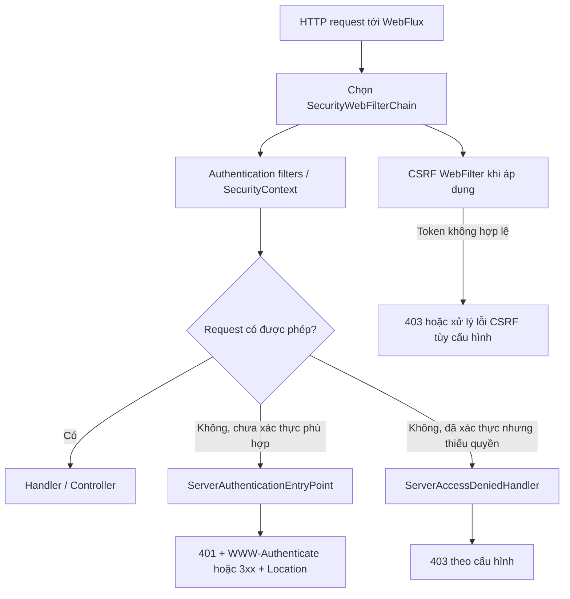

# Kiểm tra phản hồi 401, 403 hoặc chuyển hướng phù hợp cấu hình

## 1. Vấn đề: cùng là chưa được truy cập, tại sao phản hồi lại khác nhau?

Giả sử ứng dụng Spring WebFlux có ba nhóm người dùng: khách chưa đăng nhập, người dùng thường và quản trị viên. Khi gọi một tài nguyên được bảo vệ, chúng ta có thể quan sát những kết quả khác nhau:

- **401 Unauthorized:** request chưa có xác thực phù hợp hoặc credential không hợp lệ, trong cấu hình API sử dụng HTTP Basic/Bearer.
- **403 Forbidden:** request đã được xác thực nhưng thiếu quyền; hoặc request bị chặn bởi cơ chế khác như CSRF.
- **Chuyển hướng 3xx:** ứng dụng dành cho trình duyệt đưa người chưa đăng nhập đến trang login hoặc điểm bắt đầu OAuth2 authorization.

Không có quy tắc "hễ chưa đăng nhập thì luôn 401" áp dụng cho mọi ứng dụng Spring Security. Loại authentication mechanism, `ServerAuthenticationEntryPoint`, `ServerAccessDeniedHandler`, chính sách CSRF và matcher chọn `SecurityWebFilterChain` sẽ quyết định kết quả. Vì vậy bài kiểm thử cần **khẳng định đúng hợp đồng HTTP của ứng dụng**, đồng thời xác định được nguyên nhân dẫn đến status.

Đây là bài trong chương **Danh tính Reactive**, thuộc module **SPRING_SECURITY_TESTING**. Module tập trung vào cách kiểm chứng authentication, authorization và bảo vệ HTTP bằng `spring-security-test`; bài này thực hành với **WebTestClient** và `SecurityWebFilterChain` trên WebFlux. Các kiểm thử Servlet/MockMvc có nguyên tắc tương tự nhưng sử dụng hạ tầng khác.

Sau bài này, người học có thể:

1. Phân biệt lỗi authentication với lỗi authorization qua ngữ cảnh và phản hồi HTTP.
2. Dựng WebTestClient đi qua chuỗi filter Reactive thật, rồi viết ca 200, 401 và 403.
3. Kiểm tra cả status, header `WWW-Authenticate`/`Location` và nội dung response khi cấu hình yêu cầu.
4. Viết ca CSRF để tránh kết luận sai rằng mọi 403 là do thiếu role.
5. Phân biệt Basic, form login, OAuth2/OIDC login và resource server Bearer.
6. Xác định giới hạn của `mockUser()`, `mockJwt()` và khi nào phải test credential/token thực.

## 2. Các thành phần quyết định phản hồi trong WebFlux Security

Ở WebFlux, security được thực thi bằng các `WebFilter` và `SecurityWebFilterChain` thay vì Servlet `Filter`. Một request đi qua chain được chọn theo matcher và thứ tự ưu tiên.



| Thành phần | Vai trò | Tác động thường quan sát |
| --- | --- | --- |
| `SecurityWebFilterChain` | Xác định các WebFilter và policy áp dụng theo request matcher | Một path có thể dùng Basic, path khác form login hoặc Bearer |
| `AuthenticationWebFilter` và các filter liên quan | Xử lý thông tin xác thực | Credential sai có thể kích hoạt entry point |
| `ReactiveSecurityContextHolder` | Truy xuất SecurityContext trong Reactor Context | `Authentication` có/không có ảnh hưởng phân quyền |
| `AuthorizationWebFilter` | Thực hiện `authorizeExchange` | Đủ quyền thì đi tiếp; thiếu quyền thì từ chối |
| `ServerAuthenticationEntryPoint` | Bắt đầu xác thực khi cần | Trả 401/challenge hoặc redirect, tùy cấu hình |
| `ServerAccessDeniedHandler` | Phản hồi khi quyền truy cập bị từ chối | Thường trả 403 |
| `CsrfWebFilter` | Bảo vệ thao tác có khả năng thay đổi trạng thái | POST/PUT/PATCH/DELETE thiếu token có thể trả 403 |

**401 không có nghĩa tài khoản chắc chắn tồn tại hay mật khẩu chắc chắn sai.** Nó diễn tả rằng request chưa đáp ứng yêu cầu xác thực theo cơ chế server lựa chọn. **403 cũng không tự chứng minh thiếu role**; kiểm tra CSRF, matcher, method security hoặc chính sách tùy chỉnh trước khi kết luận.

### 2.1. Phân biệt ba tình huống bằng hai câu hỏi

1. Request có một `Authentication` hợp lệ cho cơ chế đang dùng không?
2. Với Authentication đó, security policy có cho phép HTTP method và path này không?

Nếu câu 1 là "chưa" và endpoint yêu cầu xác thực, entry point quyết định yêu cầu đăng nhập như thế nào. Nếu câu 1 là "có" nhưng câu 2 là "không", handler từ chối quyền thường trả 403. Một WebFilter khác như CSRF có thể từ chối request trước khi bài kiểm thử kịp quan sát rule phân quyền.

## 3. Bảng kỳ vọng theo cơ chế xác thực

| Cấu hình đang được dùng | Khi thiếu credential | Khi credential sai | Đã xác thực nhưng thiếu authority |
| --- | --- | --- | --- |
| HTTP Basic API | 401, thường có `WWW-Authenticate: Basic ...` | 401 | 403 |
| OAuth2 Resource Server với Bearer | 401, thường có Bearer challenge | 401; có thể có mã lỗi Bearer phù hợp | 403, có thể kèm `insufficient_scope` |
| Form Login cho trình duyệt | Thường 302 đến trang login | Thường redirect đến login có thông tin lỗi | 403 |
| OAuth2/OIDC Login | Có thể redirect tới login page hoặc authorization endpoint theo cấu hình | Quy trình failure handler định nghĩa kết quả | 403 |
| Entry point/denied handler tùy chỉnh | Theo hợp đồng do ứng dụng thiết lập | Theo cách xử lý được cấu hình | Theo handler được cấu hình |

**Điểm cần lưu ý:** bảng nêu các phản hồi phổ biến, không phải một tập status cứng của framework. Ví dụ, request API của ứng dụng dùng form login có thể được tùy chỉnh trả 401 thay vì redirect; ứng dụng dùng nhiều chain có thể chọn cơ chế khác nhau cho cùng một người gọi.

Trong test, đừng chỉ ghi:

```java
client.get().uri("/api/private")
    .exchange()
    .expectStatus().is4xxClientError();
```

Assertion trên quá rộng: cả 401 và 403 đều vượt qua, khiến lỗi cấu hình entry point hoặc authorization không được phát hiện. Khi đã biết hợp đồng, dùng `isUnauthorized()`, `isForbidden()`, hoặc xác nhận `Location` của redirect.

## 4. Chuẩn bị ứng dụng WebFlux mẫu với HTTP Basic

Ví dụ chính sử dụng Spring Security trên WebFlux và `WebTestClient` trong môi trường test. Các dependency thường dùng với Spring Boot 3.x:

```groovy
dependencies {
    implementation 'org.springframework.boot:spring-boot-starter-webflux'
    implementation 'org.springframework.boot:spring-boot-starter-security'
    testImplementation 'org.springframework.boot:spring-boot-starter-test'
    testImplementation 'org.springframework.security:spring-security-test'
}
```

Với Spring Boot 4.x, test starter của WebFlux có thể được tách thành `spring-boot-starter-webflux-test`. Dùng các artifact tương ứng phiên bản đang chạy; không trộn import của Boot 3 và Boot 4. Mẫu test ở phần sau tạo client bằng Spring Test nên ít phụ thuộc vào annotation test riêng của Boot.

### 4.1. Controller có tài nguyên công khai và tài nguyên bảo vệ

```java
import org.springframework.http.MediaType;
import org.springframework.web.bind.annotation.*;
import reactor.core.publisher.Mono;

@RestController
class DocumentController {

    @GetMapping("/public/ping")
    Mono<String> ping() {
        return Mono.just("pong");
    }

    @GetMapping("/api/documents")
    Mono<String> list() {
        return Mono.just("documents");
    }

    @GetMapping("/api/documents/admin")
    Mono<String> admin() {
        return Mono.just("admin-data");
    }

    @PostMapping(
        path = "/api/documents",
        consumes = MediaType.TEXT_PLAIN_VALUE)
    Mono<String> create(@RequestBody String content) {
        return Mono.just("saved:" + content);
    }
}
```

### 4.2. SecurityWebFilterChain xác định policy cụ thể

```java
import org.springframework.context.annotation.Bean;
import org.springframework.context.annotation.Configuration;
import org.springframework.http.HttpMethod;
import org.springframework.security.config.Customizer;
import org.springframework.security.config.annotation.web.reactive.EnableWebFluxSecurity;
import org.springframework.security.config.web.server.ServerHttpSecurity;
import org.springframework.security.core.userdetails.MapReactiveUserDetailsService;
import org.springframework.security.core.userdetails.User;
import org.springframework.security.core.userdetails.UserDetails;
import org.springframework.security.web.server.SecurityWebFilterChain;

@Configuration
@EnableWebFluxSecurity
class ApiSecurityConfig {

    @Bean
    SecurityWebFilterChain apiSecurity(ServerHttpSecurity http) {
        return http
            .authorizeExchange(exchanges -> exchanges
                .pathMatchers(HttpMethod.GET, "/public/ping")
                    .permitAll()
                .pathMatchers(HttpMethod.GET, "/api/documents/admin")
                    .hasRole("ADMIN")
                .pathMatchers(HttpMethod.POST, "/api/documents")
                    .hasRole("EDITOR")
                .pathMatchers(HttpMethod.GET, "/api/documents")
                    .authenticated()
                .anyExchange()
                    .denyAll())
            .httpBasic(Customizer.withDefaults())
            .formLogin(form -> form.disable())
            .csrf(Customizer.withDefaults())
            .build();
    }

    @Bean
    MapReactiveUserDetailsService users() {
        UserDetails reader = User.withUsername("alice")
            .password("{noop}secret")
            .roles("READER")
            .build();
        UserDetails editor = User.withUsername("bob")
            .password("{noop}secret")
            .roles("EDITOR")
            .build();
        UserDetails admin = User.withUsername("root")
            .password("{noop}secret")
            .roles("ADMIN")
            .build();
        return new MapReactiveUserDetailsService(reader, editor, admin);
    }
}
```

Ở đây:

- `GET /public/ping` cho phép anonymous.
- `GET /api/documents` yêu cầu bất kỳ người dùng đã xác thực.
- `GET /api/documents/admin` yêu cầu `ROLE_ADMIN`.
- `POST /api/documents` yêu cầu `ROLE_EDITOR` **và** tuân theo CSRF.
- HTTP Basic được bật, form login bị tắt, nên anonymous đến tài nguyên bảo vệ thường nhận **401**, thay vì chuyển hướng tới trang login.
- `anyExchange().denyAll()` đóng những đường dẫn còn lại. Đừng dùng status của đường dẫn không tồn tại để thay kết luận về controller route có thật.

`{noop}` và credential ở đây chỉ phục vụ bài học, không phù hợp lưu mật khẩu production. Không tắt CSRF hoặc dùng cấu hình yếu để làm test đỗ.

## 5. Thiết lập WebTestClient chạy qua SecurityWebFilterChain thật

Để kiểm chứng policy, client phải được gắn vào application context có WebFlux và security filter:

```java
import org.springframework.context.annotation.Configuration;
import org.springframework.web.reactive.config.EnableWebFlux;

@Configuration
@EnableWebFlux
class TestWebFluxConfig {
}
```

Với JUnit Jupiter và `@SpringJUnitConfig`:

```java
import org.junit.jupiter.api.BeforeEach;
import org.junit.jupiter.api.Test;
import org.springframework.beans.factory.annotation.Autowired;
import org.springframework.context.ApplicationContext;
import org.springframework.http.HttpHeaders;
import org.springframework.http.MediaType;
import org.springframework.test.context.junit.jupiter.SpringJUnitConfig;
import org.springframework.test.web.reactive.server.WebTestClient;

import static org.springframework.security.test.web.reactive.server
    .SecurityMockServerConfigurers.csrf;
import static org.springframework.security.test.web.reactive.server
    .SecurityMockServerConfigurers.mockUser;
import static org.springframework.security.test.web.reactive.server
    .SecurityMockServerConfigurers.springSecurity;

@SpringJUnitConfig(classes = {
    TestWebFluxConfig.class,
    ApiSecurityConfig.class,
    DocumentController.class
})
class ReactiveIdentityHttpTest {

    @Autowired
    ApplicationContext context;

    WebTestClient client;

    @BeforeEach
    void prepareClient() {
        client = WebTestClient.bindToApplicationContext(context)
            .apply(springSecurity())
            .configureClient()
            .build();
    }

    @Test
    void anonymousMayAccessPublicEndpoint() {
        client.get().uri("/public/ping")
            .exchange()
            .expectStatus().isOk()
            .expectBody(String.class).isEqualTo("pong");
    }

    @Test
    void anonymousGets401OnProtectedBasicEndpoint() {
        client.get().uri("/api/documents")
            .exchange()
            .expectStatus().isUnauthorized()
            .expectHeader()
            .valueMatches(HttpHeaders.WWW_AUTHENTICATE, "(?i)^Basic.*");
    }

    @Test
    void wrongBasicPasswordGets401() {
        client.get().uri("/api/documents")
            .headers(headers -> headers.setBasicAuth("alice", "wrong"))
            .exchange()
            .expectStatus().isUnauthorized();
    }

    @Test
    void correctBasicPasswordAllowsReader() {
        client.get().uri("/api/documents")
            .headers(headers -> headers.setBasicAuth("alice", "secret"))
            .exchange()
            .expectStatus().isOk()
            .expectBody(String.class).isEqualTo("documents");
    }

    @Test
    void authenticatedReaderGets403OnAdminEndpoint() {
        client.mutateWith(mockUser("alice").roles("READER"))
            .get().uri("/api/documents/admin")
            .exchange()
            .expectStatus().isForbidden();
    }

    @Test
    void adminIsAllowed() {
        client.mutateWith(mockUser("root").roles("ADMIN"))
            .get().uri("/api/documents/admin")
            .exchange()
            .expectStatus().isOk()
            .expectBody(String.class).isEqualTo("admin-data");
    }

    @Test
    void editorWithoutCsrfGets403() {
        client.mutateWith(mockUser("bob").roles("EDITOR"))
            .post().uri("/api/documents")
            .contentType(MediaType.TEXT_PLAIN)
            .bodyValue("draft")
            .exchange()
            .expectStatus().isForbidden();
    }

    @Test
    void readerWithCsrfStillLacksEditorRole() {
        client.mutateWith(mockUser("alice").roles("READER"))
            .mutateWith(csrf())
            .post().uri("/api/documents")
            .contentType(MediaType.TEXT_PLAIN)
            .bodyValue("draft")
            .exchange()
            .expectStatus().isForbidden();
    }

    @Test
    void editorWithCsrfMayWrite() {
        client.mutateWith(mockUser("bob").roles("EDITOR"))
            .mutateWith(csrf())
            .post().uri("/api/documents")
            .contentType(MediaType.TEXT_PLAIN)
            .bodyValue("draft")
            .exchange()
            .expectStatus().isOk()
            .expectBody(String.class).isEqualTo("saved:draft");
    }
}
```

Phần quan trọng nhất của setup là:

```java
WebTestClient.bindToApplicationContext(context)
    .apply(springSecurity())
    .configureClient()
    .build();
```

`bindToApplicationContext` nạp các thành phần WebFlux từ context; `springSecurity()` bảo đảm test áp dụng tích hợp Spring Security tương ứng. Nếu chỉ dùng `WebTestClient.bindToController(new DocumentController()).build()`, request có thể bỏ qua bảo mật HTTP. Một test nhận 200 khi không có filter chain **không chứng minh** rằng endpoint cho phép anonymous ở production.

### 5.1. Đọc kết quả đúng cách

| Test | Mục tiêu chính | Bằng chứng |
| --- | --- | --- |
| Anonymous gọi API bảo vệ | Authentication entry point hoạt động | 401 và Basic challenge |
| Basic password sai | Credential bị từ chối | 401 |
| Basic password đúng | Authentication thật qua Reactive authentication pipeline | 200 |
| Reader gọi admin | Authorization chặn thiếu authority | 403 |
| Admin gọi admin | Authorization cho phép đúng role | 200 và body |
| Editor POST thiếu CSRF | CSRF protection hoạt động | 403 |
| Reader POST có CSRF | Tách CSRF khỏi quyền | Vẫn 403 do thiếu role |
| Editor POST có CSRF | Đồng thời vượt qua CSRF và quyền | 200 |

`mockUser()` tạo Authentication giả cho request; nó kiểm chứng **đường phân quyền**, không chạy xác minh mật khẩu. Hai test Basic sử dụng `setBasicAuth(...)` mới đi qua cơ chế authentication dựa trên thông tin đăng nhập được cấu hình trong ví dụ.

## 6. Cách xác minh 401 đầy đủ: status, challenge và thông tin không bị lộ

Nếu ứng dụng là API dùng HTTP Basic, test một 401 nên xem xét:

```java
client.get().uri("/api/documents")
    .exchange()
    .expectStatus().isUnauthorized()
    .expectHeader()
    .valueMatches(HttpHeaders.WWW_AUTHENTICATE, "(?i)^Basic.*");
```

Header `WWW-Authenticate` là một phần của protocol HTTP authentication. Với Basic, server thường phát challenge chứa `Basic` và có thể có `realm`. Đừng cố assert realm khi ứng dụng chưa cam kết giá trị cụ thể. Với Bearer, header thường bắt đầu bằng `Bearer` và có thể có các tham số như `error`, `error_description` hoặc `scope` theo cơ chế xử lý lỗi.

Khi service công bố API error schema, bổ sung assertion cho JSON. Ví dụ nếu ứng dụng **chủ động định nghĩa** response như sau:

```json
{
  "code": "UNAUTHENTICATED",
  "message": "Authentication required"
}
```

thì test có thể thêm:

```java
.expectBody()
.jsonPath("$.code").isEqualTo("UNAUTHENTICATED");
```

Đây là ví dụ **hợp đồng lỗi của ứng dụng**, không phải định dạng JSON mặc định mà Spring Security phải tạo. Với entry point trả response không có body, assert JSON sẽ sai. Quan sát status/header của cơ chế hiện có trước khi xây assertion về body.

### 6.1. Không đánh đồng 401 với 404 hoặc 500

Test bảo mật cần gọi **endpoint tồn tại** đã được bảo vệ. Gọi `/api/not-exist` rồi nhận 404 không nói lên điều gì chắc chắn về API authorization. Gặp 500 thì đó là lỗi của ứng dụng/test setup, không phải một cách từ chối access hợp lệ. Các assertion rộng như `is4xxClientError()` hoặc `is5xxServerError()` làm mất ý nghĩa của bài test security.

## 7. Cách xác minh 403 đúng nguyên nhân

Lỗi authorization có thể do role, authority hoặc rule nghiệp vụ. Ví dụ:

```java
client.mutateWith(mockUser("alice").roles("READER"))
    .get().uri("/api/documents/admin")
    .exchange()
    .expectStatus().isForbidden();
```

`roles("READER")` tạo authority `ROLE_READER`; trong policy, `hasRole("ADMIN")` kiểm tra `ROLE_ADMIN`. Đừng nhầm `hasAuthority("ADMIN")` với `hasRole("ADMIN")` vì chúng so khớp chuỗi khác nhau. Nếu hệ thống có custom role prefix, cách suy luận phải theo config thực.

Để chứng minh 403 xuất phát từ **thiếu role**, hãy dùng GET (không bị CSRF chặn), người dùng đã có Authentication, và test đối chứng với một user có role đủ. Với POST, cần truyền CSRF token hợp lệ vào cả ca đủ quyền và thiếu quyền. Nếu cả hai cùng bị 403 khi thiếu CSRF, test không thể kết luận chính xác quyền đã được kiểm tra hay chưa.

### 7.1. Ma trận nguyên nhân 403 cho POST

| Authentication | Role yêu cầu | CSRF | Kết quả thường gặp |
| --- | --- | --- | --- |
| Writer | Đủ | Thiếu | 403 do CSRF |
| Reader | Thiếu | Có | 403 do authorization |
| Writer | Đủ | Có | Cho phép nếu request hợp lệ |
| Anonymous | Không có | Thiếu | Có thể 403 trước khi đến entry point vì CSRF |
| Anonymous | Không có | Có | Entry point xử lý việc thiếu authentication, thường 401 ở Basic API |

Thứ tự WebFilter và chính sách tùy chỉnh ảnh hưởng tình huống nào được xử lý trước. Để kiểm tra **401 khi anonymous POST**, hãy tạo request có CSRF hợp lệ nhằm loại bỏ yếu tố CSRF, thay vì kỳ vọng mọi POST anonymous phải trả 401.

### 7.2. Sự khác biệt giữa HTTP authorization và method security

Với `@EnableReactiveMethodSecurity` và `@PreAuthorize`, một service hoặc controller method có thể bị từ chối ngay cả khi `authorizeExchange` đã cho request đi qua. Test chỉ khẳng định "thiếu quyền trả 403" phải biết rule nằm ở HTTP security, method security, hay cả hai.

Một ca kiểm tra method security phải gọi bean đã được Spring proxy trong context:

```java
@Service
class AuditService {
    @PreAuthorize("hasRole('AUDITOR')")
    Mono<String> viewAudit() {
        return Mono.just("audit");
    }
}
```

Khi bật `@EnableReactiveMethodSecurity` và controller gọi service trên, cần test người dùng có và không có `ROLE_AUDITOR`. Gọi `new AuditService().viewAudit()` trực tiếp sẽ bỏ qua AOP proxy và không xác minh method security.

## 8. Form Login: khi kết quả đúng là chuyển hướng

Giả sử ứng dụng dành cho người dùng trình duyệt, dùng form login và không dùng HTTP Basic. Khi anonymous truy cập tài nguyên bảo vệ, Spring Security thường yêu cầu chuyển đến trang login thay vì trả 401 dạng API.

**Cấu hình minh họa riêng**, không chồng trực tiếp lên security chain Basic ở mục 4:

```java
@Bean
SecurityWebFilterChain browserSecurity(ServerHttpSecurity http) {
    return http
        .authorizeExchange(exchanges -> exchanges
            .pathMatchers("/login", "/public/**").permitAll()
            .anyExchange().authenticated())
        .httpBasic(basic -> basic.disable())
        .formLogin(Customizer.withDefaults())
        .build();
}
```

Với cấu hình form login mặc định và route `GET /private` tồn tại:

```java
client.get().uri("/private")
    .exchange()
    .expectStatus().is3xxRedirection()
    .expectHeader()
    .valueMatches(HttpHeaders.LOCATION, ".*/login(?:\\?.*)?");
```

Điểm cần kiểm tra là **header `Location` dẫn tới đích đăng nhập được cấu hình**. Dùng `is3xxRedirection()` nếu hợp đồng chỉ yêu cầu redirect, hoặc `isFound()` nếu ứng dụng cam kết cụ thể HTTP 302. Không coi URL `/login` là giá trị bất biến: ứng dụng có thể dùng `/sign-in`, redirect tùy request, hoặc một custom authentication entry point.

Nếu cấu hình trang login tự viết, phải cung cấp route tương ứng và kiểm tra rằng trang login không tự bị bảo vệ gây redirect loop. Spring Security có thể cung cấp trang login mặc định khi form login được bật theo cách phù hợp; việc dùng `loginPage(...)` tùy chỉnh thường đòi hỏi ứng dụng cung cấp trang đó.

### 8.1. Redirect sau login thất bại là một ca khác

Anonymous truy cập tài nguyên bảo vệ và login sai password **không cùng một luồng**. Luồng đầu sử dụng authentication entry point; luồng sau đi qua authentication failure handler. Cả hai có thể redirect nhưng đến vị trí khác nhau, chẳng hạn `/login` và `/login?error`.

Với form login bật CSRF, POST login phải có CSRF token hợp lệ. Dùng `csrf()` trong WebTestClient khi kiểm tra submission, sau đó assert redirect/location theo chính sách của ứng dụng. Một test chỉ dùng `mockUser()` sẽ bỏ qua form credential processing và không chứng minh login success/failure handler.

## 9. OAuth2/OIDC Login: redirect không nhất thiết trỏ thẳng tới IdP

Ở OAuth2/OIDC Login, một ứng dụng có thể dẫn người dùng tới:

- Trang chọn nhà cung cấp danh tính do ứng dụng hiển thị.
- Endpoint bắt đầu authorization của Spring Security, thường có dạng `/oauth2/authorization/{registrationId}`.
- Authorization endpoint thực tế của IdP, kèm các tham số theo OAuth2 Authorization Code (ví dụ `client_id`, `redirect_uri`, `state`, `scope` và PKCE nếu được cấu hình).

**Đích cụ thể phụ thuộc cấu hình**, số `ClientRegistration`, login page và các handler. Không tự khẳng định mọi anonymous request phải redirect trực tiếp tới `https://idp.example...`.

Một test redirect nên:

1. Gửi GET tới endpoint ứng dụng được bảo vệ mà không có Authentication.
2. Assert status redirect theo policy.
3. Assert `Location` có đích hợp lệ được ứng dụng định nghĩa.
4. Nếu thực sự bắt đầu OAuth2 authorization, kiểm tra `state` không rỗng và các tham số bắt buộc ở redirect theo hợp đồng.
5. Tránh assert nguyên URL có `state` ngẫu nhiên; nên parse URI rồi đối chiếu các thành phần ổn định.

```java
client.get().uri("/private")
    .exchange()
    .expectStatus().is3xxRedirection()
    .expectHeader()
    .valueMatches(HttpHeaders.LOCATION, ".+");
```

Test trên chỉ là assertion sơ bộ; test đầy đủ cần xác minh đích `Location`. Một redirect hợp lệ tới trang login không chứng minh đã đổi authorization code thành token, xác minh ID Token, hay gọi UserInfo. Những bước đó cần integration test với authorization server giả/được kiểm soát.

## 10. Resource Server Bearer: 401 và 403 với WWW-Authenticate

Ứng dụng bảo vệ API bằng bearer JWT/opaque token có đặc tính phản hồi khác form login. Một endpoint yêu cầu scope `reports.read` có thể dùng policy:

```java
@Bean
SecurityWebFilterChain bearerApi(ServerHttpSecurity http) {
    return http
        .securityMatcher(
            new PathPatternParserServerWebExchangeMatcher("/api/**"))
        .authorizeExchange(exchanges -> exchanges
            .pathMatchers("/api/reports/**")
                .hasAuthority("SCOPE_reports.read")
            .anyExchange().authenticated())
        .oauth2ResourceServer(oauth2 -> oauth2.jwt(
            Customizer.withDefaults()))
        .csrf(csrf -> csrf.disable())
        .build();
}
```

Đây là **mẫu cấu hình riêng dành cho API dùng bearer token trong header**, không áp dụng mặc định cho endpoint dựa vào cookie/session. Khi tạo SecurityWebFilterChain này, context cần `ReactiveJwtDecoder` hoặc decoder được cấu hình hợp lệ để xác thực JWT thật. Không nên tắt CSRF của mọi ứng dụng chỉ vì tài nguyên dùng OAuth2; policy phải dựa trên cách credential được gửi và bề mặt tấn công của ứng dụng.

Khi đã có reactive resource server context với decoder phù hợp, có thể kiểm tra authorization bằng mock JWT:

```java
import static org.springframework.security.test.web.reactive.server
    .SecurityMockServerConfigurers.mockJwt;

client.mutateWith(mockJwt().authorities(
        new SimpleGrantedAuthority("SCOPE_reports.read")))
    .get().uri("/api/reports/annual")
    .exchange()
    .expectStatus().isOk();

client.mutateWith(mockJwt().authorities(
        new SimpleGrantedAuthority("SCOPE_profile")))
    .get().uri("/api/reports/annual")
    .exchange()
    .expectStatus().isForbidden();
```

Những snippet này cần endpoint `/api/reports/annual` tồn tại và resource-server chain riêng. `mockJwt()` thiết lập JWT Authentication giả để kiểm tra **HTTP authorization**, không gọi JWT decoder để kiểm chứng chữ ký, issuer, audience hay JWK Set.

Với request thiếu bearer token:

```java
client.get().uri("/api/reports/annual")
    .exchange()
    .expectStatus().isUnauthorized()
    .expectHeader()
    .valueMatches(HttpHeaders.WWW_AUTHENTICATE, "(?i)^Bearer.*");
```

Với token hết hạn hoặc chữ ký sai, muốn kiểm chứng **decoder thực sự từ chối**, phải gửi raw `Authorization: Bearer ...` qua resource server có decoder/test key hoặc JWKS stub phù hợp. Không tạo `mockJwt().jwt(jwt -> ...)` rồi cho rằng test đã chứng minh bước validate chữ ký và thời hạn.

### 10.1. Khi nào thiếu scope tạo 403?

Nếu JWT đã được xác thực và mapped authorities không chứa scope bắt buộc, `hasAuthority("SCOPE_reports.read")` từ chối truy cập. Hãy tạo hai case cùng endpoint, một JWT mock có authority này và một JWT mock thiếu authority. Nếu cần kiểm tra **claim `scope` thực sự được chuyển thành `SCOPE_*`**, phải test converter và mapper riêng; `mockJwt().authorities(...)` đã cung cấp sẵn kết quả mapping.

Trong Bearer token protocol, khi thiếu quyền, `WWW-Authenticate` có thể chứa `error="insufficient_scope"`. Giá trị chính xác tùy error handler và context; chỉ assert thông tin này khi ứng dụng công bố và thực sự phát hành nó.

## 11. Nhiều SecurityWebFilterChain: cùng một anonymous nhưng khác status

Một ứng dụng có thể phục vụ API và giao diện trình duyệt trên cùng hostname. Ví dụ:

- `/api/**` dùng HTTP Basic hoặc Bearer, nên anonymous được yêu cầu xác thực bằng HTTP 401.
- `/portal/**` dùng form login, nên anonymous được redirect.

Các chain được lựa chọn **theo matcher và thứ tự**, không gộp toàn bộ authentication mechanisms của tất cả chain:

```java
@Bean
@Order(1)
SecurityWebFilterChain apiChain(ServerHttpSecurity http) {
    return http
        .securityMatcher(
            new PathPatternParserServerWebExchangeMatcher("/api/**"))
        .authorizeExchange(exchanges -> exchanges
            .anyExchange().authenticated())
        .httpBasic(Customizer.withDefaults())
        .formLogin(form -> form.disable())
        .build();
}

@Bean
@Order(2)
SecurityWebFilterChain portalChain(ServerHttpSecurity http) {
    return http
        .securityMatcher(
            new PathPatternParserServerWebExchangeMatcher("/portal/**"))
        .authorizeExchange(exchanges -> exchanges
            .anyExchange().authenticated())
        .httpBasic(basic -> basic.disable())
        .formLogin(Customizer.withDefaults())
        .build();
}
```

Ví dụ trên minh họa nguyên tắc chain selection; khi dùng trong dự án thật, cần bảo đảm đường dẫn login, resource công khai và callback login cũng khớp chain có cơ chế phù hợp. Nếu login page mặc định ở `/login` nhưng portal chain chỉ match `/portal/**`, phải bổ sung một chain hoặc matcher phù hợp để xử lý `/login`; không copy đoạn code trên thành production config mà bỏ qua các endpoint hỗ trợ đăng nhập.

Với cấu hình hoàn chỉnh, test nên có:

```java
client.get().uri("/api/notes")
    .exchange()
    .expectStatus().isUnauthorized();

client.get().uri("/portal/home")
    .exchange()
    .expectStatus().is3xxRedirection()
    .expectHeader()
    .valueMatches(HttpHeaders.LOCATION, ".*/login(?:\\?.*)?");
```

Hai test ở đây cần **hai route tồn tại** tương ứng. Việc khác status là điều đúng khi hai chain có chính sách khác nhau. Nếu chain API có `securityMatcher` sai hoặc `@Order` bị đảo dẫn tới một chain catch-all đứng trước, test phải bắt được sự thay đổi này.

### 11.1. Cách phát hiện matcher quá rộng

Nếu bạn viết `pathMatchers("/api/**").permitAll()` trước `pathMatchers("/api/admin/**").hasRole("ADMIN")` trong cùng chain, quy tắc rộng có thể khiến quy tắc admin không còn hiệu lực. Tương tự, đặt chain không có matcher lên trước chain API có thể khiến request API bị chuyển sang login. Hãy kiểm tra:

| Route | Anonymous | User thiếu quyền | User đủ quyền |
| --- | --- | --- | --- |
| API công khai | 200 | 200 | 200 |
| API Basic/Bearer bảo vệ | 401 | 403 nếu rule yêu cầu quyền cụ thể | 200 |
| Trang portal yêu cầu login | 3xx + Location | 403 nếu thiếu quyền | 200 |
| Callback/login endpoint | Theo hợp đồng của flow | Theo hợp đồng | Theo hợp đồng |

Đảm bảo các route này được khai báo thật, không dùng đường dẫn không có handler để suy đoán về authorization.

## 12. Vai trò của SecurityContext và mock authentication trong test

Trong WebFlux, `SecurityContext` theo Reactor Context. `spring-security-test` hỗ trợ nhiều mutator:

| API test | Principal mô phỏng | Kiểm thử được | Chưa kiểm thử được |
| --- | --- | --- | --- |
| `mockUser("alice").roles("USER")` | Username/role | Quyết định authorization từ authorities | Đọc password và login thực |
| `@WithMockUser` | Authentication do test listener tạo | Authorization của method/HTTP trong test thích hợp | Chứng thực credential |
| `mockJwt()` | JWT Authentication giả | Quy tắc authority/scope đã cấp sẵn | JWT decoder/JWKS/signature |
| `mockOAuth2Login()` | OAuth2 principal đã đăng nhập | Quyền theo principal OAuth2 | Authorization code/token exchange |
| `mockOidcLogin()` | OIDC principal với ID Token giả | Claims downstream và quyền đã cấp | Xác minh ID Token/nonce/issuer |
| `mockOpaqueToken()` | Principal token mờ giả | Authorization sau introspection | HTTP introspection thật |
| `csrf()` | CSRF token cho mock request | CSRF policy của WebFilter | Chính sách cookie trình duyệt/cross-site thực |

Đừng dùng `mockUser()` để dự đoán nhánh xử lý "password sai trả 401", vì helper này luôn đặt Authentication đã đăng nhập theo fixture. Đừng dùng `mockJwt()` để đo thời điểm token hết hạn; muốn kiểm tra decoding, hãy gửi bearer token thực sự qua decoder/test infrastructure.

### 12.1. Khi nào nên dùng `@WithMockUser`?

Annotation có thể giúp nhiều test dùng cùng danh tính:

```java
@Test
@WithMockUser(username = "alice", roles = "READER")
void readerCanReadDocuments() {
    client.get().uri("/api/documents")
        .exchange()
        .expectStatus().isOk();
}
```

Trong setup Spring Test, phải bảo đảm Spring Security Test listeners và `WebTestClient` được tích hợp chính xác. Nếu kiểm tra hiệu lực cho **một request cụ thể**, `client.mutateWith(mockUser(...))` minh bạch hơn, dễ so sánh anonymous với các quyền khác trong cùng test class.

## 13. Kiểm tra redirect đúng đích, không dựa vào status duy nhất

Với form/OAuth2 login, `is3xxRedirection()` chỉ cho biết server yêu cầu redirect, **không khẳng định redirect đó hợp lệ**. Một cấu hình sai có thể chuyển người dùng đến URL ngoài ý muốn hoặc lặp lại chính endpoint bị bảo vệ.

Trong test nên xem:

1. `Location` có mặt và dẫn tới trang login/authorization endpoint dự kiến.
2. Scheme, host và path không vượt ngoài allowlist của ứng dụng.
3. Các tham số redirect có giá trị hợp lệ và được encode đúng.
4. Nếu lưu original request để chuyển về sau login, redirect sau thành công không cho phép open redirect.
5. Không đưa access token, client secret, session id hoặc thông tin nhạy cảm vào URL ngoài yêu cầu giao thức.

Ví dụ nếu custom entry point bảo đảm luôn redirect đến `/sign-in`:

```java
client.get().uri("/private")
    .exchange()
    .expectStatus().is3xxRedirection()
    .expectHeader()
    .valueMatches(HttpHeaders.LOCATION, ".*/sign-in(?:\\?.*)?");
```

Đây là assertion đúng khi `/sign-in` là đích đã cấu hình; nếu app dùng `/login` hoặc IdP authorization endpoint, hãy kiểm tra đích tương ứng. Khi cần parse Location/URI, có thể đọc header từ `ExchangeResult` rồi dùng `java.net.URI` để đối chiếu path/query thay vì so nguyên string với giá trị random.

Đừng tự động follow redirect khi mục tiêu của test là kiểm tra entry point. Nếu client làm theo redirect, status cuối cùng có thể là 200 trang login và che mất HTTP 302 từ endpoint gốc.

## 14. Các lỗi kiểm thử dễ gây kết luận sai

**1. Anonymous trả 200 vì không có security filter.** Thường do dùng `bindToController(...)` thuần hoặc thiếu `.apply(springSecurity())` khi bind vào application context. Xác minh context có `SecurityWebFilterChain` và thử anonymous trên một endpoint chắc chắn được bảo vệ.

**2. Cố assert 401 cho ứng dụng dùng form login.** Khi chưa đăng nhập, form login thường redirect. Điều chỉnh expected status và `Location` theo entry point thật, hoặc cấu hình API entry point riêng nếu sản phẩm yêu cầu 401.

**3. Mọi POST anonymous đều bị kỳ vọng 401.** Khi CSRF bật, request POST thiếu token có thể bị 403 trước authorization. Thêm CSRF hợp lệ nếu đang chủ ý kiểm tra nhánh authentication.

**4. 403 bị kết luận là thiếu role dù CSRF chưa được đáp ứng.** Sử dụng GET hoặc đảm bảo POST có CSRF hợp lệ; bổ sung đối chứng user đủ/thiếu role.

**5. Chỉ kiểm tra status, quên header.** Basic/Bearer 401 thường cần `WWW-Authenticate`; redirect cần `Location`. Assert thêm header theo hợp đồng của authentication mechanism.

**6. Tạo user giả rồi khẳng định login thành công.** `mockUser()` bỏ qua password; `mockOAuth2Login()` bỏ qua IdP; `mockJwt()` bỏ qua decoder. Kiểm thử riêng cơ chế authentication với credential/token thực nếu đây là mục tiêu.

**7. Dùng `hasRole("ADMIN")` nhưng fixture chỉ có `ADMIN`.** Với role prefix mặc định, chính sách yêu cầu `ROLE_ADMIN`. Sử dụng `roles("ADMIN")` hoặc cấp authority đúng theo contract.

**8. Test trên URI không tồn tại.** Một 404 route không chứng minh request được cho phép hay bị từ chối đúng policy; tạo endpoint thật rồi test trên đó.

**9. Bật nhiều chain nhưng không kiểm tra thứ tự.** Catch-all chain có thể áp dụng sai entry point cho API. Dùng test cho cả `/api/**` lẫn `/portal/**`, với status/challenge/redirect khác nhau.

**10. So sánh nguyên URL OAuth2 chứa `state`.** State/PKCE có thể thay đổi theo request; parse URL rồi so những thành phần ổn định và điều kiện hợp lệ.

**11. Assertion quá rộng như `is4xxClientError()`.** Nó cho phép cả 401 và 403 và không bảo vệ hợp đồng của endpoint. Dùng exact status khi policy xác định.

**12. Tắt bảo vệ để làm test đỗ.** Nếu gặp 403 do CSRF, hãy bổ sung token cho test hợp lệ hoặc điều chỉnh chính sách theo threat model; không tắt security hoặc cho phép `permitAll()` bừa bãi.

**13. Trộn Servlet và Reactive.** `MockMvc` dùng Servlet filter chain, còn `WebTestClient` với WebFlux dùng reactive WebFilter. Không tự động giả định `@WithMockUser` hoặc `csrf()` ở hai stack dùng cùng một API static import.

## 15. Ma trận bài tập thực hành

| Bài tập | Chuẩn bị | Kỳ vọng cần chứng minh |
| --- | --- | --- |
| Public endpoint | `GET /public/ping` anonymous | 200 và body |
| Basic API chưa login | `GET /api/documents` không credential | 401 và `WWW-Authenticate: Basic` |
| Basic sai password | `setBasicAuth("alice", "wrong")` | 401 |
| Basic đúng password | `setBasicAuth("alice", "secret")` | 200 |
| Reader thiếu quyền | `mockUser("alice").roles("READER")` gọi admin | 403 |
| Admin đủ quyền | `mockUser("root").roles("ADMIN")` gọi admin | 200 |
| CSRF thiếu | Editor POST không CSRF | 403 |
| Role thiếu, CSRF đủ | Reader POST kèm `csrf()` | 403 |
| Role và CSRF đủ | Editor POST kèm `csrf()` | 200 |
| Form Login | GET protected endpoint anonymous trên chain form | 3xx và `Location` đến login |
| Bearer API | GET protected endpoint không bearer | 401 + Bearer challenge |
| Bearer thiếu scope | `mockJwt()` không có `SCOPE_reports.read` | 403 |
| Hai chain | GET API và portal anonymous | Status/entry point đúng từng path |
| Method security | Gọi bean reactive có `@PreAuthorize` | Đủ quyền được phép, thiếu quyền bị từ chối |

**Bài 1 — Đọc đường đi từ status.** Với config Basic ở mục 4, chạy các test trong mục 5. Giải thích vì sao `mockUser` reader truy cập admin bị 403 trong khi anonymous đọc tài liệu nhận 401.

**Bài 2 — Phân biệt CSRF và authorization.** Giữ nguyên path, user và body POST; thay riêng CSRF token, sau đó thay role. Quan sát cả hai lỗi 403 và chỉ ra mỗi test chứng minh cơ chế nào.

**Bài 3 — So sánh Basic và Form.** Tạo hai test context độc lập, một context chỉ bật HTTP Basic, context kia bật form login. Với cùng một protected route, assert 401/challenge ở Basic và 3xx/Location ở Form.

**Bài 4 — Resource Server.** Tạo chain Bearer riêng có decoder test. Dùng `mockJwt()` để kiểm tra scope đủ/thiếu; sau đó gửi một raw bearer token không hợp lệ để kiểm tra decoder/entry point thực sự từ chối và trả 401.

**Bài 5 — Nhiều chain.** Tạo chain API và portal với matcher/thứ tự rõ ràng. Đảm bảo test bắt được trường hợp chain portal chặn nhầm `/api/**` hoặc callback login không được chain thích hợp xử lý.

**Bài 6 — Header và redirect.** Bổ sung assertion cho `WWW-Authenticate` và `Location` trong từng loại test. Khi có query ngẫu nhiên, parse URI và chỉ so các ràng buộc ổn định.

Một bài làm đạt yêu cầu phải đưa ra được **bằng chứng từ WebTestClient rằng policy hiện hành tạo đúng 401, 403 hoặc redirect** và diễn giải rõ yếu tố đã kích hoạt phản hồi: thiếu authentication, thiếu authority, thiếu CSRF hay một authentication entry point dành cho trình duyệt.

## 16. Tài liệu tham khảo

- [Spring Security — Reactive Web Security](https://docs.spring.io/spring-security/reference/reactive/configuration/webflux.html): cấu hình `ServerHttpSecurity` và `SecurityWebFilterChain`.
- [Spring Security — Authorize ServerHttpRequest](https://docs.spring.io/spring-security/reference/reactive/authorization/authorize-http-requests.html): chính sách `authorizeExchange`.
- [Spring Security — WebTestClient Security Setup](https://docs.spring.io/spring-security/reference/reactive/test/web/setup.html): `bindToApplicationContext` và `springSecurity()`.
- [Spring Security — Testing Authentication](https://docs.spring.io/spring-security/reference/reactive/test/web/authentication.html): `mockUser()` và `@WithMockUser`.
- [Spring Security — Testing CSRF](https://docs.spring.io/spring-security/reference/reactive/test/web/csrf.html): kiểm thử CSRF bằng WebTestClient.
- [Spring Security — Testing OAuth2](https://docs.spring.io/spring-security/reference/reactive/test/web/oauth2.html): `mockJwt()`, `mockOAuth2Login()`, `mockOidcLogin()`.
- [Spring Security — Reactive OAuth2 Resource Server JWT](https://docs.spring.io/spring-security/reference/reactive/oauth2/resource-server/jwt.html): Bearer entry point và decoder.
- [Spring Framework — WebTestClient](https://docs.spring.io/spring-framework/reference/testing/webtestclient.html): cách tạo client với controller, context hoặc HTTP server.
