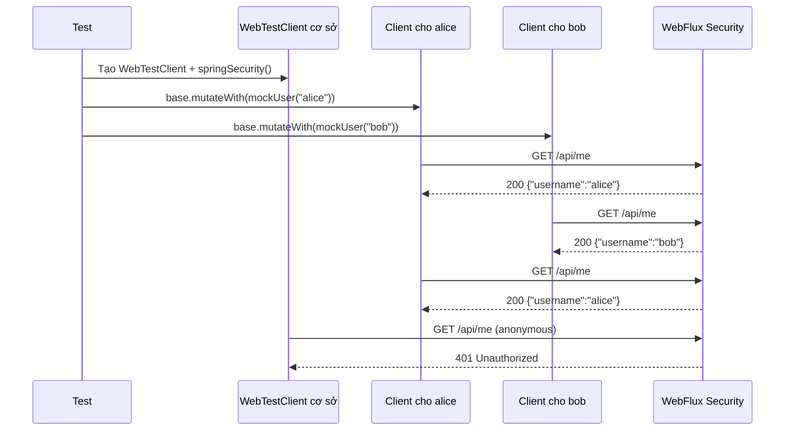

# Giữ danh tính độc lập giữa các request được tạo từ client

Trong Spring Security Reactive, mỗi HTTP request phải được xử lý với **danh tính của chính request đó**. Khi dùng `WebTestClient` và `spring-security-test`, bạn có thể tạo các request mang `alice`, `bob` hoặc anonymous trong cùng một bộ kiểm thử. Nếu vô tình gắn authentication của một người dùng lên client dùng chung, sử dụng nhầm `SecurityContextHolder` dạng ThreadLocal hoặc cache kết quả phụ thuộc danh tính, test rất dễ cho kết quả sai: request của `bob` có thể được nhận diện như `alice`.

Bài học thuộc module **SPRING_SECURITY_TESTING**, tập trung vào kiểm chứng xác thực, phân quyền và bảo vệ HTTP với `WebTestClient`. Chủ đề chính là **giữ danh tính độc lập giữa các request được tạo từ client**, trước hết với `mockUser()`, sau đó với `mockJwt()`, Bearer token giả qua decoder, và `ReactiveSecurityContextHolder`. Mục tiêu là tạo test chứng minh cả đường cho phép lẫn đường từ chối, đồng thời chứng minh client dùng chung không mang authentication còn sót lại.

## 1. Ranh giới danh tính trong ứng dụng Reactive

Với ứng dụng Servlet, lập trình viên thường gặp `SecurityContextHolder` gắn với thread đang xử lý request. Trong ứng dụng WebFlux, nhiều bước của cùng một pipeline có thể chạy trên những thread khác nhau. Spring Security Reactive cung cấp `ReactiveSecurityContextHolder`, dựa trên **Reactor Context được gắn với subscription**, để lấy `Authentication` đúng ở các bước reactive.

Hình dung ba request được phát từ một `WebTestClient` cơ sở:



Việc thử **alice → bob → alice → anonymous** là chủ ý: một test chỉ gọi `alice` rồi khẳng định `200` chưa thể chứng minh danh tính không bị rò rỉ giữa các request.

| Thành phần | Phạm vi | Hành vi cần giữ |
| --- | --- | --- |
| `WebTestClient` cơ sở | Cấu hình HTTP, codec và security test cho nhiều request | Không mang user cụ thể nếu muốn dùng cho nhiều danh tính |
| `client.mutateWith(mockUser(...))` | Cấu hình authentication kiểm thử trên client dẫn xuất | Danh tính của client dẫn xuất không tự sửa client cơ sở |
| `SecurityWebFilterChain` | Pipeline xử lý request reactive | Xác thực và phân quyền cho từng request |
| `ReactiveSecurityContextHolder` | Reactor Context của subscription | Trả authentication thuộc subscription hiện tại |
| `@WithMockUser` | Authentication giả ở phạm vi method test được cấu hình | Chỉ dùng cho đúng ca test; tránh thiết lập ở class khi cần anonymous |
| `Jwt/opaqueToken helpers` | Authentication giả cho JWT hoặc opaque token | Không xác minh token thật bằng mật mã hay introspection |

**Nguyên tắc:** khi muốn thử nhiều danh tính, hãy tạo **client dẫn xuất riêng** hoặc đặt credential riêng trên từng request. Luôn có một ca anonymous/không có quyền để kiểm tra ranh giới.

## 2. Tạo ứng dụng WebFlux tối thiểu để đọc danh tính

Ví dụ dùng Java 17+, Spring Boot 3.x, Spring WebFlux, Spring Security, Reactor và JUnit 5. Các đoạn Java bỏ `package`/`import` cho dễ tập trung vào cơ chế. Dự án kiểm thử cần có Spring Security Test.

```groovy
dependencies {
    implementation 'org.springframework.boot:spring-boot-starter-webflux'
    implementation 'org.springframework.boot:spring-boot-starter-security'

    testImplementation 'org.springframework.boot:spring-boot-starter-test'
    testImplementation 'org.springframework.security:spring-security-test'
}
```

### 2.1. Controller lấy identity từ Reactor Context

Ta tạo endpoint `/api/me` để trả tên người dùng hiện tại và endpoint `/api/reports` để minh họa phân quyền theo authority.

```java
record IdentityView(String username, List<String> authorities) {}

@RestController
@RequestMapping("/api")
class IdentityController {

    @GetMapping("/me")
    Mono<IdentityView> me() {
        return ReactiveSecurityContextHolder.getContext()
            .map(SecurityContext::getAuthentication)
            .map(auth -> new IdentityView(
                auth.getName(),
                auth.getAuthorities().stream()
                    .map(GrantedAuthority::getAuthority)
                    .sorted()
                    .toList()
            ));
    }

    @GetMapping("/reports")
    Mono<String> reports() {
        return Mono.just("reports-visible");
    }
}
```

`ReactiveSecurityContextHolder.getContext()` đọc từ **Reactor Context** của request đang chạy. Đừng tạo một biến `static Authentication currentUser`, `AtomicReference<Authentication>` dùng chung hoặc gắn danh tính vào field của singleton controller. Các cách đó làm request của người này có thể ghi đè trạng thái request của người khác.

Nếu muốn xử lý anonymous ngay trong controller, cần định nghĩa hành vi khi context không có authentication (chẳng hạn `switchIfEmpty(...)`). Trong ví dụ này `/api/me` yêu cầu đã xác thực, nên anonymous bị chặn bởi security chain trước khi vào controller.

### 2.2. SecurityWebFilterChain áp dụng cho từng request

```java
@Configuration(proxyBeanMethods = false)
@EnableWebFluxSecurity
class IdentitySecurityConfig {

    @Bean
    SecurityWebFilterChain securityWebFilterChain(ServerHttpSecurity http) {
        return http
            .authorizeExchange(exchanges -> exchanges
                .pathMatchers(HttpMethod.GET, "/api/reports")
                    .hasAuthority("SCOPE_reports.read")
                .pathMatchers(HttpMethod.GET, "/api/me")
                    .authenticated()
                .anyExchange().denyAll()
            )
            .httpBasic(Customizer.withDefaults())
            .build();
    }
}
```

Ví dụ chọn `httpBasic()` để HTTP entry point của request anonymous được xác định rõ: `GET /api/me` không có authentication trả `401 Unauthorized`. User đã được xác thực nhưng thiếu `SCOPE_reports.read` sẽ nhận `403 Forbidden` khi gọi `/api/reports`.

`mockUser()` mô phỏng authentication đã có, nên trong test này **không xác minh mật khẩu HTTP Basic**. Khi cần kiểm tra xử lý credential thật, phải gửi Authorization header và có `ReactiveAuthenticationManager`/user store thực trong phạm vi test.

## 3. Thiết lập WebTestClient và tạo client dẫn xuất cho từng người

Với `@WebFluxTest`, đưa cấu hình bảo mật vào slice bằng `@Import`. Nếu dùng client do Spring Boot tự cấp qua `@Autowired WebTestClient`, phải bảo đảm cấu hình kiểm thử đã gắn Spring Security. Ví dụ sau **tạo client cơ sở rõ ràng** để dễ quan sát phạm vi:

```java
@WebFluxTest(controllers = IdentityController.class)
@Import(IdentitySecurityConfig.class)
class IdentityIsolationTest {

    @Autowired
    ApplicationContext applicationContext;

    private WebTestClient baseClient;

    @BeforeEach
    void setUp() {
        baseClient = WebTestClient
            .bindToApplicationContext(applicationContext)
            .apply(springSecurity())
            .configureClient()
            .build();
    }

    private WebTestClient asReader(String username) {
        return baseClient.mutateWith(
            mockUser(username).authorities(
                new SimpleGrantedAuthority("SCOPE_reports.read")
            )
        );
    }

    @Test
    void aliceAndBobDoNotShareTheirIdentities() {
        WebTestClient aliceClient = asReader("alice");
        WebTestClient bobClient = asReader("bob");

        aliceClient.get()
            .uri("/api/me")
            .exchange()
            .expectStatus().isOk()
            .expectBody()
            .jsonPath("$.username").isEqualTo("alice");

        bobClient.get()
            .uri("/api/me")
            .exchange()
            .expectStatus().isOk()
            .expectBody()
            .jsonPath("$.username").isEqualTo("bob");

        // Gọi lại alice sau bob để phát hiện identity bị ghi đè.
        aliceClient.get()
            .uri("/api/me")
            .exchange()
            .expectStatus().isOk()
            .expectBody()
            .jsonPath("$.username").isEqualTo("alice");

        // Client cơ sở không được vô tình kế thừa identity.
        baseClient.get()
            .uri("/api/me")
            .exchange()
            .expectStatus().isUnauthorized();
    }
}
```

Các helper `springSecurity()` và `mockUser()` ở đây nằm trong `org.springframework.security.test.web.reactive.server.SecurityMockServerConfigurers`. `.apply(springSecurity())` gắn kiểm thử vào WebFlux security configuration; `.mutateWith(mockUser(...))` tạo biến thể client với authentication tương ứng.

Điểm cần nhớ:

- `baseClient` được dựng mới ở `@BeforeEach`, dùng như nền tảng cho các case trong một test.
- `aliceClient` và `bobClient` được dẫn xuất từ **cùng một baseClient** bằng các lời gọi `mutateWith(...)` riêng biệt.
- Sau khi gọi request của `bob`, request của `alice` vẫn phải trả `alice`.
- Request từ `baseClient` không mang authentication giả, nên phải bị từ chối theo policy ví dụ.

Không cần lưu `aliceClient` hoặc `bobClient` vào field `static` để chia sẻ giữa các test; tạo chúng gần nơi sử dụng giúp phạm vi danh tính dễ đọc và dễ kiểm soát.

### 3.1. Kiểm chứng danh tính và authority cùng lúc

Khi JSON trả về danh sách authorities, có thể khẳng định:

```java
aliceClient.get()
    .uri("/api/me")
    .exchange()
    .expectStatus().isOk()
    .expectBody()
    .jsonPath("$.username").isEqualTo("alice")
    .jsonPath("$.authorities[0]").isEqualTo("SCOPE_reports.read");
```

Test này xác nhận cả tên và authority hiện diện trong `SecurityContext`. Nó vẫn chỉ sử dụng authentication giả do helper tạo. Để kiểm tra một OAuth2 Resource Server có thực sự ánh xạ scope từ JWT/opaque token hay không, cần test riêng cho converter/introspector/decoder.

## 4. Kiểm tra quyền của hai request không chồng lên nhau

Bài kiểm thử ở mục 3 kiểm tra **identity**; bước tiếp theo kiểm tra **authority**. Một người có quyền đọc reports không được làm một client khác cũng có quyền đó.

Bổ sung vào `IdentityIsolationTest`:

```java
@Test
void authorityFromReaderDoesNotLeakToViewer() {
    WebTestClient readerClient = baseClient.mutateWith(
        mockUser("alice").authorities(
            new SimpleGrantedAuthority("SCOPE_reports.read")
        )
    );

    WebTestClient viewerClient = baseClient.mutateWith(
        mockUser("bob").authorities(
            new SimpleGrantedAuthority("SCOPE_profile.read")
        )
    );

    readerClient.get()
        .uri("/api/reports")
        .exchange()
        .expectStatus().isOk()
        .expectBody(String.class)
        .isEqualTo("reports-visible");

    viewerClient.get()
        .uri("/api/reports")
        .exchange()
        .expectStatus().isForbidden();

    readerClient.get()
        .uri("/api/reports")
        .exchange()
        .expectStatus().isOk();

    baseClient.get()
        .uri("/api/reports")
        .exchange()
        .expectStatus().isUnauthorized();
}
```

Ma trận mong đợi:

| Request | Authentication | Authority | Kết quả |
| --- | --- | --- | --- |
| Alice GET `/api/me` | `alice` | `SCOPE_reports.read` | `200`, body `alice` |
| Bob GET `/api/me` | `bob` | `SCOPE_profile.read` | `200`, body `bob` |
| Alice GET `/api/reports` | `alice` | `SCOPE_reports.read` | `200` |
| Bob GET `/api/reports` | `bob` | `SCOPE_profile.read` | `403` |
| Base client GET `/api/reports` | Anonymous | Không | `401` |

Nếu test `bob` trả `200`, có thể client/bảo mật test bị chia sẻ authentication, policy đã bị vô hiệu hóa hoặc endpoint không áp dụng chain như mong đợi. Hãy kiểm tra security configuration đã được `@Import` và client đã `.apply(springSecurity())`, đồng thời thử negative case trước khi nghi ngờ lỗi của Reactor Context.

## 5. Một client dùng chung có thể gây test phụ thuộc thứ tự thế nào?

Ví dụ dễ tạo ra **trạng thái gây hiểu nhầm**:

```java
class FragileTest {

    private WebTestClient client;

    void signInAsAlice() {
        // Field dùng chung bị thay bằng client đã gắn alice.
        client = client.mutateWith(mockUser("alice"));
    }

    void testBob() {
        // Nếu dùng lại field này mà quên cấu hình bob,
        // request vẫn mang authentication của alice.
        client.get()
            .uri("/api/me")
            .exchange();
    }
}
```

Đây là rủi ro ở **mã tổ chức test**: gán lại biến giữ client dẫn xuất rồi dùng nó cho một người khác. Không nên diễn giải rằng bản thân `mutateWith(...)` sửa toàn cục `SecurityContext` của mọi request. Điểm cần tránh là **làm mất client cơ sở hoặc truyền nhầm client có danh tính**.

Thiết kế rõ ràng hơn:

```java
WebTestClient alice = baseClient.mutateWith(mockUser("alice"));
WebTestClient bob   = baseClient.mutateWith(mockUser("bob"));

alice.get().uri("/api/me").exchange();
bob.get().uri("/api/me").exchange();
```

Hoặc tạo đối tượng dẫn xuất tại ngay chỗ dùng nếu mỗi danh tính chỉ cần một request:

```java
baseClient.mutateWith(mockUser("alice"))
    .get().uri("/api/me")
    .exchange()
    .expectStatus().isOk();
```

Đừng đặt `@WithMockUser(username = "alice")` ở cấp test class nếu cùng lớp có test mong muốn anonymous; annotation cấp class có thể làm mọi phương thức được cung cấp authentication của Alice. Nếu dùng `@WithMockUser` theo từng phương thức, hãy để vòng đời test framework quản lý và nhớ rằng nó **không thay thế** một phép thử HTTP login thật.

### 5.1. Default Authorization header cũng có phạm vi client

Một nguồn nhầm lẫn khác là cấu hình token mặc định:

```java
WebTestClient aliceClient = baseClient.mutate()
    .defaultHeader(HttpHeaders.AUTHORIZATION, "Bearer alice-token")
    .build();
```

Mọi request từ `aliceClient` có thể mang header mặc định này. Nếu sau đó dùng `aliceClient` để thử hành vi của Bob mà quên thay token, bài test **không còn độc lập về credential**.

Với test Bearer token, một cách rõ ràng là gắn token trên từng request:

```java
baseClient.get()
    .uri("/api/me")
    .headers(headers -> headers.setBearerAuth("alice-token"))
    .exchange();
```

Tuy nhiên, khi gửi Bearer header thật, WebFlux Resource Server cần một `ReactiveJwtDecoder` hoặc `ReactiveOpaqueTokenIntrospector` phù hợp để chuyển token thành authentication. Với test chỉ dùng `httpBasic()` ở mục 2, gửi header Bearer tùy ý **không khiến ứng dụng tự xác thực JWT**.

## 6. JWT giả: giữ riêng claims và scope cho từng client

Với Resource Server JWT, `mockJwt()` của Spring Security Test có thể tạo `JwtAuthenticationToken` giả với claims và authorities khác nhau trên từng client.

Đây là **biến thể cấu hình riêng**, không ghép trực tiếp vào filter chain dùng HTTP Basic ở mục 2. Thay chain bằng JWT Resource Server:

```java
@Configuration(proxyBeanMethods = false)
@EnableWebFluxSecurity
class JwtSecurityConfig {

    @Bean
    SecurityWebFilterChain jwtChain(ServerHttpSecurity http) {
        return http
            .authorizeExchange(exchanges -> exchanges
                .pathMatchers("/api/reports")
                    .hasAuthority("SCOPE_reports.read")
                .pathMatchers("/api/me")
                    .authenticated()
                .anyExchange().denyAll()
            )
            .oauth2ResourceServer(oauth2 ->
                oauth2.jwt(Customizer.withDefaults())
            )
            .build();
    }
}
```

Trong một test class riêng dùng `@Import(JwtSecurityConfig.class)` và có `@MockitoBean ReactiveJwtDecoder decoder` để context khởi tạo, có thể viết:

```java
@Test
void jwtClaimsAreKeptPerDerivedClient() {
    WebTestClient alice = baseClient.mutateWith(
        mockJwt()
            .jwt(jwt -> jwt.claim("sub", "alice"))
            .authorities(
                new SimpleGrantedAuthority("SCOPE_reports.read")
            )
    );

    WebTestClient bob = baseClient.mutateWith(
        mockJwt()
            .jwt(jwt -> jwt.claim("sub", "bob"))
            .authorities(
                new SimpleGrantedAuthority("SCOPE_profile.read")
            )
    );

    alice.get().uri("/api/me")
        .exchange()
        .expectStatus().isOk()
        .expectBody()
        .jsonPath("$.username").isEqualTo("alice");

    bob.get().uri("/api/me")
        .exchange()
        .expectStatus().isOk()
        .expectBody()
        .jsonPath("$.username").isEqualTo("bob");

    alice.get().uri("/api/reports")
        .exchange()
        .expectStatus().isOk();

    bob.get().uri("/api/reports")
        .exchange()
        .expectStatus().isForbidden();

    verifyNoInteractions(decoder);
}
```

`mockJwt()` ở đây **không gửi JWT compact đã ký để decoder xác minh**: nó đưa authentication giả vào ngữ cảnh request. Test xác nhận danh tính và scope độc lập trong quá trình kiểm tra authorization. `verifyNoInteractions(decoder)` là bằng chứng rằng mã xác minh chữ ký không được gọi.

Đừng dùng `mockJwt()` rồi khẳng định đã kiểm tra issuer, audience, expiration hay chữ ký JWT. Muốn thử những điều này, gửi Bearer token thật và sử dụng `ReactiveJwtDecoder` thật cùng các validators đúng cấu hình.

### 6.1. Tách biệt hai Bearer token khi có decoder giả

Nếu mục tiêu là kiểm tra Resource Server nhận đúng raw token của từng request, hãy dùng `ReactiveJwtDecoder` mock và gửi Bearer header. Ví dụ helper tạo các `Jwt` đã decode:

```java
private static Jwt fakeDecodedJwt(String raw, String sub) {
    Instant now = Instant.now();
    return Jwt.withTokenValue(raw)
        .header("alg", "RS256")
        .claim("sub", sub)
        .claim("scope", "reports.read")
        .issuedAt(now)
        .expiresAt(now.plusSeconds(300))
        .build();
}
```

Trong test JWT configuration riêng:

```java
@Test
void bearerRequestsPassTheirOwnTokensToDecoder() {
    when(decoder.decode("alice-token"))
        .thenReturn(Mono.just(
            fakeDecodedJwt("alice-token", "alice")
        ));

    when(decoder.decode("bob-token"))
        .thenReturn(Mono.just(
            fakeDecodedJwt("bob-token", "bob")
        ));

    baseClient.get().uri("/api/me")
        .headers(h -> h.setBearerAuth("alice-token"))
        .exchange()
        .expectStatus().isOk()
        .expectBody()
        .jsonPath("$.username").isEqualTo("alice");

    baseClient.get().uri("/api/me")
        .headers(h -> h.setBearerAuth("bob-token"))
        .exchange()
        .expectStatus().isOk()
        .expectBody()
        .jsonPath("$.username").isEqualTo("bob");

    verify(decoder).decode("alice-token");
    verify(decoder).decode("bob-token");
}
```

Điều kiện: HTTP chain phải dùng `oauth2ResourceServer().jwt()` và bean `ReactiveJwtDecoder` mock phải được inject vào authentication manager của Resource Server. Test này đi qua Bearer filter và decoder **interface**, nhưng chưa kiểm tra mật mã vì decoder đã được thay bằng Mockito.

## 7. Reactor Context: danh tính gắn với subscription, không gắn vĩnh viễn với thread

Trong luồng reactive, một publisher có thể được **subscribe** nhiều lần với các Reactor Context khác nhau. Đây là nền tảng để request không phải chia sẻ Authentication chỉ vì chúng sử dụng cùng controller bean hoặc chạy trên cùng worker thread.

Xét một publisher đọc username:

```java
Mono<String> currentUsername =
    ReactiveSecurityContextHolder.getContext()
        .map(SecurityContext::getAuthentication)
        .map(Authentication::getName);
```

Bản thân biểu thức tạo `Mono` chưa nhất thiết đọc username ngay. Giá trị sẽ được lấy khi subscriber chạy trong context phù hợp.

Bạn có thể kiểm chứng sự độc lập **ngay tại tầng Reactor** mà không cần HTTP:

```java
@Test
void eachSubscriptionReadsItsOwnSecurityContext() {
    Authentication alice = UsernamePasswordAuthenticationToken.authenticated(
        "alice", "unused", List.of(
            new SimpleGrantedAuthority("ROLE_USER")
        )
    );

    Authentication bob = UsernamePasswordAuthenticationToken.authenticated(
        "bob", "unused", List.of(
            new SimpleGrantedAuthority("ROLE_USER")
        )
    );

    Mono<String> username = ReactiveSecurityContextHolder.getContext()
        .map(SecurityContext::getAuthentication)
        .map(Authentication::getName);

    Mono<String> forAlice = username.contextWrite(
        ReactiveSecurityContextHolder.withAuthentication(alice)
    );

    Mono<String> forBob = username.contextWrite(
        ReactiveSecurityContextHolder.withAuthentication(bob)
    );

    StepVerifier.create(Mono.zip(forAlice, forBob))
        .assertNext(pair -> {
            assertThat(pair.getT1()).isEqualTo("alice");
            assertThat(pair.getT2()).isEqualTo("bob");
        })
        .verifyComplete();
}
```

`StepVerifier` thuộc `reactor-test` (thường có từ `spring-boot-starter-test` trong dự án Boot WebFlux). `contextWrite(ReactiveSecurityContextHolder.withAuthentication(...))` gắn authentication **cho subscription tương ứng**, không đặt một biến global dùng chung. `Mono.zip` đăng ký cả hai nhánh, mỗi nhánh đọc tên riêng từ context của mình.

Test này xác nhận **cơ chế Reactor Context**; nó không thay cho `WebTestClient` test ở tầng HTTP. Dùng cả hai giúp phân biệt lỗi ở nguồn identity của test, ở security filter, hay trong cách code nghiệp vụ đọc context.

### Điều gì xảy ra khi chuyển thread?

Reactor Context được lan truyền qua các operator Reactor như `map`, `flatMap`, `publishOn` theo subscription, nên không cần cố định request vào một thread. Điều không an toàn là lưu `Authentication` vào `static`/field mutable của singleton hay sử dụng ThreadLocal tùy ý rồi giả định mọi async callback đều chạy trên thread cũ.

Một đoạn cần tránh trong business code WebFlux:

```java
// Không dựa vào ThreadLocal SecurityContextHolder trong reactive chain.
return Mono.fromSupplier(() ->
    SecurityContextHolder.getContext().getAuthentication().getName()
);
```

Đoạn trên có thể nhận `null` hoặc authentication không đúng ngữ cảnh khi scheduling đổi thread, và không thể hiện contract của Spring Security Reactive.

Ưu tiên:

```java
return ReactiveSecurityContextHolder.getContext()
    .map(SecurityContext::getAuthentication)
    .map(Authentication::getName);
```

Nếu thiết kế service nhận `Authentication`/userId làm tham số đã được kiểm chứng ở biên, giữ giá trị này ở dạng dữ liệu bất biến cũng là cách rõ ràng để bảo toàn phạm vi. Tuy nhiên, không tự sao chép ThreadLocal sang vùng nhớ dùng chung.

## 8. Các bẫy rò rỉ identity ngoài WebTestClient

### 8.1. Cache kết quả phụ thuộc vào user giữa nhiều subscription

Reactor Context của mỗi request có thể độc lập nhưng kết quả nghiệp vụ vẫn bị rò rỉ nếu cache được chia sẻ không đúng khóa.

Ví dụ không an toàn:

```java
@Service
class IdentityCacheService {
    private final Mono<String> cachedUsername =
        ReactiveSecurityContextHolder.getContext()
            .map(ctx -> ctx.getAuthentication().getName())
            .cache();

    Mono<String> currentUsername() {
        return cachedUsername;
    }
}
```

`cache()` trong singleton có thể **lưu giá trị được tạo bởi subscription đầu tiên**, rồi phát lại cho request của user khác. Lỗi này thuộc **bộ nhớ đệm dùng chung**, không phải chứng cứ rằng Spring Security trộn Reactor Context.

Giải pháp là đọc identity theo mỗi subscription, hoặc cache kết quả theo **user ID/tenant ID** đã xác thực nếu nghiệp vụ cần cache:

```java
Mono<String> currentUsername() {
    return ReactiveSecurityContextHolder.getContext()
        .map(ctx -> ctx.getAuthentication().getName());
}
```

Hãy thêm test `alice → bob → alice` để phát hiện cache sai kiểu này. Khi cùng một `Mono` đã được cache rồi trả cho hai user, chỉ kiểm tra status `200` sẽ không phát hiện body chứa sai tên.

### 8.2. Tự gọi subscribe() trong service

Gọi `subscribe()` thủ công bên trong một service có thể tạo **subscription thứ hai** ngoài vòng đời và context bạn mong đợi:

```java
void triggerAudit() {
    auditPublisher
        .doOnNext(event -> saveAudit(event))
        .subscribe(); // Tách khỏi subscription HTTP gốc.
}
```

Nếu publisher dựa trên `ReactiveSecurityContextHolder`, việc tạo subscription rời có thể làm thiếu identity hoặc khiến bạn phải tự quản lý context. Trong ứng dụng WebFlux, ưu tiên **compose** pipeline bằng `flatMap`, `then`, `doOn...` và trả publisher về caller; nếu thực sự cần background task, truyền identity dưới dạng dữ liệu nghiệp vụ đã kiểm chứng cùng cơ chế queue/transaction phù hợp.

### 8.3. Để authentication trong field của service

Sai:

```java
@Service
class BadIdentityService {
    private Authentication lastAuthentication;

    Mono<String> getName(Authentication auth) {
        this.lastAuthentication = auth;
        return Mono.fromSupplier(() ->
            lastAuthentication.getName()
        );
    }
}
```

Khi nhiều request xen kẽ, field `lastAuthentication` có thể bị ghi đè. Mỗi request nên giữ authentication trong scope cục bộ hoặc Reactor Context:

```java
Mono<String> getName(Authentication auth) {
    String name = auth.getName();
    return Mono.just(name);
}
```

Đây là một lý do quan trọng để thử hai request khác identity theo cách xen kẽ.

### 8.4. @WithMockUser ở phạm vi không phù hợp

`@WithMockUser(username = "alice")` ở method test có thể hữu ích khi toàn bộ ca test chỉ dùng Alice. Nếu đặt nó ở class, mọi method test có thể được tạo authentication Alice mặc định. Điều đó ảnh hưởng các test anonymous nếu không loại bỏ/cấu hình lại annotation đúng phạm vi.

Với một test kiểm tra **nhiều request khác danh tính trong cùng method**, `mockUser(...)` trên các client dẫn xuất thể hiện ý định rõ hơn. Không nên gọi `SecurityContextHolder.setContext(...)` liên tiếp để giả các request WebFlux, vì đó là cơ chế thread-based không phản ánh Reactor Context.

### 8.5. Đọc Authentication trước lúc subscribe

Trong reactive code, tránh “chụp” authentication ở thời điểm cấu hình publisher nếu giá trị đó không được truyền từ ranh giới đã xác thực:

```java
// Không đọc ThreadLocal một lần trong singleton rồi dùng mãi:
Authentication captured =
    SecurityContextHolder.getContext().getAuthentication();

Mono<String> result = Mono.just(captured.getName());
```

Trong WebFlux, identity phải gắn với subscription hoặc được truyền tường minh theo request. `Mono.defer` có thể giúp trì hoãn các thao tác tạo dữ liệu đến lúc subscription, nhưng vẫn cần đọc `ReactiveSecurityContextHolder` trong Reactor Context thay vì dùng global ThreadLocal.

## 9. Một bài test “xanh” có thể chưa chứng minh isolation

| Test đang có | Điều nó chứng minh | Điều còn thiếu |
| --- | --- | --- |
| Chỉ Alice nhận `200` ở `/api/me` | Có authentication cho một request | Không biết Bob có bị nhận nhầm Alice không |
| Alice nhận `200`, Bob nhận `200`, chỉ assert status | Cả hai đi qua chain | Không chứng minh body chứa đúng username |
| Alice `200`, Bob `403` theo scope | Phân quyền theo authority đã cấp | Chưa chứng minh identity trong body đúng |
| Alice → Bob → Alice, assert username mỗi lần | Danh tính không bị ghi đè trong chuỗi này | Chưa chứng minh hành vi khi request thực chạy song song |
| Gọi base client anonymous và nhận `401` | Client cơ sở không mang mock authentication | Chưa kiểm tra các filter/token decoder thật |
| `mockJwt()` với Alice và Bob | Authentication JWT giả độc lập | Không kiểm chứng chữ ký hoặc claims validator |
| Bearer header riêng và mock decoder | Đường token input độc lập tới decoder interface | Chưa kiểm chứng decoder mật mã thực |
| `Mono.zip` với contextWrite khác nhau | Reactor subscription contexts độc lập | Không kiểm tra HTTP/security chain |

Nên có **nhiều lớp test bổ trợ**, không phải một test khổng lồ phải chứng minh mọi thứ. Quan trọng nhất là đặt assertion ở đúng nơi: body `/api/me` cho username, `403` cho policy, `verify(decoder)` cho Bearer flow, và test tích hợp cho các thành phần ngoài test context.

### Khi cần chứng minh cách xử lý đồng thời

Chuỗi Alice → Bob → Alice chạy tuần tự chỉ bắt được những lỗi rò rỉ trạng thái đơn giản. Nếu hệ thống dùng `flatMap`, scheduler, cache, hoặc gọi dịch vụ bất đồng bộ, hãy bổ sung test với các subscription chồng lấp thời gian và xác minh response được ghép đúng người dùng. Tại tầng thuần Reactor, `Mono.zip` ở mục 7 giúp kiểm tra hai nhánh context. Ở HTTP level, có thể chạy hai request bất đồng bộ với credential riêng và barrier có kiểm soát; bảo đảm test fixture độc lập để không tạo race ngẫu nhiên.

**Không dùng `Thread.sleep` làm công cụ bảo đảm thứ tự:** dùng `StepVerifier`, scheduler test hoặc các latch/fixture có kiểm soát khi thực sự cần chứng minh một điều kiện cạnh tranh.

## 10. Phân biệt WebTestClient in-process và HTTP server thật

`WebTestClient.bindToApplicationContext(ctx).apply(springSecurity())` chạy request qua WebFlux handler/filter của context ở chế độ in-process. `mockUser()`/`mockJwt()` có thể tạo authentication giả vì test configurer được gắn trực tiếp vào xử lý request.

Ngược lại, với:

```java
WebTestClient client = WebTestClient
    .bindToServer()
    .baseUrl("http://localhost:8080")
    .build();
```

đây là HTTP client gọi **server thật**. Authentication giả trong process test không tự chuyển thành session/credential cho server khác. Muốn kiểm tra identity độc lập trong integration test qua network, gửi credential thật của môi trường test **trên từng request**, chẳng hạn header Bearer có token A và B, hoặc hai bộ cookie/session riêng.

Ví dụ hai request HTTP có header khác nhau:

```java
client.get()
    .uri("/api/me")
    .headers(h -> h.setBearerAuth("token-A"))
    .exchange();

client.get()
    .uri("/api/me")
    .headers(h -> h.setBearerAuth("token-B"))
    .exchange();
```

Hai token trên chỉ là placeholder. Để test chạy xanh trên server thật, chúng phải được server xác minh hoặc được môi trường test cấp hợp lệ. Không dùng token giả ở integration test rồi kết luận cơ chế xác thực hoạt động.

## 11. Checklist kiểm thử đảm bảo danh tính độc lập

Trước khi đánh dấu test identity isolation là đạt, kiểm tra:

1. **Nguồn identity:** `mockUser()`, `mockJwt()` hay credential thật? Test đang chứng minh authentication giả hay xác thực qua filter/decoder?
2. **Client scope:** có client cơ sở không mang user và các client dẫn xuất riêng cho Alice/Bob không?
3. **Cấu hình bảo mật:** `SecurityWebFilterChain` đúng đã được đưa vào `@WebFluxTest` hoặc full context chưa?
4. **Body assertions:** có kiểm tra username/sub thực tế ở response không, hay chỉ nhìn status?
5. **Negative authorization:** user thiếu scope có nhận `403`, anonymous có nhận `401` đúng cấu hình không?
6. **Rò rỉ trạng thái:** có test Alice → Bob → Alice và base client anonymous không?
7. **Reactive Context:** service có dùng `ReactiveSecurityContextHolder` hoặc dữ liệu request bất biến không, hay dùng ThreadLocal/global field?
8. **Caching/concurrency:** có cache phụ thuộc người dùng không được khóa theo identity, hoặc pipeline detached subscription không?
9. **Parallel tests:** fixture và mock được cô lập theo test để không ảnh hưởng các request của test khác?
10. **Giới hạn kết luận:** có mô tả đúng mức kiểm thử, đặc biệt khi dùng helper giả chưa đi qua JWT validation hoặc introspection không?

## 12. Bài thực hành

Tạo `IdentityController` và `IdentitySecurityConfig` như mục 2, rồi thực hành theo thứ tự:

1. Dựng `baseClient` bằng `bindToApplicationContext(...).apply(springSecurity())` trong `@BeforeEach`.
2. Tạo `aliceClient` và `bobClient` bằng `baseClient.mutateWith(mockUser(...))`, cùng authority `SCOPE_reports.read`.
3. Gọi `/api/me` theo thứ tự Alice → Bob → Alice, assert ba response lần lượt `alice`, `bob`, `alice`.
4. Gọi `/api/me` bằng `baseClient`, assert `401` để chứng minh client cơ sở vẫn anonymous.
5. Tạo Bob thiếu `SCOPE_reports.read`, thử `/api/reports`: Alice `200`, Bob `403`, Alice `200`.
6. Thử cố ý làm sai bằng cách dùng lại `aliceClient` cho test Bob; xem assertion username phát hiện lỗi ngay cả khi HTTP vẫn là `200`.
7. Nếu dùng JWT Resource Server, tách test class cấu hình JWT, thử `mockJwt()` cho hai chủ thể và kiểm tra `verifyNoInteractions(decoder)`; sau đó chuyển sang Bearer header + mock decoder để phân biệt hai mức.
8. Viết test `Mono.zip` với `contextWrite(ReactiveSecurityContextHolder.withAuthentication(...))` để chứng minh hai subscription độc lập.

**Tiêu chí hoàn thành:** cùng một cấu hình WebFlux có thể chạy các request thuộc Alice, Bob và anonymous mà không làm lẫn tên người dùng hay authorities. Sự độc lập được chứng minh bằng **giá trị trả về đúng danh tính**, **kết quả phân quyền đúng** và **client cơ sở không giữ authentication**. Mỗi kết luận phải phù hợp với việc bạn dùng mock authentication hay credential thực.

## Tài liệu tham khảo

- [Spring Security — WebTestClient Setup](https://docs.spring.io/spring-security/reference/reactive/test/web/setup.html): `bindToApplicationContext(...).apply(springSecurity())`.
- [Spring Security — WebTestClient Authentication](https://docs.spring.io/spring-security/reference/reactive/test/web/authentication.html): `mockUser()`, `@WithMockUser` và authentication trong reactive tests.
- [Spring Security — Testing OAuth 2.0 Reactive](https://docs.spring.io/spring-security/reference/reactive/test/web/oauth2.html): `mockJwt()` và `mockOpaqueToken()`.
- [Spring Security — Reactive Security Context](https://docs.spring.io/spring-security/reference/reactive/authorization/method.html): sử dụng Reactor Context trong Reactive Method Security.
- [Project Reactor — Context](https://projectreactor.io/docs/core/release/reference/advancedFeatures/context.html): phạm vi `Context` theo subscription và `contextWrite`.
