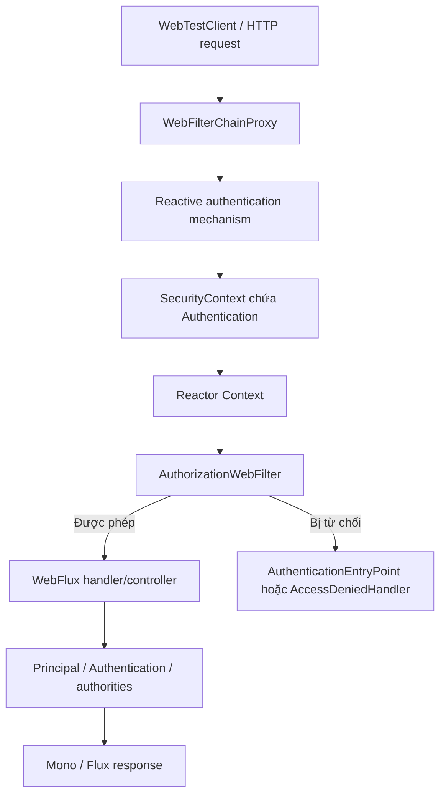

# Kiểm tra principal và authorities mà handler Reactive quan sát

Trong một ứng dụng Spring WebFlux, request có thể được Spring Security xác thực đúng ở tầng HTTP nhưng handler vẫn đọc sai tên người dùng, nhầm loại principal hoặc hiểu sai các quyền đang được cấp. Ngược lại, một test chỉ kiểm tra response `200 OK` có thể bỏ sót lỗi: controller nhận danh tính khác dự kiến, authority thiếu tiền tố, hoặc code lấy `SecurityContext` sai cách trong luồng Reactive.

Bài học thuộc chương **Danh tính Reactive** của module **`SPRING_SECURITY_TESTING`**, nơi người học kiểm chứng xác thực, phân quyền và bảo vệ HTTP thực tế bằng `spring-security-test` trên Servlet và Reactive. Ta sẽ dùng `WebTestClient` để đưa các loại `Authentication` thử nghiệm vào một WebFlux handler, rồi kiểm tra **chính giá trị principal và authorities mà handler quan sát**. Các tình huống bao gồm user/password giả lập, JWT, OAuth2/OIDC, custom principal và quyền được cấp hoặc bị từ chối.

Mục tiêu sau bài học:

- Phân biệt `Authentication`, `Authentication.getPrincipal()`, `Authentication.getName()` và `Authentication.getAuthorities()` trong WebFlux.
- Giải thích tại sao `ReactiveSecurityContextHolder` dùng **Reactor Context**, không thể mặc định đọc bằng `SecurityContextHolder` kiểu ThreadLocal.
- Cấu hình `WebTestClient.bindToApplicationContext(...).apply(springSecurity())` để request đi qua `SecurityWebFilterChain` thật.
- Dùng `mockUser()`, `mockAuthentication()`, `mockJwt()` và `mockOidcLogin()` để đưa đúng loại danh tính vào handler.
- Assert cả response HTTP và dữ liệu trả ra từ handler; phân biệt 401, 403 với tình huống đã xác thực nhưng principal/authority không đúng.
- Biết ranh giới của test với mock identity: nó xác minh **hành vi khi đã có Authentication**, không tự chứng minh mật khẩu, chữ ký JWT hoặc OIDC redirect/token exchange đã được kiểm tra.

## 1. Đường đi của danh tính trong Spring Security Reactive

Khi request đi qua Spring WebFlux, một `AuthenticationWebFilter` hoặc cơ chế security phù hợp có thể xác thực yêu cầu. `SecurityContext` mang kết quả sẽ được truyền theo **Reactor Context** trong pipeline. Từ đó, authorization và handler có thể lấy cùng một `Authentication`.



Trong test, một mutator như `mockUser("alice")` có thể cung cấp trực tiếp `Authentication` cho request để kiểm tra các thành phần ở phần sau của pipeline. Lúc này **security filters và authorization vẫn được thực thi**, nhưng bước kiểm tra mật khẩu hoặc decode token được thay bằng danh tính thử nghiệm.

| Giá trị | Nó mô tả gì? | Cách đọc trong handler |
| --- | --- | --- |
| `Authentication` | Token xác thực hiện tại, loại authentication, authorities và trạng thái | `Mono<Principal>` rồi ép sang `Authentication` hoặc `ReactiveSecurityContextHolder` |
| `Authentication.getName()` | Tên được suy ra theo loại authentication/principal | `authentication.getName()` |
| `Authentication.getPrincipal()` | Đối tượng danh tính: `UserDetails`, `Jwt`, `OidcUser`, custom principal… | `authentication.getPrincipal()` |
| `Authentication.getAuthorities()` | Danh sách `GrantedAuthority` dùng để quyết định quyền | `authority.getAuthority()` |
| `SecurityContext` | Nơi giữ `Authentication` của luồng thực thi hiện tại | `ReactiveSecurityContextHolder.getContext()` |

**Principal không nhất thiết là một chuỗi.** Với `mockUser()`, principal thường là `org.springframework.security.core.userdetails.User`; với `mockJwt()` có thể là `Jwt`; với `mockOidcLogin()` là `OidcUser`. `getName()` thường tiện dùng để log/hiển thị định danh nhưng không thay thế cho việc kiểm tra kiểu và thuộc tính của principal khi ứng dụng cần chúng.

**Authorities không tự đồng nghĩa với roles.** `ROLE_ADMIN` và `SCOPE_reports.read` đều là các `GrantedAuthority` dạng chuỗi nhưng có ý nghĩa và quy ước tiền tố khác nhau. Rule `hasRole("ADMIN")` thường tìm `ROLE_ADMIN`; `hasAuthority("SCOPE_reports.read")` tìm chính xác `SCOPE_reports.read`.

## 2. Vì sao WebFlux không nên đọc danh tính bằng ThreadLocal?

Trong ứng dụng Servlet, lập trình viên thường gặp cách:

```java
Authentication authentication =
        SecurityContextHolder.getContext().getAuthentication();
```

`SecurityContextHolder` mặc định dựa trên `ThreadLocal`. Một Reactive pipeline có thể chuyển scheduler hoặc tiếp tục chạy trên thread khác sau một thao tác bất đồng bộ. Nếu code trong WebFlux phụ thuộc vào ThreadLocal này để lấy danh tính, kết quả có thể là `null` hoặc context không tương ứng với subscriber hiện tại.

Với WebFlux, dùng **Reactor Context**:

```java
import org.springframework.security.core.Authentication;
import org.springframework.security.core.context.ReactiveSecurityContextHolder;
import reactor.core.publisher.Mono;

public Mono<String> currentUsername() {
    return ReactiveSecurityContextHolder.getContext()
            .map(context -> context.getAuthentication())
            .map(Authentication::getName);
}
```

`ReactiveSecurityContextHolder.getContext()` trả về `Mono<SecurityContext>`. Không nên gọi `.block()` trong handler đang xử lý request reactive để lấy Authentication, vì blocking phá vỡ mô hình bất đồng bộ và có thể gây lỗi trên non-blocking event loop.

Trong controller, bạn cũng có thể khai báo:

```java
@GetMapping("/api/current")
Mono<String> current(Mono<Principal> principal) {
    return principal.map(Principal::getName);
}
```

Spring WebFlux giải quyết `Mono<Principal>` từ request hiện tại. Nếu cần authorities, `Authentication` triển khai `Principal` nên có thể cast sau khi request được Spring Security xác thực:

```java
@GetMapping("/api/authorities")
Mono<List<String>> authorities(Mono<Principal> principal) {
    return principal.cast(Authentication.class)
            .map(auth -> auth.getAuthorities().stream()
                    .map(GrantedAuthority::getAuthority)
                    .sorted()
                    .toList());
}
```

Đối với một endpoint có thể cho anonymous truy cập, `exchange.getPrincipal()` hoặc `Mono<Principal>` có thể rỗng tùy cơ chế bảo mật. Đừng ép `block()` hoặc mặc định mọi request đều có danh tính đã đăng nhập. Khi cần bắt buộc người dùng xác thực, hãy cấu hình `authenticated()` ở security chain trước, rồi viết test cho cả nhánh được phép và bị từ chối.

## 3. Tạo ứng dụng Reactive mẫu để quan sát Authentication

Ví dụ dùng Java 17+, Spring Boot 3.x, Spring Security 6.x, dependency `spring-boot-starter-webflux`, `spring-boot-starter-security`, `spring-boot-starter-test` và `spring-security-test`. Chạy như một **ứng dụng WebFlux thuần** (không thêm `spring-boot-starter-web` chỉ vì các ví dụ Servlet). Các class dưới đây có thể đặt cùng package, mỗi public class ở một file Java.

### 3.1. Application và SecurityWebFilterChain

```java
import org.springframework.boot.SpringApplication;
import org.springframework.boot.autoconfigure.SpringBootApplication;

@SpringBootApplication
public class ReactiveIdentityDemoApplication {
    public static void main(String[] args) {
        SpringApplication.run(ReactiveIdentityDemoApplication.class, args);
    }
}
```

```java
import org.springframework.context.annotation.Bean;
import org.springframework.context.annotation.Configuration;
import org.springframework.security.config.Customizer;
import org.springframework.security.config.annotation.web.reactive.EnableWebFluxSecurity;
import org.springframework.security.config.web.server.ServerHttpSecurity;
import org.springframework.security.core.userdetails.User;
import org.springframework.security.core.userdetails.UserDetails;
import org.springframework.security.web.server.SecurityWebFilterChain;
import org.springframework.security.core.userdetails.ReactiveUserDetailsService;
import org.springframework.security.core.userdetails.MapReactiveUserDetailsService;

@Configuration
@EnableWebFluxSecurity
class ReactiveIdentitySecurityConfig {

    @Bean
    SecurityWebFilterChain springSecurityWebFilterChain(
            ServerHttpSecurity http) {
        return http
                .authorizeExchange(exchanges -> exchanges
                        .pathMatchers("/api/admin").hasRole("ADMIN")
                        .pathMatchers("/api/**").authenticated()
                        .anyExchange().permitAll())
                .httpBasic(Customizer.withDefaults())
                .build();
    }

    @Bean
    ReactiveUserDetailsService demoUsers() {
        UserDetails alice = User.withUsername("alice")
                .password("{noop}test-password")
                .roles("USER")
                .build();
        return new MapReactiveUserDetailsService(alice);
    }
}
```

`httpBasic()` trong ví dụ giúp nhánh chưa xác thực với endpoint `/api/**` trả `401 Unauthorized` trong test. Nếu ứng dụng thực dùng form login, OAuth2 Login hoặc API bearer token, entry point và mã HTTP có thể khác; hãy assert theo security chain được cấu hình. Tài khoản với `{noop}` ở đây chỉ để cấu hình chạy trong môi trường học tập. Ứng dụng thật cần password encoder, nguồn danh tính và cơ chế xác thực phù hợp.

### 3.2. Controller trả chính danh tính mà nó quan sát

Để kiểm chứng kết quả rõ ràng, controller trả các trường tên, loại Authentication, loại principal và authorities đã sắp xếp. Trong sản phẩm thật, endpoint kiểm tra danh tính không cần trả toàn bộ nội dung này; các trường chỉ nhằm mục đích học và test.

```java
import java.security.Principal;
import java.util.List;
import org.springframework.security.core.Authentication;
import org.springframework.security.core.GrantedAuthority;
import org.springframework.security.core.annotation.AuthenticationPrincipal;
import org.springframework.security.core.context.ReactiveSecurityContextHolder;
import org.springframework.security.core.userdetails.UserDetails;
import org.springframework.web.bind.annotation.GetMapping;
import org.springframework.web.bind.annotation.RestController;
import reactor.core.publisher.Mono;

record IdentityView(
        String name,
        String authenticationType,
        String principalType,
        List<String> authorities
) {}

@RestController
class ReactiveIdentityController {

    @GetMapping("/api/identity")
    Mono<IdentityView> identity(Mono<Principal> principal) {
        return principal
                .cast(Authentication.class)
                .map(authentication -> new IdentityView(
                        authentication.getName(),
                        authentication.getClass().getSimpleName(),
                        authentication.getPrincipal()
                                .getClass().getSimpleName(),
                        authentication.getAuthorities().stream()
                                .map(GrantedAuthority::getAuthority)
                                .sorted()
                                .toList()));
    }

    @GetMapping("/api/admin")
    Mono<String> admin(Mono<Principal> principal) {
        return principal.map(p -> "admin:" + p.getName());
    }

    @GetMapping("/api/user-details")
    Mono<String> userDetails(
            @AuthenticationPrincipal UserDetails user) {
        return Mono.just(user.getUsername());
    }

    @GetMapping("/api/context-name")
    Mono<String> nameFromReactorContext() {
        return ReactiveSecurityContextHolder.getContext()
                .map(context -> context.getAuthentication().getName());
    }
}
```

Ba đường lấy principal có trách nhiệm khác nhau:

- `Mono<Principal>` phù hợp khi handler muốn đọc principal theo HTTP request hiện tại. Ta cast sang `Authentication` để kiểm tra authorities.
- `@AuthenticationPrincipal UserDetails` thích hợp khi security principal được biết chắc là `UserDetails`, chẳng hạn sau username/password authentication. Nó không phù hợp nếu request đang mang principal `Jwt` hoặc `OidcUser`; lúc đó cần đúng kiểu.
- `ReactiveSecurityContextHolder.getContext()` phù hợp cho code service nằm sâu trong pipeline, khi không có method argument resolver của controller.

**Điểm quan sát cần kiểm tra:** nếu request được gắn mock user “alice” với `ROLE_USER`, `/api/identity` phải trả `name=alice`, principal type `User` và authorities chứa `ROLE_USER`. Điều đó chứng minh handler thực sự nhận đúng object/roles đã được đặt trong Reactive security context.

## 4. Dựng WebTestClient đúng cách

`WebTestClient` có thể bind trực tiếp tới application context, không cần mở một HTTP port thật. Để tích hợp Spring Security Test, áp dụng `springSecurity()`:

```java
import org.junit.jupiter.api.BeforeEach;
import org.junit.jupiter.api.Test;
import org.springframework.beans.factory.annotation.Autowired;
import org.springframework.boot.test.context.SpringBootTest;
import org.springframework.context.ApplicationContext;
import org.springframework.test.web.reactive.server.WebTestClient;

import static org.springframework.security.test.web.reactive.server
        .SecurityMockServerConfigurers.springSecurity;

@SpringBootTest(classes = ReactiveIdentityDemoApplication.class)
class ReactiveIdentityWebTest {

    @Autowired
    ApplicationContext context;

    WebTestClient client;

    @BeforeEach
    void prepareClient() {
        client = WebTestClient.bindToApplicationContext(context)
                .apply(springSecurity())
                .configureClient()
                .build();
    }

    // Các @Test bên dưới được đặt trong lớp này.
}
```

`bindToApplicationContext(...)` dùng các WebFlux components đã đăng ký trong context, bao gồm `SecurityWebFilterChain` và controller. `springSecurity()` gắn hỗ trợ test cho Reactive security context; nếu thiếu bước này, một số mutator của `spring-security-test` có thể không tác động như mong đợi lên request.

Một cách khác là dùng `@AutoConfigureWebTestClient` của Spring Boot trong `@SpringBootTest` WebFlux. Trong bài này, cách bind thủ công giúp nhìn rõ điểm tích hợp. Không trộn `MockMvc` của Servlet với `SecurityWebFilterChain` của WebFlux.

**Không mặc định `WebTestClient.bindToController(controller)` đã có bảo vệ Spring Security của ứng dụng.** Khi chỉ bind trực tiếp một controller không gắn application context/filter chain, các assertion 401/403 có thể không có ý nghĩa bảo mật. Dùng bind-to-context như trên hoặc cấu hình riêng security WebFilters/handler phù hợp khi cố ý làm slice test.

## 5. Test người dùng và authorities bằng `mockUser()`

`SecurityMockServerConfigurers.mockUser()` gắn một `UsernamePasswordAuthenticationToken` thử nghiệm vào request. Dù tên là “mockUser”, test vẫn có thể quan sát chính xác principal mà handler nhận được.

Đặt các ví dụ `@Test` sau **bên trong `ReactiveIdentityWebTest`**:

```java
import static org.springframework.security.test.web.reactive.server
        .SecurityMockServerConfigurers.mockUser;

@Test
void userPrincipal_andRoleAreVisibleToHandler() {
    client.mutateWith(mockUser("alice").roles("USER"))
            .get()
            .uri("/api/identity")
            .exchange()
            .expectStatus().isOk()
            .expectBody()
            .jsonPath("$.name").isEqualTo("alice")
            .jsonPath("$.authenticationType")
                .isEqualTo("UsernamePasswordAuthenticationToken")
            .jsonPath("$.principalType").isEqualTo("User")
            .jsonPath("$.authorities[0]").isEqualTo("ROLE_USER");
}

@Test
void handlerCanReadAuthenticatedUserDetails() {
    client.mutateWith(mockUser("alice").roles("USER"))
            .get()
            .uri("/api/user-details")
            .exchange()
            .expectStatus().isOk()
            .expectBody(String.class)
            .isEqualTo("alice");
}

@Test
void reactiveContextContainsSameCurrentUsername() {
    client.mutateWith(mockUser("alice").roles("USER"))
            .get()
            .uri("/api/context-name")
            .exchange()
            .expectStatus().isOk()
            .expectBody(String.class)
            .isEqualTo("alice");
}
```

Tại test đầu, `roles("USER")` chuyển thành authority `ROLE_USER`. Test thứ hai dùng `@AuthenticationPrincipal UserDetails`, còn test thứ ba đi qua `ReactiveSecurityContextHolder`. Nếu cả ba đều trả đúng “alice” thì bạn đã kiểm tra ba cách truy xuất identity trong **cùng một security setup**.

Đổi thành `.roles("ADMIN")` sẽ tạo authority `ROLE_ADMIN`; nếu cần một quyền tùy ý như `inventory:read` hoặc `SCOPE_reports.read`, dùng:

```java
import org.springframework.security.core.authority.SimpleGrantedAuthority;

client.mutateWith(mockUser("alice").authorities(
                new SimpleGrantedAuthority("SCOPE_reports.read")))
        .get()
        .uri("/api/identity")
        .exchange()
        .expectStatus().isOk()
        .expectBody()
        .jsonPath("$.authorities[0]")
        .isEqualTo("SCOPE_reports.read");
```

**Không lẫn `hasRole` với `hasAuthority`:** Rule `hasRole("ADMIN")` kiểm tra `ROLE_ADMIN`; truyền một authority `ADMIN` không tự động được coi là `ROLE_ADMIN`. Khi test JWT/resource server, scope thường có tiền tố `SCOPE_`, không phải `ROLE_`, trừ khi ứng dụng đã cấu hình converter tùy chỉnh.

### Phân biệt chưa xác thực, thiếu quyền và được phép

Với cấu hình `httpBasic()` và `/api/**` ở mục 3:

```java
@Test
void anonymousRequest_isRejectedWith401() {
    client.get()
            .uri("/api/identity")
            .exchange()
            .expectStatus().isUnauthorized();
}

@Test
void authenticatedUserWithoutAdminRole_isRejectedWith403() {
    client.mutateWith(mockUser("alice").roles("USER"))
            .get()
            .uri("/api/admin")
            .exchange()
            .expectStatus().isForbidden();
}

@Test
void authenticatedAdmin_isAllowedAndObserved() {
    client.mutateWith(mockUser("root").roles("ADMIN"))
            .get()
            .uri("/api/admin")
            .exchange()
            .expectStatus().isOk()
            .expectBody(String.class)
            .isEqualTo("admin:root");
}
```

Đây là ba bằng chứng khác nhau:

1. **401**: security chain yêu cầu xác thực nhưng request chưa cung cấp danh tính.
2. **403**: đã có danh tính xác thực nhưng thiếu `ROLE_ADMIN` để vào endpoint.
3. **200**: đủ quyền; controller còn quan sát đúng tên người được phép.

Trong ứng dụng có `formLogin()`, OAuth2 Login hoặc custom entry point, request chưa xác thực có thể được redirect tới trang login thay vì trả 401. Hãy giữ assertion tương ứng với cấu hình test, không áp một mã status mặc định cho mọi security chain.

## 6. Custom principal với `mockAuthentication()`

Ứng dụng thực đôi khi có principal do chính mình định nghĩa, chứa thông tin như tenant, account ID hoặc tên hiển thị. Test chỉ dùng `mockUser()` không kiểm chứng được việc handler nhận đúng kiểu principal đó. `mockAuthentication()` cho phép gắn một `Authentication` đã tạo trước vào request.

Định nghĩa một principal nhỏ:

```java
import java.security.Principal;

record MemberPrincipal(String name, String tenant)
        implements Principal {
    @Override
    public String getName() {
        return name;
    }
}
```

Controller có thể đọc custom principal qua `@AuthenticationPrincipal`:

```java
@GetMapping("/api/tenant")
Mono<String> tenant(@AuthenticationPrincipal MemberPrincipal member) {
    return Mono.just(member.tenant());
}
```

Thêm endpoint này vào `ReactiveIdentityController` ở mục 3 trước khi chạy test. Sau đó tạo authentication test:

```java
import java.util.List;
import org.springframework.security.authentication
        .UsernamePasswordAuthenticationToken;
import org.springframework.security.core.Authentication;
import org.springframework.security.core.authority.SimpleGrantedAuthority;

import static org.springframework.security.test.web.reactive.server
        .SecurityMockServerConfigurers.mockAuthentication;

@Test
void customPrincipal_isVisibleToReactiveHandler() {
    MemberPrincipal member = new MemberPrincipal("mai", "tenant-blue");

    Authentication authentication =
            new UsernamePasswordAuthenticationToken(
                    member,
                    null,
                    List.of(new SimpleGrantedAuthority("ROLE_USER")));

    client.mutateWith(mockAuthentication(authentication))
            .get()
            .uri("/api/tenant")
            .exchange()
            .expectStatus().isOk()
            .expectBody(String.class)
            .isEqualTo("tenant-blue");

    client.mutateWith(mockAuthentication(authentication))
            .get()
            .uri("/api/identity")
            .exchange()
            .expectStatus().isOk()
            .expectBody()
            .jsonPath("$.name").isEqualTo("mai")
            .jsonPath("$.principalType")
                .isEqualTo("MemberPrincipal");
}
```

Constructor `UsernamePasswordAuthenticationToken(principal, credentials, authorities)` tạo token đã xác thực, nên authorization filter có thể kiểm tra roles. Vì `MemberPrincipal` triển khai `Principal#getName()`, `authentication.getName()` trả về “mai”, còn `authentication.getPrincipal()` vẫn là object `MemberPrincipal` đầy đủ thông tin tenant.

**Điểm cần tránh:** dùng `@AuthenticationPrincipal MemberPrincipal` cho route mà test lại gắn `mockUser()`. Principal của `mockUser()` là `UserDetails`, không phải `MemberPrincipal`; đối số có thể không được resolve theo kiểu mong muốn. Test phải gắn đúng loại danh tính mà ứng dụng thực sử dụng.

Nếu cần bảo đảm không trộn danh tính giữa các tenant, thêm các test với `MemberPrincipal("mai","tenant-blue")` và `MemberPrincipal("mai","tenant-red")` trên **các request độc lập**, rồi assert response từng request. Đừng lưu principal vào static field hoặc `ThreadLocal` toàn cục.

## 7. JWT, OAuth2 và OIDC: cùng một handler có thể thấy các principal khác nhau

Một REST API WebFlux có thể xác thực bằng JWT hoặc opaque bearer token; một giao diện WebFlux khác có thể đăng nhập OAuth2/OIDC. Các test helpers của `spring-security-test` giúp tạo **các loại authentication khác nhau** mà không cần gọi Identity Provider.

| Test mutator | Authentication thường được tạo | Principal thường thấy | Có kiểm tra credential/token thật? |
| --- | --- | --- | --- |
| `mockUser("alice")` | `UsernamePasswordAuthenticationToken` | `UserDetails` | Không kiểm tra mật khẩu |
| `mockAuthentication(auth)` | Chính `Authentication` được cung cấp | Theo đối tượng test truyền vào | Không, trừ khi test tự gọi cơ chế kiểm tra |
| `mockJwt()` | `JwtAuthenticationToken` | `Jwt` | Không decode hoặc xác minh chữ ký |
| `mockOpaqueToken()` | `BearerTokenAuthentication` | `OAuth2AuthenticatedPrincipal` | Không introspect token thật |
| `mockOAuth2Login()` | `OAuth2AuthenticationToken` | `OAuth2User` | Không chạy redirect/token exchange |
| `mockOidcLogin()` | `OAuth2AuthenticationToken` | `OidcUser` | Không xác minh ID token/nonce/issuer |

### 7.1. Quan sát `JwtAuthenticationToken` và scope

`mockJwt()` tạo `JwtAuthenticationToken` cho request. Ta chủ động đặt subject và authority để kiểm tra handler:

```java
import org.springframework.security.core.authority.SimpleGrantedAuthority;

import static org.springframework.security.test.web.reactive.server
        .SecurityMockServerConfigurers.mockJwt;

@Test
void jwtPrincipalAndScope_areVisibleToHandler() {
    client.mutateWith(mockJwt()
                    .jwt(jwt -> jwt
                            .claim("sub", "service-42")
                            .claim("scope", "reports.read"))
                    .authorities(
                            new SimpleGrantedAuthority(
                                    "SCOPE_reports.read")))
            .get()
            .uri("/api/identity")
            .exchange()
            .expectStatus().isOk()
            .expectBody()
            .jsonPath("$.name").isEqualTo("service-42")
            .jsonPath("$.authenticationType")
                .isEqualTo("JwtAuthenticationToken")
            .jsonPath("$.principalType").isEqualTo("Jwt")
            .jsonPath("$.authorities[0]")
                .isEqualTo("SCOPE_reports.read");
}
```

Ở test này, `.authorities(...)` chỉ định quyền trực tiếp. Nó **không chứng minh `JwtGrantedAuthoritiesConverter` trong production đã đọc claim `scope` và sinh đúng authority**. Muốn kiểm chứng converter thật và filter đọc bearer header, hãy gửi `Authorization: Bearer token` đến WebFlux Resource Server với `ReactiveJwtDecoder` được mock, rồi kiểm tra decoder được gọi và kết quả 200/403. Muốn kiểm chứng chữ ký, `exp` hoặc issuer, cần test `ReactiveJwtDecoder` thật với khóa và validators phù hợp.

Nếu ứng dụng dùng claim `roles` tùy chỉnh, test `mockJwt().authorities(...)` giúp kiểm tra rule sau conversion; test tích hợp cho converter phải kiểm tra riêng claims được ánh xạ thành authorities theo quy tắc ứng dụng.

### 7.2. Quan sát OIDC principal

Trong ứng dụng WebFlux hỗ trợ OAuth2 Login, có thể dùng `mockOidcLogin()`:

```java
import static org.springframework.security.test.web.reactive.server
        .SecurityMockServerConfigurers.mockOidcLogin;

@Test
void oidcUser_isObservedAsOAuth2Authentication() {
    client.mutateWith(mockOidcLogin()
                    .idToken(idToken ->
                            idToken.claim("sub", "oidc-user-7")))
            .get()
            .uri("/api/identity")
            .exchange()
            .expectStatus().isOk()
            .expectBody()
            .jsonPath("$.name").isEqualTo("oidc-user-7")
            .jsonPath("$.authenticationType")
                .isEqualTo("OAuth2AuthenticationToken")
            .jsonPath("$.principalType")
                .isEqualTo("DefaultOidcUser");
}
```

Với OIDC, `getName()` thường dựa trên subject của ID token theo cấu hình principal; nếu hệ thống dùng một name attribute tùy chỉnh, test phải assert theo contract đó. `OidcUser` còn có `getIdToken()` và claims. Nếu controller cần principal kiểu `OidcUser` qua `@AuthenticationPrincipal`, dùng helper tương ứng thay vì `mockUser()`.

`mockOAuth2Login()` phục vụ danh tính `OAuth2User`; `mockOpaqueToken()` phục vụ principal từ introspection. Mỗi helper thay đổi loại authentication mà handler nhìn thấy. Hãy chọn helper theo **stack và cơ chế xác thực thật** của endpoint, thay vì chỉ tìm cách khiến response trả 200.

### 7.3. Khi cần kiểm thử luồng bearer hoặc OAuth2 Login thực

Một test với `mockJwt()` không gửi bearer header hay gọi decoder. Một test với `mockOidcLogin()` cũng không thực hiện redirect sang IdP hoặc xác thực callback. Các phép thử đó hữu ích để kiểm tra **hành vi của handler khi đã có identity**.

Để mở rộng:

- **Reactive JWT Resource Server:** gửi header Bearer thật qua `WebTestClient`, mock `ReactiveJwtDecoder.decode(rawToken)` để kiểm tra filter/provider/claim converter; bổ sung test decoder thật cho chữ ký/validation.
- **Reactive opaque resource server:** mock `ReactiveOpaqueTokenIntrospector.introspect(rawToken)` với `Mono<OAuth2AuthenticatedPrincipal>`; assert 401/403/200 và verify token được đưa tới introspector.
- **OAuth2/OIDC Login:** kiểm tra redirect, state/session/cookie, authorization callback, token exchange và ID token verification bằng provider giả lập khi cần kiểm chứng toàn bộ luồng.

Mỗi lớp test trả lời một câu hỏi khác nhau. Không dùng shortcut principal để khẳng định bạn đã kiểm tra bước authentication bên ngoài.

## 8. Test `ReactiveSecurityContextHolder` ở tầng service bằng StepVerifier

Không phải mọi logic đều nằm trong handler. Một service Reactive có thể đọc security context để gắn tên người dùng vào audit record hoặc lọc dữ liệu theo danh tính. Có thể test riêng service đó mà không cần HTTP.

```java
import org.springframework.security.core.Authentication;
import org.springframework.security.core.context.ReactiveSecurityContextHolder;
import reactor.core.publisher.Mono;

class ReactiveCurrentUserService {
    Mono<String> currentName() {
        return ReactiveSecurityContextHolder.getContext()
                .map(context -> context.getAuthentication())
                .map(Authentication::getName);
    }
}
```

Dùng `StepVerifier` và đặt `Authentication` vào Reactor Context khi subscribe:

```java
import java.util.List;
import org.junit.jupiter.api.Test;
import org.springframework.security.authentication
        .UsernamePasswordAuthenticationToken;
import org.springframework.security.core.Authentication;
import org.springframework.security.core.authority.SimpleGrantedAuthority;
import org.springframework.security.core.context.ReactiveSecurityContextHolder;
import reactor.test.StepVerifier;

class ReactiveCurrentUserServiceTest {

    @Test
    void currentName_readsAuthenticationFromReactorContext() {
        Authentication alice =
                new UsernamePasswordAuthenticationToken(
                        "alice",
                        null,
                        List.of(new SimpleGrantedAuthority("ROLE_USER")));

        var result = new ReactiveCurrentUserService()
                .currentName()
                .contextWrite(
                        ReactiveSecurityContextHolder
                                .withAuthentication(alice));

        StepVerifier.create(result)
                .expectNext("alice")
                .verifyComplete();
    }

    @Test
    void withoutSecurityContext_noUsernameIsProduced() {
        StepVerifier.create(
                    new ReactiveCurrentUserService().currentName())
                .verifyComplete();
    }
}
```

`ReactiveSecurityContextHolder.withAuthentication(alice)` tạo Reactor `Context` dùng cho subscriber tương ứng. `contextWrite(...)` đặt context ở ranh giới subscription; `currentName()` đọc lại nó trong luồng. Nếu không có security context, `getContext()` trả `Mono.empty()`, nên test thứ hai hoàn thành mà không phát ra username.

Không cần đưa Spring Test, `WebTestClient` hoặc `@WithMockUser` vào test thuần service này. Đối với logic cần HTTP request và authorization filter, quay lại `WebTestClient`. Cũng không nên đặt test context vào một biến static toàn cục: Reactor Context có phạm vi subscriber, rất thích hợp kiểm tra nhiều request đồng thời mà không trộn danh tính.

### Điều gì xảy ra khi đổi scheduler?

Trong Reactor, operators hoạt động với `Context` của subscription. Một pipeline dùng `publishOn(...)` vẫn có thể truy cập Reactor Context qua các toán tử đúng cách:

```java
Mono<String> name = ReactiveSecurityContextHolder.getContext()
        .publishOn(reactor.core.scheduler.Schedulers.parallel())
        .map(ctx -> ctx.getAuthentication().getName());
```

Điểm quan trọng không phải “mọi thread đều có `SecurityContextHolder`”, mà là **Reactor subscription mang Context qua pipeline**. Với các API tự khởi tạo thread, callback nằm ngoài chain hoặc thư viện không hỗ trợ context propagation, cần đánh giá riêng. Không chuyển `SecurityContext` qua một biến toàn cục để chữa lỗi mất context.

## 9. Phân quyền ở method level và những assertion có ý nghĩa

Ngoài `authorizeExchange(...)`, WebFlux có thể dùng Reactive method security:

```java
import org.springframework.security.access.prepost.PreAuthorize;
import org.springframework.stereotype.Service;
import reactor.core.publisher.Mono;

@Service
class ReactiveReportService {
    @PreAuthorize("hasAuthority('SCOPE_reports.read')")
    public Mono<String> readReport() {
        return Mono.just("report");
    }
}
```

Để annotation thật sự được áp dụng, cần bật `@EnableReactiveMethodSecurity` trong configuration và gọi method qua Spring bean proxy, không tạo service bằng `new ReactiveReportService()` trong test controller. Với ví dụ này, muốn kiểm chứng route được phép:

```java
client.mutateWith(mockJwt().authorities(
                new SimpleGrantedAuthority("SCOPE_reports.read")))
        .get()
        .uri("/api/reports")
        .exchange()
        .expectStatus().isOk();
```

Đoạn trên giả định đã có controller `GET /api/reports` gọi bean `ReactiveReportService.readReport()` và cấu hình method security. Cần viết thêm test thiếu `SCOPE_reports.read` trả 403 để chứng minh annotation đang hoạt động.

Nếu test chỉ assert `/api/identity` trả 200 với JWT, nó không bảo đảm method security đã kiểm tra scope. Ngược lại, nếu test chỉ assert 403, có thể request bị chặn ngay ở HTTP chain mà chưa chạm vào method security. Hãy định nghĩa route sao cho HTTP chỉ cần `authenticated()`, rồi để `@PreAuthorize` quyết định permission; khi đó test 200/403 mới quan sát đúng tầng phương thức.

## 10. Những sai lầm khiến test Reactive “đúng trạng thái, sai danh tính”

**1. Chỉ kiểm tra `200 OK`.** Endpoint có thể thành công với principal ngoài ý muốn. Trả hoặc kiểm tra thông tin nội bộ ở handler test: name, principal type và authority strings; assert những thuộc tính thật sự là contract.

**2. Lấy `SecurityContextHolder` trong code reactive.** ThreadLocal không phải nguồn chính cho security context của subscriber. Ưu tiên `Mono<Principal>`, `@AuthenticationPrincipal`, `ReactiveSecurityContextHolder` và Reactor Context.

**3. Không `apply(springSecurity())` khi bind WebTestClient thủ công.** Mutator có thể không ảnh hưởng request nếu mock security infrastructure chưa được tích hợp. Kiểm tra client setup, security filters và kết quả trực tiếp trên handler.

**4. Dùng `bindToController` để tuyên bố đã thử Spring Security filter chain.** Binding controller trần không tự tái hiện security configuration của toàn ứng dụng. Với test authorization, dùng application context có `SecurityWebFilterChain` phù hợp.

**5. Sử dụng sai loại principal.** `mockUser()` thường cung cấp `UserDetails`; `mockJwt()` cung cấp `Jwt`; `mockOidcLogin()` cung cấp `OidcUser`. Một handler yêu cầu `@AuthenticationPrincipal OidcUser` sẽ không nhận cùng loại khi bạn dùng mock user.

**6. Nhầm role, authority và scope.** `roles("ADMIN")` tạo `ROLE_ADMIN`. `hasAuthority("SCOPE_reports.read")` yêu cầu chuỗi đầy đủ này. Một JWT claim `scope` không tự chứng minh converter thật đã chạy nếu test đặt authorities trực tiếp bằng mutator.

**7. Dùng `mockJwt()` để chứng minh bearer filter và chữ ký JWT hoạt động.** Mutator cung cấp authentication thử nghiệm, bỏ qua decoder. Test bearer pipeline bằng HTTP Authorization header + `ReactiveJwtDecoder`; test chữ ký/issuer/expiration bằng decoder thật.

**8. Gắn identity vào một WebTestClient rồi dùng lại cho test anonymous.** `mutateWith(...)` tạo client dẫn xuất mang identity cho request dùng client đó. Test anonymous phải dùng `client` gốc không mang mock user, hoặc tạo client mới phù hợp.

**9. Gọi `block()` để “nhanh chóng lấy principal”.** Blocking trong request handler Reactive làm giảm tính đúng đắn của pipeline và có thể gây lỗi event-loop. Dùng `Mono.map/flatMap` và assert bằng WebTestClient/StepVerifier.

**10. Test service không đặt Reactor Context khi subscribe.** `ReactiveSecurityContextHolder.getContext()` sẽ rỗng; assertion thất bại dù service đúng. Dùng `contextWrite(ReactiveSecurityContextHolder.withAuthentication(...))` hoặc test qua HTTP security chain.

**11. Đọc danh tính ở ngoài subscription.** Kết quả `ReactiveSecurityContextHolder.getContext()` có ý nghĩa trong pipeline/subscription cụ thể. Đưa nó ra một static singleton hoặc lưu vào thread-local khi assembly có thể dẫn tới sai danh tính ở request khác.

**12. Bỏ qua HTTP status khi kiểm tra handler.** Nếu request không đủ quyền, handler không được thực thi; một test chỉ quan sát body rỗng mà không assert 401/403 dễ nhầm với publisher trống. Dùng status trước, body/principal sau.

## 11. Bảng quyết định và checklist kiểm thử

| Mục tiêu | Helper/thiết lập | Bằng chứng nên assert |
| --- | --- | --- |
| Kiểm tra handler thấy username và role | `mockUser("alice").roles("USER")` | `name=alice`, principal `User`, `ROLE_USER` |
| Kiểm tra principal do ứng dụng định nghĩa | `mockAuthentication(auth)` | Đúng kiểu custom principal và thuộc tính |
| Kiểm tra handler thấy danh tính JWT | `mockJwt()` | `JwtAuthenticationToken`, subject, authorities |
| Kiểm tra handler OIDC | `mockOidcLogin()` | `OidcUser` và claims cần dùng |
| Kiểm tra role ADMIN | `mockUser("root").roles("ADMIN")` | 200; user thường 403 |
| Kiểm tra request chưa xác thực | Không dùng mutator trên client gốc | 401 hoặc redirect theo entry point |
| Kiểm tra service Reactive đọc context | `StepVerifier` + `contextWrite(withAuthentication)` | Username phát ra đúng từ subscriber |
| Kiểm tra bearer token thật được giải mã | Header `Authorization` + decoder/introspector thích hợp | Decoder được gọi, claims chuyển thành authorities |
| Kiểm tra password/OIDC login thực | Authentication manager hoặc IdP thử nghiệm | Credential/callback/token validation thật |

Một test tốt về **Reactive identity** nên trả lời được cả ba câu:

1. Request có vượt qua authorization filter không, và theo điều kiện nào?
2. Handler hoặc service thấy **ai** (tên và kiểu principal), thấy **quyền nào** (chuỗi `GrantedAuthority` chính xác)?
3. Authentication đó được **giả lập** cho mục tiêu test hay được tạo qua **cơ chế xác thực thật** đã kiểm tra riêng?

### Bài tập thực hành

**Bài 1.** Với `mockUser("alice").roles("USER")`, viết test assert cả `/api/identity` và `/api/context-name` trả tên giống nhau. Đổi tên sang “bob” trên request kế tiếp và chứng minh không rò danh tính từ request trước.

**Bài 2.** Viết một test cho `/api/admin` với authority `ADMIN` và một test với `ROLE_ADMIN`. Giải thích vì sao chỉ test thứ hai thỏa `hasRole("ADMIN")` trong cấu hình mẫu.

**Bài 3.** Tạo `MemberPrincipal("mai","tenant-blue")` bằng `mockAuthentication()`; viết controller dùng `@AuthenticationPrincipal` để trả tenant, rồi assert tenant đúng. Thử dùng `mockUser("mai")` và quan sát vì sao kiểu principal không phù hợp.

**Bài 4.** Dùng `mockJwt()` đặt subject `svc-123` và `SCOPE_reports.read`, kiểm tra cả `authenticationType`, `principalType` và authority. Viết một test khác dùng `ReactiveJwtDecoder` mock với bearer header để xác minh điểm khác nhau.

**Bài 5.** Đặt `ReactiveSecurityContextHolder.withAuthentication(alice)` vào `contextWrite(...)` của `StepVerifier`. Thay bằng “bob” ở một subscription thứ hai; cả hai phải cho ra tên riêng, không cần biến static.

### Tài liệu tham khảo

- [Spring Security — Reactive Test Support](https://docs.spring.io/spring-security/reference/reactive/test/index.html)
- [Spring Security — WebTestClient Testing](https://docs.spring.io/spring-security/reference/reactive/test/web/index.html)
- [Spring Security — Mock Authentication for WebTestClient](https://docs.spring.io/spring-security/reference/reactive/test/web/authentication.html)
- [Spring Security — Reactive Security Context](https://docs.spring.io/spring-security/reference/reactive/authentication/index.html)
- [Spring Framework — WebFlux Controller Method Arguments](https://docs.spring.io/spring-framework/reference/web/webflux/controller/ann-methods/arguments.html)

Trong WebFlux, điều cần chứng minh không chỉ là request được phép truy cập, mà còn là **danh tính được bảo toàn đúng theo Reactor Context đến tận handler**. `WebTestClient` với `springSecurity()` cho phép kiểm tra HTTP authorization và quan sát principal/authorities; `StepVerifier` giúp kiểm tra logic Reactive độc lập. Dùng đúng kiểu `Authentication` thử nghiệm và assert tên, loại principal, chuỗi authorities sẽ giúp phát hiện sớm các lỗi mà assertion status đơn thuần không thể chỉ ra.
