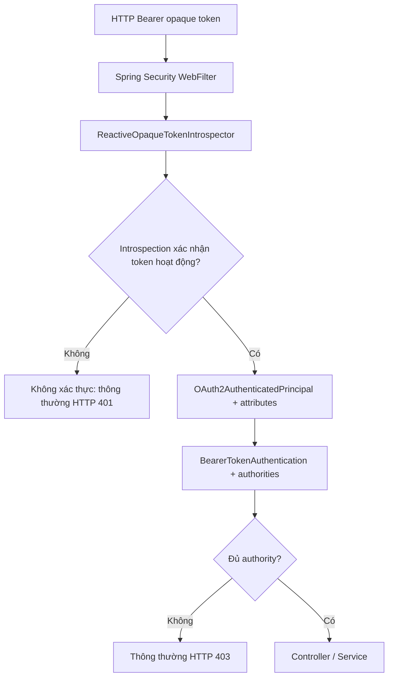

# `mockOpaqueToken` và attributes của principal trong WebFlux

Trong chương **OAuth2 Reactive** của module **SPRING_SECURITY_TESTING**, mục tiêu là kiểm chứng một API WebFlux đọc thông tin người dùng từ **opaque bearer token** và áp dụng đúng chính sách truy cập. `spring-security-test` cung cấp `mockOpaqueToken()` để mô phỏng trạng thái **token đã được introspection thành công**. Tiện ích này cho phép đưa attributes, principal và authorities giả vào request của `WebTestClient`, giúp kiểm tra nhánh được phép, bị từ chối và dữ liệu mà controller/service thật sự nhìn thấy.

Điểm quan trọng nhất: **attributes của principal và authorities dùng để phân quyền là hai tập dữ liệu có vai trò khác nhau**. Có `scope` trong attributes không chứng minh một converter đã tạo đúng authority; gắn `SCOPE_records.read` vào test không chứng minh introspection endpoint thực sự trả scope đó. Bài học chỉ rõ cách viết các bài test độc lập, có khả năng phát hiện lỗi mapping, và giới hạn của `mockOpaqueToken()`.

Nội dung sử dụng Spring Security 6, WebFlux và `WebTestClient`. Với ứng dụng Servlet, tiện ích tương ứng trong MockMvc là `SecurityMockMvcRequestPostProcessors.opaqueToken()`; còn ở Reactive, sử dụng `SecurityMockServerConfigurers.mockOpaqueToken()`.

## 1. Principal opaque token có gì sau khi xác thực?

Opaque token là chuỗi bearer mà resource server thường **không thể tự đọc để xác minh** như JWT. Trong triển khai thực tế, resource server gọi endpoint introspection để hỏi authorization server token có còn hoạt động không. Phản hồi hợp lệ có thể chứa `active`, `sub`, `scope`, `client_id`, `aud`, `exp` và claim riêng của hệ thống. Spring Security sử dụng kết quả đó để tạo đối tượng xác thực trong reactive security context.



Với resource server dùng Spring Security opaque token, các kiểu quan trọng là:

| Thành phần | Vai trò | Ví dụ dữ liệu |
| --- | --- | --- |
| `OAuth2AuthenticatedPrincipal` | Principal chứa tên, attributes và authorities | `sub`, `tenant_id`, `email`, `client_id` |
| `principal.getAttributes()` | Map các thuộc tính dùng trong logic ứng dụng | `tenant_id=tenant-a`, `email_verified=true` |
| `principal.getAttribute("sub")` | Đọc một thuộc tính bằng khóa | `fixture-sub-101` |
| `GrantedAuthority` | Quyền dùng bởi `hasAuthority`, `hasRole`, method security | `SCOPE_records.read` |
| `BearerTokenAuthentication` | `Authentication` đại diện token bearer đã được xác thực | Principal và tập authorities trong security context |
| `ReactiveSecurityContextHolder` | Cấp quyền truy cập `SecurityContext` trong Reactor pipeline | `Authentication` của request hiện tại |

`principal.getName()` thường dựa trên thuộc tính nhận dạng được cấu hình (thường là `sub` với principal mặc định). Nhưng không nên tự suy luận rằng **mọi** introspector tùy biến đều chọn cùng một name attribute. Khi chính sách nghiệp vụ cần subject OIDC/OAuth2 cụ thể, hãy xác định rõ đang dùng `sub`, `client_id` hay một tên chuẩn hóa từ hệ thống nhận dạng.

### Attributes không phải toàn bộ kết quả introspection

Trong phản hồi introspection RFC 7662, `active: true` có nghĩa máy chủ phát hành xác nhận token đang hoạt động. Đây là điều kiện để resource server có thể chấp nhận bearer token. Sau khi được xác thực, principal chứa dữ liệu định danh/quyền đã xử lý; một thuộc tính tùy ý tên `active` trong principal **không trở thành phép xác minh token**. Đặc biệt, không dùng `.attributes(attrs -> attrs.put("active", false))` để kỳ vọng `mockOpaqueToken()` từ chối request: helper đã giả lập bước xác thực thành công.

## 2. `mockOpaqueToken()` thay đổi điều gì trong WebTestClient?

Với `WebTestClient` đã được tích hợp Spring Security Test, `mockOpaqueToken()` thiết lập một authentication bearer giả để security filter và handler nhìn thấy principal đã được xác thực. Ví dụ:

```java
webTestClient.mutateWith(mockOpaqueToken()
        .attributes(attributes -> {
            attributes.put("sub", "fixture-sub-101");
            attributes.put("tenant_id", "tenant-a");
            attributes.put("email", "reader@example.test");
            attributes.put("email_verified", true);
        })
        .authorities(new SimpleGrantedAuthority("SCOPE_records.read")))
    .get().uri("/api/records")
    .exchange()
    .expectStatus().isOk();
```

Các import thường dùng:

```java
import static org.springframework.security.test.web.reactive.server.SecurityMockServerConfigurers.mockOpaqueToken;
import org.springframework.security.core.authority.SimpleGrantedAuthority;
import org.springframework.test.web.reactive.server.WebTestClient;
```

Trong ví dụ, `sub`, `tenant_id`, `email`, `email_verified` là **dữ liệu giả của principal**; authority `SCOPE_records.read` được cấp **trực tiếp trong test**. Không có request HTTP đến introspection endpoint, không có token có hiệu lực ngoài môi trường test, không kiểm tra thời hạn hay việc một authorization server thật có phát hành các thuộc tính đó hay không.

Điều này đặc biệt hữu ích để kiểm tra controller đang đọc đúng claim, hoặc một security rule có quyết định từ chối khi quyền không phù hợp. Tuy nhiên, nếu mục tiêu là kiểm tra bản thân HTTP introspection, `mockOpaqueToken()` là công cụ **không phù hợp**: cần gửi `Authorization: Bearer <token-fixture>` qua một `ReactiveOpaqueTokenIntrospector` thật nối với HTTP stub.

## 3. Cấu hình một API WebFlux để minh họa

Giả sử hệ thống có API hồ sơ tại `/api/me` và API dữ liệu tại `/api/records`. `/api/me` chỉ cần đã xác thực; `/api/records` cần quyền `SCOPE_records.read`. Cấu hình bảo mật:

```java
@Configuration
@EnableWebFluxSecurity
class DemoSecurityConfig {

    @Bean
    SecurityWebFilterChain apiSecurity(ServerHttpSecurity http) {
        return http
            .authorizeExchange(exchanges -> exchanges
                .pathMatchers(HttpMethod.GET, "/api/me").authenticated()
                .pathMatchers(HttpMethod.GET, "/api/records")
                    .hasAuthority("SCOPE_records.read")
                .anyExchange().denyAll())
            .oauth2ResourceServer(oauth -> oauth
                .opaqueToken(Customizer.withDefaults()))
            .build();
    }
}
```

Ứng dụng thực cần bean `ReactiveOpaqueTokenIntrospector` hoặc cấu hình tương ứng để khởi tạo opaque token resource server. Trong bài test sử dụng mock principal, vẫn phải nạp **cấu hình security thật sự cần kiểm tra**. Nếu test slice cần bean introspector chỉ để context khởi động, có thể dùng bean fixture riêng được cấu hình để báo lỗi khi bị gọi nhầm; **không sử dụng dữ liệu introspection thật**.

Ví dụ handler trả về thông tin định danh. Đoạn dưới chủ động xử lý `tenant_id` và `sub` thiếu hoặc sai kiểu, thay vì ép kiểu rồi để lọt lỗi ngẫu nhiên:

```java
@RestController
class ProfileController {

    @GetMapping("/api/me")
    Mono<Map<String, Object>> profile(
            @AuthenticationPrincipal OAuth2AuthenticatedPrincipal principal) {
        if (principal == null) {
            return Mono.error(new ResponseStatusException(
                HttpStatus.UNAUTHORIZED, "No authenticated principal"));
        }

        Object rawSubject = principal.getAttribute("sub");
        Object rawTenant = principal.getAttribute("tenant_id");
        if (!(rawSubject instanceof String subject) || subject.isBlank()
                || !(rawTenant instanceof String tenant) || tenant.isBlank()) {
            return Mono.error(new ResponseStatusException(
                HttpStatus.FORBIDDEN, "Missing or invalid principal attribute"));
        }

        return Mono.just(Map.of(
            "subject", subject,
            "tenant", tenant));
    }

    @GetMapping("/api/records")
    Mono<String> records() {
        return Mono.just("records-visible");
    }
}
```

`@AuthenticationPrincipal` lấy principal của request từ cơ chế bảo mật Spring Security. Ví dụ dùng `org.springframework.security.oauth2.core.OAuth2AuthenticatedPrincipal`, `ResponseStatusException`, `HttpStatus`, `Mono` và các Java type thông dụng. Rule `SCOPE_records.read` bảo vệ `/api/records` ở **filter**; validation `tenant_id` trên `/api/me` là **chính sách ứng dụng minh họa**. Hai nguồn từ chối có thể cùng trả 403 nhưng khác tầng kiểm tra.

## 4. Thiết lập WebTestClient để security filter thực sự chạy

Để thử cả authentication và authorization, phải dùng `WebTestClient` gắn với Spring application context có `SecurityWebFilterChain`. Khi tự dựng client trong test, có thể làm như sau:

```java
@Autowired
ApplicationContext applicationContext;

WebTestClient client;

@BeforeEach
void setUp() {
    client = WebTestClient.bindToApplicationContext(applicationContext)
        .apply(springSecurity())
        .configureClient()
        .build();
}
```

`springSecurity()` được static import từ `SecurityMockServerConfigurers`. Nếu dùng Spring Boot `@WebFluxTest(ProfileController.class)` và `@Import(DemoSecurityConfig.class)`, test có thể inject `WebTestClient` được Boot chuẩn bị; hãy xác minh security chain thực sự được nạp bằng các ca âm tính. Khi dùng `@SpringBootTest` với WebFlux, cần kiểm tra context khởi tạo đúng chế độ Reactive và chứa các security bean cần thiết.

Tránh dùng `WebTestClient.bindToController(new ProfileController())` rồi kết luận đã kiểm tra rule `SCOPE_records.read`: cách bind trực tiếp vào controller **không tự nạp toàn bộ bảo mật từ application context**. Đặc biệt, một request 200 với principal giả không chứng minh security filter đã kiểm tra quyền. Cần thêm anonymous 401 và thiếu authority 403 để phát hiện trường hợp filter bị bỏ qua.

Đối với `WebTestClient.bindToServer()` gửi request qua socket HTTP đến server đang chạy, `.mutateWith(mockOpaqueToken())` là cơ chế mock security ở phía test và **không dùng để đăng nhập vào server từ xa**. Khi kiểm tra server thật, cần gửi bearer token fixture được introspect bằng fake server/authorization sandbox của bộ test hoặc cơ chế xác thực test phù hợp.

## 5. Kiểm tra principal attributes qua response

Với controller và security config ở mục 3, dùng `mockOpaqueToken()` để kiểm tra `sub`, `tenant_id` đi đến handler đúng giá trị:

```java
@Test
void profileContainsFixturePrincipalAttributes() {
    client.mutateWith(mockOpaqueToken()
            .attributes(attrs -> {
                attrs.put("sub", "fixture-sub-101");
                attrs.put("tenant_id", "tenant-a");
                attrs.put("email_verified", Boolean.TRUE);
            }))
        .get().uri("/api/me")
        .exchange()
        .expectStatus().isOk()
        .expectBody()
        .jsonPath("$.subject").isEqualTo("fixture-sub-101")
        .jsonPath("$.tenant").isEqualTo("tenant-a");
}
```

`email_verified` được đưa vào principal để minh họa kiểu boolean, nhưng controller mẫu chưa dùng claim này. Nếu ứng dụng thật phân nhánh theo email verification, cần assert nhánh đó thay vì chỉ thêm claim vào fixture mà không quan sát kết quả.

Một test thiếu tenant minh họa chính sách từ chối ở controller:

```java
@Test
void missingTenantIsRejectedByApplicationPolicy() {
    client.mutateWith(mockOpaqueToken()
            .attributes(attrs -> {
                attrs.put("sub", "fixture-sub-101");
                attrs.remove("tenant_id");
            }))
        .get().uri("/api/me")
        .exchange()
        .expectStatus().isForbidden();
}

@Test
void wrongAttributeTypeIsRejected() {
    client.mutateWith(mockOpaqueToken()
            .attributes(attrs -> {
                attrs.put("sub", "fixture-sub-101");
                attrs.put("tenant_id", 123);
            }))
        .get().uri("/api/me")
        .exchange()
        .expectStatus().isForbidden();
}
```

Trong hai ca trên, 403 đến từ **validation của controller minh họa**, không phải vì filter đã biết trước `tenant_id` bắt buộc. Một dự án khác có thể trả 400 hoặc có xử lý tenant tại method security/service. Điều cần kiểm chứng là chính sách được thực thi ở vị trí thiết kế và không có truy cập chéo tenant.

### Kiểu dữ liệu của claim phải được kiểm tra

Map attributes có thể chứa `String`, `Boolean`, `Number`, `List`, hoặc cấu trúc khác tùy introspection response/parser. Không ép thẳng `(String) principal.getAttribute("tenant_id")` rồi coi `ClassCastException` là cơ chế phân quyền. Hãy kiểm tra loại dữ liệu, trường bắt buộc và các giá trị được phép trước khi dùng claim để truy vấn dữ liệu hoặc xác định tenant.

Nếu controller thực sự dùng `principal.getName()`, hãy đưa tên principal vào một test riêng. Tên có thể được suy ra từ `sub` đối với implementation mặc định, nhưng một custom introspector có thể chọn trường khác. Test dùng `getAttribute("sub")` nhằm kiểm tra **đúng claim cụ thể**, tránh kết luận sai do tên principal được cấu hình khác.

## 6. Kiểm tra `authorities` và scope độc lập với attributes

Rule `/api/records` cần authority chính xác `SCOPE_records.read`. Đó là một phần của `Authentication.getAuthorities()`, không chỉ là chuỗi trong `principal.getAttributes()`.

```java
@Test
void correctAuthorityAllowsRead() {
    client.mutateWith(mockOpaqueToken()
            .attributes(attrs -> {
                attrs.put("sub", "fixture-reader");
                attrs.put("scope", "records.read");
            })
            .authorities(new SimpleGrantedAuthority("SCOPE_records.read")))
        .get().uri("/api/records")
        .exchange()
        .expectStatus().isOk()
        .expectBody(String.class).isEqualTo("records-visible");
}

@Test
void wrongAuthorityIsForbiddenEvenWithScopeAttribute() {
    client.mutateWith(mockOpaqueToken()
            .attributes(attrs -> {
                attrs.put("sub", "fixture-reader");
                attrs.put("scope", "records.read");
            })
            .authorities(new SimpleGrantedAuthority("SCOPE_profile.read")))
        .get().uri("/api/records")
        .exchange()
        .expectStatus().isForbidden();
}
```

Hai ca sử dụng **cùng** thuộc tính `scope=records.read` nhưng authority khác nhau. Điều này chứng minh rule `hasAuthority("SCOPE_records.read")` dựa trên authorities mà authentication đã có. Nó **không chứng minh** chính `scope` được chuyển thành authority, vì test đã đặt authorities một cách tường minh.

Trong xử lý introspection thật, một introspector hoặc converter có thể đọc chuỗi scope rồi tạo các authority dạng `SCOPE_...` theo quy tắc của Spring Security hoặc quy tắc tùy biến. Để kiểm chứng phép chuyển đổi đó, phải kiểm thử **introspector/converter thật** với phản hồi introspection fixture, không gọi `.authorities(...)` để bỏ qua bước mapping.

### Phát hiện thiếu filter bằng request anonymous

```java
@Test
void anonymousIsUnauthorized() {
    client.get().uri("/api/records")
        .exchange()
        .expectStatus().isUnauthorized();
}
```

Đối với cấu hình opaque resource server ở mục 3, anonymous thiếu bearer token thường nhận 401. Nếu anonymous trả 200, kiểm tra `SecurityWebFilterChain`, thứ tự/matcher của nhiều chain, cách bind `WebTestClient` và các rule `permitAll()` không mong muốn. Nếu thiếu quyền trả 403 và đủ quyền trả 200, test đã có bằng chứng mạnh hơn rằng filter thực thi chính sách.

## 7. `ReactiveSecurityContextHolder` và kiểu `Authentication`

Một handler/service reactive có thể cần xem cả principal lẫn các authorities trong security context:

```java
@GetMapping("/api/security-summary")
Mono<Map<String, Object>> summary() {
    return ReactiveSecurityContextHolder.getContext()
        .map(SecurityContext::getAuthentication)
        .map(authentication -> Map.of(
            "name", authentication.getName(),
            "authenticationType", authentication.getClass().getSimpleName(),
            "authorities", authentication.getAuthorities().stream()
                .map(GrantedAuthority::getAuthority)
                .sorted()
                .toList()));
}
```

Ví dụ này chỉ là handler quan sát để học tập; không nên cung cấp endpoint tiết lộ chi tiết `Authentication` cho người dùng production. `ReactiveSecurityContextHolder` đọc security context trong **Reactor context**, không phải thread-local của `SecurityContextHolder` truyền thống. Với request mock opaque token, thông tin thường cho thấy một `BearerTokenAuthentication` đã được xác thực và authorities được cấu hình.

Khi kiểm tra method security (`@PreAuthorize`) hoặc tenant rule trong service, cần bật `@EnableReactiveMethodSecurity` và gọi qua bean proxy thực. Test gọi trực tiếp một method Java trên object mới tạo có thể không chạy method interceptor, nên 200/logic thành công trong unit test đó không chứng minh kiểm tra quyền hoạt động.

Với `@AuthenticationPrincipal OAuth2AuthenticatedPrincipal`, framework đưa principal của `Authentication` vào handler. Một `@WithMockUser` thường tạo `UserDetails`/`UsernamePasswordAuthenticationToken`, **không tạo OAuth2AuthenticatedPrincipal**. Nếu handler cần attributes opaque token, hãy dùng `mockOpaqueToken()` thay vì thay tên username trong `@WithMockUser` rồi cho rằng handler đang nhìn thấy claim từ introspection.

## 8. Điểm khác biệt với `mockJwt`, `mockOAuth2Login` và `mockOidcLogin`

Các helper của `spring-security-test` mang những kiểu authentication và mục tiêu khác nhau:

| Helper trong WebTestClient | Principal hoặc Authentication phù hợp | Thích hợp kiểm tra |
| --- | --- | --- |
| `mockOpaqueToken()` | Opaque bearer principal (`OAuth2AuthenticatedPrincipal`) | Attributes, authorities và rule sau opaque token authentication |
| `mockJwt()` | JWT bearer principal (`Jwt`) | JWT claim và scope/authority sau resource server JWT authentication |
| `mockOAuth2Login()` | `OAuth2User` trong phiên OAuth2 Login | Handler cần principal OAuth2 client sau login |
| `mockOidcLogin()` | `OidcUser` với ID token/UserInfo giả | Handler đọc claim OIDC sau login |
| `mockUser()`/`@WithMockUser` | Principal username/role thông thường | Role/authority cho endpoint không phụ thuộc kiểu OAuth2 principal |

**Không dùng `mockJwt()` cho endpoint cast principal sang `OAuth2AuthenticatedPrincipal` của opaque token**, và không dùng `mockOidcLogin()` để mô phỏng API resource server nhận opaque Bearer header. Dù hai helper có thể chứa một key `sub` giống nhau, các kiểu `Authentication`, principal và security flow khác nhau.

Khi nội dung test chỉ quan tâm `hasAuthority("SCOPE_records.read")`, các helper có thể cho kết quả 200 tương tự nhau nếu đặt đúng authority. Nhưng khi mã ứng dụng cần `getAttributes()`, `getIdToken()`, hoặc `Jwt.getClaims()`, **đúng kiểu principal** trở thành điều kiện thiết yếu để bài test có giá trị.

## 9. Giới hạn của mock và cách kiểm thử introspection thật

`mockOpaqueToken()` giúp viết test nhanh, độc lập với mạng và phù hợp cho hành vi **sau xác thực**. Nó không kiểm tra những điều sau:

- `active: false` từ introspection có bị từ chối hay không.
- Endpoint introspection trả timeout, HTTP 401/429/500 hoặc JSON hỏng thì ứng dụng xử lý thế nào.
- Resource server có dùng đúng `introspection-uri`, client credential và HTTP POST `token=...` không.
- `scope` từ introspection có được ánh xạ sang `SCOPE_*` đúng hay không.
- Metadata có `tenant_id`, `sub`, `client_id` từ introspection có được parse và validate theo contract không.
- Access token thật có hợp lệ, còn hạn, chưa bị thu hồi hay không.

Để kiểm tra những bước đó, viết **bộ test riêng** có `ReactiveOpaqueTokenIntrospector` trỏ vào HTTP stub nội bộ. Gửi request thật theo dạng:

```java
webTestClient.get()
    .uri("/api/records")
    .headers(headers -> headers.setBearerAuth("fixture-opaque-token"))
    .exchange()
    .expectStatus().isOk();
```

Khi stub trả HTTP 200 với `{"active":true,"sub":"fixture-reader","scope":"records.read"}`, request được phép nếu introspector, mapping và filter chain hoạt động đúng. Khi stub trả `{"active":false}`, request thường nhận 401. Khi stub trả lỗi transport hoặc phản hồi sai, kiểm tra ứng dụng **không cho phép truy cập** và trả mã lỗi theo exception handling đã cấu hình; đừng mặc định mọi lỗi mạng đều được ánh xạ sang 401.

Quan trọng: test introspection **không gọi `.mutateWith(mockOpaqueToken())`** trên request cần kiểm chứng. Nếu vẫn gắn principal giả, request có thể đi qua authorization mà không gọi introspector. Cần chứng minh bằng HTTP stub rằng nó nhận request và controller chỉ được gọi khi introspection thành công.

### Tránh dùng credential của môi trường triển khai

Token, client ID, client secret, các attribute nhạy cảm và URI được dùng trong test phải thuộc **fixture/sandbox cô lập**, không lấy từ production hoặc staging đang phục vụ người dùng. Không ghi nguyên token, header `Authorization`, Basic credential hay dữ liệu người dùng thật vào log và artifact của CI. Khi cần quan sát lỗi, dùng mã HTTP, loại exception, correlation ID và dữ liệu đã che.

## 10. Ma trận kiểm thử cần hoàn thành

| Kịch bản | Cách tạo dữ liệu | Kết quả cần xác minh |
| --- | --- | --- |
| Anonymous vào `/api/records` | Không có mock principal hay header token | 401 với Bearer resource server minh họa |
| Principal có quyền đọc | `mockOpaqueToken().authorities(SCOPE_records.read)` | 200 và body `records-visible` |
| Principal thiếu quyền | `mockOpaqueToken().authorities(SCOPE_profile.read)` | 403 trước khi controller records chạy |
| Principal có `sub`/`tenant_id` hợp lệ | `mockOpaqueToken().attributes(...)` | `/api/me` trả đúng subject và tenant |
| Thiếu `tenant_id` | Xóa claim khỏi attributes | Bị từ chối theo chính sách controller minh họa (403) |
| `tenant_id` sai kiểu | Gán số nguyên thay cho string | Bị từ chối theo chính sách controller minh họa (403) |
| `scope` attribute đúng nhưng authority sai | Attributes chứa `records.read`, authority là `SCOPE_profile.read` | 403: chứng minh filter dựa vào authority |
| `active: false` thật | HTTP introspection stub + Bearer header, **không dùng mock** | Không xác thực thành công; thường 401 |
| Lỗi introspection | HTTP stub timeout, 5xx hoặc body sai | Fail closed; status theo contract của ứng dụng |

Không nhất thiết mọi hệ thống sử dụng 401/403 chính xác như bảng: nếu có exception handler hoặc security entry point tùy biến, test cần theo **hợp đồng HTTP đã định nghĩa**. Tuy nhiên, bất biến an toàn là **không cấp quyền cho request không được xác thực hoặc không đủ authority**.

## 11. Bài thực hành: tách lỗi principal khỏi lỗi phân quyền

Tạo ứng dụng WebFlux nhỏ có hai endpoint `/api/me` và `/api/records`, cấu hình `SecurityWebFilterChain` và `ReactiveOpaqueTokenIntrospector` test theo các mục trên. Không dùng một token có quyền truy cập thật.

1. Kiểm tra anonymous `GET /api/records` trả 401. Nếu trả 200, xác minh lại cách dựng WebTestClient và security chain.
2. Dùng `mockOpaqueToken()` gắn `SCOPE_records.read`, xác minh 200 và body đúng; đổi sang `SCOPE_profile.read` để xác minh 403.
3. Dùng `.attributes(...)` đưa `sub=fixture-sub-101`, `tenant_id=tenant-a` và xác minh `/api/me` đọc được đúng giá trị.
4. Xóa `tenant_id`, sau đó thay thành số; xác minh chính sách xử lý claim từ chối request một cách rõ ràng.
5. Giữ `scope=records.read` trong attributes nhưng đặt authority sai. Giải thích vì sao filter vẫn trả 403 và test này chưa kiểm tra scope mapping từ introspection.
6. Tạo một test tích hợp khác gửi bearer token fixture đến introspection HTTP stub: lần lượt `active:true`, `active:false`, timeout. Bỏ `mockOpaqueToken()` khỏi request để bảo đảm introspector thực sự được gọi.
7. Mở rộng một API dùng `ReactiveSecurityContextHolder` để chứng minh principal trong Reactor pipeline có kiểu phù hợp; sau đó kiểm tra method security nếu service có `@PreAuthorize`.

### Tiêu chí hoàn thành

- Phân biệt được **principal attributes** dùng cho nghiệp vụ với **authorities** dùng cho bảo vệ URL/method.
- Dùng đúng `OAuth2AuthenticatedPrincipal` và `mockOpaqueToken()` trong kiểm thử WebFlux resource server dùng opaque token.
- Có cả test thành công và test bị từ chối (anonymous, thiếu quyền, claim thiếu/sai kiểu).
- Chứng minh `WebTestClient` thực sự đi qua Spring Security WebFilter bằng các ca âm tính.
- Giải thích được giới hạn của mock và có thể thiết kế một bài test introspection thật bằng HTTP stub, dữ liệu và credential test cô lập.

## Ghi nhớ

`mockOpaqueToken()` mô phỏng **kết quả xác thực opaque token thành công** trong WebTestClient; `.attributes(...)` tạo dữ liệu mà `OAuth2AuthenticatedPrincipal` mang theo, còn `.authorities(...)` quyết định quyền mà security rule nhìn thấy. Không nhầm một claim `scope` với một `GrantedAuthority`, không dùng `@WithMockUser` thay principal opaque token khi code cần attributes, và không lấy test dùng mock làm bằng chứng kiểm tra introspection thật. Để kiểm chứng đầy đủ bảo vệ HTTP của **SPRING_SECURITY_TESTING**, cần cả các ca 401/403/200 qua WebFilter và test riêng cho parser/introspector với HTTP stub khi đó là mục tiêu.
