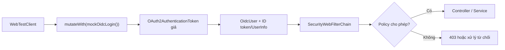

# `mockOidcLogin` và `OidcUser` với ID token hoặc UserInfo

Trong chương **OAuth2 Reactive** của module **SPRING_SECURITY_TESTING**, mục tiêu là kiểm chứng xác thực, phân quyền và bảo vệ HTTP thực tế bằng `spring-security-test` trên ứng dụng Servlet và Reactive. Người học có thể dùng `MockMvc`, `WebTestClient`, `@WithMockUser`, `SecurityContext`, JWT/OAuth2/OIDC giả lập để thử các yêu cầu được phép và bị từ chối. Với ứng dụng **Spring WebFlux** dùng **OpenID Connect (OIDC) Login**, một nhu cầu phổ biến là kiểm tra controller hoặc service đọc đúng danh tính `OidcUser` mà không phải đăng nhập qua một Identity Provider (IdP) trong mỗi bài test.

`SecurityMockServerConfigurers.mockOidcLogin()` tạo một **ngữ cảnh đăng nhập OIDC giả lập** cho request `WebTestClient`. Chúng ta có thể tùy biến **ID token**, **UserInfo** và **authorities**, hoặc cung cấp trực tiếp một `OidcUser` được dựng sẵn. Điều quan trọng là biết test đang kiểm tra **hành vi ứng dụng sau khi có principal**, không mặc nhiên kiểm tra giao thức đăng nhập OIDC, chữ ký ID token hay khả năng bảo vệ token của IdP.

## 1. Phân biệt OIDC Login, ID token và UserInfo

OIDC mở rộng OAuth 2.0 để cung cấp danh tính của người đăng nhập. Trong một luồng login thật, ứng dụng đóng vai trò **OIDC Relying Party (OAuth2 Client)** và xác thực kết quả từ OpenID Provider. Các nguồn dữ liệu cần phân biệt:

| Thành phần | Vai trò | Ví dụ |
| --- | --- | --- |
| `ID token` | Token thể hiện kết quả xác thực người dùng, thường là JWT với các claim OIDC và ràng buộc giao thức | `sub`, `iss`, `aud`, `exp`, `iat`, `email` |
| `UserInfo` | Thông tin hồ sơ bổ sung từ UserInfo Endpoint (khi được sử dụng) | `name`, `given_name`, `picture`, `email` |
| `OidcUser` | Principal của ứng dụng sau OIDC Login; cung cấp ID token, UserInfo nếu có, claims và authorities | `getIdToken()`, `getUserInfo()`, `getAuthorities()` |
| `OAuth2AuthenticationToken` | Authentication đại diện đăng nhập OAuth2/OIDC trong Spring Security | Principal `OidcUser` cùng các authorities |
| `Access token` | Dùng để truy cập tài nguyên được cấp phép, có thể dùng khi gọi UserInfo Endpoint hoặc API khác | Không đồng nghĩa ID token |

Một **ID token** minh họa chứa:

```json
{
  "iss": "https://idp.example.test",
  "sub": "account-42",
  "aud": "portal-web",
  "email": "alice@example.test",
  "email_verified": true,
  "preferred_username": "alice",
  "iat": 1894701600,
  "exp": 1894705200
}
```

Một phản hồi **UserInfo** có thể bổ sung:

```json
{
  "sub": "account-42",
  "name": "Alice Nguyen",
  "given_name": "Alice",
  "locale": "vi-VN",
  "picture": "https://cdn.example.test/avatars/alice.png"
}
```

Trong luồng OIDC thực, `sub` của UserInfo phải tương ứng với `sub` của ID token theo yêu cầu giao thức. Hai nguồn cũng có thể chứa cùng một key claim; cách ứng dụng chọn nguồn ưu tiên phải được quy định và kiểm thử minh bạch. Với test, nên đọc đúng nguồn mà controller/service cần, thay vì tình cờ dựa vào cách các claim được gộp vào `OidcUser.getClaims()`.

**Không nhầm `OidcUser` với `JwtAuthenticationToken`.** OIDC Login tạo principal người dùng cho phía ứng dụng khách; một JWT Bearer được xử lý bởi OAuth2 Resource Server tạo loại authentication khác. `mockOidcLogin()` phục vụ tình huống login OIDC của WebFlux, còn `mockJwt()` phục vụ tình huống resource server nhận JWT giả lập.

## 2. `mockOidcLogin()` hoạt động trong bài test như thế nào?

Đường kiểm thử rút gọn:



Ví dụ ngắn:

```java
import static org.springframework.security.test.web.reactive.server
        .SecurityMockServerConfigurers.mockOidcLogin;

webTestClient.mutateWith(mockOidcLogin())
        .get()
        .uri("/api/me")
        .exchange()
        .expectStatus().isOk();
```

Lệnh `mutateWith(mockOidcLogin())` chuẩn bị một authentication giả lập cho request. Nó phù hợp để xác minh logic `@AuthenticationPrincipal OidcUser`, luật `authenticated()`, authority/role, controller và service phụ thuộc vào danh tính OIDC.

Những bước **không** được thực thi đầy đủ chỉ bởi post-processor này gồm: redirect sang IdP, xác thực `state`/`nonce`, trao đổi authorization code tại token endpoint, kiểm tra chữ ký ID token, `iss`/`aud`/`exp`, gọi UserInfo Endpoint, hoặc xác minh `sub` giữa ID token và UserInfo. Các hành vi đó cần các bài kiểm thử tích hợp với bộ lọc OAuth2 Login, client registration, decoder và IdP/token endpoint giả phù hợp.

## 3. Tiền đề: WebTestClient phải gắn Spring Security Reactive

Để test security rule của WebFlux, cần dùng `WebTestClient` có chạy `SecurityWebFilterChain`. Một cách tạo client rõ ràng:

```java
import static org.springframework.security.test.web.reactive.server
        .SecurityMockServerConfigurers.springSecurity;

import org.springframework.context.ApplicationContext;
import org.springframework.test.web.reactive.server.WebTestClient;

WebTestClient webTestClient =
        WebTestClient.bindToApplicationContext(context)
                .apply(springSecurity())
                .configureClient()
                .build();
```

`context` phải là WebFlux `ApplicationContext` chứa controller và security configuration được chọn. Khi dùng `@WebFluxTest`, có thể cần `@Import` security configuration; khi dùng `@SpringBootTest`, phải bảo đảm ứng dụng đang chạy đúng WebFlux stack.

Nếu chỉ dùng `WebTestClient.bindToController(new SomeController())` mà không gắn security filters, request có thể đến handler dù chưa xác thực. Khi đó một test `200` không chứng minh route đã được bảo vệ.

Các dependency test thường gặp trong Spring Boot:

```gradle
dependencies {
    implementation "org.springframework.boot:spring-boot-starter-webflux"
    implementation "org.springframework.boot:spring-boot-starter-security"
    implementation "org.springframework.boot:spring-boot-starter-oauth2-client"

    testImplementation "org.springframework.boot:spring-boot-starter-test"
    testImplementation "org.springframework.security:spring-security-test"
}
```

Đoạn Gradle dùng cú pháp Groovy và giả định Spring Boot quản lý phiên bản. Với ví dụ chỉ kiểm tra authentication OIDC giả lập, **không cần kết nối IdP thật**; kiểm thử OIDC Login end-to-end sẽ cần thêm cấu hình client registration và endpoints thử nghiệm.

## 4. Kiểm thử riêng claim trong ID token

ID token có thể mang claim `sub`, `email` hoặc `preferred_username`. Ta tùy biến nó qua `idToken(...)`:

```java
import static org.springframework.security.test.web.reactive.server
        .SecurityMockServerConfigurers.mockOidcLogin;

webTestClient.mutateWith(mockOidcLogin()
        .idToken(token -> token
                .claim("sub", "account-42")
                .claim("email", "alice@example.test")
                .claim("email_verified", true)))
    .get()
    .uri("/api/id-token/email")
    .exchange()
    .expectStatus().isOk()
    .expectBody(String.class)
    .isEqualTo("alice@example.test");
```

Ví dụ giả định endpoint đọc `oidcUser.getIdToken().getClaimAsString("email")`. Nếu controller đọc email từ UserInfo thay vì ID token, test này không chứng minh nguồn claim đó đúng. Luôn xác định **consumer thực tế của claim**.

`mockOidcLogin().idToken(...)` không cần token JWT compact đã ký. Builder tạo một `OidcIdToken` giả dùng trong principal của test. Việc đặt `exp` trong quá khứ hoặc `iss` sai vào fixture vẫn không chứng minh resource server/IdP sẽ từ chối token ấy, vì đường xác minh cryptographic không chạy trong post-processor.

## 5. Kiểm thử riêng dữ liệu từ UserInfo

Khi ứng dụng sử dụng các thuộc tính UserInfo như `name`, `locale`, `email` hoặc `picture`, hãy cấu hình **UserInfo token** của `mockOidcLogin()`:

```java
webTestClient.mutateWith(mockOidcLogin()
        .idToken(token -> token
                .claim("sub", "account-42"))
        .userInfoToken(info -> info
                .claim("sub", "account-42")
                .claim("email", "profile@example.test")
                .claim("name", "Alice Nguyen")))
    .get()
    .uri("/api/user-info/email")
    .exchange()
    .expectStatus().isOk()
    .expectBody(String.class)
    .isEqualTo("profile@example.test");
```

Hai lưu ý quan trọng:

1. `sub` trong hai nguồn **phải khớp** ở một fixture hợp lệ về mặt OIDC. Post-processor giả lập không nên được coi là đã kiểm chứng ràng buộc này.
2. Nếu ứng dụng thực tế chỉ sử dụng ID token và không nhận UserInfo, `getUserInfo()` có thể bằng `null`. Khi code có nhánh dự phòng, phải có test riêng cho trường hợp vắng UserInfo. Không gọi `getUserInfo().getEmail()` vô điều kiện nếu contract cho phép UserInfo vắng mặt.

Không nên gán hai giá trị `email` khác nhau cho ID token và UserInfo rồi đọc `oidcUser.getEmail()` mà không xác định chính xác chính sách ưu tiên của ứng dụng. Nếu nghiệp vụ yêu cầu nguồn UserInfo, hãy đọc `oidcUser.getUserInfo()`; nếu yêu cầu nguồn ID token, đọc `oidcUser.getIdToken()`. Đây cũng là cách giúp test không bị mơ hồ.

## 6. Ví dụ đầy đủ: @WebFluxTest và các nhánh HTTP

Ứng dụng ví dụ có ba endpoint:

- `GET /api/id-token/email`: đọc email từ **ID token**, yêu cầu đăng nhập.
- `GET /api/user-info/email`: đọc email từ **UserInfo**, yêu cầu đăng nhập; trả giá trị dự phòng nếu không có UserInfo/email.
- `GET /api/reports`: chỉ cho principal có authority `ROLE_REPORT_READER`.

Ta chỉ kiểm tra authentication/authorization của WebFlux và cách controller dùng `OidcUser`. Cấu hình test **không cần chạy OAuth2 authorization-code login thật**; `mockOidcLogin()` cung cấp authentication cho các request đã được mô phỏng.

```java
import static org.springframework.security.test.web.reactive.server
        .SecurityMockServerConfigurers.mockOidcLogin;
import static org.springframework.security.test.web.reactive.server
        .SecurityMockServerConfigurers.springSecurity;

import org.junit.jupiter.api.BeforeEach;
import org.junit.jupiter.api.Test;
import org.springframework.beans.factory.annotation.Autowired;
import org.springframework.boot.test.autoconfigure.web.reactive.WebFluxTest;
import org.springframework.boot.test.context.TestConfiguration;
import org.springframework.context.ApplicationContext;
import org.springframework.context.annotation.Bean;
import org.springframework.context.annotation.Import;
import org.springframework.security.config.Customizer;
import org.springframework.security.config.annotation.web.reactive.EnableWebFluxSecurity;
import org.springframework.security.config.web.server.ServerHttpSecurity;
import org.springframework.security.core.authority.SimpleGrantedAuthority;
import org.springframework.security.oauth2.core.oidc.user.OidcUser;
import org.springframework.security.oauth2.core.oidc.OidcUserInfo;
import org.springframework.security.web.server.SecurityWebFilterChain;
import org.springframework.test.web.reactive.server.WebTestClient;
import org.springframework.web.bind.annotation.GetMapping;
import org.springframework.web.bind.annotation.RestController;
import org.springframework.security.core.annotation.AuthenticationPrincipal;

@WebFluxTest(controllers = OidcReactiveWebTest.ProfileController.class)
@Import(OidcReactiveWebTest.SecurityConfig.class)
class OidcReactiveWebTest {

    @Autowired
    ApplicationContext context;

    WebTestClient client;

    @BeforeEach
    void setUp() {
        client = WebTestClient.bindToApplicationContext(context)
                .apply(springSecurity())
                .configureClient()
                .build();
    }

    @Test
    void chuaDangNhap_khongDuocDocProfile() {
        client.get()
                .uri("/api/id-token/email")
                .exchange()
                .expectStatus().isUnauthorized();
    }

    @Test
    void idTokenEmail_duocDocTuDungNguon() {
        client.mutateWith(mockOidcLogin()
                .idToken(token -> token
                        .claim("sub", "account-42")
                        .claim("email", "id@example.test")))
            .get()
            .uri("/api/id-token/email")
            .exchange()
            .expectStatus().isOk()
            .expectBody(String.class).isEqualTo("id@example.test");
    }

    @Test
    void userInfoEmail_duocDocTuDungNguon() {
        client.mutateWith(mockOidcLogin()
                .idToken(token -> token.claim("sub", "account-42"))
                .userInfoToken(info -> info
                        .claim("sub", "account-42")
                        .claim("email", "info@example.test")))
            .get()
            .uri("/api/user-info/email")
            .exchange()
            .expectStatus().isOk()
            .expectBody(String.class).isEqualTo("info@example.test");
    }

    @Test
    void khongCoUserInfo_traGiaTriDuPhong() {
        client.mutateWith(mockOidcLogin()
                .idToken(token -> token.claim("sub", "account-42")))
            .get()
            .uri("/api/user-info/email")
            .exchange()
            .expectStatus().isOk()
            .expectBody(String.class).isEqualTo("not-provided");
    }

    @Test
    void oidcUserKhongDuRole_reportsTra403() {
        client.mutateWith(mockOidcLogin()
                .authorities(new SimpleGrantedAuthority("ROLE_VIEWER")))
            .get()
            .uri("/api/reports")
            .exchange()
            .expectStatus().isForbidden();
    }

    @Test
    void oidcUserDuRole_reportsTra200() {
        client.mutateWith(mockOidcLogin()
                .authorities(new SimpleGrantedAuthority(
                        "ROLE_REPORT_READER")))
            .get()
            .uri("/api/reports")
            .exchange()
            .expectStatus().isOk()
            .expectBody(String.class).isEqualTo("reports");
    }

    @RestController
    static class ProfileController {

        @GetMapping("/api/id-token/email")
        String idTokenEmail(@AuthenticationPrincipal OidcUser user) {
            String email =
                    user.getIdToken().getClaimAsString("email");
            return email == null ? "not-provided" : email;
        }

        @GetMapping("/api/user-info/email")
        String userInfoEmail(@AuthenticationPrincipal OidcUser user) {
            OidcUserInfo info = user.getUserInfo();
            String email = info == null
                    ? null : info.getClaimAsString("email");
            return email == null ? "not-provided" : email;
        }

        @GetMapping("/api/reports")
        String reports() {
            return "reports";
        }
    }

    @TestConfiguration
    @EnableWebFluxSecurity
    static class SecurityConfig {

        @Bean
        SecurityWebFilterChain filterChain(ServerHttpSecurity http) {
            return http.authorizeExchange(auth -> auth
                    .pathMatchers(
                            "/api/id-token/email",
                            "/api/user-info/email")
                        .authenticated()
                    .pathMatchers("/api/reports")
                        .hasAuthority("ROLE_REPORT_READER")
                    .anyExchange().denyAll())
                .httpBasic(Customizer.withDefaults())
                .build();
        }
    }
}
```

Trong test này, `httpBasic(...)` cung cấp entry point khiến request không đăng nhập đến endpoint bảo vệ nhận `401`; `mockOidcLogin()` cung cấp principal OIDC cho những ca được mô phỏng đăng nhập. Việc không cấu hình `oauth2Login()` trong filter chain mẫu là **có chủ đích**: ta chỉ kiểm thử các handler và policy khi authentication đã tồn tại. Muốn kiểm chứng đăng nhập OIDC thật, cần đưa cấu hình OAuth2 Client, bộ lọc login và IdP giả phù hợp vào một test tích hợp riêng.

`mockOidcLogin().authorities(...)` đặt các authorities vào authentication giả lập. Nó không chứng minh claim `roles` trong ID token/UserInfo đã được production mapper chuyển thành quyền đúng. Nếu ứng dụng có converter hoặc logic ánh xạ tùy biến, cần test converter riêng hoặc integration test bao phủ phần ánh xạ đó.

## 7. Cung cấp `OidcUser` tự dựng để kiểm tra principal đặc biệt

Khi dữ liệu fixture phức tạp, hoặc service cần thao tác trực tiếp với một `OidcUser` cụ thể, ta có thể dựng `DefaultOidcUser` rồi truyền vào `mockOidcLogin().oidcUser(...)`.

```java
import java.time.Instant;
import java.util.List;
import java.util.Map;
import org.springframework.security.core.authority.SimpleGrantedAuthority;
import org.springframework.security.oauth2.core.oidc.OidcIdToken;
import org.springframework.security.oauth2.core.oidc.OidcUserInfo;
import org.springframework.security.oauth2.core.oidc.user.DefaultOidcUser;
import org.springframework.security.oauth2.core.oidc.user.OidcUser;

Instant issuedAt = Instant.parse("2030-01-15T10:00:00Z");
Instant expiresAt = issuedAt.plusSeconds(3600);

OidcIdToken idToken = new OidcIdToken(
        "test-id-token", issuedAt, expiresAt,
        Map.of(
                "sub", "account-42",
                "iss", "https://idp.example.test",
                "aud", "portal-web",
                "email", "id@example.test"));

OidcUserInfo userInfo = new OidcUserInfo(Map.of(
        "sub", "account-42",
        "email", "info@example.test",
        "name", "Alice Nguyen"));

OidcUser customUser = new DefaultOidcUser(
        List.of(new SimpleGrantedAuthority("ROLE_REPORT_READER")),
        idToken,
        userInfo,
        "sub");

webTestClient.mutateWith(mockOidcLogin().oidcUser(customUser))
        .get()
        .uri("/api/reports")
        .exchange()
        .expectStatus().isOk();
```

Các object ở đây được dựng từ **dữ liệu test**, không phải ID token đã xác minh chữ ký. Mốc thời gian cố định giúp fixture ổn định; `mockOidcLogin()` không tự loại token hết hạn theo thời gian thực. Hai giá trị email khác nhau được cố ý để minh họa rằng `getIdToken()` và `getUserInfo()` là hai nguồn khác nhau; endpoint trong mục 6 đọc trực tiếp nguồn tương ứng.

Constructor `DefaultOidcUser(..., "sub")` chọn `sub` làm thuộc tính tên principal. Nếu ứng dụng dùng `preferred_username` làm tên đăng nhập, test phải phản ánh lựa chọn ấy và đảm bảo claim tồn tại. Không nên đổi khóa tên principal tùy tiện nếu các thành phần khác đang gắn quyền, audit log hoặc dữ liệu nghiệp vụ với `sub` bất biến.

## 8. Kết hợp danh tính OIDC và phân quyền nghiệp vụ

Trong ứng dụng thực tế, principal đăng nhập OIDC có thể mang profile nhưng **quyền truy cập là một chính sách riêng**. Ví dụ controller trả hồ sơ chỉ cần `authenticated()`, còn API tài chính cần `ROLE_FINANCE` và có thể phải kiểm tra thêm tenant.

Với security rule:

```java
http.authorizeExchange(exchanges -> exchanges
        .pathMatchers("/api/profile").authenticated()
        .pathMatchers("/api/finance/**").hasRole("FINANCE")
        .anyExchange().denyAll());
```

Ta nên có ít nhất ba tình huống:

```java
// Không có danh tính: bị từ chối ở endpoint yêu cầu xác thực.
client.get().uri("/api/finance/summary")
        .exchange().expectStatus().isUnauthorized();

// Có OIDC principal nhưng không có ROLE_FINANCE: thiếu quyền.
client.mutateWith(mockOidcLogin()
        .authorities(new SimpleGrantedAuthority("ROLE_VIEWER")))
    .get().uri("/api/finance/summary")
    .exchange().expectStatus().isForbidden();

// Có OIDC principal và ROLE_FINANCE: được phép theo policy mẫu.
client.mutateWith(mockOidcLogin()
        .authorities(new SimpleGrantedAuthority("ROLE_FINANCE")))
    .get().uri("/api/finance/summary")
    .exchange().expectStatus().isOk();
```

Đây là **minh họa thêm** và yêu cầu endpoint `/api/finance/summary` cùng filter chain phù hợp; không dùng nguyên các URL này với cấu hình mục 6 rồi kỳ vọng `200`. Nếu policy dùng `hasRole("FINANCE")`, authority cần có là `ROLE_FINANCE` (tiền tố mặc định); `SCOPE_finance.read` không tự động tương đương.

Khi muốn sử dụng các claim như `tenant_id` hoặc `department` để quyết định quyền, hãy triển khai và test chính sách đó rõ ràng. Việc thêm `claim("tenant_id", "tenant-a")` trong ID token chỉ đưa dữ liệu vào `OidcUser`, không tự tạo `GrantedAuthority` hay bảo đảm service đã giới hạn dữ liệu theo tenant.

## 9. Những ca thiếu dữ liệu và sai hợp đồng đáng kiểm tra

Một ứng dụng có thể gặp các trường hợp profile thiếu thuộc tính:

| Dữ liệu trong fixture | Hành vi nên kiểm thử | Lý do |
| --- | --- | --- |
| ID token có `sub` và email hợp lệ | Đọc email từ ID token thành công | Xác minh đúng nguồn claim |
| ID token có `sub` nhưng thiếu email | Service trả giá trị dự phòng hoặc báo lỗi nghiệp vụ đã định | Email thường là tùy chọn theo scope/IdP |
| ID token và UserInfo có cùng `sub` | UserInfo được chấp nhận trong fixture hợp lệ | Nhất quán danh tính |
| Không có UserInfo | Controller không dereference `null` | Không phải mọi login đều có UserInfo |
| UserInfo có `name` nhưng không có email | Chỉ các thành phần cần email mới xử lý thiếu claim | Tránh suy đoán từ tên hiển thị |
| `OidcUser` có đúng email nhưng thiếu role | Endpoint đòi role trả `403` | Profile hợp lệ không đồng nghĩa đủ quyền |
| `OidcUser` có authority phù hợp | Endpoint đòi role cho phép | Kiểm chứng rule |
| UserInfo và ID token khác `sub` | Phải được từ chối bởi **luồng OIDC thật** theo giao thức | Mock principal không kiểm tra sự ràng buộc này |

Một ca UserInfo **khác `sub`** nên được đưa vào bài kiểm thử cơ chế xử lý OIDC response thực, hoặc test một validator tùy biến nếu ứng dụng tự triển khai nó. Không kết luận security an toàn chỉ vì `mockOidcLogin()` nhận một fixture không hợp lệ và controller vẫn chạy: post-processor được thiết kế để bỏ qua việc xác minh dữ liệu từ IdP.

## 10. `@AuthenticationPrincipal`, Reactive SecurityContext và `@WithMockUser`

Trong WebFlux, các controller có thể nhận `@AuthenticationPrincipal OidcUser` khi request đã đăng nhập OIDC. Ví dụ:

```java
@GetMapping("/api/me/sub")
Mono<String> subject(@AuthenticationPrincipal OidcUser user) {
    return Mono.just(user.getSubject());
}
```

Ở service không được truyền principal trực tiếp, có thể đọc `Authentication` từ `ReactiveSecurityContextHolder`:

```java
import org.springframework.security.core.Authentication;
import org.springframework.security.core.context.ReactiveSecurityContextHolder;
import org.springframework.security.core.context.SecurityContext;
import org.springframework.security.oauth2.core.oidc.user.OidcUser;
import reactor.core.publisher.Mono;

Mono<String> currentOidcSubject() {
    return ReactiveSecurityContextHolder.getContext()
            .map(SecurityContext::getAuthentication)
            .filter(authentication ->
                    authentication != null
                    && authentication.getPrincipal() instanceof OidcUser)
            .map(Authentication::getPrincipal)
            .cast(OidcUser.class)
            .map(OidcUser::getSubject);
}
```

Nếu không có authentication OIDC phù hợp, ví dụ này trả `Mono.empty()`. Hợp đồng nghiệp vụ có thể yêu cầu `switchIfEmpty(Mono.error(...))` để từ chối yêu cầu; cần test cả hai đường. Trong Reactor, security context gắn với subscription, không nên đọc `SecurityContextHolder` thread-local rồi mặc định nó là danh tính của request WebFlux.

`@WithMockUser` tạo một principal giả kiểu username/password cho nhiều test Spring Security; nó **không phải `OidcUser`** và không cung cấp `OidcIdToken` hay `OidcUserInfo`. Khi controller nhận `OidcUser`, hãy dùng `mockOidcLogin()` hoặc tự tạo authentication OIDC thích hợp. Nếu ứng dụng cần kiểm tra scope của JWT Resource Server, công cụ phù hợp hơn có thể là `mockJwt()`.

## 11. Phân biệt các post-processor thường gặp

| Công cụ | Mô phỏng loại danh tính | Phù hợp để kiểm thử |
| --- | --- | --- |
| `mockUser()` | Username/password authentication giả | Rule `authenticated`, `hasRole` và logic không phụ thuộc OIDC |
| `mockOAuth2Login()` | Principal đã login OAuth2 thông thường | Controller và rule dùng OAuth2 login nhưng không cần `OidcUser` |
| `mockOidcLogin()` | OIDC login với `OidcUser`, ID token và UserInfo giả | Controller/service đọc claims OIDC, authorities sau login |
| `mockJwt()` | JWT authentication giả của resource server | Phân quyền theo JWT claims/scope đã được mô phỏng |
| `mockOpaqueToken()` | Opaque token authentication giả | Rule sau introspection được mô phỏng |
| `Authorization: Bearer ...` qua WebTestClient | Request gửi credential Bearer tới filter chain | Tích hợp thực với decoder/introspector được cấu hình |

Các post-processor mô phỏng danh tính là công cụ giúp test tập trung và lặp lại. Chúng **không** thay thế bài kiểm thử authorization code flow, UserInfo endpoint, issuer metadata, JWK, ID token validation, lưu trữ session hay refresh token.

Đối với các request có thay đổi dữ liệu (POST, PUT, DELETE), test OIDC login có thể còn bị **CSRF** chặn. Khi mục tiêu là kiểm tra authority, cần cấp token CSRF test phù hợp (`csrf()`) để không nhầm `403` do thiếu CSRF với `403` do thiếu quyền. Với ví dụ GET trong bài, CSRF không phải nguyên nhân chính.

## 12. Cách thiết kế test để không mơ hồ về nguồn claim

Một bộ test dễ đánh giá nên chia theo câu hỏi:

1. **Nguồn ID token:** controller đọc `user.getIdToken()`; test chỉ đổi claim từ ID token và assert kết quả tương ứng.
2. **Nguồn UserInfo:** controller đọc `user.getUserInfo()`; test cung cấp UserInfo và một test khác khi UserInfo vắng mặt.
3. **Principal tùy chỉnh:** test tự dựng `DefaultOidcUser` có ID token, UserInfo, authorities và tên principal theo hợp đồng.
4. **Quyền HTTP:** test anonymous `401`, OIDC user thiếu role `403`, OIDC user đủ role `200` trong filter chain cụ thể.
5. **Luồng OIDC thật:** test riêng trao đổi code, kiểm tra ID token, ràng buộc `sub`, nonce/state và xử lý response từ IdP.

Tách các câu hỏi này giúp tìm nguyên nhân thất bại: data mapping, sai principal, sai role, filter chain chưa kết nối hay giao thức IdP không đáp ứng đúng hợp đồng. Nếu test chỉ chứa một assertion “người dùng đã login thấy HTTP 200”, các lỗi về nguồn claim hoặc mất quyền rất dễ bị bỏ qua.

### Các sai lầm thường gặp

**Giả định `mockOidcLogin()` đã chứng minh ID token hợp lệ.** Nó cung cấp đối tượng giả, không chạy bộ xác minh token thật. Cần bài test với bộ lọc OIDC login và IdP giả nếu kiểm tra `iss`/`aud`/`nonce`/`exp`/chữ ký.

**Đọc `getEmail()` nhưng không xác định nguồn.** Khi hai nguồn cùng có email, hãy chỉ rõ yêu cầu lấy từ ID token hay UserInfo và kiểm thử đúng accessor.

**Lấy claim trong UserInfo để cấp quyền mà không xác minh nguồn tin cậy.** Profile từ IdP không tự tương đương authority của ứng dụng; phải có mapper và quy tắc cho role/scope/tenant.

**Dùng `@WithMockUser` rồi ép principal thành `OidcUser`.** Loại authentication không khớp, dễ gây `ClassCastException` hoặc principal null ở controller.

**Chỉ test OIDC user đủ quyền.** Thiếu ca anonymous và thiếu quyền khiến test khó phát hiện policy bị nới lỏng.

**Dùng client không có `springSecurity()`.** Test có thể đi thẳng tới handler, bỏ qua `SecurityWebFilterChain`.

**Giả định UserInfo luôn tồn tại.** Cần xử lý `null` nếu ứng dụng cho phép đăng nhập chỉ với ID token.

**Quên sự khác nhau giữa authentication của OIDC Login và JWT Resource Server.** Bearer JWT nhận tại API không tự biến thành một `OidcUser` của session login.

## 13. Checklist hoàn tất

- Test context đúng **WebFlux** và có `SecurityWebFilterChain`; `WebTestClient` được bind/apply Spring Security test đúng cách.
- `mockOidcLogin()` dùng cho các ca cần principal OIDC; không thay thế nó bằng `mockUser()` khi cần `OidcUser`.
- Có test ID token với `sub` và claim cần dùng, đọc trực tiếp qua `getIdToken()`.
- Có test UserInfo với cùng `sub` và các thuộc tính profile, đọc qua `getUserInfo()`.
- Có test UserInfo vắng mặt hoặc claim tùy chọn bị thiếu theo hợp đồng ứng dụng.
- Khi cần OIDC principal đặc biệt, dùng `DefaultOidcUser` có authorities và name attribute được xác định trước.
- Có cặp test authenticated nhưng thiếu quyền (`403`), đủ quyền (`200`) và anonymous (`401` khi entry point yêu cầu login).
- Không coi role/scope/tenant là hệ quả tự động của một claim trong ID token/UserInfo.
- Test riêng luồng OIDC thực khi phải xác minh token, `state`/`nonce`, issuer/audience, UserInfo subject hoặc giao tiếp IdP.
- Nếu endpoint thay đổi dữ liệu, tách lỗi CSRF khỏi lỗi phân quyền.

**Kết quả mong đợi:** `mockOidcLogin()` giúp kiểm thử ổn định những thành phần WebFlux tiêu thụ `OidcUser`, dù thông tin đến từ ID token, UserInfo hay một principal tùy chỉnh. Khi kết hợp đúng `WebTestClient` và security filter chain, bài test còn chứng minh request chưa xác thực hoặc thiếu authority bị từ chối theo chính sách, trong khi phần xác minh giao thức OIDC thực được kiểm thử tại lớp tích hợp phù hợp.
