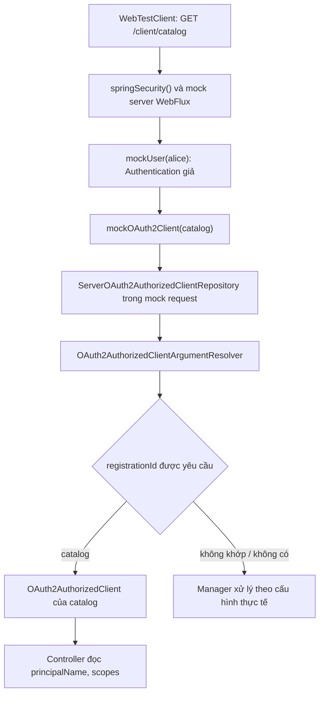

# mockOAuth2Client với authorized client theo registrationId

Trong ứng dụng Spring WebFlux có hỗ trợ OAuth2 Client, một controller có thể cần **access token đã được cấp cho một client registration cụ thể** để gọi dịch vụ ngoài. Spring Security cung cấp `@RegisteredOAuth2AuthorizedClient("catalog")` để lấy `OAuth2AuthorizedClient` gắn với registration `catalog`; khi kiểm thử, `SecurityMockServerConfigurers.mockOAuth2Client("catalog")` cho phép đưa một authorized client giả lập vào ngữ cảnh request của **WebTestClient**.

Bài học thuộc chương **OAuth2 Reactive** của module **SPRING_SECURITY_TESTING**: kiểm chứng xác thực, phân quyền và bảo vệ HTTP thực tế bằng `spring-security-test`. Bài tập trung vào **WebFlux, WebTestClient, OAuth2AuthorizedClient, principal và registrationId**, sau đó phân biệt với `mockOAuth2Login()`, `mockOidcLogin()`, `mockJwt()` và cách kiểm tra HTTP OAuth2/OIDC thực sự. Các ví dụ sử dụng Spring Boot 3.x, Spring Security 6.x và Java 17+.

## 1. Hiểu đúng đối tượng đang được giả lập

Trong OAuth2 Client, ba khái niệm có nhiệm vụ khác nhau:

| Đối tượng | Chứa điều gì? | Ví dụ |
| --- | --- | --- |
| `Authentication` | Danh tính và authorities của request vào ứng dụng | Người dùng `alice` đã đăng nhập |
| `ClientRegistration` | Cấu hình OAuth2 client: `registrationId`, `clientId`, grant type, các endpoint của nhà cung cấp | Registration `catalog` với client ID `web-catalog` |
| `OAuth2AuthorizedClient` | Một `ClientRegistration`, `principalName`, access token đã được cấp và có thể có refresh token | Token đọc Catalog API được lưu cho `alice` |

**`registrationId` không phải `clientId`:** `catalog` là khóa nội bộ để ứng dụng tìm cấu hình trong `spring.security.oauth2.client.registration.catalog`; `web-catalog` mới là client ID do Authorization Server cấp. `principalName` cũng khác với hai giá trị đó: nó xác định chủ thể gắn với authorized client.

Một controller WebFlux có thể viết:

```java
@GetMapping("/client/catalog")
Mono<ClientView> catalog(
        @RegisteredOAuth2AuthorizedClient("catalog")
        OAuth2AuthorizedClient authorizedClient) {
    return Mono.just(new ClientView(
        authorizedClient.getClientRegistration().getRegistrationId(),
        authorizedClient.getPrincipalName(),
        authorizedClient.getAccessToken().getScopes()));
}
```

Khi request được xử lý, `OAuth2AuthorizedClientArgumentResolver` sử dụng hạ tầng `ReactiveOAuth2AuthorizedClientManager` để giải quyết đối tượng `OAuth2AuthorizedClient`. Hệ thống thực có thể tìm đối tượng đã được lưu qua `ServerOAuth2AuthorizedClientRepository` hoặc cấp/refresh token khi provider tương ứng hỗ trợ. Test dùng `mockOAuth2Client` sẽ cung cấp sẵn authorized client giả lập.

### mockOAuth2Client() mặc định tạo gì?

Theo hành vi được mô tả trong tài liệu Spring Security, `mockOAuth2Client("catalog")` cung cấp một authorized client với:

- `ClientRegistration` đơn giản mang registration ID `catalog`, client ID thử nghiệm và client secret thử nghiệm.
- `principalName` mặc định là `user`.
- `OAuth2AccessToken` thử nghiệm, mặc định có scope `read`.

Ta có thể tùy chỉnh `principalName(...)`, `accessToken(...)`, `clientRegistration(...)` để phù hợp với dữ liệu controller cần đọc. Những token này **không được cấp qua Authorization Server**, không cần ký JWT và không chứng minh token thật hợp lệ.

## 2. Sơ đồ đường đi của một request test



Hai mutator trong sơ đồ phục vụ hai mục đích:

1. `mockUser("alice")` mô phỏng người dùng đã xác thực, giúp request qua rule `.authenticated()`.
2. `mockOAuth2Client("catalog").principalName("alice")` đặt authorized client tương ứng với registration `catalog` và tên principal `alice`.

**Chỉ dùng `mockOAuth2Client()` không phải lúc nào cũng đủ để vượt qua một endpoint yêu cầu authentication**: authorized client là dữ liệu dùng để gọi API ngoài, còn SecurityContext của request là một cơ chế riêng. Trong các ca kiểm thử có `.authenticated()`, hãy cung cấp danh tính giả lập phù hợp bằng `mockUser()`, `mockOAuth2Login()` hoặc cơ chế test authentication thích hợp.

## 3. Chuẩn bị ứng dụng WebFlux tối thiểu

Với Gradle và Spring Boot 3.x:

```gradle
dependencies {
    implementation("org.springframework.boot:spring-boot-starter-webflux")
    implementation("org.springframework.boot:spring-boot-starter-security")
    implementation("org.springframework.boot:spring-boot-starter-oauth2-client")

    testImplementation("org.springframework.boot:spring-boot-starter-test")
    testImplementation("org.springframework.security:spring-security-test")
}
```

Trong một ứng dụng có `@SpringBootApplication`, khai báo hai OAuth2 client registrations để phân biệt `catalog` và `billing`. Ví dụ sau dùng endpoint mẫu nên **chỉ dùng như cấu hình huấn luyện/test**, chưa phải cấu hình để kết nối nhà cung cấp thật:

```yaml
spring:
  security:
    oauth2:
      client:
        registration:
          catalog:
            provider: training-idp
            client-id: web-catalog
            client-secret: test-only-catalog-secret
            authorization-grant-type: authorization_code
            redirect-uri: "{baseUrl}/login/oauth2/code/{registrationId}"
            scope: catalog:read
          billing:
            provider: training-idp
            client-id: web-billing
            client-secret: test-only-billing-secret
            authorization-grant-type: authorization_code
            redirect-uri: "{baseUrl}/login/oauth2/code/{registrationId}"
            scope: billing:read
        provider:
          training-idp:
            authorization-uri: https://idp.example.test/authorize
            token-uri: https://idp.example.test/token
            user-info-uri: https://idp.example.test/userinfo
            user-name-attribute: sub
```

Trong ứng dụng thật, đưa client secret vào secret manager hoặc biến môi trường, dùng URL nhà cung cấp thực và HTTPS. Các bài `mockOAuth2Client` bên dưới không thực hiện token exchange, nên không gọi đến những URL mẫu này.

`SecurityWebFilterChain` bảo vệ các endpoint `/client/**`:

```java
import org.springframework.context.annotation.Bean;
import org.springframework.context.annotation.Configuration;
import org.springframework.security.config.Customizer;
import org.springframework.security.config.annotation.web.reactive.EnableWebFluxSecurity;
import org.springframework.security.config.web.server.ServerHttpSecurity;
import org.springframework.security.web.server.SecurityWebFilterChain;

@Configuration
@EnableWebFluxSecurity
class ReactiveClientSecurityConfig {

    @Bean
    SecurityWebFilterChain securityWebFilterChain(ServerHttpSecurity http) {
        return http
            .authorizeExchange(exchanges -> exchanges
                .pathMatchers("/client/**").authenticated()
                .anyExchange().denyAll())
            .oauth2Login(Customizer.withDefaults())
            .oauth2Client(Customizer.withDefaults())
            .build();
    }
}
```

`oauth2Client()` hỗ trợ hạ tầng quản lý authorized client; `oauth2Login()` hỗ trợ login tương tác qua OAuth2. Hai cơ chế này có liên quan, nhưng **đăng nhập thành công và có một authorized client của registration khác là hai trạng thái cần xem xét riêng**.

## 4. Controller: kiểm tra registration, principal và scope

Để tránh lộ bearer token, controller chỉ trả metadata an toàn. `/client/catalog/check` có quy tắc minh họa: outgoing client cần `catalog:read` mới được phép sử dụng Catalog API. Quy tắc này do controller đặt ra; bản thân annotation **không tự quyết định** access token có quyền gọi API đích.

```java
import java.util.Set;

import reactor.core.publisher.Mono;

import org.springframework.http.HttpStatus;
import org.springframework.http.ResponseEntity;
import org.springframework.security.oauth2.client.OAuth2AuthorizedClient;
import org.springframework.security.oauth2.client.annotation.RegisteredOAuth2AuthorizedClient;
import org.springframework.web.bind.annotation.GetMapping;
import org.springframework.web.bind.annotation.RestController;

@RestController
class ReactiveClientController {

    @GetMapping("/client/catalog")
    Mono<ClientView> catalog(
            @RegisteredOAuth2AuthorizedClient("catalog")
            OAuth2AuthorizedClient client) {

        return Mono.just(view(client));
    }

    @GetMapping("/client/billing")
    Mono<ClientView> billing(
            @RegisteredOAuth2AuthorizedClient("billing")
            OAuth2AuthorizedClient client) {

        return Mono.just(view(client));
    }

    @GetMapping("/client/catalog/check")
    Mono<ResponseEntity<String>> canReadCatalog(
            @RegisteredOAuth2AuthorizedClient("catalog")
            OAuth2AuthorizedClient client) {

        if (!client.getAccessToken().getScopes().contains("catalog:read")) {
            return Mono.just(ResponseEntity.status(HttpStatus.FORBIDDEN)
                .body("missing catalog:read"));
        }

        return Mono.just(ResponseEntity.ok("catalog-access-ready"));
    }

    private static ClientView view(OAuth2AuthorizedClient client) {
        return new ClientView(
            client.getClientRegistration().getRegistrationId(),
            client.getPrincipalName(),
            client.getAccessToken().getScopes());
    }
}

record ClientView(
    String registrationId,
    String principalName,
    Set<String> scopes) {}
```

Không tạo endpoint trả `client.getAccessToken().getTokenValue()` chỉ để test dễ assert: access token là credential. Với ứng dụng thật, Resource Server đích vẫn phải kiểm tra chính token và các scope/claims của nó; quy tắc cục bộ ở `canReadCatalog()` chỉ là một lớp kiểm tra bổ sung.

## 5. WebTestClient và mockOAuth2Client theo registrationId

Để test nhận diện chính xác behavior của SecurityWebFilterChain, tạo WebTestClient từ **ApplicationContext WebFlux** và áp dụng `springSecurity()`. Ta dùng `mockUser("alice")` cho inbound authentication và `mockOAuth2Client` cho outbound authorized client.

```java
import java.time.Instant;
import java.util.Set;

import org.junit.jupiter.api.BeforeEach;
import org.junit.jupiter.api.Test;
import org.springframework.beans.factory.annotation.Autowired;
import org.springframework.boot.test.context.SpringBootTest;
import org.springframework.context.ApplicationContext;
import org.springframework.security.oauth2.core.OAuth2AccessToken;
import org.springframework.test.web.reactive.server.WebTestClient;

import static org.hamcrest.Matchers.hasItem;
import static org.springframework.security.test.web.reactive.server.SecurityMockServerConfigurers.mockOAuth2Client;
import static org.springframework.security.test.web.reactive.server.SecurityMockServerConfigurers.mockUser;
import static org.springframework.security.test.web.reactive.server.SecurityMockServerConfigurers.springSecurity;

@SpringBootTest(webEnvironment = SpringBootTest.WebEnvironment.MOCK)
class ReactiveOAuth2ClientTests {

    @Autowired
    ApplicationContext context;

    WebTestClient client;

    @BeforeEach
    void setUp() {
        client = WebTestClient.bindToApplicationContext(context)
            .apply(springSecurity())
            .configureClient()
            .build();
    }

    @Test
    void catalogRegistrationIsResolvedForAlice() {
        client.mutateWith(mockUser("alice"))
            .mutateWith(mockOAuth2Client("catalog")
                .principalName("alice")
                .accessToken(accessToken(Set.of("catalog:read", "profile"))))
            .get().uri("/client/catalog")
            .exchange()
            .expectStatus().isOk()
            .expectBody()
            .jsonPath("$.registrationId").isEqualTo("catalog")
            .jsonPath("$.principalName").isEqualTo("alice")
            .jsonPath("$.scopes").value(hasItem("catalog:read"));
    }

    @Test
    void billingRegistrationCanBeResolvedIndependently() {
        client.mutateWith(mockUser("alice"))
            .mutateWith(mockOAuth2Client("billing")
                .principalName("alice")
                .accessToken(accessToken(Set.of("billing:read"))))
            .get().uri("/client/billing")
            .exchange()
            .expectStatus().isOk()
            .expectBody()
            .jsonPath("$.registrationId").isEqualTo("billing")
            .jsonPath("$.principalName").isEqualTo("alice")
            .jsonPath("$.scopes").value(hasItem("billing:read"));
    }

    @Test
    void catalogScopeAllowsControllerRule() {
        client.mutateWith(mockUser("alice"))
            .mutateWith(mockOAuth2Client("catalog")
                .principalName("alice")
                .accessToken(accessToken(Set.of("catalog:read"))))
            .get().uri("/client/catalog/check")
            .exchange()
            .expectStatus().isOk()
            .expectBody(String.class).isEqualTo("catalog-access-ready");
    }

    @Test
    void missingCatalogScopeIsRejectedByControllerRule() {
        client.mutateWith(mockUser("alice"))
            .mutateWith(mockOAuth2Client("catalog")
                .principalName("alice")
                .accessToken(accessToken(Set.of("profile"))))
            .get().uri("/client/catalog/check")
            .exchange()
            .expectStatus().isForbidden()
            .expectBody(String.class).isEqualTo("missing catalog:read");
    }

    private static OAuth2AccessToken accessToken(Set<String> scopes) {
        Instant now = Instant.now();

        return new OAuth2AccessToken(
            OAuth2AccessToken.TokenType.BEARER,
            "local-opaque-test-token",
            now.minusSeconds(10),
            now.plusSeconds(600),
            scopes);
    }
}
```

Những assertion trên đo hành vi ở các lớp:

- `catalogRegistrationIsResolvedForAlice`: annotation `"catalog"` nhận authorized client đúng ID, có `principalName = "alice"` và scope do test cấp.
- `billingRegistrationCanBeResolvedIndependently`: cùng cách cấu hình có thể giải quyết registration khác thông qua annotation `"billing"`.
- `catalogScopeAllowsControllerRule`: token chứa scope mà controller yêu cầu.
- `missingCatalogScopeIsRejectedByControllerRule`: token thiếu scope bị controller từ chối bằng 403, **không phải** vì `mockOAuth2Client` xác minh token thất bại.

Khi không có `catalog:read`, inbound request vẫn có `Authentication` từ `mockUser`; `WebFilterChain` với `.authenticated()` không tự suy ra rằng access token outbound phải có scope ấy. Trong ví dụ, 403 được tạo bởi **logic `canReadCatalog()`**.

### Đừng gộp registrationId với scope

`mockOAuth2Client("catalog")` mặc định không có nghĩa token được cấp `catalog:read`. Để kiểm tra scope, cung cấp rõ `accessToken(...)`. Tương tự, việc `ClientRegistration` yêu cầu scope `catalog:read` ở cấu hình registration **không bảo đảm** token đang có trong authorized client đã được cấp scope ấy: đối tượng `OAuth2AccessToken` chứa các scope thực tế mà logic ứng dụng sử dụng.

## 6. Dùng ClientRegistration thật của ứng dụng trong test

Đôi khi ta cần kiểm thử thêm `clientId`, `authorizationGrantType` hoặc registration metadata đang có trong ứng dụng. Khi đó, thay vì dùng `ClientRegistration` giả mặc định, lấy registration đã cấu hình qua `ReactiveClientRegistrationRepository`.

Ví dụ thêm vào lớp test có `client` ở mục 5:

```java
import org.springframework.security.oauth2.client.registration.ReactiveClientRegistrationRepository;
import org.springframework.security.oauth2.client.registration.ClientRegistration;

@Autowired
ReactiveClientRegistrationRepository registrations;

@Test
void canUseApplicationClientRegistration() {
    ClientRegistration catalog = registrations
        .findByRegistrationId("catalog")
        .block();

    assertThat(catalog).isNotNull();

    client.mutateWith(mockUser("alice"))
        .mutateWith(mockOAuth2Client()
            .clientRegistration(catalog)
            .principalName("alice")
            .accessToken(accessToken(Set.of("catalog:read"))))
        .get().uri("/client/catalog")
        .exchange()
        .expectStatus().isOk()
        .expectBody()
        .jsonPath("$.registrationId").isEqualTo("catalog");
}
```

Bổ sung static import:

```java
import static org.assertj.core.api.Assertions.assertThat;
```

Ở đây, `.clientRegistration(catalog)` giữ lại registration ID và các thông tin cấu hình mà test muốn dùng. Đây là **đọc metadata registration từ ứng dụng**, không phải gọi Authorization Server; `block()` được sử dụng trong **phần setup test** để lấy một giá trị cấu hình sẵn có, không nên chuyển cách blocking đó vào reactive request pipeline của production.

Có thể tùy chỉnh từng phần qua:

```java
mockOAuth2Client("catalog")
    .clientRegistration(builder -> builder.clientId("custom-client-id"))
```

Dùng `clientRegistration(ClientRegistration)` nếu muốn truyền đối tượng đầy đủ, và `clientRegistration(Consumer<ClientRegistration.Builder>)` nếu chỉ cần điều chỉnh một số trường. Hai cách đều khác với việc truyền access token: client registration mô tả **ứng dụng đã đăng ký**, còn access token mô tả **quyền được cấp trong lần ủy quyền cụ thể**.

## 7. Các tình huống sai registrationId hoặc sai principal

Hãy xem bảng dưới đây trước khi viết assertion cho ca âm:

| Tình huống | Điều cần kiểm chứng | Kết quả nên được hiểu thế nào |
| --- | --- | --- |
| Controller yêu cầu `catalog`, test cung cấp `catalog` | Chọn đúng authorized client | Controller có thể nhận client nếu principal và repository phù hợp |
| Controller yêu cầu `catalog`, test chỉ cung cấp `billing` | Không tự dùng nhầm token của registration khác | Manager có thể thử authorization lại hoặc trả lỗi/redirect theo grant type; **không mặc định một status duy nhất** |
| Inbound user là `alice`, client gắn `bob` | Tách authorized client theo principal | Không chấp nhận sai client; hành vi khi không tìm thấy phụ thuộc cấu hình |
| `catalog` được cấu hình nhưng chưa được authorize | Phân biệt registration có sẵn với token đã được cấp | Manager/provider có thể bắt đầu authorization-code flow hoặc grant khác |
| Access token của `catalog` thiếu `catalog:read` | Chính sách scope outbound | Nếu controller yêu cầu scope, phải từ chối hoặc xử lý theo hợp đồng |
| Client token đã hết hạn | Quản lý thời gian và refresh | Test riêng với manager/provider/token endpoint, không suy ra từ `mockOAuth2Client()` |

Một ca sai `registrationId` có thể dẫn đến **redirect sang Authorization Server**, bởi `ReactiveOAuth2AuthorizedClientManager` có khả năng bắt đầu flow mới khi một authorized client chưa tồn tại. Nếu test môi trường không có mock Authorization Server, không nên để một request vô tình gọi endpoint ngoài mạng. Hãy giới hạn bài test vào mapping đúng như mục 5, hoặc cung cấp manager/authorization provider và HTTP fixture phù hợp khi cố tình thử trường hợp thiếu client.

Có thể kiểm tra quy tắc chọn registration trong unit test của thành phần gọi `WebClient`, hoặc dùng hai endpoint `/client/catalog` và `/client/billing` để thể hiện mapping rõ ràng. Một phép thử trả `500` do cấu hình test không đầy đủ không phải là bằng chứng an toàn rằng ứng dụng đã chủ động từ chối client sai.

### Tên principal được lưu trong authorized client

`principalName` là tên được gắn với lần ủy quyền. Khi dùng `mockUser("alice")` cùng `mockOAuth2Client("catalog")`, nên thiết lập `.principalName("alice")` để dữ liệu kiểm thử phản ánh cùng người dùng. Nếu sử dụng client_credentials, principal này đôi khi là một danh tính logic cấp ứng dụng thay vì người dùng đăng nhập bằng trình duyệt. Quy tắc chọn principal và cache client phải được thống nhất trong thiết kế.

## 8. mockOAuth2Client khác mockOAuth2Login, mockOidcLogin và mockJwt

| Helper WebFlux | Giả lập chính | Thích hợp khi |
| --- | --- | --- |
| `mockOAuth2Client("catalog")` | Authorized client theo registration ID trong mock repository | Controller có `@RegisteredOAuth2AuthorizedClient("catalog")`; kiểm tra token metadata, scopes, lựa chọn client |
| `mockOAuth2Login()` | OAuth2User/Authentication đã đăng nhập và thông tin liên quan | Controller dùng `@AuthenticationPrincipal OAuth2User`, kiểm tra quyền và hành vi sau login |
| `mockOidcLogin()` | OidcUser giả với ID token và claims | Controller dùng `OidcUser` hoặc OIDC claims sau login |
| `mockUser("alice")` / `@WithMockUser` | Authentication giả | Kiểm tra role/authority, endpoint cần login; không tự cấp authorized client cho mọi registration |
| `mockJwt()` | Authentication giả cho Resource Server JWT | Kiểm tra authority/claim ở request Bearer inbound, không tạo OAuth2AuthorizedClient outbound |
| `mockOpaqueToken()` | Principal/authority sau introspection giả lập | Kiểm tra Resource Server với opaque token đã được giả định hợp lệ |

`mockOAuth2Login()` có thể được dùng khi bài test đồng thời cần principal OAuth2 đã đăng nhập. Nhưng nếu controller cần **authorized client của một registration khác** với registration login, `mockOAuth2Client("catalog")` sẽ diễn đạt rõ rằng một authorized client riêng cần có trong repository.

Không dùng `mockJwt()` để giả lập outbound OAuth2 access token theo registrationId. `JwtAuthenticationToken` trên request vào Resource Server và `OAuth2AuthorizedClient` mà ứng dụng dùng để gọi Resource Server khác là hai loại dữ liệu khác nhau.

## 9. WebClient gọi API đích bằng authorized client đã resolve

Trong ứng dụng Reactive, Spring Security tích hợp OAuth2 Client với `WebClient` qua `ServerOAuth2AuthorizedClientExchangeFilterFunction`. Có thể gắn authorized client được controller nhận vào request outbound, để filter function thêm Bearer token cho API đích.

Ví dụ cấu hình HTTP client:

```java
import org.springframework.context.annotation.Bean;
import org.springframework.context.annotation.Configuration;
import org.springframework.security.oauth2.client.ReactiveOAuth2AuthorizedClientManager;
import org.springframework.security.oauth2.client.web.reactive.function.client.ServerOAuth2AuthorizedClientExchangeFilterFunction;
import org.springframework.web.reactive.function.client.WebClient;

@Configuration
class CatalogWebClientConfig {

    @Bean
    WebClient catalogWebClient(
            ReactiveOAuth2AuthorizedClientManager manager) {
        var oauth2 = new ServerOAuth2AuthorizedClientExchangeFilterFunction(
            manager);

        return WebClient.builder()
            .filter(oauth2)
            .build();
    }
}
```

Một controller sử dụng authorized client đã resolve:

```java
import static org.springframework.security.oauth2.client.web.reactive.function.client.ServerOAuth2AuthorizedClientExchangeFilterFunction.oauth2AuthorizedClient;

@GetMapping("/client/catalog/items")
Mono<String> items(
        @RegisteredOAuth2AuthorizedClient("catalog")
        OAuth2AuthorizedClient client) {

    return catalogWebClient.get()
        .uri("https://catalog-api.example.test/items")
        .attributes(oauth2AuthorizedClient(client))
        .retrieve()
        .bodyToMono(String.class);
}
```

Đoạn `items()` là phương thức bổ sung minh họa cho controller đã được tiêm `WebClient catalogWebClient` và có các import Spring cần thiết. `catalog-api.example.test` chỉ là API mẫu; không nên chạy gọi ra mạng trong unit/integration test. Hãy dùng mock HTTP server hoặc mock `ExchangeFunction` để kiểm tra **request outbound** mang header `Authorization: Bearer ...` và không tiết lộ token vào response/log.

Không mặc định bật chế độ tự dùng access token của bất kỳ người dùng đang đăng nhập cho **mọi** request WebClient. Chỉ định `oauth2AuthorizedClient(client)` hoặc `clientRegistrationId(...)` có chủ đích để tránh gửi token sai dịch vụ. Test giả lập ở mục 5 chỉ đo controller đọc authorized client; để khẳng định WebClient thực sự gửi header cần test outbound HTTP riêng.

## 10. Test mock server khác với máy chủ HTTP thật

Ví dụ dùng `bindToApplicationContext(context).apply(springSecurity())`. Trong cách bind này, mutator có thể can thiệp mock request WebFlux và mock authorized client repository.

Ngược lại, `WebTestClient.bindToServer()` gửi HTTP tới server đã chạy trên cổng; `mockOAuth2Client()` **không chuyển một đối tượng OAuth2AuthorizedClient Java qua HTTP**. Nếu muốn kiểm chứng server chạy trong Docker, staging hoặc `@SpringBootTest(RANDOM_PORT)` bằng HTTP, cần hoàn tất OAuth2 Authorization Code thật, gửi cookie session hợp lệ hoặc cho server lấy access token thông qua client_credentials từ Authorization Server test.

```text
Mock server cùng test:
  WebTestClient + mockOAuth2Client("catalog")
           -> mock ServerOAuth2AuthorizedClientRepository
           -> controller có authorizedClient giả

Máy chủ qua HTTP:
  WebTestClient + cookie/header thật
           -> SecurityWebFilterChain trên server
           -> OAuth2 manager + kho client/token của server
           -> controller có authorizedClient khi flow hợp lệ
```

Với Resource Server nhận JWT hoặc opaque token, dùng `mockJwt()` hoặc `mockOpaqueToken()` để kiểm tra authorization nhanh nhưng cần các ca integration gửi bearer token có hiệu lực thực sự nếu mục tiêu là xác minh chữ ký/issuer hay introspection. Đối với OAuth2/OIDC Login, mock helper không thay thế bài test `state`, callback, token endpoint, ID token và `nonce`.

### So sánh với Servlet MockMvc

Trên Servlet, `SecurityMockMvcRequestPostProcessors.oauth2Client("catalog")` có mục tiêu tương tự: cung cấp authorized client giả lập cho `@RegisteredOAuth2AuthorizedClient`. Tuy nhiên controller Servlet sử dụng infrastructure `OAuth2AuthorizedClientManager` và repository Servlet; controller Reactive sử dụng `ReactiveOAuth2AuthorizedClientManager` và `ServerOAuth2AuthorizedClientRepository`. Không trộn test helper Servlet với WebFlux hoặc coi `MockMvc` là thay thế trực tiếp cho `WebTestClient`.

## 11. Lỗi thường gặp

| Hiện tượng | Nguyên nhân có thể | Cách xác minh |
| --- | --- | --- |
| Controller không nhận client của `catalog` | Test gắn `billing` hoặc sai annotation registrationId | So sánh `registrationId` trong cả annotation và mutator |
| Endpoint bị redirect dù đã gắn client | Authorized client không phải inbound Authentication | Bổ sung `mockUser` hoặc `mockOAuth2Login` hợp lệ theo policy |
| Scope khác giá trị kỳ vọng | Chưa gọi `.accessToken(...)`; scope mặc định là `read` | Đọc `OAuth2AccessToken.getScopes()` trong test |
| Principal không phải `alice` | Mock client vẫn dùng mặc định `user` | Gọi `.principalName("alice")` |
| Test gắn client rồi gọi URL staging nhưng nhận 401 | Mutator không tạo credential HTTP cho server thật | Kiểm thử flow/token/cookie HTTP thực |
| 403 dù token có `catalog:read` | 403 do inbound SecurityWebFilterChain hay logic controller? | Kiểm tra rule `authenticated/hasAuthority` và controller |
| Test vô tình gọi Authorization Server qua mạng | Thiếu authorized client, manager bắt đầu cấp token | Dùng mock client đúng registration; mock provider trong integration test |
| Test pass nhưng OAuth2 Login thật lỗi | Helper bỏ qua redirect, callback và token exchange | Viết bài test luồng HTTP thật với IdP cục bộ |
| Test gửi token giả qua response để assert | Bearer credential bị lộ | Assert metadata an toàn và kiểm tra outbound HTTP ở mock server |

Đặc biệt, các scope trong `OAuth2AccessToken` của **authorized client outbound** không tự động trở thành `GrantedAuthority` của inbound `Authentication`. Nếu một endpoint cần quyền `ROLE_ADMIN` hoặc `SCOPE_orders:read` ở tầng SecurityWebFilterChain, hãy cấp authority tương ứng cho mock inbound principal. Nếu controller cần outgoing scope `catalog:read`, hãy đặt nó ở `accessToken(...)` của authorized client và kiểm tra đúng tầng đó.

## 12. Bài tập thực hành

1. Chạy `catalogRegistrationIsResolvedForAlice`. Đổi `mockOAuth2Client("catalog")` thành `mockOAuth2Client("billing")` nhưng giữ annotation `"catalog"`. Ghi nhận hành vi manager và giải thích tại sao không thể coi hai registration là một.
2. Giữ registration `catalog`, đổi `.principalName("alice")` thành `"bob"`. Xác minh `principalName` mà controller nhận, sau đó thiết kế thêm một ca đảm bảo kho authorized client không dùng nhầm token giữa hai principal.
3. Bỏ `.accessToken(...)`, quan sát scope mặc định của mock authorized client. So sánh với scope khai báo ở `ClientRegistration`.
4. Giữ inbound `mockUser("alice")` nhưng tạo authorized client chỉ có `profile`. Giải thích vì sao `/client/catalog/check` trả 403.
5. Bỏ `mockUser("alice")` trên endpoint yêu cầu `.authenticated()`, quan sát phản hồi do SecurityWebFilterChain tạo. Phân biệt login với việc cấp authorized client.
6. Dùng `clientRegistrationRepository.findByRegistrationId("catalog").block()` trong phần setup test, rồi cung cấp đối tượng này bằng `.clientRegistration(catalog)`. So sánh `clientId` và metadata nhận được với cấu hình.
7. Viết test có mock HTTP server để kiểm tra `WebClient` mang chính access token từ `@RegisteredOAuth2AuthorizedClient("catalog")` tới Catalog API; không trả token trong response.
8. Tạo integration test OAuth2 Authorization Code hoặc `client_credentials` với Authorization Server test, kiểm tra việc cấp/refresh token thật. Đối chiếu phạm vi với `mockOAuth2Client()`.

## 13. Ghi nhớ

- **`mockOAuth2Client("catalog")` cấp một `OAuth2AuthorizedClient` giả lập theo registrationId.** Nó giúp kiểm thử controller Reactive có `@RegisteredOAuth2AuthorizedClient("catalog")` mà không cần gọi Authorization Server.
- **Registration ID, client ID, principal name và scope là bốn khái niệm khác nhau.** Khi kiểm tra kết quả, hãy xác nhận từng giá trị đang được lấy từ đâu.
- **`mockOAuth2Client()` không tự xác thực inbound principal.** Nếu endpoint cần đăng nhập, cấu hình `mockUser()`, `mockOAuth2Login()` hoặc helper thích hợp cho request.
- **`accessToken(...)` điều khiển scope của authorized client được kiểm thử.** Không suy ra scope đã cấp chỉ từ `ClientRegistration` hoặc tên registration.
- **Giả lập authorized client không kiểm tra OAuth2 flow thật.** Test redirect, code exchange, token signature, OIDC claims, refresh hoặc HTTP outbound cần các integration test riêng.
- **Giữ bearer token ở server.** Chỉ cung cấp token cho API đích có chủ đích, tránh trả credential trong response/log.

Khi thiết kế test trong **SPRING_SECURITY_TESTING**, hãy kiểm tra đồng thời: **controller yêu cầu registration nào, authorized client thuộc principal nào, và access token có scope mà logic đang sử dụng hay không**. Ba câu hỏi này giúp chứng minh đúng hành vi của `@RegisteredOAuth2AuthorizedClient` trong WebFlux mà không nhầm dữ liệu giả lập với một OAuth2 login hoặc token exchange đã diễn ra thật.

### Tài liệu tham khảo

- [Spring Security — Testing OAuth 2.0 trong WebFlux](https://docs.spring.io/spring-security/reference/reactive/test/web/oauth2.html)
- [Spring Security — Reactive Authorized Client Features](https://docs.spring.io/spring-security/reference/reactive/oauth2/client/authorized-clients.html)
- [Spring Security — Reactive OAuth2 Client core interfaces](https://docs.spring.io/spring-security/reference/reactive/oauth2/client/core.html)

