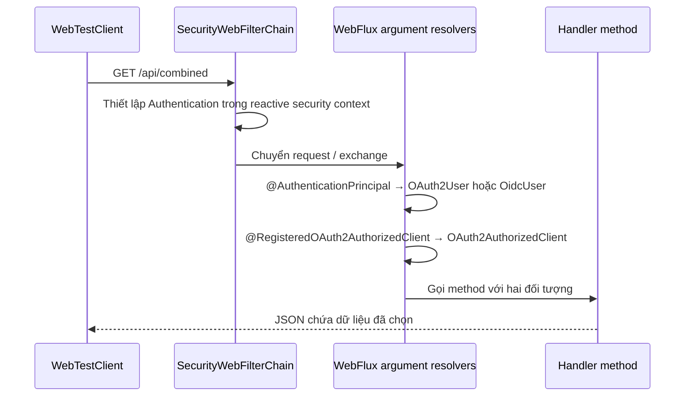

# Kiểm tra người dùng hoặc authorized client được phương thức xử lý nhận

Trong ứng dụng Spring WebFlux, một phương thức controller có thể nhận **người dùng đã xác thực** và **OAuth2 authorized client** qua hai tham số khác nhau. Cả hai đều liên quan OAuth2, nhưng chúng đại diện cho hai câu hỏi độc lập:

- **Ai đang gọi ứng dụng?** → `Authentication` hoặc principal như `OAuth2User`/`OidcUser`.
- **Ứng dụng đã có OAuth2 access token nào để gọi dịch vụ khác thay mặt người dùng hoặc theo một client registration?** → `OAuth2AuthorizedClient`.

Khi viết kiểm thử cho chương **OAuth2 Reactive** trong module `SPRING_SECURITY_TESTING`, ta cần chứng minh WebFlux đã truyền đúng đối tượng vào **phương thức xử lý HTTP**, và cần biết liệu đối tượng đến từ fixture của `spring-security-test` hay một luồng OAuth2 thật. Việc một endpoint trả `200 OK` là chưa đủ nếu bài test không kiểm tra tên principal, loại principal, registration ID, quyền hoặc authorized client được dùng.

Bài này sử dụng `WebTestClient`, `SecurityMockServerConfigurers.mockOAuth2Login()`, `mockOidcLogin()`, `mockOAuth2Client()`, `@AuthenticationPrincipal` và `@RegisteredOAuth2AuthorizedClient` để kiểm tra **argument resolution** của controller WebFlux. Sau đó, ta phân biệt kiểm thử với mock principal/client và kiểm thử qua redirect, callback, token exchange hoặc HTTP thật.

## 1. Phân biệt authenticated user và authorized client

Hai khái niệm có thể xuất hiện cùng nhau nhưng không thay thế nhau.

**Authenticated user** biểu diễn danh tính đang được Spring Security đặt trong security context của request. Khi đăng nhập OAuth2, `Authentication` thường là `OAuth2AuthenticationToken` chứa `OAuth2User`. Khi đăng nhập OpenID Connect, principal có thể là `OidcUser` với thông tin ID token, user-info và authorities.

**Authorized client** là đối tượng `OAuth2AuthorizedClient` mô tả một client registration đã được cấp quyền và có access token cho một principal. Nó chứa:

- `ClientRegistration`: registration ID, client ID, grant type, endpoint và scope được đăng ký.
- `principalName`: tên principal gắn với việc ủy quyền.
- `accessToken`: token type, token value, thời điểm cấp/hết hạn và các scope (nếu có).
- `refreshToken`: tùy flow và server có cấp hay không.

Authorized client thường được lưu hoặc lấy qua `ServerOAuth2AuthorizedClientRepository` hay các service/manager liên quan trong kiến trúc Reactive. Nó phục vụ **OAuth2 Client** khi ứng dụng cần gọi API khác; nó không phải một HTTP user đã được xác thực chỉ vì chứa access token.

| Khía cạnh | User / Authentication | Authorized client |
| --- | --- | --- |
| Câu hỏi trả lời | Ai đang truy cập ứng dụng? | Client registration nào đã được cấp token để gọi tài nguyên? |
| Kiểu điển hình | `OAuth2AuthenticationToken`, `OAuth2User`, `OidcUser` | `OAuth2AuthorizedClient` |
| Controller lấy qua | `Authentication`, `Principal`, `@AuthenticationPrincipal` | `@RegisteredOAuth2AuthorizedClient` |
| Nguồn trong test | `mockOAuth2Login()`, `mockOidcLogin()` | `mockOAuth2Client()` hoặc repository/manager test |
| Có chứng minh login/HTTP token exchange thật? | **Không**, nếu được mock | **Không**, nếu được mock |
| Dùng để kiểm tra | Danh tính, claims, authorities và authorization | Registration, access token, scope, truyền token sang outbound client |
| Lỗi dễ mắc | Nhầm principal với access token | Nhầm có token nghĩa là request đã đăng nhập |

Ví dụ: Alice đăng nhập bằng OIDC vào ứng dụng dashboard. Trong cùng request, controller có thể nhận `OidcUser` đại diện Alice và một `OAuth2AuthorizedClient` thuộc registration `reports-api` để gọi API báo cáo. Test cần chứng minh cả **đúng Alice** và **đúng registration/token của reports-api** nếu phương thức thực sự dùng cả hai.

## 2. Các argument resolver làm việc ở đâu?

WebFlux có cơ chế xử lý tham số controller. Spring Security đóng góp dữ liệu xác thực và OAuth2 Client để các tham số phù hợp được giải quyết khi HTTP request đi qua `SecurityWebFilterChain`.



Ở WebFlux, security context được liên kết với **Reactor Context**, chứ không nên giả định luôn đọc được thông qua một `ThreadLocal` cố định. Một handler có thể dùng `ReactiveSecurityContextHolder` khi cần lấy authentication trong luồng reactive; còn đối với method parameters, annotation giúp framework giải quyết tham số tại ranh giới HTTP.

Ba dạng ký hiệu thường gặp:

```java
@GetMapping("/api/current-user")
Mono<String> currentUser(@AuthenticationPrincipal OAuth2User user) {
    return Mono.just(user.getName());
}

@GetMapping("/api/oidc-subject")
Mono<String> oidcSubject(@AuthenticationPrincipal OidcUser user) {
    return Mono.just(user.getSubject());
}

@GetMapping("/api/client-name")
Mono<String> clientName(
        @RegisteredOAuth2AuthorizedClient("reports-api")
        OAuth2AuthorizedClient client) {
    return Mono.just(client.getClientRegistration().getRegistrationId());
}
```

Trong test, hãy chọn đúng cơ chế tạo dữ liệu cho từng tham số. Nếu chỉ dùng `mockOAuth2Login()` mà không có authorized client cho registration cần thiết, không nên tự cho rằng tham số thứ ba sẽ luôn được truyền đúng.

## 3. Chuẩn bị ứng dụng WebFlux và bộ test

Ví dụ tương thích về ý tưởng với Spring Security 6.x và Spring Boot 3.x; đường import hoặc một số annotation trong các phiên bản mới hơn có thể thay đổi. Các dependency điển hình:

```groovy
dependencies {
    implementation 'org.springframework.boot:spring-boot-starter-webflux'
    implementation 'org.springframework.boot:spring-boot-starter-security'
    implementation 'org.springframework.boot:spring-boot-starter-oauth2-client'

    testImplementation 'org.springframework.boot:spring-boot-starter-test'
    testImplementation 'org.springframework.security:spring-security-test'
}
```

Để tập trung vào WebFlux, nên tránh để `spring-boot-starter-web` vô tình khiến Spring Boot chọn ứng dụng Servlet thay cho Reactive khi cả hai starter cùng có mặt. Nếu ứng dụng được cấu hình web application type rõ ràng, kiểm tra test context đã tải đúng kiểu ứng dụng trước khi kết luận về Reactive security.

### 3.1. SecurityWebFilterChain

```java
import org.springframework.context.annotation.Bean;
import org.springframework.context.annotation.Configuration;
import org.springframework.security.config.Customizer;
import org.springframework.security.config.annotation.web.reactive.EnableWebFluxSecurity;
import org.springframework.security.config.web.server.ServerHttpSecurity;
import org.springframework.security.web.server.SecurityWebFilterChain;

@Configuration
@EnableWebFluxSecurity
class ReactiveOAuth2SecurityConfig {

    @Bean
    SecurityWebFilterChain springSecurityFilterChain(
            ServerHttpSecurity http) {
        return http
            .authorizeExchange(exchanges -> exchanges
                .pathMatchers("/api/reports")
                    .hasAuthority("SCOPE_reports.read")
                .pathMatchers("/api/**").authenticated()
                .anyExchange().permitAll()
            )
            .oauth2Login(Customizer.withDefaults())
            .oauth2Client(Customizer.withDefaults())
            .build();
    }
}
```

`oauth2Login()` bật luồng đăng nhập OAuth2 của ứng dụng. `oauth2Client()` bật hỗ trợ OAuth2 Client để thực hiện các tác vụ như quản lý authorized client; application còn cần cấu hình `ReactiveClientRegistrationRepository` và các service/repository phù hợp. Các configurer này không tự phát hành token khi test dùng mock.

### 3.2. ClientRegistration phục vụ ví dụ

Dưới đây là một registration thử nghiệm được khai báo trong class `@Configuration`. URI chỉ minh họa và **không được gọi** trong các test mock ở phần sau.

```java
import org.springframework.context.annotation.Bean;
import org.springframework.context.annotation.Configuration;
import org.springframework.security.oauth2.client.registration.ClientRegistration;
import org.springframework.security.oauth2.client.registration.InMemoryReactiveClientRegistrationRepository;
import org.springframework.security.oauth2.client.registration.ReactiveClientRegistrationRepository;
import org.springframework.security.oauth2.core.AuthorizationGrantType;
import org.springframework.security.oauth2.core.ClientAuthenticationMethod;

@Configuration
class ReactiveOAuth2ClientConfig {

    @Bean
    ReactiveClientRegistrationRepository registrations() {
        ClientRegistration reportsApi =
            ClientRegistration.withRegistrationId("reports-api")
                .clientId("reports-client")
                .clientSecret("test-only-secret")
                .clientAuthenticationMethod(
                    ClientAuthenticationMethod.CLIENT_SECRET_BASIC)
                .authorizationGrantType(
                    AuthorizationGrantType.AUTHORIZATION_CODE)
                .redirectUri(
                    "{baseUrl}/login/oauth2/code/{registrationId}")
                .authorizationUri(
                    "https://idp.example.test/authorize")
                .tokenUri("https://idp.example.test/token")
                .userInfoUri(
                    "https://idp.example.test/userinfo")
                .userNameAttributeName("sub")
                .scope("reports.read")
                .clientName("Reports API")
                .build();

        return new InMemoryReactiveClientRegistrationRepository(
            reportsApi);
    }
}
```

Để chạy luồng Authorization Code thật, cần provider và endpoint hoạt động. Test mock phía dưới chỉ dùng registration như metadata cho authorized client fixture. Không đưa client secret production vào tài liệu hoặc test. Nếu Spring Boot đã tạo bean registration từ `application.yml`, không khai báo thêm bean trùng chức năng vô tình làm thay đổi cấu hình.

## 4. Controller nhận OAuth2User hoặc OidcUser qua @AuthenticationPrincipal

Controller dưới đây cố ý hiển thị các dữ liệu *không nhạy cảm* cần thiết để xác minh argument resolution. Không trả access token, refresh token hoặc toàn bộ ID token qua API chỉ để tiện test.

```java
import java.util.Map;

import org.springframework.security.core.Authentication;
import org.springframework.security.core.annotation.AuthenticationPrincipal;
import org.springframework.security.oauth2.core.user.OAuth2User;
import org.springframework.security.oauth2.core.oidc.user.OidcUser;
import org.springframework.web.bind.annotation.GetMapping;
import org.springframework.web.bind.annotation.RestController;
import reactor.core.publisher.Mono;

@RestController
class ReactiveIdentityController {

    @GetMapping("/api/whoami")
    Mono<Map<String, String>> whoami(
            @AuthenticationPrincipal OAuth2User user) {
        return Mono.just(Map.of(
            "name", user.getName(),
            "sub", String.valueOf(user.getAttribute("sub"))
        ));
    }

    @GetMapping("/api/oidc")
    Mono<Map<String, String>> oidc(
            @AuthenticationPrincipal OidcUser user) {
        return Mono.just(Map.of(
            "subject", user.getSubject(),
            "issuer", String.valueOf(user.getIssuer())
        ));
    }

    @GetMapping("/api/authentication")
    Mono<Map<String, String>> authentication(
            Authentication authentication) {
        return Mono.just(Map.of(
            "principalName", authentication.getName(),
            "authenticated", Boolean.toString(
                authentication.isAuthenticated())
        ));
    }
}
```

`OAuth2User` đại diện principal từ OAuth2 Login; `OidcUser` mở rộng thông tin OpenID Connect. Nếu request đã xác thực bằng HTTP Basic hoặc một cơ chế khác, principal có thể **không** phải `OAuth2User`. Test phải tạo đúng loại principal cho phương thức đang xét.

`@AuthenticationPrincipal` cũng có thể nhận giá trị của một biểu thức, ví dụ tên hoặc thuộc tính cụ thể, nếu ứng dụng cần:
 
```java
@GetMapping("/api/subject")
Mono<String> subject(
        @AuthenticationPrincipal(expression = "attributes['sub']")
        String sub) {
    return Mono.just(sub);
}
```

Đừng ép mọi endpoint dùng biểu thức phức tạp. Với handler đọc nhiều claims, truyền `OAuth2User`/`OidcUser` vào method thường dễ hiểu hơn và giúp test kiểm tra đúng contract.

## 5. Thiết lập WebTestClient để kiểm tra Reactive security

Khi muốn kiểm tra WebFlux web filters và handler method mà không cần mở cổng HTTP, dùng `WebTestClient.bindToApplicationContext(...)` kết hợp `springSecurity()` từ `spring-security-test`:

```java
import org.junit.jupiter.api.BeforeEach;
import org.springframework.beans.factory.annotation.Autowired;
import org.springframework.boot.test.context.SpringBootTest;
import org.springframework.context.ApplicationContext;
import org.springframework.test.web.reactive.server.WebTestClient;

import static org.springframework.security.test.web.reactive.server
    .SecurityMockServerConfigurers.springSecurity;

@SpringBootTest(
    webEnvironment = SpringBootTest.WebEnvironment.MOCK
)
class ReactiveOAuth2ArgumentTest {

    @Autowired
    ApplicationContext context;

    WebTestClient client;

    @BeforeEach
    void setUp() {
        client = WebTestClient.bindToApplicationContext(context)
            .apply(springSecurity())
            .configureClient()
            .build();
    }
}
```

Cách bind này chạy WebFlux dispatch và security web filters trong bộ nhớ. `mockOAuth2Login()`, `mockOidcLogin()` và `mockOAuth2Client()` được thiết kế cho kiểu test server này, không phải để gửi một “mock principal” qua network tới ứng dụng xa.

Khi dùng `@WebFluxTest` thay cho `@SpringBootTest`, cần bảo đảm security config, client registrations, argument resolvers và những bean handler cần thiết đều có trong slice; thiếu bean có thể khiến test không chạy đúng logic của ứng dụng thật. Ví dụ ở đây dùng context đầy đủ để dễ quan sát cơ chế.

## 6. Kiểm tra OAuth2User được truyền đúng vào handler

Trong một bài test thông thường, ta tạo `OAuth2User` từ các thuộc tính mong muốn rồi dùng `mockOAuth2Login()` để đưa principal vào request. Không cần khởi động IdP.

Đặt các test dưới đây vào `ReactiveOAuth2ArgumentTest`. Import:

```java
import java.util.List;
import java.util.Map;

import org.junit.jupiter.api.Test;
import org.springframework.security.core.authority.SimpleGrantedAuthority;
import org.springframework.security.oauth2.core.user.DefaultOAuth2User;
import org.springframework.security.oauth2.core.user.OAuth2User;

import static org.springframework.security.test.web.reactive.server
    .SecurityMockServerConfigurers.mockOAuth2Login;
```

Test:

```java
@Test
void oauth2UserIsResolvedFromReactiveSecurityContext() {
    OAuth2User alice = new DefaultOAuth2User(
        List.of(new SimpleGrantedAuthority("ROLE_USER")),
        Map.of("sub", "alice-123", "email",
               "alice@example.test"),
        "sub"
    );

    client.mutateWith(mockOAuth2Login().oauth2User(alice))
        .get()
        .uri("/api/whoami")
        .exchange()
        .expectStatus().isOk()
        .expectBody()
        .jsonPath("$.name").isEqualTo("alice-123")
        .jsonPath("$.sub").isEqualTo("alice-123");
}
```

Phép kiểm thử chứng minh ba việc:

1. Security test configurer đặt `OAuth2AuthenticationToken`/`OAuth2User` vào security context của request.
2. WebFlux giải quyết tham số `@AuthenticationPrincipal OAuth2User` trong method `whoami(...)`.
3. Handler đọc đúng principal name/claim do test thiết lập.

**Nó không chứng minh** ứng dụng vừa redirect tới provider, nhận authorization code, gọi token endpoint hay tải user-info qua mạng. Các thao tác đó đã được helper bỏ qua. Khi mục tiêu chỉ là handler nhận user đúng và trả response đúng, đây chính là tầng kiểm thử thích hợp.

### 6.1. Tại sao không dùng mockUser() thay cho mockOAuth2Login()?

`mockUser("alice")` tạo một danh tính kiểm thử dạng user/password authentication, phù hợp với endpoint đọc `Authentication` chung hoặc kiểm tra roles. Nhưng handler nhận `@AuthenticationPrincipal OAuth2User` yêu cầu principal có đúng loại và thuộc tính OAuth2; mock user thông thường không cung cấp `OAuth2User`.

Nếu chọn sai helper, `@AuthenticationPrincipal` có thể trả `null`, khiến method không truy cập được thuộc tính hoặc dẫn tới lỗi mà test hiểu nhầm là lỗi WebFlux. Hãy chọn:

- `mockUser()` cho handler dựa trên principal thông thường, khi ứng dụng thực sự hỗ trợ.
- `mockOAuth2Login()` cho `OAuth2User` và các authorities của OAuth2 Login.
- `mockOidcLogin()` cho `OidcUser` và ID token/user-info claims giả lập.

## 7. Kiểm tra OidcUser và claim được handler nhận

Trong OIDC login, principal thường là `OidcUser`. Helper `mockOidcLogin()` cho phép chủ động đặt claim trong ID token kiểm thử:

```java
import static org.springframework.security.test.web.reactive.server
    .SecurityMockServerConfigurers.mockOidcLogin;

@Test
void oidcUserSubjectAndIssuerReachHandler() {
    client.mutateWith(mockOidcLogin().idToken(token -> token
            .claim("sub", "oidc-alice")
            .claim("iss", "https://idp.example.test")))
        .get()
        .uri("/api/oidc")
        .exchange()
        .expectStatus().isOk()
        .expectBody()
        .jsonPath("$.subject").isEqualTo("oidc-alice")
        .jsonPath("$.issuer")
            .isEqualTo("https://idp.example.test");
}
```

Test này xác nhận `@AuthenticationPrincipal OidcUser` được WebFlux truyền vào method và method đọc đúng subject/issuer. Nếu dự án dùng `OidcUser` được tùy biến, có thể dùng configurer để gắn principal phù hợp với contract ứng dụng.

**Giới hạn:** `mockOidcLogin().idToken(...)` dựng ID token object từ claims kiểm thử. Nó không kiểm tra chữ ký, issuer, audience, expiry hoặc nonce của ID token thật. Một test chấp nhận issuer không đáng tin cậy ở đây không phải là lỗ hổng đã được kiểm chứng; điều đó cho thấy test **đang dùng principal giả lập**. Muốn xác minh OIDC login thật, cần callback và decoder/validator theo cấu hình.

### 7.1. Kiểm tra roles/authorities độc lập với claim

Đối với endpoint `/api/reports` có rule `SCOPE_reports.read`, có thể dựng hai requests:

```java
@Test
void oauth2UserWithRequiredAuthorityMayReadReports() {
    client.mutateWith(mockOAuth2Login().authorities(
            new SimpleGrantedAuthority("SCOPE_reports.read")))
        .get()
        .uri("/api/reports")
        .exchange()
        .expectStatus().isOk();
}

@Test
void oauth2UserWithoutRequiredAuthorityIsForbidden() {
    client.mutateWith(mockOAuth2Login().authorities(
            new SimpleGrantedAuthority("SCOPE_profile")))
        .get()
        .uri("/api/reports")
        .exchange()
        .expectStatus().isForbidden();
}
```

Hai ca này cần endpoint `GET /api/reports` được ứng dụng cung cấp. Có thể bổ sung vào controller:

```java
@GetMapping("/api/reports")
Mono<String> reports() {
    return Mono.just("reports-visible");
}
```

Kết quả kiểm tra chính sách authorization theo authorities được test gắn sẵn. Nó **không** chứng minh provider đã trả scope `reports.read` hoặc ứng dụng đã ánh xạ claims/authorities từ token thật. Với OAuth2 Login, authorities được định hình bởi user service hoặc mapper cấu hình, không nên mặc định rằng mọi login đều tự sinh quyền `SCOPE_...` giống Resource Server.

## 8. Kiểm tra OAuth2AuthorizedClient được handler nhận

Khi ứng dụng phải gọi một API bên ngoài, handler có thể cần `OAuth2AuthorizedClient` của registration cụ thể. Spring Security hỗ trợ annotation `@RegisteredOAuth2AuthorizedClient` trong controller method.

Ví dụ:

```java
import java.util.Map;
import org.springframework.security.oauth2.client.OAuth2AuthorizedClient;
import org.springframework.security.oauth2.client.annotation.RegisteredOAuth2AuthorizedClient;
import org.springframework.web.bind.annotation.GetMapping;
import org.springframework.web.bind.annotation.RestController;
import reactor.core.publisher.Mono;

@RestController
class ReactiveAuthorizedClientController {

    @GetMapping("/api/client")
    Mono<Map<String, String>> clientDetails(
            @RegisteredOAuth2AuthorizedClient("reports-api")
            OAuth2AuthorizedClient authorizedClient) {
        return Mono.just(Map.of(
            "registrationId",
                authorizedClient.getClientRegistration()
                    .getRegistrationId(),
            "principalName", authorizedClient.getPrincipalName(),
            "tokenType",
                authorizedClient.getAccessToken()
                    .getTokenType().getValue()
        ));
    }
}
```

Chủ ý chỉ trả registration ID, principal name và token type. **Không trả token value hoặc refresh token** ra response; nếu test cần xác nhận token được đưa vào outbound request, hãy ghi nhận header ở local HTTP stub hoặc mock service gọi API ngoài.

### 8.1. Dùng mockOAuth2Client() để tạo authorized client trong test

`SecurityMockServerConfigurers.mockOAuth2Client()` tạo fixture authorized client phục vụ test. Ta gắn registration metadata và một access token giả lập:

```java
import java.time.Instant;
import java.util.Set;

import org.springframework.security.oauth2.client.registration.ClientRegistration;
import org.springframework.security.oauth2.client.registration.ReactiveClientRegistrationRepository;
import org.springframework.security.oauth2.core.OAuth2AccessToken;

import static org.springframework.security.test.web.reactive.server
    .SecurityMockServerConfigurers.mockOAuth2Client;
import static org.springframework.security.test.web.reactive.server
    .SecurityMockServerConfigurers.mockOAuth2Login;
```

Dùng repository test `registrations()` đã tạo ở mục 3.2 hoặc inject `ReactiveClientRegistrationRepository` rồi tìm registration trong setup:

```java
@Autowired
ReactiveClientRegistrationRepository registrations;

@Test
void controllerReceivesAuthorizedClientForExpectedRegistration() {
    OAuth2User alice = new DefaultOAuth2User(
        List.of(new SimpleGrantedAuthority("ROLE_USER")),
        Map.of("sub", "alice"),
        "sub"
    );

    ClientRegistration reports = registrations
        .findByRegistrationId("reports-api")
        .block(); // Chỉ block tại boundary setup của test.

    assertThat(reports).isNotNull();

    Instant now = Instant.now();
    OAuth2AccessToken testToken = new OAuth2AccessToken(
        OAuth2AccessToken.TokenType.BEARER,
        "test-token-not-from-provider",
        now,
        now.plusSeconds(600),
        Set.of("reports.read")
    );

    client.mutateWith(mockOAuth2Login().oauth2User(alice))
        .mutateWith(mockOAuth2Client()
            .clientRegistration(reports)
            .principalName("alice")
            .accessToken(testToken))
        .get()
        .uri("/api/client")
        .exchange()
        .expectStatus().isOk()
        .expectBody()
        .jsonPath("$.registrationId")
            .isEqualTo("reports-api")
        .jsonPath("$.principalName").isEqualTo("alice")
        .jsonPath("$.tokenType").isEqualTo("Bearer");
}
```

Snippet dùng `assertThat` từ AssertJ (static import `org.assertj.core.api.Assertions.assertThat`) và các kiểu `List`, `Map`, `OAuth2User`, `DefaultOAuth2User`, `SimpleGrantedAuthority` đã được giới thiệu trước đó. Trong fixture này, `principalName("alice")` nhất quán với principal do `mockOAuth2Login().oauth2User(alice)` tạo. Khai báo `mockOAuth2Client()` có registration phù hợp để resolver chọn đúng authorized client cho annotation `"reports-api"`.

Điều được chứng minh:

- Phương thức `clientDetails(...)` nhận được `OAuth2AuthorizedClient`.
- Client registration ID là `reports-api`, không bị nhầm sang registration khác.
- Principal name và token type khớp fixture kiểm thử.

Điều **chưa** được chứng minh:

- Ứng dụng đã gửi authorization redirect.
- Authorization Server đã cấp access token.
- Token vừa được refresh, còn hợp lệ hoặc được API ngoài chấp nhận.
- Token endpoint HTTP đã nhận request.
- Phương thức `WebClient` đã thật sự gắn Bearer token lên outbound HTTP request.

`mockOAuth2Client()` bỏ qua cơ chế cấp token thật giống như `mockOAuth2Login()` bỏ qua login flow. Hai helper phục vụ hai loại đối tượng khác nhau.

### 8.2. Có thể kiểm tra registration và scope trong cùng method

Nếu requirement là handler nhận đúng scope của authorized client, có thể trả các thông tin không nhạy cảm phục vụ test:

```java
@GetMapping("/api/client-scopes")
Mono<Map<String, Object>> scopes(
        @RegisteredOAuth2AuthorizedClient("reports-api")
        OAuth2AuthorizedClient client) {
    return Mono.just(Map.of(
        "registrationId",
            client.getClientRegistration().getRegistrationId(),
        "scopes", client.getAccessToken().getScopes()
    ));
}
```

Với fixture có `Set.of("reports.read")`, bài test có thể kiểm tra:

```java
client.mutateWith(mockOAuth2Login().oauth2User(alice))
    .mutateWith(mockOAuth2Client()
        .clientRegistration(reports)
        .principalName("alice")
        .accessToken(testToken))
    .get()
    .uri("/api/client-scopes")
    .exchange()
    .expectStatus().isOk()
    .expectBody()
    .jsonPath("$.scopes[0]").isEqualTo("reports.read");
```

Nhưng danh sách scope ở đây được tạo trong `OAuth2AccessToken` giả lập. Điều này chỉ chứng minh **handler dùng đúng dữ liệu từ authorized client**, không chứng minh provider thật sự cấp scope đó.

## 9. Kiểm tra đồng thời user và authorized client trong cùng handler

Một endpoint cần cả danh tính người dùng và authorized client có thể khai báo hai tham số:

```java
import org.springframework.security.core.annotation.AuthenticationPrincipal;
import org.springframework.security.oauth2.client.OAuth2AuthorizedClient;
import org.springframework.security.oauth2.client.annotation.RegisteredOAuth2AuthorizedClient;
import org.springframework.security.oauth2.core.user.OAuth2User;

@GetMapping("/api/combined")
Mono<Map<String, String>> combined(
        @AuthenticationPrincipal OAuth2User currentUser,
        @RegisteredOAuth2AuthorizedClient("reports-api")
        OAuth2AuthorizedClient authorizedClient) {

    return Mono.just(Map.of(
        "currentUser", currentUser.getName(),
        "authorizedClientPrincipal",
            authorizedClient.getPrincipalName(),
        "registrationId",
            authorizedClient.getClientRegistration().getRegistrationId()
    ));
}
```

Method này có hai nguồn dữ liệu. Nếu cả hai phải gắn với Alice, ta thiết lập riêng:

```java
OAuth2User alice = new DefaultOAuth2User(
    List.of(new SimpleGrantedAuthority("ROLE_USER")),
    Map.of("sub", "alice"),
    "sub"
);

client.mutateWith(mockOAuth2Login().oauth2User(alice))
    .mutateWith(mockOAuth2Client()
        .clientRegistration(reports)
        .principalName("alice")
        .accessToken(testToken))
    .get()
    .uri("/api/combined")
    .exchange()
    .expectStatus().isOk()
    .expectBody()
    .jsonPath("$.currentUser").isEqualTo("alice")
    .jsonPath("$.authorizedClientPrincipal").isEqualTo("alice")
    .jsonPath("$.registrationId").isEqualTo("reports-api");
```

Cách test này giúp phát hiện các lỗi về **định danh nguồn dữ liệu**:

- Handler vô tình dùng authorized client thuộc registration khác.
- Authorized client trong fixture gắn với principal khác người dùng hiện tại.
- Controller đọc nhầm name của client thay vì name của người dùng.
- Annotation `@RegisteredOAuth2AuthorizedClient` bị bỏ, sai registration ID hoặc không được resolver hỗ trợ vì thiếu cấu hình OAuth2 Client.

Một response 200 chung chung sẽ không phát hiện các sai lệch này. Các assertion tên người dùng, principalName và registrationId cho biết WebFlux đã truyền những đối tượng nào.

**Lưu ý về tổ chức ví dụ:** Nếu dùng cùng code trong một project demo, đặt `combined(...)` và `client-scopes(...)` vào class `ReactiveAuthorizedClientController` ở mục 8, bảo đảm có các import tương ứng. Đó là những method bổ sung cho controller, không phải các method top-level trong Java.

## 10. Authorized client không đồng nghĩa người dùng đã đăng nhập

Trong Spring Security, một `OAuth2AuthorizedClient` có thể tồn tại trong repository cho principal hoặc một luồng như `client_credentials`, trong khi request hiện tại không nhất thiết là một OAuth2 Login session. Ngược lại, người dùng đăng nhập thành công chưa chắc ứng dụng có authorized client **cho mọi registration**.

Có ít nhất bốn trạng thái hợp lệ cần phân biệt:

| Trạng thái request | User authentication | Authorized client `reports-api` | Hệ quả |
| --- | --- | --- | --- |
| Login thành công, client đã được cấp token | Có | Có | Handler có thể nhận cả hai |
| Login thành công, chưa cấp quyền cho reports API | Có | Chưa chắc có | Resolver/manager có thể cần ủy quyền tiếp hoặc báo lỗi |
| Có authorized client lưu cho một registration nhưng request chưa xác thực | Không hoặc là anonymous | Có thể tồn tại | Không tự cấp quyền vào endpoint `authenticated()` |
| Principal giả lập bằng helper | Có theo test fixture | Chỉ có nếu fixture/repository cung cấp | Không chứng minh flow thật đã chạy |

**Đặc biệt với `@RegisteredOAuth2AuthorizedClient`**, tùy `ReactiveOAuth2AuthorizedClientManager` và cách cấu hình, resolver có thể lấy client đã lưu, tìm registration, yêu cầu authorize lại hoặc bắt đầu một luồng phù hợp. Do đó, khi client **thiếu**, không nên mặc định một HTTP status duy nhất như 401 hoặc 404. Hãy xác định contract của ứng dụng: redirect để xin authorization, trả lỗi có kiểm soát, hoặc chỉ thực thi khi token đã sẵn sàng.

Trong test đơn vị của handler, có thể mock repository/manager để điều khiển nhánh không có authorized client. Trong test WebFlux integration, hãy giữ filter chain và config thật của app để kiểm tra nhánh thực tế.

## 11. Reactor Context và việc dùng identity bên trong service

Trong ứng dụng Reactive, controller thường trả `Mono`/`Flux` và service tiếp tục xử lý trên một chuỗi Reactor. Truy cập identity bằng `SecurityContextHolder.getContext()` dựa trên ThreadLocal tại một thread bất kỳ có thể không phản ánh đúng identity qua các scheduler hoặc asynchronous boundaries. Khi cần đọc authentication trong reactive pipeline, dùng `ReactiveSecurityContextHolder`.

Ví dụ một service:

```java
import org.springframework.security.core.Authentication;
import org.springframework.security.core.context.ReactiveSecurityContextHolder;
import org.springframework.stereotype.Service;
import reactor.core.publisher.Mono;

@Service
class CurrentUserService {

    Mono<String> currentName() {
        return ReactiveSecurityContextHolder
            .getContext()
            .map(context -> context.getAuthentication())
            .filter(Authentication::isAuthenticated)
            .map(Authentication::getName);
    }
}
```

Nếu controller đã nhận `@AuthenticationPrincipal OAuth2User`, bạn cũng có thể truyền principal vào service như tham số để làm phụ thuộc rõ ràng và dễ test. Cần biết dữ liệu lấy từ **argument resolver** hay được đọc **bên trong pipeline** khi thiết kế assertion.

Một bài test cho method handler cần khẳng định giá trị hiển thị hoặc service được gọi với đúng principal. Nếu service đọc Reactor Context trực tiếp, test cần chạy pipeline trong đúng security context do WebFlux test configurer cung cấp.

## 12. Khi cần xác minh token được chuyển tới WebClient

Việc `@RegisteredOAuth2AuthorizedClient` cung cấp đối tượng đúng cho handler chỉ là bước đầu. Nếu yêu cầu nghiệp vụ là “handler dùng access token của authorized client để gọi reports API”, cần thêm test đối với **outbound request**.

Một thiết kế kiểm thử phù hợp:

1. Handler nhận `OAuth2AuthorizedClient` của registration `reports-api`.
2. Handler hoặc service dùng `WebClient`/OAuth2 client exchange filter phù hợp để gọi API ngoài.
3. Local HTTP stub nhận request tới `/reports`.
4. Test xác minh HTTP request từ ứng dụng có header `Authorization: Bearer <test-token>` hoặc credential phù hợp với cấu hình.
5. API stub trả dữ liệu; test kiểm tra handler chuyển đổi response đúng.

Ví dụ code **minh họa cho tầng service**, khi access token được truyền tường minh:

```java
import org.springframework.security.oauth2.client.OAuth2AuthorizedClient;
import org.springframework.web.reactive.function.client.WebClient;
import reactor.core.publisher.Mono;

class ReportsGateway {

    private final WebClient webClient;

    ReportsGateway(WebClient webClient) {
        this.webClient = webClient;
    }

    Mono<String> fetch(OAuth2AuthorizedClient authorizedClient) {
        return webClient.get()
            .uri("/reports")
            .headers(headers -> headers.setBearerAuth(
                authorizedClient.getAccessToken().getTokenValue()
            ))
            .retrieve()
            .bodyToMono(String.class);
    }
}
```

Trong production, có thể cấu hình `ServerOAuth2AuthorizedClientExchangeFilterFunction` hoặc các cơ chế tích hợp OAuth2 Client để WebClient lấy và refresh token theo chính sách. Test phải chọn theo cơ chế ứng dụng thật dùng. Đừng vừa mock toàn bộ gateway vừa tuyên bố đã xác minh HTTP Authorization header; để kiểm tra header qua mạng, cần giữ đường WebClient và quan sát request tại stub.

**Không đưa token value vào body response hoặc log test** chỉ để assert. Header outbound tại local HTTP stub là nơi phù hợp hơn để kiểm tra token được gửi.

## 13. Phân biệt các helper trong spring-security-test

Đây là phần dễ bị nhầm nhất khi đọc test code.

| Helper WebFlux | Tạo dữ liệu gì? | Có trực tiếp kiểm tra? | Không kiểm tra |
| --- | --- | --- | --- |
| `mockUser("alice")` | Username/password principal đã xác thực | Roles, authorization, handler dùng Principal chung | OAuth2 Login |
| `mockOAuth2Login()` | OAuth2 Login authentication và `OAuth2User` | Handler nhận OAuth2User, quyền sau login | Redirect, state, authorization code, token/user-info endpoints |
| `mockOidcLogin()` | OIDC Login authentication và `OidcUser` | Handler đọc claims, quyền sau OIDC login | Chữ ký và validation ID token thật |
| `mockOAuth2Client()` | OAuth2AuthorizedClient fixture | Resolver nhận registration/token phù hợp | Token issuance, refresh, outbound HTTP và IdP |
| `mockJwt()` | Resource Server JWT authentication | Authorization theo JWT claims/authorities | JWT decoder/chữ ký JWT thật |
| `mockOpaqueToken()` | Opaque Bearer authentication | Authorization theo principal/scopes | Introspection endpoint thật |

Các helper được thiết kế để tránh phụ thuộc mạng trong những bài kiểm tra downstream logic. Nếu mục tiêu là “request HTTP thực có gửi header Bearer hoặc cookie chưa?”, hãy dùng `WebTestClient.bindToServer()` và một server đang chạy, thay vì cố truyền test context giả lập qua socket đến server khác.

## 14. Những ca âm tính có ý nghĩa

### 14.1. Không có authentication

Trên một endpoint được bảo vệ bởi `authenticated()`, request không gắn mock principal phải bị từ chối hoặc được chuyển sang login entry point:

```java
client.get()
    .uri("/api/whoami")
    .exchange()
    .expectStatus().is3xxRedirection();
```

**Status 3xx ở đây phụ thuộc cấu hình OAuth2 Login** và content negotiation. Một ứng dụng dùng API entry point có thể trả 401 thay vì redirect. Test phải assert hành vi đã được ứng dụng thiết kế, không coi một mã trạng thái là mặc định tuyệt đối cho mọi config.

Nếu request không có authentication nhưng lại được handler trả 200, cần kiểm tra URL matcher của `SecurityWebFilterChain`, test configurer đang áp dụng và việc endpoint có bị `permitAll()` ngoài ý muốn hay không.

### 14.2. Principal không đúng loại

Handler nhận `@AuthenticationPrincipal OidcUser` cần OIDC principal. Một test dùng `mockOAuth2Login()` có thể thiếu thông tin ID token, dẫn đến tham số `null` hoặc lỗi xử lý. Đây là tín hiệu thiết kế test chưa phản ánh cơ chế đăng nhập mà handler yêu cầu, trừ khi chính ứng dụng cần hỗ trợ cả OAuth2 và OIDC.

Có thể định nghĩa method nhận `OAuth2User` nếu hai loại principal đều phù hợp, vì `OidcUser` triển khai `OAuth2User`. Nếu method bắt buộc đọc `getIdToken()`, hãy dùng `OidcUser` và test OIDC.

### 14.3. Sai registration ID

Nếu annotation yêu cầu `@RegisteredOAuth2AuthorizedClient("reports-api")` nhưng fixture chỉ gắn `billing-api`, resolver không nhất thiết đưa client billing vào method reports. Tùy cấu hình manager/repository, nó có thể tìm registration reports, yêu cầu authorize hoặc báo lỗi. Hãy kiểm tra đúng registration ID được cấp; không dùng mọi client với nhau như một fixture vô danh.

### 14.4. Authorized client có principal khác

Nếu `mockOAuth2Login()` tạo Alice nhưng authorized client gắn với Bob, một test chấp nhận cả hai mà không kiểm tra quan hệ sẽ bỏ sót lỗi nghiệp vụ. Với logic cần token **on behalf of** người đang đăng nhập, assert `authorizedClient.getPrincipalName()` phù hợp `authentication.getName()`. Nếu hệ thống dùng `client_credentials` hoặc service account, quan hệ tên có thể khác; kiểm tra theo contract đó.

### 14.5. Quyền access token khác quyền của authenticated user

`OAuth2User.getAuthorities()` và `OAuth2AuthorizedClient.getAccessToken().getScopes()` là hai nguồn dữ liệu độc lập. App có thể có rule cho phép người dùng vào trang nhưng access token thiếu scope để gọi API ngoài. Khi xây fixture, nên tạo ca user có quyền nhưng client token không có scope cần thiết, rồi xem gateway xử lý lỗi 403 từ downstream như thế nào. Không tự giả định scope của token sẽ được chuyển thành role của user.

### 14.6. Test xanh vì tắt security filters

Một test `WebTestClient.bindToController(controller)` không có WebFlux security chain có thể gọi thẳng method mà không kiểm tra bảo vệ HTTP. Nếu mục tiêu là cả argument resolver và access control, dùng `bindToApplicationContext(context).apply(springSecurity())` hoặc live server có security chain; tạo negative case unauthenticated để xác nhận endpoint thực sự được bảo vệ.

## 15. Kiểm thử ngoài bộ nhớ: OAuth2 Reactive flow thật

Các helper ở trên không gọi authorization server. Khi yêu cầu cần chứng minh **người dùng hoặc authorized client có nguồn gốc từ OAuth2 flow thật**, hãy dựng integration test với một IdP hoặc HTTP stub cục bộ.

Một kịch bản kiểm tra OAuth2 Login gồm:

1. Khởi động ứng dụng WebFlux trên test port và local stub cho authorization/token/user-info endpoints.
2. Gửi request khởi động đăng nhập tới `/oauth2/authorization/{registrationId}` và quan sát `302 Location` chứa `state`.
3. Mô phỏng authorization callback dùng chính `state` và session/cookie của bước 2.
4. Để OAuth2 Client thực hiện HTTP POST đổi code lấy token tới local token endpoint.
5. Nếu cần, cho user-info endpoint trả subject và authorities theo fixture.
6. Gửi request vào `/api/whoami` sau callback với cookie/session đã được cấp; xác nhận handler nhận người dùng như kỳ vọng.
7. Gửi request vào endpoint dùng `@RegisteredOAuth2AuthorizedClient`; kiểm tra đúng registration/token được repository/manager trả về.
8. Thử token exchange lỗi, state sai hoặc thiếu authorized client và xác minh ứng dụng không tự xem những trường hợp đó là đã đăng nhập thành công.

Đối với OIDC, token endpoint còn trả ID token; nếu mục tiêu là kiểm tra chữ ký/claims, phải dùng decoder/validators thật cùng test JWK/token được ký, không dùng `mockOidcLogin()` làm bằng chứng.

Các đường HTTP này không tự xảy ra khi gọi `mockOAuth2Login()` hoặc `mockOAuth2Client()`. Kết quả 200 của mock test chỉ chứng minh phương thức nhận dữ liệu giả lập đúng. Kết quả 200 sau callback thực có thể mở rộng bằng chứng sang login/session/repository, tùy các thành phần mà test không thay bằng mock.

## 16. Ma trận kiểm thử cho handler Reactive

| Ca | Dữ liệu đầu vào | Phương thức nhận | Assertion quan trọng |
| --- | --- | --- | --- |
| OAuth2 user Alice | `mockOAuth2Login().oauth2User(alice)` | `@AuthenticationPrincipal OAuth2User` | Name/subject đúng |
| OIDC user | `mockOidcLogin().idToken(...)` | `@AuthenticationPrincipal OidcUser` | `sub`, `iss` như fixture |
| User được phép xem report | Mock login + authority `SCOPE_reports.read` | Security filter + handler | 200 |
| User thiếu quyền | Mock login với scope khác | Security filter | 403, không vào handler |
| Authorized client reports | `mockOAuth2Client()` với registration reports | `@RegisteredOAuth2AuthorizedClient("reports-api")` | Registration ID, principalName, token type |
| Cả user và client | Ghép mock login + mock client | Hai tham số trong cùng method | Name và client principal khớp contract |
| Thiếu authentication | Request không fixture | Endpoint được bảo vệ | 401 hoặc redirect theo entry point |
| Thiếu/sai registration | Fixture chỉ có registration khác | Authorized client resolver | Nhánh recovery/error/redirect theo manager |
| Token được relay outbound | Mock client + WebClient thật + local stub | Handler/service/gateway | Stub ghi nhận Bearer header |
| User đến từ OAuth2 thật | Login callback + token/user-info HTTP stub | Handler sau session | Principal có nguồn từ callback |
| Client đến từ token exchange thật | Callback/client manager + HTTP stub | `@Registered...` | Authorized client lưu/lấy đúng registration |

### Bài thực hành tự kiểm tra

Giả sử ứng dụng có endpoint `/api/combined` cần hiển thị tên người đang đăng nhập và registration của token sẽ dùng để gọi reports API. Hãy thực hiện ba nhóm test:

1. **User resolution:** dùng `mockOAuth2Login().oauth2User(alice)`, kiểm tra endpoint nhận `OAuth2User` đúng subject. Lặp lại với `mockOidcLogin()` nếu handler cần ID token/claims OIDC.
2. **Authorized client resolution:** dùng `mockOAuth2Client()` cho `reports-api`, gắn access token fixture, kiểm tra handler nhận chính xác registration ID, principalName và token type; không hiển thị token value.
3. **Combined behavior:** ghép hai helper và assert user name cùng client principal đúng theo contract. Thử sai registration ID, user/client principal khác nhau và thiếu authority để bảo đảm test phát hiện được vấn đề.

Nếu requirement là “dữ liệu này đến từ OAuth2 login/token endpoint thật”, mở rộng test bằng HTTP stub và callback/session thay vì kết luận chỉ từ mock helper.

**Tiêu chí hoàn thành:** Người học phân biệt được **principal của request**, **OAuth2AuthorizedClient của registration** và **OAuth2 access token dùng cho downstream API**; viết được WebTestClient test khiến WebFlux controller nhận đúng đối tượng qua `@AuthenticationPrincipal` và `@RegisteredOAuth2AuthorizedClient`; đồng thời nêu rõ các helper giả lập không chứng minh redirect, token exchange, ID token validation hoặc HTTP outbound đã xảy ra.

