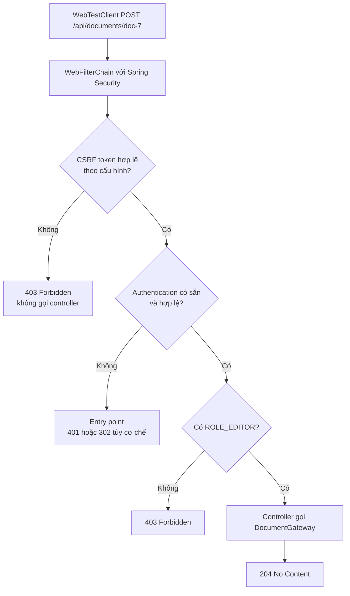

# SecurityMockServerConfigurers.csrf cho request WebFlux được bảo vệ

> **Chương:** OAuth2 Reactive  
> **Module:** `SPRING_SECURITY_TESTING`  
> **Mục tiêu:** Kiểm chứng request WebFlux có thay đổi trạng thái được bảo vệ bằng CSRF khi ứng dụng dùng OAuth2/OIDC login hoặc cơ chế xác thực khác. Người học dùng `spring-security-test`, `WebTestClient` và `SecurityMockServerConfigurers.csrf()` để tách lỗi thiếu CSRF khỏi lỗi xác thực/phân quyền; đồng thời hiểu phạm vi của test dùng principal giả và những điều phải kiểm tra qua HTTP thực.

## 1. Vì sao đăng nhập OAuth2 thành công mà POST vẫn bị từ chối?

Trong ứng dụng WebFlux, một người dùng đã hoàn tất OAuth2/OIDC login thường được nhận diện qua phiên web và cookie. Trình duyệt tự gửi cookie phiên đến website khi phát request phù hợp, kể cả trong một số tình huống bị website khác dẫn dụ gửi request. Nếu ứng dụng nhận một thao tác thay đổi dữ liệu chỉ dựa vào cookie đăng nhập, kẻ tấn công có thể tìm cách lợi dụng trạng thái đăng nhập của nạn nhân để thực hiện **Cross-Site Request Forgery (CSRF)**.

Vì thế, khi Spring Security WebFlux bật CSRF, request như `POST`, `PUT`, `PATCH` và `DELETE` phải thỏa điều kiện CSRF **ngoài** điều kiện đăng nhập và phân quyền. Trong test, một principal OAuth2 được giả lập đã đăng nhập bằng `mockOAuth2Login()` có thể đáp ứng authentication, nhưng request POST vẫn nhận `403 Forbidden` nếu thiếu CSRF token.

Giải pháp cho **bài test nhánh thành công** là dùng đúng test helper:

```java
client.mutateWith(SecurityMockServerConfigurers.mockOAuth2Login())
    .mutateWith(SecurityMockServerConfigurers.csrf())
    .post()
    .uri("/api/documents/doc-7")
    .exchange()
    .expectStatus().isNoContent();
```

Đoạn này giả định endpoint tồn tại, principal có đủ quyền và các phụ thuộc nghiệp vụ được chuẩn bị để trả `204 No Content`. `csrf()` chỉ bổ sung CSRF token hợp lệ **cho request kiểm thử được cấu hình theo Spring Security Test**, không tự chứng minh rằng trình duyệt thực đã nhận và gửi token đúng quy trình.

### 1.1. Ba điều kiện độc lập cần kiểm chứng

| Câu hỏi | Cơ chế Spring Security | Minh chứng trong test |
| --- | --- | --- |
| **Ai đang gửi request?** | Authentication, `SecurityContext`, OAuth2/OIDC login | `mockOAuth2Login()`, `mockOidcLogin()` hoặc login HTTP thật |
| **Người đó được làm gì?** | Authorization trong `SecurityWebFilterChain`, có thể thêm reactive method security | Đủ role/scope → cho phép; thiếu role/scope → `403` |
| **Request thay đổi trạng thái có đến từ nguồn hợp lệ theo cơ chế CSRF?** | `CsrfWebFilter` cùng `ServerCsrfTokenRepository` | Thiếu/sai token → `403`; token hợp lệ → đi tiếp đến bước phân quyền/nghiệp vụ |

Một kết quả `403` đơn lẻ chưa cho biết request bị chặn bởi CSRF hay authorization. Cần điều khiển các biến kiểm thử để biết chính xác hàng rào nào hoạt động.

### 1.2. Luồng xử lý minh họa



Sơ đồ là mô hình suy luận cho endpoint ví dụ. Thứ tự thực thi các WebFilter, exception handler và kết quả request cụ thể phụ thuộc cấu hình; chẳng hạn POST thiếu CSRF có thể bị `403` trước khi kiểm tra danh tính. Vì vậy muốn test authorization của POST, **hãy cấp CSRF hợp lệ** trước rồi cố ý thay đổi role.

## 2. CSRF trong WebFlux và OAuth2/OIDC liên quan như thế nào?

Spring Security WebFlux áp dụng bảo vệ CSRF mặc định cho các phương thức HTTP không được coi là an toàn. Thông thường, `GET`, `HEAD`, `OPTIONS` và `TRACE` không bị CSRF matcher mặc định yêu cầu token; `POST`, `PUT`, `PATCH`, `DELETE` thì có. Đây là quy tắc mặc định, có thể được tùy chỉnh qua `ServerHttpSecurity.csrf(...)`.

| Tình huống | CSRF thường có ý nghĩa gì? | Cần kiểm tra |
| --- | --- | --- |
| OAuth2/OIDC login dùng session cookie và form | Trình duyệt có ambient credentials, nên request thay đổi trạng thái cần chống CSRF | CSRF token repository, header/parameter, cookie/session và HTTP status |
| API dùng cookie/session sau OAuth2 login | Có nguy cơ CSRF tương tự web app | Không tắt CSRF chỉ để test xanh |
| Resource Server chỉ chấp nhận Bearer token trong `Authorization` header, không dùng cookie để xác thực | Không có cùng cơ chế tự gửi credential của trình duyệt trong nhiều thiết kế | Có thể có chính sách CSRF khác; phải phân tích kiến trúc thực |
| API chấp nhận cả cookie phiên lẫn Bearer JWT | Cookie vẫn có thể tạo bề mặt CSRF | Kiểm tra riêng từng SecurityWebFilterChain và authentication mechanism |
| OAuth2 authorization-code callback từ IdP | Có kiểm tra `state`, và OIDC có thể kiểm tra `nonce` | Không đánh đồng `state/nonce` với Spring CSRF token cho POST |

**CSRF token, OAuth2 `state` và OIDC `nonce` là những giá trị khác nhau.** `state` giúp ràng buộc authorization response với request đăng nhập ban đầu; `nonce` giúp ràng buộc ID Token trong OIDC theo flow tương ứng; CSRF token của `CsrfWebFilter` kiểm soát request HTTP thay đổi trạng thái của ứng dụng. Gọi `csrf()` trong WebTestClient không kiểm thử việc tạo/kiểm tra OAuth2 `state`, PKCE, callback hay xác minh chữ ký ID Token.

Vì callback OAuth2 thường là `GET /login/oauth2/code/{registrationId}`, nó không được kiểm tra theo mặc định giống một POST nghiệp vụ; Spring Security có các cơ chế kiểm tra tính nhất quán của OAuth2/OIDC riêng. Không nên tự dùng kết quả test `csrf()` để kết luận login callback an toàn.

## 3. Cấu hình WebFlux để kiểm tra CSRF thật

### 3.1. Dependency

Ví dụ Gradle cho ứng dụng Spring Boot 3.x / Spring Security 6.x:

```groovy
dependencies {
    implementation("org.springframework.boot:spring-boot-starter-webflux")
    implementation("org.springframework.boot:spring-boot-starter-security")
    implementation("org.springframework.boot:spring-boot-starter-oauth2-client")

    testImplementation("org.springframework.boot:spring-boot-starter-test")
    testImplementation("org.springframework.security:spring-security-test")
    testImplementation("io.projectreactor:reactor-test")
}
```

Nếu sử dụng `@MockitoBean` trong các ví dụ bên dưới, cần Spring Framework 6.2+ (thường đi cùng Spring Boot 3.4+); với dự án cũ hơn dùng `@MockBean` tương ứng. Sử dụng phiên bản dependency do Spring Boot quản lý để tránh lệch API test giữa các module.

### 3.2. SecurityWebFilterChain dùng OAuth2 Login và giữ CSRF

```java
@Configuration
class ReactiveSecurityConfiguration {

    @Bean
    SecurityWebFilterChain springSecurityFilterChain(ServerHttpSecurity http) {
        return http
            .authorizeExchange(exchanges -> exchanges
                .pathMatchers(HttpMethod.GET, "/api/documents/**")
                    .hasRole("READER")
                .pathMatchers(HttpMethod.POST, "/api/documents/**")
                    .hasRole("EDITOR")
                .anyExchange().authenticated())
            .oauth2Login(Customizer.withDefaults())
            .csrf(Customizer.withDefaults())
            .build();
    }
}
```

Trong cấu hình này, CSRF được bật; khai báo `csrf(Customizer.withDefaults())` nhằm nêu rõ ý đồ. Ứng dụng dùng `oauth2Login()` phải có cấu hình `ReactiveClientRegistrationRepository` hợp lệ. Với request thực, người dùng chưa đăng nhập có thể được chuyển hướng về trang đăng nhập hoặc authorization endpoint; không mặc định `401` như một Resource Server chỉ dùng Bearer token.

Ví dụ registration tối thiểu phục vụ cấu hình test; endpoint IdP dùng tên miền giả, không được gọi trong các test có `mockOAuth2Login()`:

```java
@TestConfiguration(proxyBeanMethods = false)
class OAuth2TestClients {

    @Bean
    ReactiveClientRegistrationRepository reactiveClientRegistrations() {
        ClientRegistration registration =
            ClientRegistration.withRegistrationId("test-idp")
                .clientId("test-client")
                .clientSecret("test-secret")
                .clientAuthenticationMethod(
                    ClientAuthenticationMethod.CLIENT_SECRET_BASIC)
                .authorizationGrantType(
                    AuthorizationGrantType.AUTHORIZATION_CODE)
                .authorizationUri("https://idp.example.test/authorize")
                .tokenUri("https://idp.example.test/token")
                .userInfoUri("https://idp.example.test/userinfo")
                .userNameAttributeName("id")
                .redirectUri(
                    "{baseUrl}/login/oauth2/code/{registrationId}")
                .scope("profile")
                .build();

        return new InMemoryReactiveClientRegistrationRepository(registration);
    }
}
```

Đây là registration OAuth2 dùng cho test, không phải OIDC discovery thực. Nếu ứng dụng đã có một `ReactiveClientRegistrationRepository` được cấu hình, không tạo bean cạnh tranh; chỉ thay endpoint/registration bằng cấu hình test phù hợp. Các thông số client ID/secret trong ví dụ chỉ là dữ liệu giả.

### 3.3. Controller và dependency nghiệp vụ

Ví dụ API cập nhật tài liệu trong WebFlux. Chúng ta muốn chứng minh request bị chặn **trước** khi lưu:

```java
public record UpdateDocumentRequest(String content) {}

public interface DocumentGateway {
    Mono<Void> update(String documentId, String content);
}

@RestController
@RequestMapping("/api/documents")
class DocumentController {
    private final DocumentGateway gateway;

    DocumentController(DocumentGateway gateway) {
        this.gateway = gateway;
    }

    @GetMapping("/{id}")
    Mono<Map<String, String>> get(@PathVariable String id) {
        return Mono.just(Map.of(
            "id", id,
            "content", "visible"));
    }

    @PostMapping("/{id}")
    Mono<ResponseEntity<Void>> update(
            @PathVariable String id,
            @RequestBody Mono<UpdateDocumentRequest> body) {
        return body
            .flatMap(command -> gateway.update(id, command.content()))
            .thenReturn(ResponseEntity.noContent().build());
    }
}
```

Ứng dụng thật cần một implementation của `DocumentGateway`. Trong integration test, mock đúng bean này và giữ controller, WebFlux handler mapping, `SecurityWebFilterChain` và `CsrfWebFilter` thật. Nếu cố ý tắt filter hoặc chỉ gọi thẳng phương thức `update(...)`, bài test không chứng minh được CSRF.

## 4. Cấu hình WebTestClient với Spring Security Test

Với client bind vào application context, phải áp dụng Spring Security test configurer:

```java
@SpringBootTest(webEnvironment = SpringBootTest.WebEnvironment.MOCK)
@Import(OAuth2TestClients.class) // Chỉ khi cần test registration riêng.
class ReactiveOAuth2CsrfIT {

    @Autowired ApplicationContext applicationContext;

    @MockitoBean DocumentGateway gateway;

    WebTestClient client;

    @BeforeEach
    void setUp() {
        client = WebTestClient
            .bindToApplicationContext(applicationContext)
            .apply(SecurityMockServerConfigurers.springSecurity())
            .configureClient()
            .build();
    }
}
```

Cấu trúc ví dụ đặt `ReactiveSecurityConfiguration` và `DocumentController` trong ứng dụng được `@SpringBootTest` nạp. Các phương thức test ở phần sau nằm trong cùng lớp `ReactiveOAuth2CsrfIT` này. Nếu ứng dụng đã có registration thật thì không cần `@Import(OAuth2TestClients.class)`; bản demo dùng nó để giữ test không phụ thuộc nhà cung cấp OAuth2 bên ngoài.

`springSecurity()` kết nối Spring Security WebFilters và các test mutator với WebTestClient; `csrf()` là mutator giúp thiết lập token phù hợp cho request. Hai API có nhiệm vụ khác nhau:

```java
WebTestClient securedClient = WebTestClient
    .bindToApplicationContext(applicationContext)
    .apply(SecurityMockServerConfigurers.springSecurity())
    .configureClient()
    .build();

WebTestClient csrfEnabledClient =
    securedClient.mutateWith(SecurityMockServerConfigurers.csrf());
```

Không cần dùng thêm `csrf()` với request GET chỉ để làm test pass. Cũng không nên gọi `mutateWith(csrf())` trên một client dùng chung toàn bộ test nếu còn muốn có test kiểm tra **thiếu CSRF**; mỗi nhánh nên cấu hình request/client theo ý định.

### 4.1. Các static import giúp ví dụ ngắn hơn

```java
import static org.springframework.security.test.web.reactive.server.SecurityMockServerConfigurers.springSecurity;
import static org.springframework.security.test.web.reactive.server.SecurityMockServerConfigurers.csrf;
import static org.springframework.security.test.web.reactive.server.SecurityMockServerConfigurers.mockOAuth2Login;
import static org.mockito.Mockito.*;
```

Các class còn lại gồm `ApplicationContext`, `WebTestClient`, `MediaType`, `SimpleGrantedAuthority`, `Mono`, các annotation Spring Boot Test và JUnit Jupiter. Tên import cụ thể có thể khác theo phiên bản Spring Security; hãy dùng bộ dependency test đồng nhất với ứng dụng.

## 5. Ma trận bốn ca POST: CSRF và role tách biệt

Giả sử người dùng vừa đăng nhập OAuth2, resource `POST /api/documents/doc-7` yêu cầu `ROLE_EDITOR` và CSRF token. Trong test, `mockOAuth2Login()` thiết lập authentication đã đăng nhập và có thể chỉ định authorities.

| Danh tính OAuth2 giả lập | CSRF token | Kết quả | `DocumentGateway.update(...)` |
| --- | --- | --- | --- |
| Có `ROLE_EDITOR` | Thiếu | `403` | Không được gọi |
| Có `ROLE_VIEWER`, thiếu `ROLE_EDITOR` | Hợp lệ | `403` | Không được gọi |
| Có `ROLE_EDITOR` | Hợp lệ | `204` | Gọi đúng một lần |
| Chưa đăng nhập | Hợp lệ | Bị từ chối hoặc redirect theo entry point | Không được gọi |

Để giữ test rõ ràng, các phương thức dưới đây dùng body cố định và mock dependency nghiệp vụ. Gắn `@MockitoBean DocumentGateway gateway` vào lớp test như mục 4.

### 5.1. Đã đăng nhập và đủ role nhưng thiếu CSRF: 403

```java
@Test
void editorWithoutCsrfIsForbidden() {
    client.mutateWith(mockOAuth2Login()
            .authorities(new SimpleGrantedAuthority("ROLE_EDITOR")))
        .post()
        .uri("/api/documents/doc-7")
        .contentType(MediaType.APPLICATION_JSON)
        .bodyValue(new UpdateDocumentRequest("updated"))
        .exchange()
        .expectStatus().isForbidden();

    verifyNoInteractions(gateway);
}
```

Test này giữ authentication và authorization đúng, cố ý bỏ CSRF. Assertion `verifyNoInteractions(gateway)` giúp phát hiện tình huống controller vô tình thực thi side effect dù response trả `403`. Không cần mock CSRF filter; phải để filter thật từ application context xử lý.

### 5.2. CSRF đúng nhưng thiếu quyền: 403

```java
@Test
void viewerWithCsrfIsForbiddenByAuthorization() {
    client.mutateWith(mockOAuth2Login()
            .authorities(new SimpleGrantedAuthority("ROLE_VIEWER")))
        .mutateWith(csrf())
        .post()
        .uri("/api/documents/doc-7")
        .contentType(MediaType.APPLICATION_JSON)
        .bodyValue(new UpdateDocumentRequest("updated"))
        .exchange()
        .expectStatus().isForbidden();

    verifyNoInteractions(gateway);
}
```

Ở đây token CSRF hợp lệ nên có thể quy kết việc bị chặn cho chính sách thiếu `ROLE_EDITOR`, miễn là các điều kiện test khác đúng. Nếu bỏ `mutateWith(csrf())`, test vẫn có thể trả `403` nhưng sẽ không thực sự chứng minh được authorization.

### 5.3. Đủ role và CSRF hợp lệ: 204

```java
@Test
void editorWithCsrfCanUpdateDocument() {
    when(gateway.update("doc-7", "updated"))
        .thenReturn(Mono.empty());

    client.mutateWith(mockOAuth2Login()
            .authorities(new SimpleGrantedAuthority("ROLE_EDITOR")))
        .mutateWith(csrf())
        .post()
        .uri("/api/documents/doc-7")
        .contentType(MediaType.APPLICATION_JSON)
        .bodyValue(new UpdateDocumentRequest("updated"))
        .exchange()
        .expectStatus().isNoContent();

    verify(gateway).update("doc-7", "updated");
}
```

Đây là **đường thành công bắt buộc** trong ma trận. Nếu chỉ có các test âm tính, ứng dụng chặn tất cả request vẫn có thể cho kết quả xanh. Ca thành công chứng minh principal, CSRF, role matcher và handler có thể phối hợp để thực thi nghiệp vụ.

### 5.4. Chưa đăng nhập nhưng có CSRF hợp lệ

```java
@Test
void anonymousCannotUpdateEvenWithCsrf() {
    client.mutateWith(csrf())
        .post()
        .uri("/api/documents/doc-7")
        .contentType(MediaType.APPLICATION_JSON)
        .bodyValue(new UpdateDocumentRequest("updated"))
        .exchange()
        .expectStatus().is3xxRedirection();

    verifyNoInteractions(gateway);
}
```

Với cấu hình OAuth2 Login dành cho ứng dụng web, entry point có thể chuyển hướng (thường `302`) tới trang đăng nhập hoặc authorization endpoint. Nếu cấu hình thực có nhiều client registrations, API entry point riêng hoặc custom exception handler, kết quả có thể khác. Hãy thay assertion theo hợp đồng thực tế; điều quan trọng là người chưa xác thực **không được cập nhật tài liệu**. Khi muốn test authentication failure của Bearer Resource Server, dùng chain riêng và kỳ vọng `401` theo cơ chế Bearer.

## 6. Kiểm chứng GET và các phương thức HTTP khác

`GET` được thiết kế cho thao tác đọc không có side effect và không thuộc tập phương thức bị yêu cầu CSRF token mặc định. Do đó, test quyền đọc không cần `csrf()`:

```java
@Test
void readerCanGetDocumentWithoutCsrfToken() {
    client.mutateWith(mockOAuth2Login()
            .authorities(new SimpleGrantedAuthority("ROLE_READER")))
        .get()
        .uri("/api/documents/doc-7")
        .exchange()
        .expectStatus().isOk()
        .expectBody()
        .jsonPath("$.id").isEqualTo("doc-7");
}

@Test
void viewerCannotReadDocumentDespiteSafeHttpMethod() {
    client.mutateWith(mockOAuth2Login()
            .authorities(new SimpleGrantedAuthority("ROLE_VIEWER")))
        .get()
        .uri("/api/documents/doc-7")
        .exchange()
        .expectStatus().isForbidden();
}
```

Điểm cần hiểu: **không yêu cầu CSRF không có nghĩa bỏ qua authentication và authorization**. Một GET có thể được miễn CSRF theo phương thức nhưng vẫn đòi `ROLE_READER`. Ngược lại, dù là GET, ứng dụng không nên dùng nó để thay đổi dữ liệu; thiết kế sai HTTP semantics làm suy yếu giả định bảo vệ CSRF.

Với `PUT`, `PATCH`, `DELETE`, thêm test tương ứng khi ứng dụng cho phép các method này. Chúng thường cần CSRF theo matcher mặc định; test phải cung cấp token cho nhánh được phép và cố ý bỏ token cho nhánh bảo vệ. Các ngoại lệ như HTTP OPTIONS preflight cần được kiểm tra theo cấu hình CORS và security thực.

## 7. Kết hợp @WithMockUser, mockOidcLogin và mockJwt

`csrf()` không phụ thuộc principal nhất thiết phải là OAuth2. Nó mô phỏng một phần riêng của bảo vệ HTTP; có thể kết hợp với các công cụ mô phỏng danh tính khác của `spring-security-test`.

| Công cụ | Danh tính được đặt vào test | Khi nào thích hợp | Giới hạn |
| --- | --- | --- | --- |
| `@WithMockUser(roles = "EDITOR")` | `Authentication` kiểu user chuẩn của Spring Security | Chỉ cần xác minh role và CSRF | Không chạy OAuth2/OIDC login, không tạo OAuth2 principal |
| `mockUser("lan").roles("EDITOR")` | User giả theo WebTestClient | Cần đổi user theo request | Không kiểm chứng credential |
| `mockOAuth2Login()` | OAuth2 login principal giả lập | Endpoint đọc OAuth2 attributes hoặc authority từ login | Không chạy authorization-code callback/token exchange |
| `mockOidcLogin()` | OIDC principal, ID Token/UserInfo giả lập | Endpoint cần `OidcUser` và claims OIDC | Không xác minh chữ ký ID Token hoặc nonce thật |
| `mockJwt()` | Principal/authorities dạng JWT cho resource server | Test quyền theo JWT claims hoặc `SCOPE_...` | Không parse Bearer header hoặc xác minh JWT ký thật |
| `csrf()` | CSRF token hợp lệ cho request test | POST/PUT/PATCH/DELETE có CSRF enabled | Không chứng minh trình duyệt lấy/gửi CSRF token đúng |

### 7.1. Dùng @WithMockUser khi chỉ quan tâm HTTP policy

```java
@Test
@WithMockUser(username = "lan", roles = "EDITOR")
void mockUserCanUpdateWhenCsrfIsPresent() {
    when(gateway.update("doc-7", "updated"))
        .thenReturn(Mono.empty());

    client.mutateWith(csrf())
        .post()
        .uri("/api/documents/doc-7")
        .contentType(MediaType.APPLICATION_JSON)
        .bodyValue(new UpdateDocumentRequest("updated"))
        .exchange()
        .expectStatus().isNoContent();

    verify(gateway).update("doc-7", "updated");
}
```

Test này giả định Spring TestContext có Spring Security Test listener và hỗ trợ Reactor Context. Ưu điểm là ngắn; hạn chế là principal mặc định không phải `OAuth2User`/`OidcUser`. Nếu controller cần `@AuthenticationPrincipal OidcUser` hoặc ép kiểu custom principal, hãy chọn `mockOidcLogin()` thay vì `@WithMockUser`.

### 7.2. Khi controller cần OidcUser

Ví dụ một test OIDC có thể dùng:

```java
client.mutateWith(
        SecurityMockServerConfigurers.mockOidcLogin()
            .authorities(new SimpleGrantedAuthority("ROLE_EDITOR")))
    .mutateWith(csrf())
    .post()
    .uri("/api/documents/doc-7")
    .contentType(MediaType.APPLICATION_JSON)
    .bodyValue(new UpdateDocumentRequest("updated"))
    .exchange()
    .expectStatus().isNoContent();
```

Ví dụ này giả định gateway được mock để trả `Mono.empty()`. `mockOidcLogin()` chuẩn bị danh tính OIDC cho kiểm thử authorization; nó không đi qua redirect, không kiểm tra `state` hay `nonce` trong callback và không tự gọi UserInfo endpoint.

### 7.3. Nếu endpoint nhận Bearer JWT thì sao?

Trong một Resource Server Reactive, có thể dùng:

```java
client.mutateWith(
        SecurityMockServerConfigurers.mockJwt()
            .authorities(new SimpleGrantedAuthority("SCOPE_docs:write")))
    .mutateWith(csrf())
    .post()
    .uri("/api/documents/doc-7")
    .exchange();
```

Đây chỉ là mảnh minh họa hai mutator; để assert status cần cấu hình resource server matcher cho `SCOPE_docs:write` và body/handler phù hợp. Một **API chỉ dùng Bearer token** thường có lựa chọn CSRF khác với ứng dụng OAuth2 login dựa vào cookie; nếu CSRF đã bị tắt trong chain API, `csrf()` không còn là điều kiện cần. Nhưng nếu cùng endpoint cũng chấp nhận session cookie, không nên suy ra rằng cứ có Bearer token là bỏ CSRF cho tất cả trường hợp.

Muốn xác minh JWT thực, gửi header `Authorization: Bearer` với token ký thật và dùng `ReactiveJwtDecoder` phù hợp; `mockJwt()` chỉ giúp test authorization sau khi đã có danh tính giả lập.

## 8. Test helper csrf() thực sự kiểm chứng điều gì?

`SecurityMockServerConfigurers.csrf()` được thiết kế để request của `WebTestClient` có CSRF token hợp lệ trong môi trường Spring Security Test. Nó giúp test đi qua `CsrfWebFilter` khi filter yêu cầu token, từ đó kiểm thử controller/authorization ở cấp WebFlux mà không phải tự quản lý chi tiết cookie và token repository trong mỗi bài.

Nó chứng minh:

1. Với CSRF được cấu hình, nhánh request có token hợp lệ có thể vượt qua kiểm tra này.
2. Khi cố ý không cung cấp token, request thay đổi trạng thái bị chặn nếu CSRF matcher áp dụng.
3. Các kiểm tra khác (role, authentication và nghiệp vụ) vẫn có thể được kiểm chứng khi đã bổ sung CSRF hợp lệ.

Nó **chưa** chứng minh:

- Token được tạo và expose đúng cách cho trình duyệt, ví dụ cookie CSRF hoặc render trang chứa token.
- Trình duyệt giữ session, đọc token, gắn header/parameter và gửi lại đúng trong nhiều HTTP request.
- Token sai, bị thay đổi, thuộc phiên khác hoặc bị replay trong các ngữ cảnh đặc biệt sẽ bị xử lý theo hợp đồng tùy chỉnh.
- OAuth2 `state`, PKCE, OIDC `nonce` và authorization-code callback hoạt động đúng.
- JWT được ký/giải mã thật hoặc IdP bên ngoài đã xác thực người dùng.

Nếu những hành vi trên là yêu cầu của sản phẩm, phải thêm integration test cấp HTTP/session tương ứng. Với CSRF token tùy chỉnh, nên kiểm tra chính `ServerCsrfTokenRepository` và cách giao diện gửi token.

### 8.1. Test một CSRF token sai

Test âm tính cơ bản chỉ cần bỏ token. Để kiểm chứng token **không hợp lệ**, có thể tạo một phiên và token server-side thực theo `ServerCsrfTokenRepository` của ứng dụng, sau đó gửi header/parameter với giá trị bị thay đổi trong cùng phiên:

```text
1. Gửi GET để ứng dụng phát sinh/đưa CSRF token theo contract test.
2. Giữ cookie/phiên cần thiết trong WebTestClient.
3. Gửi POST kèm CSRF token đã bị chỉnh sửa một ký tự.
4. Kỳ vọng 403 và xác nhận service không bị gọi.
5. Gửi lại với token hợp lệ để có đường thành công đối chiếu.
```

Chi tiết bước 1 phụ thuộc nơi ứng dụng expose `Mono<CsrfToken>` và repository dùng (ví dụ WebSession hay cookie-based). **Không tự tạo giá trị giả rồi khẳng định đó là token sai** nếu test chưa dựng trạng thái CSRF server-side tương ứng. Một số phiên bản/thiết lập dùng cơ chế che giấu hoặc trao đổi token qua cookie/header, nên phải kiểm tra đúng hợp đồng đang triển khai.

## 9. Đừng để test authorization bị CSRF che mất

Giả sử endpoint yêu cầu `ROLE_EDITOR`. Một developer viết:

```java
client.mutateWith(mockOAuth2Login()
        .authorities(new SimpleGrantedAuthority("ROLE_VIEWER")))
    .post()
    .uri("/api/documents/doc-7")
    .exchange()
    .expectStatus().isForbidden();
```

Test này có thể xanh **chỉ vì thiếu CSRF**, không hề chứng minh `ROLE_VIEWER` bị authorization chặn. Để test role, hãy cung cấp CSRF hợp lệ trước; và để test CSRF, hãy giữ role hợp lệ rồi bỏ CSRF. Cặp test cần đi cùng ca cho phép.

Tương tự, nếu test chỉ dùng `@WithMockUser` nhưng production bảo vệ endpoint bằng custom OAuth2 authorities converter, nó chưa kiểm chứng converter. Muốn test mapping thực tế, phải chạy mapper hoặc luồng login có kiểm soát riêng; `csrf()` không giúp xác thực mapping đó.

Có thể bổ sung kiểm tra side effect bằng Mockito:

```java
// Đường bị từ chối
verifyNoInteractions(gateway);

// Đường được phép
verify(gateway).update("doc-7", "updated");
```

Đây là bằng chứng quan trọng khi endpoint có ghi dữ liệu, thanh toán hoặc gọi dịch vụ bên ngoài; một HTTP status đúng nhưng tác vụ đã thực hiện trước khi bị chặn vẫn có thể là lỗi bảo mật.

## 10. Kịch bản logout, session và OAuth2 callback

### 10.1. POST logout

Trong ứng dụng có session login và CSRF mặc định, endpoint logout thường yêu cầu POST có CSRF token hợp lệ. Test có thể kiểm tra:

```java
client.mutateWith(mockOAuth2Login())
    .post()
    .uri("/logout")
    .exchange()
    .expectStatus().isForbidden();
```

Đoạn này giả định ứng dụng bật logout ở `/logout`, CSRF filter hoạt động với POST và không có custom logout matcher. Khi thêm `mutateWith(csrf())`, request có thể chuyển sang xử lý logout và redirect theo cấu hình. Để chứng minh session thực sự bị hủy, cần test chuỗi request với session/cookie và trạng thái sau logout; mock login chỉ xác nhận một phần của behavior.

### 10.2. OAuth2 callback

Một test muốn kiểm tra callback `/login/oauth2/code/{registrationId}` phải dùng transaction đăng nhập OAuth2 thật với mock IdP và xác nhận `state`, token endpoint, đăng ký client và session. Không phải cứ thêm `csrf()` vào request callback là đã kiểm chứng chống CSRF của authorization code flow. Trong OIDC cần xem thêm `nonce`, ID Token validation và mapping authorities/claims theo chính sách.

### 10.3. Multi-chain và CSRF theo path

Một ứng dụng có thể dành một `SecurityWebFilterChain` cho session-based UI và chain khác cho stateless Bearer API. Trong trường hợp đó, kiểm thử cần dựa theo **chain được chọn bởi path/matcher**. Không thể thấy POST `/api/**` không cần CSRF rồi suy ra `/admin/**` cũng vậy.

Nên kiểm tra ít nhất một POST hợp lệ và một POST thiếu CSRF trên vùng dùng session; đồng thời kiểm tra Bearer API bằng header/token thực nếu policy của vùng đó khác. Nếu CSRF được bỏ qua có điều kiện, test phải bao phủ cả vùng bị yêu cầu và vùng được miễn để phát hiện matcher quá rộng.

## 11. Những lỗi thường gặp khi chạy WebTestClient

| Dấu hiệu | Nguyên nhân có thể | Cách phân tích |
| --- | --- | --- |
| Đủ role nhưng POST luôn `403` | Thiếu CSRF token | Thêm `mutateWith(csrf())` cho nhánh được phép |
| Test sai role trả `403` nhưng thực tế vẫn có lỗ hổng authorization | POST bị chặn trước bởi CSRF | Gửi token CSRF hợp lệ rồi kiểm tra thiếu role |
| Thêm `csrf()` vẫn `403` | Quyền không đủ, matchers sai, body lỗi hoặc CSRF repository/custom matcher đặc biệt | Kiểm tra quyền thực, filter chain, token repository, endpoint; không tắt filter |
| Anonymous POST trả `403` thay vì `302` hoặc `401` | CSRF chặn trước entry point | Cấp CSRF hợp lệ để kiểm tra cơ chế xác thực |
| Test POST trả `200/204` cả khi thiếu CSRF | Test dùng `bindToController` hoặc chain không nạp; CSRF bị tắt; matcher miễn trừ | Kiểm tra `springSecurity()`, `SecurityWebFilterChain` và `csrf` policy |
| `mockOAuth2Login()` không tạo đúng principal custom | Helper chỉ tạo principal mặc định | Cung cấp custom OAuth2 user hoặc dùng integration test mapper |
| Test xanh nhưng website thực không gửi CSRF token | `csrf()` đã tạo token hợp lệ trong test | Thêm bài test browser/session với CSRF token thật |
| GET bị `403` dù không cần CSRF | Thiếu role hoặc custom rule | Kiểm tra authorization độc lập với CSRF |
| `@WithMockUser` hoạt động trong test nhưng không qua server thật | Reactor/TestContext không truyền identity qua network | Dùng HTTP login/cookie/Bearer token khi `bindToServer()` |
| Test OAuth2 callback xanh bằng `mockOAuth2Login()` | Chưa chạy authorization-code flow | Thêm IdP stub, state/token exchange integration test |
| Bài test ảnh hưởng nhau | Dùng WebTestClient mutated, session hoặc mock state chia sẻ | Dựng client/test state rõ ràng và reset Mockito theo lifecycle |

Để quan sát quyết định từ chối trong môi trường test, có thể bật mức DEBUG cho `org.springframework.security`; không log raw access token, session cookie hoặc secret. Đừng dùng `permitAll()` hoặc `csrf().disable()` trong cấu hình test chỉ để “sửa” một bài test đáng lẽ phải gửi CSRF token.

## 12. Bài thực hành

Tạo ứng dụng Spring WebFlux có OAuth2 Login, một tài khoản `ROLE_READER`, một tài khoản `ROLE_EDITOR` và hai endpoint `GET/POST /api/documents/{id}`. Giữ CSRF mặc định, dùng `WebTestClient.bindToApplicationContext(...).apply(springSecurity())` và mock `DocumentGateway`.

Viết các ca sau:

1. `GET` bằng `ROLE_READER`, **không** kèm CSRF → `200`.
2. `POST` bằng `ROLE_EDITOR`, **không** kèm CSRF → `403`, không gọi gateway.
3. `POST` bằng `ROLE_VIEWER`, **có** `csrf()` → `403`, không gọi gateway.
4. `POST` bằng `ROLE_EDITOR`, **có** `csrf()` → `204` và gateway được gọi đúng một lần.
5. `POST` anonymous, **có** CSRF → bị từ chối hoặc redirect theo entry point cấu hình, không gọi gateway.
6. Thay một test bằng `@WithMockUser` và một test bằng `mockOidcLogin()`; giải thích sự khác biệt của principal và phạm vi kiểm chứng.
7. Thêm kiểm thử token bị sửa trong cùng session và xác nhận `403`. Nếu app có custom CSRF repository, kiểm tra cách nó expose/token lookup.
8. Tạo một test riêng cho OAuth2 authorization-code callback với IdP HTTP stub, không dùng `csrf()` để thay thế bước xác minh `state`.

**Tiêu chí hoàn thành:** Người học chứng minh được cả hai tuyến `403` (thiếu CSRF và thiếu quyền) bằng cách kiểm soát đúng từng điều kiện, có một tuyến thành công, xác nhận không phát sinh side effect khi bị chặn, hiểu khi nào CSRF áp dụng cho session-based OAuth2/OIDC và phân biệt CSRF token với OAuth2 `state`/OIDC `nonce`.

**Ghi nhớ:** `SecurityMockServerConfigurers.csrf()` là công cụ kiểm thử **bảo vệ CSRF của request WebFlux**, đặc biệt hữu ích khi kết hợp `mockOAuth2Login()` hoặc `mockOidcLogin()` để test endpoint có session và quyền. Nó không đăng nhập giúp người dùng, không cấp quyền thay role, không kiểm chứng login callback và không xác minh JWT/OIDC token thật. Hãy giữ `SecurityWebFilterChain` của ứng dụng và viết riêng các ca **thiếu token**, **thiếu quyền** và **đủ cả hai** để mỗi kết quả đều có ý nghĩa.
