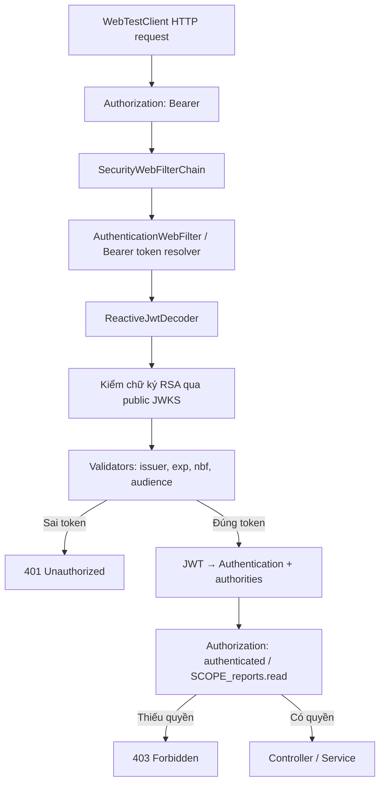

# Kiểm tra token thiếu hoặc sai bằng request thực theo cấu hình ứng dụng

Một test WebFlux có thể trả `401 Unauthorized` khi thiếu token và `403 Forbidden` khi thiếu scope, nhưng vẫn chưa kiểm tra được **cấu hình xác thực OAuth2 của ứng dụng** nếu test tự gắn `Authentication` bằng `mockJwt()`. Ngược lại, khi gửi một chuỗi JWT qua header `Authorization: Bearer ...` của HTTP request thật, Spring Security phải tự đọc Bearer token, giải mã, kiểm tra chữ ký và các điều kiện hợp lệ, chuyển claims thành authorities, rồi mới quyết định cho phép truy cập endpoint.

Bài thuộc chương **OAuth2 Reactive** trong module **SPRING_SECURITY_TESTING**, nơi người học kiểm chứng xác thực, phân quyền và bảo vệ HTTP thực tế bằng `spring-security-test` trên Servlet lẫn Reactive, dùng `MockMvc`, `WebTestClient`, `@WithMockUser`, `SecurityContext`, JWT/OAuth2/OIDC giả lập và các ca được phép hoặc bị từ chối. Chủ đề cụ thể của bài là **kiểm tra token thiếu hoặc sai bằng request thực theo cấu hình ứng dụng**: sử dụng `WebTestClient` chạy qua HTTP tới ứng dụng WebFlux với `SecurityWebFilterChain`, `ReactiveJwtDecoder`, validators và converter thật. Các cổng phụ thuộc ngoài như JWKS có thể được thay bằng HTTP server test kiểm soát được.

> **Mục tiêu kiểm thử:** Một token hợp lệ có đúng quyền đi qua; request thiếu token, token sai chữ ký/issuer/audience/thời gian bị chặn ở tầng xác thực; token hợp lệ nhưng thiếu scope bị chặn ở tầng phân quyền. Mỗi ca phải có một nguyên nhân được kiểm soát và một đối chứng dương để tránh test xanh giả.

## 1. Phân biệt dữ liệu giả lập với request Bearer thực

Trong Spring Security Reactive có ba kiểu test rất dễ bị nhầm:

| Cách tạo danh tính | Đường đi | Điều được chứng minh | Điều chưa được chứng minh |
|---|---|---|---|
| `mockUser("alice")` | Spring Security Test chèn một user giả lập vào test server | Authorization với user/role đã có | Token JWT có hợp lệ không |
| `mockJwt().authorities(...)` | Spring Security Test tạo JWT authentication giả lập | Matcher scope/authority hoạt động theo input test | Chữ ký, `iss`, `aud`, `exp`, decoder và ánh xạ claims mặc định |
| `WebTestClient` gửi **Bearer JWT ký thật** qua HTTP | `AuthenticationWebFilter`/Resource Server → `ReactiveJwtDecoder` → validators/converter → authorization | Toàn bộ đường xử lý token đã thực thi | Các chức năng không có trong kịch bản, như cấp token bởi IdP, refresh/revoke nếu không test riêng |

Một test giả lập hợp lệ:

```java
client.mutateWith(mockJwt()
        .authorities(
                new SimpleGrantedAuthority(
                        "SCOPE_reports.read")))
    .get()
    .uri("/api/reports")
    .exchange()
    .expectStatus().isOk();
```

Ở đây `mockJwt()` trực tiếp cung cấp authentication đã có authority. Spring Security Test không cần tải JWKS hoặc xác minh chữ ký từ token string. Test này nên mang tên như `userWithReadScopeMayAccessReports`, không nên được dùng làm bằng chứng `jwtSignatureIsVerified`.

Một test tích hợp cho cấu hình ứng dụng sẽ có hình dạng:

```java
client.get()
    .uri("/api/reports")
    .headers(headers ->
            headers.setBearerAuth(signedAccessToken))
    .exchange()
    .expectStatus().isOk();
```

Giá trị `signedAccessToken` phải là **JWT có chữ ký bằng private key test**, public key tương ứng được `ReactiveJwtDecoder` tải/đọc theo cấu hình. Không sử dụng `mockJwt()` trên request này.

### 1.1. Tại sao “request thực” lại quan trọng?

`WebTestClient` có thể chạy theo hai chế độ:

- **Mock server/application-context-bound**: `WebTestClient.bindToApplicationContext(...)` hoặc `bindToController(...)`, chạy qua pipeline giả lập trong cùng JVM. Có thể dùng `mockJwt()`/`mockUser()` khi đã áp dụng Spring Security Test.
- **HTTP server-bound**: `WebTestClient.bindToServer().baseUrl("http://localhost:<port>")`, gửi request qua HTTP đến ứng dụng WebFlux đang chạy. Khi dùng chế độ này, auth phải được truyền bằng header/cookie thật mà server hiểu; mutation `mockJwt()` ở client không tự được gửi qua mạng.

Bài này ưu tiên **HTTP server-bound** để có bằng chứng rõ rằng request được xử lý bởi cấu hình OAuth2 Resource Server của ứng dụng. Application-context-bound vẫn có thể kiểm tra filter và decoder thật nếu gửi Bearer header và không bypass security; nhưng tránh nhầm kết quả từ `mockJwt()` với xác thực token.

## 2. Đường đi của Bearer token trong WebFlux



Theo cấu hình thường gặp:

- **Không có Bearer token:** Không có JWT authentication; endpoint yêu cầu xác thực được từ chối, thường là `401`.
- **Bearer token không đọc được:** Decoder không parse/xác minh được, thường trả `401` với thông tin `WWW-Authenticate: Bearer ...`.
- **Token ký đúng nhưng sai `iss`, `aud` hoặc quá hạn:** JWT validators từ chối, thường trả `401`.
- **Token hợp lệ nhưng không có authority do endpoint yêu cầu:** Được xác thực nhưng bị authorization chặn, thường là `403`.
- **Token hợp lệ và đủ quyền:** Controller chạy và trả response nghiệp vụ.

Status `401` hoặc `403` là kết quả mong đợi ở ví dụ này, **không phải quy tắc bất biến cho mọi hệ thống**. Ứng dụng có nhiều security chain, custom entry point, CSRF, custom error handler hoặc chính sách che tài nguyên bằng `404` có thể có hợp đồng khác. Test phải được viết theo cấu hình thực tế.

## 3. Thiết kế tình huống: API Reactive bảo vệ bằng scope

Giả sử API báo cáo có hai endpoint:

- `GET /api/identity`: cần token hợp lệ, không yêu cầu một scope cụ thể.
- `GET /api/reports`: cần token hợp lệ có authority `SCOPE_reports.read`.

JWT mẫu hợp lệ:

```json
{
  "iss": "https://issuer.example.invalid",
  "aud": ["reports-api"],
  "sub": "alice",
  "scope": "reports.read",
  "iat": 1893456000,
  "nbf": 1893456000,
  "exp": 1893459600
}
```

Các timestamp trên chỉ minh họa cấu trúc, **không dùng token chứa timestamp cố định để làm test còn hạn**. Test tự tạo `iat`, `nbf`, `exp` tương đối với thời gian đang chạy hoặc một test clock có kiểm soát.

Cấu hình sử dụng:

- Issuer được tin cậy: `https://issuer.example.invalid`.
- Audience dành cho API này: `reports-api`.
- JWS algorithm: `RS256` (RSA + SHA-256).
- Scope được ánh xạ mặc định từ claim `scope` thành authority bắt đầu bằng `SCOPE_`.
- Public key từ JWKS endpoint. Test sẽ cấu hình JWKS server chạy ở loopback.

**Bài test có giá trị phải có ít nhất một JWT ký đúng nhận `200`**, vì nếu toàn bộ JWKS configuration bị hỏng thì mọi request sai cũng có thể trả `401`, tạo ra một bộ test âm tính xanh mà không xác minh được validator.

## 4. Phụ thuộc và các bean ứng dụng cần giữ thật

Ví dụ dùng Java 17+, Spring Boot 3.x, Spring Security 6.x. Cấu hình phụ thuộc Gradle:

```groovy
dependencies {
    implementation 'org.springframework.boot:spring-boot-starter-webflux'
    implementation 'org.springframework.boot:spring-boot-starter-security'
    implementation 'org.springframework.boot:spring-boot-starter-oauth2-resource-server'

    testImplementation 'org.springframework.boot:spring-boot-starter-test'
    testImplementation 'org.springframework.security:spring-security-test'
    testImplementation 'io.projectreactor:reactor-test'

    // Chỉ mock máy chủ JWKS qua HTTP; vẫn dùng decoder thật.
    testImplementation 'com.squareup.okhttp3:mockwebserver:4.12.0'
}

tasks.named('test') {
    useJUnitPlatform()
}
```

Spring Boot quản lý phiên bản các thư viện Spring Security/Jose đi kèm. Dùng phiên bản Boot tương ứng của dự án và kiểm tra dependency management để tránh ghép thủ công hai phiên bản Security không tương thích.

Cấu hình ứng dụng minh họa:

```yaml
app:
  oauth2:
    issuer: https://issuer.example.invalid
    audience: reports-api
    jwk-set-uri: https://issuer.example.invalid/.well-known/jwks.json
```

Các giá trị trong `application.yml` dùng làm cấu hình mẫu. Trong test, thay riêng những **property cần trỏ sang nguồn test**, vẫn nạp class Security thật. Khi tạo nội dung giảng dạy, không đặt private key, client secret hoặc token production trong tài liệu/test fixtures.

### 4.1. ReactiveJwtDecoder thật với issuer, audience và thời gian

Cấu hình WebFlux Resource Server:

```java
@Configuration(proxyBeanMethods = false)
@EnableWebFluxSecurity
public class ReactiveApiSecurityConfig {

    @Bean
    ReactiveJwtDecoder jwtDecoder(
            @Value("${app.oauth2.issuer}") String issuer,
            @Value("${app.oauth2.audience}") String audience,
            @Value("${app.oauth2.jwk-set-uri}") String jwkSetUri) {

        NimbusReactiveJwtDecoder decoder =
                NimbusReactiveJwtDecoder
                        .withJwkSetUri(jwkSetUri)
                        .jwsAlgorithm(SignatureAlgorithm.RS256)
                        .build();

        OAuth2TokenValidator<Jwt> issuerAndTime =
                JwtValidators.createDefaultWithIssuer(issuer);

        OAuth2TokenValidator<Jwt> audienceValidator = jwt ->
                jwt.getAudience() != null
                        && jwt.getAudience().contains(audience)
                    ? OAuth2TokenValidatorResult.success()
                    : OAuth2TokenValidatorResult.failure(
                            new OAuth2Error(
                                    "invalid_token",
                                    "Access token không dành cho API này",
                                    null));

        decoder.setJwtValidator(
                new DelegatingOAuth2TokenValidator<>(
                        issuerAndTime, audienceValidator));

        return decoder;
    }

    // SecurityWebFilterChain ở phần tiếp theo.
}
```

Các import tiêu biểu:

```java
import org.springframework.beans.factory.annotation.Value;
import org.springframework.context.annotation.Bean;
import org.springframework.context.annotation.Configuration;
import org.springframework.security.config.annotation.web.reactive.EnableWebFluxSecurity;
import org.springframework.security.oauth2.core.DelegatingOAuth2TokenValidator;
import org.springframework.security.oauth2.core.OAuth2Error;
import org.springframework.security.oauth2.core.OAuth2TokenValidator;
import org.springframework.security.oauth2.core.OAuth2TokenValidatorResult;
import org.springframework.security.oauth2.jose.jws.SignatureAlgorithm;
import org.springframework.security.oauth2.jwt.Jwt;
import org.springframework.security.oauth2.jwt.JwtValidators;
import org.springframework.security.oauth2.jwt.NimbusReactiveJwtDecoder;
import org.springframework.security.oauth2.jwt.ReactiveJwtDecoder;
```

`JwtValidators.createDefaultWithIssuer(issuer)` giữ bộ kiểm tra thời gian mặc định và issuer; `audienceValidator` bổ sung kiểm tra audience đúng API. Nếu chỉ đặt một audience validator và bỏ validators mặc định, có nguy cơ vô tình chấp nhận token đã hết hạn hoặc chưa tới thời điểm hiệu lực. Một test `wrongAudience` và một test `expiredJwt` độc lập giúp bắt những hồi quy như vậy.

Để kiểm chữ ký thực sự, `NimbusReactiveJwtDecoder.withJwkSetUri(...)` phải được chạy với JWKS public key hợp lệ. Không thay bằng:

```java
// Phá mục tiêu integration test nếu mock trả sẵn JWT:
@MockBean
ReactiveJwtDecoder jwtDecoder;
```

Với các phiên bản Spring Boot mới dùng `@MockitoBean`, nguyên tắc vẫn vậy: nếu mục tiêu là xác minh token thực, không mock decoder.

### 4.2. SecurityWebFilterChain và authority thật

Cùng class `ReactiveApiSecurityConfig`:

```java
@Bean
SecurityWebFilterChain securityWebFilterChain(
        ServerHttpSecurity http) {

    return http
            .authorizeExchange(exchanges -> exchanges
                    .pathMatchers(HttpMethod.GET, "/api/identity")
                        .authenticated()
                    .pathMatchers(HttpMethod.GET, "/api/reports")
                        .hasAuthority("SCOPE_reports.read")
                    .anyExchange().denyAll())
            .httpBasic(ServerHttpSecurity.HttpBasicSpec::disable)
            .formLogin(ServerHttpSecurity.FormLoginSpec::disable)
            .oauth2ResourceServer(oauth2 -> oauth2
                    .jwt(Customizer.withDefaults()))
            .build();
}
```

Import:

```java
import org.springframework.http.HttpMethod;
import org.springframework.security.config.Customizer;
import org.springframework.security.config.web.server.ServerHttpSecurity;
import org.springframework.security.web.server.SecurityWebFilterChain;
```

Chúng ta chủ đích tắt HTTP Basic và form login trong **API Bearer-only** này để test không vô tình chứng minh một cơ chế authentication khác. Nếu ứng dụng của bạn thực sự có nhiều phương thức đăng nhập, hãy giữ cấu hình sản phẩm và kiểm đúng chain.

Ví dụ chỉ dùng `GET`, nên không phụ thuộc vào CSRF. Không tắt CSRF một cách tùy tiện để làm cho test `POST`/`PATCH` trả kết quả mong muốn: với endpoint ghi, phải kiểm tra riêng chính sách CSRF của ứng dụng.

Spring Security Resource Server mặc định chuyển scope trong JWT thành authority như `SCOPE_reports.read` khi dùng converter mặc định. Nếu ứng dụng thay converter để đọc `scp`, `roles` hoặc cấu trúc tenant, **giữ converter production trong bài test tích hợp** và tạo raw claims chính xác. Không dùng `.authorities(...)` để tự gán kết quả converter rồi tuyên bố đã kiểm tra conversion thật.

### 4.3. Controller chỉ trả dữ liệu sau khi được bảo vệ

```java
@RestController
class ReportsController {

    @GetMapping("/api/identity")
    Mono<Map<String, String>> identity(Mono<Principal> principal) {
        return principal.map(p ->
                Map.of("subject", p.getName()));
    }

    @GetMapping("/api/reports")
    Mono<Map<String, String>> reports(Mono<Principal> principal) {
        return principal.map(p ->
                Map.of(
                        "subject", p.getName(),
                        "data", "AUTHORIZED_REPORT_MARKER"));
    }
}
```

Import:

```java
import java.security.Principal;
import java.util.Map;
import org.springframework.web.bind.annotation.GetMapping;
import org.springframework.web.bind.annotation.RestController;
import reactor.core.publisher.Mono;
```

`AUTHORIZED_REPORT_MARKER` là dữ liệu giả để test rằng khi bị chặn, response **không chứa** nội dung nghiệp vụ. Ứng dụng thực nên có thêm service/repository và kiểm quyền sở hữu tài nguyên khi cần; `hasAuthority("SCOPE_reports.read")` chỉ bảo vệ scope ở mức endpoint, chưa chứng minh user chỉ đọc được tài nguyên của chính mình.

## 5. Tạo JWKS cục bộ và JWT ký thật

Để test lặp lại được mà không phải gọi IdP thật, ta tạo **hai cặp khóa RSA**:

1. `TRUSTED`: private key dùng ký token hợp lệ, public key trả qua JWKS.
2. `UNTRUSTED`: private key khác, cố ý dùng cùng `kid` nhưng **không** đưa public key của nó vào JWKS.

Việc dùng cùng `kid` khi thử chữ ký sai giúp test đi tới bước xác minh chữ ký bằng một public key đã tìm thấy; nếu `kid` không tồn tại, decoder có thể từ chối sớm do không tìm được khóa, khiến test không chứng minh điều ta mong muốn.

Một JWKS có cấu trúc:

```json
{
  "keys": [
    {
      "kty": "RSA",
      "use": "sig",
      "alg": "RS256",
      "kid": "demo-key-1",
      "n": "<base64url RSA modulus>",
      "e": "AQAB"
    }
  ]
}
```

Không cần tạo thủ công `n`/`e`; thư viện Nimbus JOSE/JWT xuất public JWK từ RSA key test. Tuyệt đối **không** trả private exponent `d` hoặc private key trong HTTP JWKS.

### 5.1. Factory sinh khóa và ký JWT

```java
private static RSAKey newRsaKey(String kid) {
    try {
        KeyPairGenerator generator =
                KeyPairGenerator.getInstance("RSA");
        generator.initialize(2048);

        KeyPair pair = generator.generateKeyPair();

        return new RSAKey.Builder(
                (RSAPublicKey) pair.getPublic())
                .privateKey((RSAPrivateKey) pair.getPrivate())
                .keyID(kid)
                .build();
    } catch (GeneralSecurityException ex) {
        throw new IllegalStateException(
                "Không tạo được khóa test", ex);
    }
}
```

Helper ký JWT:

```java
private static String signJwt(
        RSAKey signingKey,
        String issuer,
        List<String> audiences,
        String scope,
        Instant notBefore,
        Instant expiresAt) throws Exception {

    JWTClaimsSet.Builder claims = new JWTClaimsSet.Builder()
            .jwtID(UUID.randomUUID().toString())
            .issuer(issuer)
            .subject("alice")
            .audience(audiences)
            .issueTime(Date.from(
                    Instant.now().minusSeconds(60)))
            .notBeforeTime(Date.from(notBefore))
            .expirationTime(Date.from(expiresAt));

    if (scope != null) {
        claims.claim("scope", scope);
    }

    SignedJWT token = new SignedJWT(
            new JWSHeader.Builder(JWSAlgorithm.RS256)
                    .keyID(signingKey.getKeyID())
                    .build(),
            claims.build());

    token.sign(new RSASSASigner(
            signingKey.toRSAPrivateKey()));

    return token.serialize();
}
```

Đặt các helper vào một lớp test; không nhúng mã tạo token giả vào ứng dụng production. Các thời điểm nên cách đủ xa clock skew trong test âm tính `exp`/`nbf`. Token dùng làm fixture này **là JWT ký thật**, khác với `Jwt` object được dựng trong `.with(mockJwt())`.

## 6. Bộ integration test gửi request qua HTTP thật

Sau đây là một bộ test có thể triển khai cùng cấu hình và controller ở mục 4. Lớp test giả định project có một ứng dụng Spring Boot WebFlux (`@SpringBootApplication`) nhận diện các bean minh họa. Có thể thay `@SpringBootTest(classes = ...)` nếu project thực tế dùng cấu trúc package khác.

**Ý tưởng triển khai:** `MockWebServer` đóng vai **JWKS endpoint**, còn `WebTestClient.bindToServer()` gửi request HTTP tới Spring Boot Reactive đang chạy ở port ngẫu nhiên. Decoder và chain trong ứng dụng vẫn là bean thật.

### 6.1. Lớp test và môi trường JWKS

```java
@SpringBootTest(
        webEnvironment =
                SpringBootTest.WebEnvironment.RANDOM_PORT)
class ReactiveBearerTokenIT {

    static final String EXPECTED_ISSUER =
            "https://issuer.example.invalid";
    static final String EXPECTED_AUDIENCE =
            "reports-api";

    static final RSAKey TRUSTED =
            newRsaKey("demo-key-1");
    static final RSAKey UNTRUSTED =
            newRsaKey("demo-key-1");

    static final MockWebServer JWKS_SERVER =
            startJwksServer();

    @LocalServerPort
    int port;

    WebTestClient client;

    @DynamicPropertySource
    static void tokenConfig(DynamicPropertyRegistry registry) {
        registry.add("app.oauth2.issuer",
                () -> EXPECTED_ISSUER);
        registry.add("app.oauth2.audience",
                () -> EXPECTED_AUDIENCE);
        registry.add("app.oauth2.jwk-set-uri",
                () -> JWKS_SERVER.url("/jwks").toString());
    }

    @BeforeEach
    void bindToRunningServer() {
        client = WebTestClient.bindToServer()
                .baseUrl("http://localhost:" + port)
                .build();
    }

    private static MockWebServer startJwksServer() {
        MockWebServer server = new MockWebServer();

        // Chỉ xuất public JWK của key được tin cậy.
        String jwks = new JWKSet(
                TRUSTED.toPublicJWK()).toString();

        server.setDispatcher(new Dispatcher() {
            @Override
            public MockResponse dispatch(
                    RecordedRequest request) {

                if ("/jwks".equals(request.getPath())) {
                    return new MockResponse()
                            .setResponseCode(200)
                            .setHeader("Content-Type",
                                    "application/json")
                            .setBody(jwks);
                }

                return new MockResponse()
                        .setResponseCode(404);
            }
        });

        try {
            server.start();
            return server;
        } catch (IOException ex) {
            throw new ExceptionInInitializerError(ex);
        }
    }

    static String token(
            RSAKey key,
            String issuer,
            List<String> audience,
            String scope,
            Instant nbf,
            Instant exp) throws Exception {

        return signJwt(
                key, issuer, audience, scope, nbf, exp);
    }

    static String validToken(String scope) throws Exception {
        Instant now = Instant.now();

        return token(
                TRUSTED,
                EXPECTED_ISSUER,
                List.of(EXPECTED_AUDIENCE),
                scope,
                now.minusSeconds(60),
                now.plusSeconds(600));
    }

    @AfterAll
    static void closeJwksServer() throws IOException {
        JWKS_SERVER.shutdown();
    }

    // Test methods ở phần tiếp theo.
}
```

Các helper `newRsaKey`/`signJwt` của mục 5 được đặt trong chính lớp `ReactiveBearerTokenIT`, hoặc trong một test fixture import được. Server JWKS cần tồn tại khi decoder tải khóa, vì vậy cấu hình `@DynamicPropertySource` trỏ tới server đã được khởi động trước khi ApplicationContext tạo bean.

Import cần thiết cho lớp test:

```java
import com.nimbusds.jose.JWSAlgorithm;
import com.nimbusds.jose.JWSHeader;
import com.nimbusds.jose.crypto.RSASSASigner;
import com.nimbusds.jose.jwk.JWKSet;
import com.nimbusds.jose.jwk.RSAKey;
import com.nimbusds.jwt.JWTClaimsSet;
import com.nimbusds.jwt.SignedJWT;
import okhttp3.mockwebserver.Dispatcher;
import okhttp3.mockwebserver.MockResponse;
import okhttp3.mockwebserver.MockWebServer;
import okhttp3.mockwebserver.RecordedRequest;
import org.junit.jupiter.api.AfterAll;
import org.junit.jupiter.api.BeforeEach;
import org.junit.jupiter.api.Test;
import org.springframework.boot.test.context.SpringBootTest;
import org.springframework.boot.test.web.server.LocalServerPort;
import org.springframework.http.HttpHeaders;
import org.springframework.test.context.DynamicPropertyRegistry;
import org.springframework.test.context.DynamicPropertySource;
import org.springframework.test.web.reactive.server.WebTestClient;

import java.io.IOException;
import java.security.GeneralSecurityException;
import java.security.KeyPair;
import java.security.KeyPairGenerator;
import java.security.interfaces.RSAPrivateKey;
import java.security.interfaces.RSAPublicKey;
import java.time.Instant;
import java.util.Date;
import java.util.List;
import java.util.UUID;
```

Những test dưới đây có thể đặt vào phần `// Test methods` trong lớp trên. Chúng minh họa một **bộ kiểm thử nguyên nhân lỗi tách biệt** và có thể được điều chỉnh cho config/endpoint thật.

### 6.2. Đối chứng dương: JWT hợp lệ có scope được phép

```java
@Test
void validBearerTokenCanAccessReports() throws Exception {
    String jwt = validToken("reports.read");

    client.get()
            .uri("/api/reports")
            .headers(headers -> headers.setBearerAuth(jwt))
            .exchange()
            .expectStatus().isOk()
            .expectBody()
            .jsonPath("$.subject").isEqualTo("alice")
            .jsonPath("$.data")
                .isEqualTo("AUTHORIZED_REPORT_MARKER");
}
```

Đây là phép kiểm **bắt buộc có**. Nó chứng minh đường JWKS hoạt động, decoder chấp nhận chữ ký và validators, converter tạo authority đúng và matcher cho phép truy cập.

Thêm một đối chứng tách authentication và scope:

```java
@Test
void validTokenWithoutReportScopeCanStillReadIdentity()
        throws Exception {
    String jwt = validToken("unrelated.scope");

    client.get()
            .uri("/api/identity")
            .headers(headers -> headers.setBearerAuth(jwt))
            .exchange()
            .expectStatus().isOk()
            .expectBody()
            .jsonPath("$.subject").isEqualTo("alice");
}
```

Nếu token hợp lệ thiếu scope báo cáo nhận `403` trên `/api/reports` nhưng `200` trên `/api/identity`, ta có bằng chứng tốt hơn rằng **authentication thành công, authorization riêng ở endpoint báo cáo thất bại**.

### 6.3. Không có token: từ chối trước controller

```java
@Test
void missingBearerTokenIsUnauthorized() {
    client.get()
            .uri("/api/reports")
            .exchange()
            .expectStatus().isUnauthorized();
}
```

Không thêm `.mutateWith(mockUser(...))`, không gửi Basic credentials, cookie session hoặc mock JWT. Request cần thực sự **vô danh**. Nếu một request trước đó có token, test vẫn phải đảm bảo request tiếp theo không vô tình mang header từ `defaultHeader(...)` hoặc state khác trong shared client.

Có thể kiểm thêm response không chứa dữ liệu:

```java
@Test
void unauthorizedResponseDoesNotLeakReport() {
    client.get()
            .uri("/api/reports")
            .exchange()
            .expectStatus().isUnauthorized()
            .expectBody(String.class)
            .consumeWith(result -> {
                String body = result.getResponseBody();
                assertThat(body == null ? "" : body)
                        .doesNotContain(
                                "AUTHORIZED_REPORT_MARKER");
            });
}
```

Import AssertJ:

```java
import static org.assertj.core.api.Assertions.assertThat;
```

Ở production, còn cần kiểm các header, cookie, log và trạng thái DB phù hợp; marker chỉ là minh họa kiểm response.

### 6.4. Token không phải JWT hợp lệ

```java
@Test
void malformedBearerTokenIsUnauthorized() {
    client.get()
            .uri("/api/reports")
            .headers(headers -> headers.setBearerAuth(
                    "not.a.valid.signed.jwt"))
            .exchange()
            .expectStatus().isUnauthorized();
}
```

Request vẫn có đúng scheme Bearer, nhưng nội dung không phải token có chữ ký được decoder chấp nhận. Test này kiểm xử lý lỗi parse/decoder. Không thay thế nó bằng `mockJwt().jwt(jwt -> ...)`, vì API mock tự dựng JWT object hợp lệ cho security context.

### 6.5. Token ký sai private key

```java
@Test
void jwtSignedByWrongKeyIsUnauthorized() throws Exception {
    Instant now = Instant.now();

    String jwt = token(
            UNTRUSTED,
            EXPECTED_ISSUER,
            List.of(EXPECTED_AUDIENCE),
            "reports.read",
            now.minusSeconds(60),
            now.plusSeconds(600));

    client.get()
            .uri("/api/reports")
            .headers(headers -> headers.setBearerAuth(jwt))
            .exchange()
            .expectStatus().isUnauthorized();
}
```

`UNTRUSTED` dùng **cùng `kid`** nhưng private key khác. Decoder tải public key của `TRUSTED` từ JWKS nên không thể xác minh chữ ký token do `UNTRUSTED` ký. Nếu test chỉ dùng một `kid` chưa tồn tại, kết quả `401` có thể do không tìm thấy key thay vì xác minh chữ ký thất bại.

### 6.6. Token ký đúng nhưng issuer sai

```java
@Test
void jwtWithWrongIssuerIsUnauthorized() throws Exception {
    Instant now = Instant.now();

    String jwt = token(
            TRUSTED,
            "https://another-issuer.example.invalid",
            List.of(EXPECTED_AUDIENCE),
            "reports.read",
            now.minusSeconds(60),
            now.plusSeconds(600));

    client.get()
            .uri("/api/reports")
            .headers(headers -> headers.setBearerAuth(jwt))
            .exchange()
            .expectStatus().isUnauthorized();
}
```

Chữ ký, audience, thời gian đều đúng; chỉ issuer bị thay. Nếu production bỏ `JwtValidators.createDefaultWithIssuer(...)`, test phải chuyển sang đỏ.

### 6.7. Token ký đúng nhưng audience sai

```java
@Test
void jwtWithWrongAudienceIsUnauthorized() throws Exception {
    Instant now = Instant.now();

    String jwt = token(
            TRUSTED,
            EXPECTED_ISSUER,
            List.of("payments-api"),
            "reports.read",
            now.minusSeconds(60),
            now.plusSeconds(600));

    client.get()
            .uri("/api/reports")
            .headers(headers -> headers.setBearerAuth(jwt))
            .exchange()
            .expectStatus().isUnauthorized();
}
```

Một token ký hợp lệ nhưng dành cho `payments-api` không nên được dùng để truy cập `reports-api`. Không so sánh audience bằng phép `contains()` trên chuỗi JSON serialize; nên so tập giá trị audience được parse đúng chuẩn.

### 6.8. JWT hết hạn và JWT chưa có hiệu lực

```java
@Test
void expiredJwtIsUnauthorized() throws Exception {
    Instant now = Instant.now();

    String jwt = token(
            TRUSTED,
            EXPECTED_ISSUER,
            List.of(EXPECTED_AUDIENCE),
            "reports.read",
            now.minusSeconds(1200),
            now.minusSeconds(600));

    client.get()
            .uri("/api/reports")
            .headers(headers -> headers.setBearerAuth(jwt))
            .exchange()
            .expectStatus().isUnauthorized();
}

@Test
void jwtBeforeNotBeforeIsUnauthorized() throws Exception {
    Instant now = Instant.now();

    String jwt = token(
            TRUSTED,
            EXPECTED_ISSUER,
            List.of(EXPECTED_AUDIENCE),
            "reports.read",
            now.plusSeconds(600),
            now.plusSeconds(1200));

    client.get()
            .uri("/api/reports")
            .headers(headers -> headers.setBearerAuth(jwt))
            .exchange()
            .expectStatus().isUnauthorized();
}
```

Các mốc ±600 giây được chọn để nằm xa clock skew thường thấy. Nếu test `exp` quá hạn chỉ 1 giây, validator có thể cho phép do skew và kết quả test phụ thuộc tốc độ CI. Khi cần thử **chính xác ranh giới** `exp`/`nbf`, hãy đưa clock và skew vào cấu hình có thể kiểm soát thay vì dựa trên thời gian thực.

### 6.9. Token hợp lệ nhưng không có scope yêu cầu

```java
@Test
void validTokenWithoutRequiredScopeIsForbidden()
        throws Exception {

    String jwt = validToken("reports.export");

    client.get()
            .uri("/api/reports")
            .headers(headers -> headers.setBearerAuth(jwt))
            .exchange()
            .expectStatus().isForbidden();
}
```

Test này cho thấy `401` và `403` khác nhau:

- Token ở đây **có chữ ký đúng, issuer/audience đúng, còn hạn** → authentication thành công.
- Claim `scope` chỉ là `reports.export` → converter mặc định tạo `SCOPE_reports.export`.
- Endpoint yêu cầu `SCOPE_reports.read` → authorization trả `403`.

Một bộ test chỉ kiểm `403` chưa đủ nếu không có `validBearerTokenCanAccessReports`: endpoint có thể luôn trả `403` do matcher sai hoặc chain không hoạt động như dự kiến.

### 6.10. Gọi liên tiếp hai request để bắt rò rỉ danh tính

```java
@Test
void validRequestDoesNotAuthenticateNextAnonymousRequest()
        throws Exception {

    String jwt = validToken("reports.read");

    client.get()
            .uri("/api/identity")
            .headers(headers -> headers.setBearerAuth(jwt))
            .exchange()
            .expectStatus().isOk()
            .expectBody()
            .jsonPath("$.subject").isEqualTo("alice");

    client.get()
            .uri("/api/identity")
            .exchange()
            .expectStatus().isUnauthorized();
}
```

Bài test giả định API Bearer stateless và không có login/session authentication khác. HTTP client mặc định ở ví dụ không được cấu hình tự mang Bearer token sang các request sau; Spring Reactive Security context thuộc **request/subscription**. Nếu test dùng session cookie, cơ chế lưu state phải được kiểm riêng và đối chiếu đúng hợp đồng của ứng dụng.

## 7. Vì sao phải chạy HTTP thật thay vì `mockJwt()`?

Hai đoạn sau thoạt nhìn giống nhau nhưng có độ bao phủ khác nhau.

**Dạng giả lập:**

```java
webTestClient
    .mutateWith(mockJwt()
        .jwt(jwt -> jwt.subject("alice")
                .claim("scope", "reports.read"))
        .authorities(new SimpleGrantedAuthority(
                "SCOPE_reports.read")))
    .get()
    .uri("/api/reports")
    .exchange()
    .expectStatus().isOk();
```

`mockJwt()` giúp người học kiểm thử logic phân quyền khi authentication đã tồn tại. Nhưng ngay cả khi production sai decoder, sai audience hoặc mapping scope, test vẫn có thể xanh vì test tự chèn authority hợp lệ.

**Dạng tích hợp:**

```java
webTestClient.get()
    .uri("/api/reports")
    .header(HttpHeaders.AUTHORIZATION,
            "Bearer " + validToken("reports.read"))
    .exchange()
    .expectStatus().isOk();
```

Ở dạng tích hợp:

1. Header `Authorization` được đưa qua HTTP.
2. Resource Server giải quyết Bearer token.
3. `ReactiveJwtDecoder` phải xác minh chữ ký JWT dựa trên khóa tin cậy.
4. Validators kiểm issuer, audience và thời gian.
5. Converter thật tạo principal/authorities.
6. Authorization thực áp dụng policy cho `/api/reports`.
7. Controller chỉ chạy khi yêu cầu hợp lệ.

Đừng đổi tên hoặc bố cục test để đánh lừa người đọc. Hãy nói rõ test nào **mock authentication**, test nào **gửi token đã ký qua HTTP**. Cả hai loại đều hữu ích và bổ sung cho nhau.

## 8. Status, WWW-Authenticate và tính chính xác của assertion

OAuth2 Resource Server trả các lỗi liên quan Bearer theo chính sách của Spring Security và cấu hình entry point. Trong tình huống mặc định, response bị từ chối vì thiếu token hoặc JWT không hợp lệ thường có status `401`, kèm `WWW-Authenticate` bắt đầu bằng `Bearer`. Với token hợp lệ nhưng thiếu authority, response thường có status `403`.

Một test có thể kiểm sự hiện diện của Bearer challenge:

```java
client.get()
    .uri("/api/reports")
    .exchange()
    .expectStatus().isUnauthorized()
    .expectHeader()
    .valueMatches(
            HttpHeaders.WWW_AUTHENTICATE,
            "Bearer.*");
```

Các chi tiết `error="invalid_token"`, `error_description`, `error_uri` có thể khác theo tình huống và tùy custom configuration. Vì thế không hardcode toàn bộ chuỗi lỗi nếu hợp đồng API không yêu cầu chính xác chuỗi đó. Quan trọng hơn, **không tiết lộ giá trị raw token hoặc nội dung nhạy cảm trong error response**.

| HTTP | Tình huống trong ví dụ | Tầng xác định |
|---|---|---|
| `200` | JWT hợp lệ, đủ `reports.read` | Decoder + validators + converter + authorization |
| `401` | Không có token | Entry point vì chưa được xác thực |
| `401` | Bearer không parse được | Decoder |
| `401` | JWT chữ ký sai | Decoder/signature verification |
| `401` | JWT issuer/audience sai | Validators |
| `401` | JWT hết hạn/chưa có hiệu lực | Timestamp validator |
| `403` | JWT hợp lệ nhưng thiếu `reports.read` | HTTP authorization |
| `403` ở request ghi | Có thể do CSRF, nếu chính sách bật | CSRF filter, cần ca riêng để phân biệt |

Nếu test POST/PATCH nhận `403` nhưng không gửi CSRF khi cấu hình yêu cầu, kết quả chưa chứng minh user thiếu quyền. Muốn kiểm scope trên request ghi, cung cấp token CSRF hợp lệ nếu ứng dụng cần; hoặc thực hiện test theo một API Bearer-only thực sự được cấu hình không dùng CSRF ở đúng chain.

## 9. Test xanh giả từ việc dùng sai cấu hình

Đây là những trường hợp thường làm bộ test có vẻ đầy đủ nhưng không kiểm đúng pipeline.

### 9.1. Thay decoder bằng mock

```java
// Không dùng cho bộ test muốn kiểm chữ ký/issuer/audience thật.
@MockitoBean
ReactiveJwtDecoder decoder;
```

Khi decoder bị mock và trả JWT hợp lệ, test có thể `200` dù production không kiểm chữ ký hoặc audience. Chỉ mock decoder khi bạn **cố ý** kiểm một unit riêng nằm sau tầng xác thực.

### 9.2. Bỏ security filter trong WebTestClient

Nếu tự tạo:

```java
WebTestClient client =
        WebTestClient.bindToController(
                new ReportsController())
                .build();
```

bạn chưa chắc đã gắn `SecurityWebFilterChain`. `200` với request không có token có thể do đã bypass filter. Khi mục tiêu là kiểm filter/resource server, hãy dùng `@SpringBootTest` chạy ứng dụng thật hoặc `WebTestClient.bindToApplicationContext(context).apply(springSecurity())` với context đúng và **không** dùng `mockJwt()` cho test validator.

### 9.3. Request tới sai security matcher

Trong ứng dụng có nhiều `SecurityWebFilterChain`, một chain ưu tiên cao có thể bắt `/api/reports` trước chain Resource Server; test khi ấy đang kiểm policy khác. Cần dùng endpoint thực, xem cấu hình `securityMatcher`, order và request path. Không tự tạo route minh họa khác rồi mặc định rằng toàn hệ thống có cùng bảo vệ.

### 9.4. Token âm tính sai nhiều điều kiện

Một token vừa **hết hạn**, **sai chữ ký** và **sai audience** nhận `401` chưa chứng minh bộ kiểm audience có hiệu lực. Để kiểm audience, dùng chữ ký đúng, issuer đúng và token còn hạn; chỉ đổi `aud`. Với token sai chữ ký, giữ mọi claim khác hợp lệ. Mỗi test âm tính nên chủ động sai **một** điều kiện để kết quả có ý nghĩa.

### 9.5. Không có ca dương

Nếu JWKS URI bị sai, mọi token đều bị `401`; những test invalid token vẫn xanh. Hãy đảm bảo một token hợp lệ ký bằng key trong JWKS **phải nhận `200`** trước khi suy luận từ các ca lỗi.

### 9.6. Mặc định tin JWT là access token

OIDC ID token và OAuth2 access token có thể cùng ở dạng JWT, nhưng **mục đích sử dụng khác nhau**. Token có chữ ký đúng không tự được phép gọi API nếu thiếu audience, token type, scope hoặc rule theo hợp đồng của IdP. Khi provider có claim `token_use` hoặc `typ` đặc thù, đưa validator tương ứng vào **cấu hình ứng dụng** và tạo một ca ID-like token bị từ chối.

## 10. Nếu ứng dụng dùng opaque token thay JWT

Không phải mọi OAuth2 access token đều là JWT. Với opaque token, Resource Server có thể gọi **introspection endpoint** thay vì xác minh chữ ký JWT:

```java
@Bean
SecurityWebFilterChain apiFilter(
        ServerHttpSecurity http) {

    return http
        .authorizeExchange(exchanges -> exchanges
            .pathMatchers("/api/reports")
                .hasAuthority("SCOPE_reports.read")
            .anyExchange().authenticated())
        .oauth2ResourceServer(oauth2 -> oauth2
            .opaqueToken(Customizer.withDefaults()))
        .build();
}
```

Đây là **cấu hình thay thế** cho ứng dụng chọn opaque token, không đặt đồng thời với decoder JWT của ví dụ trước mà không có thiết kế authentication manager/resolver rõ ràng.

Để test opaque token với **introspection thật qua HTTP stub**:

1. Giữ `ReactiveOpaqueTokenIntrospector`/Resource Server configuration đang dùng, nếu có thể.
2. Cho introspection endpoint test trả JSON có `"active": true`, `"scope": "reports.read"`, `"sub": "alice"` khi token hợp lệ.
3. Gửi header `Authorization: Bearer opaque-valid-123`; assert `/api/reports` thành công.
4. Cho introspection endpoint trả `"active": false` đối với token sai/hết hạn/thu hồi; assert `401`.
5. Cho token `"active": true` nhưng scope chỉ là `reports.export`; assert `403`.
6. Kiểm client authentication gửi tới introspection endpoint nếu profile yêu cầu, và không lộ client secret trong log.

Ví dụ response introspection dạng JSON:

```json
{
  "active": true,
  "sub": "alice",
  "scope": "reports.read",
  "client_id": "reports-client",
  "exp": 1893459600
}
```

Kết quả test phải phù hợp **đúng kiểu token và cơ chế xác thực của sản phẩm**. Không tạo một chuỗi `"opaque-valid-123"` rồi kỳ vọng `NimbusReactiveJwtDecoder` chấp nhận nó; decoder JWT không phải introspector.

## 11. Kiểm thử OAuth2 Client outbound khác Resource Server inbound

Ứng dụng Reactive đôi khi là **OAuth2 Client** gửi token tới API khác, không phải hoặc không chỉ là Resource Server nhận token từ người dùng.

- Ở **inbound Resource Server**, request vào `/api/reports` mang `Authorization: Bearer ...`; test kiểm decoder/introspector, authority và HTTP status server trả.
- Ở **outbound OAuth2 Client**, service sử dụng `ReactiveOAuth2AuthorizedClientManager`/`ServerOAuth2AuthorizedClientExchangeFilterFunction` để lấy token và gắn Bearer vào request gửi API khác; test kiểm header được gửi, refresh/re-authorize và xử lý downstream `401`/`403`.

Hai đường này có ranh giới và kết quả khác nhau.

Ví dụ WebClient gửi HTTP tới server downstream giả lập:

```java
WebClient client = WebClient.builder()
        .baseUrl("http://localhost:9001")
        .build();

Mono<String> response =
        client.get()
                .uri("/remote/reports")
                .headers(headers ->
                        headers.setBearerAuth("token-test"))
                .retrieve()
                .bodyToMono(String.class);
```

Trong một test dành cho outbound behavior, thay port `9001` bằng port của HTTP stub. Kiểm stub nhận đúng `Authorization: Bearer token-test`; cho stub trả `401` khi thiếu token hoặc `403` khi scope không đủ; sau đó assert service của ứng dụng xử lý lỗi downstream theo hợp đồng. Nếu muốn thử **manager tự cấp/refresh token**, dùng manager/provider thật và token endpoint test, không hardcode header trong test chính.

Đừng kết luận response `401` từ **API downstream** là do `SecurityWebFilterChain` của **ứng dụng client** chặn request. Hãy ghi rõ response thuộc server nào.

## 12. Cách kiểm code Reactor khi authentication thất bại

Trong WebFlux, security context nằm trong Reactor context của request. Nếu Bearer token không hợp lệ:

- Decoder phát tín hiệu lỗi, Spring Security xử lý thành authentication failure.
- Controller/route được bảo vệ không được thực thi.
- Không có authentication đáng tin cậy được đưa tới code nghiệp vụ như khi token hợp lệ.

Đây là lý do cần test request HTTP thật, thay vì chỉ dựng một `Mono<Authentication>` trong service rồi assert `401` giả lập.

Với một **unit test service độc lập**, vẫn có thể dùng `StepVerifier` để kiểm chính sách bên trong service:

```java
Authentication alice =
        UsernamePasswordAuthenticationToken.authenticated(
                "alice",
                "N/A",
                AuthorityUtils.createAuthorityList(
                        "ROLE_USER"));

Mono<String> pipeline =
        ReactiveSecurityContextHolder.getContext()
                .map(SecurityContext::getAuthentication)
                .map(Authentication::getName)
                .contextWrite(
                        ReactiveSecurityContextHolder
                                .withAuthentication(alice));

StepVerifier.create(pipeline)
        .expectNext("alice")
        .verifyComplete();
```

Test này chứng minh **Reactor Context đã được thiết lập** cho publisher, không chứng minh Bearer token được giải mã. Cần hai nhóm test với mục tiêu rõ ràng.

### 12.1. Không dùng ThreadLocal của luồng test làm bằng chứng cho request

Trong WebFlux, đặt:

```java
SecurityContextHolder.getContext()
        .setAuthentication(alice);
```

trên JUnit thread không đồng nghĩa server nhận `alice` ở request HTTP thật, đặc biệt khi server chạy event-loop và subscription khác. Với request tích hợp, header Bearer mới là nguồn xác thực; với unit test publisher, dùng `ReactiveSecurityContextHolder.withAuthentication(...)` hoặc các công cụ Spring Security Test được bind đúng runtime.

### 12.2. Không tự tách subscribe trong code nghiệp vụ

Một service bất đồng bộ tự gọi `.subscribe()` rồi phát event có thể làm mất context/correlation hoặc thực thi tác dụng phụ sau khi response đã trả. Khi kiểm thử từ chối truy cập, cần đảm bảo code không xử lý request trái phép theo một luồng phụ. Thiết kế service trả `Mono`/`Flux` cho caller và compose bằng `flatMap`, `then`... giúp Spring Security kiểm soát ranh giới request rõ ràng hơn.

## 13. Không chỉ assert status: kiểm tra dữ liệu và tác dụng phụ

Một route trả `401/403` chưa chứng minh chắc chắn rằng không có dữ liệu bí mật bị lộ hoặc thay đổi xảy ra. Với endpoint ghi, bổ sung ví dụ như:

```java
@Test
void invalidBearerTokenDoesNotUpdateReport()
        throws Exception {

    String before =
            reportRepository.findById(reportId)
                    .blockOptional()
                    .orElseThrow()
                    .getTitle();

    client.patch()
            .uri("/api/reports/{id}", reportId)
            .headers(headers ->
                    headers.setBearerAuth("malformed-token"))
            .contentType(MediaType.APPLICATION_JSON)
            .bodyValue("""
                    {"title":"TAMPERED"}
                    """)
            .exchange()
            .expectStatus().isUnauthorized();

    String after =
            reportRepository.findById(reportId)
                    .blockOptional()
                    .orElseThrow()
                    .getTitle();

    assertThat(after).isEqualTo(before);
}
```

Đây là **biến thể minh họa**, chỉ chạy khi dự án thực sự có PATCH endpoint, repository và fixture `reportId`. Nếu cấu hình CSRF bắt buộc, test request ghi cần xét thêm CSRF để phân biệt nguyên nhân chặn. Trong ví dụ JWT malformed, decoder phải chặn trước controller; khi test authorization thiếu scope trên PATCH, cần đảm bảo request hợp lệ ở các lớp khác.

Đối với Reactive repository, có thể dùng `StepVerifier` để quan sát giá trị trước/sau hoặc dùng test fixture ở transaction độc lập; tránh `.block()` trong **event-loop production**, dù trong JUnit thread nó có thể được sử dụng có chủ đích để lấy snapshot. Khi tác dụng phụ bất đồng bộ tồn tại (event, email, queue), phải có tín hiệu hoàn tất hoặc mock/fake cổng ngoài và xác nhận không phát side effect trái phép.

| Mức kiểm tra | Trạng thái cần quan sát | Kỹ thuật |
|---|---|---|
| HTTP | `401`/`403` theo contract | `WebTestClient.expectStatus()` |
| Response | Không chứa marker bí mật | `expectBody`, JSONPath, header/cookie |
| Database | Bản ghi không thay đổi | Query lại repository sau request |
| Queue/event | Không phát event nghiệp vụ | Fake publisher, outbox, spy ở cổng ngoài |
| Token/session | Không cấp authenticated session từ token sai | Request tiếp theo vô danh, session assertion |
| Đối chứng | Token hợp lệ, đủ quyền thực hiện thành công | Ca `200`/`204` và trạng thái nghiệp vụ đúng |

Với request bị từ chối, audit log theo chính sách có thể vẫn được tạo; “không có tác dụng phụ nghiệp vụ trái phép” khác với “không ghi bất kỳ log/audit nào”.

## 14. Ma trận ca test cần có

| ID | Bearer token | Chữ ký | `iss` | `aud` | Thời gian | Scope | Kỳ vọng |
|---|---|---|---|---|---|---|---|
| T01 | Thiếu | — | — | — | — | — | `401` |
| T02 | Không phải JWT | Không parse | — | — | — | — | `401` |
| T03 | JWT ký bằng key khác | Sai | Đúng | Đúng | Còn hạn | `reports.read` | `401` |
| T04 | JWT hợp lệ về mật mã | Đúng | Sai | Đúng | Còn hạn | `reports.read` | `401` |
| T05 | JWT hợp lệ về mật mã | Đúng | Đúng | Sai | Còn hạn | `reports.read` | `401` |
| T06 | JWT hợp lệ về mật mã | Đúng | Đúng | Đúng | Hết hạn | `reports.read` | `401` |
| T07 | JWT hợp lệ về mật mã | Đúng | Đúng | Đúng | `nbf` tương lai | `reports.read` | `401` |
| T08 | JWT hợp lệ về mật mã | Đúng | Đúng | Đúng | Còn hạn | `reports.export` | `403` trên `/api/reports` |
| T09 | JWT hợp lệ về mật mã | Đúng | Đúng | Đúng | Còn hạn | `reports.read` | `200` trên `/api/reports` |
| T10 | JWT hợp lệ không có scope đọc | Đúng | Đúng | Đúng | Còn hạn | `reports.export` | `200` trên `/api/identity` |
| T11 | Request sau một request hợp lệ | Không có | — | — | — | — | `401`, không rò rỉ principal |
| T12 | JWT hợp lệ có role/claim khác | Đúng | Đúng | Đúng | Còn hạn | Theo policy | Assert authority converter theo config |
| T13 | JWT sai token type | Đúng | Đúng | Đúng | Còn hạn | Có scope | Từ chối nếu policy của IdP yêu cầu token type |
| T14 | JWT không có audience | Đúng | Đúng | Thiếu | Còn hạn | `reports.read` | `401` nếu audience là bắt buộc |
| T15 | JWT `aud` chứa nhiều audience | Đúng | Đúng | Có `reports-api` | Còn hạn | `reports.read` | `200` nếu policy cho phép |
| T16 | Request ghi trái phép | Sai hoặc thiếu quyền | Theo ca | Theo ca | Theo ca | Theo ca | HTTP từ chối và DB/event không thay đổi |

Từng case nên lưu tên mô tả **hành vi bảo mật** như `expiredJwtIsUnauthorized`, `wrongAudienceIsUnauthorized`, `validTokenWithoutRequiredScopeIsForbidden`. Đừng chỉ viết một test tên `returns401`: reviewer sẽ khó biết nó bảo vệ điều kiện nào.

## 15. Khi nào không nên dùng một JWT giả tự ký?

Nếu Resource Server production sử dụng:

- **Opaque token**: kiểm bằng introspection server; JWT giả ký không đi qua cơ chế đúng.
- **JWT dùng khóa HMAC**: công nghệ xác minh khác RSA/JWKS; test theo cấu hình thực và tránh hardcode secret sản phẩm.
- **JWT có nhiều issuer**: cần resolver/manager cho issuer, mỗi issuer có JWKS và validators riêng; kiểm token issuer A không bị map sang issuer B.
- **mTLS/DPoP sender-constrained token**: ngoài JWT còn cần chứng minh proof-of-possession ở tầng HTTP; token Bearer đơn thuần không đủ để xác nhận profile bảo mật.
- **Token binding theo tenant/client type**: kiểm `azp`, `client_id`, `token_use`, `tenant_id` khi policy quy định và test âm tính tương ứng.
- **Token introspection có revocation**: cần kiểm `active=false`/revocation từ AS test; JWT stateless đã ký không tự bị vô hiệu hóa chỉ vì test đổi một biến trong memory.

Vì thế, trước khi viết fixture phải xác định **chính sách token của ứng dụng**. Mục tiêu bài này là *gửi request thật theo cấu hình hiện tại*, không ép mọi OAuth2 Resource Server dùng cùng một loại token.

## 16. Những lỗi thường gặp khi chạy CI

| Hiện tượng | Nguyên nhân thường gặp | Cách xử lý |
|---|---|---|
| Mọi JWT đều `401` | JWKS URL sai, public key không khớp, issuer sai | Chạy ca hợp lệ trước; kiểm server JWKS và config readback |
| JWT đúng vẫn `403` | Scope thiếu, prefix `SCOPE_` không khớp, security matcher khác | Kiểm claims/authorities converter và policy endpoint |
| JWT sai issuer vẫn `200` | Đã bỏ issuer validator hoặc mock decoder | Giữ validator production, dùng token chỉ sai issuer |
| JWT sai audience vẫn `200` | Không có audience validator | Thêm rule từ yêu cầu API và test audience sai |
| JWT hết hạn vẫn `200` | Thiếu timestamp validator hoặc test token chưa vượt skew | Giữ defaults và chọn thời gian quá hạn đủ xa |
| `mockJwt()` luôn `200` | Test tự cấp authority | Chạy test header Bearer ký thật |
| Test bị `403` vì CSRF | Request ghi thiếu CSRF | Phân biệt test CSRF với test scope; dùng CSRF hợp lệ khi cần |
| Test kết nối sai port | `WebTestClient` đang gọi server khác | Bind vào `@LocalServerPort` của ứng dụng test |
| JWKS server dừng sớm | Lifecycle không trùng ApplicationContext | Giữ JWKS server sống trong toàn bộ thời gian decoder sử dụng |
| Kết quả test thay đổi theo thời gian | `exp`/`nbf` gần clock skew | Sinh mốc tương đối hoặc dùng clock test |
| Test dùng `@WithMockUser` và khẳng định JWT đã xác minh | Bỏ qua decoder | Tách test mock principal và test real Bearer |
| Response `401` nhưng vẫn sửa DB | Có side effect trước authorization | Xem lại luồng filter/service và assert trạng thái sau request |
| Kết quả CI phụ thuộc IdP ngoài mạng | Network/credential/rate limit | Dùng JWKS/IdP stub kiểm soát cho integration, để E2E riêng |
| `Authorization` hiện trong log CI | Logging/request capture thiếu bảo vệ | Che Bearer token, không ghi secrets |
| Test pass khi không có security | Route test không chạy chain thật | Thử request không token; phải bị chặn và có positive control |

### Quản lý vòng đời JWKS server

Bài test ví dụ dùng `@AfterAll` để dừng `MockWebServer`. Trong bộ test lớn, Spring có thể **cache ApplicationContext** giữa nhiều lớp; nếu một context chứa decoder vẫn được tái sử dụng sau khi server JWKS đã dừng, kết quả có thể phụ thuộc cache khóa và thứ tự chạy. Có thể thiết kế JWKS server sống theo test suite/context, dùng context riêng cho test class, hoặc cấu hình test lifecycle nhất quán. Không cần tự `Thread.sleep()` để “đợi token hết hạn”.

### Không lưu token thật

Mọi khóa và token trong bài test phải là dữ liệu test. Không tải private key của IdP thật, không ghi Bearer token thực vào test fixture, không in header có credential ra log tập trung. Khi cần capture request đến JWKS hoặc resource server stub, log **loại request và trạng thái**; chỉ lưu credential giả không có giá trị ngoài môi trường test.

## 17. Thực hành áp dụng cho ứng dụng hiện có

Giả sử ứng dụng Spring Boot Reactive đang có endpoint `GET /api/orders` bảo vệ bằng `SCOPE_orders.read`.

**Bước 1 — Ghi lại hợp đồng bảo mật:** Endpoint đi qua `SecurityWebFilterChain` nào, token JWT hay opaque, JWKS/introspection ở đâu, issuer/audience và claim scope chính xác là gì. Với token JWT, xác định thuật toán được tin cậy và converter.

**Bước 2 — Tạo môi trường test:** Chạy ứng dụng bằng `@SpringBootTest(RANDOM_PORT)`, trỏ JWKS/introspection ra server HTTP cục bộ. Giữ bean decoder/validator/converter và filter chain thật. Dùng `WebTestClient.bindToServer()` kết nối đến port vừa cấp.

**Bước 3 — Tạo đối chứng dương:** JWT ký bằng private key test, public key trong JWKS, `iss`/`aud` đúng, còn hạn và `scope=orders.read`. Assert endpoint trả `200` và dữ liệu giả mong đợi.

**Bước 4 — Test token thiếu và sai:** Gửi request không Bearer; gửi malformed token, token ký sai, issuer/audience sai và hết hạn. Assert `401`, body không lộ nội dung nghiệp vụ.

**Bước 5 — Test token hợp lệ nhưng thiếu quyền:** Dùng token hợp lệ có scope khác. Assert `403` ở endpoint yêu cầu quyền, và có thể `200` ở endpoint chỉ cần authentication để tách nguyên nhân lỗi.

**Bước 6 — Test resource-level authorization:** Nếu order thuộc tenant/user khác, dùng token hợp lệ đủ scope nhưng không có quyền sở hữu, kiểm status và dữ liệu DB không thay đổi. Scope hợp lệ không tự động cấp quyền trên mọi object.

**Bước 7 — Test tác dụng phụ:** Với `POST/PATCH/DELETE`, snapshot DB/outbox/email gateway, gọi request trái phép, xác minh không ghi trái phép. Phân biệt CSRF, role/scope và kiểm owner.

**Bước 8 — Gắn vào CI:** Giữ các test mock nhanh cho nhiều biến thể quyền và một nhóm integration test token ký thật để bắt regression decoder/validators/converter/filter. Không nhầm kết quả của chúng.

### Câu hỏi tự kiểm tra

**1.** `mockJwt()` cho request `200`: có chứng minh chữ ký JWT được xác minh chưa? **Chưa.** `mockJwt()` đã cung cấp authentication cho test.

**2.** Token sai `aud` trả `401`: đã đủ kết luận audience validator hoạt động chưa? **Chỉ khi** token vẫn có chữ ký, issuer và thời gian hợp lệ, đồng thời có một token đối chứng đúng audience đi qua.

**3.** Token đúng nhưng thiếu scope nhận `403`: đây là lỗi authentication hay authorization? **Authorization**, nếu token thật sự được decoder chấp nhận và request không bị một filter khác chặn trước.

**4.** Test dùng `WebTestClient.bindToServer()` nhưng `.mutateWith(mockJwt())` ở client: server có tự nhận JWT giả không? **Không.** Server qua mạng nhận header/cookie do HTTP gửi, không được truyền trực tiếp security context của test client.

**5.** Token trả `401` nhưng bản ghi vẫn bị thay đổi trước khi handler kết thúc: test status đã đủ bảo vệ dữ liệu chưa? **Chưa.** Phải assert trạng thái lưu trữ và tác dụng phụ.

**6.** Một token opaque cần xác minh bằng gì? **Introspection** (hoặc cơ chế khác theo sản phẩm), chứ không bắt nó đi qua JWT decoder chỉ vì bài test minh họa JWT.

## 18. Tài liệu đối chiếu

- [Spring Security — Reactive OAuth2 Resource Server JWT](https://docs.spring.io/spring-security/reference/reactive/oauth2/resource-server/jwt.html)
- [Spring Security — Reactive OAuth2 Resource Server Opaque Token](https://docs.spring.io/spring-security/reference/reactive/oauth2/resource-server/opaque-token.html)
- [Spring Security — Testing WebFlux](https://docs.spring.io/spring-security/reference/reactive/test/web/index.html)
- [Spring Security — Reactive OAuth2 Testing](https://docs.spring.io/spring-security/reference/reactive/test/web/oauth2.html)
- [Spring Security — WebFlux Security](https://docs.spring.io/spring-security/reference/reactive/configuration/webflux.html)
- [Spring Security API — NimbusReactiveJwtDecoder](https://docs.spring.io/spring-security/site/docs/current/api/org/springframework/security/oauth2/jwt/NimbusReactiveJwtDecoder.html)
- [RFC 6750 — OAuth 2.0 Bearer Token Usage](https://www.rfc-editor.org/rfc/rfc6750.html)
- [RFC 9068 — JWT Profile for OAuth 2.0 Access Tokens](https://www.rfc-editor.org/rfc/rfc9068.html)

Khi kiểm tra **token thiếu hoặc sai**, câu hỏi không chỉ là “endpoint trả `401` hay `403`?” mà là **request đã đi qua cơ chế xác thực nào, điều kiện nào thực sự bị vi phạm và ứng dụng có giữ an toàn cho dữ liệu không**. Dùng `WebTestClient` gửi Bearer token đã ký qua HTTP tới ứng dụng WebFlux thật, với decoder, validators và security chain của ứng dụng, cho phép kiểm chứng những câu hỏi ấy. `mockJwt()` và `mockUser()` vẫn có giá trị cho test phân quyền nhanh, nhưng cần được đặt đúng phạm vi để kết quả không tạo cảm giác an toàn giả.
