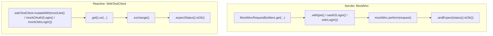

# Tách các helper Reactive khỏi API có tên gần giống của MockMvc

Khi chuyển bài kiểm thử Spring Security từ Servlet sang Reactive, lỗi phổ biến là giữ nguyên tên helper `jwt()`, `oauth2Login()` hoặc `oidcLogin()` rồi chỉ đổi `MockMvc` thành `WebTestClient`. Nhìn qua, các helper có mục đích tương tự: tạo một danh tính đã xác thực để kiểm tra endpoint. Nhưng chúng thuộc **hai bộ API test khác nhau**, nhận **hai loại đối tượng khác nhau** và được áp dụng tại **hai điểm khác nhau trong lời gọi HTTP**.

Bài thuộc chương **OAuth2 Reactive** của **SPRING_SECURITY_TESTING**. Mục tiêu của module là kiểm chứng xác thực, phân quyền và bảo vệ HTTP thực tế bằng `spring-security-test` trên **Servlet và Reactive**, sử dụng `MockMvc`, `WebTestClient`, `@WithMockUser`, `SecurityContext`, mock JWT/OAuth2/OIDC cùng các trường hợp được phép và bị từ chối. Nội dung dưới đây chỉ rõ import, DSL, luồng tạo `Authentication`, cách thiết lập test và giới hạn của từng helper để tránh những bài test “xanh” nhưng bỏ qua phần security cần kiểm chứng.

## 1. Hai hệ sinh thái có tên tương tự nhưng không dùng lẫn

Trong MockMvc, các request post-processor thường đến từ:

```java
import static org.springframework.security.test.web.servlet.request
        .SecurityMockMvcRequestPostProcessors.jwt;
import static org.springframework.security.test.web.servlet.request
        .SecurityMockMvcRequestPostProcessors.oauth2Login;
import static org.springframework.security.test.web.servlet.request
        .SecurityMockMvcRequestPostProcessors.oidcLogin;
```

Với WebTestClient của **WebFlux**, các configurer tương ứng đến từ:

```java
import static org.springframework.security.test.web.reactive.server
        .SecurityMockServerConfigurers.mockJwt;
import static org.springframework.security.test.web.reactive.server
        .SecurityMockServerConfigurers.mockOAuth2Login;
import static org.springframework.security.test.web.reactive.server
        .SecurityMockServerConfigurers.mockOidcLogin;
```

Các package `web.servlet.request` và `web.reactive.server` là dấu hiệu phân biệt ngay từ lúc import. Không chỉ sửa chữ `jwt` thành `mockJwt` bằng tìm kiếm toàn dự án: phải hiểu request đang được xây dựng bởi MockMvc hay WebTestClient.

| Mục đích | MockMvc / Servlet | WebTestClient / Reactive |
|---|---|---|
| User/password giả | `user("alice")` trong `.with(...)` | `mockUser("alice")` trong `.mutateWith(...)` |
| JWT principal giả | `jwt()` | `mockJwt()` |
| OAuth2 Login principal giả | `oauth2Login()` | `mockOAuth2Login()` |
| OIDC Login principal giả | `oidcLogin()` | `mockOidcLogin()` |
| Opaque token principal giả | `opaqueToken()` | `mockOpaqueToken()` |
| CSRF token giả hợp lệ | `csrf()` trong `.with(...)` | `csrf()` trong `.mutateWith(...)` |
| Tích hợp security khi dựng client thủ công | `MockMvcBuilders...apply(springSecurity())` | `WebTestClient.bindToApplicationContext(...).apply(springSecurity())` |
| Cấu hình server-side | `HttpSecurity` / `SecurityFilterChain` | `ServerHttpSecurity` / `SecurityWebFilterChain` |
| Kiểm thử method security | `@EnableMethodSecurity` | `@EnableReactiveMethodSecurity` |

`@WithMockUser` có thể được dùng trong các loại test được Spring Security Test hỗ trợ, nhưng nó là **annotation test context**, không phải tên helper thay cho `mockUser()`. Việc annotation ảnh hưởng đến request/publisher nào phụ thuộc test execution listener và cách test tích hợp Spring Security.

## 2. Phân biệt hai cú pháp ngay tại request

MockMvc dùng `MockHttpServletRequestBuilder` và `RequestPostProcessor`:

```java
mockMvc.perform(
        get("/api/reports")
            .with(jwt().authorities(
                new SimpleGrantedAuthority("SCOPE_reports.read"))))
    .andExpect(status().isOk());
```

WebTestClient dùng các configurer của `SecurityMockServerConfigurers`:

```java
webTestClient
    .mutateWith(mockJwt().authorities(
        new SimpleGrantedAuthority("SCOPE_reports.read")))
    .get()
    .uri("/api/reports")
    .exchange()
    .expectStatus().isOk();
```

Tuy cách trình bày tương tự, đây là **hai chuỗi lời gọi khác kiểu**:



Không viết `webTestClient.get().uri("/api/reports").with(jwt())`: request specifier của WebTestClient không cung cấp một API `.with(...)` nhận Servlet `RequestPostProcessor`. Tương tự, `mockMvc.perform(get(...).with(mockJwt()))` không có kiểu phù hợp.

Một lỗi khác là import nhầm `csrf()`: tên hàm ở hai API có thể giống hệt nhau, nhưng kiểu trả về khác nhau. Khi IDE gợi ý import, đọc cả **package** và cấu trúc test, không chỉ nhìn tên phương thức.

## 3. Đối tượng Authentication được giả lập khác nhau như thế nào?

Các helper Spring Security Test chuẩn bị một `Authentication`/principal phục vụ kiểm thử mà không phải thực hiện toàn bộ quá trình xác thực thực tế:

| Helper | Đối tượng thường được xây dựng | Nên kiểm chứng |
|---|---|---|
| `user()` / `mockUser()` | Username/password-style authenticated principal | `hasRole`/`hasAuthority`, thông tin user |
| `jwt()` / `mockJwt()` | `JwtAuthenticationToken` | Scope/authority của JWT, subject/claims controller đọc |
| `oauth2Login()` / `mockOAuth2Login()` | `OAuth2AuthenticationToken` với `OAuth2User` | Quyền và luồng nghiệp vụ sau OAuth2 Login |
| `oidcLogin()` / `mockOidcLogin()` | `OAuth2AuthenticationToken` với `OidcUser` | OIDC claims và quyền sau OIDC Login |
| `opaqueToken()` / `mockOpaqueToken()` | Authentication đại diện opaque bearer token | Quyền dựa vào attributes/authorities sau introspection |

Các helper này **không tự động chứng minh** backend đã xử lý `Authorization: Bearer ...`, tải JWKS, xác minh chữ ký JWT, gọi introspection endpoint, redirect sang IdP, đổi authorization code hoặc xác minh ID token thực. Chúng chủ yếu kiểm tra **authorization sau khi đã có Authentication**.

Đặc biệt, trong code WebFlux, principal đã mock được truyền vào **Reactor Context của security chain**. Handler hoặc service có thể đọc bằng `ReactiveSecurityContextHolder.getContext()`; nó không nhất thiết có sẵn qua `SecurityContextHolder.getContext()` kiểu ThreadLocal của Servlet.

## 4. Thiết lập WebFlux test có filter bảo mật thực

Ví dụ API đọc danh tính và báo cáo:

```java
import org.springframework.context.annotation.Bean;
import org.springframework.context.annotation.Configuration;
import org.springframework.http.HttpMethod;
import org.springframework.security.config.Customizer;
import org.springframework.security.config.annotation.web.reactive.EnableWebFluxSecurity;
import org.springframework.security.config.web.server.ServerHttpSecurity;
import org.springframework.security.web.server.SecurityWebFilterChain;

@Configuration
@EnableWebFluxSecurity
class ReactiveApiSecurity {

    @Bean
    SecurityWebFilterChain apiSecurity(ServerHttpSecurity http) {
        return http
            .authorizeExchange(exchanges -> exchanges
                .pathMatchers(HttpMethod.GET, "/api/me")
                    .authenticated()
                .pathMatchers(HttpMethod.GET, "/api/reports")
                    .hasAuthority("SCOPE_reports.read")
                .pathMatchers(HttpMethod.POST, "/api/reports")
                    .hasAuthority("SCOPE_reports.write")
                .anyExchange().denyAll())
            .httpBasic(Customizer.withDefaults())
            .build();
    }
}
```

Ví dụ cố ý bật `httpBasic()` làm entry point để ca chưa xác thực dễ quan sát bằng HTTP 401. Trên hệ thống dùng form login hoặc entry point tùy chỉnh, request chưa đăng nhập có thể nhận redirect 302. CSRF protection vẫn có thể áp dụng cho POST; vì vậy test POST ở phần sau dùng `csrf()`.

Controller WebFlux trả kết quả từ `ReactiveSecurityContextHolder`:

```java
import java.util.Map;
import org.springframework.security.core.context.ReactiveSecurityContextHolder;
import org.springframework.web.bind.annotation.GetMapping;
import org.springframework.web.bind.annotation.PostMapping;
import org.springframework.web.bind.annotation.RequestMapping;
import org.springframework.web.bind.annotation.RestController;
import reactor.core.publisher.Mono;

@RestController
@RequestMapping("/api")
class ReactiveApiController {

    @GetMapping("/me")
    Mono<Map<String, String>> me() {
        return ReactiveSecurityContextHolder.getContext()
            .map(context -> Map.of(
                "name", context.getAuthentication().getName()));
    }

    @GetMapping("/reports")
    Mono<Map<String, String>> reports() {
        return Mono.just(Map.of("report", "visible"));
    }

    @PostMapping("/reports")
    Mono<Map<String, String>> create() {
        return Mono.just(Map.of("result", "saved"));
    }
}
```

`Mono.just(...)` trong hai method reports là dữ liệu minh họa; chính `SecurityWebFilterChain` đang áp dụng quyền truy cập. Trong ứng dụng thật, có thể cần kiểm soát quyền chi tiết trong service bằng `@PreAuthorize` và reactive method security.

Một slice test phù hợp:

```java
import org.junit.jupiter.api.Test;
import org.springframework.beans.factory.annotation.Autowired;
import org.springframework.boot.test.autoconfigure.web.reactive.WebFluxTest;
import org.springframework.context.annotation.Import;
import org.springframework.test.web.reactive.server.WebTestClient;

@WebFluxTest(controllers = ReactiveApiController.class)
@Import(ReactiveApiSecurity.class)
class ReactiveApiSecurityTest {

    @Autowired WebTestClient webTestClient;

    // Các method test ở những phần tiếp theo.
}
```

Ví dụ giả định dependencies gồm Spring Boot WebFlux, Spring Security, Spring Security Test và JUnit 5; các import cho `SimpleGrantedAuthority`/static configurer được bổ sung ở từng phần. Nếu cần decoder/manager khác để khởi tạo context, hãy cung cấp bean cấu hình test tương ứng.

Trường hợp dựng client thủ công thay vì để Spring Boot tạo:

```java
import static org.springframework.security.test.web.reactive.server
        .SecurityMockServerConfigurers.springSecurity;

WebTestClient client = WebTestClient
        .bindToApplicationContext(applicationContext)
        .apply(springSecurity())
        .configureClient()
        .build();
```

`springSecurity()` ở đây là **Reactive WebTestClient configurer**; nó không phải import Servlet dành cho `MockMvcBuilders`. Nếu client được bind trực tiếp vào controller mà không có security web filters, request trả 200 chỉ chứng minh controller chạy, không chứng minh quyền đã được bảo vệ.

## 5. So sánh user() của MockMvc và mockUser() của Reactive

### Servlet

```java
import static org.springframework.security.test.web.servlet.request
        .SecurityMockMvcRequestPostProcessors.user;

mockMvc.perform(get("/api/me")
        .with(user("alice").roles("READER")))
    .andExpect(status().isOk());
```

### Reactive

```java
import static org.springframework.security.test.web.reactive.server
        .SecurityMockServerConfigurers.mockUser;

webTestClient
    .mutateWith(mockUser("alice").roles("READER"))
    .get()
    .uri("/api/me")
    .exchange()
    .expectStatus().isOk()
    .expectBody()
    .jsonPath("$.name").isEqualTo("alice");
```

Trong fixture này, `roles("READER")` tạo authority `ROLE_READER` theo quy tắc role prefix thường gặp. Với chính sách `hasAuthority("SCOPE_reports.read")`, authority `ROLE_READER` **không đủ** để đọc `/api/reports`. Phải test role và scope theo đúng chuỗi chính sách.

Ca đối chứng:

```java
webTestClient
    .mutateWith(mockUser("alice").roles("READER"))
    .get()
    .uri("/api/reports")
    .exchange()
    .expectStatus().isForbidden();
```

Đây là một request **đã xác thực nhưng thiếu authority cụ thể**, nên 403 có ý nghĩa khác với một request anonymous. Nếu thiếu principal hoặc entry point khác, status có thể thay đổi theo cấu hình.

## 6. So sánh jwt() của MockMvc và mockJwt() của Reactive

Hai helper có thể được cấu hình JWT và authorities theo cách rất giống nhau, nhưng cách áp dụng khác:

```java
// Servlet
mockMvc.perform(get("/api/reports")
        .with(jwt()
            .jwt(token -> token.subject("alice")
                .claim("scope", "reports.read"))
            .authorities(
                new SimpleGrantedAuthority("SCOPE_reports.read"))))
    .andExpect(status().isOk());
```

```java
// Reactive
webTestClient
    .mutateWith(mockJwt()
        .jwt(token -> token.subject("alice")
            .claim("scope", "reports.read"))
        .authorities(
            new SimpleGrantedAuthority("SCOPE_reports.read")))
    .get()
    .uri("/api/reports")
    .exchange()
    .expectStatus().isOk()
    .expectBody()
    .jsonPath("$.report").isEqualTo("visible");
```

Ở ví dụ này:

1. `subject("alice")` minh họa claim định danh.
2. `claim("scope", "reports.read")` ghi claim JWT để controller/service đọc.
3. `authorities(new SimpleGrantedAuthority(...))` chỉ định authority **được gắn trực tiếp vào Authentication giả lập**.
4. WebFlux authorization rule yêu cầu `SCOPE_reports.read` nên request được phép.

**Đừng nhầm số 2 với số 3.** Nếu test tự cấp authorities, nó không xác minh rằng converter JWT của ứng dụng thực sự biến claim `scope` thành `SCOPE_...` theo đúng quy tắc production. Để test converter, cần kiểm tra converter riêng hoặc đi qua cơ chế xác thực Bearer/token decoder thật theo setup phù hợp.

Ca bị từ chối:

```java
webTestClient
    .mutateWith(mockJwt().authorities(
        new SimpleGrantedAuthority("SCOPE_reports.write")))
    .get()
    .uri("/api/reports")
    .exchange()
    .expectStatus().isForbidden();
```

Đây là bằng chứng HTTP authorization xét đúng authority, **chưa phải** bằng chứng JWT signature hoặc JWKS validation. Một JWT giả lập có thể được Spring Security Test gắn vào context dù ứng dụng không thể xác minh một JWT thật có cùng claims.

### Khi cần kiểm tra Bearer JWT thật

Với test chạy qua HTTP server thực, gửi header:

```java
webTestClient.get()
    .uri("/api/reports")
    .headers(headers -> headers.setBearerAuth(signedJwt))
    .exchange()
    .expectStatus().isOk();
```

Ở đây, `signedJwt` phải được ký bằng test key tương ứng với cấu hình `ReactiveJwtDecoder`, và app phải bật Resource Server JWT thật. Test cần JWKS/issuer cục bộ hoặc một identity provider thử nghiệm có kiểm soát; mock JWT không kiểm tra cơ chế đó.

**Ranh giới quan trọng:** `WebTestClient` có thể bind tới **application context** hoặc tới **live HTTP server**. `mockJwt()` can thiệp vào bộ lọc test khi client gắn với application context của WebFlux; nó không thể tự đưa một Authentication vào JVM server từ xa chỉ bằng một HTTP request. Với `RANDOM_PORT` hoặc server ngoài tiến trình, dùng HTTP Authorization header và decoder thật để kiểm tra xác thực qua mạng.

## 7. oauth2Login() và mockOAuth2Login() không khởi động login thật

Trong Servlet:

```java
import static org.springframework.security.test.web.servlet.request
        .SecurityMockMvcRequestPostProcessors.oauth2Login;

mockMvc.perform(get("/api/me")
        .with(oauth2Login()))
    .andExpect(status().isOk());
```

Trong WebFlux:

```java
import static org.springframework.security.test.web.reactive.server
        .SecurityMockServerConfigurers.mockOAuth2Login;

webTestClient
    .mutateWith(mockOAuth2Login())
    .get()
    .uri("/api/me")
    .exchange()
    .expectStatus().isOk();
```

Hai bài test giả lập một principal đã đăng nhập với OAuth2. Chúng không chuyển trình duyệt tới Authorization Server và không thực hiện:

- `GET /oauth2/authorization/{registrationId}` để tạo state.
- Callback `/login/oauth2/code/{registrationId}`.
- HTTP POST đến token endpoint để đổi code.
- Lấy UserInfo từ IdP thật.
- Xác minh session, cookie và trạng thái authorization request qua redirect.

Nếu muốn kiểm luồng OAuth2 Login **thật**, cần test filter chain cùng một mock IdP có authorization/token/UserInfo endpoints, giữ session giữa redirect và callback rồi xác nhận HTTP POST/token response. `mockOAuth2Login()` là công cụ kiểm tra quyền **sau đăng nhập**, không thay thế integration test đó.

### Trường hợp cần thuộc tính người dùng

Với một endpoint đọc thuộc tính của `OAuth2User`, có thể tạo user giả rõ ràng theo API hỗ trợ của phiên bản đang dùng:

```java
webTestClient
    .mutateWith(mockOAuth2Login()
        .attributes(attributes -> attributes.put("department", "sales")))
    .get()
    .uri("/api/me")
    .exchange()
    .expectStatus().isOk();
```

Fixture trên minh họa cách bổ sung attribute vào principal để service/controller đọc; controller `/api/me` trong bài chỉ trả tên user, nên chưa assert `department`. Để xác minh giá trị thuộc tính, tạo endpoint hoặc service thực sự đọc `OAuth2User.getAttributes()` và assert response tương ứng.

Không tự suy luận user có authority `ROLE_ADMIN` chỉ vì IdP trả một field trong attributes. Phải kiểm tra mapper hoặc authorities do test chủ động cấu hình.

## 8. oidcLogin() và mockOidcLogin() dành cho OIDC principal

OpenID Connect mở rộng OAuth2 để cung cấp **ID token** mô tả danh tính người dùng. Trong MockMvc:

```java
import static org.springframework.security.test.web.servlet.request
        .SecurityMockMvcRequestPostProcessors.oidcLogin;

mockMvc.perform(get("/api/me")
        .with(oidcLogin()
            .idToken(token -> token
                .subject("alice")
                .claim("email", "alice@example.test"))))
    .andExpect(status().isOk());
```

Trong WebFlux:

```java
import static org.springframework.security.test.web.reactive.server
        .SecurityMockServerConfigurers.mockOidcLogin;

webTestClient
    .mutateWith(mockOidcLogin()
        .idToken(token -> token
            .subject("alice")
            .claim("email", "alice@example.test")))
    .get()
    .uri("/api/me")
    .exchange()
    .expectStatus().isOk()
    .expectBody()
    .jsonPath("$.name").isEqualTo("alice");
```

OIDC test helper cung cấp `OidcUser` giả lập để kiểm code đọc `sub`, `email`, user authorities hoặc registration ID tùy cấu hình fixture. **Không kiểm tra chữ ký ID token**, `nonce`, `iss`, `aud` hay tương tác thật với token/JWKS endpoints.

Không dùng `mockJwt()` thay `mockOidcLogin()` chỉ vì hai loại đều có JWT:

- **Resource Server Bearer JWT**: thường có `JwtAuthenticationToken`; dùng `mockJwt()`.
- **OIDC Login**: principal thường là `OidcUser` được gắn trong `OAuth2AuthenticationToken`; dùng `mockOidcLogin()`.

Nếu controller khai báo tham số `@AuthenticationPrincipal OidcUser user`, request từ `mockJwt()` có thể không cung cấp đúng kiểu dữ liệu mà controller chờ. Ngược lại, một controller lấy `@AuthenticationPrincipal Jwt jwt` không tự nhận được kiểu `Jwt` từ `mockOidcLogin()`.

## 9. opaqueToken() và mockOpaqueToken(): đừng nhầm introspection

Với OAuth2 Resource Server sử dụng opaque bearer token, authorization server có thể cung cấp endpoint **introspection** để xác thực token. Test helpers dựng Authentication giả mà không cần gọi introspection:

```java
// Servlet: SecurityMockMvcRequestPostProcessors.opaqueToken
mockMvc.perform(get("/api/reports")
        .with(opaqueToken().authorities(
            new SimpleGrantedAuthority("SCOPE_reports.read"))))
    .andExpect(status().isOk());
```

```java
// Reactive: SecurityMockServerConfigurers.mockOpaqueToken
webTestClient
    .mutateWith(mockOpaqueToken().authorities(
        new SimpleGrantedAuthority("SCOPE_reports.read")))
    .get()
    .uri("/api/reports")
    .exchange()
    .expectStatus().isOk();
```

Ca này phù hợp khi chính sách xét authority sau introspection. Nếu cần kiểm token thực sự được introspect, phải cấu hình `ReactiveOpaqueTokenIntrospector`/HTTP test server và gửi HTTP Bearer token qua đường xác thực thật.

Không đưa access token thật vào test logs hay ghi credentials vào code. Fixtures token giả được dùng để minh họa các quyền, còn kiểm tra end-to-end phải sử dụng token test và mock introspection server riêng.

## 10. csrf(): cùng tên, khác nơi áp dụng

Một lỗi thường xuất hiện khi chuyển Servlet test sang WebFlux là bỏ CSRF hoặc import helper sai package. Với MockMvc:

```java
import static org.springframework.security.test.web.servlet.request
        .SecurityMockMvcRequestPostProcessors.csrf;

mockMvc.perform(post("/api/reports")
        .with(jwt().authorities(
            new SimpleGrantedAuthority("SCOPE_reports.write")))
        .with(csrf()))
    .andExpect(status().isOk());
```

Với WebTestClient:

```java
import static org.springframework.security.test.web.reactive.server
        .SecurityMockServerConfigurers.csrf;

webTestClient
    .mutateWith(mockJwt().authorities(
        new SimpleGrantedAuthority("SCOPE_reports.write")))
    .mutateWith(csrf())
    .post()
    .uri("/api/reports")
    .exchange()
    .expectStatus().isOk();
```

Với cấu hình mẫu giữ CSRF protection mặc định, `csrf()` giúp request POST đi tiếp đến controller. Ca thiếu CSRF có thể nhận 403 ngay cả khi Authentication đủ scope:

```java
webTestClient
    .mutateWith(mockJwt().authorities(
        new SimpleGrantedAuthority("SCOPE_reports.write")))
    .post()
    .uri("/api/reports")
    .exchange()
    .expectStatus().isForbidden();
```

Đây là ví dụ cho **một cấu hình có yêu cầu CSRF đối với POST**. API Bearer JWT stateless có thể chủ động tắt CSRF hoặc dùng chính sách khác theo threat model. Khi mục tiêu là test validation/controller sau security, hãy gửi đủ CSRF nếu policy yêu cầu; khi mục tiêu là test bảo vệ CSRF, phải có cả ca thiếu token và token hợp lệ.

## 11. Test trái và phải: anonymous, thiếu quyền, đủ quyền

Một test chỉ có `mockJwt()` trả 200 không chứng minh endpoint đã an toàn. Ma trận tối thiểu nên gồm:

| Request | Authentication của test | Đích kiểm tra | Kỳ vọng với cấu hình mẫu |
|---|---|---|---|
| `GET /api/me` | Không có | Yêu cầu đăng nhập | 401 |
| `GET /api/me` | `mockUser("alice")` | Có identity | 200, body tên `alice` |
| `GET /api/reports` | Không có | Chặn anonymous | 401 |
| `GET /api/reports` | `mockJwt()` với `SCOPE_reports.write` | Thiếu quyền đọc | 403 |
| `GET /api/reports` | `mockJwt()` với `SCOPE_reports.read` | Đúng quyền đọc | 200 |
| `POST /api/reports` | `SCOPE_reports.write`, thiếu CSRF | Chặn request không có CSRF | 403 |
| `POST /api/reports` | `SCOPE_reports.write`, có CSRF | Đúng quyền ghi | 200 |

Ví dụ những test được phép/bị từ chối trong cùng class:

```java
@Test
void anonymousCannotReadReports() {
    webTestClient.get()
        .uri("/api/reports")
        .exchange()
        .expectStatus().isUnauthorized();
}

@Test
void wrongJwtScopeIsForbidden() {
    webTestClient
        .mutateWith(mockJwt().authorities(
            new SimpleGrantedAuthority("SCOPE_reports.write")))
        .get()
        .uri("/api/reports")
        .exchange()
        .expectStatus().isForbidden();
}

@Test
void rightJwtScopeIsAllowed() {
    webTestClient
        .mutateWith(mockJwt().authorities(
            new SimpleGrantedAuthority("SCOPE_reports.read")))
        .get()
        .uri("/api/reports")
        .exchange()
        .expectStatus().isOk();
}
```

Trạng thái 401/403 phụ thuộc entry point, security chain và exception handler thật. Ví dụ trên dựa vào `httpBasic()` và rules ở mục 4. Nếu ứng dụng bật `formLogin()` hoặc OIDC login cho browser, anonymous có thể bị chuyển hướng thay vì 401. Viết kỳ vọng theo cấu hình đang test, không áp một mã chung cho mọi hệ thống.

## 12. Dấu hiệu nhận diện imports và kiểu trả về bị nhầm

| Triệu chứng trong IDE/test | Khả năng nguyên nhân | Cách xử lý |
|---|---|---|
| `Cannot resolve method with(...)` trên WebTestClient | Đang dùng cú pháp MockMvc | Dùng `webTestClient.mutateWith(...)` |
| `Required WebTestClientConfigurer, provided RequestPostProcessor` | Import `SecurityMockMvcRequestPostProcessors.jwt()` | Import `SecurityMockServerConfigurers.mockJwt()` |
| `mockJwt()` không dùng được trong `MockMvc.perform(...)` | Import helper reactive vào Servlet | Dùng `jwt()` trong `.with(...)` |
| `csrf()` bị ambiguous hoặc sai kiểu | Static import cả hai `csrf` | Giữ duy nhất import phù hợp framework |
| Test WebFlux `getContext()` rỗng | Client chưa gắn security filters, hoặc publisher chạy ngoài request context | Kiểm `springSecurity()` và scope subscription |
| WebFlux test 200 dù security config sai | Test client bind thẳng controller, không chạy web filters | Bind application context có `SecurityWebFilterChain` |
| `@AuthenticationPrincipal OidcUser` nhận null khi dùng mock JWT | Principal sai loại | Dùng `mockOidcLogin()` |
| `mockJwt()` pass nhưng Bearer header thật 401 | Mock bỏ qua decoder/signature/JWKS | Thêm test token ký thật qua HTTP |
| `mockOAuth2Login()` pass nhưng callback thật lỗi | Mock bỏ qua authorization redirect/token endpoint | Test OAuth2 Code flow với mock IdP |
| Test có quyền đúng nhưng POST trả 403 | CSRF còn bật | Bổ sung `csrf()` khi muốn kiểm phần sau security |
| `mockJwt()` không ảnh hưởng live server `RANDOM_PORT` | Configurer chỉ có hiệu lực trong test-bound WebFlux client | Gửi Bearer header và dùng decoder thật |

Khi gặp lỗi biên dịch, ưu tiên xem đầy đủ package trong import. Khi test chạy nhưng sai behavior, kiểm WebTestClient đã chạy security web filters chưa và Authentication đã được đưa vào **Reactor Context của request** chưa.

## 13. Các API có tên giống nhau ở phần cấu hình Security

Việc phân biệt helper test nên đi cùng việc phân biệt security setup:

```java
// Servlet
@EnableWebSecurity
class ServletSecurity {
    @Bean
    SecurityFilterChain chain(HttpSecurity http) throws Exception {
        return http.authorizeHttpRequests(auth -> auth
                .requestMatchers("/api/reports")
                    .hasAuthority("SCOPE_reports.read")
                .anyRequest().authenticated())
            .build();
    }
}
```

```java
// Reactive
@EnableWebFluxSecurity
class WebFluxSecurity {
    @Bean
    SecurityWebFilterChain chain(ServerHttpSecurity http) {
        return http.authorizeExchange(ex -> ex
                .pathMatchers("/api/reports")
                    .hasAuthority("SCOPE_reports.read")
                .anyExchange().authenticated())
            .build();
    }
}
```

Hai đoạn trên là **hai ví dụ cấu hình cho hai loại ứng dụng khác nhau**; không đặt cạnh nhau trong cùng một application context rồi kỳ vọng Spring tự chọn đúng. Servlet dùng `HttpSecurity` và `SecurityFilterChain`; Reactive dùng `ServerHttpSecurity` và `SecurityWebFilterChain`.

Ở method security, Servlet có `@EnableMethodSecurity`, Reactive có `@EnableReactiveMethodSecurity`. Với method trả `Mono`/`Flux`, Spring Security có thể cần lấy Authentication từ Reactor Context **khi subscription**, nên một test service reactive trực tiếp phải cung cấp context thích hợp hoặc đi qua WebTestClient có security chain.

## 14. Test trực tiếp Mono/Flux không sử dụng mutateWith()

`mockJwt()`/`mockOidcLogin()` là helper cho **WebTestClient HTTP exchange**. Nếu đang test service trả `Mono` độc lập với HTTP, không có `WebTestClient` để gọi `mutateWith()`.

Một cách tạo SecurityContext cho direct publisher:

```java
Authentication alice = new UsernamePasswordAuthenticationToken(
        "alice", "n/a", List.of(
            new SimpleGrantedAuthority("SCOPE_reports.read")));

Mono<String> currentName =
        ReactiveSecurityContextHolder.getContext()
            .map(context -> context.getAuthentication().getName());

StepVerifier.create(currentName.contextWrite(
        ReactiveSecurityContextHolder.withAuthentication(alice)))
    .expectNext("alice")
    .verifyComplete();
```

Ở đây, context được gắn cho **subscription Reactor**, không được truyền qua HTTP mock request. Nếu dùng `@WithMockUser` trong direct-service test, cần chắc chắn test execution listeners và Reactor Context test support của cấu hình dự án đã thực sự được áp dụng; nếu không, `Mono` có thể không nhìn thấy danh tính của annotation.

Không thay `ReactiveSecurityContextHolder` bằng `SecurityContextHolder.getContext()` để “chữa cháy” WebFlux: một pipeline có thể đổi thread hoặc được subscribe ở thời điểm khác. Ưu tiên dùng Reactor Context hoặc đưa Authentication thành tham số rõ ràng của service theo thiết kế.

## 15. Phân biệt authentication giả với xác thực token và login thực

Khi đọc báo cáo test, cần gắn đúng nhãn phạm vi:

| Test đang dùng | Đã kiểm tra | Chưa kiểm tra |
|---|---|---|
| `mockJwt()` + WebTestClient bound to context | Reactive authorization với `JwtAuthenticationToken` giả | Decoder, signature, issuer, audience, JWKS |
| `mockOpaqueToken()` | Quyền với opaque principal giả | HTTP introspection thật |
| `mockOAuth2Login()` | Quyền/nghiệp vụ với OAuth2User giả | Authorization Code callback/token exchange |
| `mockOidcLogin()` | Quyền/nghiệp vụ với OidcUser giả | ID token validation, nonce, issuer, discovery |
| `mockUser()` | Quyền với username/roles giả | Password/Bearer/OIDC authentication mechanism |
| `csrf()` | Có token CSRF test để vượt bộ lọc khi được yêu cầu | Tự thân toàn bộ hành vi CSRF trong trình duyệt thật |
| HTTP Bearer token ký thật + decoder/JWKS test | Đường xác thực JWT qua HTTP | OAuth2/OIDC browser login nếu không đi qua callback |
| Mock IdP + callback thật | Authorization Code flow, state, token request/response | Điều kiện vận hành của IdP production |

Để kiểm cơ chế xác thực thật, cần gửi đầu vào thật đến filter tương ứng và quan sát kết quả. Để kiểm authorization, helper giả lập là lựa chọn hiệu quả vì mỗi test điều khiển chính xác principal, authorities và claims.

Một bài kiểm thử tốt có **đối chứng**:

```text
No authentication             -> 401/302 theo entry point
mockJwt with wrong authority  -> 403
mockJwt with right authority  -> 200
Real Bearer JWT, valid        -> được xác thực nếu decoder/JWKS đúng
Real Bearer JWT, invalid      -> bị từ chối tại authentication layer
```

Không dùng kết quả từ ba dòng đầu để kết luận hai dòng cuối đã được xác minh.

## 16. Bài thực hành: di chuyển bộ test MockMvc sang WebFlux

Giả sử ứng dụng có ba endpoint:

1. `GET /api/me` yêu cầu một người dùng đã xác thực, trả tên principal.
2. `GET /api/reports` yêu cầu `SCOPE_reports.read`.
3. `POST /api/reports` yêu cầu `SCOPE_reports.write`; dự án còn bật CSRF protection.

Hãy thực hiện theo trình tự:

1. Viết bảng ánh xạ `user()/jwt()/oauth2Login()/oidcLogin()/opaqueToken()/csrf()` của MockMvc sang `mockUser()/mockJwt()/mockOAuth2Login()/mockOidcLogin()/mockOpaqueToken()/csrf()` của WebTestClient và ghi đúng hai package import.
2. Tạo `SecurityWebFilterChain` với `authorizeExchange` và `pathMatchers`; test bằng WebTestClient gắn vào application context có security.
3. Viết test anonymous bị từ chối, JWT chỉ có scope ghi không được đọc, JWT có scope đọc được phép đọc.
4. Dùng `mockUser("alice")` đọc `/api/me`, assert body tên `alice`; giải thích vì sao đây là principal giả, không phải kiểm tra đăng nhập qua password.
5. Viết test `POST` có quyền ghi nhưng thiếu CSRF nhận từ chối; thêm `mutateWith(csrf())` để request đi tiếp.
6. Với một endpoint đọc `OidcUser`, dùng `mockOidcLogin()` đặt subject/email rõ ràng. Thử dùng `mockJwt()` và giải thích khác biệt kiểu principal.
7. Tạo một test có OAuth2User bằng `mockOAuth2Login()`. Đề xuất integration test riêng nếu mục tiêu là kiểm tra token endpoint hoặc callback thật.
8. Test direct service trả `Mono<String>` đọc `ReactiveSecurityContextHolder` bằng `StepVerifier` và `contextWrite(withAuthentication(...))`, không dùng `mutateWith()`.
9. Với `WebTestClient` kết nối một server đang chạy trên cổng thật, gửi Bearer JWT ký bằng test key và dùng `ReactiveJwtDecoder` có JWKS mock server để kiểm tra chữ ký/issuer độc lập với `mockJwt()`.
10. Chứng minh một test sai import (Servlet `RequestPostProcessor` truyền vào Reactive WebTestClient) bị lỗi kiểu, và sửa bằng đúng Reactive configurer.

**Tiêu chí hoàn thành:** Người học chỉ rõ **helper thuộc môi trường nào**, **cách gắn principal vào request hoặc subscription**, **phạm vi xác thực/phân quyền thực sự đã được kiểm tra**, và luôn có cả ca được phép lẫn bị từ chối. Một test WebFlux trả 200 với `mockJwt()` hoặc `mockOidcLogin()` không được dùng làm bằng chứng JWT/OIDC thực đã được xác minh qua mạng.
