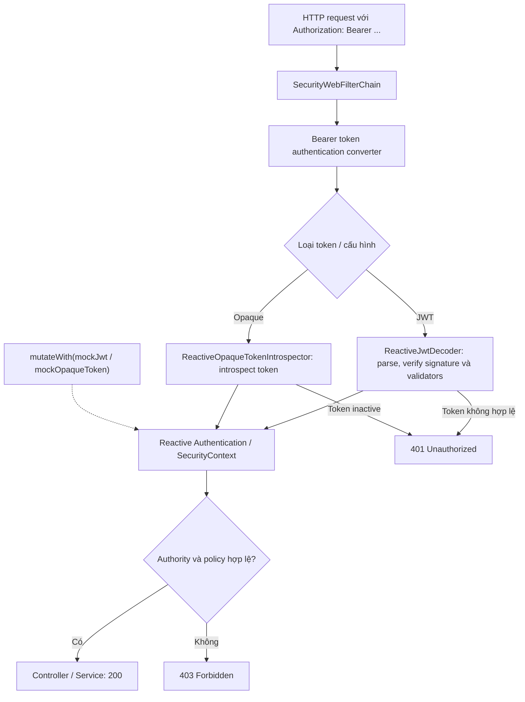
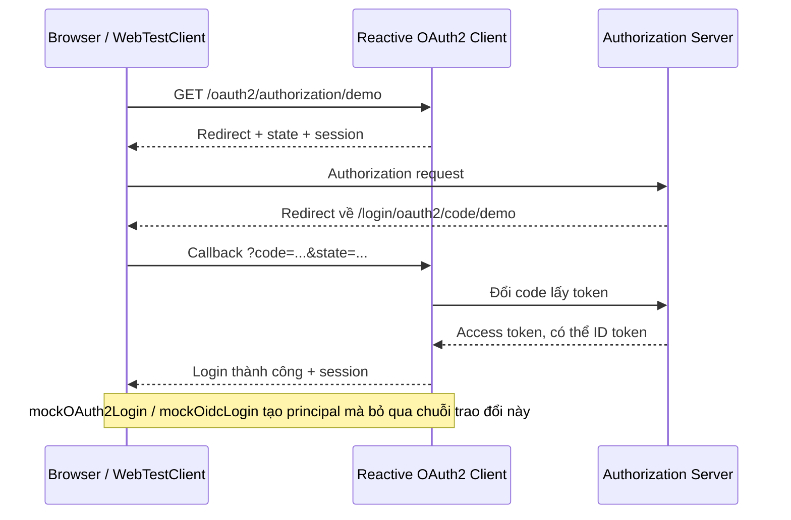

# Bổ sung ca xác thực thật để kiểm tra bước mà mutator đã giả lập

Trong kiểm thử Spring Security Reactive, `WebTestClient.mutateWith(mockJwt())`, `mockOpaqueToken()`, `mockOAuth2Login()` và `mockOidcLogin()` cho phép tạo sẵn một danh tính đã xác thực. Các helper này rất hữu ích khi cần kiểm tra **authorization**, cách controller đọc principal hoặc cách business code sử dụng claims. Nhưng một test trả `200 OK` sau khi dùng mutator **không chứng minh đường xác thực thực tế đã chạy**.

Nếu mục tiêu là xác nhận Resource Server thực sự kiểm tra chữ ký JWT, kiểm tra thời hạn, gọi introspection endpoint hoặc OAuth2 Client thực hiện redirect/callback và đổi authorization code lấy token, bạn phải **bổ sung các ca kiểm thử đi qua đúng bước đã bị mutator bỏ qua**.

Bài thuộc module **SPRING_SECURITY_TESTING**: kiểm chứng xác thực, phân quyền và bảo vệ HTTP thực tế bằng `spring-security-test` trên Servlet và Reactive. Trọng tâm là WebFlux với `WebTestClient`. Sau bài này, bạn có thể phân biệt test có principal giả với test xác thực thực, chọn cấu hình test tương ứng và thiết kế các ca `200/401/403` có bằng chứng rõ ràng.

## 1. Mutator đã mô phỏng phần nào?

Để ứng dụng Resource Server xử lý một Bearer token thông thường, luồng xác thực gồm nhiều bước:



Khi dùng `mockJwt()` hoặc `mockOpaqueToken()`, Spring Security Test trực tiếp dựng một `Authentication` phù hợp rồi cung cấp cho request. Nó mô phỏng trạng thái **sau khi xác thực**. Vì thế test có thể xanh dù decoder, chữ ký, introspection server hoặc token validator bị cấu hình sai.

Cùng logic áp dụng cho đăng nhập OAuth2/OIDC:



**Hệ quả:** việc test truy cập được một trang chỉ yêu cầu `authenticated()` với `mockOidcLogin()` không kiểm tra `state`, `nonce`, token endpoint, ID token signature, user-info endpoint hoặc cách ứng dụng xử lý một callback không hợp lệ.

## 2. Bản đồ lựa chọn mức kiểm thử

| Kỹ thuật | Danh tính đến từ đâu? | Bước được kiểm tra | Bước chưa được kiểm tra |
| --- | --- | --- | --- |
| `mockJwt()` | `JwtAuthenticationToken` giả do test tạo | Quyết định phân quyền sau authentication, controller nhận claims | Bearer parsing, decoder, chữ ký, issuer/audience/expiration |
| Bearer header + mock `ReactiveJwtDecoder` | Decoder mock trả `Jwt` định sẵn | WebFilter, gọi đúng decoder, converter, phân quyền | Xác minh mật mã và các validators thật |
| Bearer header + `NimbusReactiveJwtDecoder` thật | Compact JWS được ký bằng private key test | Xác minh chữ ký, validators đã cấu hình, converter, HTTP authorization | Giao thức phát token ở nhà cung cấp, JWKS discovery nếu dùng public key cố định |
| `mockOpaqueToken()` | `BearerTokenAuthentication` giả | Phân quyền theo authorities được cấp | Raw token, introspection, xử lý `active` |
| Bearer header + `ReactiveOpaqueTokenIntrospector` thật | HTTP response từ fake introspection server | HTTP introspection và xử lý JSON `active`, scope | Tình trạng token theo Authorization Server sản xuất |
| `mockOAuth2Login()` / `mockOidcLogin()` | OAuth2/OIDC principal giả | Trang sau đăng nhập và authorization | Redirect/state/callback, đổi code, ID token verification |
| Callback + Authorization Server thử nghiệm | Code, state, token, ID token test được phát qua giao thức | Login filter, session/state, token endpoint và validation theo cấu hình | Tính khả dụng và chính sách của Identity Provider production |

Không phải mọi test đều cần dùng server ngoài hay mật mã thật. Một bộ test tốt có **hai lớp bổ sung**: test nhanh dùng mutator cho logic phân quyền, và một nhóm integration test chuyên xác minh những bước authentication mà mutator đã mô phỏng.

## 3. Nền tảng WebFlux dùng cho các ví dụ JWT

Ví dụ sử dụng Java 17+, Spring Boot 3.x, Spring WebFlux, Spring Security Reactive và JUnit 5. Các đoạn code lược bỏ `package`/`import`; trong dự án thật, import các class theo phiên bản đang dùng.

Dependency Gradle cơ bản:

```groovy
dependencies {
    implementation 'org.springframework.boot:spring-boot-starter-webflux'
    implementation 'org.springframework.boot:spring-boot-starter-security'
    implementation 'org.springframework.boot:spring-boot-starter-oauth2-resource-server'

    testImplementation 'org.springframework.boot:spring-boot-starter-test'
    testImplementation 'org.springframework.security:spring-security-test'

    // Test HTTP introspection ở mục 7 (chọn phiên bản phù hợp dự án).
    testImplementation 'org.wiremock:wiremock:3.10.0'
}
```

Tạo một controller nhỏ để kiểm tra claims của principal:

```java
@RestController
class JwtReportsController {

    @GetMapping("/api/reports")
    Mono<Map<String, String>> reports(@AuthenticationPrincipal Jwt jwt) {
        return Mono.just(Map.of(
            "sub", jwt.getSubject(),
            "result", "reports-visible"
        ));
    }
}
```

Cấu hình Resource Server JWT thật:

```java
@Configuration(proxyBeanMethods = false)
@EnableWebFluxSecurity
class JwtApiSecurity {

    @Bean
    SecurityWebFilterChain jwtChain(ServerHttpSecurity http) {
        return http
            .authorizeExchange(exchanges -> exchanges
                .pathMatchers(HttpMethod.GET, "/api/reports")
                    .hasAuthority("SCOPE_reports.read")
                .anyExchange().denyAll()
            )
            .oauth2ResourceServer(oauth2 ->
                oauth2.jwt(Customizer.withDefaults())
            )
            .build();
    }
}
```

Với JWT Resource Server mặc định, scope trong claim `scope` hoặc `scp` được chuyển thành authority có tiền tố `SCOPE_`, ví dụ `"reports.read"` thành `SCOPE_reports.read`. Nếu ứng dụng sử dụng custom `ReactiveJwtAuthenticationConverter`, test cần nạp đúng converter và kiểm tra mapping thực tế.

## 4. Test số 1: mockJwt() chỉ xác minh authorization

`mockJwt()` thuộc `SecurityMockServerConfigurers` của `spring-security-test`. Nó chuẩn bị một `JwtAuthenticationToken` giả trong reactive security context.

Ví dụ lát cắt WebFlux:

```java
@WebFluxTest(controllers = JwtReportsController.class)
@Import(JwtApiSecurity.class)
class JwtAuthorizationSliceTest {

    @Autowired ApplicationContext context;

    @MockitoBean ReactiveJwtDecoder decoder;

    private WebTestClient client;

    @BeforeEach
    void setUp() {
        client = WebTestClient
            .bindToApplicationContext(context)
            .apply(springSecurity())
            .configureClient()
            .build();
    }

    @Test
    void simulatedJwtAllowsRequiredScope() {
        client.mutateWith(mockJwt()
                .jwt(jwt -> jwt.claim("sub", "alice"))
                .authorities(
                    new SimpleGrantedAuthority("SCOPE_reports.read")
                )
            )
            .get()
            .uri("/api/reports")
            .exchange()
            .expectStatus().isOk()
            .expectBody()
            .jsonPath("$.sub").isEqualTo("alice");

        verifyNoInteractions(decoder);
    }

    @Test
    void simulatedJwtWithoutScopeGets403() {
        client.mutateWith(mockJwt()
                .jwt(jwt -> jwt.claim("sub", "bob"))
                .authorities(
                    new SimpleGrantedAuthority("SCOPE_inventory.read")
                )
            )
            .get()
            .uri("/api/reports")
            .exchange()
            .expectStatus().isForbidden();

        verifyNoInteractions(decoder);
    }
}
```

`@MockitoBean` có trong Spring Framework 6.2+ (ví dụ Spring Boot 3.4+); với dự án cũ hơn, dùng `@MockBean` phù hợp phiên bản. Decoder mock được cung cấp để test context có thể khởi tạo chain. Vì `mockJwt()` tạo authentication giả, `ReactiveJwtDecoder.decode(...)` **không được gọi**.

Ca `403` này rất có giá trị để chứng minh **policy**. Tuy nhiên, cả hai test không xác minh JWT signature, expiration, issuer hay audience. Đừng đặt tên test là `jwtSignatureIsValid` hoặc ghi báo cáo “JWT đã được xác minh mật mã”.

### 4.1. Đi qua Bearer filter nhưng vẫn mock decoder

Khi muốn kiểm tra token được lấy từ HTTP header và đi vào đúng decoder, đừng dùng mutator. Gửi header:

```java
@Test
void bearerHeaderIsPassedToDecoderMock() {
    Instant now = Instant.now();

    Jwt decoded = Jwt.withTokenValue("fixture-jwt")
        .header("alg", "RS256")
        .claim("sub", "alice")
        .claim("scope", "reports.read")
        .issuedAt(now)
        .expiresAt(now.plusSeconds(300))
        .build();

    when(decoder.decode("fixture-jwt"))
        .thenReturn(Mono.just(decoded));

    client.get()
        .uri("/api/reports")
        .headers(headers -> headers.setBearerAuth("fixture-jwt"))
        .exchange()
        .expectStatus().isOk()
        .expectBody()
        .jsonPath("$.sub").isEqualTo("alice");

    verify(decoder).decode("fixture-jwt");
}
```

Test này chứng minh WebFlux Resource Server đi qua Bearer authentication pipeline và gọi `decode` đúng raw token. Dù `Jwt` có header `alg=RS256`, **không có phép xác minh RSA nào diễn ra**, bởi decoder bị Mockito thay thế. Đây là bước trung gian hữu ích khi debug filter chain hoặc converter nhưng không phải integration test mật mã.

## 5. Test số 2: ký JWT thật và sử dụng ReactiveJwtDecoder thật

Để kiểm tra chính bước mutator bỏ qua, cần thực sự **ký compact JWS** rồi để `NimbusReactiveJwtDecoder` kiểm tra chữ ký bằng khóa tin cậy. Test này không cần Identity Provider ngoài: ta sinh cặp khóa RSA riêng cho test và ký token bằng private key.

### 5.1. Cấu hình decoder thật trong test context

Tạo test class riêng chạy với WebFlux server thật, dùng cấu hình `JwtApiSecurity` ở mục 3. Ví dụ sau giả định application context có controller/chain đó và test cung cấp đúng decoder đang được chain sử dụng:

```java
@SpringBootTest(
    webEnvironment = SpringBootTest.WebEnvironment.RANDOM_PORT,
    properties = "spring.main.web-application-type=reactive"
)
@AutoConfigureWebTestClient
@Import(RealJwtAuthenticationIT.TestJwtKeys.class)
class RealJwtAuthenticationIT {

    static final String ISSUER = "https://issuer.test.invalid";
    static final KeyPair TRUSTED_KEYS = generateRsaKeys();

    @Autowired WebTestClient http;

    @TestConfiguration
    static class TestJwtKeys {

        @Bean
        @Primary
        ReactiveJwtDecoder jwtDecoder() {
            NimbusReactiveJwtDecoder decoder =
                NimbusReactiveJwtDecoder.withPublicKey(
                    (RSAPublicKey) TRUSTED_KEYS.getPublic()
                ).build();

            decoder.setJwtValidator(
                JwtValidators.createDefaultWithIssuer(ISSUER)
            );

            return decoder;
        }
    }

    private static KeyPair generateRsaKeys() {
        try {
            KeyPairGenerator generator =
                KeyPairGenerator.getInstance("RSA");
            generator.initialize(2048);
            return generator.generateKeyPair();
        } catch (GeneralSecurityException exception) {
            throw new IllegalStateException(exception);
        }
    }

    // Các test ở mục 5.3 dùng key pair và decoder này.
}
```

Trong trường hợp application production đã khai báo một `ReactiveJwtDecoder` hoặc chỉ định decoder trực tiếp trong `SecurityWebFilterChain`, cần bảo đảm **test thực sự dùng decoder được tạo ở đây**; `@Primary` chỉ chọn bean khi inject theo type, không thay một decoder đã được cấu hình cố định trong DSL.

`NimbusReactiveJwtDecoder.withPublicKey(...)` kiểm tra chữ ký JWS bằng public key đã cấu hình. `JwtValidators.createDefaultWithIssuer(...)` bổ sung kiểm tra issuer cùng các validation mặc định, bao gồm các trường thời gian thích hợp. `aud` là yêu cầu nghiệp vụ riêng: muốn kiểm tra audience, phải cấu hình thêm validator audience cụ thể.

### 5.2. Hàm tạo compact JWS đã ký

Dùng Nimbus JOSE + JWT (thường đã có trên classpath qua Spring Security OAuth2 JWT):

```java
private static String signJwt(
        PrivateKey key,
        String subject,
        String scope,
        Instant issuedAt,
        Instant expiresAt) throws JOSEException {

    JWTClaimsSet claims = new JWTClaimsSet.Builder()
        .issuer(ISSUER)
        .subject(subject)
        .claim("scope", scope)
        .issueTime(Date.from(issuedAt))
        .expirationTime(Date.from(expiresAt))
        .build();

    SignedJWT signed = new SignedJWT(
        new JWSHeader.Builder(JWSAlgorithm.RS256)
            .type(JOSEObjectType.JWT)
            .build(),
        claims
    );

    signed.sign(new RSASSASigner((RSAPrivateKey) key));
    return signed.serialize();
}
```

Đặt helper `signJwt` bên trong `RealJwtAuthenticationIT` ở trên. Chuỗi được trả về thực sự có ba phần `header.payload.signature` và chữ ký được tạo bằng private key. Không gọi `mockJwt()` trong các test bên dưới.

### 5.3. Các ca xác thực mật mã và phân quyền

```java
@Test
void trustedSignatureAndRequiredScopeReturn200() throws Exception {
    Instant now = Instant.now();
    String signed = signJwt(
        TRUSTED_KEYS.getPrivate(),
        "alice",
        "reports.read",
        now.minusSeconds(30),
        now.plusSeconds(300)
    );

    http.get()
        .uri("/api/reports")
        .headers(headers -> headers.setBearerAuth(signed))
        .exchange()
        .expectStatus().isOk()
        .expectBody()
        .jsonPath("$.sub").isEqualTo("alice");
}

@Test
void signatureFromUnknownKeyReturns401() throws Exception {
    KeyPair unknownKeys = generateRsaKeys();
    Instant now = Instant.now();

    String signed = signJwt(
        unknownKeys.getPrivate(),
        "alice",
        "reports.read",
        now.minusSeconds(30),
        now.plusSeconds(300)
    );

    http.get()
        .uri("/api/reports")
        .headers(headers -> headers.setBearerAuth(signed))
        .exchange()
        .expectStatus().isUnauthorized();
}

@Test
void expiredSignedTokenReturns401() throws Exception {
    Instant now = Instant.now();

    String signed = signJwt(
        TRUSTED_KEYS.getPrivate(),
        "alice",
        "reports.read",
        now.minusSeconds(3600),
        now.minusSeconds(1800)
    );

    http.get()
        .uri("/api/reports")
        .headers(headers -> headers.setBearerAuth(signed))
        .exchange()
        .expectStatus().isUnauthorized();
}

@Test
void verifiedTokenWithoutRequiredScopeReturns403() throws Exception {
    Instant now = Instant.now();

    String signed = signJwt(
        TRUSTED_KEYS.getPrivate(),
        "alice",
        "inventory.read",
        now.minusSeconds(30),
        now.plusSeconds(300)
    );

    http.get()
        .uri("/api/reports")
        .headers(headers -> headers.setBearerAuth(signed))
        .exchange()
        .expectStatus().isForbidden();
}
```

Ở đây, ca `401` với **khóa ký không khớp** cung cấp bằng chứng decoder thực sự kiểm tra chữ ký. Ca `401` với token hết hạn kiểm tra validator thời gian. Ca `403` với scope thiếu cho biết **token đã qua xác thực** nhưng policy không cho phép.

Nếu dùng JWT thực sự từ Authorization Server bằng `issuer-uri` và `jwk-set-uri`, cần kiểm tra thêm JWKS retrieval, lựa chọn khóa theo `kid`, rotation/caching và issuer/audience theo cấu hình. Test với public key cố định **không chứng minh các phần giao thức đó đã chạy**. Tuy nhiên nó vẫn mạnh hơn rõ rệt so với `mockJwt()` vì RSA verification và JWT validators thực sự được thực thi.

**Lưu ý tình trạng bảo mật:** `401 Unauthorized` thường cho biết xác thực thất bại hoặc không có authentication; `403 Forbidden` thường cho biết đã xác thực nhưng thiếu quyền. Cấu hình entry point/exception mapping tùy biến có thể làm response khác; test phải phản ánh chain thực.

## 6. Từ mockOpaqueToken() tới HTTP introspection thật

Opaque token cần một phép kiểm chứng khác với JWT. Ở Reactive, `mockOpaqueToken()` tạo sẵn `BearerTokenAuthentication` trong security context, còn introspection thật dùng `ReactiveOpaqueTokenIntrospector` để gửi token tới Authorization Server.

### 6.1. Test mutator chỉ kiểm tra quyền

```java
client.mutateWith(mockOpaqueToken()
        .attributes(attrs -> attrs.put("sub", "alice"))
        .authorities(
            new SimpleGrantedAuthority("SCOPE_reports.read")
        )
    )
    .get()
    .uri("/api/opaque-reports")
    .exchange()
    .expectStatus().isOk();
```

Đây là **đoạn ví dụ trong một test class WebFlux có chain opaque-token**, không phải nối trực tiếp vào JWT chain ở mục 3. Nó không gọi introspection; ngay cả khi test gắn `active=true` lên map attributes, đó cũng chỉ là dữ liệu do test giả lập.

### 6.2. Dùng introspector thực với WireMock

Tạo một cấu hình Resource Server **riêng** sử dụng opaque token:

```java
@Configuration(proxyBeanMethods = false)
@EnableWebFluxSecurity
class OpaqueApiSecurity {

    @Bean
    SecurityWebFilterChain opaqueChain(ServerHttpSecurity http) {
        return http
            .authorizeExchange(exchanges -> exchanges
                .pathMatchers("/api/opaque-reports")
                    .hasAuthority("SCOPE_reports.read")
                .anyExchange().denyAll()
            )
            .oauth2ResourceServer(oauth2 ->
                oauth2.opaqueToken(Customizer.withDefaults())
            )
            .build();
    }
}

@RestController
class OpaqueReportsController {

    @GetMapping("/api/opaque-reports")
    Mono<Map<String, String>> reports(
            @AuthenticationPrincipal OAuth2AuthenticatedPrincipal principal) {
        return Mono.just(Map.of(
            "sub", principal.getAttribute("sub")
        ));
    }
}
```

Dùng Spring Boot auto-configuration để tạo **ReactiveOpaqueTokenIntrospector thật** từ URL và test credentials. Một WireMock server local đóng vai trò endpoint HTTP:

```java
@SpringBootTest(
    webEnvironment = SpringBootTest.WebEnvironment.RANDOM_PORT,
    properties = "spring.main.web-application-type=reactive"
)
@AutoConfigureWebTestClient
class OpaqueIntrospectionIT {

    static final WireMockServer idp =
        new WireMockServer(
            WireMockConfiguration.options().dynamicPort()
        );

    static {
        idp.start();
    }

    @Autowired WebTestClient http;

    @DynamicPropertySource
    static void introspectionEndpoint(DynamicPropertyRegistry registry) {
        registry.add(
            "spring.security.oauth2.resourceserver.opaquetoken.introspection-uri",
            () -> idp.baseUrl() + "/oauth2/introspect"
        );
        registry.add(
            "spring.security.oauth2.resourceserver.opaquetoken.client-id",
            () -> "resource-server-test"
        );
        registry.add(
            "spring.security.oauth2.resourceserver.opaquetoken.client-secret",
            () -> "test-only-secret"
        );
    }

    @BeforeEach
    void resetIdp() {
        idp.resetAll();
    }

    @AfterAll
    static void stopIdp() {
        idp.stop();
    }

    @Test
    void activeTokenIsIntrospectedOverHttp() {
        idp.stubFor(post(urlEqualTo("/oauth2/introspect"))
            .withBasicAuth("resource-server-test", "test-only-secret")
            .withRequestBody(containing("token=opaque-active"))
            .willReturn(okJson("""
                {
                  "active": true,
                  "sub": "alice",
                  "scope": "reports.read"
                }
                """))
        );

        http.get()
            .uri("/api/opaque-reports")
            .headers(h -> h.setBearerAuth("opaque-active"))
            .exchange()
            .expectStatus().isOk()
            .expectBody()
            .jsonPath("$.sub").isEqualTo("alice");

        idp.verify(1,
            postRequestedFor(urlEqualTo("/oauth2/introspect"))
                .withRequestBody(containing("token=opaque-active"))
        );
    }

    @Test
    void inactiveTokenResponseReturns401() {
        idp.stubFor(post(urlEqualTo("/oauth2/introspect"))
            .withBasicAuth("resource-server-test", "test-only-secret")
            .withRequestBody(containing("token=opaque-inactive"))
            .willReturn(okJson("""
                {"active": false}
                """))
        );

        http.get()
            .uri("/api/opaque-reports")
            .headers(h -> h.setBearerAuth("opaque-inactive"))
            .exchange()
            .expectStatus().isUnauthorized();

        idp.verify(1,
            postRequestedFor(urlEqualTo("/oauth2/introspect"))
                .withRequestBody(containing("token=opaque-inactive"))
        );
    }
}
```

Các method `post`, `postRequestedFor`, `urlEqualTo`, `containing` và `okJson` đến từ WireMock 3. Ví dụ dùng HTTP server giả lập tại loopback và **không** thay `ReactiveOpaqueTokenIntrospector` bằng Mockito.

**Điều kiện quan trọng:** application context của test phải sử dụng `OpaqueApiSecurity` và introspector thật; không nên đồng thời khởi động JWT chain ở mục 3 cho cùng endpoint mà không xác định `securityMatcher`/`@Order`. Nếu production đã định nghĩa introspector tùy biến, các property `opaquetoken.*` có thể không thay được bean đó. Hãy cấu hình chính xác implementation được dùng và kiểm tra bằng request trên WireMock.

Test mức này chứng minh **HTTP introspection request đã được gửi và response `active` đã được xử lý**. Nó vẫn chưa chứng minh token thực được nhà cung cấp cấp hoặc thu hồi: trạng thái `active` đang do WireMock trả về. Muốn chứng minh tích hợp với Authorization Server staging, phải dùng token thật của môi trường đó và xác nhận điều kiện cấp/thu hồi.

## 7. OAuth2/OIDC login: mutator bỏ qua nhiều bước hơn

`mockOAuth2Login()` và `mockOidcLogin()` của Spring Security Test tạo authentication tương tự một người đã đăng nhập, thích hợp cho test truy cập trang sau login. Nhưng chúng thường **bỏ qua** chuỗi HTTP giữa browser, ứng dụng và Authorization Server.

Một test sau login bằng mutator:

```java
client.mutateWith(mockOidcLogin()
        .idToken(token -> token
            .claim("sub", "alice")
            .claim("email", "alice@example.test")
        )
    )
    .get()
    .uri("/account")
    .exchange()
    .expectStatus().isOk();
```

Kết quả thành công chỉ nói rằng app có thể sử dụng `OidcUser` giả do test tạo. Nó không chứng minh code callback hợp lệ, state chống CSRF, PKCE, nonce, ID token signature hay token endpoint.

### 7.1. Những ca login thực cần bổ sung

Để test luồng login qua HTTP, tạo **Authorization Server thử nghiệm** có các endpoint `authorization`, `token` và nếu dùng OIDC thì cả JWKS/UserInfo/metadata tùy cấu hình. Có thể dùng WireMock/MockWebServer kết hợp JWT signer kiểm thử hoặc một Authorization Server test fixture.

Một kịch bản tiêu chuẩn:

1. **Khởi phát login:** request `GET /oauth2/authorization/{registrationId}` tới WebFlux app thực; kỳ vọng redirect đến authorization endpoint và có `state`. Với OIDC, có thể có `nonce` và PKCE `code_challenge` khi cấu hình.
2. **Giữ session và state:** lưu session cookie từ response khởi phát login; fake Authorization Server phát mã `code` rồi redirect về callback. Callback phải dùng **chính state đã lưu**.
3. **Đổi authorization code:** gọi `GET /login/oauth2/code/{registrationId}?code=...&state=...` với đúng session cookie; xác nhận WebFlux OAuth2 Client thực sự `POST` đến token endpoint.
4. **Kiểm tra token response:** fake Authorization Server trả access token. Với OIDC, phải có ID token được **ký bằng khóa test**, issuer/audience/nonce/time hợp lệ theo validator đang dùng. Application xác thực ID token và tạo login session.
5. **Đọc session đã đăng nhập:** gọi một endpoint bảo vệ bằng session cookie sau callback, kiểm tra identity mong đợi.
6. **Ca âm tính:** gửi sai `state`, callback không có session ban đầu, code sai, ID token signature sai, nonce sai hoặc token endpoint báo lỗi. Kiểm tra login thất bại và không có session xác thực.

Cấu hình OAuth2 Client/WebFlux thường cần một `ReactiveClientRegistrationRepository` với registration và provider endpoints phù hợp, cộng repository lưu authorization request/session. Với OIDC, cấu hình thêm `issuer`/`jwk-set-uri`/`user-info-uri` tương ứng. Không dùng token của môi trường production trong test.

### 7.2. Đừng đoán một status cố định cho mọi lỗi login

Khi OAuth2 login gặp lỗi, kết quả có thể là redirect tới failure URL, status `401`/`403` hoặc phản hồi của exception handler tùy cấu hình ứng dụng. Điều cần xác nhận là **không tạo phiên đăng nhập thành công** và callback sai không được chấp nhận. Ngoài HTTP status, hãy kiểm tra session, security context sau callback và request tới token endpoint.

| Bước cần kiểm chứng | Test chỉ dùng `mockOidcLogin()` | Login HTTP qua fake Authorization Server |
| --- | --- | --- |
| Trang sau login đọc `OidcUser` | Có | Có |
| Sinh `state` và giữ trong session | Không | Có |
| Kiểm tra callback `state` đúng | Không | Có |
| Gửi authorization code đến token endpoint | Không | Có |
| Kiểm tra ID token signature | Không | Có khi dùng validator/decoder thật |
| Kiểm tra `nonce` (OIDC) | Không | Có khi OIDC flow được cấu hình và test thực thi |
| Identity Provider production hoạt động | Không | Chưa; chỉ với môi trường tích hợp thực |

### 7.3. OAuth2 Client gọi downstream cũng là một đường khác

Nếu ứng dụng sử dụng `WebClient` với `ServerOAuth2AuthorizedClientExchangeFilterFunction` để gọi downstream, một test chỉ `mockOAuth2Client()` hoặc trả `OAuth2AuthorizedClient` giả chưa chứng minh **token đã được đính vào HTTP request gửi đi**. Hãy dùng WireMock/MockWebServer quan sát chính xác header `Authorization: Bearer <token>` tại API downstream. Nếu muốn kiểm tra cấp phát token, giữ `ReactiveOAuth2AuthorizedClientManager` thật và stub token endpoint. Đây là một ranh giới riêng với việc kiểm tra login hoặc Resource Server JWT.

## 8. WebTestClient in-process và gọi server thật

Khi kiểm thử mutator, ta thường bind `WebTestClient` vào `ApplicationContext` và gắn `springSecurity()`:

```java
WebTestClient inProcess = WebTestClient
    .bindToApplicationContext(applicationContext)
    .apply(springSecurity())
    .configureClient()
    .build();

inProcess.mutateWith(mockJwt())
    .get()
    .uri("/api/reports")
    .exchange();
```

Đường này cho phép Spring Security Test đưa authentication giả vào WebFlux test chain.

Để kiểm tra authentication thực qua HTTP, có thể dùng `@SpringBootTest(webEnvironment = RANDOM_PORT)` + `@AutoConfigureWebTestClient` hoặc một client `bindToServer()` trỏ tới port của server. Khi đó **gửi raw credential trong request**:

```java
http.get()
    .uri("/api/reports")
    .headers(h -> h.setBearerAuth(signedJwt))
    .exchange()
    .expectStatus().isOk();
```

Không coi `mutateWith(mockJwt())` hay `mockOidcLogin()` là bằng chứng một server ngoài đã chấp nhận token/login: mutator không biến một JWT giả thành compact JWS đã ký hay thực hiện redirect/callback.

Lưu ý rằng “full context” và “real HTTP server” là hai chiều độc lập. Một integration test `@SpringBootTest(webEnvironment = MOCK)` có thể nạp full context nhưng vẫn xử lý in-process. Một JWT được ký thật có thể đi qua decoder thật ở cả hai chế độ; HTTP server thật chỉ cần khi mục tiêu bao gồm network/transport hoặc luồng callback/cookie ngoài tiến trình.

## 9. Những ca âm tính đặc biệt quan trọng

Một bài kiểm thử authentication mạnh cần chứng minh **credential không hợp lệ bị từ chối**, vì test chỉ có ca `200` có thể xanh ngay cả khi authorization filter bị bỏ qua hoặc endpoint vô tình `permitAll()`.

| Bối cảnh | Dữ liệu âm tính | Kết quả thông thường | Bằng chứng cần có |
| --- | --- | --- | --- |
| JWT real decoder | Chữ ký bằng khóa không tin cậy | `401` | Không được decode thành authentication |
| JWT real decoder | Token hết hạn | `401` | Validator thời gian đã chạy |
| JWT real decoder | Issuer sai | `401` nếu cấu hình issuer validator | Validator issuer đang được áp dụng |
| JWT real decoder | Audience sai | `401` **nếu có audience validator** | Không tự giả định decoder mặc định kiểm tra audience |
| JWT đã xác thực | Scope sai | `403` | Authorization policy từ chối |
| Opaque introspection | `active:false` | `401` | Introspector HTTP thực nhận response inactive |
| Opaque introspection | `active:true`, thiếu scope | `403` | Authentication hợp lệ nhưng thiếu authority |
| OAuth2 login | Callback sai `state` | Login thất bại | Session ban đầu không bị dùng trái phép |
| OIDC login | ID token ký bằng khóa khác | Login thất bại | ID token signature verification thực |
| OAuth2/OIDC login | Token endpoint trả lỗi | Login thất bại | Xử lý lỗi token exchange |
| API chưa có authentication | Không gửi Bearer/session | `401` hoặc redirect tùy entry point | Endpoint thực sự được bảo vệ |

Đặc biệt, test `mockJwt()` với `.jwt(jwt -> jwt.claim("exp", ...))` không kiểm tra validator expiration vì decoder đã bị bỏ qua. Test `mockOidcLogin()` tự gắn `email` hay `nonce` vào ID token giả cũng không chứng minh OIDC token validation.

## 10. Các bẫy làm test “xanh” nhưng thiếu bảo đảm

### 10.1. Vừa dùng mutator vừa gửi Authorization header

Ví dụ:

```java
client.mutateWith(mockJwt()
        .authorities(new SimpleGrantedAuthority("SCOPE_reports.read"))
    )
    .get()
    .uri("/api/reports")
    .headers(h -> h.setBearerAuth("garbage"))
    .exchange()
    .expectStatus().isOk();
```

Đừng suy ra token `garbage` đã được Resource Server chấp nhận. Authentication giả đã được cung cấp; hành vi xử lý đồng thời Bearer header và test context còn phụ thuộc filter setup. Khi muốn kiểm tra decoder, **không dùng `mockJwt()`** trong request đó.

### 10.2. Mock toàn bộ decoder trong test “signature verification”

Nếu `when(decoder.decode("x")).thenReturn(Mono.just(jwt))`, đó là test **giả lập kết quả decode**, không phải test xác minh chữ ký. Một ca JWT thật phải dùng `NimbusReactiveJwtDecoder` thật cùng token JWS được ký; phải có negative test khi chữ ký sai.

### 10.3. Test login chỉ bằng @WithMockUser

`@WithMockUser` tạo identity cho Spring Security Test, không chạy OAuth2 Client redirect, token exchange hoặc OIDC login. Nó vẫn rất hữu ích cho các controller đã nhận authentication hợp lệ. Hãy mô tả nó là test authorization/business behavior, rồi bổ sung một login integration test cho authentication protocol.

### 10.4. Mock security chain hoặc tắt filters

Một `WebTestClient.bindToController(controller)` thuần hoặc HTTP test bỏ qua `SecurityWebFilterChain` không xác nhận bộ lọc authentication. Test có thể trả `200` vì controller được gọi trực tiếp. Cần bind application context chứa security chain và `springSecurity()` hoặc chạy server thật với chain production.

### 10.5. Nhầm lỗi authorization với lỗi authentication

`401 Unauthorized` và `403 Forbidden` có ý nghĩa khác nhau:

- `401`: không có authentication hợp lệ (token thiếu/invalid/expired).
- `403`: đã có authentication nhưng không đủ authority, hoặc request bị policy khác như CSRF chặn.
- `200`: request qua được các cơ chế đang cấu hình.

Trong OAuth2 login hướng browser, ứng dụng có thể redirect thay vì trả `401`. Luôn căn cứ vào authentication entry point/security chain thực tế.

### 10.6. Dùng decoder thật nhưng không dùng đúng validator production

Một test ký JWT rồi đưa public key test vào `NimbusReactiveJwtDecoder` kiểm tra được chữ ký. Nó không tự chứng minh đã kiểm tra `audience`, `issuer`, `token_use`, `typ` hay yêu cầu business riêng. Chỉ khẳng định những validators được **cấu hình rõ ràng** và có negative test chứng minh.

### 10.7. Không cô lập test credentials và trạng thái session

Khi test login/callback, lưu đúng cookie và `state` của từng luồng, không dùng chung chúng giữa Alice/Bob. Dùng cặp khóa, client secrets và token giả riêng của test; không ghi access token thật lên log/assertion/CI artifacts. Nếu ứng dụng cache JWKS, authorized client hoặc introspection, cần reset/điều khiển fixture để kết quả không phụ thuộc test trước.

## 11. Bộ kiểm thử đề xuất cho một API Reactive có JWT và OAuth2 Login

Một module WebFlux dùng JWT Resource Server và OAuth2 Login thường cần **ba nhóm test**:

1. **Policy slice nhanh** với `@WebFluxTest` và `mockJwt()`/`mockOidcLogin()`: kiểm tra endpoint nào được phép, endpoint nào bị `403`, principal/claims được sử dụng đúng; mock service để tránh phụ thuộc DB.
2. **Authentication integration** với `@SpringBootTest` + real decoder/introspector: gửi Bearer token đã ký hoặc opaque token thực sự đi qua HTTP introspection; kiểm tra `200/401/403`, chữ ký sai, token hết hạn, active false và scope sai.
3. **Protocol integration** với fake OAuth2/OIDC Authorization Server: chạy authorization redirect/callback, state/nonce, token endpoint, ID token verification, session và các ca lỗi tương ứng. Nếu app gọi downstream, kiểm tra cả header Bearer gửi đi.

Một nhóm có thể dùng mutator, nhóm khác dùng fake HTTP server. Điều quan trọng là **không thay đổi tên test để làm phạm vi kiểm chứng trông lớn hơn thực tế**.

Ma trận bàn giao kiểm thử:

| Khẳng định muốn đưa vào báo cáo | Test tối thiểu cần có |
| --- | --- |
| User có scope được truy cập API | `mockJwt()` với scope đúng và scope sai |
| Resource Server đọc Bearer header | Raw header + decoder mock, verify `decode(rawToken)` |
| JWT signature verification hoạt động | Token ký thật + decoder thật, ít nhất một ca chữ ký sai `401` |
| Expiration/issuer validation hoạt động | Decoder thật + negative test từng claim theo validator đã cấu hình |
| Opaque introspection HTTP hoạt động | Introspector HTTP thật + fake endpoint, verify request/`active` |
| OIDC login xử lý state/code đúng | Khởi phát login, giữ session, callback và fake token endpoint |
| ID token signature/nonce được kiểm tra | Login OIDC thật với ID token test ký đúng và sai |
| App gửi Bearer token ra downstream | HTTP client thật + WireMock assert exact `Authorization` |

## 12. Bài thực hành

1. Tạo API WebFlux `GET /api/reports` yêu cầu `SCOPE_reports.read`. Dùng `mockJwt()` chạy test `200` và `403`, xác nhận decoder mock không được gọi.
2. Bỏ mutator, gửi `Authorization: Bearer fixture-jwt` và mock `ReactiveJwtDecoder` trả `Jwt`. Dùng Mockito verify `decode("fixture-jwt")`. Ghi rõ test này chưa kiểm tra chữ ký.
3. Dùng `NimbusReactiveJwtDecoder.withPublicKey(...)` thật, sinh khóa RSA test và ký JWT RS256. Viết test token hợp lệ `200`, sai chữ ký `401`, hết hạn `401`, token hợp lệ thiếu scope `403`.
4. Tạo một test class WebFlux khác với Resource Server opaque token. Dùng `mockOpaqueToken()` kiểm tra policy rồi thay bằng Bearer header + introspection HTTP thật tới WireMock. Verify path, token form và `active:false` bị từ chối.
5. Nếu ứng dụng làm OAuth2/OIDC Client, tạo fake Authorization Server, thử login redirect và callback có đúng session/state. Thêm ca callback sai state và ID token ký sai; kiểm tra ứng dụng **không** tạo login session.
6. Phân loại từng test trong báo cáo là **authorization with fake principal**, **authentication interface mock**, **cryptographic/HTTP authentication integration** hoặc **OAuth2/OIDC protocol integration**.

**Tiêu chí hoàn thành:** bạn chứng minh bằng test rằng các bước Spring Security Test đã mô phỏng có thể thực sự chạy với credential và protocol phù hợp. Một ca dùng `mockJwt()`/`mockOidcLogin()` xanh là bằng chứng có giá trị cho logic sau xác thực, nhưng chỉ các ca Bearer/JWS/introspection/callback thực mới tạo bằng chứng cho những ranh giới authentication tương ứng.

## Tài liệu tham khảo

- [Spring Security — Reactive Testing OAuth2](https://docs.spring.io/spring-security/reference/reactive/test/web/oauth2.html): `mockJwt()`, `mockOpaqueToken()`, `mockOAuth2Login()`, `mockOidcLogin()`.
- [Spring Security — Reactive WebTestClient Setup](https://docs.spring.io/spring-security/reference/reactive/test/web/setup.html): `springSecurity()` và cách bind WebTestClient.
- [Spring Security — Reactive OAuth2 Resource Server JWT](https://docs.spring.io/spring-security/reference/reactive/oauth2/resource-server/jwt.html): `ReactiveJwtDecoder`, JWT validation, authorities.
- [Spring Security — Reactive OAuth2 Resource Server Opaque Token](https://docs.spring.io/spring-security/reference/reactive/oauth2/resource-server/opaque-token.html): `ReactiveOpaqueTokenIntrospector` và introspection.
- [Spring Security — Reactive OAuth2 Login](https://docs.spring.io/spring-security/reference/reactive/oauth2/login/index.html): authorization code và OAuth2 login trong WebFlux.
- [OpenID Connect Core 1.0](https://openid.net/specs/openid-connect-core-1_0.html): ID token, issuer/audience, nonce và validation.
- [RFC 7662 — OAuth2 Token Introspection](https://www.rfc-editor.org/rfc/rfc7662): request và response introspection.
