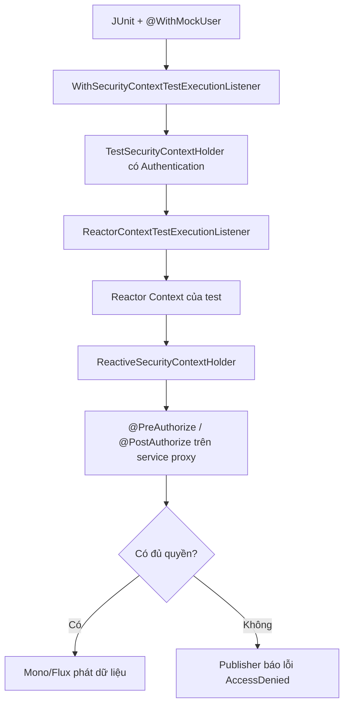
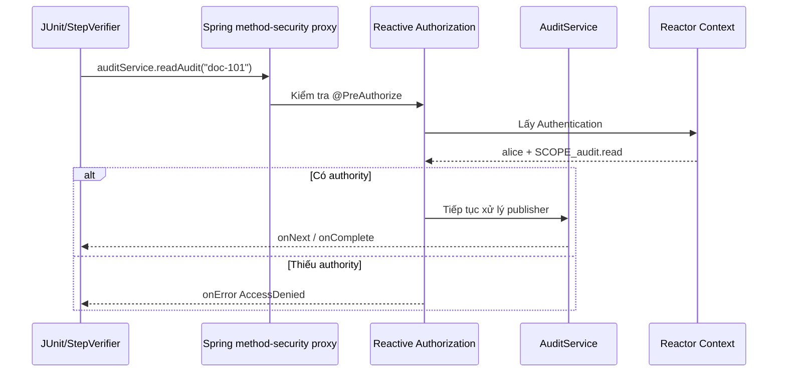

# ReactorContextTestExecutionListener và ngữ cảnh bảo mật cho phương thức

## 1. Bài toán: HTTP đã được xác thực nhưng method test vẫn không thấy người dùng

Một ứng dụng Spring WebFlux có service đọc tài liệu kiểm toán. Phương thức được bảo vệ bằng `@PreAuthorize` và trả về `Mono<String>`. Ở production, request đi qua `SecurityWebFilterChain`, Authentication được đưa vào ngữ cảnh bảo mật của Reactor và service có thể đánh giá quyền truy cập.

Khi chuyển sang **kiểm thử trực tiếp service**, nhiều người viết:

```java
@Test
@WithMockUser(username = "alice", roles = "AUDITOR")
void readAudit() {
    StepVerifier.create(auditService.readSummary())
        .expectNext("audit summary")
        .verifyComplete();
}
```

Nhưng test có thể bị từ chối hoặc không thấy Authentication nếu hạ tầng test **không chuyển security context của annotation sang Reactor Context**. Đây là trách nhiệm của `ReactorContextTestExecutionListener` trong `spring-security-test`. Một `SecurityContext` đặt ở `ThreadLocal` không tự động đồng nghĩa với context mà các operator Reactive có thể đọc.

Bài này thuộc chương **Phương thức Reactive** của module **SPRING_SECURITY_TESTING**: kiểm chứng xác thực, phân quyền và bảo vệ HTTP cho Servlet/Reactive bằng `spring-security-test`, `MockMvc`, `WebTestClient`, `@WithMockUser` và các principal giả lập JWT/OAuth2/OIDC. Phạm vi trực tiếp là **method security của Spring WebFlux/Reactor**, đặc biệt sự phối hợp giữa Spring Test, listener, `@EnableReactiveMethodSecurity` và `StepVerifier`.

Sau bài học, người học có thể:

1. Giải thích sự khác biệt giữa `SecurityContextHolder`, `TestSecurityContextHolder` và `ReactiveSecurityContextHolder`.
2. Mô tả công việc của `WithSecurityContextTestExecutionListener` và `ReactorContextTestExecutionListener` trong một test dùng `@WithMockUser`.
3. Cấu hình `@EnableReactiveMethodSecurity`, Spring TestContext và listener cho test gọi service Reactive trực tiếp.
4. Kiểm tra các trường hợp đủ authority, thiếu authority, anonymous và khác biệt `roles`/`authorities` bằng `StepVerifier`.
5. Cấp Authentication cho một publisher cụ thể bằng `contextWrite(ReactiveSecurityContextHolder.withAuthentication(...))`.
6. Phân biệt lỗi Reactive method security với status 401/403 ở tầng HTTP và nhận diện những test vô tình bỏ qua proxy hoặc context.

## 2. Ba nơi liên quan đến SecurityContext

Không nên coi mọi API chứa cụm từ “SecurityContext” là cùng một kho lưu trữ.

| Thành phần | Ngữ cảnh sử dụng | Ý nghĩa trong bài test |
| --- | --- | --- |
| `SecurityContextHolder` | Chủ yếu truy cập context theo luồng xử lý Servlet/thông thường | Thường dựa vào `ThreadLocal`; không phải nguồn đáng tin cậy xuyên suốt reactive pipeline |
| `TestSecurityContextHolder` | `spring-security-test`, tích hợp với `@WithMockUser`/`@WithSecurityContext` | Giữ Authentication do test fixture tạo để các thành phần test hỗ trợ sử dụng |
| `ReactiveSecurityContextHolder` | Publisher Reactor trên WebFlux | Đọc SecurityContext từ **Reactor Context** của subscription |

Ví dụ Reactive:

```java
Mono<String> name =
    ReactiveSecurityContextHolder.getContext()
        .map(context -> context.getAuthentication().getName());
```

`ReactiveSecurityContextHolder.getContext()` trả `Mono<SecurityContext>`, không trả một `SecurityContext` ngay lập tức. Publisher trên cần được **subscribe** trong ngữ cảnh chứa Authentication. Nếu Reactor Context không có SecurityContext, publisher có thể hoàn thành rỗng; một phương thức có `@PreAuthorize` cũng có thể thất bại vì chưa có xác thực phù hợp.

### 2.1. Vì sao ThreadLocal không đủ cho Reactive?

Reactor có thể thay đổi thread khi gặp `publishOn`, `subscribeOn` hoặc các nguồn async khác. `ThreadLocal` gắn với một thread, còn **Reactor Context** gắn với subscriber và được truyền theo chuỗi operator tương thích.



Sơ đồ thể hiện quan hệ trách nhiệm, không mô tả chính xác từng callback nội bộ ở mọi phiên bản framework. Điều quan trọng: `@WithMockUser` tạo Authentication mẫu, listener thích hợp đưa Authentication vào ngữ cảnh mà security của **publisher Reactive** đọc được.

## 3. ReactorContextTestExecutionListener làm việc gì?

`ReactorContextTestExecutionListener` nằm trong package:

```java
org.springframework.security.test.context.support
    .ReactorContextTestExecutionListener
```

Nó là một Spring `TestExecutionListener`, không phải `WebFilter`, `ReactiveAuthenticationManager` hay bộ phận xác minh JWT. Theo API Spring Security Test, nó thiết lập Reactor Context với Authentication lấy từ `TestSecurityContextHolder` và dọn ngữ cảnh Reactor khi kết thúc test. Listener này dùng phối hợp với `WithSecurityContextTestExecutionListener`.

| Listener | Đầu vào | Đóng góp |
| --- | --- | --- |
| `WithSecurityContextTestExecutionListener` | `@WithMockUser`, `@WithUserDetails` hoặc annotation dùng `@WithSecurityContext` | Tạo và đặt `SecurityContext` dành cho test |
| `ReactorContextTestExecutionListener` | Authentication trong test security context | Chuẩn bị khả năng truy cập Authentication từ publisher Reactive |

Nếu thiếu listener thứ nhất, annotation có thể không tạo Authentication. Nếu thiếu listener Reactor, một test gọi service Reactive trực tiếp có thể không nhìn thấy Authentication trong `ReactiveSecurityContextHolder` dù test thread đang có principal.

**Những việc listener không thực hiện:** gọi login endpoint, kiểm tra mật khẩu, gọi token endpoint OAuth2, xác minh JWT/ID Token, tự tạo `SecurityWebFilterChain` hoặc cấp authority bằng cách đọc database. Mọi quyền của `@WithMockUser` đều là fixture do bài test chỉ định.

### 3.1. Cách khai báo listener tường minh

Trong một Spring TestContext có hỗ trợ `spring-security-test`, hai listener có thể được đăng ký bằng:

```java
import org.springframework.security.test.context.support
    .WithSecurityContextTestExecutionListener;
import org.springframework.security.test.context.support
    .ReactorContextTestExecutionListener;
import org.springframework.test.context.TestExecutionListeners;

@TestExecutionListeners(
    listeners = {
        WithSecurityContextTestExecutionListener.class,
        ReactorContextTestExecutionListener.class
    },
    mergeMode = TestExecutionListeners.MergeMode.MERGE_WITH_DEFAULTS)
class ExampleReactiveMethodTest {
    // Các test sẽ nằm trong Spring TestContext.
}
```

`MERGE_WITH_DEFAULTS` giúp giữ các listener Spring Test thiết yếu khác thay vì thay toàn bộ bộ listener mặc định. Trong những cấu hình đã đăng ký sẵn các listener Spring Security, không cần thêm lại; hãy kiểm tra danh sách listener hiệu lực khi debug.

Spring Security Test còn cung cấp meta-annotation `@SecurityTestExecutionListeners`, kích hoạt các security listeners trong ngữ cảnh dùng cách cấu hình đó. Khi test cần cả ApplicationContext, dependency injection và Spring Boot/Spring Test listener mặc định, dùng cấu hình TestContext tương ứng và tránh vô tình loại các listener khác.

## 4. Dependency tối thiểu cho test method security Reactive

Ví dụ ở bài dùng Spring Security 6.x và Reactor 3.x trên hệ Spring Boot 3.x. Với Gradle:

```groovy
dependencies {
    implementation 'org.springframework.boot:spring-boot-starter-security'
    implementation 'org.springframework.boot:spring-boot-starter-webflux'

    testImplementation 'org.springframework.boot:spring-boot-starter-test'
    testImplementation 'org.springframework.security:spring-security-test'
    testImplementation 'io.projectreactor:reactor-test'
}
```

`reactor-test` cung cấp `StepVerifier`; `spring-security-test` cung cấp `@WithMockUser` và các listener; Spring Test/JUnit tạo ApplicationContext. Tùy Spring Boot 4.x, test starter có thể tách theo module WebFlux, nhưng nguyên tắc dùng `spring-security-test`, `reactor-test` và API bảo mật Reactive vẫn tương ứng. Giữ các phiên bản theo BOM của Spring Boot.

**Không bắt buộc khởi động web server** nếu mục tiêu chỉ là method security trên một service bean. Với test service thuần, cần Spring container tạo proxy và listener gắn context là đủ; MockMvc và WebTestClient sẽ chỉ cần khi chuyển sang kiểm thử HTTP.

## 5. Xây dựng service có @PreAuthorize và dùng ReactiveSecurityContextHolder

Giả sử quyền đọc audit được mô hình bằng authority `SCOPE_audit.read`; quyền xem bảng tổng hợp quản trị bằng role `AUDITOR`. Service:

```java
import org.springframework.security.access.prepost.PreAuthorize;
import org.springframework.security.core.context
    .ReactiveSecurityContextHolder;
import reactor.core.publisher.Mono;

public class AuditService {

    @PreAuthorize("hasAuthority('SCOPE_audit.read')")
    public Mono<String> readAudit(String documentId) {
        return ReactiveSecurityContextHolder.getContext()
            .map(context -> "audit:" + documentId + ":"
                + context.getAuthentication().getName());
    }

    @PreAuthorize("hasRole('AUDITOR')")
    public Mono<String> readSummary() {
        return Mono.just("audit summary");
    }
}
```

Với `hasAuthority("SCOPE_audit.read")`, Spring Security so khớp chính xác chuỗi authority. `hasRole("AUDITOR")` thông thường kiểm tra `ROLE_AUDITOR`. Claim hoặc scope nằm trong token **chưa tự trở thành** GrantedAuthority nếu converter của ứng dụng chưa ánh xạ.

Tạo cấu hình test:

```java
import org.springframework.context.annotation.Bean;
import org.springframework.context.annotation.Configuration;
import org.springframework.security.config.annotation
    .method.configuration.EnableReactiveMethodSecurity;

@Configuration(proxyBeanMethods = false)
@EnableReactiveMethodSecurity
class ReactiveMethodSecurityConfig {

    @Bean
    AuditService auditService() {
        return new AuditService();
    }
}
```

`@EnableReactiveMethodSecurity` kích hoạt phương thức bảo mật Reactive như `@PreAuthorize`, `@PostAuthorize` theo hỗ trợ của phiên bản Spring Security đang dùng. Service cần là bean do Spring quản lý để lời gọi đi qua proxy/AOP interceptor. Nếu trong test tự viết `new AuditService().readAudit(...)`, annotation không được áp dụng, nên một ca thiếu quyền có thể trả dữ liệu thay vì báo lỗi.

**Khác biệt với HTTP:** Ở đây ta gọi method trực tiếp và nhận `Mono`. Kết quả bị từ chối biểu hiện bằng **error signal** của publisher (thường thuộc họ `AccessDeniedException`), chưa phải HTTP 403. Khi request đi qua WebFlux security và exception translation, lỗi có thể được chuyển thành phản hồi HTTP tương ứng.

## 6. Bộ kiểm thử hoàn chỉnh với @WithMockUser và StepVerifier

Các test dưới đây dùng một ApplicationContext nhỏ chứa `ReactiveMethodSecurityConfig`. Chúng không mở HTTP port và không cần user/password thật.

```java
import org.junit.jupiter.api.Test;
import org.springframework.beans.factory.annotation.Autowired;
import org.springframework.security.access.AccessDeniedException;
import org.springframework.security.test.context.support.WithMockUser;
import org.springframework.security.test.context.support.WithAnonymousUser;
import org.springframework.security.test.context.support
    .WithSecurityContextTestExecutionListener;
import org.springframework.security.test.context.support
    .ReactorContextTestExecutionListener;
import org.springframework.test.context.TestExecutionListeners;
import org.springframework.test.context.junit.jupiter.SpringJUnitConfig;
import reactor.test.StepVerifier;

import static org.assertj.core.api.Assertions.assertThat;

@SpringJUnitConfig(classes = ReactiveMethodSecurityConfig.class)
@TestExecutionListeners(
    listeners = {
        WithSecurityContextTestExecutionListener.class,
        ReactorContextTestExecutionListener.class
    },
    mergeMode = TestExecutionListeners.MergeMode.MERGE_WITH_DEFAULTS)
class AuditServiceMethodSecurityTest {

    @Autowired
    AuditService auditService;

    @Test
    @WithMockUser(username = "alice",
                  authorities = "SCOPE_audit.read")
    void matchingAuthorityCanReadAudit() {
        StepVerifier.create(auditService.readAudit("doc-101"))
            .expectNext("audit:doc-101:alice")
            .verifyComplete();
    }

    @Test
    @WithMockUser(username = "bob",
                  authorities = "SCOPE_profile")
    void unrelatedAuthorityCannotReadAudit() {
        StepVerifier.create(auditService.readAudit("doc-101"))
            .expectError(AccessDeniedException.class)
            .verify();
    }

    @Test
    @WithMockUser(username = "carol",
                  roles = "AUDITOR")
    void auditorRoleCanReadSummary() {
        StepVerifier.create(auditService.readSummary())
            .expectNext("audit summary")
            .verifyComplete();
    }

    @Test
    @WithMockUser(username = "dave",
                  authorities = "AUDITOR")
    void rawAuthorityIsNotTheSameAsRole() {
        StepVerifier.create(auditService.readSummary())
            .expectError(AccessDeniedException.class)
            .verify();
    }

    @Test
    @WithAnonymousUser
    void anonymousCannotReadRestrictedSummary() {
        StepVerifier.create(auditService.readSummary())
            .expectError(AccessDeniedException.class)
            .verify();
    }
}
```

Một số cấu hình security có thể phát một loại exception khác thuộc quá trình xử lý thiếu Authentication thay vì `AccessDeniedException` trong ca hoàn toàn anonymous. Nếu ứng dụng cấu hình riêng, hãy assert loại lỗi theo policy và phiên bản thực; các ca **đã xác thực nhưng thiếu authority** ở trên là đối chứng ổn định để kiểm tra authorization.

**Vì sao tạo StepVerifier ở từng test?** Security kiểm tra publisher Reactive tại thời điểm tương ứng trong luồng subscription. `StepVerifier.create(...)` vừa subscribe vừa xác minh dữ liệu hoặc error signal. Một test chỉ tạo `Mono` rồi kết thúc mà không subscribe có thể không thực thi phần logic mong muốn.

### 6.1. Các assertion thực sự kiểm tra điều gì?

| Test | Authentication do listener cung cấp | Bằng chứng |
| --- | --- | --- |
| Alice có `SCOPE_audit.read` | Username Alice, authority chính xác | Method phát `audit:doc-101:alice` |
| Bob chỉ có `SCOPE_profile` | Đã xác thực nhưng thiếu quyền | Publisher phát lỗi truy cập |
| Carol có role AUDITOR | `ROLE_AUDITOR` | `hasRole("AUDITOR")` cho phép |
| Dave có authority AUDITOR | Chỉ `AUDITOR`, thiếu `ROLE_AUDITOR` | `hasRole` từ chối |
| Anonymous | Không có người dùng đã xác thực theo policy | Method bị từ chối |

Bộ test cần cả ca cho phép và ca từ chối. Chỉ test người dùng có quyền có thể không phát hiện việc service bị gọi trực tiếp bỏ qua proxy; ca thiếu quyền sẽ thất bại khi annotation không hoạt động.

## 7. Trình tự listener, annotation và thời điểm tạo Authentication

`@WithMockUser` là annotation mô tả fixture:

```java
@WithMockUser(username = "alice",
              roles = {"USER", "AUDITOR"})
```

Theo mặc định, Spring Security Test thiết lập SecurityContext trước khi thực thi test method, thường tương ứng `TestExecutionListener.beforeTestMethod` (trước callback `@BeforeEach` của JUnit Jupiter). Có thể đổi thời điểm:

```java
import org.springframework.security.test.context.support.TestExecutionEvent;
import org.springframework.security.test.context.support.WithMockUser;

@Test
@WithMockUser(
    username = "alice",
    roles = "AUDITOR",
    setupBefore = TestExecutionEvent.TEST_EXECUTION)
void runsWithSecurityContextSetBeforeTestExecution() {
    // SecurityContext được chuẩn bị sau @BeforeEach,
    // nhưng trước phần thân test theo lựa chọn này.
}
```

Đổi `setupBefore` khi cần một tương tác rất cụ thể với `@BeforeEach` hoặc một extension khác. Nếu setup tạo một `Mono` mà chưa subscribe, phải hiểu thời điểm context được áp dụng khi publisher thực sự chạy. Cách đơn giản nhất là tạo và subscribe publisher **bên trong test method** với `StepVerifier`, như mục 6.

Không nên:

- Lấy `Authentication` từ static field để dùng lại qua nhiều test.
- Chia sẻ một `Mono` đã cache chứa kết quả/exception giữa các test có danh tính khác nhau.
- Dùng `Thread.sleep` để đợi publisher chạy.
- Tự đặt rồi quên dọn `SecurityContextHolder` trong test chạy song song.

Các listener có trách nhiệm chuẩn bị/dọn ngữ cảnh test; test nên cô lập fixture theo method để tránh rò rỉ người dùng giữa các test.

## 8. Kiểm thử Reactor Context mà không cần annotation hoặc listener

`ReactorContextTestExecutionListener` thuận tiện khi viết test Spring Test với `@WithMockUser`. Nhưng đôi khi cần kiểm tra một publisher độc lập với nhiều danh tính khác nhau, hoặc không muốn khởi động ApplicationContext. Lúc đó có thể đưa Authentication vào một subscription tường minh.

```java
import org.junit.jupiter.api.Test;
import org.springframework.security.authentication
    .UsernamePasswordAuthenticationToken;
import org.springframework.security.core.Authentication;
import org.springframework.security.core.authority.AuthorityUtils;
import org.springframework.security.core.context
    .ReactiveSecurityContextHolder;
import reactor.core.publisher.Mono;
import reactor.test.StepVerifier;

class ReactorContextDirectTest {

    @Test
    void explicitAuthenticationIsVisibleToPublisher() {
        Authentication alice =
            new UsernamePasswordAuthenticationToken(
                "alice",
                "unused",
                AuthorityUtils.createAuthorityList("ROLE_AUDITOR"));

        Mono<String> currentName =
            ReactiveSecurityContextHolder.getContext()
                .map(context -> context.getAuthentication().getName())
                .contextWrite(
                    ReactiveSecurityContextHolder
                        .withAuthentication(alice));

        StepVerifier.create(currentName)
            .expectNext("alice")
            .verifyComplete();
    }
}
```

`contextWrite(...)` ở cuối chuỗi đặt context cho các operator upstream của subscription. Kỹ thuật này có thể dùng cả khi test method security bean:

```java
Authentication reader =
    new UsernamePasswordAuthenticationToken(
        "reader", "unused",
        AuthorityUtils.createAuthorityList("SCOPE_audit.read"));

Mono<String> result = auditService.readAudit("doc-202")
    .contextWrite(ReactiveSecurityContextHolder
        .withAuthentication(reader));

StepVerifier.create(result)
    .expectNext("audit:doc-202:reader")
    .verifyComplete();
```

Nếu đang chạy trong Spring test với `@WithMockUser`, phần context tường minh có thể ghi đè hoặc làm thay đổi Authentication mà annotation cung cấp cho subscription đó. **Chọn một nguồn danh tính rõ ràng cho mỗi test** để tránh false positive.

### 8.1. Truyền SecurityContext so với Authentication

API cung cấp hai cách thường gặp:

```java
ReactiveSecurityContextHolder.withAuthentication(authentication);
ReactiveSecurityContextHolder.withSecurityContext(
    Mono.just(securityContext));
```

Cách đầu tiện cho fixture chỉ cần Authentication; cách sau dùng khi test muốn dựng đầy đủ `SecurityContext`. Cả hai tạo một `Context` để dùng với Reactor `contextWrite`. Nếu `authentication` thiếu authorities hoặc `isAuthenticated` không phù hợp, kết quả authorization có thể khác kỳ vọng.

## 9. Vai trò của proxy và subscription trong method security

Đường đi khi gọi service đúng:



Lỗi phổ biến là test gọi thẳng lớp service bằng `new`:

```java
AuditService raw = new AuditService();
Mono<String> result = raw.readSummary();
// @PreAuthorize không được Spring proxy thực thi trên raw instance.
```

Hoặc đặt lời gọi đến phương thức có `@PreAuthorize` **từ một method khác trong cùng instance**:

```java
public Mono<String> internalCall() {
    return readSummary(); // Tự gọi trong cùng bean: có thể bỏ qua proxy.
}
```

Với proxy-based method security, self-invocation thường không đi qua interceptor. Hãy thiết kế boundary method hợp lý, gọi qua Spring bean/proxy và viết ca thiếu quyền để chứng minh bảo vệ thực sự có hiệu lực. Không tự coi annotation là một bảo đảm bảo mật nếu đường gọi bỏ qua hạ tầng AOP.

### 9.1. Đừng block giữa pipeline chỉ để đọc user

Đoạn sau là một anti-pattern:

```java
String user = ReactiveSecurityContextHolder.getContext()
    .map(ctx -> ctx.getAuthentication().getName())
    .block();
```

`block()` tạo subscription đồng bộ và có thể chạy ngoài ngữ cảnh hoặc trên event-loop không cho phép blocking. Khi cần dùng danh tính, hãy tiếp tục xử lý bằng `map`, `flatMap` hoặc truyền thông tin trong reactive pipeline; không dùng `SecurityContextHolder.getContext()` kiểu Servlet làm phương án thay thế mặc định.

## 10. @PostAuthorize và kiểm tra dữ liệu trả về

Ngoài kiểm tra quyền **trước khi** method thực thi, Reactive method security có thể bảo vệ kết quả:

```java
import org.springframework.security.access.prepost.PostAuthorize;
import reactor.core.publisher.Mono;

public class ReportService {

    @PostAuthorize("returnObject.owner == authentication.name")
    public Mono<OwnedReport> findReport() {
        return Mono.just(new OwnedReport("alice", "draft"));
    }
}

class OwnedReport {
    private final String owner;
    private final String body;

    public OwnedReport(String owner, String body) {
        this.owner = owner;
        this.body = body;
    }
    public String getOwner() { return owner; }
    public String getBody() { return body; }
}
```

`@PostAuthorize` kiểm tra giá trị được trả về theo ngữ cảnh phương thức được bảo vệ; ở đây chỉ cho phép caller có tên trùng `owner`. Mẫu cần được đặt trên Spring bean do method-security proxy quản lý. Hai ca:

```java
@Test
@WithMockUser(username = "alice")
void reportOwnerCanRead() {
    StepVerifier.create(reportService.findReport())
        .assertNext(report ->
            assertThat(report.getOwner()).isEqualTo("alice"))
        .verifyComplete();
}

@Test
@WithMockUser(username = "bob")
void anotherUserCannotRead() {
    StepVerifier.create(reportService.findReport())
        .expectError(AccessDeniedException.class)
        .verify();
}
```

Đây là **mẫu mở rộng**: để hai test chạy, thêm `ReportService` thành bean vào cấu hình và inject bean này trong test class; `OwnedReport` là một kiểu dữ liệu mẫu. Cách này thích hợp với `Mono` trả một đối tượng; các quy tắc security áp dụng cho `Flux` hoặc những kiểu publisher khác cần đối chiếu với phiên bản framework và tính chất stream cụ thể.

Điểm cần nhớ: test `@PostAuthorize` phải subscribe để quan sát dữ liệu/lỗi, không chỉ kiểm tra rằng service trả một `Mono` khác `null`.

## 11. Reactor Context qua scheduler và các ranh giới bất đồng bộ

Một lợi thế của Reactor Context là nó được truyền theo subscription khi dùng đúng operator:

```java
Mono<String> currentUser =
    ReactiveSecurityContextHolder.getContext()
        .map(ctx -> ctx.getAuthentication().getName())
        .publishOn(reactor.core.scheduler.Schedulers.parallel());

StepVerifier.create(currentUser.contextWrite(
        ReactiveSecurityContextHolder.withAuthentication(alice)))
    .expectNext("alice")
    .verifyComplete();
```

Ở ví dụ, `alice` là biến `Authentication` được tạo như mục 8. Ngữ cảnh đi qua `publishOn` vì Reactor quản lý subscription context; việc thay thread không nên làm mất danh tính nếu pipeline được xây đúng.

Ngược lại, những thao tác như gọi `subscribe()` độc lập trong phương thức service, tự tạo luồng ngoài Reactor, dùng API callback không truyền context, hoặc lưu publisher có lifecycle khác có thể làm đứt liên hệ ngữ cảnh và khiến lỗi xuất hiện khó dự đoán.

**Cách kiểm thử:** nếu service chuyển scheduler, giữ hai ca giống nhau cho người dùng đủ/thiếu quyền; assert kết quả/lỗi bằng `StepVerifier`. Không dựa vào việc test chạy trên cùng một thread hay sleep để chờ task hoàn tất. Nếu cần tích hợp thư viện async ngoài Reactor, xác định rõ cách truyền Authentication/context qua boundary đó.

## 12. Khi nào phải dùng WebTestClient thay vì chỉ StepVerifier?

`StepVerifier` trên một service bean trả lời câu hỏi: “Với Authentication trong Reactor Context, lời gọi method có được phép không và publisher phát gì?”.

`WebTestClient` trả lời câu hỏi bổ sung: “Với một **HTTP request** đi qua `SecurityWebFilterChain`, client sẽ nhận status/header/body nào?”.

| Cần kiểm tra | Công cụ/thiết lập nên dùng |
| --- | --- |
| `@PreAuthorize` cho phép hoặc từ chối trên service bean | Spring TestContext + listener + `StepVerifier` |
| `@PostAuthorize` trên kết quả Reactive | Service proxy + `StepVerifier` |
| Reactor Context thuần không có Spring container | `contextWrite(withAuthentication(...))` + `StepVerifier` |
| HTTP path matcher, entry point, CSRF, status 401/403 | `WebTestClient` áp dụng `springSecurity()` |
| Đăng nhập Basic/form hoặc xác minh bearer thật | HTTP request phù hợp qua authentication filter/decoder |
| Chữ ký JWT/OIDC, token exchange, UserInfo | Integration test với decoder/IdP hoặc server giả kiểm soát được |

Một test WebFlux có thể tạo client bằng:

```java
WebTestClient client = WebTestClient
    .bindToApplicationContext(applicationContext)
    .apply(SecurityMockServerConfigurers.springSecurity())
    .configureClient()
    .build();
```

Và gửi user giả:

```java
client.mutateWith(SecurityMockServerConfigurers
        .mockUser("alice").authorities(
            new SimpleGrantedAuthority("SCOPE_audit.read")))
    .get().uri("/api/audit/doc-101")
    .exchange()
    .expectStatus().isOk();
```

Đoạn WebTestClient là **mẫu HTTP tích hợp**: để chạy, ứng dụng phải có controller route `/api/audit/{id}`, WebFlux infrastructure, security chain và service bean tương ứng. `mockUser()` đặt Authentication vào request mô phỏng; nó không cần hoặc không chứng minh tên/mật khẩu đã được xác thực qua Identity Provider.

Trong test gọi service trực tiếp, listener phải tạo context; trong test HTTP, Spring Security WebFilters và mock-server configurers mang ngữ cảnh cho request. Hai cách bổ sung cho nhau, không thể thay thế chức năng của nhau trong mọi tình huống.

### 12.1. Vì sao method test không tự trả HTTP 403?

Khi `@PreAuthorize` từ chối trong test trực tiếp, subscriber nhận một error signal. Nó chưa có `ServerWebExchange` hay `ServerAccessDeniedHandler` để chuyển exception thành response.

Ở HTTP test, cùng quyền bị từ chối có thể tạo 403, còn anonymous có thể nhận 401 hoặc chuyển hướng tới trang login tùy `ServerAuthenticationEntryPoint`. Hãy assert HTTP status theo cấu hình, đồng thời dùng method test để cô lập business authorization.

## 13. Người dùng JWT, OAuth2, OIDC và principal tùy biến

`@WithMockUser` tạo một Authentication kiểu username/password giả, với principal mặc định là Spring Security `User`. Đây là lựa chọn phù hợp khi expression chỉ cần username, role hoặc authority.

Khi method thực sự cần:

- `JwtAuthenticationToken`, claim `tenant` hay `scope`;
- `OAuth2AuthenticationToken` hoặc `OAuth2User` có custom attributes;
- `OidcUser` và ID Token/UserInfo;
- principal domain object riêng của dự án;

thì chỉ `@WithMockUser` có thể **không mô phỏng đúng kiểu Authentication**. Với WebTestClient, Spring Security Test có `mockJwt()`, `mockOAuth2Login()` và `mockOidcLogin()`. Với test **service trực tiếp**, có thể cung cấp một Authentication cụ thể qua `contextWrite(withAuthentication(...))` hoặc tạo annotation fixture bằng `@WithSecurityContext`.

Ví dụ method check token authority:

```java
@PreAuthorize("hasAuthority('SCOPE_audit.read')")
public Mono<String> readAudit(String id) { /* ... */ }
```

`@WithMockUser(authorities="SCOPE_audit.read")` đủ để kiểm tra quyết định phân quyền theo authority, nhưng **không kiểm tra bộ chuyển claim `scope` của JWT thành `SCOPE_*`**. Muốn xác minh converter, hãy viết test converter riêng hoặc integration test resource-server sử dụng JWT/decoder theo thiết kế.

Với `@WithUserDetails`, nhớ rằng nó dựa trên cách Spring Security Test tìm `UserDetailsService` theo contract annotation; không mặc định chuyển `ReactiveUserDetailsService` thành service đó. Nếu dự án chỉ có user service Reactive, `@WithMockUser` hoặc custom security context fixture thường đơn giản hơn cho method test.

## 14. Ma trận test nên có cho Reactive method security

| Ca | Fixture | Kết quả cần chứng minh |
| --- | --- | --- |
| Đủ authority | `@WithMockUser(authorities="SCOPE_audit.read")` | `@PreAuthorize` cho phép, dữ liệu và tên user đúng |
| Thiếu authority | User có `SCOPE_profile` | Publisher phát `AccessDeniedException` |
| Role đúng | `roles="AUDITOR"` | `hasRole("AUDITOR")` cho phép |
| Authority cùng chữ nhưng thiếu prefix | `authorities="AUDITOR"` | `hasRole("AUDITOR")` từ chối |
| Anonymous | `@WithAnonymousUser` | Bị từ chối theo policy và exception thực |
| Không có listener Reactive | TestContext không gắn bridge sang Reactor | Phát hiện vấn đề context thay vì kết luận service sai |
| Context tường minh | `contextWrite(withAuthentication(alice))` | Publisher đọc đúng Alice |
| Scheduler switch | `publishOn` hoặc `subscribeOn` | Context đi theo publisher, không phụ thuộc thread |
| `@PostAuthorize` cùng owner | Owner trùng authentication name | Publisher phát dữ liệu |
| `@PostAuthorize` khác owner | Owner khác name | Publisher báo lỗi truy cập |
| Không đi qua proxy | Gọi raw instance | Negative test cho thấy thiếu bảo vệ; sửa setup để dùng bean |
| HTTP đi qua WebTestClient | Mock user đủ/thiếu quyền | 200/403 theo chain và entry point |

Không nhất thiết tạo một test chỉ để cố ý gỡ listener hoặc gọi raw service trong CI. Đó là các **thí nghiệm chẩn đoán** khi học/debug. Bộ test production nên tập trung vào hành vi hợp lệ và các trường hợp bị từ chối, với setup đúng và ổn định.

## 15. Lỗi thường gặp và cách tìm nguyên nhân

**1. Có `@WithMockUser` nhưng `ReactiveSecurityContextHolder.getContext()` rỗng.** Kiểm tra Spring Test extension, `WithSecurityContextTestExecutionListener` và `ReactorContextTestExecutionListener`. Nếu tự cấu hình `@TestExecutionListeners` mà không merge defaults, có thể đã loại listener quan trọng. Dùng setup tường minh hoặc kiểm tra listeners đã được đăng ký.

**2. `@PreAuthorize` không chặn người dùng thiếu quyền.** Có thể thiếu `@EnableReactiveMethodSecurity`, service chưa phải Spring bean, lời gọi bỏ qua proxy hoặc self-invocation. Luôn có một test user thiếu quyền để phát hiện.

**3. Test chỉ tạo `Mono` rồi kết thúc.** Reactive publisher thường là lazy; cần `StepVerifier` hoặc một subscriber thực sự. `assertThat(service.method()).isNotNull()` không kiểm tra quyền.

**4. Dùng `SecurityContextHolder` ThreadLocal trong Reactive code.** Trong một test đơn giản nó có thể chứa user, nhưng sẽ không an toàn khi pipeline đổi thread; dùng `ReactiveSecurityContextHolder` trong flow.

**5. Lấy Authentication quá sớm ở lúc xây publisher.** Tạo publisher trong một lifecycle nhưng subscribe ở lifecycle khác có thể nhận context khác dự kiến. Kiểm tra vị trí subscription và `contextWrite`.

**6. `roles="AUDITOR"` và `authorities="AUDITOR"` bị coi là tương đương.** `roles` thường thêm `ROLE_`, còn `authorities` dùng chuỗi nguyên vẹn. Test cả hai đối chứng.

**7. Mong method test tự có HTTP 401/403.** Không có HTTP exchange thì publisher báo lỗi; status chỉ phát sinh khi gọi qua WebFlux security/exception handling.

**8. Kết luận `@WithMockUser` đã test authentication thật.** Fixture bỏ qua password, token signature, issuer và các bước login. Nếu cần kiểm chứng credential, dùng HTTP integration phù hợp.

**9. Đặt `@WithUserDetails` khi chỉ có `ReactiveUserDetailsService`.** Test fixture cần bean đáp ứng contract của annotation; dùng mock user/custom context nếu không có `UserDetailsService` đồng bộ.

**10. Test bị phụ thuộc thứ tự do context cũ còn sót.** Tránh static cache, tự ghi `SecurityContextHolder` hoặc reuse publisher nóng. Dựa vào lifecycle listener và fixture tách theo test method.

**11. Dùng `block()` trong service Reactive để lấy danh tính.** Có thể gây lỗi trên event-loop hoặc tách subscription; thay bằng operator Reactive và truyền context phù hợp.

**12. Gọi private/final method hoặc tự gọi trong cùng bean.** Proxy/AOP có hạn chế interception. Đặt method bảo vệ ở boundary public phù hợp với cơ chế proxy của ứng dụng và test bằng bean được inject.

## 16. Bài thực hành

### Bài 1 — Tạo context test chuẩn

Tạo `AuditService` có `@PreAuthorize("hasAuthority('SCOPE_audit.read')")`, cấu hình `@EnableReactiveMethodSecurity` và test `@SpringJUnitConfig` với hai listener. Dùng `@WithMockUser`/`StepVerifier` chứng minh Alice đọc được, Bob thiếu authority bị từ chối.

### Bài 2 — Phân biệt role và authority

Tạo method `@PreAuthorize("hasRole('AUDITOR')")`. Viết một test với `roles="AUDITOR"` và một test với `authorities="AUDITOR"`. Giải thích vì sao kết quả khác nhau theo role prefix mặc định.

### Bài 3 — Tự cung cấp Reactor Context

Không dùng `@WithMockUser`, tạo `UsernamePasswordAuthenticationToken` rồi gọi service trong publisher có `contextWrite(ReactiveSecurityContextHolder.withAuthentication(auth))`. Assert dữ liệu chứa tên người dùng đúng.

### Bài 4 — Bảo vệ kết quả Reactive

Tạo service có `@PostAuthorize` kiểm tra người sở hữu dữ liệu. Test một caller có quyền và một caller khác tên; dùng `StepVerifier` để quan sát dữ liệu hoặc error signal.

### Bài 5 — Kiểm tra HTTP với WebTestClient

Tạo một controller gọi `AuditService`, đưa Spring Security WebFilterChain vào application context và dùng `WebTestClient.bindToApplicationContext(...).apply(springSecurity())`. Kiểm tra anonymous bị yêu cầu xác thực, user thiếu quyền bị 403 và user đủ quyền được phép theo policy đã cấu hình.

### Bài 6 — Chẩn đoán lỗi context

Trên một nhánh test tạm, thử gọi raw service thay vì Spring bean, hoặc bỏ `ReactorContextTestExecutionListener` trong một setup chủ đích. So sánh kết quả với bộ test chuẩn, sau đó phục hồi cấu hình; không giữ thí nghiệm thiếu bảo vệ như một test production.

**Tiêu chí hoàn thành:** Người học chỉ ra được nguồn Authentication của publisher Reactive, giải thích vai trò của từng listener, chứng minh `@PreAuthorize`/`@PostAuthorize` hoạt động trên bean thật, và xác minh đầy đủ cả nhánh được phép lẫn bị từ chối bằng `StepVerifier`. Đồng thời phân biệt chính xác error signal trong method test với phản hồi HTTP từ WebTestClient.

## 17. Tài liệu tham khảo

- [Spring Security — Testing Reactive Method Security](https://docs.spring.io/spring-security/reference/reactive/test/method.html): ví dụ chính thức về `@WithMockUser`, `StepVerifier`, ca đủ quyền và bị từ chối.
- [Spring Security — Testing Method Security](https://docs.spring.io/spring-security/reference/servlet/test/method.html): `@WithMockUser`, `WithSecurityContextTestExecutionListener` và lưu ý về `ReactorContextTestExecutionListener`.
- [Spring Security API — ReactorContextTestExecutionListener](https://docs.spring.io/spring-security/reference/api/java/org/springframework/security/test/context/support/ReactorContextTestExecutionListener.html): nhiệm vụ thiết lập/dọn Reactor Context trong Spring Test.
- [Spring Security API — SecurityTestExecutionListeners](https://docs.spring.io/spring-security/reference/api/java/org/springframework/security/test/context/annotation/SecurityTestExecutionListeners.html): meta-annotation đăng ký hai security listeners.
- [Spring Security — Reactive Method Security](https://docs.spring.io/spring-security/reference/reactive/authorization/method.html): `@EnableReactiveMethodSecurity`, `@PreAuthorize`, `@PostAuthorize` và Reactive authorization.
- [Spring Security — Reactive Security Context](https://docs.spring.io/spring-security/reference/reactive/integrations/concurrency.html): lưu truyền Authentication trong Reactive pipeline.
- [Spring Security — Testing WebFlux Security](https://docs.spring.io/spring-security/reference/reactive/test/web/setup.html): `WebTestClient` và `springSecurity()`.
- [Project Reactor — Context](https://projectreactor.io/docs/core/release/reference/advancedFeatures/context.html): subscription context và `contextWrite`.
- [Project Reactor — Testing](https://projectreactor.io/docs/core/release/reference/testing.html): dùng `StepVerifier` để kiểm tra publisher.
