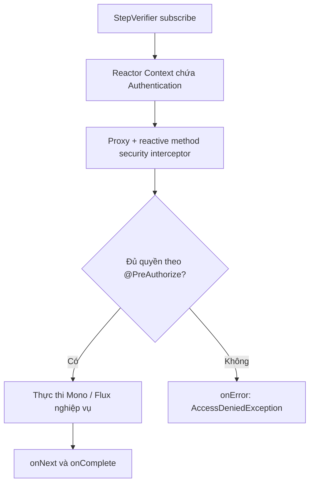

# `StepVerifier` cho kết quả được phép và lỗi từ chối trong phương thức Reactive

Trong chương **Phương thức Reactive** của module **SPRING_SECURITY_TESTING**, người học cần chứng minh một phương thức trả về `Mono` hoặc `Flux` thực sự tuân thủ chính sách Spring Security: principal **đủ quyền** nhận được dữ liệu hợp lệ; principal **thiếu quyền** gặp lỗi truy cập bị từ chối; và mã nghiệp vụ được bảo vệ không tạo tác dụng phụ khi lời gọi chưa được cấp phép. Công cụ phù hợp ở tầng publisher là **`StepVerifier`** của `reactor-test`.

Module **SPRING_SECURITY_TESTING** kiểm chứng xác thực, phân quyền và bảo vệ HTTP trên cả Servlet với `MockMvc` và Reactive với `WebTestClient`, sử dụng `spring-security-test`, `@WithMockUser`, `SecurityContext` và các danh tính JWT/OAuth2/OIDC giả lập. Riêng bài này tập trung vào **method security của WebFlux/Reactor**: `@EnableReactiveMethodSecurity`, `@PreAuthorize`, `ReactiveSecurityContextHolder` và cách khẳng định tín hiệu `onNext`, `onComplete`, `onError` từ `Mono`/`Flux`. Phần cuối kết nối kết quả ở tầng method với HTTP 401/403/200 mà `WebTestClient` quan sát được.

## 1. `StepVerifier` chứng minh điều gì?

Trong Reactor, `Mono<T>` biểu diễn một publisher phát tối đa một giá trị rồi kết thúc, còn `Flux<T>` có thể phát nhiều giá trị. Phương thức trả về publisher thường **chưa thực thi đầy đủ** cho đến khi có subscriber. Vì vậy, chỉ gọi phương thức hoặc chỉ kiểm tra đối tượng trả về không đủ để xác minh bảo mật:

```java
Mono<String> publisher = reportService.readReport("r-101");

// Dòng trên chỉ tạo hoặc lấy publisher.
// Nếu không subscribe, chưa có bằng chứng về kết quả hay lỗi của pipeline.
```

`StepVerifier` chủ động subscribe, kiểm tra từng tín hiệu và xác nhận publisher kết thúc đúng kỳ vọng:

| Mục tiêu | Assertion của `StepVerifier` | Ý nghĩa |
| --- | --- | --- |
| Trả đúng một dữ liệu được phép | `.expectNext("report:r-101").verifyComplete()` | Nhận đúng dữ liệu, sau đó có `onComplete` |
| Trả tập dữ liệu có thứ tự | `.expectNext("a", "b").verifyComplete()` | `Flux` phát đúng hai phần tử rồi hoàn tất |
| Bị từ chối bởi method security | `.expectError(AccessDeniedException.class).verify()` | Publisher kết thúc với lỗi quyền truy cập |
| Cần kiểm tra chi tiết exception | `.expectErrorSatisfies(error -> ...).verify()` | Kiểm tra loại lỗi, thông tin bổ sung hoặc nguyên nhân |
| Không phát dữ liệu trước khi bị từ chối | `.expectErrorMatches(predicate).verify()` | Lỗi xuất hiện trước khi có `onNext` ngoài mong đợi |

Một ca `verifyComplete()` đơn thuần cho phép publisher trống kết thúc thành công. Khi nghiệp vụ **phải trả dữ liệu**, nên dùng `expectNext(...)` hoặc `assertNext(...)` trước `verifyComplete()` để tránh test xanh khi service vô tình trả `Mono.empty()`.

### Spring Security đưa kết quả từ chối vào publisher như thế nào?

Với reactive method security, Spring AOP áp dụng một interceptor quanh method có `@PreAuthorize` hoặc annotation bảo mật tương ứng. Interceptor lấy `Authentication` từ reactive security context, quyết định có cho thực thi method hay không, rồi trả kết quả dưới dạng publisher. Khi bị từ chối, subscriber nhận tín hiệu lỗi, thường là `AccessDeniedException` hoặc một subtype của nó đối với principal đã xác thực nhưng thiếu quyền. Không nên kiểm tra một exception đồng bộ khi **chưa subscribe** rồi kết luận method security đã chạy.



**Phân biệt tầng kiểm thử:** `StepVerifier` trực tiếp trên service kiểm tra **publisher và method security**, chưa tạo HTTP response. `AccessDeniedException` trong service **không phải mã HTTP 403**; mã 403 chỉ xuất hiện khi gọi qua WebFlux security/filter và exception handling của ứng dụng. Ngược lại, request HTTP không xác thực thường được entry point chuyển thành 401 (với HTTP Basic/Bearer) hoặc redirect theo cơ chế login đang bật.

## 2. Cấu hình method security cho một service Reactive

Ví dụ sử dụng Spring Security 6, Spring Boot 3, Java 17+ và Project Reactor. Cấu hình method security riêng cho các bean reactive:

```java
@Configuration(proxyBeanMethods = false)
@EnableReactiveMethodSecurity
class ReactiveMethodSecurityConfig {
}
```

`@EnableReactiveMethodSecurity` là chìa khóa để kích hoạt interceptor cho `@PreAuthorize`. Bài test cũng cần đăng ký **service dưới dạng Spring bean**, để lời gọi đi qua proxy. Đoạn sau minh họa một service có hai quyền khác nhau:

```java
@Service
class ReportService {

    private final AtomicInteger executed = new AtomicInteger();

    @PreAuthorize("hasAuthority('SCOPE_reports.read')")
    public Mono<String> readReport(String reportId) {
        return Mono.defer(() -> {
            executed.incrementAndGet();
            return Mono.just("report:" + reportId);
        });
    }

    @PreAuthorize("hasRole('AUDITOR')")
    public Flux<String> auditEvents() {
        return Flux.just("audit-open", "audit-close");
    }

    public int executionCount() {
        return executed.get();
    }
}
```

`hasAuthority('SCOPE_reports.read')` yêu cầu một authority **chính xác** tên `SCOPE_reports.read`. `hasRole('AUDITOR')` mặc định yêu cầu authority `ROLE_AUDITOR`. Đừng nhầm `roles("AUDITOR")` với một authority mang tên `AUDITOR` không có prefix.

`Mono.defer(...)` trong `readReport` làm thao tác nghiệp vụ (ở đây là tăng bộ đếm và phát dữ liệu) diễn ra khi subscribe. Bộ đếm chỉ là **fixture quan sát trong test**, giúp chứng minh lời gọi bị từ chối không chạy phần xử lý tạo tác dụng phụ. Trong ứng dụng thực, tác dụng phụ có thể là ghi database, gọi API, phát event hoặc thay đổi trạng thái.

Lời gọi service phải đi qua **Spring proxy**. Tạo trực tiếp `new ReportService()` sẽ không áp dụng `@PreAuthorize`; gọi một phương thức có bảo mật từ một phương thức khác **trong cùng đối tượng** có thể bị lỗi *self-invocation*, do lời gọi không đi qua proxy. Vì thế, khi kiểm chứng interceptor thật, lấy bean từ Spring context và tránh kiểm thử chỉ trên object do test tự tạo.

## 3. Dựng `Authentication` giả để đưa vào Reactor Context

Với một bài unit/integration test ở tầng service, cách xác định rõ danh tính cho từng subscription là tạo `Authentication` giả rồi đưa vào `ReactiveSecurityContextHolder`:

```java
private Authentication userWithAuthorities(
        String username, String... authorityNames) {
    List<GrantedAuthority> authorities = Arrays.stream(authorityNames)
        .map(SimpleGrantedAuthority::new)
        .map(authority -> (GrantedAuthority) authority)
        .toList();

    return new UsernamePasswordAuthenticationToken(
        username, "fixture-credentials", authorities);
}

private <T> Mono<T> runAs(Mono<T> publisher, Authentication user) {
    return publisher.contextWrite(
        ReactiveSecurityContextHolder.withAuthentication(user));
}

private <T> Flux<T> runAs(Flux<T> publisher, Authentication user) {
    return publisher.contextWrite(
        ReactiveSecurityContextHolder.withAuthentication(user));
}
```

`UsernamePasswordAuthenticationToken` constructor có tham số authorities tạo một đối tượng authentication đã xác thực trong bộ test. Đây chỉ là fixture nội bộ, **không chứng minh username/password thực sự được kiểm tra**. `ReactiveSecurityContextHolder.withAuthentication(...)` tạo Reactor `Context` chứa security context tương ứng. Khi subscriber chạy, method security sẽ đọc danh tính đó để áp dụng rule.

Các import chính gồm `org.springframework.security.core.Authentication`, `GrantedAuthority`, `SimpleGrantedAuthority`, `UsernamePasswordAuthenticationToken`, `org.springframework.security.core.context.ReactiveSecurityContextHolder`, `reactor.core.publisher.Mono`, `Flux` và `java.util.Arrays`, `List`.

Không lấy `SecurityContextHolder.getContext()` ở thread JUnit rồi mặc định nó đi theo luồng Reactor. **Reactive security context dựa vào Reactor Context**, không phụ thuộc riêng một `ThreadLocal` trên thread tạo publisher. Đưa context vào đúng publisher trước khi `StepVerifier` subscribe giúp test ổn định, không cần user/session/tokens của môi trường triển khai.

## 4. Test `Mono` được phép: đúng dữ liệu và hoàn thành

Lớp test cần nạp cấu hình method security cùng service như Spring beans:

```java
@SpringJUnitConfig(classes = {
    ReactiveMethodSecurityConfig.class,
    ReportService.class
})
class ReportServiceSecurityTest {

    @Autowired
    ReportService reportService;

    @Test
    void readerWithScopeCanReadReport() {
        Authentication reader = new UsernamePasswordAuthenticationToken(
            "fixture-reader", "N/A",
            List.of(new SimpleGrantedAuthority("SCOPE_reports.read")));

        Mono<String> result = reportService.readReport("r-101")
            .contextWrite(ReactiveSecurityContextHolder.withAuthentication(reader));

        StepVerifier.create(result)
            .expectNext("report:r-101")
            .verifyComplete();
    }
}
```

`@SpringJUnitConfig` lấy từ Spring Test; `StepVerifier` lấy từ `reactor.test.StepVerifier`, và JUnit 5 dùng `@Test`. Ví dụ sử dụng đúng cấu hình `@EnableReactiveMethodSecurity`, service bean có method `@PreAuthorize`, principal có authority phù hợp. Không dùng `@WebFluxTest` hoặc chạy HTTP server cho bài test này vì mục tiêu là **tầng method**.

Một ca được phép tốt nên kiểm tra cả giá trị và tín hiệu hoàn tất: nếu service phát dữ liệu khác, rỗng, ném lỗi hoặc không kết thúc, test phải thất bại. Đừng chỉ dùng `expectNextCount(1)` khi cần chứng minh giá trị dữ liệu cụ thể, đặc biệt với thông tin bảo mật phụ thuộc subject/tenant.

## 5. Test `Mono` bị từ chối: thiếu authority và không thực thi nghiệp vụ

Với cùng service, đổi duy nhất authorities của người dùng. Principal vẫn được đánh dấu đã xác thực nhưng không có `SCOPE_reports.read`:

```java
@Test
void authenticatedUserWithoutScopeIsDenied() {
    Authentication reader = new UsernamePasswordAuthenticationToken(
        "fixture-reader", "N/A",
        List.of(new SimpleGrantedAuthority("SCOPE_profile.read")));

    int before = reportService.executionCount();

    Mono<String> result = reportService.readReport("r-101")
        .contextWrite(ReactiveSecurityContextHolder.withAuthentication(reader));

    StepVerifier.create(result)
        .expectError(AccessDeniedException.class)
        .verify();

    assertEquals(before, reportService.executionCount());
}
```

`AccessDeniedException` là `org.springframework.security.access.AccessDeniedException`. Trong các phiên bản Spring Security mới, ngoại lệ cụ thể có thể là một subtype như `AuthorizationDeniedException`; phép `expectError(AccessDeniedException.class)` nhằm kiểm tra cùng nhóm lỗi truy cập. Việc xác minh bộ đếm không tăng chứng minh phần `Mono.defer` tạo tác dụng phụ **không được subscribe** sau khi bị chặn bởi chính sách method security.

Nếu muốn kiểm tra chi tiết mà vẫn chấp nhận các subtype hợp lệ, có thể viết:

```java
StepVerifier.create(result)
    .expectErrorSatisfies(error -> {
        assertInstanceOf(AccessDeniedException.class, error);
        assertNotNull(error.getMessage());
    })
    .verify();
```

Đừng khẳng định toàn bộ message của exception là một chuỗi cố định trừ khi ứng dụng tự định nghĩa hợp đồng đó; thông điệp lỗi có thể thay đổi theo Spring Security và locale. Quan trọng hơn là **không có `onNext` nào trước tín hiệu từ chối** và tác dụng phụ không diễn ra.

### Trường hợp không có authentication

Với publisher không được cấp reactive security context, method security phải từ chối khi rule yêu cầu quyền. Tuy nhiên, **loại exception cụ thể** ở tầng service có thể khác với trường hợp principal đã xác thực nhưng thiếu quyền, chẳng hạn `AuthenticationCredentialsNotFoundException` hoặc lỗi access denial tùy phiên bản/cấu hình. Nên kiểm tra theo contract của môi trường test:

```java
@Test
void noAuthenticationCannotReadReport() {
    StepVerifier.create(reportService.readReport("r-101"))
        .expectErrorSatisfies(error -> {
            assertTrue(
                error instanceof AuthenticationException
                    || error instanceof AccessDeniedException);
        })
        .verify();
}
```

`AuthenticationException` là `org.springframework.security.core.AuthenticationException`. Đoạn này chỉ xác minh không có context thì method bị từ chối; không khẳng định mã HTTP. Khi cần xác nhận chính xác 401 cho request anonymous, viết test **WebTestClient qua WebFilter chain** ở mục 9.

## 6. Test `Flux`: nhiều phần tử khi được phép, lỗi khi bị từ chối

Security interceptor cũng áp dụng cho phương thức trả về `Flux`. Với `auditEvents()` yêu cầu `ROLE_AUDITOR`:

```java
@Test
void auditorReceivesAllEventsInOrder() {
    Authentication auditor = new UsernamePasswordAuthenticationToken(
        "fixture-auditor", "N/A",
        List.of(new SimpleGrantedAuthority("ROLE_AUDITOR")));

    Flux<String> result = reportService.auditEvents()
        .contextWrite(ReactiveSecurityContextHolder.withAuthentication(auditor));

    StepVerifier.create(result)
        .expectNext("audit-open", "audit-close")
        .verifyComplete();
}

@Test
void nonAuditorCannotSubscribeToAuditEvents() {
    Authentication user = new UsernamePasswordAuthenticationToken(
        "fixture-user", "N/A",
        List.of(new SimpleGrantedAuthority("ROLE_USER")));

    Flux<String> result = reportService.auditEvents()
        .contextWrite(ReactiveSecurityContextHolder.withAuthentication(user));

    StepVerifier.create(result)
        .expectError(AccessDeniedException.class)
        .verify();
}
```

Ở ca bị từ chối, `expectError(...)` ngay sau subscribe có ý nghĩa: nếu một phần tử được phát trước rồi mới báo lỗi thì StepVerifier sẽ thất bại. Điều này phù hợp với `@PreAuthorize` bảo vệ **toàn bộ lời gọi** trước khi bắt đầu phát stream. Nếu ứng dụng cần phân quyền **theo từng phần tử** trong một stream, phải có thiết kế và test riêng cho chính sách đó; `@PreAuthorize` ở đầu phương thức không tự bảo đảm mọi phần tử của `Flux` đều thuộc tenant được phép.

Nếu dùng `.expectNextCount(2)`, test chỉ kiểm tra số lượng, không kiểm tra giá trị hoặc thứ tự. Với dữ liệu nhạy cảm, hãy dùng `assertNext(...)` để kiểm tra danh tính/tenant và nội dung từng phần tử.

## 7. Đặt Reactor Context tại nơi `StepVerifier` thực sự subscribe

`StepVerifier.create(publisher)` subscribe khi gọi `verify()` hoặc `verifyComplete()`. Một số lỗi thường gặp xuất phát từ việc gắn security context vào publisher **không phải publisher đang được kiểm tra**.

**Đúng:**

```java
Mono<String> secured = reportService.readReport("r-101")
    .contextWrite(ReactiveSecurityContextHolder.withAuthentication(reader));

StepVerifier.create(secured)
    .expectNext("report:r-101")
    .verifyComplete();
```

**Sai:**

```java
Mono<String> result = reportService.readReport("r-101");

result.contextWrite(
    ReactiveSecurityContextHolder.withAuthentication(reader));

// contextWrite trả về một publisher MỚI; 'result' vẫn là bản cũ.
StepVerifier.create(result)
    .expectNext("report:r-101")
    .verifyComplete();
```

Các toán tử Reactor thường bất biến: `.contextWrite(...)` **không thay đổi tại chỗ** publisher ban đầu. Phải giữ lại publisher mới hoặc chain trực tiếp khi đưa vào `StepVerifier`.

Một sai lầm khác là gọi `reportService.readReport(...).block()` trước test rồi mới khẳng định một giá trị Java thông thường. `.block()` cũng kích hoạt subscription, nhưng nó che mất quá trình kiểm tra signal và dễ làm người học bỏ qua lỗi ngữ cảnh, timeout hoặc stream. Với bài kiểm thử reactive method security, nên dùng `StepVerifier` để giữ đúng mô hình bất đồng bộ.

### `@WithMockUser` có dùng được không?

`spring-security-test` hỗ trợ `@WithMockUser` cùng Spring Test Execution Listeners để đặt danh tính test; khi cấu hình **Reactor context test listener** phù hợp, một số bài test reactive có thể dùng annotation thay cho `.contextWrite(...)`:

```java
@Test
@WithMockUser(username = "fixture-reader", authorities = "SCOPE_reports.read")
void annotatedReaderCanReadReport() {
    StepVerifier.create(reportService.readReport("r-101"))
        .expectNext("report:r-101")
        .verifyComplete();
}
```

Ví dụ annotation phụ thuộc cấu hình Spring Test và `ReactorContextTestExecutionListener` được đăng ký trong test context; không áp dụng chung cho mọi test Reactor được tạo bằng JUnit thuần. Nếu test annotation thất bại vì không có authentication, kiểm tra test listener thay vì tắt method security. Dùng `.contextWrite(withAuthentication(...))` trực tiếp thường rõ ràng nhất khi cần **nhiều danh tính trong cùng một lớp test** hoặc muốn tránh phụ thuộc context setup bên ngoài.

## 8. Kiểm tra `@PreAuthorize` với principal JWT/OAuth2/OIDC giả

Giá trị của method security thường nằm ở các **authorities** và các thuộc tính `Authentication` mà biểu thức SpEL dùng. Với bài test service đơn giản kiểm tra `hasAuthority('SCOPE_reports.read')`, `UsernamePasswordAuthenticationToken` giả là đủ. Nhưng nếu chính biểu thức hoặc service cần kiểu principal đặc thù, cần dùng đúng fixture:

| Mã ứng dụng cần | Fixture hợp lý | Không đủ để chứng minh |
| --- | --- | --- |
| Role/authority thông thường | `@WithMockUser` hoặc `UsernamePasswordAuthenticationToken` với authorities | Xác thực password thật |
| Principal chứa JWT claims | `JwtAuthenticationToken` từ JWT fixture, hoặc WebTestClient `mockJwt()` | Chữ ký JWT, issuer/audience và thời hạn qua decoder |
| `OAuth2AuthenticatedPrincipal` từ opaque bearer token | `BearerTokenAuthentication`/principal test hoặc `mockOpaqueToken()` trên WebTestClient | HTTP introspection thật |
| Principal OAuth2 Login | `OAuth2AuthenticationToken` chứa `OAuth2User` | Authorization Code flow |
| `OidcUser`/ID token/UserInfo | Principal `DefaultOidcUser` fixture hoặc `mockOidcLogin()` | Nonce, chữ ký và quá trình xác minh ID token |

Ví dụ một rule `@PreAuthorize("authentication.name == #owner")` yêu cầu kiểm tra **danh tính người gọi**. Nếu nghiệp vụ dùng `tenant_id` hoặc `sub` từ JWT/OIDC, hãy đặt đúng claim và assert các ca khác tenant bị từ chối. Không nên chỉ đặt authority hợp lệ rồi cho rằng đã kiểm tra điều kiện tenant.

Với **service thuần dùng StepVerifier**, có thể tạo `Authentication` phù hợp và gắn bằng `ReactiveSecurityContextHolder.withAuthentication(...)`. Còn các tiện ích `mockJwt()`, `mockOpaqueToken()`, `mockOAuth2Login()` và `mockOidcLogin()` thường được sử dụng trên **WebTestClient** để mô phỏng người dùng ở tầng HTTP. Mỗi helper có ranh giới riêng; không dùng `mockJwt()` để kết luận decoder chấp nhận chữ ký của token thật.

## 9. Từ exception của `StepVerifier` đến HTTP 401/403/200

Một service phát `AccessDeniedException` chỉ cho biết chính sách method security từ chối subscription. Khi gọi service qua HTTP, WebFlux security filter và exception handling sẽ chuyển kết quả này thành HTTP response theo cấu hình ứng dụng.

Ví dụ bổ sung `SecurityWebFilterChain` dùng HTTP Basic để có expectation rõ ràng cho anonymous:

```java
@Configuration
@EnableWebFluxSecurity
@EnableReactiveMethodSecurity
class ApiSecurityConfig {

    @Bean
    SecurityWebFilterChain httpSecurity(ServerHttpSecurity http) {
        return http
            .authorizeExchange(exchange -> exchange
                .pathMatchers("/api/reports/**").authenticated()
                .anyExchange().permitAll())
            .httpBasic(Customizer.withDefaults())
            .build();
    }
}

@RestController
class ReportController {

    private final ReportService reports;

    ReportController(ReportService reports) {
        this.reports = reports;
    }

    @GetMapping("/api/reports/{id}")
    Mono<String> find(@PathVariable String id) {
        return reports.readReport(id);
    }
}
```

Khi dùng `WebTestClient` bind vào application context có security chain và `.apply(springSecurity())`, các kịch bản là:

```java
// Không có Authentication: filter chain HTTP Basic trả 401.
client.get().uri("/api/reports/r-101")
    .exchange()
    .expectStatus().isUnauthorized();

// Có Authentication nhưng thiếu authority: @PreAuthorize từ chối -> 403.
client.mutateWith(mockUser("fixture-user").roles("USER"))
    .get().uri("/api/reports/r-101")
    .exchange()
    .expectStatus().isForbidden();

// Có đúng authority: @PreAuthorize cho phép -> 200.
client.mutateWith(mockUser("fixture-reader")
        .authorities(new SimpleGrantedAuthority("SCOPE_reports.read")))
    .get().uri("/api/reports/r-101")
    .exchange()
    .expectStatus().isOk()
    .expectBody(String.class).isEqualTo("report:r-101");
```

Ví dụ giả định test đã nạp controller, `ReportService`, security configuration, `WebTestClient` có tích hợp Spring Security Test và các import `SecurityMockServerConfigurers.mockUser`. Nếu ứng dụng sử dụng form login, OAuth2 Login hoặc custom exception handler, anonymous có thể được redirect hoặc trả mã khác theo contract; **không mặc định 401 cho mọi ứng dụng**.

Test ở tầng method và test qua HTTP bổ sung lẫn nhau:

| `StepVerifier` trên service | `WebTestClient` qua WebFilter | Kết luận |
| --- | --- | --- |
| `onNext` đúng + `onComplete` | 200 và body đúng | Method được cho phép; HTTP endpoint chuyển kết quả thành công |
| `onError(AccessDeniedException)` | 403 với người dùng thiếu quyền | Method security từ chối; filter/handler áp dụng luật HTTP tương ứng |
| Exception khi không có Authentication | 401 khi HTTP Basic/Bearer yêu cầu đăng nhập | Cần xác thực trước khi gọi method được bảo vệ |
| Publisher bị từ chối, bộ đếm side effect không tăng | Controller/service không thực thi nghiệp vụ nhạy cảm | Yêu cầu bảo vệ trước side effect được thỏa mãn |

Không tạo một publisher bằng `StepVerifier` rồi khẳng định “HTTP 403” mà không gửi HTTP request. Và không chỉ assert 200 với user có quyền: nếu security WebFilter bị bỏ qua, controller có thể trả 200 khiến test xanh giả. Nên có cả ca thiếu quyền và anonymous.

## 10. Các sai lầm thường gặp khi kiểm thử reactive method security

| Triệu chứng | Nguyên nhân thường gặp | Cách sửa/kiểm chứng |
| --- | --- | --- |
| Test luôn cho phép dù có `@PreAuthorize` | Lấy `new Service()` hoặc self-invocation, không chạy qua Spring AOP proxy | Lấy bean từ Spring Test context; gọi method public qua proxy |
| Test luôn báo không có authentication | `SecurityContextHolder` trên thread nhưng thiếu Reactor context | Dùng `.contextWrite(ReactiveSecurityContextHolder.withAuthentication(auth))` hoặc cấu hình test listener |
| Đã gọi `contextWrite` mà vẫn thiếu quyền | Bỏ qua publisher mới do `contextWrite` trả về | Gán lại publisher hoặc chain trực tiếp trước StepVerifier |
| Test xanh khi service trả trống | Chỉ dùng `.verifyComplete()` | Thêm `.expectNext(...)` hoặc `.assertNext(...)` |
| Exception sai với expectation 401/403 | Đang test service, chưa có HTTP exchange | Assert lỗi reactive ở StepVerifier; status HTTP ở WebTestClient |
| User có `ROLE_USER` vẫn vào method cần `SCOPE_reports.read` | Method security chưa bật hoặc test không gọi proxy | Nạp `@EnableReactiveMethodSecurity`, kiểm tra rule và negative test |
| Test bị treo vì publisher không kết thúc | Publisher vô hạn hoặc lệnh chờ không giới hạn | Đặt kỳ vọng `thenCancel()` cho stream vô hạn, dùng timeout verify phù hợp |
| Dữ liệu tenant khác vẫn được phát | `@PreAuthorize` chỉ kiểm tra role/scope, chưa có rule tenant | Bổ sung policy tenant và test dữ liệu/principal thuộc tenant khác |
| Lỗi bị `onErrorResume` chuyển thành dữ liệu thành công | Pipeline nuốt `AccessDeniedException` | Không chuyển lỗi phân quyền thành giá trị cho phép; phân loại lỗi chính xác |
| Test HTTP 200 nhưng filter bảo mật không chạy | WebTestClient bind controller trực tiếp | Bind application context/server có SecurityWebFilterChain, kiểm tra 401/403 |

### Thứ tự subscribe, lỗi và tác dụng phụ

Đối với method trả `Mono`/`Flux`, một phần xử lý có thể chạy **eager** trước khi publisher được subscribe nếu tác giả method gọi API có side effect ngay lúc xây publisher. Dù interceptor chặn request, test vẫn cần xác minh **không có side effect trái phép**. Đối với I/O phản ứng, ưu tiên trì hoãn bằng `Mono.defer`, `Mono.fromCallable` (với scheduler phù hợp nếu tác vụ blocking), hoặc API reactive chỉ thực hiện I/O khi subscribe. Không dùng `Thread.sleep()` hay `block()` trong method reactive để chờ một kết quả bảo mật.

Nếu service trả về `Flux` vô hạn, `StepVerifier` không thể `verifyComplete()`; thay bằng `.expectNext(...).thenCancel().verify()` với giới hạn thời gian thích hợp. Điều này chỉ kiểm tra những phần tử đã quan sát được, không chứng minh các phần tử tương lai đều tuân thủ tenant policy.

## 11. Bài thực hành: kiểm chứng kết quả được phép và bị từ chối

Tạo hai phương thức được quản lý bởi Spring:

```java
@PreAuthorize("hasAuthority('SCOPE_documents.read')")
public Mono<String> readDocument(String documentId) {
    return Mono.just("document:" + documentId);
}

@PreAuthorize("hasRole('AUDITOR')")
public Flux<String> events() {
    return Flux.just("created", "approved");
}
```

Sau đó viết bộ test với `@EnableReactiveMethodSecurity`, lấy service bean từ Spring và dùng `StepVerifier` theo các bước:

1. **Được phép:** gắn authentication có `SCOPE_documents.read`, kiểm tra `readDocument("d-1")` phát đúng `document:d-1` rồi `onComplete`.
2. **Thiếu scope:** gắn authentication chỉ có `SCOPE_profile.read`, kiểm tra `onError(AccessDeniedException)` và không có dữ liệu tài liệu được phát.
3. **Không đăng nhập:** bỏ authentication khỏi Reactor context, kiểm tra publisher bị từ chối; giải thích vì sao chưa thể từ kết quả này suy ra mã HTTP 401.
4. **Flux có quyền:** gắn `ROLE_AUDITOR`, kiểm tra hai sự kiện `created`, `approved` theo đúng thứ tự và hoàn tất.
5. **Flux không có quyền:** gắn `ROLE_USER`, kiểm tra stream lỗi trước khi phát bất kỳ phần tử nào.
6. **Chống side effect:** tạo bộ đếm hoặc spy I/O ở lớp nghiệp vụ, kiểm tra ca bị từ chối không thực thi phần bảo vệ; sửa fixture nếu phát hiện code chạy eager.
7. **Kiểm chứng HTTP:** dùng `WebTestClient` vào controller gọi service trên ứng dụng WebFlux có security filter thật; kiểm tra anonymous 401 (nếu dùng Basic/Bearer), user thiếu quyền 403, user đủ quyền 200.
8. **Kiểm tra kiểu principal:** nếu method phụ thuộc JWT/OIDC/opaque attributes, thay fixture username thông thường bằng principal phù hợp và có ca sai hoặc thiếu claim; bảo đảm test không cấp quyền chỉ nhờ một attribute được đặt tùy ý.

### Tiêu chí hoàn thành

| Tiêu chí | Bằng chứng |
| --- | --- |
| Method security thực sự bật | Service bean có proxy, test thiếu scope sinh lỗi truy cập |
| Security context đúng mô hình Reactor | Authentication trong `contextWrite` được interceptor nhìn thấy khi subscribe |
| Happy path có kiểm chứng dữ liệu | `StepVerifier` thấy đúng `onNext` và `onComplete` |
| Từ chối không lộ dữ liệu | Publisher lỗi trước `onNext`, không có side effect trái phép |
| Phân biệt tầng method và HTTP | Lỗi service được assert với StepVerifier; HTTP status được assert bằng WebTestClient |
| Test tái lập và độc lập | Dùng principal, authority và token fixture; không cần credential/IdP của môi trường triển khai |

## Ghi nhớ

**`StepVerifier` kiểm chứng tín hiệu của publisher chứ không tự kích hoạt Spring Security.** Để kiểm tra reactive method security, cần `@EnableReactiveMethodSecurity`, **service bean được gọi qua proxy**, và `Authentication` có mặt trong **Reactor Context** khi subscribe. Với principal đủ quyền, kiểm tra dữ liệu chính xác và `onComplete`; với principal thiếu quyền, kiểm tra `onError(AccessDeniedException)` và xác nhận mã nghiệp vụ bảo vệ không tạo side effect. Cuối cùng, dùng `WebTestClient` với security WebFilter thật để xác minh kết quả HTTP 401/403/200. Đây là cách xây bộ kiểm thử `SPRING_SECURITY_TESTING` có cả kịch bản được phép và bị từ chối mà không phụ thuộc tài khoản hay token thật.
