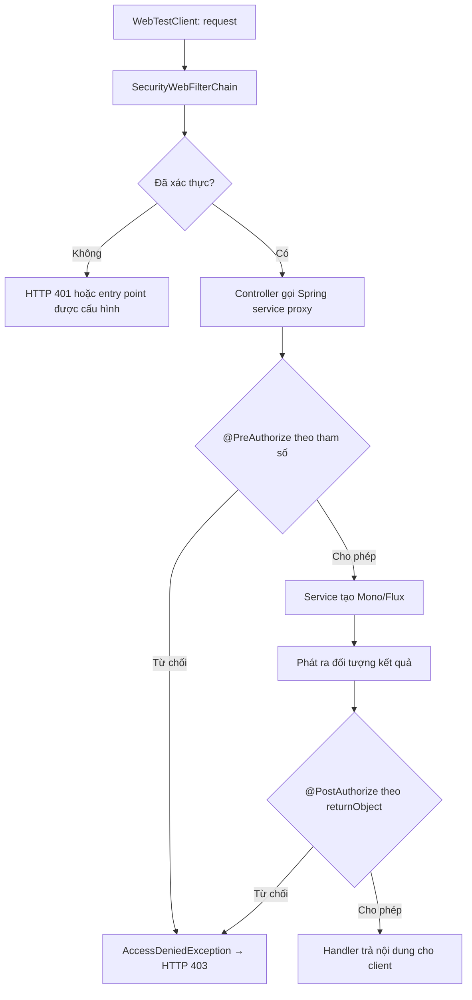

# Quyền theo dữ liệu trả về hoặc tham số khi cơ chế đó được hỗ trợ

Trong ứng dụng Spring WebFlux, chỉ kiểm tra rằng người dùng có vai trò `USER` chưa đủ để bảo vệ dữ liệu. Ví dụ, cả Alice lẫn Bob đều đăng nhập hợp lệ nhưng Alice chỉ được đọc hồ sơ của mình; một tài khoản hỗ trợ có quyền `DOC_ADMIN` có thể đọc hồ sơ của cả hai. Quyết định cho phép hoặc từ chối phải xét **tham số của phương thức** (chủ hồ sơ được yêu cầu) hoặc **dữ liệu phương thức thực sự trả về** (chủ sở hữu bản ghi lấy từ kho dữ liệu).

Chương **Phương thức Reactive** của module **`SPRING_SECURITY_TESTING`** hướng dẫn kiểm chứng xác thực, phân quyền và bảo vệ HTTP bằng `spring-security-test` trên Servlet và Reactive. Bài này sử dụng **`@EnableReactiveMethodSecurity`, `@PreAuthorize`, `@PostAuthorize`, `WebTestClient` và `StepVerifier`** để kiểm tra chính những điều kiện gắn với tham số hoặc đối tượng kết quả. Khi cần áp dụng `@PreFilter` hay `@PostFilter`, ta sẽ chỉ dùng chúng ở cấu hình và kiểu dữ liệu mà phiên bản Spring Security đang chạy hỗ trợ.

Sau bài học, người học có thể:

- Xác định điểm khác nhau giữa phân quyền HTTP theo URL và **phân quyền ngay trên Spring service method**.
- Viết biểu thức SpEL `@PreAuthorize` dựa trên `#owner`, `authentication.name` và authorities.
- Viết `@PostAuthorize` dựa trên `returnObject.owner` để tránh trả nhầm dữ liệu của người khác.
- Tạo test WebFlux sử dụng `WebTestClient`, `mockUser()` và `mockJwt()`, kiểm tra kết quả `200/401/403`.
- Kiểm tra trực tiếp bean service qua `StepVerifier` và `ReactiveSecurityContextHolder.withAuthentication(...)`.
- Nhận biết vai trò cũng như giới hạn của `@PreFilter`/`@PostFilter`, của Spring AOP proxy, của Reactor Context và của phân quyền sau khi đã lấy dữ liệu.

## 1. Có ba thời điểm để quyết định quyền

Khi một request `GET /api/documents/a-1` đến ứng dụng, kiểm tra ở HTTP filter có thể chỉ biết user đã đăng nhập. Những kiểm tra đặc thù dữ liệu được đặt tại service:



| Cơ chế | Khi nào ra quyết định? | Dữ liệu có thể dùng | Tác dụng |
| --- | --- | --- | --- |
| `authorizeExchange(...)` | Ở tầng WebFlux security filter | Path, method, Authentication, request context | Chặn route khi chưa xác thực hoặc thiếu quyền chung |
| `@PreAuthorize` | Trước lời gọi service method được AOP bảo vệ | Authentication, method arguments, bean policy | Ngăn method chạy nếu quyền theo tham số không đạt |
| `@PostAuthorize` | Sau khi method tạo kết quả, trước khi kết quả bị cung cấp cho caller | Authentication, `returnObject` | Ngăn trả một kết quả không thuộc quyền xem |
| `@PreFilter` | Lọc dữ liệu đầu vào của method, khi được hỗ trợ | `filterObject` ở collection/argument phù hợp | Chỉ chuyển tiếp phần tử đạt điều kiện |
| `@PostFilter` | Lọc các phần tử đầu ra, khi được hỗ trợ | `filterObject` của collection/publisher | Bỏ các phần tử không đạt điều kiện |

`@PreAuthorize` phù hợp khi tham số đã đủ quyết định quyền: ví dụ Bob không được gọi `findForOwner("alice")`. `@PostAuthorize` phù hợp khi quyền chỉ xác định được **sau khi đọc bản ghi**: ví dụ `findById("a-1")` cần truy xuất database mới biết owner là Alice.

**Không xem `@PostAuthorize` là cơ chế rollback.** Phương thức có thể đã thực hiện thao tác hoặc gọi hệ thống ngoài trước khi điều kiện sau lời gọi phát hiện lỗi. Với phương thức **ghi dữ liệu**, nên xác minh quyền **trước khi thay đổi trạng thái** hoặc kiểm tra quyền trong cùng giao dịch/câu truy vấn phù hợp. Với trả dữ liệu stream, cần chú ý cả phần tử đã phát ra trước khi lỗi xuất hiện.

## 2. Bật Reactive Method Security và giữ đúng Reactor Context

Ví dụ sử dụng Java 17+, Spring Boot 3.x và Spring Security 6.x, với các dependency cơ bản:

```text
implementation:
  spring-boot-starter-webflux
  spring-boot-starter-security

testImplementation:
  spring-boot-starter-test
  spring-security-test
  reactor-test  (nếu chưa có qua bộ test dependencies)
```

Đây là **ứng dụng WebFlux**, không phải Servlet. Hãy dùng `SecurityWebFilterChain` và `WebTestClient`; không dùng `MockMvc` hoặc `@EnableMethodSecurity` của luồng Servlet làm thay thế cho `@EnableReactiveMethodSecurity`.

### Cấu hình Spring Security Reactive

```java
import org.springframework.context.annotation.Bean;
import org.springframework.context.annotation.Configuration;
import org.springframework.security.config.Customizer;
import org.springframework.security.config.annotation.method.configuration.EnableReactiveMethodSecurity;
import org.springframework.security.config.annotation.web.reactive.EnableWebFluxSecurity;
import org.springframework.security.config.web.server.ServerHttpSecurity;
import org.springframework.security.web.server.SecurityWebFilterChain;

@Configuration
@EnableWebFluxSecurity
@EnableReactiveMethodSecurity(useAuthorizationManager = true)
class ReactiveDocumentSecurityConfig {

    @Bean
    SecurityWebFilterChain springSecurityFilterChain(ServerHttpSecurity http) {
        return http
                .authorizeExchange(exchange -> exchange
                        .pathMatchers("/api/documents/**").authenticated()
                        .anyExchange().permitAll())
                .httpBasic(Customizer.withDefaults())
                .formLogin(ServerHttpSecurity.FormLoginSpec::disable)
                .build();
    }
}
```

`@EnableReactiveMethodSecurity(useAuthorizationManager = true)` bật các interceptor Reactive dựa trên `AuthorizationManager`. API này được giới thiệu từ Spring Security 5.8 và có mặt trong nhánh 6.x. Với các phiên bản khác, cần kiểm tra API/tham số annotation tương ứng trước khi đưa code vào project.

Ở đây `authorizeExchange(...)` yêu cầu đăng nhập cho mọi endpoint `/api/documents/**`. Nó **không tự kiểm tra quyền sở hữu từng tài liệu**; các rule đó sẽ nằm trong service.

`httpBasic()` được bật, còn form login bị tắt để nhánh chưa xác thực có phản hồi HTTP 401 dễ kiểm chứng với test API. Một ứng dụng OAuth2 Login hoặc Bearer Resource Server có thể dùng entry point khác; khi ấy kết quả 401/302 phải theo cấu hình thực.

### Reactor Context thay cho ThreadLocal

Reactive method security đọc `Authentication` từ **Reactor Context**, thông qua cơ chế `ReactiveSecurityContextHolder`. Vì Publisher có thể chạy qua nhiều thread/scheduler, việc chỉ đọc `SecurityContextHolder.getContext()` ở ThreadLocal của Servlet có thể cho kết quả trống hoặc sai.

```java
import org.springframework.security.core.Authentication;
import org.springframework.security.core.context.ReactiveSecurityContextHolder;
import reactor.core.publisher.Mono;

Mono<String> currentName() {
    return ReactiveSecurityContextHolder.getContext()
            .map(context -> context.getAuthentication())
            .map(Authentication::getName);
}
```

Không `block()` trong biểu thức `@PreAuthorize` để lấy Authentication hay gọi database: điều đó có thể chặn event loop và gây lỗi luồng. Với điều kiện đơn giản, biểu thức SpEL trả `boolean`; nếu rule phải truy vấn bất đồng bộ, cân nhắc policy bean hỗ trợ reactive theo đúng phiên bản framework, hoặc kiểm tra trong pipeline/service với phản hồi từ chối rõ ràng.

### Method security dùng Spring AOP proxy

Những annotation trên chỉ có hiệu lực khi method được gọi **qua Spring bean proxy**:

- Cách đúng: controller inject `DocumentService` từ application context rồi gọi `service.read("a-1")`.
- Cách dễ sai: test tự `new DocumentService()`, do đó không có method interceptor.
- Cách dễ sai khác: method cùng class gọi `this.read(id)`. Lời gọi nội bộ (self-invocation) thường bỏ qua proxy và không kích hoạt annotation.
- Việc gắn annotation lên `private` hoặc một đường gọi không được Spring AOP intercept không chứng minh có bảo vệ. Nên dùng method service công khai, gọi qua Spring bean và kiểm tra cả ca bị từ chối.

Những nguyên tắc này có ý nghĩa trong test: nếu mọi yêu cầu đều trả 200, hãy xác nhận bạn đang thực sự gọi proxy chứ không gọi object được khởi tạo thủ công.

## 3. Ví dụ: quyền dựa trên tham số và quyền sở hữu kết quả

Giả sử tài liệu có `id`, `owner` và `content`. Có hai tình huống cần bảo vệ:

1. `GET /api/documents/owner/alice`: tên owner đã nằm trong tham số; chỉ Alice hoặc người có `DOC_ADMIN` được gọi service.
2. `GET /api/documents/a-1`: client chỉ biết ID. Service đọc bản ghi rồi dùng `@PostAuthorize` để kiểm tra owner của **đối tượng thực tế** trước khi trả.

### DTO kết quả

```java
public class DocumentView {
    private final String id;
    private final String owner;
    private final String content;

    public DocumentView(String id, String owner, String content) {
        this.id = id;
        this.owner = owner;
        this.content = content;
    }

    public String getId() {
        return id;
    }

    public String getOwner() {
        return owner;
    }

    public String getContent() {
        return content;
    }
}
```

Getter `getOwner()` cho phép Spring Expression Language đọc `returnObject.owner` từ một đối tượng `DocumentView`. Lớp không chứa credential hay token; trường `owner` là thuộc tính nghiệp vụ để đối chiếu với principal hiện tại.

### Service có `@PreAuthorize` và `@PostAuthorize`

```java
import java.util.Map;
import org.springframework.security.access.method.P;
import org.springframework.security.access.prepost.PostAuthorize;
import org.springframework.security.access.prepost.PreAuthorize;
import org.springframework.stereotype.Service;
import reactor.core.publisher.Mono;

@Service
public class DocumentService {

    // Dữ liệu cố định để ví dụ không phụ thuộc database.
    private final Map<String, DocumentView> documents = Map.of(
            "a-1", new DocumentView("a-1", "alice", "Alice's report"),
            "b-1", new DocumentView("b-1", "bob", "Bob's report")
    );

    @PreAuthorize(
            "#owner == authentication.name or hasAuthority('DOC_ADMIN')")
    public Mono<DocumentView> findForOwner(@P("owner") String owner) {
        // Chỉ được chạy sau khi quyền theo tham số đã đạt.
        return Mono.just(new DocumentView(
                "owner-" + owner, owner, "Private summary"));
    }

    @PostAuthorize(
            "returnObject.owner == authentication.name or hasAuthority('DOC_ADMIN')")
    public Mono<DocumentView> read(String id) {
        // Chỉ tại đây mới xác định được chủ sở hữu của ID.
        return Mono.justOrEmpty(documents.get(id));
    }
}
```

`@P("owner")` giúp Spring Security nhận diện tên tham số trong SpEL ngay cả khi build không giữ metadata Java parameter names. Nếu không dùng `@P`, project có thể cần compile option `-parameters` hoặc cơ chế discovery tương thích. Không viết một test phụ thuộc `#owner` rồi bỏ qua cách tên tham số được khôi phục tại runtime.

Biểu thức `#owner == authentication.name` so sánh chủ hồ sơ được yêu cầu với tên `Authentication` hiện tại. Mệnh đề `hasAuthority('DOC_ADMIN')` cho phép một quyền quản trị riêng vượt qua giới hạn chủ sở hữu. `DOC_ADMIN` là **authority chính xác**, không phải role mặc định `ROLE_ADMIN`.

Ở `read(String id)`, method chưa biết owner cho tới khi dữ liệu được tìm. Với `Mono<DocumentView>`, cơ chế after-method authorization có thể đánh giá giá trị `DocumentView` được phát ra so với `authentication.name`. Kết quả không được phép sẽ bị từ chối trước khi được giao cho caller. Khi publisher rỗng, không có đối tượng để kiểm tra; ứng dụng cần xác định xử lý “không tìm thấy” riêng, chẳng hạn `404 Not Found`, thay vì gộp tự động với `403`.

Điều kiện quyền của ví dụ chỉ dành cho mục đích học: với mô hình dữ liệu thật cần xử lý cả tenant, trạng thái tài liệu, role được cấp, delegation và các quy tắc khác. So sánh một string `owner` không đủ làm chính sách phân quyền đa tenant nếu account ID không được ràng buộc với tenant.

### Controller gọi qua Spring bean

```java
import org.springframework.web.bind.annotation.GetMapping;
import org.springframework.web.bind.annotation.PathVariable;
import org.springframework.web.bind.annotation.RequestMapping;
import org.springframework.web.bind.annotation.RestController;
import reactor.core.publisher.Mono;

@RestController
@RequestMapping("/api/documents")
class DocumentController {

    private final DocumentService service;

    DocumentController(DocumentService service) {
        this.service = service;
    }

    @GetMapping("/owner/{owner}")
    Mono<DocumentView> findByOwner(@PathVariable String owner) {
        return service.findForOwner(owner);
    }

    @GetMapping("/{id}")
    Mono<DocumentView> findById(@PathVariable String id) {
        return service.read(id);
    }
}
```

Controller không tự thay thế logic `@PreAuthorize`/`@PostAuthorize`. Nó chỉ gọi service qua bean đã được inject. Khi service báo `AccessDeniedException` cho một request đã xác thực, security exception handling ở WebFlux thường trả HTTP `403 Forbidden`. Request chưa có Authentication phù hợp sẽ bị HTTP chain chặn trước service.

Để chạy mẫu trong một Spring Boot WebFlux project, tạo lớp `@SpringBootApplication` ở package bao trùm `ReactiveDocumentSecurityConfig`, `DocumentService` và `DocumentController`. Khi file Java tách riêng theo class, không đặt nhiều `public class` độc lập trong cùng một file.

## 4. Kiểm thử qua HTTP bằng WebTestClient

Bộ test này kiểm chứng cả HTTP security chain và method interceptors. `WebTestClient` bind vào application context, áp dụng `springSecurity()`, sau đó dùng `mockUser()` để cung cấp Authentication thử nghiệm cho request.

```java
import org.junit.jupiter.api.BeforeEach;
import org.junit.jupiter.api.Test;
import org.springframework.beans.factory.annotation.Autowired;
import org.springframework.boot.test.context.SpringBootTest;
import org.springframework.context.ApplicationContext;
import org.springframework.security.core.authority.SimpleGrantedAuthority;
import org.springframework.test.web.reactive.server.WebTestClient;

import static org.springframework.security.test.web.reactive.server
        .SecurityMockServerConfigurers.mockUser;
import static org.springframework.security.test.web.reactive.server
        .SecurityMockServerConfigurers.springSecurity;

@SpringBootTest
class ReactiveDocumentSecurityHttpTest {

    @Autowired
    ApplicationContext context;

    WebTestClient client;

    @BeforeEach
    void prepareClient() {
        client = WebTestClient.bindToApplicationContext(context)
                .apply(springSecurity())
                .configureClient()
                .build();
    }

    @Test
    void correctOwnerArgument_isAllowed() {
        client.mutateWith(mockUser("alice").roles("USER"))
                .get()
                .uri("/api/documents/owner/alice")
                .exchange()
                .expectStatus().isOk()
                .expectBody()
                .jsonPath("$.owner").isEqualTo("alice")
                .jsonPath("$.id").isEqualTo("owner-alice");
    }

    @Test
    void anotherOwnersArgument_isForbiddenBeforeMethod() {
        client.mutateWith(mockUser("bob").roles("USER"))
                .get()
                .uri("/api/documents/owner/alice")
                .exchange()
                .expectStatus().isForbidden();
    }

    @Test
    void ownReturnedDocument_isAllowed() {
        client.mutateWith(mockUser("alice").roles("USER"))
                .get()
                .uri("/api/documents/a-1")
                .exchange()
                .expectStatus().isOk()
                .expectBody()
                .jsonPath("$.id").isEqualTo("a-1")
                .jsonPath("$.owner").isEqualTo("alice");
    }

    @Test
    void anotherOwnersReturnedDocument_isForbidden() {
        // Chỉ có ID trong URL; owner được biết sau service.read().
        client.mutateWith(mockUser("bob").roles("USER"))
                .get()
                .uri("/api/documents/a-1")
                .exchange()
                .expectStatus().isForbidden();
    }

    @Test
    void documentAdmin_isAllowedAcrossOwners() {
        client.mutateWith(mockUser("auditor").authorities(
                        new SimpleGrantedAuthority("DOC_ADMIN")))
                .get()
                .uri("/api/documents/a-1")
                .exchange()
                .expectStatus().isOk()
                .expectBody()
                .jsonPath("$.owner").isEqualTo("alice");
    }

    @Test
    void anonymousRequest_isRejectedByHttpChain() {
        client.get()
                .uri("/api/documents/a-1")
                .exchange()
                .expectStatus().isUnauthorized();
    }
}
```

Các test bao phủ hai điểm quyết định riêng:

| Test | Authentication mô phỏng | Điều kiện quyết định | HTTP kỳ vọng |
| --- | --- | --- | --- |
| `correctOwnerArgument_isAllowed` | Alice + `ROLE_USER` | `#owner == authentication.name` | `200` |
| `anotherOwnersArgument_isForbiddenBeforeMethod` | Bob + `ROLE_USER` | `#owner` là Alice, không có `DOC_ADMIN` | `403` |
| `ownReturnedDocument_isAllowed` | Alice | `returnObject.owner` là Alice | `200` |
| `anotherOwnersReturnedDocument_isForbidden` | Bob | Bản ghi `a-1` thuộc Alice | `403` |
| `documentAdmin_isAllowedAcrossOwners` | Auditor + `DOC_ADMIN` | Nhánh quyền admin cho phép | `200` |
| `anonymousRequest_isRejectedByHttpChain` | Không có authentication | `/api/documents/**` cần đăng nhập | `401` |

**Giữ đúng điều kiện của test:** `mockUser()` chỉ tạo Authentication để đưa vào security context. Nó không kiểm tra mật khẩu, OAuth2 login, bearer token hoặc chữ ký JWT. Test trên xác minh logic method security **sau khi đã có danh tính**. Với ứng dụng sử dụng JWT thực tế, bổ sung test resource server riêng để xác nhận JWT claims được chuyển thành authorities đúng trước khi các rule method được áp dụng.

Nếu ứng dụng dùng `formLogin()`, callback OAuth2 hay entry point khác, status khi chưa đăng nhập có thể là redirect thay vì 401. Không thay đổi assertion tùy ý để “cho xanh”: cần đọc đúng cấu hình security của endpoint và định nghĩa HTTP contract tương ứng.

## 5. Kiểm tra trực tiếp reactive service bằng StepVerifier

HTTP test xác minh wiring giữa controller, filter chain và Spring service. Khi muốn kiểm tra chính sách service độc lập với HTTP, inject **Spring bean đã qua proxy** rồi gắn Authentication vào Reactor Context của subscription:

```java
import java.util.List;
import org.junit.jupiter.api.Test;
import org.springframework.beans.factory.annotation.Autowired;
import org.springframework.boot.test.context.SpringBootTest;
import org.springframework.security.access.AccessDeniedException;
import org.springframework.security.authentication.UsernamePasswordAuthenticationToken;
import org.springframework.security.core.Authentication;
import org.springframework.security.core.authority.SimpleGrantedAuthority;
import org.springframework.security.core.context.ReactiveSecurityContextHolder;
import reactor.test.StepVerifier;

@SpringBootTest
class ReactiveDocumentServiceTest {

    @Autowired
    DocumentService service;

    private static Authentication user(String name) {
        return new UsernamePasswordAuthenticationToken(
                name, null,
                List.of(new SimpleGrantedAuthority("ROLE_USER")));
    }

    @Test
    void preAuthorize_acceptsMatchingOwner() {
        StepVerifier.create(
                service.findForOwner("alice")
                        .contextWrite(ReactiveSecurityContextHolder
                                .withAuthentication(user("alice"))))
                .expectNextMatches(doc ->
                        doc.getOwner().equals("alice"))
                .verifyComplete();
    }

    @Test
    void preAuthorize_rejectsAnotherOwner() {
        StepVerifier.create(
                service.findForOwner("alice")
                        .contextWrite(ReactiveSecurityContextHolder
                                .withAuthentication(user("bob"))))
                .expectError(AccessDeniedException.class)
                .verify();
    }

    @Test
    void postAuthorize_rejectsDataBelongingToAnotherOwner() {
        StepVerifier.create(
                service.read("a-1")
                        .contextWrite(ReactiveSecurityContextHolder
                                .withAuthentication(user("bob"))))
                .expectError(AccessDeniedException.class)
                .verify();
    }

    @Test
    void postAuthorize_allowsItsOwner() {
        StepVerifier.create(
                service.read("b-1")
                        .contextWrite(ReactiveSecurityContextHolder
                                .withAuthentication(user("bob"))))
                .expectNextMatches(doc ->
                        doc.getId().equals("b-1")
                        && doc.getOwner().equals("bob"))
                .verifyComplete();
    }
}
```

`StepVerifier` **subscribe** vào Publisher, vì vậy interceptor Reactive có cơ hội chạy trong Reactor Context đã được thiết lập. Nếu chỉ gọi `service.read("a-1")` rồi bỏ đó, một pipeline Reactive lười thực thi chưa chắc đã đi qua nhánh cần kiểm tra.

`withAuthentication(...)` tạo Context cho chính subscription đó, giúp mỗi test dùng một principal riêng. Không phải tự đặt `SecurityContextHolder` global, không phải tạo fake HTTP request và không phải dùng `.block()`. Đối tượng `UsernamePasswordAuthenticationToken` được khởi tạo bằng constructor có authorities nên được coi là authenticated cho mục đích test.

Một điểm cần nhớ: nếu thay `@Autowired DocumentService` bằng `new DocumentService()` thì annotation method security có thể không được thực thi vì không còn Spring proxy. Test mong `AccessDeniedException` sẽ thất bại; khi gặp tình huống này, kiểm tra wiring trước khi sửa SpEL.

## 6. `@PreAuthorize`: kiểm tra tham số trước khi gọi service

Đôi khi quyền phụ thuộc vào hai hoặc nhiều tham số:

```java
@PreAuthorize(
    "#tenant == authentication.details.tenant "
    + "and (#owner == authentication.name "
    + "or hasAuthority('DOC_ADMIN'))")
public Mono<DocumentView> find(
        @P("tenant") String tenant,
        @P("owner") String owner,
        String id) {
    // ...
}
```

Đoạn trên chỉ là **ví dụ mở rộng có điều kiện**: `authentication.details.tenant` phải thực sự tồn tại trong kiểu Authentication mà ứng dụng sử dụng. `mockUser()` mặc định không có một tenant object như vậy. Với app đa tenant, nên thiết kế `tenant` dựa trên danh tính/tokens đã xác thực và policy kiểm tra nguồn dữ liệu tin cậy; không để client tự truyền một tenant rồi mặc định coi nó là chính chủ.

Để giữ quy tắc dễ đọc, có thể chuyển kiểm tra sang Spring bean:

```java
import org.springframework.security.core.Authentication;
import org.springframework.stereotype.Component;

@Component("documentPolicy")
class DocumentPolicy {
    public boolean mayReadOwner(
            String owner, Authentication authentication) {
        if (authentication == null || !authentication.isAuthenticated()) {
            return false;
        }
        return owner.equals(authentication.getName())
                || authentication.getAuthorities().stream()
                    .anyMatch(a -> "DOC_ADMIN".equals(a.getAuthority()));
    }
}
```

Service gọi biểu thức:

```java
@PreAuthorize("@documentPolicy.mayReadOwner(#owner, authentication)")
public Mono<DocumentView> findForOwner(@P("owner") String owner) {
    // ...
}
```

Lợi ích là policy có thể được kiểm tra bằng unit test và tái sử dụng. Hàm kiểm tra `mayReadOwner(...)` trong ví dụ chỉ xử lý dữ liệu trong bộ nhớ và trả boolean ngay, không truy vấn database hay gọi network.

Trong Reactive Method Security dựa trên AuthorizationManager, hỗ trợ các dạng biểu thức và policy trả kết quả Reactive đã phát triển theo phiên bản. Nếu muốn trả `Mono<Boolean>` từ SpEL hoặc quyết định bất đồng bộ bằng custom `ReactiveAuthorizationManager`, hãy dựa vào API/version đang dùng và viết test riêng cho cả cho phép, từ chối, error và publisher rỗng. **Không gọi `Mono.block()` trong một biểu thức để “ép” trả boolean.**

### Quy tắc không nên chỉ dựa vào tên hiển thị

`authentication.name` là cách đơn giản để minh họa quyền theo owner, nhưng một ứng dụng thực có thể dùng subject ID, tenant ID, account ID hoặc quan hệ group. Hai người thuộc hai tenant có thể có cùng username. Nếu dữ liệu có nhiều chiều sở hữu, policy nên kiểm tra bằng các ID ổn định đã xác thực, không chỉ bằng một tên hiển thị do request cung cấp.

## 7. `@PostAuthorize`: kiểm tra chính đối tượng đã được lấy ra

Với `read("a-1")`, tham số ID không cho biết chủ sở hữu. Service phải đọc dữ liệu rồi mới quyết định:

```java
@PostAuthorize(
    "returnObject.owner == authentication.name "
    + "or hasAuthority('DOC_ADMIN')")
public Mono<DocumentView> read(String id) {
    return repository.findById(id);
}
```

Trong trường hợp `Mono<DocumentView>` và cơ chế Reactive after-method authorization được bật, `returnObject` đại diện cho giá trị tài liệu được kiểm tra, cho phép đối chiếu `getOwner()` với Authentication. Khi bị từ chối, Publisher kết thúc bằng lỗi authorization và không trả tài liệu bị chặn cho subscriber.

Khác với `@PreAuthorize`, **công việc đọc dữ liệu có thể đã diễn ra** trước khi `@PostAuthorize` ra quyết định. Vì vậy:

- Với **phương thức chỉ đọc một đối tượng**, after-method check có thể là một lớp bảo vệ hữu ích, đặc biệt khi ID không trực tiếp thể hiện owner.
- Với **phương thức ghi, gửi email, gọi thanh toán hoặc phát sự kiện**, không đặt authorization duy nhất ở `@PostAuthorize`; side effect có thể đã xảy ra trước lúc bị từ chối.
- Với **kho dữ liệu lớn**, tránh lấy toàn bộ dữ liệu rồi lọc quyền sau; nên áp dụng giới hạn tenant/owner ngay trong truy vấn để giảm truy cập dư thừa và tránh lộ dữ liệu qua log/cache.
- Với **Publisher rỗng hoặc lỗi nghiệp vụ**, cần kiểm tra riêng hợp đồng không tìm thấy/không hợp lệ. Không tự động diễn giải `Mono.empty()` thành “đã xác thực và được phép”.

Điều kiện `returnObject.owner` giả định object có getter/property có thể được SpEL đọc. Với dữ liệu dạng `Map`, biểu thức có thể cần `returnObject['owner']`; với DTO khác, hãy dùng getter thực tế. Không áp một biểu thức cho mọi kiểu return value mà không có test.

### Phân biệt `@PostAuthorize` và `@PostFilter`

`@PostAuthorize` đưa ra quyết định **cho phép hoặc từ chối một kết quả**. `@PostFilter` (nếu được hỗ trợ với kiểu trả về/phiên bản cụ thể) **lọc từng phần tử**, có thể chỉ trả các phần tử hợp lệ. Khi cần trả nhiều bản ghi của cùng tenant, filtering thường phù hợp hơn từ chối toàn bộ, nhưng phép lọc ở tầng service không thay thế truy vấn database bảo đảm giới hạn dữ liệu.

## 8. `@PreFilter` và `@PostFilter`: dùng khi kiểu dữ liệu và phiên bản hỗ trợ

Spring Security có các interceptor Reactive `PreFilterAuthorizationReactiveMethodInterceptor` và `PostFilterAuthorizationReactiveMethodInterceptor` trong cơ chế AuthorizationManager. Chúng cho phép dùng biểu thức dựa trên `filterObject`. Tuy nhiên, cách các interceptor xử lý loại Publisher, tham số collection, cấu trúc phần tử và hành vi filter còn phụ thuộc phiên bản/mode. Vì thế **đừng mặc định một ví dụ Collection/Stream của Servlet có thể áp nguyên xi cho `Flux` Reactive** mà chưa kiểm chứng.

### Ví dụ ý tưởng cho `@PostFilter` trên Flux

```java
import org.springframework.security.access.prepost.PostFilter;
import reactor.core.publisher.Flux;

@PostFilter(
    "filterObject.owner == authentication.name "
    + "or hasAuthority('DOC_ADMIN')")
public Flux<DocumentView> findVisibleDocuments() {
    return Flux.just(
            new DocumentView("a-1", "alice", "Alice"),
            new DocumentView("b-1", "bob", "Bob"));
}
```

Trong cấu hình có interceptor hỗ trợ lọc từng item của `Flux`, Alice nhận bản ghi Alice, Bob nhận bản ghi Bob, còn `DOC_ADMIN` nhận cả hai. Có thể kiểm tra bằng `StepVerifier.expectNextMatches(...)` và xác nhận kết thúc với số phần tử mong đợi.

Nhưng đây là **ví dụ phụ thuộc khả năng hỗ trợ của phiên bản**. Trước khi chọn nó làm cơ chế an toàn của sản phẩm, phải chạy test chứng minh:

1. Interceptor đang được kích hoạt trên **Spring proxied bean**, không phải object khởi tạo bằng `new`.
2. `filterObject` được hiểu là **từng `DocumentView`** chứ không phải chính đối tượng Publisher.
3. Người dùng chỉ nhận các mục được phép, không có phần tử bí mật được phát ra trước khi filter.
4. Một publisher lớn hoặc vô hạn không bị gom toàn bộ vào bộ nhớ.

Nếu framework không hỗ trợ đúng kiểu mong muốn, cách chắc chắn hơn là áp quyền tại repository/query hoặc dùng một filter Reactive do ứng dụng định nghĩa với context đã xác thực, rồi viết test bằng `StepVerifier`. Bản thân `Flux.filter(...)` chỉ là phép lọc dữ liệu; nếu không ràng buộc với danh tính đã xác thực và không được áp dụng nhất quán, nó không tự trở thành giải pháp phân quyền.

### Ví dụ ý tưởng cho `@PreFilter` với collection đầu vào

```java
import java.util.List;
import org.springframework.security.access.prepost.PreFilter;

@PreFilter(
    filterTarget = "documents",
    value = "filterObject.owner == authentication.name")
public Mono<Integer> processDocuments(
        @P("documents") List<DocumentView> documents) {
    // Chỉ minh họa việc method nhận danh sách đã lọc.
    return Mono.just(documents.size());
}
```

`@PreFilter` có thể giảm các phần tử không thuộc người gọi trước khi method xử lý, nếu collection/argument được interceptor tương ứng hỗ trợ. Với dữ liệu **ghi/đổi trạng thái**, việc âm thầm bỏ những phần tử trái phép có thể gây hiểu nhầm (“gửi 10 yêu cầu nhưng chỉ xử lý 3”). Trong nhiều API nghiệp vụ, phù hợp hơn là **từ chối toàn bộ request** và trả lỗi tường minh khi danh sách chứa item không được phép.

Ngoài ra, dữ liệu truyền vào có thể là immutable list, custom collection hay một Publisher; test cần xác minh framework có thể lọc mà không phá contract của method hoặc thay đổi collection ngoài ý muốn. Khi có nhiều tham số dạng collection, `filterTarget` hoặc cách đặt tên tham số phải chính xác.

### Lọc quyền ở database thường hiệu quả hơn

Thay vì đọc mọi tài liệu rồi dùng post-filter, có thể xác định principal và đưa điều kiện owner/tenant vào query:

```java
public Flux<DocumentView> findOwnedDocuments() {
    return ReactiveSecurityContextHolder.getContext()
            .map(context -> context.getAuthentication().getName())
            .flatMapMany(owner ->
                    repository.findByOwner(owner));
}
```

Đây là ý tưởng về phân tách trách nhiệm; `repository.findByOwner(...)` phải là phương thức truy vấn Reactive thật trong ứng dụng. Với `DOC_ADMIN` hoặc delegated access, policy cần chọn query phù hợp thay vì chỉ so sánh tên. Luôn kiểm tra quyền tenant trước khi cấp dữ liệu, và dùng test nhiều principal để tránh lộ dữ liệu giữa các subscription.

## 9. Đưa JWT/OAuth2/OIDC giả lập vào rule phương thức

Với Resource Server sử dụng JWT, `mockJwt()` của `spring-security-test` cho phép tạo sẵn `JwtAuthenticationToken` trong WebTestClient. Khi service yêu cầu scope cụ thể:

```java
@PreAuthorize(
    "hasAuthority('SCOPE_documents.read') "
    + "and #owner == authentication.name")
public Mono<DocumentView> readForOwner(
        @P("owner") String owner) {
    return Mono.just(new DocumentView(
            "doc-1", owner, "private"));
}
```

Test:

```java
import org.springframework.security.core.authority.SimpleGrantedAuthority;
import static org.springframework.security.test.web.reactive.server
        .SecurityMockServerConfigurers.mockJwt;

client.mutateWith(mockJwt()
        .jwt(jwt -> jwt.claim("sub", "alice"))
        .authorities(new SimpleGrantedAuthority(
                "SCOPE_documents.read")))
    .get()
    .uri("/api/documents/owner/alice")
    .exchange()
    .expectStatus().isOk();
```

Đoạn này minh họa **cách gắn JWT principal và authority**, nhưng để thực thi thì controller `/api/documents/owner/alice` phải gọi đúng method `readForOwner` có annotation vừa thêm. Nếu controller vẫn gọi `findForOwner` ở mục 3, test sẽ kiểm tra policy của method đó chứ không phải `readForOwner`.

`mockJwt().authorities(...)` **gắn thẳng authorities vào Authentication**; test không chứng minh converter thật đã tạo `SCOPE_documents.read` từ claim `scope`, cũng không xác minh chữ ký JWT. Muốn kiểm tra bearer HTTP thực sự, gửi header `Authorization: Bearer ...` và dùng `ReactiveJwtDecoder` giả lập để kiểm tra bước giải mã/chuyển đổi; muốn kiểm chứng cryptographic validation, dùng decoder thật và token đã ký bằng khóa test.

Tương tự, `mockOidcLogin()` tạo `OidcUser` đã được xác thực ở request, nhưng không chạy toàn bộ OAuth2/OIDC redirect, state, authorization code hay ID token verification. Nó phù hợp để test quyền **sau đăng nhập**, khi policy dựa trên claims/authorities của OIDC principal.

Với ứng dụng dùng nhiều cơ chế, hãy xác minh kiểu Authentication, issuer/tenant claim và scope mapping trong các test chuyên biệt. Không suy ra `ROLE_ADMIN` từ `SCOPE_admin` nếu ứng dụng không có converter định nghĩa rõ việc đó.

## 10. Những lỗi kiểm thử thường gặp

**1. Gắn `@EnableMethodSecurity` thay vì `@EnableReactiveMethodSecurity`.** WebFlux có cơ chế riêng dựa trên Reactor Context và interceptor Reactive. Hãy bật đúng annotation và chạy test chứng minh denied branch thực sự hoạt động.

**2. Gọi service bằng `new` hoặc self-invocation.** Spring AOP không intercept lời gọi không đi qua proxy; `@PreAuthorize`/`@PostAuthorize` có thể bị bỏ qua. Inject Spring bean và đặt method bảo vệ trong bean được gọi từ bean khác.

**3. Bỏ quên `-parameters` hoặc `@P`.** SpEL `#owner` có thể không nhận ra tên tham số; thêm `@P("owner")` hoặc cấu hình compiler phù hợp, rồi kiểm tra test cả cho phép và từ chối.

**4. Test chỉ assert `200 OK`.** Nếu method security chưa kích hoạt, tất cả request có thể trả 200. Cần ca Bob xem tài liệu Alice trả `403` và ca Alice được phép trả 200.

**5. Nhầm quyết định ở HTTP với quyết định ở method.** Nếu HTTP filter đã trả 403 trước controller thì test chưa chứng minh `@PostAuthorize`. Ví dụ bài này chỉ yêu cầu `authenticated()` ở HTTP, để quyền theo owner được quyết định bên trong service.

**6. Dùng `@PostAuthorize` cho lệnh ghi dữ liệu.** Trước khi bị chặn, side effect đã có thể xảy ra. Với thay đổi trạng thái, kiểm tra quyền trước thao tác hoặc trong transaction/query.

**7. Dùng `@PostFilter` để lọc toàn bộ bảng lớn trong bộ nhớ.** Cách đó có thể tốn tài nguyên, làm sai pagination và không đảm bảo dữ liệu không xuất hiện ở log/cache trung gian. Giới hạn theo owner/tenant ngay tại repository khi có thể.

**8. Giả định filtering annotations hỗ trợ mọi dạng `Flux`/`Mono`.** Kiểm tra version, shape của method argument/return type, `filterObject` và readback test. Nếu không hỗ trợ, dùng policy/query rõ ràng.

**9. Dùng `block()` trong rule truy cập dữ liệu Reactive.** Expression nên nhanh, không chặn. Nếu phải query policy async, dùng cơ chế Reactive phù hợp với phiên bản đang triển khai.

**10. Quên Reactor Context trong test service.** Gọi StepVerifier mà không `contextWrite(withAuthentication(...))` có thể khiến policy không tìm được Authentication. WebTestClient với `springSecurity()` đặt context giúp ở tầng HTTP.

**11. Nhầm `hasRole` với `hasAuthority`.** `hasRole("ADMIN")` tìm `ROLE_ADMIN`, trong khi `hasAuthority("DOC_ADMIN")` tìm chính xác authority này; JWT scopes có thể được ánh xạ thành `SCOPE_...`.

**12. Quyền theo username nhưng bỏ qua tenant.** Username không phải lúc nào là identifier duy nhất; policy dữ liệu nên dùng account/tenant IDs từ Authentication đã kiểm chứng.

**13. Bỏ qua subscription/lỗi sau khi tạo Publisher.** Test chỉ gọi method mà không subscribe có thể chưa kích hoạt đường đi cần quan sát. Dùng `StepVerifier` hoặc `WebTestClient` và assert cả success/error.

**14. Đồng nhất “không tìm thấy” và “không được phép”.** `Mono.empty()`, lỗi authorization và lỗi repository là ba loại kết quả khác nhau; API có thể chọn 404 để hạn chế tiết lộ sự tồn tại của tài nguyên nhưng phải định nghĩa rõ policy đó và test nhất quán.

## 11. Checklist và bài tập thực hành

Trước khi coi một bài test **quyền theo dữ liệu** là đầy đủ, hãy xác nhận:

1. `@EnableReactiveMethodSecurity` được bật trên WebFlux configuration và service là Spring bean đã qua proxy.
2. `@PreAuthorize` từ chối đúng khi tham số owner khác principal và chấp nhận khi đúng owner/quyền admin.
3. `@PostAuthorize` từ chối tài liệu thực sự thuộc user khác, kể cả khi URL chỉ chứa ID.
4. HTTP test dùng `WebTestClient` đã `apply(springSecurity())`, có cả 200, 403 và 401 phù hợp security entry point.
5. Service test dùng `StepVerifier` trên Spring bean, gắn Authentication vào Reactor Context bằng `contextWrite(...)`.
6. Nếu dùng `@PreFilter`/`@PostFilter`, test chứng minh lọc đúng từng item và đúng kiểu dữ liệu trên chính phiên bản Spring Security đang chạy.
7. Các quyền `ROLE_`/`SCOPE_`/custom authorities được kiểm tra đúng chuỗi; không mặc định rằng các loại Authentication khác nhau có mapping giống nhau.
8. Các phương thức có side effect kiểm tra quyền **trước khi thay đổi trạng thái**; truy vấn dữ liệu lớn được giới hạn theo owner/tenant sớm nhất có thể.

### Bài tập 1 — Quyền theo tham số

Viết thêm endpoint `GET /api/documents/owner/{owner}` có rule `@PreAuthorize("#owner == authentication.name")`. Chạy với Alice gọi Alice (200) và Bob gọi Alice (403). Sau đó thêm `DOC_ADMIN` và kiểm tra trường hợp admin.

### Bài tập 2 — Quyền theo kết quả

Tạo một service `readById(id)` trả `Mono<DocumentView>` từ repository. Dùng `@PostAuthorize("returnObject.owner == authentication.name")`. Bổ sung ca user nhìn tài liệu của mình, của người khác và ID không tồn tại. Xác định cách ứng dụng phân biệt 403 với 404.

### Bài tập 3 — Giới hạn Spring AOP

Viết method nội bộ gọi `this.read("a-1")` trong cùng class rồi so sánh với controller inject bean và gọi `service.read("a-1")`. Giải thích trường hợp nào annotation được intercept và sửa bằng cách chuyển logic được bảo vệ sang bean riêng.

### Bài tập 4 — Lọc dữ liệu nhiều phần tử

Nếu phiên bản hỗ trợ `@PostFilter` cho `Flux<DocumentView>`, viết test Alice chỉ thấy các bản ghi có `owner=alice` và admin thấy tất cả. Nếu không hỗ trợ đúng semantics, triển khai repository `findByOwner` hoặc policy filter Reactive trong service, rồi test bằng StepVerifier.

### Bài tập 5 — Quyền lấy từ JWT

Tạo test `mockJwt()` có `sub=alice` và `SCOPE_documents.read` để kiểm tra policy method phù hợp; sau đó dùng `ReactiveJwtDecoder` mock với header bearer để xác minh việc chuyển claim thành authority trong pipeline thật. Nêu rõ bằng chứng mà mỗi test cung cấp.

### Tài liệu tham khảo

- [Spring Security — Reactive Method Security](https://docs.spring.io/spring-security/reference/6.5/reactive/authorization/method.html)
- [Spring Security — Reactive Authorization](https://docs.spring.io/spring-security/reference/reactive/authorization/index.html)
- [Spring Security — Reactive WebTestClient Support](https://docs.spring.io/spring-security/reference/reactive/test/web/index.html)
- [Spring Security — Method Security Concepts and Filtering](https://docs.spring.io/spring-security/reference/servlet/authorization/method-security.html) (các ví dụ Servlet để đối chiếu; cần xác minh hỗ trợ Reactive trước khi áp dụng)
- [Spring Security — Reactive Security Context](https://docs.spring.io/spring-security/reference/reactive/authentication/index.html)

Quyền theo **tham số** phù hợp với `@PreAuthorize` khi caller đã cung cấp thông tin cần kiểm tra; quyền theo **đối tượng được tìm thấy** phù hợp với `@PostAuthorize` khi chỉ service mới biết chủ sở hữu thật. Kết hợp WebTestClient và StepVerifier trên Spring proxy giúp kiểm chứng cả HTTP response lẫn quyết định method security trong Reactor Context. Khi xử lý danh sách, stream hoặc dữ liệu có side effect, chỉ áp dụng lọc/kiểm tra sau khi đã xác minh chính xác khả năng hỗ trợ của framework và hợp đồng nghiệp vụ, đồng thời giữ giới hạn owner/tenant ở tầng dữ liệu khi có thể.
