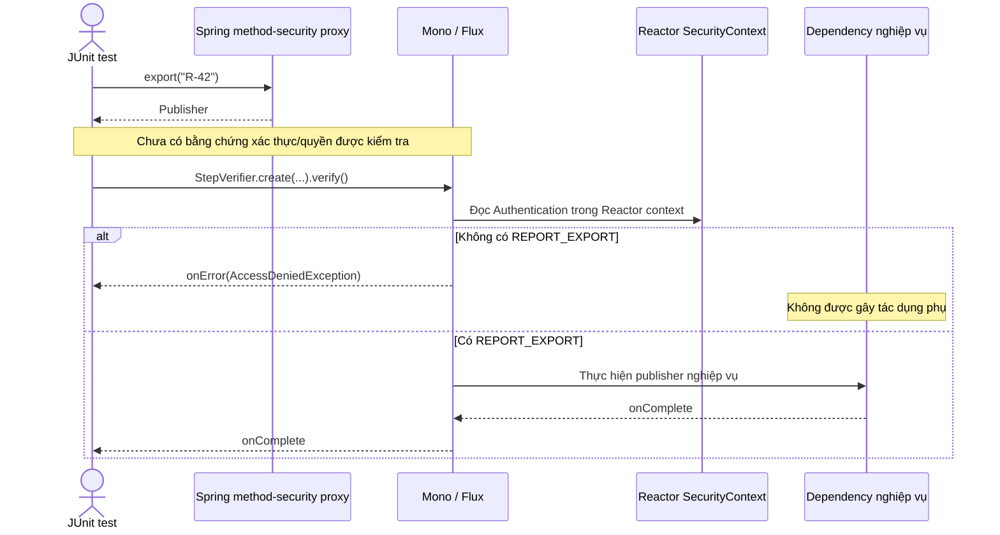

# Kiểm tra sau subscribe thay vì chỉ tạo một Publisher

Trong Spring WebFlux, một lời gọi phương thức trả về `Mono<T>` hoặc `Flux<T>` thường **chỉ tạo mô tả công việc**. Nó chưa đồng nghĩa với việc truy vấn dữ liệu, ghi trạng thái hay kiểm tra phân quyền đã hoàn tất. Khi kiểm thử **Reactive Method Security** bằng `spring-security-test`, nếu test chỉ gọi phương thức rồi kiểm tra Publisher khác `null` thì test rất dễ “xanh giả”: không ai subscribe, không có tín hiệu hoàn tất hay lỗi để assertion.

Bài thuộc chương **Phương thức Reactive** trong module `SPRING_SECURITY_TESTING`, nơi người học kiểm chứng xác thực, phân quyền và bảo vệ HTTP trên Servlet/Reactive bằng `MockMvc`, `WebTestClient`, `@WithMockUser` và các cơ chế tạo `SecurityContext`. Trọng tâm của bài này là cách **thực sự kích hoạt và quan sát kết quả kiểm tra quyền sau khi subscribe**: sử dụng `StepVerifier`, `ReactiveSecurityContextHolder`, xác minh lỗi `AccessDeniedException`, kiểm tra service/dependency có bị gọi và mở rộng lên `WebTestClient`.

> **Nguyên tắc cốt lõi:** Kiểm thử một Publisher phải **subscribe và chờ tín hiệu có thể xác minh**. Tạo Publisher, kiểm tra `notNull` hoặc gọi `StepVerifier.create(...)` mà không `verify()` không chứng minh reactive authorization đã chạy.

## 1. Lời gọi phương thức và lần subscribe là hai thời điểm khác nhau

Một Publisher lạnh (*cold publisher*) thường hoãn việc thực thi cho tới khi có Subscriber. Xét:

```java
Mono<Void> publisher = reportService.export("R-42");
// Chưa nhất thiết truy vấn DB, gửi message hay hoàn thành kiểm tra quyền.

StepVerifier.create(publisher)
        .verifyComplete();
// Có subscription: kiểm tra publisher phát tín hiệu hoàn tất.
```

Ở ví dụ thứ hai, `verifyComplete()` tạo subscription, yêu cầu Publisher chạy và xác nhận nó hoàn tất không lỗi. Nếu bị từ chối quyền, test phải **mong đợi lỗi** thay vì mong đợi hoàn tất.



Đây là sơ đồ nguyên tắc cho một **phương thức reactive được bảo vệ đúng cách**, với nghiệp vụ được trì hoãn bằng `Mono.defer(...)`. Không nên khẳng định rằng *mọi* mã Java luôn được trì hoãn đến subscribe: **phần code tạo Publisher có thể chạy ngay khi gọi phương thức**. Chỉ thao tác bên trong một nguồn reactive lười, chẳng hạn `Mono.defer`, mới được hoãn theo thiết kế. Chính khác biệt này khiến test cần quan sát cả thời điểm subscription lẫn tác dụng phụ.

| Hành động trong test | Có đảm bảo subscribe? | Chứng minh được gì? |
|---|---|---|
| `Mono<?> p = service.run()` | Không | Phương thức trả về một đối tượng Publisher (nếu không lỗi đồng bộ). |
| `assertThat(p).isNotNull()` | Không | Chỉ kiểm tra tham chiếu; chưa có kết luận về authorization. |
| `StepVerifier.create(p)` | Chưa | Chỉ xây dựng kịch bản kiểm tra; chưa gọi `verify`. |
| `StepVerifier.create(p).verifyComplete()` | **Có** | Publisher được subscribe và hoàn tất không lỗi. |
| `StepVerifier.create(p).expectError(...).verify()` | **Có** | Publisher được subscribe và phát đúng loại lỗi. |
| `p.block()` / `p.block(Duration)` | Có đối với Mono lạnh | Có thực thi nhưng assertion lỗi/tín hiệu kém linh hoạt; không dùng `block` trong event loop sản xuất. |
| `WebTestClient...exchange()` | Có, trên luồng HTTP được WebFlux xử lý | Kiểm tra qua HTTP với SecurityWebFilterChain và handler thực tế nếu client bind đúng. |

## 2. Vì sao kiểm thử chỉ tạo Publisher lại xanh sai?

Ví dụ **không đủ**:

```java
@Test
void deniedUser_testThatProvesNothing() {
    Mono<Void> result = exportService.export("R-42");

    assertThat(result).isNotNull();
    // Không có subscribe -> chưa xác nhận đã bị từ chối.
    // Test vẫn có thể PASS dù @PreAuthorize bị gỡ.
}
```

Tương tự, đoạn sau thiếu bước quyết định:

```java
StepVerifier.create(exportService.export("R-42"))
        .expectError(AccessDeniedException.class);
// Thiếu .verify(): kịch bản được mô tả nhưng không chạy.
```

Thực tế có những interceptor và đoạn mã chạy ở thời điểm khác nhau; test không được suy luận rằng “phương thức đã được gọi” có nghĩa “Spring đã ra quyết định phân quyền và nghiệp vụ đã bị ngăn”. Một test có giá trị phải xác minh **onNext/onComplete/onError sau subscription** và, nếu cần, cả **tương tác với dependency gây tác dụng phụ**.

## 3. Cấu hình Reactive Method Security thực sự

Ví dụ áp dụng cho ứng dụng Spring Boot WebFlux, Java 17+ với `spring-boot-starter-webflux`, `spring-boot-starter-security`, `spring-boot-starter-test`, `spring-security-test` và `reactor-test`. `reactor-test` cung cấp `StepVerifier`/`PublisherProbe`; nếu chưa có trên test classpath, thêm dependency với test scope.

Để Spring Security tạo interceptor cho annotation bảo mật phương thức, bật `@EnableReactiveMethodSecurity` và gọi qua **bean do Spring quản lý**:

```java
import org.springframework.context.annotation.Configuration;
import org.springframework.security.config.annotation.method.configuration
        .EnableReactiveMethodSecurity;

@Configuration
@EnableReactiveMethodSecurity
class ReactiveMethodSecurityConfig {
}
```

Một cổng nghiệp vụ gây tác dụng phụ:

```java
import reactor.core.publisher.Mono;

public interface ExportGateway {
    Mono<Void> send(String reportId);
}
```

Service có annotation phân quyền:

```java
import org.springframework.security.access.prepost.PreAuthorize;
import org.springframework.stereotype.Service;
import reactor.core.publisher.Mono;

@Service
public class ReportExportService {
    private final ExportGateway gateway;

    public ReportExportService(ExportGateway gateway) {
        this.gateway = gateway;
    }

    @PreAuthorize("hasAuthority('REPORT_EXPORT')")
    public Mono<Void> export(String reportId) {
        return Mono.defer(() -> gateway.send(reportId));
    }
}
```

`@PreAuthorize` yêu cầu authority **chính xác** `REPORT_EXPORT`. Nó không tự thêm `ROLE_` như `hasRole("...")`. `Mono.defer` giúp lời gọi `gateway.send(reportId)` diễn ra khi có subscription, không phải ngay lúc tạo Publisher. Cách viết này tạo ranh giới rõ ràng: người thiếu quyền không được khiến dependency gửi dữ liệu/gây tác dụng phụ.

**Điều kiện để test có ý nghĩa:** Inject `ReportExportService` từ Spring context, không viết `new ReportExportService(...)`. Nếu tự tạo object hoặc gọi method nội bộ không qua proxy, annotation method security có thể không được áp dụng. Spring cũng cần bật cấu hình method security ở chính test context đang dùng.

## 4. Gắn Authentication vào Reactor context trong unit/integration test

Ở Servlet, nhiều người quen đặt `SecurityContextHolder.getContext().setAuthentication(...)` trước khi gọi method. Trong Reactive, authentication cần đi cùng **Reactor context** qua chuỗi publisher, không chỉ nằm trong ThreadLocal của thread chạy JUnit.

Ta dựng một `Authentication` rồi truyền nó vào publisher bằng `ReactiveSecurityContextHolder.withAuthentication(...)`:

```java
import java.util.List;
import org.springframework.security.authentication
        .UsernamePasswordAuthenticationToken;
import org.springframework.security.core.Authentication;
import org.springframework.security.core.authority.SimpleGrantedAuthority;
import org.springframework.security.core.context.ReactiveSecurityContextHolder;
import reactor.core.publisher.Mono;

static Authentication authenticationWith(String authority) {
    return new UsernamePasswordAuthenticationToken(
            "lan",
            "unused",
            List.of(new SimpleGrantedAuthority(authority)));
}

static <T> Mono<T> withUser(
        Mono<T> publisher,
        String authority
) {
    return publisher.contextWrite(
            ReactiveSecurityContextHolder.withAuthentication(
                    authenticationWith(authority)));
}
```

Đây là hai helper **nằm trong lớp test**. Ta dùng constructor ba tham số của `UsernamePasswordAuthenticationToken` để tạo đối tượng `Authentication` đã được đánh dấu authenticated với danh sách quyền chỉ định. `contextWrite` gắn thông tin cho đoạn Reactive pipeline trong subscription tương ứng; nó không cài vĩnh viễn user cho mọi request hay mọi test.

Có thể dùng `@WithMockUser` ở các Spring test được tích hợp `spring-security-test` và listener phù hợp; tuy nhiên việc **chủ động gắn Reactor context** trong ví dụ giúp dễ thấy thời điểm kiểm tra và tránh nhầm với việc đặt `SecurityContextHolder` kiểu ThreadLocal.

## 5. Bài test chính: subscribe rồi mới khẳng định bị từ chối

Lớp test tích hợp Spring dưới đây giữ `ReportExportService` thật, thay `ExportGateway` bằng Mockito mock. `@MockitoBean` là API Spring Framework 6.2+/Spring Boot 3.4+; với phiên bản cũ dùng cơ chế mock bean tương ứng.

```java
import org.junit.jupiter.api.Test;
import org.springframework.beans.factory.annotation.Autowired;
import org.springframework.boot.test.context.SpringBootTest;
import org.springframework.test.context.bean.override.mockito.MockitoBean;
import org.springframework.security.access.AccessDeniedException;
import reactor.core.publisher.Mono;
import reactor.test.StepVerifier;

import static org.mockito.Mockito.verify;
import static org.mockito.Mockito.verifyNoInteractions;
import static org.mockito.Mockito.when;

@SpringBootTest
class ReportExportMethodSecurityTest {
    @Autowired
    ReportExportService exportService; // Bean thật: phải qua proxy

    @MockitoBean
    ExportGateway gateway; // Chỉ mock dependency phía sau

    @Test
    void deniedAfterSubscribe_andGatewayIsNotCalled() {
        Mono<Void> result = withUser(
                exportService.export("R-42"),
                "REPORT_READ");

        // Tạo Publisher không tự động chứng minh phân quyền.
        // Assertion thật là sau subscribe:
        StepVerifier.create(result)
                .expectError(AccessDeniedException.class)
                .verify();

        verifyNoInteractions(gateway);
    }

    @Test
    void allowedAfterSubscribe_andGatewayRuns() {
        when(gateway.send("R-42"))
                .thenReturn(Mono.empty());

        Mono<Void> result = withUser(
                exportService.export("R-42"),
                "REPORT_EXPORT");

        StepVerifier.create(result)
                .verifyComplete();

        verify(gateway).send("R-42");
    }
}
```

Trong mã trên, `withUser(...)` và `authenticationWith(...)` ở mục 4 phải được đặt vào cùng lớp test (hoặc một lớp utility dùng chung). Các phương thức test không tự tạo `ReportExportService`, nên annotation `@PreAuthorize` có cơ hội hoạt động qua proxy.

**Hai nhánh rất quan trọng:**

- Người dùng `REPORT_READ` không có `REPORT_EXPORT`: sau khi subscribe, Publisher phát `AccessDeniedException` (hoặc subtype). Test xác minh dependency **chưa được gọi**.
- Người dùng `REPORT_EXPORT`: sau khi subscribe, Publisher hoàn tất; dependency đã được gọi đúng với `R-42`.

Với Reactive method security, lỗi phân quyền được phát dưới dạng tín hiệu `onError` trong pipeline. `StepVerifier` quan sát được lỗi, còn `assertThat(publisher).isNotNull()` thì không. Các assertion về tương tác phải đặt **sau** `verify()`; việc kiểm tra tương tác quá sớm có thể chỉ phản ánh rằng Publisher chưa được subscribe.

### Vì sao chỉ test nhánh bị từ chối vẫn chưa đủ?

Một cấu hình sai từ chối **tất cả** người dùng vẫn có thể làm test `expectError(AccessDeniedException.class)` xanh. Bắt buộc có ca đủ quyền `verifyComplete()` và xác minh dependency hoạt động; nhờ vậy test có khả năng phát hiện cả **cho phép thừa** lẫn **từ chối thừa**.

## 6. Kiểm chứng Publisher thật sự được subscribe bằng PublisherProbe

`reactor-test` cung cấp `PublisherProbe` để quan sát việc subscribe, request và cancel. Công cụ này đặc biệt hữu ích khi một method security test cần chứng minh một Publisher nghiệp vụ **đã hoặc chưa chạy**, thay vì chỉ biết phương thức Java có được gọi.

```java
import reactor.test.publisher.PublisherProbe;

@Test
void allowedFlowSubscribesToGatewayPublisher() {
    PublisherProbe<Void> probe = PublisherProbe.empty();
    when(gateway.send("R-42"))
            .thenReturn(probe.mono());

    Mono<Void> result = withUser(
            exportService.export("R-42"),
            "REPORT_EXPORT");

    probe.assertWasNotSubscribed();

    StepVerifier.create(result)
            .verifyComplete();

    probe.assertWasSubscribed();
    probe.assertWasRequested();
    verify(gateway).send("R-42");
}
```

Ca bị từ chối có thể kiểm tra `verifyNoInteractions(gateway)` như mục 5, hoặc nếu nghiệp vụ cố ý trả một Publisher được dựng sẵn, dùng `PublisherProbe.assertWasNotSubscribed()` để chứng minh **Publisher phía sau không bị subscribe**. Hai loại assertion khác nhau:

| Assertion | Quan sát điều gì? | Giới hạn |
|---|---|---|
| `verify(gateway).send(...)` | Java method của dependency được gọi. | Chưa chắc Publisher trả về đã được subscribe. |
| `verifyNoInteractions(gateway)` | Không có lời gọi Mockito tới dependency. | Không quan sát side effect nằm ở đối tượng khác. |
| `probe.assertWasSubscribed()` | Publisher do probe theo dõi đã nhận subscribe. | Không mặc nhiên chứng minh nghiệp vụ ngoài probe thành công. |
| `probe.assertWasNotSubscribed()` | Publisher đang theo dõi chưa được subscribe. | Không chứng minh mọi publisher khác cũng chưa chạy. |
| `StepVerifier.verifyComplete()` | Publisher được subscribe và kết thúc thành công. | Không tự chứng minh quyền đúng nếu request/test không đi qua proxy bảo mật. |

Thử nghiệm tốt thường kết hợp **tín hiệu reactive** với **tương tác/hiệu ứng thực tế**.

## 7. Bẫy nguy hiểm: tác dụng phụ xảy ra trước subscribe

Đừng giả định mọi method trả `Mono` đều tự động trì hoãn nghiệp vụ. Hãy so sánh:

```java
// RỦI RO: gửi sự kiện ngay khi phương thức Java chạy.
public Mono<Void> exportEagerly(String id) {
    auditLogger.write("EXPORT_REQUESTED", id); // Side effect đồng bộ!
    return gateway.send(id);
}

// TỐT HƠN: để các tác vụ phụ thuộc được gọi khi subscribe.
public Mono<Void> exportLazily(String id) {
    return Mono.defer(() -> {
        auditLogger.write("EXPORT_REQUESTED", id);
        return gateway.send(id);
    });
}
```

Trong phương thức đầu, `auditLogger.write(...)` có thể chạy **ngay trong lời gọi Java**, trước khi cơ chế reactive quyết định quyền ở subscription; nó làm cho nhận định “không subscribe thì không có tác dụng phụ” sai. Trong phương thức sau, logic được đặt trong `Mono.defer` và có thể bị chặn trước khi thực thi nếu reactive method-security interceptor đúng cách.

Một bẫy tương tự:

```java
// Nếu remoteService.startNow() khởi động công việc ngay,
// Mono.fromFuture(...) không tự hoàn tác side effect đã xảy ra.
Mono<Result> result =
        Mono.fromFuture(remoteService.startNow());

// Khi cần hoãn khởi tạo future, dùng overload supplier tương ứng:
Mono<Result> deferred =
        Mono.fromFuture(() -> remoteService.startNow());
```

Vì vậy, ngoài assertion `StepVerifier`, các ca nhạy cảm phải kiểm tra **không có ghi DB, không có event, không có request tới hệ thống ngoài** khi thiếu quyền. `Mono.defer` giúp trì hoãn lời gọi, nhưng không phải biện pháp bảo mật độc lập: phương thức vẫn phải được gọi qua bean/proxy có `@PreAuthorize` hoặc chính sách bảo vệ tương đương.

## 8. @PostAuthorize: kiểm tra sau khi có giá trị, không thể “quay ngược” side effect

`@PreAuthorize` thường là lựa chọn đúng khi cần chặn **trước** nghiệp vụ nhạy cảm. `@PostAuthorize` có mục đích khác: nó có thể cần **giá trị được trả về** để đánh giá quyền, ví dụ chỉ cho phép xem báo cáo thuộc sở hữu người hiện tại.

```java
import org.springframework.security.access.prepost.PostAuthorize;
import org.springframework.stereotype.Service;
import reactor.core.publisher.Mono;

class ReportView {
    private final String id;
    private final String owner;

    ReportView(String id, String owner) {
        this.id = id;
        this.owner = owner;
    }

    public String getId() { return id; }
    public String getOwner() { return owner; }
}

interface ReportLookup {
    Mono<ReportView> find(String id);
}

@Service
class SecuredReportLookup {
    private final ReportLookup lookup;

    SecuredReportLookup(ReportLookup lookup) {
        this.lookup = lookup;
    }

    @PostAuthorize("returnObject.owner == authentication.name")
    public Mono<ReportView> find(String id) {
        return Mono.defer(() -> lookup.find(id));
    }
}
```

Khi subscribe, upstream có thể cần đọc báo cáo rồi `@PostAuthorize` mới biết `owner` để so sánh với principal. Với người không phải chủ sở hữu, test có thể kỳ vọng `AccessDeniedException` và **không có dữ liệu được phát cho consumer**; tuy nhiên **truy vấn đọc đã có thể xảy ra**. Vì vậy không viết test `@PostAuthorize` rồi khẳng định dependency hoàn toàn không chạy, trừ khi kiến trúc có thêm lớp chặn sớm.

Ví dụ test sau dùng `StepVerifier` (giả định bean `SecuredReportLookup` được inject và repository đã được mock):

```java
when(lookup.find("R-42"))
        .thenReturn(Mono.just(new ReportView("R-42", "an")));

Mono<ReportView> denied = securedReportLookup.find("R-42")
        .contextWrite(
                ReactiveSecurityContextHolder.withAuthentication(
                        authenticationWith("REPORT_READ")));

StepVerifier.create(denied)
        .expectError(AccessDeniedException.class)
        .verify();

verify(lookup).find("R-42"); // Có thể cần đọc trước khi kiểm tra owner.
```

Ở đây helper `authenticationWith` tạo principal tên `lan`, còn `owner="an"`; quyền đơn giản `REPORT_READ` không thay đổi điều kiện ownership. Để có test đối chứng, trả một `ReportView` có `owner="lan"` và dùng `expectNextMatches(...).verifyComplete()`.

**Cảnh báo:** Không nên dùng `@PostAuthorize` làm hàng rào duy nhất cho một thao tác ghi/chuyển tiền/phát sự kiện, vì tác dụng phụ có thể đã xảy ra trước khi hậu kiểm từ chối. Với mutation, áp dụng `@PreAuthorize` và kiểm tra ownership/tenant trong logic trước khi ghi nếu cần.

## 9. WebTestClient: kiểm thử đến tận HTTP response

Kiểm thử service trực tiếp bằng `StepVerifier` giúp xác định chính xác exception của method security. Sau đó, nên có ca tích hợp `WebTestClient` để chứng minh **Reactive SecurityWebFilterChain** chuyển lỗi phân quyền thành HTTP status phù hợp.

Với ứng dụng WebFlux, cấu hình URL chỉ yêu cầu user đã đăng nhập; quyền `REPORT_EXPORT` được giữ tại service `@PreAuthorize`. Như vậy một response 403 thực sự có cơ hội đến từ **method security**, thay vì bị HTTP rule chặn từ trước.

```java
import org.springframework.context.annotation.Bean;
import org.springframework.context.annotation.Configuration;
import org.springframework.security.config.Customizer;
import org.springframework.security.config.annotation.web.reactive
        .EnableWebFluxSecurity;
import org.springframework.security.config.web.server.ServerHttpSecurity;
import org.springframework.security.web.server.SecurityWebFilterChain;

@Configuration
@EnableWebFluxSecurity
class ExportHttpSecurityConfig {
    @Bean
    SecurityWebFilterChain filterChain(ServerHttpSecurity http) {
        return http
                .authorizeExchange(exchanges -> exchanges
                        .pathMatchers("/api/exports/**").authenticated()
                        .anyExchange().permitAll())
                .httpBasic(Customizer.withDefaults())
                .build();
    }
}
```

Controller phải **trả lại publisher** thay vì subscribe thủ công:

```java
import org.springframework.http.ResponseEntity;
import org.springframework.web.bind.annotation.PathVariable;
import org.springframework.web.bind.annotation.PostMapping;
import org.springframework.web.bind.annotation.RequestMapping;
import org.springframework.web.bind.annotation.RestController;
import reactor.core.publisher.Mono;

@RestController
@RequestMapping("/api/exports")
class ExportController {
    private final ReportExportService exportService;

    ExportController(ReportExportService exportService) {
        this.exportService = exportService;
    }

    @PostMapping("/{id}")
    Mono<ResponseEntity<Void>> export(@PathVariable String id) {
        return exportService.export(id)
                .thenReturn(ResponseEntity.accepted().<Void>build());
    }
}
```

`thenReturn(...)` chỉ phát response sau khi `exportService.export(...)` hoàn tất. Nếu method security từ chối, Publisher phát lỗi và HTTP pipeline xử lý lỗi thay vì luôn trả 202. Đừng gọi `subscribe()` trong controller rồi trả response ngay: đó là fire-and-forget, có thể làm mất tín hiệu lỗi và tách tác dụng phụ khỏi kiểm tra HTTP.

### Mock WebFlux user và CSRF đúng cách

`spring-security-test` cung cấp `SecurityMockServerConfigurers.mockUser()` và `csrf()` dành cho WebFlux. Không dùng `SecurityMockMvcRequestPostProcessors` của Servlet.

```java
import org.junit.jupiter.api.BeforeEach;
import org.junit.jupiter.api.Test;
import org.springframework.beans.factory.annotation.Autowired;
import org.springframework.boot.test.context.SpringBootTest;
import org.springframework.context.ApplicationContext;
import org.springframework.security.core.authority.SimpleGrantedAuthority;
import org.springframework.test.context.bean.override.mockito.MockitoBean;
import org.springframework.test.web.reactive.server.WebTestClient;
import reactor.core.publisher.Mono;

import static org.mockito.Mockito.verify;
import static org.mockito.Mockito.verifyNoInteractions;
import static org.mockito.Mockito.when;
import static org.springframework.security.test.web.reactive.server
        .SecurityMockServerConfigurers.springSecurity;
import static org.springframework.security.test.web.reactive.server
        .SecurityMockServerConfigurers.mockUser;
import static org.springframework.security.test.web.reactive.server
        .SecurityMockServerConfigurers.csrf;

@SpringBootTest(webEnvironment = SpringBootTest.WebEnvironment.MOCK)
class ReportExportHttpTest {
    @Autowired
    ApplicationContext context;

    @MockitoBean
    ExportGateway gateway;

    WebTestClient webTestClient;

    @BeforeEach
    void setUp() {
        webTestClient = WebTestClient
                .bindToApplicationContext(context)
                .apply(springSecurity())
                .configureClient()
                .build();
    }

    @Test
    void missingMethodAuthority_returns403_withoutSideEffect() {
        webTestClient
                .mutateWith(mockUser("lan").authorities(
                        new SimpleGrantedAuthority("REPORT_READ")))
                .mutateWith(csrf())
                .post()
                .uri("/api/exports/R-42")
                .exchange()
                .expectStatus().isForbidden();

        verifyNoInteractions(gateway);
    }

    @Test
    void correctMethodAuthority_returns202_afterCompletion() {
        when(gateway.send("R-42"))
                .thenReturn(Mono.empty());

        webTestClient
                .mutateWith(mockUser("lan").authorities(
                        new SimpleGrantedAuthority("REPORT_EXPORT")))
                .mutateWith(csrf())
                .post()
                .uri("/api/exports/R-42")
                .exchange()
                .expectStatus().isAccepted();

        verify(gateway).send("R-42");
    }

    @Test
    void missingCsrf_isForbidden_beforeMethodExecution() {
        webTestClient
                .mutateWith(mockUser("lan").authorities(
                        new SimpleGrantedAuthority("REPORT_EXPORT")))
                .post()
                .uri("/api/exports/R-42")
                .exchange()
                .expectStatus().isForbidden();

        verifyNoInteractions(gateway);
    }
}
```

Ở ví dụ, `csrf()` giữ request POST đủ điều kiện vượt qua CSRF filter để test **@PreAuthorize**. Nếu bỏ CSRF, kết quả 403 có thể do CSRF chứ không phải thiếu `REPORT_EXPORT`. Vì thế các ca phân quyền phải có **đối chứng đủ quyền + CSRF thành công**. Nếu dự án vô hiệu hóa CSRF cho API stateless một cách có chủ đích, kỳ vọng phải theo SecurityWebFilterChain thực tế.

`WebTestClient.exchange()` kích hoạt pipeline HTTP và nhận response; assertion sau đó cho biết status của quá trình đã được xử lý. Nếu hệ thống dùng async side effect ngoài Publisher trả về, chỉ kiểm tra HTTP status chưa đủ để kết luận tác dụng phụ đã kết thúc; cần kiểm tra dependency/trạng thái cuối hoặc cơ chế quan sát phù hợp.

## 10. Không để test kết thúc trước reactive signal

Một lỗi thường gặp là chủ động subscribe nhưng không đợi:

```java
@Test
void unreliableTest() {
    Mono<Void> result = withUser(
            exportService.export("R-42"),
            "REPORT_READ");

    result.subscribe(); // Không đợi completion/error đúng cách.
    // Test có thể return trước khi pipeline báo lỗi.
}
```

Đừng dùng `subscribe()` thủ công rồi bỏ qua `Disposable` và error handler trong một bài test bảo mật. Thay bằng:

```java
StepVerifier.create(
        withUser(exportService.export("R-42"), "REPORT_READ"))
        .expectError(AccessDeniedException.class)
        .verify();
```

Nếu publisher có asynchronous scheduler, `StepVerifier.verify()` chờ tín hiệu theo kịch bản; thiết lập timeout phù hợp theo chính sách test để tránh treo vô hạn. Với logic thời gian (`delay`, `timeout`), `StepVerifier.withVirtualTime(...)` có thể giúp nhưng phải dựng Publisher **sau khi virtual scheduler được kích hoạt**, thường bằng supplier; nó không thay thế việc kiểm tra security context và quyền.

Đối với `Flux`, còn cần kiểm tra tín hiệu từng phần và terminal signal. Ví dụ:

```java
StepVerifier.create(reportQuery.findVisibleReports())
        .expectNextMatches(report -> report.isVisibleTo("lan"))
        .expectNextCount(2)
        .verifyComplete();
```

Đoạn trên minh họa một query `Flux<Report>` trong môi trường đã có Reactor authentication context phù hợp, giả định kết quả đúng **ba** phần tử. Nếu `@PreAuthorize` từ chối, dùng `expectError(AccessDeniedException.class).verify()` và kiểm tra không phát dữ liệu nhạy cảm. Cũng cần nhớ **subscription không đồng nghĩa có demand hoặc completion**: một `Flux` có thể chưa phát phần tử vì backpressure hoặc chạy vô hạn. Cần thiết kế `thenRequest`, `thenCancel` hoặc timeout cho các kịch bản ấy.

## 11. Nhiều subscription, cache và quyền của từng người dùng

Publisher lạnh có thể được subscribe nhiều lần, và mỗi lần có một Reactor context khác nhau. Nếu cùng một Publisher được chia sẻ cho nhiều user, cần đảm bảo quyền được đánh giá trong **subscription đúng người dùng**; không được coi “đã chạy với admin một lần” là giấy phép tái sử dụng kết quả cho user khác.

```java
Mono<Void> sharedDescription = exportService.export("R-42");

StepVerifier.create(withUser(
                sharedDescription, "REPORT_READ"))
        .expectError(AccessDeniedException.class)
        .verify();

// Khi tạo subscription khác với user đủ quyền:
// stub gateway thích hợp rồi verifyComplete().
```

Lưu ý khi dùng `cache()`, `share()` hoặc tự memoize Publisher chứa thông tin quyền/tenant: các toán tử này có thể tái sử dụng signal hoặc dữ liệu giữa các subscriber theo ngữ nghĩa của chúng. Nếu cache nằm **sau khi** đã phát kết quả phụ thuộc danh tính người dùng, cần đánh giá nguy cơ rò rỉ dữ liệu qua các request khác nhau. Bảo vệ quyền phải gắn với từng request/tenant và không để cached data bypass kiểm tra cần thiết.

Không suy diễn rằng mọi việc subscribe lần thứ hai chắc chắn gọi lại dependency: đó còn phụ thuộc cold/hot publisher, cache và cấu trúc pipeline. Hãy kiểm tra bằng `PublisherProbe` hoặc bộ đếm side effect nếu hành vi đa subscription là yêu cầu của ứng dụng.

## 12. Ma trận kiểm thử nên có

| Tình huống | Công cụ | Assertion có giá trị |
|---|---|---|
| User thiếu quyền gọi method `@PreAuthorize` | `StepVerifier` + Reactor context | `expectError(AccessDeniedException.class).verify()`; dependency chưa chạy. |
| User có quyền gọi method `@PreAuthorize` | `StepVerifier` | `verifyComplete()`; dependency được gọi; publisher nghiệp vụ được subscribe khi cần. |
| Tạo Publisher nhưng không subscribe | `PublisherProbe`/Mockito | Chỉ quan sát chưa chạy; **không gọi đó là test phân quyền thành công**. |
| `@PostAuthorize` với kết quả không thuộc user | `StepVerifier` | Không phát kết quả ra ngoài; có thể đã gọi read dependency. |
| POST qua HTTP với quyền sai | `WebTestClient` + `mockUser()` + `csrf()` | 403 và không có side effect; HTTP rule không được chặn sai tầng. |
| POST qua HTTP đúng quyền | `WebTestClient` | 202/2xx phù hợp và nghiệp vụ đã hoàn tất hoặc đã được khởi tạo đúng cam kết. |
| POST thiếu CSRF | `WebTestClient` | 403 do CSRF theo chain được cấu hình, không kết luận từ chối do method security. |
| Method trả `Flux` không kết thúc | `StepVerifier` với request/cancel/timeout | Xác nhận tín hiệu/demand thực tế, tránh test treo. |

## 13. Những lỗi cần tránh

1. **Chỉ `assertNotNull(Mono)`**: Không có subscription nên chưa xác nhận đã cho phép/từ chối.
2. **Thiếu `verify()` của StepVerifier**: Kịch bản được dựng nhưng không chạy.
3. **Kiểm tra `verifyNoInteractions(...)` trước subscribe rồi báo bảo vệ thành công**: Có thể chỉ do chưa có nguồn reactive nào chạy.
4. **Dùng `new Service()` thay vì Spring bean**: Bỏ qua proxy `@PreAuthorize`.
5. **Đặt side effect đồng bộ trước `Mono.defer`**: Có thể chạy ngay khi gọi method, không chờ security check.
6. **Dùng ThreadLocal `SecurityContextHolder` để mô phỏng Reactive user**: Không đảm bảo authentication được truyền qua Reactor context.
7. **Chỉ test nhánh 403**: Một cấu hình cấm tất cả cũng làm test xanh; luôn có positive test.
8. **Nhầm `@PostAuthorize` với chặn side effect từ đầu**: Hậu kiểm có thể chạy sau khi dữ liệu đã được đọc hoặc ghi.
9. **Mock chính service có `@PreAuthorize`**: Bỏ qua interceptor cần kiểm tra; chỉ mock dependency phía sau.
10. **Quên CSRF của WebFlux khi gửi POST**: 403 từ CSRF che 403 từ method authorization.
11. **Dùng Servlet post-processor với `WebTestClient`**: Chọn `SecurityMockServerConfigurers` của Reactive.
12. **Gọi `subscribe()` thủ công và bỏ qua terminal error**: Test có thể hoàn thành trước kết quả thật.
13. **Dùng publisher cache chứa kết quả phụ thuộc principal mà không có cơ chế cô lập**: Có thể làm khó xác minh quyền cho từng subscriber và gây rủi ro dữ liệu.

## 14. Checklist hoàn thành

- [ ] `@EnableReactiveMethodSecurity` được bật trong test context và bean có `@PreAuthorize` được inject từ Spring.
- [ ] Method có side effect được thiết kế theo reactive lazy semantics, không chạy việc nhạy cảm ngay lúc tạo Publisher.
- [ ] Test dùng `StepVerifier.verify()`, `verifyComplete()` hoặc `expectError(...).verify()`, không chỉ kiểm tra non-null.
- [ ] Reactor context có Authentication/authorities đúng cho **subscription đang test**.
- [ ] Nhánh thiếu quyền gây lỗi `AccessDeniedException` (hoặc subtype) và không thực thi side effect.
- [ ] Nhánh đủ quyền hoàn tất thành công và có assertion về dependency/publisher được subscribe.
- [ ] Với `@PostAuthorize`, phân biệt việc không phát dữ liệu với việc upstream đã có thể chạy.
- [ ] Với HTTP, `WebTestClient` bind đúng Spring Security Reactive context; POST đủ CSRF khi đang test method authorization.
- [ ] Có positive/negative test, không nhầm nguyên nhân 401/403, không bỏ qua tín hiệu terminal.
- [ ] Không dùng cached publisher hoặc ThreadLocal làm đường tắt qua kiểm tra quyền theo request.

**Kết luận:** Với Reactive Method Security, **tạo ra một `Mono` hoặc `Flux` chưa đủ để kết luận phân quyền đã được kiểm tra**. Test phải subscribe, quan sát tín hiệu hoàn tất/lỗi và xác minh tác dụng phụ thật. `StepVerifier` kiểm tra trực tiếp Publisher ở tầng service; `WebTestClient` chứng minh kết quả khi pipeline thực sự được chạy qua HTTP.
