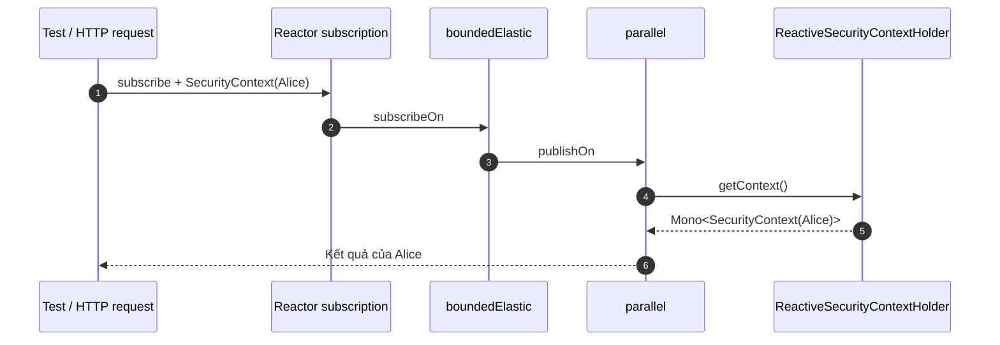

# Giữ Reactor Context khi chuyển scheduler

## 1. Bài toán: đổi luồng xử lý nhưng vẫn giữ danh tính người dùng

Trong ứng dụng Servlet truyền thống, nhiều đoạn code quen lấy người dùng hiện tại bằng `SecurityContextHolder.getContext().getAuthentication()`. Cách này dễ tạo cảm giác rằng danh tính luôn đi cùng **thread** đang thực thi. Trong Spring WebFlux, một HTTP request có thể chạy qua nhiều luồng do `publishOn`, `subscribeOn` hoặc các thao tác bất đồng bộ của Reactor. Nếu dùng tư duy thread-local của Servlet để đọc danh tính, test có thể thất bại ngẫu nhiên, thấy người dùng rỗng hoặc không đúng phạm vi.

Giả sử endpoint `GET /documents/current` gọi service:

1. WebFlux đã xác thực request của Alice.
2. `@PreAuthorize` yêu cầu authority `SCOPE_docs:read`.
3. Reactive pipeline được chuyển từ một scheduler sang scheduler khác.
4. Service lấy tên người dùng để trả đúng tài liệu của Alice.

Điều ta muốn là **đổi thread không làm thay đổi hoặc làm mất danh tính của cùng một reactive subscription**. Ngược lại, request của Bob, một subscription mới hoặc một callback được khởi chạy bên ngoài pipeline **không được thừa hưởng ngẫu nhiên** authentication của Alice.

Bài thuộc chương **Phương thức Reactive** của module **SPRING_SECURITY_TESTING**. Mục đích là kiểm chứng xác thực, phân quyền và hành vi HTTP bằng `spring-security-test`: `WebTestClient` cho WebFlux, `MockMvc` cho Servlet, `@WithMockUser`, `SecurityContext` và các principal JWT/OAuth2/OIDC giả lập. Trọng tâm bài này là **Reactor Context**, `ReactiveSecurityContextHolder`, `publishOn`/`subscribeOn` và kiểm thử **reactive method security** bằng `StepVerifier` lẫn `WebTestClient`.

Sau bài học, bạn có thể:

- Giải thích vì sao Reactor Context gắn với **subscriber/subscription**, còn `ThreadLocal` gắn với thread.
- Dùng `ReactiveSecurityContextHolder.getContext()` để lấy authentication trong reactive chain.
- Chuyển scheduler bằng `publishOn`, `subscribeOn` mà vẫn giữ security context khi làm việc trong cùng pipeline.
- Dùng `contextWrite(ReactiveSecurityContextHolder.withAuthentication(...))` để cấp danh tính cho một test `StepVerifier`.
- Kiểm chứng `@PreAuthorize` cho phép hoặc từ chối khi reactive publisher chạy qua scheduler.
- Phát hiện những chỗ làm đứt context như `subscribe()` lồng nhau, `block()`, future/thread được tạo ngoài Reactor, hoặc cache dùng chung không phù hợp.
- Phân biệt test `mockJwt()`/`mockOidcLogin()` với xác minh JWT và OAuth2/OIDC thực.

## 2. Reactor Context không phải ThreadLocal

`Reactor Context` là cấu trúc key/value bất biến, gắn với một **subscriber**, và có thể được đọc từ các operator bên trong chuỗi Reactor. Mỗi subscription có thể nhìn thấy một ngữ cảnh riêng. Spring Security Reactive sử dụng cơ chế này để lưu `Mono<SecurityContext>` nhằm hỗ trợ xác thực và phân quyền trong WebFlux.

| Đặc tính | `ThreadLocal` / tư duy Servlet | `Reactor Context` / WebFlux |
|---|---|---|
| Phạm vi giá trị | Thread đang chạy | Subscriber/subscription |
| Đổi thread | Không tự mang `ThreadLocal` sang thread khác | Các operator Reactor chuẩn giữ context trong cùng subscription |
| Lấy security context | `SecurityContextHolder.getContext()` | `ReactiveSecurityContextHolder.getContext()` |
| Kiểu dữ liệu | `SecurityContext` đồng bộ | `Mono<SecurityContext>` |
| Tác vụ ngoài pipeline | Có thể yêu cầu cơ chế propagation riêng | Phải nối vào pipeline hoặc truyền ngữ cảnh một cách có chủ đích |
| Kiểm thử | `MockMvc` + Servlet request post-processors | `WebTestClient` + reactive test configurers; `StepVerifier` + `contextWrite` |

**Điều cốt lõi:** `publishOn` hoặc `subscribeOn` không tự làm mất Reactor Context khi được sử dụng trong **cùng một pipeline Reactor được kết nối đúng**. Lỗi thường đến từ việc mở một subscription mới, chạy công việc ngoài chuỗi hoặc sử dụng `ThreadLocal` mà không có cơ chế propagation thích hợp.

### 2.1. publishOn và subscribeOn khác nhau thế nào?

- `subscribeOn(scheduler)` ảnh hưởng đến nơi thực hiện quá trình **subscribe ngược về nguồn**; thường được dùng để chuyển các nguồn blocking được bọc bằng `Mono.fromCallable(...)` sang `Schedulers.boundedElastic()`.
- `publishOn(scheduler)` chuyển nơi chạy các tín hiệu **ở phía sau operator đó**.
- Khi `Mono`/`Flux` vẫn là một chuỗi Reactor hợp lệ, các lần chuyển scheduler này không đổi authentication nằm trong Reactor Context của subscription.
- Không assert tên thread cụ thể như một bằng chứng đúng về bảo mật; thread có thể thay đổi theo tải, phiên bản Reactor và cách lập lịch.

Ví dụ minh họa cách sử dụng cả hai:

```java
Mono<String> flow = Mono.just("start")
    .subscribeOn(Schedulers.boundedElastic())
    .publishOn(Schedulers.parallel())
    .flatMap(ignored ->
        ReactiveSecurityContextHolder.getContext())
    .map(context ->
        context.getAuthentication().getName());
```

Khi một authentication thích hợp đã được cấp trong Reactor Context, `flow` trả tên người dùng tương ứng, dù các tín hiệu có thể chạy trên nhiều thread. Ví dụ này chỉ dùng scheduler để chứng minh hành vi, không có công việc blocking cần thiết thực sự.

### 2.2. Diễn biến theo từng bước



Hình mô tả **ngữ nghĩa truyền context**, không buộc các thread phải xuất hiện theo đúng thứ tự vật lý ở mọi phép tối ưu hóa của Reactor.

## 3. Đọc Reactive SecurityContextHolder đúng cách

Trong WebFlux, dùng:

```java
Mono<String> currentUsername() {
    return ReactiveSecurityContextHolder.getContext()
        .map(SecurityContext::getAuthentication)
        .map(Authentication::getName);
}
```

`ReactiveSecurityContextHolder.getContext()` trả về `Mono<SecurityContext>`. Nếu pipeline không có security context, publisher có thể hoàn tất rỗng; code không nên tùy tiện gọi `block()` để cố lấy một giá trị đồng bộ trong request reactive.

Một cách fail-closed có thông báo tường minh trong service:

```java
Mono<Authentication> currentAuthentication() {
    return ReactiveSecurityContextHolder.getContext()
        .map(SecurityContext::getAuthentication)
        .filter(Objects::nonNull)
        .switchIfEmpty(Mono.error(
            new AuthenticationCredentialsNotFoundException(
                "Reactive authentication is missing")));
}
```

Đây là logic helper có thể hữu ích ở nơi thực sự cần authentication. Trong ứng dụng có `SecurityWebFilterChain` và `@PreAuthorize`, Spring Security thường đã kiểm tra authentication/authority trước khi cho phép truy cập phương thức; helper trên không thay thế cơ chế authorization đó.

### 3.1. Vì sao SecurityContextHolder của Servlet gây nhầm?

Ví dụ dưới đây không phải cách đáng tin cậy để đọc danh tính WebFlux:

```java
// Không nên dùng để xác định principal của Reactive subscriber.
Authentication auth =
    SecurityContextHolder.getContext().getAuthentication();
```

`SecurityContextHolder` mặc định dựa trên `ThreadLocal` và phù hợp với những luồng tích hợp tương ứng của Servlet. Trong WebFlux, một request có thể đổi thread và nhiều subscription có thể dùng lại thread trong pool. ThreadLocal ở một thread bất kỳ có thể rỗng hoặc chứa dữ liệu không liên quan nếu ứng dụng tự đặt sai.

Đừng cố sửa bằng cách truyền tay `SecurityContextHolder` qua mọi `publishOn`. Cách rõ ràng là đọc `ReactiveSecurityContextHolder` từ Reactor Context hoặc truyền một dữ liệu nghiệp vụ tối thiểu (như user ID đã xác minh) vào bước downstream cần sử dụng nó.

## 4. Cấu hình Reactive Method Security tối thiểu

Ví dụ sử dụng Java 17+, Spring Boot 3 và Spring Security 6. Với dự án thực tế, đồng bộ phiên bản dependency theo Spring Boot mà ứng dụng sử dụng.

```kotlin
// build.gradle.kts
dependencies {
    implementation("org.springframework.boot:spring-boot-starter-webflux")
    implementation("org.springframework.boot:spring-boot-starter-security")

    testImplementation("org.springframework.boot:spring-boot-starter-test")
    testImplementation("org.springframework.security:spring-security-test")
    testImplementation("io.projectreactor:reactor-test")
}
```

Một cấu hình bảo vệ HTTP và kích hoạt reactive method security:

```java
@Configuration
@EnableWebFluxSecurity
@EnableReactiveMethodSecurity
class ReactiveSecurityConfig {

    @Bean
    SecurityWebFilterChain security(ServerHttpSecurity http) {
        return http
            .authorizeExchange(exchanges -> exchanges
                .pathMatchers(HttpMethod.GET, "/documents/current")
                    .authenticated()
                .anyExchange().denyAll()
            )
            .httpBasic(Customizer.withDefaults())
            .formLogin(
                ServerHttpSecurity.FormLoginSpec::disable)
            .csrf(ServerHttpSecurity.CsrfSpec::disable)
            .build();
    }
}
```

Những kiểu chính: `@Configuration`, `@Bean`, `@EnableWebFluxSecurity`, `@EnableReactiveMethodSecurity`, `ServerHttpSecurity`, `SecurityWebFilterChain`, `HttpMethod` và `Customizer`.

Trong ví dụ:

- Ở lớp HTTP, endpoint `/documents/current` yêu cầu `authenticated()`; anonymous dùng HTTP Basic entry point nên thường được trả **401 Unauthorized**.
- Ở lớp method, service bên dưới yêu cầu `SCOPE_docs:read`. Một người đã đăng nhập nhưng thiếu authority phải bị từ chối.
- `@EnableReactiveMethodSecurity` kích hoạt interceptor/AOP cho bean Spring, không áp dụng cho object tạo tay bằng `new` hoặc lời gọi nội bộ bỏ qua proxy.
- Cấu hình tắt CSRF chỉ dành cho ví dụ **GET-only** để giảm phần không liên quan. Một ứng dụng có form/session và các thao tác ghi cần đánh giá CSRF theo mô hình xác thực thực tế.

### 4.1. Service đọc authentication sau khi chuyển scheduler

```java
@Service
class DocumentService {

    @PreAuthorize("hasAuthority('SCOPE_docs:read')")
    public Mono<String> currentDocument() {
        return Mono.just("load")
            .subscribeOn(Schedulers.boundedElastic())
            .publishOn(Schedulers.parallel())
            // Đọc security context SAU điểm chuyển scheduler.
            .flatMap(ignored ->
                ReactiveSecurityContextHolder.getContext())
            .map(context -> {
                Authentication authentication =
                    context.getAuthentication();
                return "document-for-" +
                    authentication.getName();
            });
    }
}
```

Đây là một bean Spring thật có method public trả `Mono<String>`. Nó có hai lớp kiểm chứng:

1. **Method authorization:** `@PreAuthorize` cần tìm được authentication có `SCOPE_docs:read` khi publisher được subscribe.
2. **Đọc danh tính trong pipeline:** `ReactiveSecurityContextHolder.getContext()` cần vẫn thấy đúng authentication **sau `subscribeOn` và `publishOn`**.

Vì toàn bộ chuỗi thuộc cùng subscription, kết quả mong đợi với Alice là `document-for-alice`. Nếu ngữ cảnh bị mất, đọc authentication hoặc method security sẽ thất bại; nếu context của Bob bị “rò” sang Alice, body sẽ cho ra chuỗi sai.

Lưu ý: `boundedElastic` chủ yếu dành cho các nguồn có tính blocking. Ví dụ trên cố ý đưa nó vào để thể hiện scheduler hop; khi không có công việc blocking, không cần chuyển vô cớ sang boundedElastic trong sản phẩm thật.

### 4.2. Controller gọi đúng bean được proxy

```java
@RestController
class DocumentController {

    private final DocumentService documents;

    DocumentController(DocumentService documents) {
        this.documents = documents;
    }

    @GetMapping("/documents/current")
    Mono<String> current() {
        return documents.currentDocument();
    }
}
```

Controller gọi **bean được Spring quản lý**, giúp reactive method-security interceptor chạy. Việc tạo `new DocumentService()` hoặc gọi một phương thức cùng class từ `this.someMethod()` có thể bỏ qua proxy, khiến phép thử không còn kiểm chứng `@PreAuthorize` thực sự.

Để test được 401/403/200 theo ví dụ, cần đưa `ReactiveSecurityConfig`, `DocumentService` và `DocumentController` vào cùng application context.

## 5. Test qua WebTestClient: 401, 403, 200 và identity sau scheduler hop

`WebTestClient` gắn với mock WebFlux application context chạy qua `SecurityWebFilterChain` và các interceptor method security. Với `spring-security-test`, ta có thể tạo identity cho từng ca:

```java
@SpringBootTest(
    webEnvironment = SpringBootTest.WebEnvironment.MOCK)
@AutoConfigureWebTestClient
class DocumentSecurityWebTestClientTest {

    @Autowired
    WebTestClient client;

    @Test
    void anonymousRequestGets401() {
        client.get()
            .uri("/documents/current")
            .exchange()
            .expectStatus().isUnauthorized();
    }

    @Test
    void aliceWithScopeCanReadHerDocument() {
        client.mutateWith(
                mockUser("alice")
                    .authorities(new SimpleGrantedAuthority(
                        "SCOPE_docs:read")))
            .get()
            .uri("/documents/current")
            .exchange()
            .expectStatus().isOk()
            .expectBody(String.class)
            .isEqualTo("document-for-alice");
    }

    @Test
    void bobWithoutScopeGets403() {
        client.mutateWith(
                mockUser("bob")
                    .authorities(new SimpleGrantedAuthority(
                        "SCOPE_profile")))
            .get()
            .uri("/documents/current")
            .exchange()
            .expectStatus().isForbidden();
    }

    @Test
    void carolWithScopeKeepsHerOwnIdentity() {
        client.mutateWith(
                mockUser("carol")
                    .authorities(new SimpleGrantedAuthority(
                        "SCOPE_docs:read")))
            .get()
            .uri("/documents/current")
            .exchange()
            .expectStatus().isOk()
            .expectBody(String.class)
            .isEqualTo("document-for-carol");
    }
}
```

Import đặc trưng: `@SpringBootTest`, `@AutoConfigureWebTestClient`, `@Autowired`, `@Test`, `WebTestClient`, `SimpleGrantedAuthority`; static import `SecurityMockServerConfigurers.mockUser`. Với cách dựng client thủ công, dùng:

```java
WebTestClient client = WebTestClient
    .bindToApplicationContext(applicationContext)
    .apply(springSecurity())
    .build();
```

`springSecurity()` thuộc `SecurityMockServerConfigurers`. Phải đảm bảo test context nạp **WebFlux security chain**; nếu chỉ bind một controller đứng riêng mà không có security, request 200 chưa chứng minh quyền được kiểm tra.

### 5.1. Từng test đang chứng minh điều gì?

| Test | Xác thực | Authority | Kết quả | Bằng chứng |
|---|---|---|---|---|
| Anonymous | Không | Không | 401 | HTTP entry point yêu cầu authentication |
| Alice | Có | `SCOPE_docs:read` | 200, `document-for-alice` | Method cho phép và context vẫn thấy Alice sau scheduler hop |
| Bob | Có | `SCOPE_profile` | 403 | Method security từ chối quyền không đủ |
| Carol | Có | `SCOPE_docs:read` | 200, `document-for-carol` | Danh tính không bị hardcode thành Alice |

**403 của Bob khác 401 của anonymous:** Bob đã xác thực thành công nhưng không thỏa `@PreAuthorize`. Nếu Bob nhận 200, cần kiểm tra method interceptor đã hoạt động chưa, service có bị gọi qua `this`/`new` không, và test có vô tình gắn `SCOPE_docs:read` mặc định vào client không.

### 5.2. Test với @WithMockUser có ý nghĩa khác

`@WithMockUser` thuộc `spring-security-test` và có thể gắn security context trong Spring Test context khi có listener phù hợp. Trong một test reactive, cần hiểu danh tính được đưa vào **Reactor Context của subscription** như thế nào; không chỉ nhìn giá trị trong `SecurityContextHolder` trên test thread.

Với phép thử cần đổi nhiều identity hoặc nhiều subscriptions, `WebTestClient.mutateWith(mockUser(...))` hay `contextWrite(ReactiveSecurityContextHolder.withAuthentication(...))` thể hiện phạm vi chính xác và giúp tránh test phụ thuộc annotation đặt ở cấp lớp.

## 6. Test method service trực tiếp bằng StepVerifier và contextWrite

Khi không cần xác nhận HTTP, ta có thể kiểm tra reactive method security ở **bean service thật** bằng `StepVerifier`. Điểm quan trọng là publisher được subscribe **với Reactor Context chứa authentication**.

### 6.1. Tạo Authentication giả lập

```java
private static Authentication auth(
        String username, String authority) {
    return new UsernamePasswordAuthenticationToken(
        username,
        "N/A",
        List.of(new SimpleGrantedAuthority(authority))
    );
}
```

Constructor ba tham số tạo một `Authentication` có danh sách authorities và được xem là authenticated. Vì đây là fixture test, nó không đi qua username/password authentication provider.

### 6.2. Cấp context đúng subscription

```java
@SpringBootTest
class ReactiveMethodSecurityStepVerifierTest {

    @Autowired
    DocumentService documents;

    private static Authentication auth(
            String username, String authority) {
        return new UsernamePasswordAuthenticationToken(
            username,
            "N/A",
            List.of(new SimpleGrantedAuthority(authority))
        );
    }

    @Test
    void readsAliceAfterSchedulerSwitch() {
        Mono<String> publisher = documents.currentDocument()
            .contextWrite(
                ReactiveSecurityContextHolder.withAuthentication(
                    auth("alice", "SCOPE_docs:read")
                )
            );

        StepVerifier.create(publisher)
            .expectNext("document-for-alice")
            .verifyComplete();
    }

    @Test
    void rejectsBobWithoutRequiredAuthority() {
        Mono<String> publisher = documents.currentDocument()
            .contextWrite(
                ReactiveSecurityContextHolder.withAuthentication(
                    auth("bob", "SCOPE_profile")
                )
            );

        StepVerifier.create(publisher)
            .expectError(AccessDeniedException.class)
            .verify();
    }
}
```

Những import đặc trưng: `StepVerifier`, `ReactiveSecurityContextHolder`, `Authentication`, `UsernamePasswordAuthenticationToken`, `SimpleGrantedAuthority`, `AccessDeniedException`, `List`, `Mono` và các annotation Spring Test.

Hai phép thử này cần `DocumentService` được Spring quản lý và `@EnableReactiveMethodSecurity` thực sự được kích hoạt. Nếu chỉ viết `new DocumentService().currentDocument()`, Spring không tạo AOP interceptor và test từ chối Bob có thể **không còn đúng**.

`StepVerifier.create(...)` subscribe publisher, kích hoạt method security và phép đọc Reactor Context. `contextWrite(...)` đặt authentication trong **subscription đó**, không sửa một biến static global cho các test khác.

**Nếu thấy lỗi khác với `AccessDeniedException` ở các phiên bản Spring Security khác nhau**, cần kiểm tra điểm chặn và exception thực tế: thiếu authentication có thể đi qua nhánh lỗi khác thiếu authority. Với Bob được xác thực nhưng thiếu `SCOPE_docs:read` như fixture ở đây, `AccessDeniedException` là hành vi phù hợp của method authorization.

### 6.3. Đừng dùng .block() để “đưa SecurityContext vào trước”

Một kiểu test sai:

```java
// Không dùng trong reactive request hoặc để giả lập context đúng cách.
SecurityContext context =
    ReactiveSecurityContextHolder.getContext().block();
```

`block()` tạo một subscription đồng bộ, có thể không nhận Reactor Context của subscription khác và có thể chặn thread event-loop. Ngay cả trong test, gọi `block()` rồi tái sử dụng một context lấy từ nơi khác có thể che mất lỗi propagation.

`StepVerifier` là công cụ phù hợp để kiểm chứng các tín hiệu `onNext`, `onError`, `onComplete` mà không phải block trên reactive pipeline.

## 7. Chứng minh hai subscription không trộn danh tính khi chạy đồng thời

Một lỗi nguy hiểm là sử dụng một biến mutable hoặc `ThreadLocal` chia sẻ không đúng cách làm principal của request này xuất hiện trong request khác. Reactor Context theo subscriber hỗ trợ tách biệt nếu code không tự phá vỡ cơ chế đó.

```java
@Test
void eachSubscriptionRetainsItsOwnIdentity() {
    Mono<String> alice = documents.currentDocument()
        .contextWrite(
            ReactiveSecurityContextHolder.withAuthentication(
                auth("alice", "SCOPE_docs:read")
            )
        );

    Mono<String> carol = documents.currentDocument()
        .contextWrite(
            ReactiveSecurityContextHolder.withAuthentication(
                auth("carol", "SCOPE_docs:read")
            )
        );

    StepVerifier.create(Mono.zip(alice, carol))
        .assertNext(pair -> {
            assertThat(pair.getT1())
                .isEqualTo("document-for-alice");
            assertThat(pair.getT2())
                .isEqualTo("document-for-carol");
        })
        .verifyComplete();
}
```

Ví dụ này nên đặt trong cùng lớp test ở mục 6, dùng `auth(...)` đã định nghĩa và static import `assertThat` của AssertJ.

`Mono.zip` subscribe các nguồn đầu vào và kết hợp kết quả. Mỗi nhánh có `contextWrite` của riêng nó, do đó Alice và Carol giữ danh tính độc lập. Đây là test concurrency/cross-context có giá trị hơn việc chỉ kiểm tra một user trong toàn bộ lớp.

**Cảnh báo về cache:** nếu một publisher phụ thuộc principal được đưa vào `.cache()` rồi chia sẻ giữa các người dùng, phép tính/cached result có thể được tái sử dụng **bất kể context của subscriber sau**. Reactor Context vẫn đúng theo subscription, nhưng cách **chia sẻ kết quả** có thể làm lộ dữ liệu. Không cache một `Mono` chứa dữ liệu user-specific dùng chung cho nhiều người mà không có key và phạm vi bảo vệ phù hợp.

## 8. contextWrite: vị trí đặt ảnh hưởng operator nào đọc được giá trị?

Reactor Context truyền **ngược hướng từ downstream subscriber về upstream operators** tại thời điểm subscribe. Vì vậy, `contextWrite(...)` thường được đặt **ở cuối đoạn pipeline cần cấp context**, để các operator ở phía trên nhìn thấy.

Ví dụ một key nghiệp vụ đơn giản, tách khỏi security context:

```java
Mono<String> readRequestId = Mono.deferContextual(
        contextView ->
            Mono.just(contextView.get("requestId"))
    )
    .publishOn(Schedulers.parallel())
    .contextWrite(Context.of("requestId", "request-42"));

StepVerifier.create(readRequestId)
    .expectNext("request-42")
    .verifyComplete();
```

Trong trường hợp này, `deferContextual` đọc được `requestId` vì `contextWrite` nằm downstream của operator đọc và cả hai thuộc cùng subscription.

Ví dụ đảo sai vị trí:

```java
Mono<String> missingContext = Mono.just("start")
    .contextWrite(Context.of("requestId", "request-42"))
    .flatMap(ignored -> Mono.deferContextual(
        contextView -> Mono.just(
            contextView.get("requestId")
        )
    ));
```

`flatMap` ở **phía sau** `contextWrite` trong ví dụ trên không nhận được key do `contextWrite` đã tạo cho upstream; nếu không có key được cấp từ một nơi khác, việc gọi `get("requestId")` sẽ gây lỗi. Đặt `contextWrite` ở cuối, hoặc truyền key rõ ràng cho nơi cần đọc.

### 8.1. Không vô tình thay toàn bộ Context

Lời gọi dạng function có thể thay context nhìn thấy ở upstream:

```java
publisher.contextWrite(context -> Context.empty());
```

Nếu dùng một bước như vậy giữa subscription và operator bảo mật, các key đã có sẽ không được giữ lại trong view upstream. Hãy thêm key bằng `context.put(...)` hoặc dùng `contextWrite(Context.of(...))` khi muốn bảo toàn các key hiện tại:

```java
publisher.contextWrite(context ->
    context.put("requestId", "request-42")
);
```

Không tự sửa key nội bộ mà `ReactiveSecurityContextHolder` sử dụng. Muốn cung cấp authentication cho test hoặc cho một subscription đã được xác thực có chủ đích, dùng chính API `ReactiveSecurityContextHolder.withAuthentication(...)` hoặc `withSecurityContext(...)`.

### 8.2. Đặc điểm bất biến của Context

`Context` là immutable: `put` trả về một context mới, không thay đổi context gốc. Việc viết `context.put("key", value)` mà bỏ qua kết quả trong một callback không có giá trị cập nhật gì cho pipeline. Trong `contextWrite(context -> context.put(...))`, Reactor sử dụng **context trả về**, nên key mới được áp dụng.

## 9. Những đường đi thường làm mất ngữ cảnh

### 9.1. subscribe() lồng nhau tạo subscription độc lập

Đây là anti-pattern:

```java
Mono<String> current = ReactiveSecurityContextHolder
    .getContext()
    .map(ctx -> ctx.getAuthentication().getName());

return Mono.fromRunnable(() -> {
    // Tạo một subscription thứ hai ngoài pipeline của request.
    current.subscribe(name -> audit(name));
}).then();
```

`subscribe()` tự mở một subscription khác; không được giả định nó sẽ tự mang Reactor Context của subscription chứa request. Việc chạy audit độc lập còn khiến lifecycle, lỗi và thứ tự không được gắn với HTTP response.

Cách giữ audit **trong cùng reactive chain**:

```java
return ReactiveSecurityContextHolder.getContext()
    .map(ctx -> ctx.getAuthentication().getName())
    .flatMap(name ->
        auditReactive(name).thenReturn(name)
    );
```

`auditReactive(name)` ở đây là ví dụ một phương thức trả `Mono<Void>`. Nếu audit phải được bảo đảm thực hiện, việc giữ nó trong chain giúp lỗi và completion được quản lý bởi cùng subscription; khi cần tách sang hàng đợi/background, phải truyền đúng metadata tối thiểu và có chiến lược propagation tường minh.

### 9.2. CompletableFuture hoặc Thread được tạo ngoài Reactor

```java
// Không bảo đảm context của HTTP subscriber đi vào future này.
CompletableFuture<String> future =
    CompletableFuture.supplyAsync(() ->
        SecurityContextHolder.getContext()
            .getAuthentication().getName()
    );
```

Future trên chạy trên thread pool khác và đọc `ThreadLocal`. Trong WebFlux, nó không tự nhận Reactor Context của subscription. Nếu muốn tích hợp một thao tác blocking, thường bọc nó thành source reactor:

```java
return ReactiveSecurityContextHolder.getContext()
    .map(SecurityContext::getAuthentication)
    .map(Authentication::getName)
    .flatMap(username ->
        Mono.fromCallable(() ->
                blockingRepository.loadFor(username))
            .subscribeOn(Schedulers.boundedElastic())
    );
```

Ở đây đọc danh tính từ Reactor Context **trước**, rồi truyền `username` thành tham số rõ ràng cho thao tác blocking. Không buộc repository phải biết về Reactor Context hoặc thread-local. `blockingRepository.loadFor(...)` chỉ là một phương thức minh họa; trong ứng dụng thực phải có repository tương ứng.

### 9.3. Chạy code blocking trên event-loop

`Thread.sleep(...)`, JDBC đồng bộ hoặc `block()` trong handler reactive có thể gây tắc nghẽn event-loop. `Schedulers.boundedElastic()` có thể phù hợp cho một tác vụ blocking bắt buộc khi được bọc trong `Mono.fromCallable(...)`; nếu có driver reactive, ưu tiên pipeline non-blocking đúng nghĩa.

Chuyển sang `boundedElastic` không phải cách sửa việc đọc sai principal. Nếu code vẫn đọc `SecurityContextHolder` thread-local ở đó, đổi scheduler có thể khiến kết quả càng khó đoán.

### 9.4. Ghép nhiều nguồn hoặc chạy parallel không đúng phạm vi

`flatMap`, `parallel().runOn(...)` và `zip` vẫn có thể giữ context của subscription khi sử dụng đúng các operator Reactor. Nhưng nếu một nhánh bên trong tự gọi `subscribe()` hoặc dùng publisher được cache/hot chia sẻ sai, danh tính có thể không còn tương ứng với người gọi. Hãy kiểm tra các nhánh thực sự được nối bằng `flatMap`/`concatMap`/`then`/`zip` và không dùng biến static để lưu principal.

## 10. Reactor automatic context propagation và giới hạn ThreadLocal

Reactor và hệ sinh thái Micrometer có cơ chế **context propagation** tích hợp ở các phiên bản hiện đại, bao gồm những tùy chọn phục hồi `ThreadLocal` đã đăng ký accessor khi đi qua một số boundary hoặc khi bật automatic context propagation. Tuy nhiên, điều này không có nghĩa mọi `ThreadLocal` bất kỳ hoặc mọi task tạo thủ công đều tự được bảo toàn.

Đối với Spring Security Reactive:

- **Nguồn chuẩn là Reactor Context.** Dùng `ReactiveSecurityContextHolder` để đọc authentication trong reactive code.
- Các hook propagation, `contextCapture()` hoặc `ThreadLocalAccessor` dành cho những tích hợp cụ thể và phụ thuộc thư viện/phiên bản. Chúng không thay thế reactive method security hoặc một security context được cấp đúng.
- Không đặt yêu cầu rằng `SecurityContextHolder.getContext()` luôn có giá trị trên mọi thread của `Schedulers.parallel()`.
- Khi tương tác thư viện chỉ hỗ trợ blocking/thread-local, hãy xác định ranh giới và truyền **dữ liệu tối thiểu có chủ đích** hoặc dùng cơ chế propagation đã được tích hợp, test riêng chiều đi và chiều về.

Điểm phân biệt: **scheduler hop trong cùng một Reactor subscription thường an toàn cho Reactor Context**, nhưng **việc chuyển sang một đơn vị công việc nằm ngoài subscription** cần thêm cơ chế quản lý ngữ cảnh.

## 11. JWT, OAuth2 và OIDC giả lập khi kiểm tra method security

Bộ test ở mục 5 dùng `mockUser(...)` để làm rõ scope. Khi ứng dụng thật nhận bearer JWT hoặc dùng OIDC login, loại authentication có thể khác:

```java
// JWT principal giả lập cho WebFlux test, authority chọn rõ.
client.mutateWith(mockJwt().authorities(
        new SimpleGrantedAuthority("SCOPE_docs:read")))
    .get()
    .uri("/documents/current")
    .exchange()
    .expectStatus().isOk();
```

`mockJwt()` cung cấp `JwtAuthenticationToken` giả lập để authorization kiểm tra authority; nó **không** xác minh chữ ký JWT, issuer, audience, exp/nbf hoặc đọc bearer header qua `ReactiveJwtDecoder`. Với endpoint cần principal là JWT, cách mock này phù hợp để test application logic và method security.

Tương tự:

```java
// OAuth2/OIDC login đã giả lập người dùng được xác thực.
client.mutateWith(mockOidcLogin()
        .authorities(new SimpleGrantedAuthority(
            "SCOPE_docs:read")))
    .get()
    .uri("/documents/current")
    .exchange()
    .expectStatus().isOk();
```

`mockOidcLogin()` chỉ tạo principal OIDC trong mock exchange; nó không thực hiện authorization-code flow, token exchange, kiểm chứng ID Token hay gọi UserInfo. `mockOAuth2Login()` có mục tiêu tương tự cho OAuth2 login principal.

Với `@WithMockUser`, test tạo user/authorities giả lập, nhưng nếu controller cần `OidcUser` hoặc `Jwt`, một user mock thường không có đúng loại principal. Có thể cần `mockJwt()`/`mockOidcLogin()` hoặc tự dựng `Authentication` phù hợp.

Nếu mục tiêu bài là **giữ Reactor Context sau scheduler hop**, các mock identity trên đủ để test cách security context đi cùng subscription. Nếu mục tiêu là xác minh **token HTTP thật**, cần test tích hợp riêng với bearer token được ký trong test và một `ReactiveJwtDecoder` thật, hoặc flow OAuth2/OIDC với provider giả lập. Không đánh đồng hai cấp độ.

## 12. Phân tích kết quả 401, 403, 302 và lỗi context

| Triệu chứng | Nguyên nhân cần kiểm tra | Hướng xác minh |
|---|---|---|
| Anonymous nhận 401 | HTTP Basic/bearer entry point yêu cầu authentication | Kiểm tra cấu hình entry point |
| Anonymous nhận 302 | Form/OAuth2 login entry point | Không mặc định coi 302 là lỗi |
| Alice có scope nhận 200 | Method security và context hợp lệ | Assert cả body `document-for-alice` |
| Bob thiếu scope nhận 403 | `@PreAuthorize` từ chối authority | Kiểm tra authority đúng tên |
| Bob thiếu scope vẫn nhận 200 | Proxy method security không chạy, rule chưa bật | Kiểm tra `@EnableReactiveMethodSecurity` và lời gọi qua bean |
| Sau `publishOn` principal bị rỗng | Đọc sai API, contextWrite sai vị trí, subscription bị tách | Đọc `ReactiveSecurityContextHolder` và tìm `subscribe()` lồng |
| Sau `subscribeOn` thấy user khác | Dữ liệu chia sẻ không đúng hoặc static/ThreadLocal bị rò | Test hai subscription với hai identity |
| Test PASS nhưng live API bearer bị 401 | Mock bypass decoder | Kiểm tra token HTTP thật và `ReactiveJwtDecoder` |
| Test StepVerifier không qua @PreAuthorize | Service bị `new` hoặc self-invocation bypass proxy | Inject bean từ context |
| Kết quả phụ thuộc thứ tự test | Client đã mutate mặc định, context/static state dùng chung | Tạo baseClient không mock và authentication theo từng ca |
| Context bị thiếu ở CompletableFuture | Future tạo ngoài reactive chain | Truyền tham số rõ hoặc thiết kế propagation riêng |
| WebTestClient RANDOM_PORT không nhận mockUser | Mock configurer không đi qua TCP/HTTP | Dùng credential thật qua HTTP cho live server |

Phản hồi HTTP cũng phụ thuộc bước xử lý: **401** thường là chưa xác thực, **403** là đã xác thực nhưng thiếu quyền; **302** có thể hợp lệ khi form/OAuth2 login được bật. Một lỗi khi đọc Reactor Context trong handler có thể biểu hiện như lỗi ứng dụng thay vì 401/403, vì vậy cần kiểm tra **lớp nào thực sự phát lỗi**.

### 12.1. Đọc log mà không lộ dữ liệu nhạy cảm

Có thể log tên operator, loại principal, quyền hoặc request correlation ID giả lập trong test. Không in access token, client secret, session cookie hoặc toàn bộ claims nhạy cảm để chứng minh propagation. Một test tốt chủ yếu assert **kết quả hành vi HTTP** và dữ liệu có chủ đích, không phụ thuộc vào log thread name.

## 13. Bài thực hành tổng hợp

Dựa trên `ReactiveSecurityConfig`, `DocumentService` và `DocumentController` ở mục 4, hãy thực hiện:

1. **Authentication và authorization:** anonymous gọi `/documents/current` → 401; Alice có `SCOPE_docs:read` → 200; Bob thiếu scope → 403.
2. **Context sau scheduler hop:** dùng cả `subscribeOn(boundedElastic)` và `publishOn(parallel)`, sau đó `ReactiveSecurityContextHolder.getContext()` phải trả Alice trong test Alice.
3. **Subscription độc lập:** dùng `StepVerifier` với `contextWrite(withAuthentication(...))` riêng cho Alice và Carol; `Mono.zip` không làm hai kết quả bị trộn.
4. **Đổi vị trí contextWrite:** tạo test `deferContextual` với key `requestId`, chứng minh đặt context downstream của operator đọc thì thấy key, còn đặt upstream sai hướng thì không.
5. **Đủ và thiếu authority:** test `@PreAuthorize` trực tiếp trên Spring bean bằng `StepVerifier`, xác nhận thiếu quyền phát `AccessDeniedException`.
6. **Tái hiện anti-pattern:** thử tạo một `subscribe()` lồng hoặc `CompletableFuture` không truyền context; giải thích vì sao không thể dựa vào authentication ngầm từ HTTP subscription.
7. **Dữ liệu riêng tư:** minh họa việc truyền username sau khi đọc từ Reactor Context vào một `Mono.fromCallable(...)` trên boundedElastic.
8. **Đối chứng với principal khác:** test `mockJwt()` hoặc `mockOidcLogin()` có quyền `SCOPE_docs:read`, nêu rõ cấp độ test và những gì chưa được xác minh về token.
9. **Live HTTP:** nếu chuyển test sang `RANDOM_PORT`, cấp credentials qua HTTP thay vì dựa vào mock authentication trong JVM test.
10. **Regression:** bỏ `@EnableReactiveMethodSecurity` hoặc gọi service qua `new` trong một bản thử cục bộ để quan sát vì sao test từ chối Bob không còn kiểm chứng đúng mục tiêu; khôi phục cấu hình chuẩn sau thử nghiệm.

**Tiêu chí hoàn thành:** Trong cùng một reactive subscription, đổi `publishOn`/`subscribeOn` vẫn phải giữ **đúng authentication trong Reactor Context**, còn hai subscriptions khác nhau phải giữ **hai danh tính độc lập**. Bộ test phải xác nhận `@PreAuthorize` thực sự hoạt động, phản hồi HTTP **401/403/200** phù hợp, và không dùng `SecurityContextHolder` thread-local hay `subscribe()` lồng nhau làm nguồn danh tính của reactive request. Cần phân biệt rõ việc kiểm thử propagation bằng mock identity với việc xác minh mật mã JWT hoặc giao thức OAuth2/OIDC thật.
