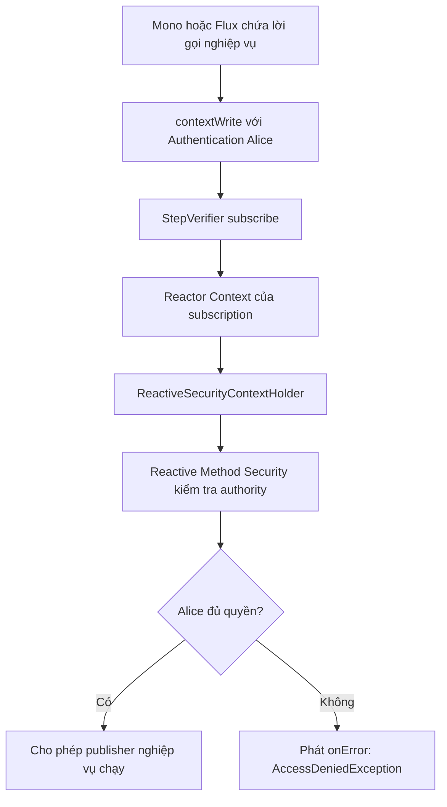

# Ngữ cảnh danh tính được đặt tường minh trong pipeline kiểm thử

Trong Spring WebFlux, một phương thức nghiệp vụ thường trả về `Mono` hoặc `Flux` và được bảo vệ bằng `@PreAuthorize`, `@PostAuthorize` hoặc một quy tắc Reactive method security. Khi kiểm thử trực tiếp những publisher này, câu hỏi không chỉ là “đã khởi tạo người dùng giả lập chưa?” mà còn là **danh tính ấy có thực sự nằm trong Reactor Context của subscription đang được xác minh không?**

Khác với lối suy nghĩ dựa trên `ThreadLocal`, Reactive SecurityContext phải theo được pipeline bất đồng bộ, kể cả khi đổi scheduler hoặc có nhiều subscriber. Một test tạo `Authentication` đúng nhưng không đưa nó vào **subscription** có thể bị từ chối ngoài ý muốn; ngược lại, dùng trạng thái toàn cục có thể làm test Alice và Bob ảnh hưởng nhau.

Bài học thuộc chương **Phương thức Reactive** của module **SPRING_SECURITY_TESTING**. Mục tiêu của module là kiểm chứng xác thực, phân quyền và bảo vệ HTTP trên Servlet và Reactive bằng `spring-security-test`, MockMvc, WebTestClient, `@WithMockUser`, SecurityContext, JWT/OAuth2/OIDC mô phỏng cùng các ca được phép hoặc bị từ chối. Trọng tâm bài này là **đặt tường minh danh tính bằng `ReactiveSecurityContextHolder.withAuthentication(...)` hoặc `withSecurityContext(...)`, kết hợp `contextWrite(...)` và `StepVerifier`** để kiểm thử method security tại đúng ranh giới subscription.

## 1. Tại sao Reactive SecurityContext không giống Servlet SecurityContext?

Trong ứng dụng Servlet, các đoạn mã đồng bộ thường đọc `SecurityContextHolder.getContext().getAuthentication()` từ ngữ cảnh gắn với thread xử lý request. Trong WebFlux, một request có thể đi qua nhiều toán tử và scheduler; việc giữ danh tính chỉ bằng `ThreadLocal` không phải mô hình bảo đảm xuyên suốt một chuỗi Reactive.

Spring Security dùng `ReactiveSecurityContextHolder` để đọc một `SecurityContext` từ **Reactor Context** gắn với subscriber. Khi một publisher được subscribe, context từ subscriber được truyền theo hướng về các toán tử **upstream**. Nhờ đó, tầng nghiệp vụ và cơ chế kiểm tra quyền có thể nhìn thấy authentication tương ứng với request/subscription.



Hình trên minh họa logic. Về cơ chế Reactor, `contextWrite` tạo/cập nhật context cho phía **upstream** tại thời điểm subscribe; nó không “ghi một biến toàn cục cho tất cả luồng”.

| Khái niệm | Công dụng | Điều cần tránh |
| --- | --- | --- |
| `Authentication` | Danh tính, trạng thái authenticated và `GrantedAuthority` | Gán quyền quá rộng cho mọi test |
| `SecurityContext` | Bao bọc `Authentication` | Coi một context dùng chung là an toàn cho Alice/Bob |
| `ReactiveSecurityContextHolder` | Đọc/đặt security context cho pipeline | Dùng `SecurityContextHolder` ThreadLocal thay cho Reactor Context |
| `contextWrite(...)` | Gắn Context vào subscription | Quên gắn vào publisher thực sự được subscribe |
| `StepVerifier` | Subscribe rồi xác minh `onNext`, `onComplete`, `onError` | Chỉ tạo `Mono` mà không subscribe |
| `@PreAuthorize` | Kiểm soát quyền trước khi chạy publisher nghiệp vụ | Gọi sai bean, bỏ qua Spring AOP proxy |

**Nguyên tắc trọng yếu:** test trực tiếp một phương thức Reactive không tự có HTTP request, nên cũng không tự có status `401` hoặc `403`. Ở mức service, ta xác minh tín hiệu **`onError`** chứa exception bảo mật; muốn xác minh mã HTTP phải thực hiện thêm test qua `WebTestClient` và security web filter.

## 2. Chuẩn bị môi trường và dependencies

Ví dụ sử dụng Java 17+, Spring Security 6.x, Reactor, JUnit 5 và Mockito. Trong ứng dụng Spring Boot, những phụ thuộc thường cần có:

```groovy
dependencies {
    implementation 'org.springframework.boot:spring-boot-starter-webflux'
    implementation 'org.springframework.boot:spring-boot-starter-security'

    testImplementation 'org.springframework.boot:spring-boot-starter-test'
    testImplementation 'org.springframework.security:spring-security-test'
    testImplementation 'io.projectreactor:reactor-test'
}
```

`reactor-test` cung cấp `StepVerifier`. Với những test ví dụ bên dưới, chỉ cần Spring Test context, không phải khởi động HTTP server hay giả lập OAuth2/JWT decoder.

Các ví dụ sử dụng `@MockitoBean` của Spring Framework 6.2+ (phù hợp Spring Boot 3.4+). Ở phiên bản Boot cũ, hãy sử dụng annotation mock bean tương thích phiên bản dự án. Không trộn các đoạn code từ nhiều phiên bản Spring Security nếu chưa kiểm tra API thực tế.

## 3. Một service Reactive có phương thức được bảo vệ

Giả sử ứng dụng có hai thao tác với báo cáo: đọc cần `SCOPE_reports.read`, phát hành cần `SCOPE_reports.write`. Chúng ta cố ý đặt collaborator tại ranh giới thực hiện nghiệp vụ để quan sát liệu logic được gọi khi quyền bị từ chối hay không.

```java
import reactor.core.publisher.Mono;

public interface ReportGateway {
    Mono<String> fetch(String reportId);
    Mono<Void> publish(String reportId);
}
```

```java
import org.springframework.security.access.prepost.PreAuthorize;
import org.springframework.stereotype.Service;
import reactor.core.publisher.Mono;

@Service
public class ReportService {
    private final ReportGateway gateway;

    public ReportService(ReportGateway gateway) {
        this.gateway = gateway;
    }

    @PreAuthorize("hasAuthority('SCOPE_reports.read')")
    public Mono<String> read(String reportId) {
        return Mono.defer(() -> gateway.fetch(reportId));
    }

    @PreAuthorize("hasAuthority('SCOPE_reports.write')")
    public Mono<Void> publish(String reportId) {
        return Mono.defer(() -> gateway.publish(reportId));
    }
}
```

Trong ví dụ:

1. `@PreAuthorize` được xử lý bởi **Spring Method Security**, không phải bằng câu lệnh `if` trong service.
2. `ReportService` phải được gọi qua **Spring-managed bean/proxy**; tạo trực tiếp `new ReportService(gateway)` sẽ bỏ qua interceptor bảo mật.
3. Hai phương thức trả `Mono`, phù hợp với Reactive method security.
4. `Mono.defer(...)` làm cho lời gọi `gateway.fetch` hoặc `gateway.publish` xảy ra khi publisher được **subscribe**, giúp ca kiểm thử “bị từ chối thì không gọi nghiệp vụ” có ý nghĩa. Nếu logic ghi dữ liệu chạy ngay khi dựng `Mono`, phương thức có thể gây tác dụng phụ trước khi security interceptor kiểm tra tại subscription; đó là thiết kế cần sửa.

**Cảnh báo:** `Mono.defer` không thay thế bảo mật. Quy tắc bảo mật vẫn đến từ `@PreAuthorize` trên bean có proxy và `@EnableReactiveMethodSecurity`; `defer` chỉ bảo đảm thao tác nghiệp vụ không chạy sớm khi dựng chuỗi.

## 4. Kích hoạt Reactive method security trong Spring Test context

Thay vì khởi động toàn bộ ứng dụng, ta có thể xây một context tối thiểu để kiểm thử đúng method-security proxy:

```java
import org.springframework.context.annotation.Configuration;
import org.springframework.security.config.annotation.method.configuration.EnableReactiveMethodSecurity;

@Configuration(proxyBeanMethods = false)
@EnableReactiveMethodSecurity
class ReactiveMethodsTestConfig {
}
```

`@EnableReactiveMethodSecurity` đăng ký các interceptor dùng để đánh giá annotation như `@PreAuthorize` trong chuỗi Reactive. Khi kiểm thử, cần cả lớp config này **và** bean `ReportService` do Spring tạo.

Một test context điển hình có thể dùng `@SpringJUnitConfig`:

```java
import org.springframework.test.context.junit.jupiter.SpringJUnitConfig;

@SpringJUnitConfig(classes = {
    ReactiveMethodsTestConfig.class,
    ReportService.class
})
class ReportServiceSecurityTest {
    // @Autowired ReportService phải là bean được Spring quản lý.
}
```

Nếu dự án đã có `@SpringBootTest` và bật Reactive method security trong application configuration, không phải khai báo lại config test riêng. Nhưng khi viết **unit test thuần** gọi `new ReportService(...)`, không được diễn giải các kết quả của test đó như bằng chứng `@PreAuthorize` đã thực thi.

## 5. Tạo Authentication tường minh cho từng principal

Khi mục tiêu là kiểm tra quyền chứ không kiểm tra cách đăng nhập HTTP, có thể tạo `Authentication` trực tiếp và chỉ định chính xác các authorities:

```java
import java.util.Arrays;
import java.util.List;

import org.springframework.security.authentication.UsernamePasswordAuthenticationToken;
import org.springframework.security.core.Authentication;
import org.springframework.security.core.GrantedAuthority;
import org.springframework.security.core.authority.SimpleGrantedAuthority;

static Authentication authenticated(String username, String... authorities) {
    List<GrantedAuthority> granted = Arrays.stream(authorities)
        .map(value -> (GrantedAuthority)
            new SimpleGrantedAuthority(value))
        .toList();

    return UsernamePasswordAuthenticationToken.authenticated(
        username, "unused-test-credential", granted);
}
```

Ví dụ:

```java
Authentication alice = authenticated(
    "alice", "SCOPE_reports.read");
Authentication bob = authenticated(
    "bob", "SCOPE_reports.write");
Authentication charlie = authenticated(
    "charlie"); // Đã xác thực, nhưng không có authorities.
```

Mỗi authentication này có `isAuthenticated() == true`. Điều đó **không** có nghĩa tất cả đều đọc/phát hành được báo cáo: `@PreAuthorize` vẫn kiểm tra `GrantedAuthority` mà phương thức yêu cầu.

Đây là fixture trực tiếp cho **method security**, không phải kiểm chứng chữ ký JWT, quá trình đăng nhập OAuth2/OIDC hoặc việc ánh xạ claim thành authority. Nếu cần xác minh những cơ chế đó, hãy có test riêng chạy qua filter/decoder hoặc converter tương ứng.

## 6. Phương thức cốt lõi: `contextWrite(withAuthentication(...))`

`ReactiveSecurityContextHolder.withAuthentication(authentication)` tạo một Reactor `Context` chứa security context tương ứng. Gắn context vào đúng publisher muốn kiểm thử:

```java
import static org.springframework.security.core.context
    .ReactiveSecurityContextHolder.withAuthentication;

Mono<String> result = reportService.read("report-01")
    .contextWrite(withAuthentication(
        authenticated("alice", "SCOPE_reports.read")));

StepVerifier.create(result)
    .expectNext("report data")
    .verifyComplete();
```

Đoạn trên giả định `ReportGateway.fetch("report-01")` đã được stub trả `Mono.just("report data")`. Khi `StepVerifier` subscribe, Reactor truyền Context đến method-security interceptor và lời gọi nghiệp vụ upstream.

Không viết:

```java
// SAI: gọi withAuthentication(...) nhưng không nối Context vào pipeline.
withAuthentication(authenticated("alice", "SCOPE_reports.read"));
StepVerifier.create(reportService.read("report-01"))
    .expectNext("report data")
    .verifyComplete();
```

Hàm `withAuthentication(...)` **trả về Context**, không tự kích hoạt một “phiên đăng nhập toàn cục”. Nếu không dùng Context ấy với `contextWrite`, không có lý do gì để subscription mới nhìn thấy Alice.

## 7. Bộ kiểm thử StepVerifier hoàn chỉnh: cho phép và từ chối

Đoạn dưới là một lớp test hoàn chỉnh theo cấu hình và service ở các mục trước. Nó dùng Mockito để quan sát collaborator nghiệp vụ, đồng thời kiểm tra tín hiệu Reactive khi thiếu authority.

```java
import org.junit.jupiter.api.Test;
import org.springframework.beans.factory.annotation.Autowired;
import org.springframework.security.access.AccessDeniedException;
import org.springframework.security.authentication.UsernamePasswordAuthenticationToken;
import org.springframework.security.core.Authentication;
import org.springframework.security.core.GrantedAuthority;
import org.springframework.security.core.authority.SimpleGrantedAuthority;
import org.springframework.security.core.context.ReactiveSecurityContextHolder;
import org.springframework.test.context.bean.override.mockito.MockitoBean;
import org.springframework.test.context.junit.jupiter.SpringJUnitConfig;
import reactor.core.publisher.Mono;
import reactor.test.StepVerifier;

import java.util.Arrays;
import java.util.List;

import static org.mockito.Mockito.times;
import static org.mockito.Mockito.verify;
import static org.mockito.Mockito.verifyNoInteractions;
import static org.mockito.Mockito.when;

@SpringJUnitConfig(classes = {
    ReactiveMethodsTestConfig.class,
    ReportService.class
})
class ReportServiceSecurityTest {

    @Autowired
    ReportService reportService;

    @MockitoBean
    ReportGateway gateway;

    private static Authentication auth(
            String username, String... authorities) {
        List<GrantedAuthority> grants = Arrays.stream(authorities)
            .map(value -> (GrantedAuthority)
                new SimpleGrantedAuthority(value))
            .toList();
        return UsernamePasswordAuthenticationToken.authenticated(
            username, "not-used", grants);
    }

    @Test
    void readerCanFetchReport() {
        when(gateway.fetch("r-01"))
            .thenReturn(Mono.just("report:01"));

        Mono<String> result = reportService.read("r-01")
            .contextWrite(ReactiveSecurityContextHolder.withAuthentication(
                auth("alice", "SCOPE_reports.read")));

        StepVerifier.create(result)
            .expectNext("report:01")
            .verifyComplete();

        verify(gateway, times(1)).fetch("r-01");
    }

    @Test
    void writerCannotFetchWithoutReadAuthority() {
        Mono<String> result = reportService.read("r-02")
            .contextWrite(ReactiveSecurityContextHolder.withAuthentication(
                auth("bob", "SCOPE_reports.write")));

        StepVerifier.create(result)
            .expectError(AccessDeniedException.class)
            .verify();

        verifyNoInteractions(gateway);
    }

    @Test
    void userWithoutAnyAuthorityCannotFetch() {
        Mono<String> result = reportService.read("r-03")
            .contextWrite(ReactiveSecurityContextHolder.withAuthentication(
                auth("charlie")));

        StepVerifier.create(result)
            .expectError(AccessDeniedException.class)
            .verify();

        verifyNoInteractions(gateway);
    }

    @Test
    void writerCanPublishReport() {
        when(gateway.publish("r-04")).thenReturn(Mono.empty());

        Mono<Void> result = reportService.publish("r-04")
            .contextWrite(ReactiveSecurityContextHolder.withAuthentication(
                auth("bob", "SCOPE_reports.write")));

        StepVerifier.create(result)
            .verifyComplete();

        verify(gateway, times(1)).publish("r-04");
    }

    @Test
    void readerCannotPublishReport() {
        Mono<Void> result = reportService.publish("r-05")
            .contextWrite(ReactiveSecurityContextHolder.withAuthentication(
                auth("alice", "SCOPE_reports.read")));

        StepVerifier.create(result)
            .expectError(AccessDeniedException.class)
            .verify();

        verifyNoInteractions(gateway);
    }
}
```

Mỗi phương thức `@Test` cần có bộ mock sạch, như cách Spring Test quản lý `@MockitoBean` với cơ chế reset mặc định. Trường hợp test cấu hình không reset mocks giữa các phương thức, phải dọn lịch sử tương tác theo chiến lược riêng trước khi dùng `verifyNoInteractions`.

Đọc kết quả theo hai lớp:

1. `StepVerifier` xác minh **publisher** được subscribe và phát ra giá trị, hoàn thành hay bị từ chối đúng loại exception.
2. `verify(gateway)` hoặc `verifyNoInteractions(gateway)` xác minh **hành vi nghiệp vụ** thực sự được gọi hoặc bị chặn, không chỉ nhìn bề ngoài tín hiệu Reactive.

Trong ví dụ, `ReportGateway` được gọi **bên trong `Mono.defer`**. Điều này giúp một ca thiếu quyền không vô tình gọi collaborator ngay ở giai đoạn dựng chuỗi.

## 8. Không có SecurityContext: kiểm tra riêng trường hợp chưa xác thực

Nếu test không gắn Context và không dùng `@WithMockUser`, một method yêu cầu authority sẽ không có authentication phù hợp. Tùy lớp interceptor/phiên bản Spring Security, sự thiếu vắng authentication có thể biểu hiện qua `AuthenticationCredentialsNotFoundException` (thuộc `AuthenticationException`) hoặc ngoại lệ từ chối truy cập.

Ca test có thể kiểm tra **nhóm lỗi bảo mật**, thay vì gắn cứng status HTTP không tồn tại trong service:

```java
import org.springframework.security.access.AccessDeniedException;
import org.springframework.security.core.AuthenticationException;

import static org.junit.jupiter.api.Assertions.assertTrue;

@Test
void noSecurityContextCannotReadReport() {
    StepVerifier.create(reportService.read("r-06"))
        .expectErrorSatisfies(error ->
            assertTrue(
                error instanceof AuthenticationException
                || error instanceof AccessDeniedException,
                "Expected a Spring Security authentication/authorization error"
            ))
        .verify();

    verifyNoInteractions(gateway);
}
```

Mục đích là khẳng định **không có danh tính hợp lệ** và **không có nghiệp vụ được gọi**, chứ không đồng nhất một exception cụ thể với `401` HTTP. Khi muốn xác minh status, cần test tầng WebFlux HTTP riêng vì `ExceptionTranslationWebFilter`/entry point quyết định cách ánh xạ exception sang phản hồi.

Nếu chạy test trong lớp có `@WithMockUser` ở cấp class, trường hợp “không có context” không còn thật sự ẩn danh. Đừng thêm annotation đặt principal toàn cục vào lớp test mà vẫn giả định `StepVerifier.create(service.read(...))` mặc định không có authentication.

## 9. Một publisher, hai subscription: Alice không biến thành Bob

Publisher có thể được subscribe nhiều lần; mỗi subscription cần nhận **context riêng**. Đây là lợi ích quan trọng của việc đặt security context bằng `contextWrite` thay vì sửa biến tĩnh hoặc `ThreadLocal`.

```java
@Test
void samePublisherCanBeSubscribedWithDifferentIdentities() {
    when(gateway.fetch("r-07"))
        .thenReturn(Mono.just("report:07"));

    // defer tạo lời gọi tới proxy mỗi lần subscription bắt đầu.
    Mono<String> source = Mono.defer(
        () -> reportService.read("r-07"));

    Mono<String> asAlice = source.contextWrite(
        ReactiveSecurityContextHolder.withAuthentication(
            auth("alice", "SCOPE_reports.read")));

    Mono<String> asBob = source.contextWrite(
        ReactiveSecurityContextHolder.withAuthentication(
            auth("bob", "SCOPE_reports.write")));

    StepVerifier.create(asAlice)
        .expectNext("report:07")
        .verifyComplete();

    StepVerifier.create(asBob)
        .expectError(AccessDeniedException.class)
        .verify();

    StepVerifier.create(asAlice)
        .expectNext("report:07")
        .verifyComplete();

    // Chỉ hai subscription hợp lệ thực hiện nghiệp vụ.
    verify(gateway, times(2)).fetch("r-07");
}
```

Kết quả mong muốn là **Alice được phép hai lần, Bob bị từ chối một lần**, bất kể thứ tự subscription. Không có thao tác “đặt Alice toàn cục, xóa Alice rồi đặt Bob”; danh tính đã được gắn vào mỗi pipeline cụ thể.

Đừng dùng `source.cache()` hoặc `share()` vô điều kiện với publisher phụ thuộc danh tính. Cache có thể tái sử dụng kết quả được tính cho một subscriber khác; nếu dữ liệu gắn với người dùng, cache phải có khóa và ranh giới bảo mật rõ ràng. Đó là một bài toán riêng về chia sẻ dữ liệu Reactive, không được giải quyết chỉ bởi `contextWrite`.

## 10. Đặt context đúng vị trí trong chuỗi `flatMap`

Một vấn đề thường gặp là logic được gọi **bên trong** `flatMap`, nhưng context lại gắn vào publisher không chứa bước đó. Ví dụ hợp lệ:

```java
when(gateway.fetch("r-08"))
    .thenReturn(Mono.just("report:08"));

Mono<String> pipeline = Mono.just("r-08")
    .flatMap(reportService::read)
    .contextWrite(ReactiveSecurityContextHolder.withAuthentication(
        auth("alice", "SCOPE_reports.read")));

StepVerifier.create(pipeline)
    .expectNext("report:08")
    .verifyComplete();
```

`contextWrite` đặt ở cuối pipeline theo cách viết này cung cấp Context cho những toán tử upstream, bao gồm `flatMap` và publisher con được subscribe bên trong.

Trường hợp dễ hiểu sai:

```java
Mono<String> pipeline = Mono.just("r-08")
    .contextWrite(ReactiveSecurityContextHolder.withAuthentication(
        auth("alice", "SCOPE_reports.read")))
    .flatMap(reportService::read);
```

Với cách viết này, `contextWrite` chỉ làm thay đổi Context đối với phần **upstream của chính nó**; `flatMap` đứng phía downstream không mặc nhiên nhận cùng thay đổi khi bắt đầu publisher con. Nếu gọi method security ở `flatMap`, cần đặt Context ở phạm vi bao phủ cả lời gọi `flatMap`.

Hãy kiểm tra **publisher cuối cùng mà `StepVerifier` subscribe**. Một đoạn code có `contextWrite` chưa chắc đã đúng nếu nó đặt sai nhánh hoặc không được nối vào pipeline đang kiểm thử.

## 11. Dùng `withSecurityContext` khi cần một SecurityContext có sẵn

Ngoài `withAuthentication`, API còn có `ReactiveSecurityContextHolder.withSecurityContext(Mono<SecurityContext>)`. Cách này phù hợp khi test cần cung cấp một đối tượng `SecurityContext` tường minh, ví dụ để tái sử dụng fixture đã tạo.

```java
import org.springframework.security.core.Authentication;
import org.springframework.security.core.context.SecurityContext;
import org.springframework.security.core.context.SecurityContextImpl;
import org.springframework.security.core.context.ReactiveSecurityContextHolder;
import reactor.core.publisher.Mono;

Authentication alice =
    auth("alice", "SCOPE_reports.read");

SecurityContext securityContext = new SecurityContextImpl(alice);

Mono<String> result = reportService.read("r-09")
    .contextWrite(ReactiveSecurityContextHolder.withSecurityContext(
        Mono.just(securityContext)));
```

Trong ví dụ này phải stub `gateway.fetch("r-09")` và subscribe bằng `StepVerifier` như ở mục 7 để kiểm tra đầu ra. Khi chỉ cần một `Authentication`, cách ngắn gọn hơn thường là `withAuthentication`.

Không dùng chung một đối tượng `SecurityContextImpl` **có thể thay đổi** giữa các test chạy song song, rồi đổi `setAuthentication` ngay khi publisher đang chạy. Tốt hơn là tạo context bất biến theo cách sử dụng hoặc tạo mới mỗi subscription/test.

## 12. Quan sát principal bên trong Reactor Context

Để kiểm tra trực tiếp danh tính được đưa vào pipeline, có thể xây một helper Reactive đọc context:

```java
import org.springframework.security.core.Authentication;
import org.springframework.security.core.context.ReactiveSecurityContextHolder;
import reactor.core.publisher.Mono;

Mono<String> currentUsername() {
    return ReactiveSecurityContextHolder.getContext()
        .map(context -> context.getAuthentication())
        .map(Authentication::getName);
}
```

Và kiểm thử:

```java
@Test
void contextContainsExactlyTheSubscriberIdentity() {
    StepVerifier.create(currentUsername()
            .contextWrite(
                ReactiveSecurityContextHolder.withAuthentication(
                    auth("alice", "SCOPE_reports.read"))))
        .expectNext("alice")
        .verifyComplete();

    StepVerifier.create(currentUsername()
            .contextWrite(
                ReactiveSecurityContextHolder.withAuthentication(
                    auth("bob", "SCOPE_reports.write"))))
        .expectNext("bob")
        .verifyComplete();

    // Không gắn context: không có principal để phát ra.
    StepVerifier.create(currentUsername())
        .verifyComplete();
}
```

Khi gọi `ReactiveSecurityContextHolder.getContext()` mà không có context, publisher hoàn thành rỗng. Cách này hữu ích để xác minh **identity propagation** độc lập với `@PreAuthorize`; tuy nhiên nó không thay thế test method security, bởi một helper tự đọc principal không chứng minh interceptor có hoạt động hay không.

Nếu test dùng các toán tử `publishOn` hoặc `subscribeOn`, Reactor Context vẫn được truyền theo pipeline Reactor theo quy tắc của thư viện. Ngược lại, tự gọi `subscribe()` bên trong service rồi thoát khỏi chuỗi có thể phá vỡ khả năng kiểm soát completion, lỗi và context; không làm điều này như một cách “để tác vụ chạy nền”.

## 13. So sánh cách đặt danh tính tường minh với `@WithMockUser`

`spring-security-test` hỗ trợ annotation `@WithMockUser` trong một số kịch bản kiểm thử Reactor khi TestExecutionListener tương ứng được bật. Đây là cách gọn để dùng **một người dùng cố định** cho toàn bộ phương thức test:

```java
import org.springframework.security.test.context.support.WithMockUser;

@Test
@WithMockUser(username = "reader", authorities = "SCOPE_reports.read")
void annotatedReaderCanRead() {
    when(gateway.fetch("r-10"))
        .thenReturn(Mono.just("report:10"));

    StepVerifier.create(reportService.read("r-10"))
        .expectNext("report:10")
        .verifyComplete();
}
```

Nhưng nếu cần **hai danh tính trong cùng test**, hoặc muốn đảm bảo context nằm chính xác trong một nhánh Reactor, nên dùng `withAuthentication(...)` và `contextWrite(...)`. Điều này cũng làm test rõ ràng hơn về nguồn gốc quyền truy cập.

| Mục tiêu | Công cụ phù hợp |
| --- | --- |
| Một danh tính cố định cho toàn phương thức test | `@WithMockUser` |
| Nhiều principal/authorities trong một test | `withAuthentication(...)` + `contextWrite(...)` |
| Quan sát lỗi/signal của `Mono`/`Flux` trực tiếp | `StepVerifier` |
| Kiểm tra HTTP 401/403 với WebFlux | `WebTestClient` và security web filters |
| Mô phỏng đăng nhập OAuth2/OIDC Reactive qua HTTP | `mockOAuth2Login()`, `mockOidcLogin()` |
| Mô phỏng JWT Reactive Resource Server | `mockJwt()` |
| Kiểm tra chữ ký, thời hạn token thật | `ReactiveJwtDecoder` thật và token ký bằng khóa test |

`@WithMockUser` không tạo OAuth2User, OidcUser hay Jwt. Còn `contextWrite(withAuthentication(...))` không mặc nhiên thực hiện bất kỳ cơ chế xác thực HTTP nào; nó chỉ cung cấp authentication đã dựng cho pipeline đang kiểm tra.

## 14. Liên hệ với WebTestClient: exception ở service khác HTTP status

Khi kiểm thử trực tiếp `ReportService.read(...)` bằng `StepVerifier`, thiếu quyền thường phát sinh `AccessDeniedException`. Khi cùng publisher được gọi thông qua một controller và `SecurityWebFilterChain`, Spring Security sẽ ánh xạ tình huống sang HTTP status theo entry point và access-denied handler.

Ví dụ controller WebFlux:

```java
import org.springframework.web.bind.annotation.GetMapping;
import org.springframework.web.bind.annotation.PathVariable;
import org.springframework.web.bind.annotation.RestController;
import reactor.core.publisher.Mono;

@RestController
class ReportController {
    private final ReportService reportService;

    ReportController(ReportService reportService) {
        this.reportService = reportService;
    }

    @GetMapping("/api/reports/{id}")
    Mono<String> read(@PathVariable String id) {
        return reportService.read(id);
    }
}
```

Với một `SecurityWebFilterChain` yêu cầu `authenticated()` và dùng HTTP Basic challenge, các request có thể kiểm tra bằng `WebTestClient`:

```java
import org.springframework.security.core.authority.SimpleGrantedAuthority;
import static org.springframework.security.test.web.reactive.server
    .SecurityMockServerConfigurers.mockUser;

WebTestClient alice = baseClient.mutateWith(
    mockUser("alice").authorities(
        new SimpleGrantedAuthority("SCOPE_reports.read")));

WebTestClient bob = baseClient.mutateWith(
    mockUser("bob").authorities(
        new SimpleGrantedAuthority("SCOPE_reports.write")));

// Các client này giả lập identity trên mock WebFlux context.
alice.get().uri("/api/reports/r-11")
    .exchange()
    .expectStatus().isOk();

bob.get().uri("/api/reports/r-11")
    .exchange()
    .expectStatus().isForbidden();

baseClient.get().uri("/api/reports/r-11")
    .exchange()
    .expectStatus().isUnauthorized();
```

Trong đoạn trên, `baseClient` phải được bind vào application context có `ReportController`, `ReportService`, `SecurityWebFilterChain`, `@EnableReactiveMethodSecurity` và đã áp dụng `springSecurity()`. Test thành công cũng cần stub hoặc implementation `ReportGateway.fetch("r-11")` trả dữ liệu thích hợp. Đây là **ví dụ liên kết giữa hai cấp test**, không phải một đoạn chạy độc lập khi chưa chuẩn bị context.

Sơ đồ phạm vi kiểm chứng:

```text
StepVerifier + contextWrite(Authentication)
    -> method-security proxy -> ReportService -> ReportGateway
    -> xác minh onNext/onError và interaction

WebTestClient + mockUser / mockJwt / mockOAuth2Login
    -> SecurityWebFilterChain -> Controller -> method-security proxy
    -> xác minh HTTP 200/401/403 và nội dung
```

Một test chỉ gửi `mockUser()` đến controller nhưng quên bật `@EnableReactiveMethodSecurity` có thể vẫn qua `authenticated()` của web filter, trong khi `@PreAuthorize` ở service **không được kiểm tra**. Vì vậy test trực tiếp method security và test HTTP bổ sung cho nhau.

## 15. Lỗi phổ biến khi kiểm thử ngữ cảnh Reactive

| Biểu hiện | Nguyên nhân khả dĩ | Cách kiểm tra hoặc khắc phục |
| --- | --- | --- |
| Test không thấy principal dù đã tạo `Authentication` | Không nối `withAuthentication` với `contextWrite` | Gắn vào publisher cuối cùng được subscribe |
| Test Alice và Bob lẫn quyền | Dùng biến context/global mutable, cache publisher hoặc reuse mock data | Tạo authentication/context riêng cho từng subscription |
| `@PreAuthorize` không có tác dụng | Service được `new` trực tiếp, self-invocation hoặc chưa bật `@EnableReactiveMethodSecurity` | Inject bean do Spring quản lý, kiểm tra proxy |
| Assertion chạy quá sớm | Không subscribe hoặc verify trước khi `StepVerifier` hoàn tất | Đặt `verify(...)` sau `verifyComplete()` / `verify()` |
| Collaborator bị gọi dù request thiếu quyền | Logic chạy eager khi dựng `Mono`, gọi `subscribe()` nội bộ, hay bypass proxy | Dùng `Mono.defer`, trả Publisher cho caller và kiểm tra đường gọi |
| Test thiếu quyền nhận loại lỗi khác mong đợi | Không có authentication, khác nhánh thiếu authority | Tách test anonymous và test authenticated-without-permission |
| Test `StepVerifier` đòi status HTTP `403` | Nhầm service publisher với HTTP layer | Assert `AccessDeniedException`; dùng WebTestClient cho HTTP |
| `SecurityContextHolder.getContext()` trả rỗng trong reactive service | Dựa vào ThreadLocal ngoài ngữ nghĩa Reactor | Dùng `ReactiveSecurityContextHolder.getContext()` |
| Test qua nhưng bị lỗi khi chạy đồng thời | Mocks hoặc context mutable dùng chung, DB/cache chia sẻ | Cô lập fixture, subscription và tài nguyên nghiệp vụ |
| Đã dùng `mockJwt()` rồi kết luận JWT thật được xác thực | Mock security context không kiểm chữ ký | Viết test với bearer + `ReactiveJwtDecoder` thật nếu mục tiêu yêu cầu |

### Chú ý `contextWrite` và thứ tự subscription

Một publisher được tạo không đồng nghĩa đã chạy; `StepVerifier.create(...)` tạo verifier, còn các lệnh `verify()`/`verifyComplete()` mới thực hiện subscription và đợi tín hiệu. Nếu ứng dụng có publisher hot, nguồn dữ liệu được chia sẻ hoặc side effect ngoài chuỗi, cần chọn kỹ thuật test phù hợp hơn; không mặc nhiên coi mọi publisher là cold.

### Chú ý method security với `Flux`

Các quy tắc bảo mật cũng có thể áp dụng cho phương thức trả `Flux<T>`. Khi đó `StepVerifier` cần kiểm tra nhiều phần tử hoặc `expectNextCount`. Quan trọng là xác minh người không đủ quyền **không nhận bất kỳ dữ liệu nhạy cảm nào** trước `onError`; tránh chỉ kiểm tra lỗi cuối chuỗi nếu dữ liệu đã bị phát ra trước đó.

Ví dụ:

```java
StepVerifier.create(
        reportService.streamReports()
            .contextWrite(
                ReactiveSecurityContextHolder.withAuthentication(
                    auth("viewer"))))
    .expectError(AccessDeniedException.class)
    .verify();
```

Đoạn này mang tính minh họa: cần tự định nghĩa `streamReports(): Flux<...>` có `@PreAuthorize` và collaborator tương ứng. Khi chạy thật, phải xác nhận tín hiệu `onNext` không xuất hiện trước lỗi (như `expectError` ngay sau subscription đã yêu cầu).

## 16. Bài thực hành và tiêu chí hoàn thành

Hãy mở rộng ví dụ với `ReportService.delete(String id)` trả `Mono<Void>` và yêu cầu `SCOPE_reports.delete`. Viết ít nhất các trường hợp sau:

1. Tạo `Authentication` Alice có `SCOPE_reports.delete`; gắn vào publisher bằng `contextWrite(withAuthentication(...))`; `StepVerifier.verifyComplete()` và xác minh `ReportGateway.delete(...)` được gọi một lần.
2. Tạo Bob chỉ có `SCOPE_reports.read`; subscribe `delete` với Context của Bob; xác nhận `AccessDeniedException` và không có interaction ghi dữ liệu.
3. Không đặt security context; xác nhận publisher kết thúc bằng lỗi xác thực/phân quyền phù hợp, và collaborator không được gọi.
4. Dùng cùng một nguồn `Mono.defer(() -> reportService.delete(...))` với hai context riêng; thực hiện Bob → Alice → Bob; xác nhận thứ tự không tạo ra sự rò rỉ quyền.
5. Viết `currentUsername()` với `ReactiveSecurityContextHolder.getContext()` và kiểm tra Alice/Bob trả đúng tên khi subscribe riêng.
6. Tạo controller `DELETE /api/reports/{id}` trên WebFlux và kiểm tra HTTP status (thường `401` khi anonymous, `403` khi thiếu authority, thành công theo contract khi đủ quyền). Chú ý CSRF với phương thức DELETE: cung cấp CSRF token hợp lệ trong test nếu web security đang bật CSRF, để `403` thực sự phản ánh method security.
7. Thử bỏ `@EnableReactiveMethodSecurity` trong một cấu hình test tạm thời. Ca thiếu quyền phải **không còn nhận lỗi như kỳ vọng**; đây là cách phát hiện test vô tình bỏ qua AOP security proxy. Khôi phục cấu hình sau thử nghiệm.

**Tiêu chí đạt:** phân biệt Reactor Context với `ThreadLocal`, đặt `Authentication` tường minh trong subscription bằng `contextWrite`, kiểm tra `@PreAuthorize` qua Spring bean được proxy, hiểu khác biệt giữa `onError` và HTTP `401/403`, đồng thời chứng minh bằng các ca được phép/bị từ chối rằng nghiệp vụ không chạy khi thiếu quyền.

### Tài liệu tham khảo

- [Spring Security — Reactive Method Security](https://docs.spring.io/spring-security/reference/reactive/authorization/method.html): `@EnableReactiveMethodSecurity`, `@PreAuthorize` và Reactor Context.
- [Spring Security — ReactiveSecurityContextHolder API](https://docs.spring.io/spring-security/reference/api/java/org/springframework/security/core/context/ReactiveSecurityContextHolder.html): `getContext()`, `withAuthentication(...)`, `withSecurityContext(...)`.
- [Spring Security — Testing Reactive Method Security](https://docs.spring.io/spring-security/reference/reactive/test/method.html): `StepVerifier` và ngữ cảnh security trong test.
- [Reactor — Context Reference](https://projectreactor.io/docs/core/release/reference/advancedFeatures/context.html): quy tắc context theo subscription, `contextWrite` và hướng truyền context.
