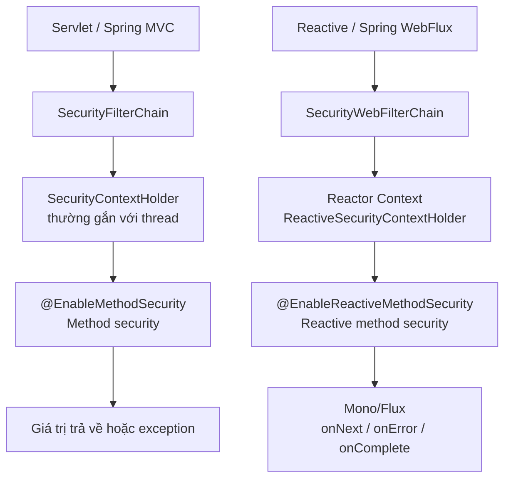

# Không giả định mọi annotation Servlet đều áp dụng giống hệt trong Reactive

> **Chương:** Phương thức Reactive  
> **Module:** `SPRING_SECURITY_TESTING`  
> **Mục tiêu:** Kiểm chứng xác thực, phân quyền và bảo vệ HTTP trong Spring Security qua `spring-security-test`, phân biệt rõ bảo mật phương thức của Servlet và WebFlux. Người học dùng `@WithMockUser`, `SecurityContext`, `StepVerifier`, `WebTestClient` và các helper JWT/OAuth2/OIDC khi phù hợp; hiểu vì sao cùng một annotation có thể cần hạ tầng, thời điểm thực thi và assertion khác nhau trên `Mono`/`Flux`.

## 1. Cùng tên annotation không đồng nghĩa cùng cơ chế thực thi

Khi chuyển từ Spring MVC sang Spring WebFlux, nhiều nhóm giữ nguyên `@PreAuthorize("hasRole('ADMIN')")` trên service rồi cho rằng phần bảo mật đã được chuyển thành công. Biểu thức phân quyền có thể giữ nguyên về ý nghĩa, nhưng **cơ chế cung cấp danh tính, thời điểm kiểm tra, kiểu trả về và cách kiểm thử** không còn giống luồng Servlet đồng bộ.

Trong Servlet, một request thường đi qua `SecurityFilterChain` và mã xử lý lấy authentication từ `SecurityContextHolder`. Trong Reactive, request đi qua `SecurityWebFilterChain`, còn phương thức trả `Mono`/`Flux` cần lấy danh tính từ **Reactor Context** thông qua `ReactiveSecurityContextHolder`. Việc tạo một publisher và việc subscribe publisher là hai giai đoạn khác nhau; lỗi phân quyền có thể xuất hiện như tín hiệu `onError` khi subscribe.

Ví dụ một service Reactive:

```java
@PreAuthorize("hasAuthority('SCOPE_invoices:read')")
public Mono<Invoice> readInvoice(String id) {
    return repository.findById(id);
}
```

Một test chỉ gọi `Mono<Invoice> result = service.readInvoice("inv-7");` mà không subscribe **chưa đủ** để chứng minh publisher có phát dữ liệu được phép hay từ chối. Cần dùng `StepVerifier`, `WebTestClient` hoặc subscriber phù hợp để quan sát tín hiệu thực thi.

### 1.1. Hai luồng bảo mật khác nhau



Test tốt cần chỉ ra cơ chế mà nó đang chạy: **HTTP filters bảo vệ request**, **method security bảo vệ bean method**, hay **authentication mechanism tạo principal từ credential/token**. Ba lớp có thể kết hợp, nhưng không thay thế cho nhau.

## 2. Bảng đối chiếu annotation và điểm khác biệt

| Annotation / API | Trong Servlet | Trong Reactive | Điều cần kiểm chứng |
| --- | --- | --- | --- |
| `@EnableMethodSecurity` | Bật method security theo hạ tầng imperative | Không phải cấu hình thay thế trực tiếp cho Reactive method security | Dùng `@EnableReactiveMethodSecurity` cho service Reactive |
| `@EnableReactiveMethodSecurity` | Không phải annotation cấu hình chính cho service MVC | Bật interceptor bảo mật phương thức dành cho Reactive | Bean là Spring bean, kiểu trả về được phiên bản hỗ trợ |
| `@PreAuthorize` | Thường đánh giá khi gọi phương thức, ném exception khi từ chối | Kiểm tra danh tính từ Reactor Context; kết quả từ chối có thể đi qua publisher dưới dạng `onError` | Subscribe publisher và assert đúng exception |
| `@PostAuthorize` | Kiểm tra sau khi có giá trị trả về | Có thể kiểm tra giá trị được phát từ publisher theo hỗ trợ của framework | Không dùng để bảo vệ side effect đã xảy ra trước đó |
| `@Secured` / `@RolesAllowed` | Có thể bật theo cờ cấu hình | Khả năng và cờ bật cần kiểm tra đúng phiên bản reactive đang dùng | Không mặc định mọi kiểu annotation đều đã được bật |
| `@PreFilter` / `@PostFilter` | Hỗ trợ các dạng tham số/kết quả collection nhất định | Không suy ra sẽ tự lọc từng item của `Flux` giống Java Collection | Kiểm tra tính năng hỗ trợ theo phiên bản và viết test nhiều phần tử |
| `@AuthenticationPrincipal` | Inject principal trong MVC controller | Có thể inject principal vào WebFlux handler; kiểu và cách resolve cần phù hợp | Dùng đúng principal JWT/OIDC/custom trong test |
| `@WithMockUser` | Chuẩn bị authentication qua Spring Security Test | Dùng được với Spring TestContext và tích hợp Reactor Context thích hợp | Có subscription/reactive test integration |
| `@WithUserDetails` | Dựa trên `UserDetailsService` để tạo principal test | Không tự suy ra nó sẽ gọi `ReactiveUserDetailsService` | Dùng fixture phù hợp hoặc custom `@WithSecurityContext` |
| `@WithAnonymousUser` | Tạo ca anonymous trong test | Tạo ca anonymous khi tích hợp Spring Security Test phù hợp | Phân biệt HTTP 401/redirect với service-level denial |

Không cần bỏ mọi annotation quen thuộc khi chuyển sang Reactive. Các biểu thức như `hasRole` và `hasAuthority` vẫn có ích, nhưng **đúng cấu hình, đúng luồng context và đúng loại publisher** quyết định kết quả thực tế.

### 2.1. Một ngoại lệ quan trọng: các phương thức không trả Publisher

Method security Reactive được thiết kế để làm việc với luồng phản ứng, đặc biệt các phương thức trả `Mono<T>` hoặc `Flux<T>`. Không nên mặc định một method trả `String`, `void`, `CompletableFuture<T>` hay một kiểu coroutine bất kỳ sẽ nhận cùng hành vi bảo mật với Servlet chỉ vì nó có `@PreAuthorize`.

Khi công việc thật có các kiểu trả về khác, hãy kiểm tra hợp đồng Spring Security của **phiên bản đang dùng**, và viết test cho chính phương thức đó. Với mã Java Reactor, cách ít gây nhầm lẫn nhất là biểu diễn tác vụ bảo mật dưới dạng `Mono` hoặc `Flux` và giữ toàn bộ xử lý bất đồng bộ trong pipeline.

## 3. Reactor Context không phải ThreadLocal của Servlet

Trong Spring MVC, nhiều đoạn mã đọc:

```java
Authentication authentication =
    SecurityContextHolder.getContext().getAuthentication();
```

Trong service WebFlux, phụ thuộc vào ThreadLocal ở một thời điểm tùy ý có thể dẫn đến thiếu danh tính, đặc biệt khi pipeline chuyển scheduler hoặc gọi các đoạn bất đồng bộ tự quản lý. Cách truy cập phù hợp là:

```java
Mono<String> currentUsername() {
    return ReactiveSecurityContextHolder.getContext()
        .map(SecurityContext::getAuthentication)
        .map(Authentication::getName);
}
```

Reactor Context là dữ liệu gắn với **subscription**, được truyền qua các operator Reactor phù hợp. Việc chuyển scheduler bằng `publishOn` hoặc `subscribeOn` trong cùng pipeline không tự đồng nghĩa mất context; điểm rủi ro thường là thoát khỏi pipeline để tạo tác vụ độc lập mà không truyền ngữ cảnh đúng cách.

Tránh mã sau trong service được bảo vệ:

```java
public Mono<Void> recordAudit(String event) {
    auditClient.send(event).subscribe(); // Tách tác vụ khỏi pipeline gọi.
    return Mono.empty();
}
```

Lệnh `subscribe()` thủ công tạo một subscription riêng. Nó khiến quản lý lỗi, hoàn thành tác vụ và việc truyền Reactor Context khó kiểm soát. Thay bằng:

```java
public Mono<Void> recordAudit(String event) {
    return auditClient.send(event);
}
```

Sau đó controller hoặc service gọi `recordAudit(...)` phải compose publisher bằng `then(...)`, `flatMap(...)` hoặc operator tương ứng. Hành vi bảo mật được đánh giá trong cùng luồng subscription do framework quản lý.

### 3.1. Tách dữ liệu identity khỏi logic nghiệp vụ

Một helper thích hợp cho WebFlux:

```java
public Mono<String> currentUserId() {
    return ReactiveSecurityContextHolder.getContext()
        .map(SecurityContext::getAuthentication)
        .map(Authentication::getName);
}
```

Nếu controller nhận `Principal` hoặc `Authentication` như argument mà framework resolve, đó cũng là cách hợp lệ. Nhưng đừng trộn tùy tiện `Authentication.getName()` với local user ID, `Jwt.getSubject()` hoặc `OidcUser.getSubject()`: kiểu principal phụ thuộc cơ chế đăng nhập thực.

`@WithMockUser(username = "lan")` tạo danh tính test với tên `lan`. Nó không chứng minh một JWT thực, HTTP Basic hoặc OIDC login sẽ tạo cùng tên/authority. Kiểm thử mapping danh tính phải được bổ sung ở lớp authentication tương ứng.

## 4. Xây dựng ví dụ WebFlux có bảo vệ phương thức

Giả sử ứng dụng quản lý hóa đơn với hai quyền:

- `SCOPE_invoices:read`: được phép tra cứu hóa đơn, nhưng chỉ xem hóa đơn có `owner` trùng người dùng hiện tại.
- `ROLE_ACCOUNTANT`: được phép thực hiện thao tác đánh dấu hóa đơn đã đối soát.

Ta muốn kiểm thử cả **quyền trước khi gọi phương thức** và **kiểm soát dữ liệu sau khi đọc**; đồng thời xác nhận không có side effect ở trường hợp bị chặn.

### 4.1. Dependency

Ví dụ Gradle cho Spring Boot 3.x / Spring Security 6.x, với phiên bản được quản lý đồng bộ bởi Spring Boot:

```groovy
dependencies {
    implementation("org.springframework.boot:spring-boot-starter-webflux")
    implementation("org.springframework.boot:spring-boot-starter-security")

    testImplementation("org.springframework.boot:spring-boot-starter-test")
    testImplementation("org.springframework.security:spring-security-test")
    testImplementation("io.projectreactor:reactor-test")
}
```

Trong ứng dụng thật, persistence có thể là R2DBC, MongoDB Reactive hoặc client HTTP dùng `WebClient`. Ở đây tạo interface để mock ở lớp dữ liệu, giữ service và interceptor bảo mật thật.

### 4.2. Dữ liệu và service

```java
public record Invoice(
        String id,
        String owner,
        String description) {}

public interface InvoiceGateway {
    Mono<Invoice> findById(String id);
    Mono<Void> reconcile(String id);
}
```

Service:

```java
@Service
public class InvoiceService {
    private final InvoiceGateway gateway;

    public InvoiceService(InvoiceGateway gateway) {
        this.gateway = gateway;
    }

    @PreAuthorize("hasAuthority('SCOPE_invoices:read')")
    @PostAuthorize("returnObject.owner() == authentication.name")
    public Mono<Invoice> readOwnedInvoice(String id) {
        return gateway.findById(id);
    }

    @PreAuthorize("hasRole('ACCOUNTANT')")
    public Mono<Void> reconcile(String id) {
        return gateway.reconcile(id);
    }
}
```

`@PreAuthorize` kiểm tra người dùng có authority đọc trước khi cho phép service thực thi. `@PostAuthorize` minh họa việc so sánh `owner` của hóa đơn được trả về với tên người dùng hiện tại. Cú pháp biểu thức và việc kiểm tra giá trị được phát cần được xác minh trên phiên bản Spring Security đang dùng, đặc biệt nếu đổi `Mono<Invoice>` thành `Flux<Invoice>` hoặc `Mono<List<Invoice>>`.

**Không dùng `@PostAuthorize` để bảo vệ thao tác ghi đã gây side effect.** Khi logic đọc hóa đơn trả dữ liệu về cho tầng method security, repository đã có thể thực hiện truy vấn trước khi bị từ chối. Với ghi dữ liệu hoặc gửi message, phải kiểm tra quyền **trước** side effect, như `@PreAuthorize` hoặc một authorization check có kiểm soát trong pipeline.

### 4.3. Hai lớp bảo mật phải được bật riêng

```java
@Configuration
@EnableWebFluxSecurity
@EnableReactiveMethodSecurity
class ReactiveSecurityConfig {

    @Bean
    SecurityWebFilterChain webSecurity(ServerHttpSecurity http) {
        return http
            .authorizeExchange(exchanges -> exchanges
                .pathMatchers("/health").permitAll()
                .pathMatchers("/api/invoices/**").authenticated()
                .anyExchange().denyAll())
            .httpBasic(Customizer.withDefaults())
            .build();
    }
}
```

`@EnableWebFluxSecurity` cấu hình hạ tầng WebFlux Security. `@EnableReactiveMethodSecurity` bật interception/authorization trên các method reactive được Spring quản lý. Nếu chỉ có WebFilter bảo vệ `authenticated()`, người dùng đã đăng nhập nhưng không có `SCOPE_invoices:read` có thể vượt qua tầng HTTP; **service annotation** mới bảo vệ scope.

Ở ví dụ này, `httpBasic` giúp test anonymous của `GET` nhận `401` theo entry point phù hợp. CSRF mặc định vẫn áp dụng với những HTTP method có thay đổi trạng thái; chúng ta sẽ đưa CSRF token cho test POST cần đi qua filter.

Controller đơn giản:

```java
@RestController
@RequestMapping("/api/invoices")
class InvoiceController {
    private final InvoiceService service;

    InvoiceController(InvoiceService service) {
        this.service = service;
    }

    @GetMapping("/{id}")
    Mono<Invoice> read(@PathVariable String id) {
        return service.readOwnedInvoice(id);
    }

    @PostMapping("/{id}/reconcile")
    Mono<ResponseEntity<Void>> reconcile(@PathVariable String id) {
        return service.reconcile(id)
            .thenReturn(ResponseEntity.noContent().build());
    }
}
```

Khi dùng `@EnableReactiveMethodSecurity`, hãy gọi phương thức bảo vệ **qua bean Spring**, chẳng hạn controller inject `InvoiceService`. Lời gọi nội bộ `this.reconcile(...)` từ một method khác trong cùng class có thể bỏ qua method interceptor trong cơ chế proxy thông thường; không được mặc định rằng self-invocation vẫn áp dụng `@PreAuthorize`.

## 5. Kiểm thử trực tiếp Reactive Method Security bằng StepVerifier

`StepVerifier` quan sát tín hiệu publisher: giá trị phát ra, tín hiệu lỗi và hoàn thành. Đây là cách phù hợp để kiểm tra `@PreAuthorize` và `@PostAuthorize` trên `Mono`, thay vì chỉ gọi method rồi không subscribe.

### 5.1. Cấu hình lớp test

```java
@SpringBootTest
class InvoiceMethodSecurityIT {
    @Autowired InvoiceService service;

    @MockitoBean InvoiceGateway gateway;
}
```

Ví dụ giả định Spring Boot quét được `InvoiceService` và cấu hình `ReactiveSecurityConfig`. `@MockitoBean` có ở Spring Framework 6.2+; với dự án cũ hơn có thể dùng `@MockBean` phù hợp. Khi dùng `@WithMockUser` trên publisher, phải có Spring Security Test và Spring TestContext với hỗ trợ Reactor Context (thường qua `ReactorContextTestExecutionListener`).

### 5.2. Có scope và đúng chủ sở hữu → cho phép

```java
@Test
@WithMockUser(
    username = "lan",
    authorities = "SCOPE_invoices:read")
void ownerWithScopeCanReadInvoice() {
    Invoice invoice =
        new Invoice("inv-7", "lan", "Quarterly invoice");
    when(gateway.findById("inv-7"))
        .thenReturn(Mono.just(invoice));

    StepVerifier.create(service.readOwnedInvoice("inv-7"))
        .expectNext(invoice)
        .verifyComplete();

    verify(gateway).findById("inv-7");
}
```

Ca này chứng minh cả `@PreAuthorize` (scope) và `@PostAuthorize` (owner) cho phép publisher phát hóa đơn.

### 5.3. Người dùng không có scope → từ chối trước gateway

```java
@Test
@WithMockUser(username = "minh", roles = "VIEWER")
void readerWithoutRequiredScopeIsDenied() {
    StepVerifier.create(service.readOwnedInvoice("inv-7"))
        .expectError(AccessDeniedException.class)
        .verify();

    verifyNoInteractions(gateway);
}
```

`@WithMockUser(roles = "VIEWER")` sinh authority `ROLE_VIEWER`, **không** sinh `SCOPE_invoices:read`. Đây là ca quan trọng để chứng minh method interceptor chặn call khi thiếu quyền. Nếu test nhận `Invoice` thay vì lỗi, kiểm tra có thật sự bật `@EnableReactiveMethodSecurity` và service có được inject qua Spring proxy.

### 5.4. Có scope nhưng không phải owner → từ chối sau khi đọc

```java
@Test
@WithMockUser(
    username = "minh",
    authorities = "SCOPE_invoices:read")
void scopeDoesNotOverrideOwnerRule() {
    when(gateway.findById("inv-7"))
        .thenReturn(Mono.just(
            new Invoice("inv-7", "lan", "Private invoice")));

    StepVerifier.create(service.readOwnedInvoice("inv-7"))
        .expectError(AccessDeniedException.class)
        .verify();

    verify(gateway).findById("inv-7");
}
```

Việc gateway được gọi ở ca này phù hợp với kiểm tra **sau** khi nhận dữ liệu. Nếu policy yêu cầu không được truy vấn dữ liệu của người khác, chuyển kiểm tra ownership vào truy vấn được giới hạn bởi principal hoặc dùng policy kiểm tra trước khi thực hiện I/O; không trông đợi `@PostAuthorize` ngăn query đã bắt đầu.

### 5.5. Chỉ đúng role mới được thực hiện side effect

```java
@Test
@WithMockUser(username = "lan", roles = "ACCOUNTANT")
void accountantCanReconcile() {
    when(gateway.reconcile("inv-7")).thenReturn(Mono.empty());

    StepVerifier.create(service.reconcile("inv-7"))
        .verifyComplete();

    verify(gateway).reconcile("inv-7");
}

@Test
@WithMockUser(username = "lan", roles = "VIEWER")
void viewerCannotReconcile() {
    StepVerifier.create(service.reconcile("inv-7"))
        .expectError(AccessDeniedException.class)
        .verify();

    verifyNoInteractions(gateway);
}
```

Một bộ test có cả ca được phép và bị từ chối sẽ phát hiện cấu hình chặn nhầm mọi request hoặc bỏ qua toàn bộ interceptor. Khi xét side effect, nên assert phụ thuộc **không được gọi** ở nhánh bị từ chối, chứ không chỉ assert kiểu exception.

### 5.6. Nếu @WithMockUser không truyền được vào Reactor Context

Trước khi thay logic nghiệp vụ, hãy kiểm tra test có dùng Spring Extension/TestContext và listener của Spring Security Test hay không. Một phép thử chẩn đoán nhỏ:

```java
@Test
@WithMockUser(username = "lan")
void testIdentityIsVisibleDuringSubscription() {
    Mono<String> name =
        ReactiveSecurityContextHolder.getContext()
            .map(SecurityContext::getAuthentication)
            .map(Authentication::getName);

    StepVerifier.create(name)
        .expectNext("lan")
        .verifyComplete();
}
```

Nếu dùng `@TestExecutionListeners` để tùy biến listener, đừng vô tình thay toàn bộ danh sách mặc định và loại phần thiết lập SecurityContext/Reactor Context. Không tự tạo publisher trên một thread rồi tách subscription sang hệ thống bất đồng bộ độc lập và kỳ vọng test context đi theo.

## 6. WebTestClient: kiểm tra HTTP Security và Reactive Method Security cùng lúc

Test trực tiếp service cho thấy method interceptor hoạt động. Nhưng nó chưa chứng minh HTTP request đi qua `SecurityWebFilterChain` và được dịch từ `AccessDeniedException` thành HTTP status phù hợp. Dùng `WebTestClient` để test từ ranh giới HTTP.

### 6.1. Bind vào application context có Spring Security

```java
@SpringBootTest(webEnvironment = SpringBootTest.WebEnvironment.MOCK)
class InvoiceHttpSecurityIT {
    @Autowired ApplicationContext applicationContext;

    @MockitoBean InvoiceGateway gateway;

    WebTestClient client;

    @BeforeEach
    void setup() {
        client = WebTestClient.bindToApplicationContext(applicationContext)
            .apply(SecurityMockServerConfigurers.springSecurity())
            .configureClient()
            .build();
    }
}
```

Các phương thức test tiếp theo nằm trong lớp trên. `springSecurity()` kết nối web filters bảo mật vào WebTestClient khi bind context. Khi test bằng `bindToController(controller)` mà không có chain, controller có thể chạy bình thường dù production chặn request.

### 6.2. Test anonymous, scope đúng, thiếu scope và sai owner

```java
@Test
void anonymousCannotRead() {
    client.get()
        .uri("/api/invoices/inv-7")
        .exchange()
        .expectStatus().isUnauthorized();

    verifyNoInteractions(gateway);
}

@Test
void readerWithCorrectScopeAndOwnerCanRead() {
    when(gateway.findById("inv-7"))
        .thenReturn(Mono.just(
            new Invoice("inv-7", "lan", "Quarterly invoice")));

    client.mutateWith(
            SecurityMockServerConfigurers.mockUser("lan")
                .authorities(new SimpleGrantedAuthority(
                    "SCOPE_invoices:read")))
        .get()
        .uri("/api/invoices/inv-7")
        .exchange()
        .expectStatus().isOk()
        .expectBody()
        .jsonPath("$.owner").isEqualTo("lan");
}

@Test
void readerWithoutScopeIsForbidden() {
    client.mutateWith(
            SecurityMockServerConfigurers.mockUser("minh")
                .roles("VIEWER"))
        .get()
        .uri("/api/invoices/inv-7")
        .exchange()
        .expectStatus().isForbidden();

    verifyNoInteractions(gateway);
}

@Test
void correctScopeButOtherOwnerIsForbidden() {
    when(gateway.findById("inv-7"))
        .thenReturn(Mono.just(
            new Invoice("inv-7", "lan", "Private invoice")));

    client.mutateWith(
            SecurityMockServerConfigurers.mockUser("minh")
                .authorities(new SimpleGrantedAuthority(
                    "SCOPE_invoices:read")))
        .get()
        .uri("/api/invoices/inv-7")
        .exchange()
        .expectStatus().isForbidden();
}
```

Với HTTP Basic và không bật form login trong ví dụ, anonymous vào đường `authenticated()` thường trả `401`. Nếu ứng dụng thực dùng form login/OAuth2 Login hoặc entry point tùy chỉnh, có thể trả redirect thay vì `401`; hãy assert theo chính security chain production.

### 6.3. POST có CSRF và role là hai hàng rào riêng

CSRF là kiểm tra ở WebFilter, trong khi `@PreAuthorize("hasRole('ACCOUNTANT')")` là kiểm tra ở method interceptor. Muốn chứng minh thiếu role, trước tiên phải gửi CSRF token hợp lệ.

```java
@Test
void accountantWithoutCsrfIsForbidden() {
    client.mutateWith(
            SecurityMockServerConfigurers.mockUser("lan")
                .roles("ACCOUNTANT"))
        .post()
        .uri("/api/invoices/inv-7/reconcile")
        .exchange()
        .expectStatus().isForbidden();

    verifyNoInteractions(gateway);
}

@Test
void viewerWithCsrfIsForbiddenByMethodSecurity() {
    client.mutateWith(
            SecurityMockServerConfigurers.mockUser("lan")
                .roles("VIEWER"))
        .mutateWith(SecurityMockServerConfigurers.csrf())
        .post()
        .uri("/api/invoices/inv-7/reconcile")
        .exchange()
        .expectStatus().isForbidden();

    verifyNoInteractions(gateway);
}

@Test
void accountantWithCsrfCanReconcile() {
    when(gateway.reconcile("inv-7")).thenReturn(Mono.empty());

    client.mutateWith(
            SecurityMockServerConfigurers.mockUser("lan")
                .roles("ACCOUNTANT"))
        .mutateWith(SecurityMockServerConfigurers.csrf())
        .post()
        .uri("/api/invoices/inv-7/reconcile")
        .exchange()
        .expectStatus().isNoContent();

    verify(gateway).reconcile("inv-7");
}
```

Nhóm test này phân biệt lỗi bảo vệ HTTP và lỗi method security, đồng thời kiểm tra tác vụ không chạy khi request bị chặn. `csrf()` là tiện ích test để request có CSRF token hợp lệ; nó không thay thế kiểm thử trình duyệt lấy token từ cookie/form và gửi lại qua nhiều request thật.

## 7. Tránh nhập nhằng MockMvc, WebTestClient và test listener

| Cách test | Loại hạ tầng | Hợp lý cho | Giới hạn |
| --- | --- | --- | --- |
| `MockMvc` và `SecurityMockMvcRequestPostProcessors.user()` | Servlet MVC | `SecurityFilterChain`, MVC controller, method security imperative | Không kiểm chứng `SecurityWebFilterChain` WebFlux |
| `WebTestClient.bindToApplicationContext(...).apply(springSecurity())` | WebFlux in-process | WebFilter chain, reactive handlers, method security trong HTTP request | Không tạo kết nối HTTP TCP thật |
| `WebTestClient.bindToServer()` | HTTP client qua network | Request đến server thật, header/cookie/token | `@WithMockUser` trong JUnit không tự đi qua network |
| `StepVerifier` + Spring TestContext | Service Reactive publisher | `@PreAuthorize`/`@PostAuthorize` và Reactor Context trong service | Không chứng minh HTTP status hoặc WebFilter |
| `@WithMockUser` | Test authentication giả lập | Role/authority, logic method đã có user | Không test user store, password, JWT decoder, OAuth2 callback |
| `mockJwt()`, `mockOAuth2Login()`, `mockOidcLogin()` | Test identity theo loại principal | Principal/authority từ JWT, OAuth2/OIDC trong controller | Không xác minh token thật hay login protocol |

Một lỗi chuyển nền tảng phổ biến là giữ `@AutoConfigureMockMvc` trong test của ứng dụng WebFlux rồi cho rằng filter chain được giữ nguyên. Với WebFlux, hãy sử dụng hạ tầng WebTestClient và cấu hình test phù hợp; đừng chọn tool chỉ vì annotation giống Spring MVC.

### 7.1. @WithMockUser không phải cùng một thứ với mockUser()

`@WithMockUser` được xử lý bởi Spring Security Test qua Spring TestContext; trong test reactive, cần tích hợp context với Reactor subscription. `SecurityMockServerConfigurers.mockUser()` trực tiếp điều chỉnh WebTestClient đã được tích hợp Spring Security. Có thể chọn:

```java
@Test
@WithMockUser(username = "lan", roles = "ACCOUNTANT")
void viaAnnotation() {
    // StepVerifier hoặc WebTestClient đã bind đúng context...
}

@Test
void viaMutator() {
    client.mutateWith(
        SecurityMockServerConfigurers.mockUser("lan")
            .roles("ACCOUNTANT"))
        .get().uri("/api/invoices/inv-7")
        .exchange();
}
```

Đoạn thứ hai chỉ minh họa cách gắn principal; để test đúng endpoint cần authority/fixture và assertion như các ca ở mục 6. Không nên mặc định `@WithMockUser` sẽ truyền principal tới server khác process khi test qua TCP.

### 7.2. @WithUserDetails cần chú ý đặc biệt

`@WithUserDetails` trong Spring Security Test thường truy vấn bean `UserDetailsService` imperative để tạo principal. WebFlux thường dùng `ReactiveUserDetailsService`, có hợp đồng khác. Vì vậy không nên đặt `@WithUserDetails("lan")` lên test Reactive rồi kết luận nó đang kiểm tra việc đọc user từ reactive store.

Nếu chỉ kiểm tra quyền, sử dụng `@WithMockUser` hoặc `mockUser()` với authorities cụ thể. Nếu cần custom principal:

- Xây `Authentication` thích hợp và dùng `mockAuthentication(...)` với WebTestClient.
- Hoặc tạo annotation `@WithSecurityContext` tùy chỉnh, kết hợp Spring Security Test/Reactor Context.
- Nếu mục tiêu là kiểm tra **xác thực thật** từ `ReactiveUserDetailsService`, giữ service/authentication manager thật và gửi HTTP Basic hoặc form credentials qua WebTestClient.

Không dùng mock principal để khẳng định hệ thống đã kiểm tra password encoder hay nguồn dữ liệu người dùng.

## 8. @PreAuthorize và @PostAuthorize có cùng mức an toàn không?

Hai annotation có thời điểm và hệ quả khác nhau:

| Câu hỏi | `@PreAuthorize` | `@PostAuthorize` |
| --- | --- | --- |
| Đánh giá trước hay sau kết quả nghiệp vụ? | Trước khi cho phép thao tác được bảo vệ | Sau khi có kết quả cần kiểm tra |
| Ngăn truy vấn/side effect từ đầu? | Phù hợp để ngăn khi không đủ quyền | Không bảo đảm ngăn I/O đã bắt đầu |
| Dùng kiểm tra quyền vai trò/scope? | Phù hợp | Có thể, nhưng thường không cần đợi kết quả |
| Dùng kiểm tra owner của dữ liệu trả về? | Cần có thông tin owner trước | Phù hợp với giá trị trả về hỗ trợ bởi framework |
| Với `Flux` nhiều phần tử? | Có thể chặn toàn luồng trước khi xử lý | Cần xác minh semantics cho từng phần tử/stream theo phiên bản |

Hãy đặt policy có thể quyết định **trước** khi truy cập dữ liệu vào `@PreAuthorize` hoặc query có điều kiện theo principal. `@PostAuthorize` phù hợp với những quyết định cần biết kết quả sau khi đọc và không làm thay đổi dữ liệu.

Ví dụ thay vì:

```java
@PostAuthorize("returnObject.owner() == authentication.name")
public Mono<Void> deleteInvoice(String id) {
    return repository.deleteById(id);
}
```

...hãy kiểm tra quyền trước khi xóa:

```java
@PreAuthorize("hasRole('ACCOUNTANT')")
public Mono<Void> deleteInvoice(String id) {
    return repository.deleteById(id);
}
```

Nếu chính sách còn đòi owner, bổ sung điều kiện owner trước khi thực hiện lệnh xóa, thường bằng một truy vấn có scope hoặc một kiểm tra trong pipeline. Đối với các thao tác ghi, `@PostAuthorize` trên `Mono<Void>` còn không có object phát ra để kiểm tra ownership như trong biểu thức minh họa.

### 8.1. @PreFilter và @PostFilter trên dữ liệu Reactive

Trong Servlet, một annotation filter có thể được dùng với collection có thể duyệt được. Với Reactive, dữ liệu có thể là `Flux<Invoice>` phát dần nhiều phần tử, có thể không có kích thước hữu hạn hoặc cần backpressure. **Đừng tự suy ra** `@PostFilter("filterObject.owner == authentication.name")` luôn lọc từng phát xạ của mọi `Flux` như khi áp dụng cho `List<Invoice>`.

Nếu business requirement là “chỉ trả hóa đơn thuộc về người dùng hiện tại”, cách rõ ràng thường là giới hạn ngay truy vấn:

```java
public Flux<Invoice> findOwnedInvoices(String ownerId) {
    return invoiceRepository.findAllByOwner(ownerId);
}
```

Nếu phải lọc ở pipeline, có thể dùng `filter(...)` hoặc `filterWhen(...)` với chính sách được kiểm soát, nhưng cần chắc chắn dữ liệu nhạy cảm không bị phát ra ngoài trước khi lọc, đồng thời kiểm tra authority, owner và context bằng test có nhiều phần tử. Tốt nhất là viết test cả một invoice của user và một invoice người khác, assert chỉ phần tử hợp lệ tới subscriber.

`@Secured` và `@RolesAllowed` cũng cần kiểm tra hỗ trợ và cờ bật của phiên bản Reactive đang dùng; không nên giả định cấu hình `@EnableMethodSecurity(securedEnabled = true, jsr250Enabled = true)` cho Servlet sẽ tự áp dụng tương đương cho `@EnableReactiveMethodSecurity`.

## 9. Principal từ JWT/OAuth2/OIDC không giống @WithMockUser

Khi WebFlux thực tế là Resource Server hoặc OAuth2/OIDC client, principal runtime có thể khác `org.springframework.security.core.userdetails.User`:

| Cơ chế | Principal thường gặp | Cách test nhanh | Test thêm để chứng minh authentication |
| --- | --- | --- | --- |
| HTTP Basic với user store | `UserDetails` | `mockUser()` hoặc `@WithMockUser` cho authorization | Gửi Basic header, giữ `ReactiveUserDetailsService` và password encoder thật |
| OAuth2 Login | `OAuth2User` | `mockOAuth2Login()` | Authorization-code callback + token/UserInfo stub |
| OIDC Login | `OidcUser` | `mockOidcLogin()` | ID Token validation, state/nonce và mapping thật |
| Bearer JWT Resource Server | `Jwt` qua `JwtAuthenticationToken` | `mockJwt()` | JWT ký thật, `ReactiveJwtDecoder` và JWKS thật/stub |

Trong service:

```java
@PreAuthorize("hasAuthority('SCOPE_invoices:read')")
public Mono<Invoice> readOwnedInvoice(String id) {
    return gateway.findById(id);
}
```

`@WithMockUser(authorities = "SCOPE_invoices:read")` giúp xác nhận quyền này được thực thi. Nhưng test không chạy `JwtGrantedAuthoritiesConverter` hay logic ánh xạ scope từ token thật. Nếu ứng dụng ánh xạ scope JWT thành `SCOPE_invoices:read`, cần test riêng converter với claim thực tế hoặc request có token thật.

Nếu biểu thức method security truy cập principal theo kiểu cụ thể, chẳng hạn `principal.claims['tenant_id']` trên JWT hoặc một custom OIDC principal, test dùng `@WithMockUser` có thể thất bại do kiểu dữ liệu khác. Hãy cung cấp principal phù hợp bằng `mockJwt()`, `mockOidcLogin()` hoặc custom authentication; kiểm tra cả allowed/denied với dữ liệu claim hợp lệ và bất hợp lệ.

## 10. Test slice có thể làm mất method interceptor

`@WebFluxTest(InvoiceController.class)` chỉ nạp một phần application context. Nếu service được mock bằng `@MockitoBean InvoiceService`, lời gọi đến service sẽ trả kết quả mock và **không đi qua `@PreAuthorize` của implementation thật**. Test có thể xanh mà không chứng minh phương thức được bảo vệ.

Để test method security trong HTTP request:

1. Nạp `InvoiceService` thật như Spring bean và bật `@EnableReactiveMethodSecurity`.
2. Mock `InvoiceGateway` hoặc phụ thuộc ngoài, không mock chính service đang chứa annotation.
3. Dùng WebTestClient bind vào context có `SecurityWebFilterChain` thật.
4. Viết cả ca có scope/role cho phép và thiếu scope/role bị từ chối.
5. Assert không có side effect khi bị chặn; với post-authorization, hiểu rằng truy vấn có thể đã chạy.

Nếu dùng full `@SpringBootTest`, hạ tầng dễ giống runtime hơn nhưng test nặng hơn. Nếu dùng slice, phải import đúng cấu hình reactive method security và bean service cần test. Chỉ thấy HTTP `403` chưa đủ: có thể chính HTTP matcher hoặc CSRF đang chặn trước method.

### 10.1. Self-invocation và các phép gọi ngoài Spring bean

Method security thường dựa trên interceptor quanh method call tới bean được Spring quản lý. Khi một method trong cùng class gọi method được bảo vệ bằng `this.someSecuredMethod()`, lời gọi có thể không đi qua interceptor; tạo service bằng `new InvoiceService(...)` cũng không tự áp dụng annotation.

Để kiểm chứng, viết test gọi **bean inject từ Spring**. Nếu cần bảo vệ lời gọi nội bộ, cân nhắc tách method sang bean khác hoặc thiết kế một authorization check rõ ràng trước thao tác. Không thử “sửa” bằng cách tăng số lượng `@WithMockUser` trong test.

## 11. Các lỗi thường gặp khi chuyển từ Servlet sang Reactive

| Hiện tượng | Nguyên nhân có thể | Cách kiểm tra |
| --- | --- | --- |
| `@PreAuthorize` không chặn dù service có annotation | Chưa bật `@EnableReactiveMethodSecurity`, gọi trực tiếp instance hoặc tự gọi nội bộ | Kiểm tra cấu hình, Spring bean và cách gọi |
| Test chỉ gọi method, không thấy exception | Publisher chưa được subscribe | Dùng `StepVerifier` hoặc HTTP test chờ response |
| `@WithMockUser` có trên JUnit nhưng service không thấy user | Thiếu Spring TestContext/Reactor Context integration | Kiểm tra listener, subscription và test framework |
| Code reactive đọc user sai hoặc rỗng | Đọc ThreadLocal `SecurityContextHolder` thay vì Reactor Context | Dùng `ReactiveSecurityContextHolder` hoặc handler argument |
| Tại sao có scope mà vẫn `403`? | `hasRole` yêu cầu `ROLE_...`, còn scope thường là `SCOPE_...` | Assert chính xác authorities và biểu thức |
| Test POST thiếu role trả `403` nhưng annotation không chạy | CSRF chặn request trước method | Gửi CSRF hợp lệ khi kiểm tra role |
| Test trả `200` dù thiếu quyền method | Slice mock luôn service, thiếu reactive method security | Dùng service thật và mock repository/client phía sau |
| `@PostAuthorize` báo lỗi sau khi đã truy vấn | Post-authorization kiểm tra kết quả sau khi lấy dữ liệu | Không dùng nó để chặn side effect; chuyển điều kiện quan trọng sang pre-check |
| `Flux` bị lọc sai kỳ vọng | Dùng suy luận từ `@PostFilter` trên `List` | Kiểm tra hỗ trợ/semantics của phiên bản; test từng emission |
| Test với `@WithUserDetails` không chạy | Chỉ có `ReactiveUserDetailsService`, nhưng annotation mong `UserDetailsService` imperative | Tạo mock/custom security context hoặc test login thật |
| `MockMvc` test pass nhưng WebFlux không được bảo vệ | Dùng hạ tầng Servlet cho ứng dụng Reactive | Dùng WebTestClient + `springSecurity()` và correct chain |
| JWT/OIDC test xanh nhưng token thật sai chữ ký | Test dùng `mockJwt()` hoặc `@WithMockUser` | Thêm test token ký thật + decoder/callback |
| Đổi scheduler làm mất identity ở tác vụ ngoài | Tự tạo subscription/executor ngoài pipeline | Truyền context đúng hoặc compose vào cùng publisher |

Khi phân tích lỗi, có thể bật DEBUG cho `org.springframework.security` trong môi trường test, quan sát WebFilter, method authorization và loại principal. Tránh ghi raw JWT, cookie phiên, mật khẩu hoặc dữ liệu nhạy cảm vào CI logs.

## 12. Bài thực hành và tiêu chí đạt

Xây một ứng dụng WebFlux dùng `InvoiceService` ở mục 4, bảo vệ bằng `@EnableReactiveMethodSecurity` và HTTP Basic/JWT tùy thiết kế. Thực hiện bài test theo các bước:

1. Viết `StepVerifier` cho người dùng có `SCOPE_invoices:read` và đúng owner: nhận hóa đơn và hoàn thành.
2. Với người dùng thiếu scope: nhận `AccessDeniedException` và xác minh `InvoiceGateway` không bị gọi.
3. Với người dùng có scope nhưng sai owner: test `@PostAuthorize` trả lỗi và giải thích vì sao truy vấn đã có thể thực hiện.
4. Với thao tác `reconcile`, kiểm tra `ROLE_ACCOUNTANT` được phép còn `ROLE_VIEWER` bị từ chối trước side effect.
5. Lặp lại các tình huống quan trọng qua `WebTestClient` và `SecurityWebFilterChain`: có `200`, `401` hoặc redirect theo entry point, `403` do method, và POST có/không có CSRF.
6. Dùng `@WithMockUser` trên `StepVerifier` và `mockUser()` trên WebTestClient; giải thích dữ liệu authentication đến từ đâu.
7. Tạo một test slice cố ý mock `InvoiceService`, quan sát annotation không còn được kiểm chứng; sửa bằng cách giữ bean service thật và mock gateway.
8. Thêm một ca `mockJwt()` và một ca JWT Bearer thật để nhận diện đâu là kiểm thử authorization, đâu là xác thực token qua decoder.
9. Kiểm tra `@PreFilter`/`@PostFilter` hoặc các annotation bổ sung trước khi áp dụng cho `Flux` bằng một test nhiều phần tử và tài liệu phiên bản dự án.

Một bài làm đạt khi:

- Dùng đúng `@EnableReactiveMethodSecurity` và Spring bean được quản lý cho các method trả publisher.
- Hiểu `SecurityContext` trong Reactor subscription, không ngầm dùng ThreadLocal Servlet.
- Quan sát được lỗi và thành công qua `StepVerifier` hoặc WebTestClient, không dừng ở việc tạo `Mono`.
- Tách được HTTP filter, CSRF, method authorization và authentication thực; các ca bị từ chối không gây side effect ngoài ý muốn.
- Biết giới hạn của `@WithMockUser`, `@WithUserDetails`, `@PreFilter`/`@PostFilter` và các principal JWT/OAuth2/OIDC khi làm việc với WebFlux.

**Ghi nhớ:** Giữ nguyên tên `@PreAuthorize` không có nghĩa giữ nguyên toàn bộ hành vi Servlet. Trong WebFlux, cần **Reactive method security đúng phiên bản**, **Reactor Context đúng subscription**, **bean/interceptor thật** và **bài test subscribe publisher**. Chỉ khi đó mới có bằng chứng rằng phương thức Reactive được bảo vệ như chính sách yêu cầu.
