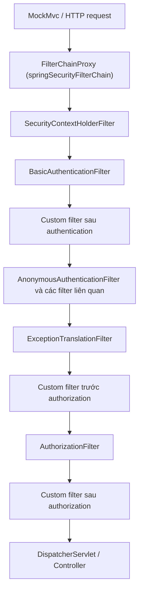

# Kiểm thử tích hợp để xác nhận vị trí filter trong SecurityFilterChain

Trong chương **Filter và cơ chế tùy biến** của module **SPRING_SECURITY_TESTING**, mục tiêu là kiểm chứng xác thực, phân quyền và bảo vệ HTTP thực tế bằng `spring-security-test`. Người học dùng `MockMvc` trên ứng dụng Servlet và `WebTestClient` trên ứng dụng Reactive, kết hợp `@WithMockUser`, `SecurityContext`, JWT/OAuth2/OIDC giả lập và các ca **được phép hoặc bị từ chối**. Khi thêm một filter bảo mật tùy biến, việc test nó chạy được là chưa đủ: **filter phải nằm đúng vị trí trong chuỗi bảo mật để nhìn thấy danh tính cần thiết, xử lý request đúng lúc và không vô tình bỏ qua cơ chế bảo vệ khác**.

Ví dụ, một filter ghi nhật ký truy cập cần đọc principal đã xác thực. Nếu nó chạy **trước** `BasicAuthenticationFilter`, lúc kiểm tra request có thể chưa có principal. Ngược lại, một filter cần tiền xử lý request trước lúc quyết định phân quyền phải chạy **trước** `AuthorizationFilter`. Nếu đặt sau `AuthorizationFilter`, filter có thể không bao giờ chạy khi request bị từ chối.

Bài này hướng dẫn viết **integration test với filter chain thật** bằng `MockMvc` để chứng minh thứ tự tương đối giữa filter tùy biến và filter của Spring Security. Cùng với test HTTP `200`/`401`/`403`, ta sẽ kiểm tra dấu vết request, thử cả nhánh bị chặn trước khi tới controller, kiểm tra cấu trúc chuỗi filter và nhận diện khác biệt với `SecurityWebFilterChain` của WebFlux.

## 1. Vì sao thứ tự filter quyết định kết quả bảo mật?

Trong Servlet, một request thường đi qua các thành phần theo thứ tự tương đối:



Sơ đồ tập trung vào các mốc cần thiết cho bài học; chuỗi thực còn có nhiều filter khác và có thể thay đổi theo cơ chế đăng nhập, session, CSRF, CORS, phiên bản Spring Security và cấu hình ứng dụng. Những mốc có ý nghĩa:

- **Sau xác thực:** filter có thể đọc `SecurityContextHolder.getContext().getAuthentication()` nếu cơ chế đăng nhập đã chạy thành công.
- **Trước phân quyền:** filter có thể thu thập dữ liệu, kiểm tra một điều kiện nghiệp vụ hoặc ghi dấu vết *trước* quyết định của `AuthorizationFilter`.
- **Sau phân quyền:** filter chỉ được đi tới khi các filter phía trước đã gọi tiếp `FilterChain.doFilter(...)`; nếu authorization từ chối, filter phía sau không được chạy.
- **Phạm vi chuỗi:** một `SecurityFilterChain` chỉ áp dụng cho request khớp `RequestMatcher` của nó; filter thêm vào chuỗi đó không tự chạy ở tất cả URL.

Với một request bị chặn, việc thiếu dấu vết của filter phía sau có thể chính là bằng chứng của vị trí mong đợi. Test chỉ kiểm tra controller trả `403` không thể chứng minh filter của ta đã chạy trước hay sau điểm từ chối.

## 2. Phân biệt filter Servlet với filter trong Spring Security

Trong hệ sinh thái Servlet có hai phạm vi dễ nhầm:

| Thành phần | Đăng ký ở đâu? | Hệ quả đối với kiểm thử |
| --- | --- | --- |
| Servlet `Filter` được container quản lý | Qua `FilterRegistrationBean`, `@WebFilter` hoặc cơ chế đăng ký servlet | Chạy theo thứ tự filter của container, có thể nằm bên ngoài `FilterChainProxy` |
| Spring Security `FilterChainProxy` | Bản thân là một Servlet filter tên thường gặp `springSecurityFilterChain` | Chọn `SecurityFilterChain` phù hợp với request và gọi các security filters bên trong |
| Custom filter thêm bằng `HttpSecurity.addFilterBefore/After` | Bên trong một `SecurityFilterChain` | Thứ tự được xác lập tương đối với một loại security filter đã biết |
| `OncePerRequestFilter` | Một kiểu nền để viết Servlet filter | Hỗ trợ tránh chạy lặp theo dispatch phù hợp, **không tự quy định thứ tự** |
| `WebFilter` của Spring WebFlux | Bên trong cơ chế WebFlux, có thể được thêm vào `SecurityWebFilterChain` | Dùng Reactor context và `WebTestClient`, không sử dụng trực tiếp Servlet `FilterChain` |

Một lỗi cấu hình phổ biến là biến custom `Filter` thành Spring bean được container tự đăng ký, **đồng thời** thêm cùng filter vào `HttpSecurity`. Khi đó filter có thể chạy hai lần hoặc chạy ngoài vị trí dự kiến. Nếu mục tiêu là filter thuộc chuỗi Spring Security, hãy kiểm soát đăng ký để nó chỉ được gắn đúng chỗ; nếu filter cũng là bean, cân nhắc vô hiệu hóa đăng ký Servlet tự động bằng một `FilterRegistrationBean` có `setEnabled(false)` và xác minh setup ứng dụng.

## 3. Các API gắn filter và điều cần chứng minh

Spring Security Servlet cung cấp các điểm mở rộng thông dụng:

```java
http.addFilterBefore(customFilter, BasicAuthenticationFilter.class);
http.addFilterAfter(customFilter, BasicAuthenticationFilter.class);
http.addFilterAt(customFilter, UsernamePasswordAuthenticationFilter.class);
```

| API | Ý nghĩa | Test nên khẳng định |
| --- | --- | --- |
| `addFilterBefore(A, B.class)` | Đặt `A` trước vị trí thứ tự đăng ký cho loại `B` | `A` thực thi trước `B` đối với request đi qua cả hai |
| `addFilterAfter(A, B.class)` | Đặt `A` sau vị trí thứ tự đăng ký cho loại `B` | `A` thấy trạng thái do `B` tạo ra, nếu `B` cho request đi tiếp |
| `addFilterAt(A, B.class)` | Đặt `A` ở cùng vị trí thứ tự với `B` | Không dựa vào thứ tự xác định giữa nhiều filter cùng vị trí; xem xét thay cơ chế thay vì chỉ thêm cạnh nó |
| `securityMatcher(...)` | Chọn toàn bộ `SecurityFilterChain` cho request | Đúng endpoint đi qua chain có filter; endpoint khác có thể dùng chain khác |
| `authorizeHttpRequests(...requestMatchers(...))` | Xác định quyền **bên trong** chain đã chọn | Endpoint `permitAll` vẫn có thể đi qua custom filter nằm trong chain |

**Không lấy `@Order` trên một filter bất kỳ để suy ra vị trí của nó trong `SecurityFilterChain`.** `@Order` thường liên quan đến thứ tự của bean/container filter hoặc các chain, trong khi `HttpSecurity` quản lý thứ tự security filters nội bộ theo registry riêng. Khi ứng dụng có nhiều chain, `@Order` đặt trên các bean `SecurityFilterChain` quyết định thứ tự chúng được xét để chọn chuỗi đầu tiên khớp request.

## 4. Ví dụ: kiểm tra một filter ở sau HTTP Basic và hai filter quanh AuthorizationFilter

Ta xây dựng tình huống Servlet có ba filter thử nghiệm:

1. `PrincipalProbeFilter` đặt **sau `BasicAuthenticationFilter`**; nó ghi tên authentication quan sát được vào request attribute `probe.principal`.
2. `TraceFilter("before-authz")` đặt **trước `AuthorizationFilter`**; nó thêm mốc vào attribute `probe.trace`.
3. `TraceFilter("after-authz")` đặt **sau `AuthorizationFilter`**; nó thêm mốc vào cùng attribute **nếu request được cho đi tiếp**.

Các dấu vết chỉ nằm trong request của test, không ghi credential hay token vào log. Đây là kỹ thuật quan sát dành cho ví dụ; trong production cần tránh ghi dữ liệu nhạy cảm vào response hoặc log.

### 4.1. Filter đọc principal sau Basic Authentication

```java
import jakarta.servlet.FilterChain;
import jakarta.servlet.ServletException;
import jakarta.servlet.http.HttpServletRequest;
import jakarta.servlet.http.HttpServletResponse;
import java.io.IOException;
import org.springframework.security.core.Authentication;
import org.springframework.security.core.context.SecurityContextHolder;
import org.springframework.web.filter.OncePerRequestFilter;

final class PrincipalProbeFilter extends OncePerRequestFilter {

    @Override
    protected void doFilterInternal(
            HttpServletRequest request,
            HttpServletResponse response,
            FilterChain chain)
            throws ServletException, IOException {

        Authentication authentication =
                SecurityContextHolder.getContext().getAuthentication();

        request.setAttribute(
                "probe.principal",
                authentication == null ? "(none)" : authentication.getName());

        chain.doFilter(request, response);
    }
}
```

Khi request có HTTP Basic credential hợp lệ, `BasicAuthenticationFilter` thực hiện xác thực rồi đặt kết quả vào security context trước khi gọi filter phía sau. Vì thế filter trên dự kiến thấy tên `alice` hoặc `bob`. Với request không gửi credential, tại vị trí **ngay sau BasicAuthenticationFilter** nhưng **trước AnonymousAuthenticationFilter**, nó có thể thấy `null`. Khi thông tin Basic sai, `BasicAuthenticationFilter` có thể trực tiếp gọi authentication entry point và không gọi tiếp chuỗi; lúc ấy probe không chạy.

### 4.2. Filter ghi dấu vết theo đúng thứ tự chạy

```java
import jakarta.servlet.Filter;
import jakarta.servlet.FilterChain;
import jakarta.servlet.ServletException;
import jakarta.servlet.ServletRequest;
import jakarta.servlet.ServletResponse;
import java.io.IOException;

final class TraceFilter implements Filter {

    private final String marker;

    TraceFilter(String marker) {
        this.marker = marker;
    }

    String marker() {
        return marker;
    }

    @Override
    public void doFilter(
            ServletRequest request,
            ServletResponse response,
            FilterChain chain)
            throws IOException, ServletException {

        String previous = (String) request.getAttribute("probe.trace");
        String next = previous == null ? marker : previous + ">" + marker;
        request.setAttribute("probe.trace", next);

        chain.doFilter(request, response);
    }
}
```

Ta dùng `Filter` thuần cho hai `TraceFilter` vì ví dụ muốn quan sát **mỗi instance**. Nếu sử dụng hai instance cùng loại `OncePerRequestFilter` mà không phân biệt tên marker “đã lọc”, cơ chế tránh chạy lặp theo request có thể làm kết quả khó hiểu. Trong ứng dụng thực, hãy thiết kế registration và ngữ nghĩa “once per request” theo dispatcher type một cách có chủ đích.

### 4.3. Cấu hình SecurityFilterChain và controller

Ví dụ hướng tới Spring Boot 3.x/Spring Security 6.x (Servlet Jakarta). Cấu hình tối thiểu:

```java
import org.springframework.context.annotation.Bean;
import org.springframework.context.annotation.Configuration;
import org.springframework.security.config.Customizer;
import org.springframework.security.config.annotation.web.builders.HttpSecurity;
import org.springframework.security.config.annotation.web.configuration.EnableWebSecurity;
import org.springframework.security.core.userdetails.User;
import org.springframework.security.core.userdetails.UserDetailsService;
import org.springframework.security.provisioning.InMemoryUserDetailsManager;
import org.springframework.security.web.SecurityFilterChain;
import org.springframework.security.web.access.intercept.AuthorizationFilter;
import org.springframework.security.web.authentication.www.BasicAuthenticationFilter;
import org.springframework.web.bind.annotation.GetMapping;
import org.springframework.web.bind.annotation.RestController;

@Configuration
@EnableWebSecurity
class ProbeSecurityConfig {

    @Bean
    SecurityFilterChain apiSecurity(HttpSecurity http) throws Exception {
        http.securityMatcher("/api/**")
            .authorizeHttpRequests(authorize -> authorize
                .requestMatchers("/api/public").permitAll()
                .requestMatchers("/api/private").hasRole("READER")
                .anyRequest().denyAll())
            .httpBasic(Customizer.withDefaults());

        http.addFilterAfter(
                new PrincipalProbeFilter(), BasicAuthenticationFilter.class);
        http.addFilterBefore(
                new TraceFilter("before-authz"), AuthorizationFilter.class);
        http.addFilterAfter(
                new TraceFilter("after-authz"), AuthorizationFilter.class);

        return http.build();
    }

    @Bean
    UserDetailsService users() {
        return new InMemoryUserDetailsManager(
            User.withUsername("alice")
                .password("{noop}pw").roles("READER").build(),
            User.withUsername("bob")
                .password("{noop}pw").roles("GUEST").build());
    }
}

@RestController
class ProbeController {

    @GetMapping("/api/private")
    String privateResource() {
        return "private";
    }

    @GetMapping("/api/public")
    String publicResource() {
        return "public";
    }
}
```

Những điểm cần hiểu:

- `securityMatcher("/api/**")` chọn các request chạy vào chain này; `/api/private` và `/api/public` đều khớp.
- `permitAll()` cho `/api/public` **không có nghĩa là các filter phía trước bị bỏ qua**.
- `hasRole("READER")` yêu cầu authority `ROLE_READER`. Người dùng `alice` có quyền, `bob` chỉ có `ROLE_GUEST`.
- `httpBasic(...)` xử lý header `Authorization: Basic ...`. Test dùng **credential HTTP thật đi qua filter**, không trực tiếp nhét principal vào `SecurityContext`.
- Bộ filter thử nghiệm được tạo **trực tiếp khi cấu hình `HttpSecurity`**, không khai báo thêm bean Servlet filter để tránh đăng ký hai lần.

Vì `/api/**` là chain duy nhất trong cấu hình minh họa, cần kiểm soát các đường dẫn ngoài phạm vi này khi dùng trong ứng dụng thật. Một hệ thống có nhiều chain thường có chain fallback bảo vệ những request chưa khớp; không mở rộng chính sách từ ví dụ sang toàn hệ thống mà bỏ qua các endpoint khác.

## 5. Integration test MockMvc xác minh hành vi thật

Sau khi có `ProbeSecurityConfig` và `ProbeController`, dùng `@SpringBootTest` với `@AutoConfigureMockMvc` để đảm bảo Spring Security filters được gắn vào `MockMvc`. Ví dụ dưới khai báo một Spring Boot test context tối thiểu và import chính xác hai lớp ở mục 4, tránh phụ thuộc vào component scan của ứng dụng lớn.

```java
import static org.hamcrest.Matchers.equalTo;
import static org.hamcrest.Matchers.nullValue;
import static org.springframework.security.test.web.servlet.request
        .SecurityMockMvcRequestPostProcessors.httpBasic;
import static org.springframework.test.web.servlet.request.MockMvcRequestBuilders.get;
import static org.springframework.test.web.servlet.result.MockMvcResultMatchers.content;
import static org.springframework.test.web.servlet.result.MockMvcResultMatchers.request;
import static org.springframework.test.web.servlet.result.MockMvcResultMatchers.status;

import org.junit.jupiter.api.Test;
import org.springframework.beans.factory.annotation.Autowired;
import org.springframework.boot.SpringBootConfiguration;
import org.springframework.boot.autoconfigure.EnableAutoConfiguration;
import org.springframework.boot.test.autoconfigure.web.servlet.AutoConfigureMockMvc;
import org.springframework.boot.test.context.SpringBootTest;
import org.springframework.context.annotation.Import;
import org.springframework.test.web.servlet.MockMvc;

@SpringBootTest(classes = FilterPositionIntegrationTest.TestApp.class)
@AutoConfigureMockMvc
class FilterPositionIntegrationTest {

    @Autowired
    MockMvc mockMvc;

    @SpringBootConfiguration
    @EnableAutoConfiguration
    @Import({ProbeSecurityConfig.class, ProbeController.class})
    static class TestApp {}

    @Test
    void readerDuQuyen_chayCaHaiPhiaAuthorization() throws Exception {
        mockMvc.perform(get("/api/private")
                .with(httpBasic("alice", "pw")))
            .andExpect(status().isOk())
            .andExpect(content().string("private"))
            .andExpect(request().attribute("probe.principal", equalTo("alice")))
            .andExpect(request().attribute(
                    "probe.trace", equalTo("before-authz>after-authz")));
    }

    @Test
    void daXacThucNhungThieuRole_dungTaiAuthorization() throws Exception {
        mockMvc.perform(get("/api/private")
                .with(httpBasic("bob", "pw")))
            .andExpect(status().isForbidden())
            .andExpect(request().attribute("probe.principal", equalTo("bob")))
            .andExpect(request().attribute(
                    "probe.trace", equalTo("before-authz")));
    }

    @Test
    void khongCredential_biYeuCauXacThuc() throws Exception {
        mockMvc.perform(get("/api/private"))
            .andExpect(status().isUnauthorized())
            .andExpect(request().attribute("probe.principal", equalTo("(none)")))
            .andExpect(request().attribute(
                    "probe.trace", equalTo("before-authz")));
    }

    @Test
    void saiMatKhau_dungNgayTaiBasicAuthentication() throws Exception {
        mockMvc.perform(get("/api/private")
                .with(httpBasic("alice", "wrong-password")))
            .andExpect(status().isUnauthorized())
            .andExpect(request().attribute("probe.principal", nullValue()))
            .andExpect(request().attribute("probe.trace", nullValue()));
    }

    @Test
    void permitAll_vanDiQuaCustomFilters() throws Exception {
        mockMvc.perform(get("/api/public"))
            .andExpect(status().isOk())
            .andExpect(content().string("public"))
            .andExpect(request().attribute("probe.principal", equalTo("(none)")))
            .andExpect(request().attribute(
                    "probe.trace", equalTo("before-authz>after-authz")));
    }
}
```

Đây là ví dụ test tích hợp với **HTTP Basic và SecurityFilterChain thật**. Với context tối thiểu ở trên, có đúng chain và controller minh họa. Khi chuyển sang `@SpringBootTest` của ứng dụng thật, cần bảo đảm không có chain khác có `@Order` cao hơn đang bắt request `/api/**`; cơ sở dữ liệu hoặc service bên ngoài có thể cần cấu hình test riêng nếu chúng có nhiều phụ thuộc không liên quan.

`httpBasic("alice", "pw")` trong Spring Security Test tạo header Authorization Basic cho request; **filter xác thực thật** sẽ xử lý username/password được gửi. Khác với `.with(user("alice"))` hoặc `@WithMockUser`, cách này có khả năng phát hiện việc filter Basic không chạy hoặc thứ tự filter đọc danh tính không đúng.

## 6. Cách đọc bằng chứng từ năm ca HTTP

| Request | Kết quả | `probe.principal` | `probe.trace` | Kết luận |
| --- | --- | --- | --- | --- |
| `alice` + mật khẩu đúng → `/api/private` | `200` | `alice` | `before-authz>after-authz` | Basic xác thực trước probe; Authorization cho qua |
| `bob` + mật khẩu đúng → `/api/private` | `403` | `bob` | `before-authz` | Probe đọc principal, marker trước authorization chạy; marker sau không chạy |
| Không gửi credential → `/api/private` | `401` | `(none)` | `before-authz` | Probe chạy sau Basic chưa có authentication; authorization từ chối anonymous |
| `alice` + mật khẩu sai → `/api/private` | `401` | Không có attribute | Không có attribute | Basic chặn trước khi request tới các filter thử nghiệm |
| Không gửi credential → `/api/public` | `200` | `(none)` | `before-authz>after-authz` | `permitAll` vẫn để request đi qua các filter nội bộ |

**Điều được chứng minh:** từ cùng một chain, filter có thể thấy principal sau khi HTTP Basic xác thực, chạy trước quyết định authorization, và chỉ thấy filter phía sau authorization khi request được cho qua. Đây là bằng chứng hành vi bổ sung cho thứ tự khai báo trong `HttpSecurity`.

**Điều chưa được chứng minh chỉ bằng các test này:** vị trí tuyệt đối của mọi filter trong phiên bản Spring Security, việc token JWT được decode/introspect, khả năng chặn mọi kiểu dispatch, hay ảnh hưởng của những security chains khác. Những mục tiêu đó phải có test riêng.

## 7. Kiểm tra thứ tự cấu trúc của FilterChainProxy

Test HTTP cho thấy hiệu ứng thực thi. Để phát hiện sai vị trí ngay ở cấu hình, ta còn có thể kiểm tra **danh sách filter** do `FilterChainProxy` xây dựng sau khi Spring khởi tạo.

Ví dụ minh họa khi test context chỉ có chain `apiSecurity` của mục 4:

```java
import static org.junit.jupiter.api.Assertions.assertTrue;

import jakarta.servlet.Filter;
import java.util.List;
import org.junit.jupiter.api.Test;
import org.springframework.beans.factory.annotation.Autowired;
import org.springframework.boot.test.context.SpringBootTest;
import org.springframework.security.web.FilterChainProxy;
import org.springframework.security.web.access.intercept.AuthorizationFilter;
import org.springframework.security.web.authentication.www.BasicAuthenticationFilter;

@SpringBootTest(classes = FilterPositionIntegrationTest.TestApp.class)
class FilterOrderStructureTest {

    @Autowired
    FilterChainProxy proxy;

    @Test
    void thuTuDuocGhiTrongSecurityFilterChain() {
        List<Filter> filters = proxy.getFilterChains()
                .get(0).getFilters();

        int basic = find(filters, BasicAuthenticationFilter.class);
        int probe = find(filters, PrincipalProbeFilter.class);
        int authorization = find(filters, AuthorizationFilter.class);
        int before = traceIndex(filters, "before-authz");
        int after = traceIndex(filters, "after-authz");

        assertTrue(basic < probe);
        assertTrue(probe < before);
        assertTrue(before < authorization);
        assertTrue(authorization < after);
    }

    private static int find(List<Filter> filters, Class<?> kind) {
        for (int i = 0; i < filters.size(); i++) {
            if (kind.isInstance(filters.get(i))) {
                return i;
            }
        }
        throw new AssertionError("Missing filter: " + kind.getName());
    }

    private static int traceIndex(List<Filter> filters, String marker) {
        for (int i = 0; i < filters.size(); i++) {
            if (filters.get(i) instanceof TraceFilter trace
                    && marker.equals(trace.marker())) {
                return i;
            }
        }
        throw new AssertionError("Missing TraceFilter: " + marker);
    }
}
```

**Chú ý phạm vi:** `getFilterChains().get(0)` chỉ hợp lý trong ví dụ đơn chain. Với ứng dụng nhiều chain, cần tìm đúng `SecurityFilterChain` khớp URL cần test rồi mới lấy `getFilters()`; không mặc định phần tử đầu tiên luôn là API chain. Một số loại matcher phụ thuộc servlet context hoặc HandlerMapping, vì vậy nên chọn chain theo request thử nghiệm được dựng chính xác theo cấu hình ứng dụng.

Kiểm tra cấu trúc cho biết thứ tự trong danh sách, nhưng tự nó **không chứng minh** filter thật sự đã được gọi, đã có principal hay request bị dừng ở đâu. Vì thế, bài test cấu trúc chỉ bổ trợ cho các ca HTTP `MockMvc` ở mục trước.

## 8. Phát hiện nhầm lẫn khi có nhiều SecurityFilterChain

Một ứng dụng có thể có:

```java
@Bean
@Order(1)
SecurityFilterChain adminChain(HttpSecurity http) throws Exception {
    http.securityMatcher("/admin/**")
        .authorizeHttpRequests(auth -> auth
            .anyRequest().hasRole("ADMIN"))
        .httpBasic(Customizer.withDefaults());
    return http.build();
}

@Bean
@Order(2)
SecurityFilterChain apiChain(HttpSecurity http) throws Exception {
    http.securityMatcher("/api/**")
        .authorizeHttpRequests(auth -> auth
            .anyRequest().authenticated())
        .httpBasic(Customizer.withDefaults());
    http.addFilterAfter(
        new PrincipalProbeFilter(), BasicAuthenticationFilter.class);
    return http.build();
}
```

Ở đây `PrincipalProbeFilter` thuộc `apiChain` và **không** thuộc `adminChain`. `FilterChainProxy` chọn **chain đầu tiên khớp** request; nó không gộp hai chain rồi thực thi toàn bộ filter của cả hai. Do đó một test gửi `/admin/status` không thể dùng để khẳng định filter của `apiChain` chạy đúng hay sai.

Ma trận kiểm tra cần xác định chain được chọn:

| URL | Chain dự kiến | Probe của API có chạy không? |
| --- | --- | --- |
| `/api/reports` | `apiChain` | Có, nếu request đến vị trí probe |
| `/admin/status` | `adminChain` | Không, trừ khi admin chain cũng thêm probe |
| `/other` | Không khớp hai chain trên | Cần fallback chain/chính sách riêng; không tự coi là được bảo vệ |

Khi có chain ưu tiên cao với matcher quá rộng như `/**`, các chain sau có thể không bao giờ được chọn. Test tích hợp nên kiểm tra ít nhất một URL đại diện cho mỗi chain và một URL ngoài phạm vi dự kiến. Trong production, nên có chính sách fallback phù hợp để tránh vô tình để request không đi qua một security chain nào.

## 9. Vì sao @WithMockUser chưa đủ để kiểm tra vị trí sau authentication filter?

Một test kiểu:

```java
mockMvc.perform(get("/api/private").with(user("alice").roles("READER")))
    .andExpect(status().isOk());
```

hoặc:

```java
@WithMockUser(username = "alice", roles = "READER")
@Test
void canRead() throws Exception {
    mockMvc.perform(get("/api/private"))
        .andExpect(status().isOk());
}
```

có thể phù hợp để kiểm tra rule `hasRole`, vì chúng tạo sẵn authentication cho test. Nhưng với principal được đặt sẵn trong test context, một filter ở **trước** `BasicAuthenticationFilter` cũng có thể nhìn thấy danh tính. Test sẽ PASS dù vị trí filter không còn như dự định.

Để chứng minh **tác động của chính cơ chế HTTP Basic/JWT/OAuth2**, hãy gửi credential qua request thật và để security filter tương ứng xác thực. Trong bài ví dụ, `httpBasic(...)` giúp phân biệt rõ trạng thái **trước và sau** `BasicAuthenticationFilter`.

Tương tự, `.with(jwt())` của MockMvc tạo `JwtAuthenticationToken` giả lập và thường bỏ qua bước giải mã Bearer JWT. Nếu mục tiêu là kiểm tra custom filter nằm sau Bearer authentication filter và chỉ được đọc claim **sau khi decoder xác minh token**, cần gửi `Authorization: Bearer <signed-token>` và cấu hình `JwtDecoder` test phù hợp. Không lấy kết quả `.with(jwt())` để kết luận token decoder đã chạy.

## 10. Các lỗi thường làm phép kiểm thử vị trí filter thiếu giá trị

**Chỉ assert filter đã được gọi.** Dù filter chạy ở vị trí sai, một biến đếm invocation vẫn có thể đạt kỳ vọng. Hãy kiểm tra trạng thái trước/sau authentication và dấu vết trước/sau authorization trên cả request cho phép lẫn request bị chặn.

**Dùng response header mà không kiểm tra đường bị chặn.** Một filter có thể ghi header trước khi gọi `chain.doFilter(...)`, nhưng exception handler hoặc response wrapper có thể thay đổi response. Với `MockMvc` và ví dụ này, request attribute giúp quan sát thứ tự ổn định hơn. Kiểm thử HTTP response vẫn cần khi sản phẩm thực sự yêu cầu header.

**Không chạy security filters trong MockMvc.** Nếu dựng `MockMvcBuilders.standaloneSetup(controller)` mà không áp dụng Spring Security, filter chain có thể không chạy. Dùng `@SpringBootTest` + `@AutoConfigureMockMvc` với filter mặc định, hoặc `MockMvcBuilders.webAppContextSetup(context).apply(springSecurity())` và cấu hình đúng context.

**Đưa custom filter vừa vào servlet container vừa vào HttpSecurity.** Việc đăng ký kép dễ tạo hai lần gọi hoặc một lần gọi ở ngoài `FilterChainProxy`. Kiểm tra bean/`FilterRegistrationBean` và dùng readback request trace để xác nhận hành vi thật.

**Đặt filter sau AuthorizationFilter rồi kỳ vọng nó chạy trên 403.** Khi authorization từ chối, filter phía sau không nhận request. Nếu filter bắt buộc phải ghi nhận cả request bị từ chối, vị trí hoặc cơ chế bắt sự kiện authorization cần được thiết kế lại.

**Nhầm trạng thái chưa xác thực với thiếu quyền.** Với HTTP Basic: không có hoặc sai credential thường là `401`; đã xác thực nhưng thiếu `ROLE_READER` thường là `403`. Với form login hoặc entry point tùy chỉnh, status có thể thay đổi.

**Quên CSRF khi thử POST.** Một request POST đủ role nhưng không có CSRF có thể bị `403` bởi `CsrfFilter` từ rất sớm. Để kiểm tra thứ tự gần `AuthorizationFilter`, dùng GET hoặc cấp CSRF hợp lệ bằng `.with(csrf())` rồi kiểm tra riêng nhánh CSRF.

**Giả định thứ tự trên mọi phiên bản và mọi filter.** Spring Security có các thay đổi về security context, authorization manager và cơ chế đăng nhập giữa các phiên bản. Hãy kiểm tra thứ tự tương đối của những filter phục vụ policy ứng dụng, thay vì hardcode một danh sách đầy đủ của framework.

**Bỏ qua dispatch bất đồng bộ/lỗi.** `OncePerRequestFilter` có các điểm mở rộng để quyết định lọc async/error dispatch. Nếu filter có trách nhiệm ở các dispatch này, cần test riêng và không suy ra từ một GET đồng bộ.

## 11. Với Reactive, khái niệm tương đương là SecurityWebFilterChain

Spring WebFlux sử dụng `WebFilter`, `SecurityWebFilterChain` và `ServerHttpSecurity`, không dùng trực tiếp Servlet `FilterChain` hay `SecurityContextHolder` thread-local theo cùng cách.

```java
import org.springframework.security.config.web.server.SecurityWebFiltersOrder;
import org.springframework.security.config.web.server.ServerHttpSecurity;
import org.springframework.security.web.server.SecurityWebFilterChain;
import org.springframework.web.server.WebFilter;
import reactor.core.publisher.Mono;

WebFilter trace = (exchange, chain) -> {
    exchange.getAttributes().put("probe.reactive", "before-authz");
    return chain.filter(exchange);
};

SecurityWebFilterChain reactiveSecurity =
        http.authorizeExchange(exchanges -> exchanges
                .pathMatchers("/api/public").permitAll()
                .anyExchange().authenticated())
            .httpBasic(Customizer.withDefaults())
            .addFilterAt(trace, SecurityWebFiltersOrder.AUTHORIZATION)
            .build();
```

Đây là **minh họa cấu hình**: `http` là `ServerHttpSecurity` đã được framework cung cấp và `Customizer` cần import phù hợp. `SecurityWebFiltersOrder.AUTHORIZATION` là vị trí thứ tự WebFlux dành cho bước authorization; việc đặt custom filter tại **cùng order** không tự bảo đảm ai chạy trước ai. Khi cần quan hệ thứ tự chắc chắn cho một policy, hãy đánh giá cơ chế đã được Spring Security cung cấp (ví dụ `ReactiveAuthorizationManager`) và thiết kế/test vị trí cụ thể tương ứng.

Kiểm thử Reactive dùng `WebTestClient` bind với application context có security chain:

```java
WebTestClient client = WebTestClient.bindToApplicationContext(context)
        .apply(SecurityMockServerConfigurers.springSecurity())
        .configureClient()
        .build();

client.get().uri("/api/public")
        .exchange().expectStatus().isOk();

client.get().uri("/api/private")
        .exchange().expectStatus().isUnauthorized();
```

Nếu filter cần đọc authentication trong WebFlux, phải lấy từ `ReactiveSecurityContextHolder`/Reactor context ở **thời điểm subscription**, không giả định `SecurityContextHolder.getContext()` của Servlet có cùng dữ liệu. Tương tự Servlet, `WebTestClient.mutateWith(mockUser())` mô phỏng principal giúp kiểm tra rule, còn Bearer header/token endpoint test mới kiểm chứng đường xác thực token thật.

## 12. Checklist trước khi kết luận filter nằm đúng vị trí

- Đã xác định **security chain nào** xử lý URL cần test và cơ chế xác thực nào phải chạy trước custom filter.
- Đã gắn filter bằng `addFilterBefore`/`addFilterAfter` với loại filter mốc phù hợp; không phụ thuộc vào thứ tự của các filter cùng vị trí `addFilterAt`.
- Test chạy **filter chain thật** qua `MockMvc` với Spring Security enabled, hoặc qua `WebTestClient` với WebFlux security.
- Có credential đi qua **authentication filter thật** khi mục tiêu là kiểm tra vị trí sau xác thực; không chỉ dùng mock principal đặt sẵn.
- Có ca đủ quyền (`200`), đã xác thực thiếu quyền (`403`), chưa xác thực (`401`) và sai credential (bị chặn sớm).
- Dấu vết trước/sau authorization đúng thứ tự trên request được phép, và filter phía sau không chạy khi authorization từ chối.
- Đã kiểm tra endpoint `permitAll` vẫn chạy qua những filter thuộc cùng chain khi chúng không chủ động bỏ qua.
- Không đăng ký trùng filter ngoài Servlet container và bên trong Spring Security chain.
- Khi có nhiều `SecurityFilterChain`, đã xác minh thứ tự `@Order` và matcher của từng chain, có fallback phù hợp.
- Với POST/PUT/DELETE, đã tách lỗi CSRF khỏi lỗi authentication/authorization.
- Chỉ dùng test danh sách filter như bằng chứng **cấu trúc**; vẫn cần ít nhất một HTTP integration test chứng minh hành vi.

**Kết quả mong đợi:** bộ kiểm thử không chỉ xác nhận custom filter được gọi, mà còn chứng minh nó chạy sau cơ chế xác thực cần thiết, trước hoặc sau điểm phân quyền theo thiết kế và trong đúng `SecurityFilterChain` của request. Các dấu vết `MockMvc` cùng kết quả HTTP `200`/`401`/`403` làm rõ sự khác nhau giữa **vị trí đã đăng ký** và **hành vi thật khi request được cho qua hoặc bị chặn**.
