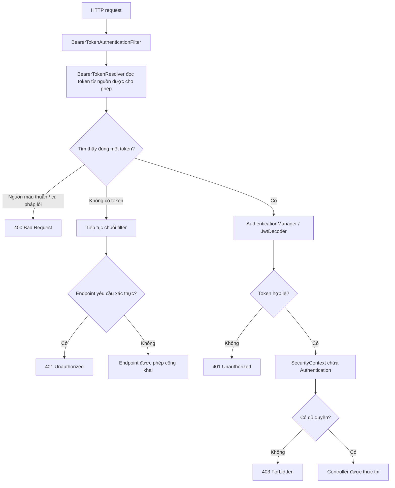

# Bộ lọc lấy token từ header, cookie hoặc nguồn tùy chỉnh

Khi một API dùng Spring Security để bảo vệ HTTP, thông tin xác thực thường được gửi trong header `Authorization: Bearer <token>`. Tuy nhiên, một số hệ thống nhận token từ **cookie**, **header nội bộ do gateway chuyển tiếp** hoặc nguồn đặc thù. Khi đó, câu hỏi không chỉ là “đọc được token ở đâu?” mà còn là “bộ lọc có chọn đúng một token, đưa token qua cùng cơ chế xác minh và từ chối các nguồn mâu thuẫn hay không?”.

Bài học thuộc chương **Filter và cơ chế tùy biến** của module **SPRING_SECURITY_TESTING**. Trọng tâm là kiểm chứng xác thực, phân quyền và HTTP protection bằng **spring-security-test** trên ứng dụng **Servlet** với **MockMvc**; phần sau đối chiếu với **Reactive / WebTestClient**. Ta sẽ đi từ `BearerTokenAuthenticationFilter` mặc định đến `BearerTokenResolver` tùy chỉnh, rồi viết các ca kiểm thử được phép hoặc bị từ chối.

## 1. Tách ba trách nhiệm: tìm token, xác thực, phân quyền

Với OAuth2 Resource Server trên Servlet, luồng khái niệm như sau:



Đây là sơ đồ tư duy, không biểu diễn mọi nhánh xử lý lỗi hay thứ tự nội bộ của các filter.

| Thành phần | Nhiệm vụ | Điều không được suy diễn |
| --- | --- | --- |
| `BearerTokenResolver` | Tìm chuỗi bearer token trong request và xác định request có mâu thuẫn không | Đọc được token **không có nghĩa** token đáng tin |
| `BearerTokenAuthenticationFilter` | Kết nối việc trích xuất token với authentication pipeline của Resource Server | Không tự cấp quyền chỉ vì request có header/cookie |
| `JwtDecoder` hoặc `OpaqueTokenIntrospector` | Xác thực chữ ký, claim hoặc kết quả introspection theo cấu hình | Token hợp lệ chưa chắc có scope để gọi endpoint |
| `AuthorizationFilter` / method security | Kiểm tra authority, role, scope của Authentication đã tạo | Thiếu quyền khác với token sai hoặc hết hạn |

Nếu nguồn token khác với `Authorization`, **ưu tiên cấu hình cách trích xuất cho Resource Server hiện có**. Không nên tự viết filter kiểu `request.getHeader("X-User")` rồi gắn `Authentication` đã xác thực mà không kiểm chứng token. Làm vậy bỏ qua phần xác minh mật mã hoặc introspection.

## 2. Nguồn mặc định và chính sách cho nhiều nguồn

Spring Security cung cấp `DefaultBearerTokenResolver`. Với cấu hình Resource Server thông thường, nó đọc `Authorization: Bearer ...`, áp dụng quy tắc cú pháp của Bearer token và mặc định không chấp nhận access token từ URI query parameter. API có thể cấu hình tên header khác khi có hợp đồng triển khai rõ ràng.

Ví dụ request chuẩn:

```http
GET /api/profile HTTP/1.1
Host: api.example.test
Authorization: Bearer eyJhbGciOi...
```

Một hệ thống có thể cần nhận thêm:

```http
GET /api/profile HTTP/1.1
Host: api.example.test
Cookie: ACCESS_TOKEN=eyJhbGciOi...
```

hoặc một header đặc thù của ứng dụng:

```http
GET /api/profile HTTP/1.1
Host: api.example.test
X-Service-Token: eyJhbGciOi...
```

Trong bài, `X-Service-Token` chứa **chuỗi token cần được xác thực tiếp**, không phải username, role hay kết quả xác thực do client tự khai báo. Việc chấp nhận header tùy chỉnh là một quyết định thiết kế; nếu header do gateway tạo, gateway phải xóa giá trị cùng tên mà client bên ngoài tự gửi trước khi gán giá trị đáng tin cậy.

Đề xuất quy tắc lựa chọn cho bài thực hành:

1. Nhận token từ **chính xác một** trong ba nguồn: header Bearer chuẩn, cookie `ACCESS_TOKEN` hoặc header `X-Service-Token`.
2. Nếu có token từ **hai nguồn trở lên**, trả lỗi `invalid_request`, thay vì ngầm ưu tiên một nguồn. Điều này tránh việc proxy, browser và client ứng dụng hiểu khác nhau về token đang được dùng.
3. Nếu xuất hiện nhiều cookie `ACCESS_TOKEN` hoặc nhiều `X-Service-Token`, từ chối để không chọn ngẫu nhiên.
4. Không lấy token từ `?access_token=...`, bởi URL thường đi vào browser history, log, referrer và hệ thống giám sát.
5. Dù token lấy ở nguồn nào, vẫn đưa qua **cùng decoder/introspector** để kiểm tra hiệu lực và phân quyền.

| Dữ liệu đầu vào | Kết quả từ resolver | Kết quả HTTP mong đợi trong ví dụ |
| --- | --- | --- |
| Chỉ Bearer header hợp lệ | Trả chuỗi token | Tiếp tục xác thực; có thể 200 |
| Chỉ `ACCESS_TOKEN` cookie hợp lệ | Trả chuỗi token | Tiếp tục xác thực; có thể 200 |
| Chỉ `X-Service-Token` hợp lệ | Trả chuỗi token | Tiếp tục xác thực; có thể 200 |
| Không có token | `null` | 401 nếu endpoint yêu cầu xác thực |
| Bearer header và cookie cùng hiện diện | Ném lỗi `invalid_request` | 400 |
| Cookie rỗng, trùng tên hoặc chứa ký tự điều khiển | Ném lỗi `invalid_request` | 400 |
| Một chuỗi token sai chữ ký/hết hạn | Resolver vẫn có thể đọc được | 401 tại bước xác thực |
| Token hợp lệ nhưng thiếu authority | Resolver và xác thực thành công | 403 tại bước phân quyền |

Các mã phản hồi giả định `BearerTokenAuthenticationEntryPoint` và access rules như cấu hình bên dưới. Nếu ứng dụng thay exception handler, hãy kiểm tra hợp đồng HTTP đang dùng.

## 3. Triển khai BearerTokenResolver có kiểm soát

Ta khai báo một `BearerTokenResolver` trong phần code Servlet của ứng dụng. Nó tái sử dụng `DefaultBearerTokenResolver` cho header Bearer chuẩn, rồi mở rộng cách đọc cookie và header nội bộ.

```java
import java.util.ArrayList;
import java.util.Collections;
import java.util.List;

import jakarta.servlet.http.Cookie;
import jakarta.servlet.http.HttpServletRequest;

import org.springframework.http.HttpHeaders;
import org.springframework.security.oauth2.core.OAuth2AuthenticationException;
import org.springframework.security.oauth2.server.resource.BearerTokenErrors;
import org.springframework.security.oauth2.server.resource.web.BearerTokenResolver;
import org.springframework.security.oauth2.server.resource.web.DefaultBearerTokenResolver;

public final class MultiSourceBearerTokenResolver
        implements BearerTokenResolver {

    private static final String COOKIE_NAME = "ACCESS_TOKEN";
    private static final String CUSTOM_HEADER = "X-Service-Token";
    private static final int MAX_TOKEN_LENGTH = 8192;

    private final DefaultBearerTokenResolver standard =
        new DefaultBearerTokenResolver();

    public MultiSourceBearerTokenResolver() {
        // Không vận chuyển bearer token trong URL hoặc form body.
        standard.setAllowUriQueryParameter(false);
        standard.setAllowFormEncodedBodyParameter(false);
    }

    @Override
    public String resolve(HttpServletRequest request) {
        List<String> authorizationHeaders =
            Collections.list(request.getHeaders(HttpHeaders.AUTHORIZATION));

        if (authorizationHeaders.size() > 1) {
            throw invalidRequest("Multiple Authorization headers");
        }

        List<String> tokens = new ArrayList<>();

        // Resolver chuẩn kiểm tra cú pháp Bearer của Authorization header.
        String headerToken = standard.resolve(request);
        if (headerToken != null) {
            tokens.add(headerToken);
        }

        Cookie[] cookies = request.getCookies();
        boolean cookieSeen = false;
        if (cookies != null) {
            for (Cookie cookie : cookies) {
                if (COOKIE_NAME.equals(cookie.getName())) {
                    if (cookieSeen) {
                        throw invalidRequest("Duplicate access token cookies");
                    }
                    cookieSeen = true;
                    tokens.add(requireToken(cookie.getValue()));
                }
            }
        }

        List<String> customHeaders =
            Collections.list(request.getHeaders(CUSTOM_HEADER));

        if (customHeaders.size() > 1) {
            throw invalidRequest("Duplicate custom token headers");
        }
        if (!customHeaders.isEmpty()) {
            // X-Service-Token chứa giá trị raw, không có tiền tố Bearer.
            tokens.add(requireToken(customHeaders.get(0)));
        }

        if (tokens.size() > 1) {
            throw invalidRequest("Bearer token in multiple locations");
        }

        return tokens.isEmpty() ? null : tokens.get(0);
    }

    private static String requireToken(String value) {
        if (value == null || value.isBlank()
                || value.length() > MAX_TOKEN_LENGTH
                || value.chars().anyMatch(ch ->
                    Character.isWhitespace(ch)
                    || Character.isISOControl(ch))) {
            throw invalidRequest("Malformed access token");
        }
        return value;
    }

    private static OAuth2AuthenticationException invalidRequest(
            String description) {
        return new OAuth2AuthenticationException(
            BearerTokenErrors.invalidRequest(description));
    }
}
```

Giới hạn độ dài và kiểm tra ký tự ở đây bảo vệ lớp trích xuất trước các giá trị rỗng, control characters hoặc quá dài; các token còn lại **vẫn phải được decoder/introspector kiểm tra**. Với một nhà phát hành token cụ thể, có thể bổ sung giới hạn cú pháp phù hợp sau khi biết định dạng được cấp. Đừng coi biểu thức kiểm tra chuỗi là xác minh JWT.

Lưu ý hành vi khi request vừa có `Authorization: Basic ...` vừa có cookie token: resolver chuẩn không xem Basic là bearer; ví dụ dành riêng cho Resource Server, nên bạn phải quyết định rõ chính sách nếu ứng dụng thật chấp nhận **nhiều cơ chế xác thực** trên cùng route. Tránh tự động chuyển sang nguồn khác khi một nguồn credential đã được chỉ định nhưng không hợp lệ.

### Tại sao ném BearerTokenErrors.invalidRequest?

Khi token xuất hiện tại hai vị trí, request **mơ hồ về nguồn token**. `BearerTokenErrors.invalidRequest(...)` mang loại lỗi Bearer được Spring Security hiểu và có thể được `BearerTokenAuthenticationEntryPoint` chuyển thành HTTP **400 Bad Request**. Đây là lỗi yêu cầu, khác với một token đã được trích xuất nhưng bị `JwtDecoder` từ chối, thường được phản hồi **401 Unauthorized**.

Lỗi trả về có thể mang `WWW-Authenticate: Bearer` và các thông tin `error` theo RFC 6750. Không khẳng định nguyên văn toàn bộ header trong mọi phiên bản hoặc khi có custom entry point; test nên ưu tiên status và loại lỗi theo hợp đồng.

## 4. Gắn resolver vào SecurityFilterChain của Resource Server

Trong ứng dụng Servlet dùng JWT:

```java
import org.springframework.context.annotation.Bean;
import org.springframework.context.annotation.Configuration;
import org.springframework.security.config.Customizer;
import org.springframework.security.config.annotation.web.builders.HttpSecurity;
import org.springframework.security.web.SecurityFilterChain;
import org.springframework.security.oauth2.server.resource.web.BearerTokenResolver;

@Configuration
class TokenSourceSecurityConfig {

    @Bean
    BearerTokenResolver bearerTokenResolver() {
        return new MultiSourceBearerTokenResolver();
    }

    @Bean
    SecurityFilterChain securityFilterChain(
            HttpSecurity http,
            BearerTokenResolver bearerTokenResolver) throws Exception {

        return http
            .authorizeHttpRequests(authorize -> authorize
                .requestMatchers("/health").permitAll()
                .requestMatchers("/api/ops")
                    .hasAuthority("SCOPE_ops:read")
                .requestMatchers("/api/**").authenticated()
                .anyRequest().denyAll())
            .oauth2ResourceServer(oauth2 -> oauth2
                .bearerTokenResolver(bearerTokenResolver)
                .jwt(Customizer.withDefaults()))
            .build();
    }
}
```

Không tạo thủ công một `Authentication` đã xác thực từ giá trị cookie/header. Resource Server nhận token do resolver trả về và tiếp tục dùng `JwtDecoder`. Trong môi trường thật cần thiết lập decoder tin cậy, chẳng hạn:

```yaml
spring:
  security:
    oauth2:
      resourceserver:
        jwt:
          issuer-uri: https://identity.example.test/realms/training
```

Khi dùng `issuer-uri`, hãy cấu hình theo issuer được tin cậy và xác minh chữ ký, thời hạn, issuer, audience theo yêu cầu của API. Cơ chế lấy token từ cookie **không miễn trừ** bất cứ bước xác thực nào.

Nếu sản phẩm dùng opaque token, cấu hình `.opaqueToken(...)` với introspection URI, credentials và introspector phù hợp, vẫn có thể sử dụng nguyên tắc lựa chọn nguồn token. Việc chuyển JWT sang opaque token thay đổi **bước xác thực**, không thay đổi yêu cầu phải từ chối nguồn mơ hồ.

### Controller dùng để quan sát kết quả

```java
import org.springframework.security.core.annotation.AuthenticationPrincipal;
import org.springframework.security.oauth2.jwt.Jwt;
import org.springframework.web.bind.annotation.GetMapping;
import org.springframework.web.bind.annotation.PostMapping;
import org.springframework.web.bind.annotation.RestController;

@RestController
class TokenSourceController {

    @GetMapping("/health")
    String health() {
        return "ok";
    }

    @GetMapping("/api/profile")
    String profile(@AuthenticationPrincipal Jwt jwt) {
        return jwt.getSubject();
    }

    @GetMapping("/api/ops")
    String operations() {
        return "ops";
    }

    @PostMapping("/api/change")
    String change() {
        return "changed";
    }
}
```

`/api/profile` yêu cầu xác thực; `/api/ops` cần thêm `SCOPE_ops:read`. `POST /api/change` sẽ giúp minh họa rủi ro **CSRF khi bearer token nằm trong cookie**.

## 5. Kiểm thử resolver với MockMvc mà không phụ thuộc nhà cung cấp JWT

Để phân biệt lỗi **đọc nguồn token** với lỗi **xác minh JWT**, trước tiên ta cung cấp một `JwtDecoder` thử nghiệm. Decoder này chỉ chấp nhận các chuỗi token cố định `test-user-token` và `test-ops-token`, từ chối mọi chuỗi khác.

**Phạm vi của kỹ thuật này:** các ca test chứng minh filter lấy token từ đúng nơi, gọi decoder và áp dụng authorization. Chúng **không** xác minh chữ ký RSA, issuer hay audience; muốn kiểm chứng mật mã, phải có test riêng dùng JWT đã ký thực và decoder production/tương đương.

Tạo cấu hình **chỉ trong `src/test/java`**, không đưa bean decoder giả vào code production:

```java
import java.time.Instant;

import org.springframework.boot.test.context.TestConfiguration;
import org.springframework.context.annotation.Bean;
import org.springframework.security.oauth2.jwt.BadJwtException;
import org.springframework.security.oauth2.jwt.Jwt;
import org.springframework.security.oauth2.jwt.JwtDecoder;

@TestConfiguration(proxyBeanMethods = false)
class TestJwtDecoderConfig {

    @Bean
    JwtDecoder jwtDecoder() {
        return token -> {
            String scope;
            if ("test-user-token".equals(token)) {
                scope = "profile:read";
            } else if ("test-ops-token".equals(token)) {
                scope = "ops:read";
            } else {
                throw new BadJwtException("Rejected test token");
            }

            Instant now = Instant.now();
            return Jwt.withTokenValue(token)
                .header("alg", "test-only")
                .subject("alice")
                .issuedAt(now.minusSeconds(10))
                .expiresAt(now.plusSeconds(600))
                .claim("scope", scope)
                .build();
        };
    }
}
```

`JwtAuthenticationConverter` mặc định thường ánh xạ claim `scope` hoặc `scp` sang authorities tiền tố `SCOPE_`, nên `scope = "ops:read"` thỏa rule `SCOPE_ops:read`.

### Các ca kiểm thử HTTP qua SecurityFilterChain

```java
import jakarta.servlet.http.Cookie;

import org.junit.jupiter.api.Test;
import org.springframework.beans.factory.annotation.Autowired;
import org.springframework.boot.test.autoconfigure.web.servlet.AutoConfigureMockMvc;
import org.springframework.boot.test.context.SpringBootTest;
import org.springframework.context.annotation.Import;
import org.springframework.http.HttpHeaders;
import org.springframework.test.web.servlet.MockMvc;

import static org.springframework.security.test.web.servlet.request.SecurityMockMvcRequestPostProcessors.csrf;
import static org.springframework.test.web.servlet.request.MockMvcRequestBuilders.get;
import static org.springframework.test.web.servlet.request.MockMvcRequestBuilders.post;
import static org.springframework.test.web.servlet.result.MockMvcResultMatchers.content;
import static org.springframework.test.web.servlet.result.MockMvcResultMatchers.status;

@SpringBootTest
@AutoConfigureMockMvc
@Import(TestJwtDecoderConfig.class)
class MultiSourceTokenTests {

    @Autowired
    MockMvc mvc;

    @Test
    void bearerHeaderIsAccepted() throws Exception {
        mvc.perform(get("/api/profile")
                .header(HttpHeaders.AUTHORIZATION, "Bearer test-user-token"))
            .andExpect(status().isOk())
            .andExpect(content().string("alice"));
    }

    @Test
    void accessTokenCookieIsAccepted() throws Exception {
        mvc.perform(get("/api/profile")
                .cookie(new Cookie("ACCESS_TOKEN", "test-user-token")))
            .andExpect(status().isOk())
            .andExpect(content().string("alice"));
    }

    @Test
    void customHeaderIsAccepted() throws Exception {
        mvc.perform(get("/api/profile")
                .header("X-Service-Token", "test-user-token"))
            .andExpect(status().isOk())
            .andExpect(content().string("alice"));
    }

    @Test
    void missingTokenIsUnauthorized() throws Exception {
        mvc.perform(get("/api/profile"))
            .andExpect(status().isUnauthorized());
    }

    @Test
    void invalidCookieTokenIsUnauthorized() throws Exception {
        mvc.perform(get("/api/profile")
                .cookie(new Cookie("ACCESS_TOKEN", "unknown-token")))
            .andExpect(status().isUnauthorized());
    }

    @Test
    void headerAndCookieTogetherAreRejected() throws Exception {
        mvc.perform(get("/api/profile")
                .header(HttpHeaders.AUTHORIZATION, "Bearer test-user-token")
                .cookie(new Cookie("ACCESS_TOKEN", "test-user-token")))
            .andExpect(status().isBadRequest());
    }

    @Test
    void duplicateCookieNamesAreRejected() throws Exception {
        mvc.perform(get("/api/profile")
                .cookie(
                    new Cookie("ACCESS_TOKEN", "test-user-token"),
                    new Cookie("ACCESS_TOKEN", "test-ops-token")))
            .andExpect(status().isBadRequest());
    }

    @Test
    void queryParameterDoesNotBecomeBearerToken() throws Exception {
        mvc.perform(get("/api/profile")
                .param("access_token", "test-user-token"))
            .andExpect(status().isUnauthorized());
    }

    @Test
    void validTokenWithoutScopeIsForbiddenOnOps() throws Exception {
        mvc.perform(get("/api/ops")
                .header(HttpHeaders.AUTHORIZATION, "Bearer test-user-token"))
            .andExpect(status().isForbidden());
    }

    @Test
    void tokenWithOpsScopeCanCallOps() throws Exception {
        mvc.perform(get("/api/ops")
                .cookie(new Cookie("ACCESS_TOKEN", "test-ops-token")))
            .andExpect(status().isOk())
            .andExpect(content().string("ops"));
    }

    @Test
    void cookieOnStateChangingRequestStillNeedsCsrf() throws Exception {
        mvc.perform(post("/api/change")
                .cookie(new Cookie("ACCESS_TOKEN", "test-user-token")))
            .andExpect(status().isForbidden());
    }

    @Test
    void cookieAndValidCsrfCanChangeState() throws Exception {
        mvc.perform(post("/api/change")
                .cookie(new Cookie("ACCESS_TOKEN", "test-user-token"))
                .with(csrf()))
            .andExpect(status().isOk())
            .andExpect(content().string("changed"));
    }
}
```

Trong ví dụ này, `@AutoConfigureMockMvc` kích hoạt filter chain tương ứng. Mỗi `perform()` là một HTTP request được xử lý qua Spring Security; không gắn danh tính sẵn bằng `@WithMockUser` hay `jwt()`, vì mục tiêu là chứng minh **resolver lấy dữ liệu từ request**.

Cách đọc kết quả:

- `bearerHeaderIsAccepted`, `accessTokenCookieIsAccepted`, `customHeaderIsAccepted`: cùng token được decoder test chấp nhận khi đặt ở ba nguồn.
- `missingTokenIsUnauthorized`: request thiếu credential nên không qua được `.authenticated()`.
- `invalidCookieTokenIsUnauthorized`: resolver tìm được token nhưng decoder test từ chối; khác với trường hợp không tìm được token.
- `headerAndCookieTogetherAreRejected` và `duplicateCookieNamesAreRejected`: từ chối nguồn mơ hồ tại lớp resolver với HTTP 400.
- `queryParameterDoesNotBecomeBearerToken`: query param không phải kênh chấp nhận token trong chính sách này.
- `validTokenWithoutScopeIsForbiddenOnOps`: token đã qua decoder nhưng không có `SCOPE_ops:read`, nên bị chặn ở authorization.
- Hai ca POST: nhắc rằng khi browser tự gửi cookie, phải kiểm tra CSRF thật sự chứ không bỏ bảo vệ chỉ vì API dùng OAuth2 Resource Server.

Nếu ứng dụng tùy biến `AuthenticationEntryPoint` hoặc `AccessDeniedHandler`, mã HTTP và thông tin lỗi có thể khác. Hãy đặt assertion theo hợp đồng thực tế, nhưng vẫn giữ rõ ba nhánh lỗi **nguồn mơ hồ / token không hợp lệ / thiếu quyền**.

## 6. Cookie mang bearer token: CSRF, bảo vệ cookie và vòng đời token

Cookie có một khác biệt căn bản so với việc JavaScript chủ động đặt bearer header: **trình duyệt có thể tự gửi cookie** tới domain/đường dẫn tương ứng. Vì thế, một API nhận access token trong cookie có thể bị tấn công CSRF nếu request thay đổi trạng thái được gửi từ trang khác và server không có biện pháp chống CSRF phù hợp.

Các điểm cần thiết kế và kiểm thử:

| Vấn đề | Cách xử lý | Bài test tương ứng |
| --- | --- | --- |
| CSRF cho POST/PUT/PATCH/DELETE | Bật và cấu hình `CsrfTokenRepository`/quy tắc phù hợp | Thiếu CSRF bị chặn; CSRF hợp lệ được xử lý |
| Cookie bị đọc bởi JavaScript | Sử dụng `HttpOnly` khi browser không cần đọc token | Kiểm tra `Set-Cookie` có `HttpOnly` |
| Cookie đi qua HTTP không mã hóa | Đặt `Secure`, dùng HTTPS | Kiểm tra `Secure` trong môi trường triển khai |
| Cross-site cookie | `SameSite` theo nhu cầu; không coi `SameSite` là lớp bảo vệ duy nhất | Test trình duyệt với cross-site navigation/submission |
| Cookie có phạm vi quá rộng | Hạn chế `Domain` và `Path` | Test phạm vi cookie với những route liên quan |
| Token hết hạn hoặc bị thu hồi | Decoder/introspection từ chối; cleanup cookie tùy chính sách | Test token hết hạn/bị thu hồi trả 401 |
| Header và cookie cùng lúc | Chính sách một nguồn duy nhất | Test nhiều nguồn trả 400 |

Ví dụ một cookie được cấp an toàn hơn trong môi trường HTTPS:

```http
Set-Cookie: ACCESS_TOKEN=eyJhbGciOi...; Path=/api; Secure; HttpOnly; SameSite=Lax
```

Thuộc tính `SameSite=Lax` chỉ minh họa và không tự động đáp ứng mọi luồng login, iframe hay cross-site API. Cấu hình thực tế phải được đánh giá theo domain, reverse proxy và hành vi browser. `HttpOnly` làm giảm khả năng script đọc cookie, nhưng **không chặn việc browser tự gửi cookie** trong yêu cầu CSRF.

**Không nên tắt CSRF toàn ứng dụng chỉ vì token mang tên “Bearer”**. Nếu cùng một API cho phép cả bearer header do client tự gắn và bearer cookie tự động, cần xác định rõ chính sách CSRF cho cookie và các request trạng thái. Với API thuần bearer header không dùng cookie, một số kiến trúc stateless có thể cấu hình CSRF khác; đó là quyết định theo threat model, không phải kết luận từ tên filter.

## 7. Vì sao không tự viết filter để đánh dấu người dùng đã đăng nhập?

Một cách làm dễ mắc lỗi:

```java
// MÃ MINH HỌA SAI: không dùng trong ứng dụng thật.
String user = request.getHeader("X-Authenticated-User");
Authentication auth = UsernamePasswordAuthenticationToken
    .authenticated(user, null, List.of());
SecurityContextHolder.getContext().setAuthentication(auth);
```

Nếu bất kỳ client nào cũng có thể gửi `X-Authenticated-User: admin`, server đang **tin danh tính do người gửi tự khai báo**. Dù header đến từ gateway, filter này vẫn cần cơ chế xác thực gateway, bảo đảm header do gateway kiểm soát và không lọt vào từ client không đáng tin. Thường nên có mTLS, mạng tin cậy, kiểm tra chữ ký hoặc xác thực proxy theo thiết kế hệ thống.

Trong bài này, `X-Service-Token` vẫn phải đi qua `JwtDecoder`; bản thân header không có đặc quyền tạo `Authentication`. Nếu không dùng Bearer/JWT mà dùng API key hay cơ chế tùy biến riêng, có thể cần `OncePerRequestFilter` hoặc `AuthenticationFilter` cùng `AuthenticationManager`/`AuthenticationProvider` đặc thù. Khi đó cần:

1. Trích xuất credential một cách tường minh, kiểm tra trường hợp thiếu/đa nguồn.
2. Chuyển credential tới provider **xác minh thật** (API-key store, mật mã, service tin cậy), không tự coi chuỗi tồn tại là hợp lệ.
3. Chỉ tạo authenticated `Authentication` sau khi provider thành công; thiết lập/giải phóng `SecurityContext` theo lifecycle của Spring Security.
4. Dùng failure handling đúng để không vô tình chuyển lỗi xác thực thành 500 hoặc tiếp tục với danh tính cũ.
5. Đặt filter trong `SecurityFilterChain` ở vị trí phù hợp và tránh đăng ký trùng filter qua Servlet container.

Kiểm thử một filter tùy chỉnh nên đo **bộ lọc đã gọi provider**, hành vi khi credential thiếu/sai, và request sau đó không giữ authentication từ request trước. Nhưng nếu chỉ cần đổi nơi lấy bearer token, `BearerTokenResolver` thường là extension point gọn và an toàn hơn.

## 8. Kiểm thử có chữ ký thật và introspection thật

Decoder giả ở mục 5 phù hợp để cô lập behavior **token extraction**. Để xác minh toàn bộ hệ thống, bổ sung các kiểm thử tích hợp khác:

| Mục tiêu | Kiểu test | Điều chứng minh |
| --- | --- | --- |
| `BearerTokenResolver` chọn header/cookie/custom header và từ chối xung đột | MockMvc + decoder giả kiểm soát đầu vào | Quy tắc lấy token và đường đi của filter |
| JWT ký hợp lệ, issuer đúng, audience đúng được chấp nhận | MockMvc + JWT RS256 ký bằng khóa test + `NimbusJwtDecoder` | Xác minh chữ ký và validator thực |
| JWT sai chữ ký/issuer/hết hạn bị từ chối | Gửi JWT thật đã ký với một điều kiện sai | 401 từ decoder/validator |
| Opaque token `active=false` bị từ chối | Mock HTTP introspection và cấu hình `OpaqueTokenIntrospector` thật | 401 từ introspection |
| Scope không đủ | Authentication hợp lệ nhưng thiếu `SCOPE_...` | 403 từ authorization |
| Cookie cùng CSRF hợp lệ | MockMvc hoặc browser integration với `CsrfTokenRepository` | Rule CSRF hoạt động |
| Cookie cross-site, `Secure`, `SameSite` trong browser | Test E2E/HTTP triển khai gần thực tế | Hành vi cookie trong trình duyệt |

Đừng dùng `jwt()` của `SecurityMockMvcRequestPostProcessors` để khẳng định filter đã đọc đúng cookie. Helper đó **đưa Authentication giả vào mock request** mà không cần `BearerTokenResolver` tìm được token. Dùng nó để test role/scope một cách chủ đích, và dùng HTTP header/cookie thật trong các test resolver.

## 9. Liên hệ Reactive / WebTestClient

Ứng dụng **Spring WebFlux** không dùng `HttpServletRequest` hay `BearerTokenResolver` của Servlet. Với Resource Server Reactive, một extension point tương ứng là `ServerBearerTokenAuthenticationConverter` hoặc một `ServerAuthenticationConverter` do ứng dụng cung cấp. Kiểu dữ liệu HTTP đầu vào khi đó là `ServerWebExchange`, và việc xác thực thuộc pipeline `SecurityWebFilterChain`.

Đoạn khái niệm sau minh họa cách chọn một token từ cookie trên Reactive:

```java
// Chỉ minh họa ý tưởng; cần bổ sung kiểm tra nhiều nguồn,
// ký tự hợp lệ và chuyển lỗi sang AuthenticationException.
ServerAuthenticationConverter cookieConverter = exchange -> {
    HttpCookie cookie = exchange.getRequest()
        .getCookies()
        .getFirst("ACCESS_TOKEN");

    if (cookie == null) {
        return Mono.empty();
    }

    return Mono.just(
        new BearerTokenAuthenticationToken(cookie.getValue()));
};
```

Trong Spring Security WebFlux, cấu hình Resource Server có thể nhận converter qua nhánh `oauth2ResourceServer().bearerTokenConverter(...)` tùy API của phiên bản đang sử dụng. Khi triển khai thật, cần nối cùng cơ chế xác thực JWT/opaque và bảo đảm các trường hợp trùng header/cookie bị chặn; không dùng trực tiếp đoạn minh họa chưa có kiểm tra mâu thuẫn ở trên.

Với **WebTestClient**, có hai mức test:

- **Mock server**: `WebTestClient.bindToApplicationContext(context).apply(springSecurity())` và request mang `Authorization`/cookie để kiểm tra converter; `mockJwt()` chỉ dùng khi muốn giả lập Authentication cho authorization.
- **HTTP server chạy thật**: `WebTestClient.bindToServer().baseUrl(...)` và `headers.setBearerAuth(signedJwt)` hoặc gửi cookie thật. Mock mutator không chuyển `SecurityContext` Java sang server ngoài tiến trình.

Dùng đúng stack: `MockMvc` và `BearerTokenResolver` thuộc Servlet; `WebTestClient`, `ServerWebExchange` và reactive authentication converter thuộc WebFlux. Không trộn các filter của hai stack.

## 10. Bài tập thực hành

1. Cấu hình `MultiSourceBearerTokenResolver` vào ứng dụng Servlet. Gửi cùng token hợp lệ lần lượt ở `Authorization: Bearer`, cookie `ACCESS_TOKEN` và `X-Service-Token`. Giải thích vì sao cả ba đi tới cùng decoder.
2. Gửi đồng thời header và cookie với **cùng một chuỗi token**. Kiểm tra request vẫn bị trả 400. Trả lời vì sao không nên tự động chọn header và bỏ qua cookie.
3. Gửi token qua `?access_token=test-user-token`. Kiểm chứng request không được xác thực chỉ nhờ URL query parameter.
4. Tạo ca `unknown-token` trong cookie, kiểm chứng 401. So sánh với ca có token hợp lệ nhưng thiếu `SCOPE_ops:read` trả 403.
5. Thêm test trùng hai header `X-Service-Token` hoặc trùng hai cookie `ACCESS_TOKEN`. Bảo đảm resolver trả `invalid_request`.
6. Dùng `POST /api/change` cùng cookie token nhưng không có CSRF, rồi thêm `.with(csrf())`. Giải thích khác biệt và lý do cookie có thể tạo nguy cơ CSRF.
7. Tạo JWT thật có chữ ký RSA từ cặp khóa test và gửi qua cookie. Kiểm chứng `NimbusJwtDecoder` từ chối JWT sai chữ ký/hết hạn; so sánh với decoder giả ở mục 5.
8. Thêm token từ header của gateway. Đề xuất cách gateway loại bỏ header mà client bên ngoài tự gửi và cách Resource Server vẫn xác minh token sau khi nhận được.
9. Chuyển ví dụ sang WebFlux với `WebTestClient`, kiểm tra converter đọc đúng cookie và không bỏ qua tình huống có đồng thời header Bearer.

## 11. Ghi nhớ

- **Đọc token từ header, cookie hay nguồn tùy chỉnh chỉ là bước trích xuất**. Giá trị phải tiếp tục qua `JwtDecoder` hoặc `OpaqueTokenIntrospector` để được xác thực.
- **`BearerTokenResolver` là điểm mở rộng tự nhiên trên Servlet Resource Server** khi muốn đổi nơi lấy bearer token. Không cần tự tạo authentication từ chuỗi chưa được xác minh.
- **Nhiều nguồn là một quyết định bảo mật**, không chỉ là ưu tiên kỹ thuật. Hãy xác định chính sách rõ ràng và kiểm thử nguồn xung đột, trùng tên, giá trị sai.
- **Cookie token đem đến trách nhiệm CSRF và cookie security**. `HttpOnly`, `Secure`, `SameSite` và chống CSRF giải quyết các rủi ro khác nhau.
- **400, 401 và 403 kiểm tra những tầng khác nhau**: request mơ hồ hoặc sai cú pháp, credential không hợp lệ, và người dùng đã xác thực nhưng thiếu quyền.
- **Mock principal và decoder giả có phạm vi hẹp**. Cần JWT ký thật hoặc introspection thật để kết luận về độ tin cậy của token trong hệ thống.

Trong **SPRING_SECURITY_TESTING**, một bộ kiểm thử có giá trị cần cho thấy **token đến từ đâu, có được xác thực bởi cùng cơ chế tin cậy hay không, và authority sau khi xác thực có đủ cho endpoint hay không**. Tách rõ ba câu hỏi này giúp tùy biến filter mà vẫn giữ nguyên ranh giới bảo mật của ứng dụng.

### Tài liệu tham khảo

- [Spring Security — Bearer Tokens (Servlet)](https://docs.spring.io/spring-security/reference/servlet/oauth2/resource-server/bearer-tokens.html)
- [Spring Security — OAuth2 Resource Server JWT (Servlet)](https://docs.spring.io/spring-security/reference/servlet/oauth2/resource-server/jwt.html)
- [Spring Security — OAuth2 Resource Server Bearer Tokens (Reactive)](https://docs.spring.io/spring-security/reference/reactive/oauth2/resource-server/bearer-tokens.html)
- [Spring Security — Testing OAuth2 Resource Server](https://docs.spring.io/spring-security/reference/servlet/test/mockmvc/oauth2.html)

