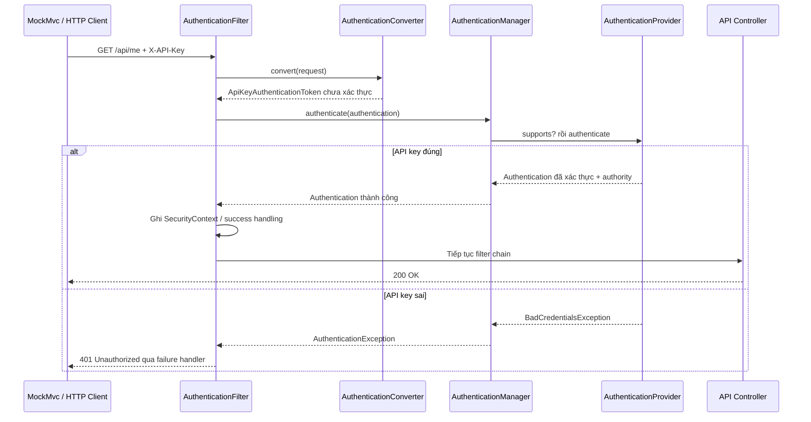

# Converter, AuthenticationManager và provider được filter sử dụng

Trong Spring Security, một filter có thể nhìn thấy header xác thực nhưng điều đó chưa đủ để khẳng định request đã được đăng nhập. Filter phải nhận diện đúng dữ liệu đầu vào, chuyển thành một **yêu cầu xác thực chưa đáng tin cậy**, chuyển yêu cầu cho thành phần kiểm tra credentials, rồi chỉ dùng kết quả đã xác thực để tiếp tục xử lý HTTP.

Trong chương **Filter và cơ chế tùy biến** của module `SPRING_SECURITY_TESTING`, bài này tập trung vào ba hợp đồng quyết định tính đúng đắn của cơ chế xác thực tùy biến:

1. **Converter** đọc HTTP request và tạo `Authentication` đầu vào.
2. **`AuthenticationManager`** điều phối việc xác thực.
3. **`AuthenticationProvider`** kiểm tra credentials, trả về `Authentication` hợp lệ hoặc báo lỗi.

Một bài test thực sự có giá trị phải chứng minh dữ liệu đã đi qua đúng ba thành phần đó, xử lý thành công/thất bại như hợp đồng và không cho request thiếu quyền đi vào controller. Ta sẽ dùng một cơ chế `X-API-Key` minh họa trên Spring Security Servlet với `MockMvc`, sau đó đối chiếu với `WebTestClient` và Reactive Security.

## 1. Ba trách nhiệm độc lập trong luồng xác thực

Giả sử client gọi:

```http
GET /api/me HTTP/1.1
Host: localhost
X-API-Key: local-test-key-only
```

Ứng dụng có một filter tùy biến chuyên xử lý header `X-API-Key`. Luồng xử lý hợp lý là:



Các đối tượng có trách nhiệm khác nhau:

| Thành phần | Input | Output | Việc không nên làm |
| --- | --- | --- | --- |
| `AuthenticationConverter` | `HttpServletRequest` | `Authentication` chưa xác thực, `null`, hoặc `AuthenticationException` | Tự xác thực bí mật rồi đánh dấu `isAuthenticated=true` |
| `AuthenticationFilter` | Request, converter, manager | Điều phối xác thực và success/failure handling | Mã hóa cứng quy tắc role hoặc tự tin tưởng header |
| `AuthenticationManager` | `Authentication` đầu vào | `Authentication` đã xác thực hoặc exception | Tự giả định mọi token dùng cùng provider |
| `ProviderManager` | Một tập `AuthenticationProvider` | Gọi provider hỗ trợ loại token | Gọi ngẫu nhiên provider không hỗ trợ token |
| `AuthenticationProvider` | Credentials hoặc token chưa xác thực | Authentication có principal/authorities hoặc `AuthenticationException` | Tin dữ liệu client gửi mà không kiểm tra |
| `AuthorizationFilter` | Authentication sau xác thực + request | Cho phép hoặc chặn theo policy | Thay thế công việc kiểm tra credentials |

**Authentication** trả lời “ai đã được xác minh?”. **Authorization** trả lời “danh tính đó có quyền làm hành động này không?”. Vì vậy 401 do thiếu/sai credentials và 403 do thiếu quyền là hai nhánh cần kiểm thử riêng. Request CSRF sai cũng có thể nhận 403 trước khi đi tới phần authentication tùy theo cấu hình.

### 1.1. Converter không phải provider

Cùng một HTTP header:

```http
X-API-Key: wrong-key
```

Converter vẫn có thể tạo một `ApiKeyAuthenticationToken` với `isAuthenticated() == false`. Chính provider phải xác định key đó có giá trị hay không. Nếu converter tự biến mọi chuỗi không rỗng thành người dùng có `ROLE_ADMIN`, ứng dụng đã bỏ qua lớp kiểm tra credentials.

Một converter thường có ba kết quả:

- **Không có credentials:** trả `null` để filter tiếp tục sang cơ chế khác hoặc cho authorization xử lý request chưa xác thực.
- **Credentials có cú pháp hợp lệ:** trả token *chưa xác thực* để manager quyết định.
- **Credentials sai định dạng:** ném `AuthenticationException` thích hợp; filter/failure handler quyết định HTTP response.

Việc “không có header” khác “header rỗng hoặc bị lặp”. Chúng có thể dẫn tới cùng HTTP 401 tại API bảo vệ, nhưng test cần phân biệt nhánh nào đã gọi provider và nhánh nào bị chặn trước khi xác thực.

## 2. Authentication token đại diện cho dữ liệu nào?

Interface `Authentication` vừa biểu diễn **yêu cầu xác thực** vừa biểu diễn **kết quả xác thực**. Trước xác thực, credentials là đầu vào *chưa đáng tin cậy*. Sau xác thực, principal và authorities mới có thể được các bước downstream sử dụng.

Một mô hình đơn giản:

| Thuộc tính | Trước xác thực | Sau xác thực |
| --- | --- | --- |
| `principal` | Chưa rõ hoặc thông tin tự khai | Client identity đã được provider kiểm tra |
| `credentials` | API key raw do client gửi | Nên xóa hoặc không tiếp tục giữ trong kết quả |
| `authorities` | Rỗng/không đáng tin | Authorities do nguồn đáng tin cấp |
| `isAuthenticated()` | `false` | `true`, sau khi provider xác thực thành công |

Một token custom giúp `AuthenticationProvider.supports(...)` nhận đúng loại mà không can thiệp vào cơ chế HTTP Basic, form login hay JWT sẵn có.

### 2.1. Tạo ApiKeyAuthenticationToken cho bài thực hành

Ví dụ dùng Java 17 và Spring Security 6.x. Đây là fixture mô phỏng API-key authentication; trong sản phẩm thật, key phải được lưu trữ và tra cứu an toàn theo chính sách riêng.

```java
import java.util.Collection;
import java.util.List;

import org.springframework.security.authentication.AbstractAuthenticationToken;
import org.springframework.security.core.GrantedAuthority;

public final class ApiKeyAuthenticationToken
        extends AbstractAuthenticationToken {

    private final String principal;
    private String credentials;

    private ApiKeyAuthenticationToken(
            String principal,
            String credentials,
            Collection<? extends GrantedAuthority> authorities,
            boolean authenticated) {

        super(authorities);
        this.principal = principal;
        this.credentials = credentials;
        super.setAuthenticated(authenticated);
    }

    public static ApiKeyAuthenticationToken presented(String rawKey) {
        return new ApiKeyAuthenticationToken(
            null, rawKey, List.of(), false
        );
    }

    public static ApiKeyAuthenticationToken trusted(
            String clientId,
            Collection<? extends GrantedAuthority> authorities) {

        return new ApiKeyAuthenticationToken(
            clientId, null, authorities, true
        );
    }

    @Override
    public Object getPrincipal() {
        return principal;
    }

    @Override
    public Object getCredentials() {
        return credentials;
    }

    // Chỉ factory trusted() dùng được đường setAuthenticated(true)
    // bằng super, tránh để code bên ngoài tự đánh dấu trusted.
    @Override
    public void setAuthenticated(boolean authenticated) {
        if (authenticated) {
            throw new IllegalArgumentException(
                "Authentication must be created by a trusted provider"
            );
        }
        super.setAuthenticated(false);
    }

    @Override
    public void eraseCredentials() {
        super.eraseCredentials();
        this.credentials = null;
    }
}
```

Ở đây `presented(rawKey)` tạo token chưa xác thực. `trusted(clientId, authorities)` dành cho code đã kiểm chứng key trong provider. Không công khai raw key qua `getName()`, response hay log.

**Cần hiểu giới hạn của factory minh họa:** Kỹ thuật factory chỉ làm rõ hợp đồng trong ví dụ. Việc gọi tên `trusted()` không phải một biện pháp bảo mật tự thân nếu mọi code trong ứng dụng đều có thể gọi factory này. Đảm bảo chỉ code đáng tin sau kiểm tra credentials tạo kết quả authenticated; không cho controller hay converter dùng nó để bỏ qua provider.

## 3. Viết converter chỉ đọc header

Trong Servlet, `org.springframework.security.web.authentication.AuthenticationConverter` có method:

```java
Authentication convert(HttpServletRequest request);
```

Ta dùng header `X-API-Key`. Converter không truy vấn database hay quyết định roles.

```java
import java.util.Enumeration;

import jakarta.servlet.http.HttpServletRequest;
import org.springframework.security.authentication.BadCredentialsException;
import org.springframework.security.core.Authentication;
import org.springframework.security.web.authentication.AuthenticationConverter;

public final class ApiKeyHeaderConverter
        implements AuthenticationConverter {

    private static final String HEADER = "X-API-Key";

    @Override
    public Authentication convert(HttpServletRequest request) {
        Enumeration<String> headers = request.getHeaders(HEADER);

        if (headers == null || !headers.hasMoreElements()) {
            return null; // Không có API key: không khởi tạo auth.
        }

        String rawKey = headers.nextElement();

        // Không chấp nhận header rỗng hoặc nhiều header cùng tên.
        if (headers.hasMoreElements()
                || rawKey == null
                || rawKey.isBlank()) {
            throw new BadCredentialsException(
                "Invalid API key header"
            );
        }

        return ApiKeyAuthenticationToken.presented(rawKey);
    }
}
```

Đối với phần lớn phiên bản Servlet, `getHeaders()` trả một enumeration thay vì `null`; kiểm tra null ở đây chỉ giúp code phòng thủ. Hai giá trị header cùng tên có thể được server hợp nhất thành một header tùy connector/proxy; nếu yêu cầu bảo vệ against ambiguity, cần kiểm thử ở cổng HTTP thực và chính sách parse header của hạ tầng bên ngoài.

Cách đọc này cố ý **không** làm các việc:

- Không gọi `SecurityContextHolder.getContext().setAuthentication(...)`.
- Không đánh dấu `isAuthenticated(true)`.
- Không gán sẵn `ROLE_ADMIN` hoặc `ROLE_USER`.
- Không tự ghi 200/401 hoặc redirect.
- Không tự đọc session/token từ cookie khi yêu cầu chỉ nhận `X-API-Key`.

Nếu converter nhận header đúng nhưng key không tồn tại, nó vẫn trả token chưa xác thực; provider sẽ từ chối ở bước tiếp theo.

### 3.1. Unit test converter

Test converter có thể dùng `MockHttpServletRequest`, không cần khởi động Spring context:

```java
import org.junit.jupiter.api.Test;
import org.springframework.mock.web.MockHttpServletRequest;
import org.springframework.security.authentication.BadCredentialsException;

import static org.assertj.core.api.Assertions.*;
import static org.junit.jupiter.api.Assertions.assertThrows;

class ApiKeyHeaderConverterTest {

    private final ApiKeyHeaderConverter converter =
        new ApiKeyHeaderConverter();

    @Test
    void noHeaderReturnsNull() {
        MockHttpServletRequest request =
            new MockHttpServletRequest("GET", "/api/me");

        assertThat(converter.convert(request)).isNull();
    }

    @Test
    void headerCreatesUnauthenticatedToken() {
        MockHttpServletRequest request =
            new MockHttpServletRequest("GET", "/api/me");
        request.addHeader("X-API-Key", "unverified-value");

        var token = converter.convert(request);

        assertThat(token)
            .isInstanceOf(ApiKeyAuthenticationToken.class);
        assertThat(token.isAuthenticated()).isFalse();
        assertThat(token.getCredentials())
            .isEqualTo("unverified-value");
        assertThat(token.getAuthorities()).isEmpty();
    }

    @Test
    void blankHeaderIsRejectedAsMalformed() {
        MockHttpServletRequest request =
            new MockHttpServletRequest("GET", "/api/me");
        request.addHeader("X-API-Key", "  ");

        assertThrows(BadCredentialsException.class,
            () -> converter.convert(request));
    }
}
```

Những test trên trả lời câu hỏi “converter hiểu request ra sao?”. Chúng **chưa** chứng minh key được xác thực, provider nào được chọn hoặc HTTP status. Bước đó nằm ở manager/provider và filter-chain integration.

## 4. Provider chịu trách nhiệm kiểm tra API key

`AuthenticationProvider` có hai method:

```java
Authentication authenticate(Authentication authentication)
    throws AuthenticationException;

boolean supports(Class<?> authentication);
```

`supports(...)` thông báo provider có thể xử lý một loại `Authentication` nào. `authenticate(...)` kiểm tra credentials và trả authentication đã xác thực hoặc ném `AuthenticationException`.

Ví dụ tạo `ApiKeyAuthenticationProvider` với một key chỉ dùng trong môi trường test:

```java
import java.nio.charset.StandardCharsets;
import java.security.MessageDigest;
import java.util.List;

import org.springframework.security.authentication.AuthenticationProvider;
import org.springframework.security.authentication.BadCredentialsException;
import org.springframework.security.core.Authentication;
import org.springframework.security.core.authority.SimpleGrantedAuthority;

public final class ApiKeyAuthenticationProvider
        implements AuthenticationProvider {

    private final byte[] expectedKey;

    public ApiKeyAuthenticationProvider(String keyForLocalTest) {
        this.expectedKey =
            keyForLocalTest.getBytes(StandardCharsets.UTF_8);
    }

    @Override
    public Authentication authenticate(Authentication authentication) {
        if (!(authentication instanceof ApiKeyAuthenticationToken)) {
            return null;
        }

        Object credentials = authentication.getCredentials();

        if (!(credentials instanceof String rawKey)) {
            throw new BadCredentialsException("Invalid API key");
        }

        byte[] candidate =
            rawKey.getBytes(StandardCharsets.UTF_8);

        boolean matches =
            MessageDigest.isEqual(candidate, expectedKey);

        if (!matches) {
            throw new BadCredentialsException("Invalid API key");
        }

        return ApiKeyAuthenticationToken.trusted(
            "integration-client",
            List.of(
                new SimpleGrantedAuthority("ROLE_CLIENT")
            )
        );
    }

    @Override
    public boolean supports(Class<?> authenticationType) {
        return ApiKeyAuthenticationToken.class
            .isAssignableFrom(authenticationType);
    }
}
```

Trong bài test, key cố định `local-test-key-only` giúp kết quả ổn định. Trong sản phẩm thật, không hardcode khóa bí mật trong source; dùng cấu hình bí mật, credential store, hashing/lookup với chính sách phù hợp và cơ chế rotation/revocation. So sánh hai chuỗi raw key bằng `MessageDigest.isEqual(...)` chỉ minh họa tránh so sánh chuỗi đơn giản; nó **không** thay thế thiết kế lưu trữ API key an toàn trong môi trường production.

Bốn điểm cần kiểm chứng từ provider:

1. Nhận đúng loại `ApiKeyAuthenticationToken`.
2. Từ chối key sai bằng `BadCredentialsException`.
3. Với key đúng, trả về một `Authentication` có `isAuthenticated() == true`.
4. Chỉ cấp authorities lấy từ logic đáng tin, không dùng danh sách role do client tự khai.

### 4.1. Test riêng provider

```java
import org.junit.jupiter.api.Test;
import org.springframework.security.authentication.BadCredentialsException;

import static org.assertj.core.api.Assertions.*;
import static org.junit.jupiter.api.Assertions.assertThrows;

class ApiKeyAuthenticationProviderTest {

    private final ApiKeyAuthenticationProvider provider =
        new ApiKeyAuthenticationProvider("local-test-key-only");

    @Test
    void acceptsCorrectKeyAndBuildsTrustedPrincipal() {
        var attempt =
            ApiKeyAuthenticationToken.presented(
                "local-test-key-only"
            );

        var result = provider.authenticate(attempt);

        assertThat(result.isAuthenticated()).isTrue();
        assertThat(result.getName())
            .isEqualTo("integration-client");
        assertThat(result.getAuthorities())
            .extracting("authority")
            .containsExactly("ROLE_CLIENT");
        assertThat(result.getCredentials()).isNull();
    }

    @Test
    void rejectsWrongKey() {
        assertThrows(BadCredentialsException.class,
            () -> provider.authenticate(
                ApiKeyAuthenticationToken.presented("wrong")
            ));
    }

    @Test
    void onlySupportsCustomAuthenticationToken() {
        assertThat(provider.supports(
            ApiKeyAuthenticationToken.class
        )).isTrue();

        assertThat(provider.supports(
            org.springframework.security.authentication
                .UsernamePasswordAuthenticationToken.class
        )).isFalse();
    }
}
```

Ở bài test provider, không cần `MockMvc`. Khi phát hiện lỗi `supports(...)` hoặc cấp role sai, test nhỏ thường chỉ ra nguyên nhân rõ hơn test integration chạy toàn filter chain.

## 5. AuthenticationManager và ProviderManager điều phối ra sao?

`AuthenticationManager` là interface với một method chính:

```java
Authentication authenticate(Authentication authentication)
    throws AuthenticationException;
```

`ProviderManager` là một implementation phổ biến: nó quản lý danh sách `AuthenticationProvider`, thử các provider có `supports(...) == true` và trả kết quả phù hợp hoặc báo xác thực thất bại.

Ví dụ:

```java
import java.util.List;

import org.springframework.security.authentication.AuthenticationManager;
import org.springframework.security.authentication.ProviderManager;

AuthenticationProvider apiKeyProvider =
    new ApiKeyAuthenticationProvider("local-test-key-only");

AuthenticationManager manager =
    new ProviderManager(List.of(apiKeyProvider));

Authentication verified = manager.authenticate(
    ApiKeyAuthenticationToken.presented("local-test-key-only")
);
```

Nếu có nhiều provider:

```java
AuthenticationManager manager = new ProviderManager(
    List.of(apiKeyProvider, anotherAuthenticationProvider)
);
```

Provider không nên nhận một loại token mình không hỗ trợ, và nếu không thể xử lý request có thể trả `null` để manager thử provider khác. Provider phát hiện credential không hợp lệ thường ném `BadCredentialsException`. Các exception đặc thù như disabled/locked account có thể làm dừng quá trình thử provider theo quy tắc của `ProviderManager`; không nên giả định mọi lỗi đều sẽ tiếp tục thử đến hết danh sách.

Khi một manager không tìm được provider phù hợp, có thể nhận lỗi kiểu `ProviderNotFoundException`. Đây thường là lỗi cấu hình provider/token class hơn là “mật khẩu sai”. Test nên có ca chứng minh manager đã gắn đúng provider thay vì chỉ mong một mã HTTP chung.

### 5.1. Test manager thực sự gọi provider

```java
import java.util.List;
import org.junit.jupiter.api.Test;
import org.springframework.security.authentication.ProviderManager;

import static org.assertj.core.api.Assertions.assertThat;
import static org.mockito.Mockito.spy;
import static org.mockito.Mockito.verify;
import static org.mockito.ArgumentMatchers.any;

@Test
void providerManagerDelegatesToSupportingProvider() {
    ApiKeyAuthenticationProvider provider = spy(
        new ApiKeyAuthenticationProvider("local-test-key-only")
    );

    ProviderManager manager =
        new ProviderManager(List.of(provider));

    var result = manager.authenticate(
        ApiKeyAuthenticationToken.presented(
            "local-test-key-only"
        )
    );

    assertThat(result.isAuthenticated()).isTrue();
    verify(provider).authenticate(
        any(ApiKeyAuthenticationToken.class)
    );
}
```

Bài test này chứng minh manager gọi provider, nhưng **không** chứng minh filter HTTP đã đi qua converter hay trả 401/403 đúng. Đó là lý do cần thêm `MockMvc` integration test.

## 6. Lắp converter, manager và provider vào AuthenticationFilter

Trong Spring Security Servlet, `AuthenticationFilter` nhận `AuthenticationManager` và `AuthenticationConverter`. Nó có thể được gắn vào `SecurityFilterChain`, xử lý kết quả xác thực qua `AuthenticationSuccessHandler`/`AuthenticationFailureHandler`.

Ví dụ sau cho request `/api/**`. Một API key đúng sẽ tạo security context và cho request tiếp tục tới authorization filter/controller. API key sai bị trả 401.

```java
import java.io.IOException;
import java.util.List;

import jakarta.servlet.FilterChain;
import jakarta.servlet.ServletException;
import jakarta.servlet.http.HttpServletRequest;
import jakarta.servlet.http.HttpServletResponse;

import org.springframework.context.annotation.Bean;
import org.springframework.context.annotation.Configuration;
import org.springframework.security.authentication.AuthenticationManager;
import org.springframework.security.authentication.ProviderManager;
import org.springframework.security.config.annotation.web.builders.HttpSecurity;
import org.springframework.security.config.http.SessionCreationPolicy;
import org.springframework.security.core.Authentication;
import org.springframework.security.authentication.AuthenticationProvider;
import org.springframework.security.web.SecurityFilterChain;
import org.springframework.security.web.authentication.AuthenticationFilter;
import org.springframework.security.web.authentication.AuthenticationSuccessHandler;
import org.springframework.security.web.authentication.UsernamePasswordAuthenticationFilter;

@Configuration
class ApiKeySecurityConfig {

    @Bean
    AuthenticationProvider apiKeyProvider() {
        // Giá trị cố định CHỈ để minh họa trong test.
        return new ApiKeyAuthenticationProvider(
            "local-test-key-only"
        );
    }

    @Bean
    SecurityFilterChain apiChain(
            HttpSecurity http,
            AuthenticationProvider apiKeyProvider) throws Exception {

        AuthenticationManager manager =
            new ProviderManager(List.of(apiKeyProvider));

        AuthenticationFilter apiKeyFilter =
            new AuthenticationFilter(
                manager, new ApiKeyHeaderConverter()
            );

        apiKeyFilter.setRequestMatcher(
            request -> request.getServletPath().startsWith("/api/")
        );

        apiKeyFilter.setFailureHandler(
            (request, response, exception) ->
                response.sendError(
                    HttpServletResponse.SC_UNAUTHORIZED
                )
        );

        // AuthenticationFilter cần tiếp tục chain đối với API request.
        // Handler có cả biến thể 4 tham số để nhận FilterChain.
        apiKeyFilter.setSuccessHandler(
            new AuthenticationSuccessHandler() {

                @Override
                public void onAuthenticationSuccess(
                        HttpServletRequest request,
                        HttpServletResponse response,
                        Authentication authentication) {
                    // Handler 3 tham số không được gọi bởi filter
                    // trong đường thành công minh họa bên dưới.
                }

                @Override
                public void onAuthenticationSuccess(
                        HttpServletRequest request,
                        HttpServletResponse response,
                        FilterChain chain,
                        Authentication authentication)
                        throws IOException, ServletException {

                    chain.doFilter(request, response);
                }
            }
        );

        http
            .securityMatcher("/api/**")
            .sessionManagement(session -> session
                .sessionCreationPolicy(
                    SessionCreationPolicy.STATELESS
                )
            )
            .authorizeHttpRequests(auth -> auth
                .requestMatchers("/api/public").permitAll()
                .requestMatchers("/api/admin").hasRole("ADMIN")
                .anyRequest().authenticated()
            )
            .exceptionHandling(errors -> errors
                .authenticationEntryPoint(
                    (request, response, exception) ->
                        response.sendError(
                            HttpServletResponse.SC_UNAUTHORIZED
                        )
                )
            )
            .addFilterBefore(
                apiKeyFilter,
                UsernamePasswordAuthenticationFilter.class
            );

        return http.build();
    }
}
```

**Vì sao phải chỉ định success handler?** Một login filter truyền thống có thể redirect hoặc tự hoàn tất response sau xác thực. Với API filter cần tiếp tục xử lý `GET /api/me`, handler phải chuyển request đi tiếp sau khi Spring Security tạo security context. Đoạn minh họa dùng biến thể `AuthenticationSuccessHandler.onAuthenticationSuccess(..., FilterChain, ...)` trong Spring Security 6.x. Nếu triển khai theo phiên bản khác hoặc dùng filter subclass riêng, hãy xác nhận hợp đồng success handler của version đó và tránh gọi `chain.doFilter(...)` hai lần.

Đường `sessionCreationPolicy(STATELESS)` phù hợp cho API key gửi lại ở mỗi request. Nó không biến key thành một browser session. Trong các ứng dụng dùng nhiều authentication mechanisms, việc tạo manager cục bộ cho filter giúp tránh vô tình chuyển loại token custom sang manager không có provider phù hợp. Nếu ứng dụng đã có manager chuyên dụng hoặc `AuthenticationManagerResolver<HttpServletRequest>`, có thể dùng thiết kế đó theo đúng ownership của security config.

**Không nên gắn filter bằng `@Component` rồi đồng thời thêm nó bằng `http.addFilterBefore(...)`** nếu Spring Boot tự đăng ký nó thành Servlet filter toàn cục. Điều đó có thể khiến filter chạy hai lần hoặc nằm sai vị trí. Với filter được tạo bên trong `SecurityFilterChain` như ví dụ, nó không cần đăng ký thành bean Servlet filter riêng.

### 6.1. Tạo endpoint được bảo vệ

```java
import java.security.Principal;
import org.springframework.web.bind.annotation.GetMapping;
import org.springframework.web.bind.annotation.RestController;

@RestController
class ApiKeyDemoController {

    @GetMapping("/api/me")
    String me(Principal principal) {
        return principal.getName();
    }

    @GetMapping("/api/admin")
    String admin() {
        return "admin-only";
    }

    @GetMapping("/api/public")
    String publicInfo() {
        return "public";
    }
}
```

Controller trả tên đã được provider xác thực, không trả raw API key. Endpoint `/api/admin` đòi `ROLE_ADMIN` nhưng provider minh họa chỉ cấp `ROLE_CLIENT`, tạo được một ca **403 sau xác thực thành công**.

## 7. MockMvc chứng minh request đi qua toàn bộ pipeline

Khi có Spring Boot Servlet app, `@SpringBootTest` và `@AutoConfigureMockMvc` giúp `MockMvc` chạy controller cùng security filter chain đã được cấu hình. Không dùng `@AutoConfigureMockMvc(addFilters = false)` trong test này.

```java
import org.junit.jupiter.api.Test;
import org.springframework.beans.factory.annotation.Autowired;
import org.springframework.boot.test.autoconfigure.web.servlet.AutoConfigureMockMvc;
import org.springframework.boot.test.context.SpringBootTest;
import org.springframework.test.web.servlet.MockMvc;

import static org.springframework.test.web.servlet.request
    .MockMvcRequestBuilders.get;
import static org.springframework.test.web.servlet.result
    .MockMvcResultMatchers.content;
import static org.springframework.test.web.servlet.result
    .MockMvcResultMatchers.status;

@SpringBootTest
@AutoConfigureMockMvc
class ApiKeyFilterHttpTest {

    @Autowired
    MockMvc mockMvc;

    @Test
    void validKeyCreatesIdentityAndReachesController()
            throws Exception {
        mockMvc.perform(get("/api/me")
                .header("X-API-Key", "local-test-key-only"))
            .andExpect(status().isOk())
            .andExpect(content().string("integration-client"));
    }

    @Test
    void invalidKeyIsRejectedBeforeController() throws Exception {
        mockMvc.perform(get("/api/me")
                .header("X-API-Key", "wrong-key"))
            .andExpect(status().isUnauthorized());
    }

    @Test
    void missingKeyIsRejectedAsAnonymous() throws Exception {
        mockMvc.perform(get("/api/me"))
            .andExpect(status().isUnauthorized());
    }

    @Test
    void blankKeyIsRejected() throws Exception {
        mockMvc.perform(get("/api/me")
                .header("X-API-Key", " "))
            .andExpect(status().isUnauthorized());
    }

    @Test
    void authenticatedClientWithoutAdminRoleGetsForbidden()
            throws Exception {
        mockMvc.perform(get("/api/admin")
                .header("X-API-Key", "local-test-key-only"))
            .andExpect(status().isForbidden());
    }

    @Test
    void publicEndpointDoesNotRequireApiKey() throws Exception {
        mockMvc.perform(get("/api/public"))
            .andExpect(status().isOk())
            .andExpect(content().string("public"));
    }
}
```

Bộ test trên kiểm tra hành vi **Servlet HTTP pipeline trong JVM**. Nó không mở socket TCP/TLS; để kiểm tra reverse proxy, header normalization hoặc TLS, dùng HTTP client qua server thật. Tuy nhiên, với filter chain Spring MVC, MockMvc là công cụ phù hợp để bắt lỗi wiring converter/manager/provider và policy 401/403.

### 7.1. Vì sao cần cả 200, 401 và 403?

| Request | Converter | Provider | Authorization | Kỳ vọng |
| --- | --- | --- | --- | --- |
| `/api/me` + key đúng | Tạo token | Xác thực, tạo `ROLE_CLIENT` | `authenticated()` cho qua | **200**, tên client |
| `/api/me` + key sai | Tạo token | `BadCredentialsException` | Không đến controller | **401** |
| `/api/me` không header | `null` | Không được gọi | Bị chặn vì anonymous | **401** |
| `/api/me` + header rỗng | Ném `BadCredentialsException` | Không được gọi | Failure handler chặn | **401** |
| `/api/admin` + key đúng | Tạo token | Xác thực thành công | Thiếu `ROLE_ADMIN` | **403** |
| `/api/public` không key | `null` | Không được gọi | `permitAll()` | **200** |

Mỗi dòng có một trách nhiệm cụ thể. Nếu chỉ viết `@WithMockUser(roles = "CLIENT")` trên test `/api/me`, 200 có thể xuất hiện mà provider chưa được gọi. Nó hữu ích cho test authorization, nhưng **không chứng minh key trong HTTP header đã được kiểm tra**.

## 8. Dùng Mockito để xác nhận converter và manager được filter gọi

Ngoài integration test, có thể kiểm tra hợp đồng điều phối của chính `AuthenticationFilter` trong một test nhỏ. Test này thay converter và manager bằng mock; do đó mục tiêu chỉ là xác nhận **filter gọi đúng dependency và truyền đúng Authentication**, không phải kiểm tra logic của provider.

```java
import jakarta.servlet.FilterChain;
import jakarta.servlet.http.HttpServletRequest;
import jakarta.servlet.http.HttpServletResponse;
import org.junit.jupiter.api.Test;
import org.springframework.mock.web.MockHttpServletRequest;
import org.springframework.mock.web.MockHttpServletResponse;
import org.springframework.security.authentication.AuthenticationManager;
import org.springframework.security.core.Authentication;
import org.springframework.security.web.authentication.AuthenticationConverter;
import org.springframework.security.web.authentication.AuthenticationFilter;
import org.springframework.security.web.authentication.AuthenticationSuccessHandler;

import static org.mockito.Mockito.*;

class AuthenticationFilterDelegationTest {

    @Test
    void filterPassesConvertedTokenToManager() throws Exception {
        AuthenticationConverter converter =
            mock(AuthenticationConverter.class);
        AuthenticationManager manager =
            mock(AuthenticationManager.class);
        FilterChain chain = mock(FilterChain.class);

        MockHttpServletRequest request =
            new MockHttpServletRequest("GET", "/api/me");
        MockHttpServletResponse response =
            new MockHttpServletResponse();

        Authentication attempt =
            ApiKeyAuthenticationToken.presented("test-key");
        Authentication verified =
            ApiKeyAuthenticationToken.trusted(
                "client-a",
                java.util.List.of(
                    new org.springframework.security.core.authority
                        .SimpleGrantedAuthority("ROLE_CLIENT")
                )
            );

        when(converter.convert(request)).thenReturn(attempt);
        when(manager.authenticate(attempt)).thenReturn(verified);

        AuthenticationFilter filter =
            new AuthenticationFilter(manager, converter);
        filter.setRequestMatcher(req -> true);
        filter.setSuccessHandler(new AuthenticationSuccessHandler() {

            @Override
            public void onAuthenticationSuccess(
                    HttpServletRequest req,
                    HttpServletResponse res,
                    Authentication authentication) {
            }

            @Override
            public void onAuthenticationSuccess(
                    HttpServletRequest req,
                    HttpServletResponse res,
                    FilterChain filterChain,
                    Authentication authentication)
                    throws java.io.IOException,
                           jakarta.servlet.ServletException {
                filterChain.doFilter(req, res);
            }
        });

        filter.doFilter(request, response, chain);

        verify(converter).convert(request);
        verify(manager).authenticate(attempt);
        verify(chain).doFilter(request, response);
    }
}
```

Test nhỏ phù hợp khi bạn viết một filter mới hoặc thay converter. Nó bắt được trường hợp filter không gọi manager, truyền token sai hoặc không chạy downstream chain sau thành công.

**Giới hạn:** `manager` trong đoạn trên là Mockito mock. Test vẫn xanh nếu provider thật bị cấu hình sai; vì thế nó bổ sung cho provider unit test và MockMvc integration test chứ không thay thế chúng.

### 8.1. Test filter không gọi manager khi converter trả null

```java
@Test
void noConvertedAuthenticationSkipsManager() throws Exception {
    AuthenticationConverter converter =
        mock(AuthenticationConverter.class);
    AuthenticationManager manager =
        mock(AuthenticationManager.class);
    FilterChain chain = mock(FilterChain.class);

    MockHttpServletRequest request =
        new MockHttpServletRequest("GET", "/api/public");
    MockHttpServletResponse response =
        new MockHttpServletResponse();

    when(converter.convert(request)).thenReturn(null);

    AuthenticationFilter filter =
        new AuthenticationFilter(manager, converter);
    filter.setRequestMatcher(req -> true);

    filter.doFilter(request, response, chain);

    verify(converter).convert(request);
    verifyNoInteractions(manager);
    verify(chain).doFilter(request, response);
}
```

Trong đoạn này, import các class và static Mockito giống test trước. Test chứng minh filter **không xác thực khi converter không tạo token**, nhưng chưa kiểm tra `/api/public` có được phép truy cập hay không; điều đó thuộc authorization configuration, nên cần MockMvc integration test.

## 9. Phân biệt lỗi converter, provider và authorization

Khi kiểm thử custom authentication, nhiều lỗi đều biểu hiện là HTTP 401/403 nên rất dễ kết luận nhầm.

| Điểm lỗi | Ví dụ | Thành phần được gọi tới đâu? | Hướng xử lý |
| --- | --- | --- | --- |
| Không có header | Converter trả `null` | Filter → converter; bỏ qua manager | Request anonymous; authorization/entry point quyết định |
| Header rỗng/sai cú pháp | Converter ném `BadCredentialsException` | Dừng trước manager/provider | Failure handler có thể trả 401 |
| Header hợp lệ nhưng key không tồn tại | Provider ném `BadCredentialsException` | Converter → manager → provider | 401 |
| Provider không hỗ trợ token | `supports() == false`, thiếu provider khác | Manager không tìm được provider phù hợp | Lỗi cấu hình/`ProviderNotFoundException` |
| Credentials đúng | Provider trả token đã xác thực | Đầy đủ pipeline | Qua authorization filter |
| Authenticated nhưng không đủ role | `ROLE_CLIENT` truy cập `hasRole("ADMIN")` | Provider thành công, authorization từ chối | 403 |
| CSRF token sai với POST có CSRF | CSRF filter chặn request | Có thể dừng trước custom authentication | 403; không đổ lỗi cho API key |
| Lỗi DB/secret store | Provider không thể tra cứu key | Đã tới provider nhưng lỗi hạ tầng | Xử lý theo policy lỗi hệ thống; không mặc nhiên như bad credentials |

**Không nên trả 403 khi client gửi key sai** chỉ vì endpoint có rule role. Client chưa được xác thực thì nhánh chính là authentication failure. Ngược lại, key đúng nhưng thiếu role cần được nhận diện là authentication thành công và authorization thất bại.

Khi test dương tính thất bại, cách truy tìm có thứ tự là:

1. Filter có thực sự chạy trên URL đó không?
2. Converter có đọc được header và tạo token đúng loại không?
3. Manager có được gọi với token đó không?
4. Provider có `supports()` đúng token class không?
5. Provider có trả principal/authorities đã xác thực không?
6. Success handler có tiếp tục filter chain theo đúng contract không?
7. Authorization rule có cho phép authorities đó không?

Một bộ test với unit test converter/provider, test delegation của filter và MockMvc integration sẽ chỉ ra tầng nào đang có vấn đề nhanh hơn một assertion HTTP chung chung.

## 10. SecurityContext và thời điểm request được xem là đã xác thực

Sau khi manager trả authentication hợp lệ, filter cần làm cho kết quả đó xuất hiện trong security context để downstream `AuthorizationFilter`, controller hoặc method security sử dụng. Những filter có sẵn như `AuthenticationFilter` có lifecycle xử lý success/failure và lưu context theo cấu hình.

Nếu tự viết `OncePerRequestFilter`, developer phải tự xử lý những trách nhiệm đó: thiết lập và dọn security context đúng thời điểm, chọn `SecurityContextRepository` khi cần lưu giữa requests, xử lý exception bằng entry point/failure handler và bảo đảm không giữ context từ request trước. Điều này làm tăng nguy cơ tạo lỗi bảo mật hoặc mất session.

**Đừng tạo một authentication đã xác thực bằng cách sửa trực tiếp:**

```java
// Sai ý nghĩa nếu chưa kiểm chứng credentials:
Authentication trusted = ApiKeyAuthenticationToken.trusted(
    request.getHeader("X-API-Key"),
    List.of(new SimpleGrantedAuthority("ROLE_ADMIN"))
);
SecurityContextHolder.getContext().setAuthentication(trusted);
```

Đoạn trên vừa dùng raw API key làm principal vừa cấp role trực tiếp từ dữ liệu chưa xác minh. Nó có thể khiến test `200 OK` mà toàn bộ provider chưa chạy.

Tương tự, một test dùng:

```java
mockMvc.perform(get("/api/me")
    .with(user("integration-client").roles("CLIENT")))
    .andExpect(status().isOk());
```

có thể hữu ích để kiểm tra endpoint cần `ROLE_CLIENT`, nhưng không chứng minh `X-API-Key` đã được đọc và xác thực. Trong test HTTP authentication, hãy gửi header và để filter gọi manager/provider.

### 10.1. Session và request stateless

Với API key hoặc Bearer token được gửi trên mỗi request, cấu hình stateless thường phù hợp. Không nên giả định một lần gọi GET có API key sẽ tạo session và các request sau tự động đăng nhập. Nếu ứng dụng cố ý lưu authentication trong session, hãy kiểm tra `SecurityContextRepository` và session strategy cụ thể. Một test request sau không gửi lại header phải trả về hành vi đúng theo chính sách stateless/session của ứng dụng.

## 11. Khi có nhiều filter hoặc nhiều cơ chế xác thực

Một ứng dụng Spring Security có thể vừa hỗ trợ form login cho browser, vừa sử dụng JWT cho REST API và một custom API key cho đối tác.

Một số nguyên tắc:

- Dùng `SecurityFilterChain` và request matchers rõ ràng cho từng khu vực; kiểm tra chain nào được chọn trước khi suy ra provider phải chạy.
- Một `ProviderManager` có thể dùng nhiều providers; mỗi provider phải thông báo chính xác `supports(...)`.
- Nếu muốn chọn manager theo request/tenant, có thể dùng `AuthenticationManagerResolver<HttpServletRequest>` khi filter được thiết kế hỗ trợ resolver, nhưng phải kiểm tra dữ liệu chọn tenant không cho phép client tự hướng request sang manager yếu hơn.
- Không đăng ký custom filter hai lần, ví dụ vừa như Servlet filter toàn cục vừa trong Spring Security chain.
- Nếu muốn xử lý Bearer JWT chuẩn, nên dùng Resource Server và các lớp decoder/converter phù hợp; không tự viết một bộ lọc parse JWT tùy tiện chỉ để có kiểm thử.
- Filter order quan trọng: chạy quá muộn có thể khiến authorization chặn request trước khi custom authentication được thiết lập; chạy hai lần có thể khiến provider được gọi trùng.

Đặc biệt, `supports(Class<?>)` chỉ nhận **class của authentication token**, không nhận URL hoặc HTTP method. URL matching thuộc filter/chain; việc chọn provider thuộc manager. Test nên kiểm tra cả hai tầng này.

## 12. Đối chiếu với Reactive WebFlux

Trên WebFlux, cùng ý tưởng được thể hiện bằng những contract tương ứng:

| Servlet Security | Reactive Security |
| --- | --- |
| `AuthenticationConverter` | `ServerAuthenticationConverter` |
| `AuthenticationManager` | `ReactiveAuthenticationManager` |
| `AuthenticationFilter` | `AuthenticationWebFilter` |
| `AuthenticationProvider` / `ProviderManager` | Logic kiểm chứng trong reactive manager, có thể điều phối nhiều managers theo cấu hình |
| `HttpServletRequest` | `ServerWebExchange` |
| `SecurityContextHolder` kiểu Servlet | `ReactiveSecurityContextHolder` trong Reactor Context |
| `MockMvc` | `WebTestClient` |

Trong Reactive, converter trả `Mono<Authentication>`. Khi không có credentials, nó trả `Mono.empty()`; khi input sai, trả `Mono.error(new BadCredentialsException(...))`; khi có credentials, trả `Mono.just(...)`. Manager trả `Mono<Authentication>` và **không được tự block** bằng `block()` trên event-loop chỉ để kiểm tra key.

Ví dụ rút gọn converter:

```java
import org.springframework.security.authentication.BadCredentialsException;
import org.springframework.security.core.Authentication;
import org.springframework.security.web.server.authentication.ServerAuthenticationConverter;
import org.springframework.web.server.ServerWebExchange;
import reactor.core.publisher.Mono;

class ReactiveApiKeyConverter
        implements ServerAuthenticationConverter {

    @Override
    public Mono<Authentication> convert(ServerWebExchange exchange) {
        var headers =
            exchange.getRequest().getHeaders().get("X-API-Key");

        if (headers == null || headers.isEmpty()) {
            return Mono.empty();
        }

        if (headers.size() != 1
                || headers.get(0).isBlank()) {
            return Mono.error(
                new BadCredentialsException("Invalid API key header")
            );
        }

        return Mono.just(
            ApiKeyAuthenticationToken.presented(headers.get(0))
        );
    }
}
```

Một `ReactiveAuthenticationManager` dành cho fixture có thể xác thực theo cách không blocking:

```java
import java.util.List;
import org.springframework.security.authentication.BadCredentialsException;
import org.springframework.security.authentication.ReactiveAuthenticationManager;
import org.springframework.security.core.authority.SimpleGrantedAuthority;
import reactor.core.publisher.Mono;

ReactiveAuthenticationManager manager = authentication ->
    Mono.defer(() -> {
        if (!(authentication instanceof ApiKeyAuthenticationToken)) {
            return Mono.empty();
        }

        if (!"local-test-key-only".equals(
                authentication.getCredentials())) {
            return Mono.error(
                new BadCredentialsException("Invalid API key")
            );
        }

        return Mono.just(
            ApiKeyAuthenticationToken.trusted(
                "integration-client",
                List.of(
                    new SimpleGrantedAuthority("ROLE_CLIENT")
                )
            )
        );
    });
```

Đây chỉ là **logic kiểm chứng dữ liệu test trong bộ nhớ**. Nếu tra key qua database/network thật, cần repository/client Reactive phù hợp để không block event loop. Không copy một `AuthenticationProvider` Servlet có I/O blocking trực tiếp vào Reactive pipeline.

### 12.1. Gắn AuthenticationWebFilter

```java
import org.springframework.security.config.web.server.SecurityWebFiltersOrder;
import org.springframework.security.web.server.authentication.AuthenticationWebFilter;

AuthenticationWebFilter filter =
    new AuthenticationWebFilter(manager);

filter.setServerAuthenticationConverter(
    new ReactiveApiKeyConverter()
);

// Trong quá trình xây SecurityWebFilterChain:
http.addFilterAt(filter, SecurityWebFiltersOrder.AUTHENTICATION);
```

Ví dụ này minh họa chỗ nối converter và reactive manager. Khi xây WebFlux SecurityFilterChain đầy đủ, phải cấu hình matcher, server authentication entry point/failure/success handler và authorization policy phù hợp; trong một API yêu cầu request tiếp tục, success handler phải giữ đúng hành vi chain. `AuthenticationWebFilter` có thể dùng những chiến lược mặc định, nhưng test cần quan sát kết quả HTTP thực của ứng dụng thay vì suy ra từ snippet.

Với `WebTestClient`:

- `bindToApplicationContext(...).apply(springSecurity())` kiểm thử filter chain Reactive trong bộ nhớ.
- `bindToServer()` kiểm thử HTTP qua mạng tới server thực.
- `mutateWith(mockUser())`, `mockJwt()` hoặc `mockOAuth2Login()` tạo authentication giả lập để kiểm thử authorization; chúng **không** chứng minh converter/reactive manager xử lý header thật.

Để kiểm chứng converter tùy biến trên WebFlux, nên gửi request có header `X-API-Key` và assert 200/401/403 qua `WebTestClient`, đồng thời có unit test cho converter và manager với `StepVerifier` nếu cần.

## 13. Kỹ thuật kiểm thử tránh “xanh giả”

### 13.1. Không chỉ assert 200

Nếu filter không chạy mà endpoint bị `permitAll()` ngoài ý muốn, test vẫn trả 200. Hãy có negative case **không gửi header** tới tài nguyên được bảo vệ; mong đợi bị chặn theo entry point. Với key sai, mong đợi provider từ chối.

### 13.2. Không chỉ dùng @WithMockUser

`@WithMockUser` đặt sẵn `SecurityContext`. Nó phù hợp cho authorization hoặc method security, nhưng không kiểm tra converter, manager, provider của cơ chế custom. Dùng header thực trong request khi muốn xác minh custom filter.

### 13.3. Không dựng authenticated token tại converter

Một converter trả token đã được xác thực bằng role do request tự khai là dấu hiệu bỏ qua kiểm tra credentials. Bài test converter nên assert `isAuthenticated() == false`; test provider mới assert `true` sau khi xác minh key.

### 13.4. Không gắn provider cho sai token class

Nếu `supports()` sai, `ProviderManager` có thể báo không tìm thấy provider dù key đúng. Đừng sửa bằng cách khiến provider hỗ trợ mọi `Authentication.class` nếu nó chỉ biết kiểm tra API key. Test `supports(...)` để giữ ranh giới giữa cơ chế custom và Basic/form/JWT.

### 13.5. Không phân biệt lỗi theo thông điệp tùy tiện

Thông điệp trong `BadCredentialsException` có thể khác theo phiên bản hoặc handler. Với HTTP API, xác minh status, response contract và hành vi bảo mật. Tránh trả nội dung lỗi có chứa raw API key, credential store hoặc chi tiết nội bộ.

### 13.6. Không gọi provider bằng tay từ controller

Controller gọi trực tiếp provider sẽ bỏ qua filter chain, exception handling và security context. Để xác thực request, nên để filter/manager điều phối; để test logic provider, gọi provider trực tiếp trong một **unit test** có chủ đích.

### 13.7. Không nhầm lỗi CSRF với lỗi API key

POST có CSRF bật có thể bị 403 ngay cả khi API key đúng. Khi test custom authentication bằng POST, hãy cung cấp CSRF hợp lệ hoặc cấu hình CSRF đúng với loại endpoint theo policy đã thiết kế; không tắt CSRF bừa bãi để sửa test.

### 13.8. Không mặc định MockMvc là HTTP qua mạng

`MockMvc` chạy Servlet filter chain và MVC dispatch trong JVM. Nó đủ để kiểm tra converter/manager/provider của ứng dụng Servlet khi được gắn đúng filters, nhưng không xác minh connector TCP, proxy, TLS hay gateway. Khi những yếu tố đó là mục tiêu, mở server ở test port và dùng HTTP client như `WebTestClient.bindToServer()`.

## 14. Ma trận kiểm thử đầy đủ cho custom authentication

| Mục tiêu | Bài test phù hợp | Điều cần kiểm tra |
| --- | --- | --- |
| Header vắng mặt | Converter unit test | Trả `null`, không gọi manager |
| Header đúng cú pháp | Converter unit test | Tạo `ApiKeyAuthenticationToken` chưa xác thực |
| Header rỗng/trùng | Converter unit test | Từ chối input mơ hồ |
| Provider chấp nhận key đúng | Provider unit test | Principal đúng, `isAuthenticated=true`, authorities đúng |
| Provider từ chối key sai | Provider unit test | `BadCredentialsException` |
| Provider không bắt nhầm Basic/form token | Provider unit test | `supports(...)` chính xác |
| Manager điều phối đúng | Unit test ProviderManager + spy | Provider được gọi, kết quả được trả |
| Filter gọi converter/manager | Unit test AuthenticationFilter + Mockito | `convert()` rồi `authenticate()` đúng đối tượng |
| API key đúng | MockMvc + real filter chain | 200, principal ở controller đúng |
| API key sai | MockMvc + real filter chain | 401, controller không được phục vụ |
| API key vắng mặt | MockMvc + real filter chain | 401 tại endpoint bảo vệ |
| Đã xác thực nhưng thiếu role | MockMvc + real filter chain | 403 |
| Endpoint công khai | MockMvc + real filter chain | `permitAll()` theo policy |
| Authorization riêng | `@WithMockUser`/`with(user())` | Quyền truy cập, không kết luận credential parsing |
| Custom filter trên WebFlux | WebTestClient + reactive filter chain | Headers, reactive manager, 200/401/403 |
| HTTP connector/proxy thật | HTTP client tới test server/gateway | Header đến server và phản hồi qua mạng |

### Bài tập thực hành

Hãy tạo một API key mechanism tương tự ví dụ và hoàn thành các yêu cầu:

1. Viết converter đọc `X-API-Key`. Header vắng mặt trả `null`; header hợp lệ tạo token chưa xác thực; header rỗng gây lỗi.
2. Viết provider chỉ hỗ trợ `ApiKeyAuthenticationToken`, xác thực key fixture và trả principal `integration-client` với `ROLE_CLIENT`.
3. Nối provider vào `ProviderManager`, rồi manager và converter vào `AuthenticationFilter`. Kiểm tra filter chạy ở đúng URL và có success/failure handling phù hợp.
4. Viết test `MockMvc` cho 200 với key đúng, 401 với key sai/vắng mặt, và 403 khi client đã xác thực vào đường yêu cầu `ROLE_ADMIN`.
5. Viết unit test chứng minh `converter.convert(...)` trả token chưa xác thực, `provider.supports(...)` đúng và manager đã gọi provider.
6. Thử thay request header bằng `@WithMockUser` rồi giải thích tại sao test đó **không chứng minh** cơ chế API key đã hoạt động.

**Tiêu chí hoàn thành:** Có bằng chứng rõ rằng converter **đọc HTTP request**, manager **nhận authentication chưa đáng tin**, provider **kiểm tra credentials và tạo authorities đáng tin**, filter **đưa kết quả vào luồng xử lý**, và authorization **vẫn từ chối tài nguyên vượt quyền**. Khi mỗi tầng có một assertion đúng mục tiêu, bộ kiểm thử có thể phát hiện lỗi cấu hình hoặc lỗ hổng trong cơ chế xác thực tùy biến thay vì chỉ kiểm tra controller trả HTTP 200.

