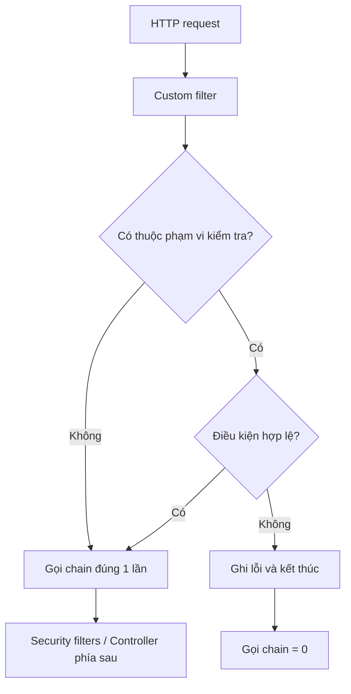

# Kiểm tra gọi tiếp chuỗi đúng một lần hoặc dừng đúng điều kiện

Một filter tùy biến có thể kiểm tra đúng header hoặc token nhưng vẫn làm hệ thống hoạt động sai: **quên gọi chain khi request được phép**, **gọi chain hai lần**, hoặc **đã trả lỗi nhưng vẫn cho downstream thực thi**. Những lỗi này nguy hiểm hơn một kết quả HTTP không đúng đơn thuần, vì controller, transaction hoặc thao tác ghi dữ liệu phía sau có thể bị thực hiện lặp lại.

Trong chương **Filter và cơ chế tùy biến** của **SPRING_SECURITY_TESTING**, chúng ta kiểm chứng xác thực, phân quyền và bảo vệ HTTP thực tế bằng `spring-security-test` trên **Servlet** và **Reactive**. Người học sử dụng `MockMvc`, `WebTestClient`, `@WithMockUser`, `SecurityContext` cùng JWT/OAuth2/OIDC giả lập để cô lập các nhánh được phép hoặc bị từ chối. Trọng tâm của bài là **đo bằng chứng về việc chuyển tiếp/dừng chuỗi** thay vì chỉ xem status code.

## 1. Hợp đồng ba nhánh của filter

| Nhánh | Điều kiện | Hành vi | Số lần gọi chain tiếp theo |
|---|---|---|---:|
| Tiếp tục | Request khớp phạm vi và hợp lệ | Chuyển request cho filter/handler tiếp theo | **1** |
| Dừng | Request khớp phạm vi nhưng vi phạm điều kiện | Thiết lập response lỗi và kết thúc | **0** |
| Không thuộc phạm vi | Filter không cần kiểm tra request này | Bỏ qua logic riêng nhưng vẫn chuyển tiếp | **1** |

Ở đây, **1 lần** là số lần **filter hiện tại gọi phương thức chain tiếp theo trong một lần xử lý**. Không có nghĩa toàn bộ ứng dụng chỉ có một filter, hoặc một HTTP request không thể trải qua nhiều lần dispatch.



Ví dụ xuyên suốt: endpoint `GET /api/critical` yêu cầu header `X-Request-Id` không rỗng. Endpoint `/api/public` không cần header này. Khi thiếu header ở đường dẫn critical, filter trả `400 Bad Request`. Đây là **kiểm tra dữ liệu request**, không phải cơ chế chứng minh danh tính: client tự đặt được `X-Request-Id`, vì vậy **không dùng header này thay cho xác thực/phân quyền**.

### Sự khác biệt Servlet và WebFlux

| Tiêu chí | Servlet | Reactive WebFlux |
|---|---|---|
| Giao diện | `Filter`/`OncePerRequestFilter` | `WebFilter` |
| Phương thức gọi tiếp | `FilterChain.doFilter(request, response)` | `WebFilterChain.filter(exchange)` |
| Kết quả | `void`, tiếp tục trong Servlet call stack | `Mono<Void>`, biểu diễn việc hoàn tất bất đồng bộ |
| Dừng | Ghi lỗi, `return`, không gọi `doFilter` | Trả publisher kết thúc response, không gọi `chain.filter` |
| Test đơn vị | `MockHttpServletRequest` + Mockito | `MockServerWebExchange` + `StepVerifier` + Mockito |
| Test HTTP | `MockMvc` | `WebTestClient` |
| Bẫy đặc thù | Async/error dispatch; filter bị đăng ký trùng | Một method call nhưng downstream publisher bị subscribe nhiều lần |

## 2. Servlet: một filter có hai nhánh rõ ràng

Với Spring Security chạy trên Servlet, có thể mở rộng `OncePerRequestFilter`. Ví dụ:

```java
import java.io.IOException;
import jakarta.servlet.FilterChain;
import jakarta.servlet.ServletException;
import jakarta.servlet.http.HttpServletRequest;
import jakarta.servlet.http.HttpServletResponse;
import org.springframework.util.StringUtils;
import org.springframework.web.filter.OncePerRequestFilter;

final class RequiredRequestIdFilter extends OncePerRequestFilter {

    @Override
    protected boolean shouldNotFilter(HttpServletRequest request) {
        String uri = request.getRequestURI();
        String contextPath = request.getContextPath();
        String path = uri.substring(contextPath.length());
        return !"/api/critical".equals(path);
    }

    @Override
    protected void doFilterInternal(
            HttpServletRequest request,
            HttpServletResponse response,
            FilterChain filterChain)
            throws ServletException, IOException {

        String requestId = request.getHeader("X-Request-Id");
        if (!StringUtils.hasText(requestId)) {
            response.sendError(
                HttpServletResponse.SC_BAD_REQUEST,
                "X-Request-Id is required");
            return; // Không cho downstream chạy.
        }

        filterChain.doFilter(request, response); // Đúng một lần.
    }
}
```

`shouldNotFilter` là hook chọn phạm vi lọc. Khi request không trùng `/api/critical`, Spring bỏ logic `doFilterInternal` nhưng vẫn cho request đi tiếp. Cách tính path từ context path phù hợp minh họa; ở ứng dụng thực cần tính đến Servlet mapping, URL encoding và request matcher nếu policy phức tạp.

Các điểm cần ghi nhớ:

1. **Thiếu hoặc trắng header:** gọi `sendError(...)` và `return` ngay, không gọi `doFilter`.
2. **Đủ header:** chỉ một lời gọi `filterChain.doFilter(...)`.
3. **Không đúng đường dẫn:** filter không kiểm header và để request tiếp tục.
4. **Lỗi downstream:** không tự gọi lại `doFilter`; để cơ chế xử lý exception phù hợp hoạt động.

## 3. Unit test Servlet: đếm số lần doFilter

Đừng chỉ assert response 200/400. Một response 200 có thể đến từ filter tự tạo dù controller chưa chạy, còn một response 400 có thể được ghi **sau khi controller đã bị gọi**.

Tạo unit test bằng Spring Mock Servlet và Mockito:

```java
import jakarta.servlet.FilterChain;
import jakarta.servlet.ServletException;
import org.junit.jupiter.api.Test;
import org.springframework.mock.web.MockHttpServletRequest;
import org.springframework.mock.web.MockHttpServletResponse;

import static org.assertj.core.api.Assertions.assertThat;
import static org.mockito.ArgumentMatchers.same;
import static org.mockito.Mockito.mock;
import static org.mockito.Mockito.times;
import static org.mockito.Mockito.verify;
import static org.mockito.Mockito.verifyNoInteractions;
import static org.mockito.Mockito.verifyNoMoreInteractions;

class RequiredRequestIdFilterTest {

    private final RequiredRequestIdFilter filter =
            new RequiredRequestIdFilter();

    private static MockHttpServletRequest criticalRequest() {
        return new MockHttpServletRequest("GET", "/api/critical");
    }

    @Test
    void validRequestContinuesExactlyOnce() throws Exception {
        var request = criticalRequest();
        request.addHeader("X-Request-Id", "req-1");
        var response = new MockHttpServletResponse();
        FilterChain chain = mock(FilterChain.class);

        filter.doFilter(request, response, chain);

        verify(chain, times(1))
                .doFilter(same(request), same(response));
        verifyNoMoreInteractions(chain);
        assertThat(response.getStatus()).isEqualTo(200);
    }

    @Test
    void missingHeaderStopsWithoutCallingChain() throws Exception {
        var request = criticalRequest();
        var response = new MockHttpServletResponse();
        FilterChain chain = mock(FilterChain.class);

        filter.doFilter(request, response, chain);

        assertThat(response.getStatus()).isEqualTo(400);
        verifyNoInteractions(chain);
    }

    @Test
    void whitespaceOnlyHeaderAlsoStops() throws Exception {
        var request = criticalRequest();
        request.addHeader("X-Request-Id", "  ");
        var response = new MockHttpServletResponse();
        FilterChain chain = mock(FilterChain.class);

        filter.doFilter(request, response, chain);

        assertThat(response.getStatus()).isEqualTo(400);
        verifyNoInteractions(chain);
    }

    @Test
    void outsideScopeContinuesWithoutHeader() throws Exception {
        var request = new MockHttpServletRequest(
                "GET", "/api/public");
        var response = new MockHttpServletResponse();
        FilterChain chain = mock(FilterChain.class);

        filter.doFilter(request, response, chain);

        verify(chain, times(1))
                .doFilter(same(request), same(response));
        verifyNoMoreInteractions(chain);
    }
}
```

Các assertion độc lập xác minh:

- `verify(chain, times(1)).doFilter(...)`: đã chuyển tiếp **chính xác một lần**.
- `verifyNoMoreInteractions(chain)`: không còn lời gọi khác tới mock chain.
- `verifyNoInteractions(chain)`: đã dừng **trước tất cả downstream**.
- `response.getStatus()`: kết quả HTTP phản ánh chính sách.

`same(request)`/`same(response)` phù hợp khi filter không bọc request/response. Nếu một filter hợp lệ dùng wrapper để biến đổi body hoặc header, hãy bắt tham số bằng `ArgumentCaptor` rồi kiểm nội dung của wrapper, thay vì bắt buộc cùng identity đối tượng.

### Khi chain ném lỗi

Nếu downstream ném exception, filter cần để lỗi được xử lý đúng thay vì lặng lẽ gọi lại:

```java
import static org.junit.jupiter.api.Assertions.assertThrows;
import static org.mockito.Mockito.doThrow;

@Test
void downstreamErrorDoesNotRetryChain() throws Exception {
    var request = criticalRequest();
    request.addHeader("X-Request-Id", "req-2");
    var response = new MockHttpServletResponse();
    FilterChain chain = mock(FilterChain.class);

    doThrow(new ServletException("downstream failed"))
            .when(chain)
            .doFilter(same(request), same(response));

    assertThrows(ServletException.class,
        () -> filter.doFilter(request, response, chain));

    verify(chain, times(1))
            .doFilter(same(request), same(response));
}
```

Đây là method **thêm vào class test trên**, dùng lại helper `criticalRequest()`. Nó không khẳng định toàn bộ HTTP app sẽ trả 500; phần mapping exception thành HTTP response phụ thuộc error handling ở tầng tích hợp.

## 4. Các cách viết Servlet sai dù dùng OncePerRequestFilter

Ví dụ gọi chain trùng:

```java
// SAI: request hợp lệ bị chuyển tiếp hai lần.
if (valid) {
    filterChain.doFilter(request, response);
}
filterChain.doFilter(request, response);
```

Ví dụ không dừng sau khi gửi lỗi:

```java
// SAI: phản hồi 400 đã được tạo nhưng downstream vẫn chạy.
if (!valid) {
    response.sendError(400);
}
filterChain.doFilter(request, response);
```

Và một anti-pattern phức tạp hơn: gọi `doFilter` trong `try` rồi gọi lại khi bắt exception. Request có thể đã tạo side effect hoặc commit response trong lần thứ nhất; lần thứ hai không phải cơ chế retry an toàn.

Mẫu rõ ràng nhất:

```java
if (!valid) {
    response.sendError(400);
    return;
}
filterChain.doFilter(request, response);
```

### OncePerRequestFilter không có nghĩa “một lần cho mọi dispatch”

`OncePerRequestFilter` giúp tránh chạy lại logic nội bộ trong một số tình huống reentry/dispatch; nhưng **không tự đảm bảo** implementation của `doFilterInternal` chỉ gọi `filterChain.doFilter` một lần. Ngoài ra, Servlet có các dispatcher type như `REQUEST`, `ASYNC` và `ERROR`. Lớp cung cấp các hook `shouldNotFilterAsyncDispatch()` và `shouldNotFilterErrorDispatch()` để quyết định cách xử lý phù hợp.

Nếu kiểm thử async/error dispatch, hãy tạo đúng tình huống dispatch và nêu rõ phạm vi “một lần” đang được đo. Hai lời gọi `filter.doFilter(...)` tuần tự trong test không nhất thiết là cùng một lần dispatch; marker nội bộ có thể đã được dọn sau lời gọi thứ nhất.

## 5. MockMvc integration: kiểm controller chạy 0 hoặc 1 lần

Unit test về mock chain vẫn cần được bổ sung bằng kiểm thử với handler thật:

```java
import java.util.concurrent.atomic.AtomicInteger;
import org.springframework.web.bind.annotation.GetMapping;
import org.springframework.web.bind.annotation.RestController;

@RestController
class CriticalController {

    final AtomicInteger calls = new AtomicInteger();

    @GetMapping("/api/critical")
    String critical() {
        return "processed-" + calls.incrementAndGet();
    }
}
```

```java
import static org.springframework.test.web.servlet.request
        .MockMvcRequestBuilders.get;
import static org.springframework.test.web.servlet.result
        .MockMvcResultMatchers.content;
import static org.springframework.test.web.servlet.result
        .MockMvcResultMatchers.status;

@Test
void mockMvcConfirmsStopAndContinue() throws Exception {
    CriticalController controller = new CriticalController();
    MockMvc mvc = MockMvcBuilders
            .standaloneSetup(controller)
            .addFilters(new RequiredRequestIdFilter())
            .build();

    mvc.perform(get("/api/critical"))
            .andExpect(status().isBadRequest());
    assertThat(controller.calls.get()).isZero();

    mvc.perform(get("/api/critical")
            .header("X-Request-Id", "req-3"))
            .andExpect(status().isOk())
            .andExpect(content().string("processed-1"));
    assertThat(controller.calls.get()).isEqualTo(1);
}
```

Điều kiện thiếu header **không được gọi controller**; điều kiện hợp lệ làm counter tăng đúng một lần. Tuy nhiên, `MockMvcBuilders.standaloneSetup(...)` với `addFilters(...)` chỉ kiểm tra filter/controller đã lắp trong test, **không chứng minh Spring Security FilterChainProxy đang có mặt**.

Khi cần kiểm bảo vệ HTTP toàn ứng dụng, dùng `@SpringBootTest` + `@AutoConfigureMockMvc(addFilters = true)` và cấu hình SecurityFilterChain thật. Có thể đặt filter ở vị trí rõ ràng:

```java
@Bean
SecurityFilterChain apiSecurity(HttpSecurity http) throws Exception {
    http.authorizeHttpRequests(auth -> auth
            .requestMatchers("/api/critical").authenticated()
            .anyRequest().permitAll());
    http.httpBasic(Customizer.withDefaults());
    http.addFilterBefore(
            new RequiredRequestIdFilter(),
            AuthorizationFilter.class);
    return http.build();
}
```

Ví dụ trên là cấu hình **Servlet**. Nếu đăng ký cùng một filter làm bean được Servlet container auto-register **và** chèn vào Spring Security chain, hãy kiểm tra nguy cơ bị chạy ở hai tầng hoặc sai vị trí. Khi cần đưa một bean filter chỉ vào security chain, có thể phải vô hiệu hóa registration tại container bằng `FilterRegistrationBean` thích hợp.

## 6. Đọc đúng HTTP status và thứ tự filter

Thiếu `X-Request-Id` trong bài minh họa là **400**, không phải lỗi xác thực. Các nguyên nhân độc lập khác gồm:

| Nguyên nhân | Phản hồi thường thấy | Tầng chịu trách nhiệm |
|---|---|---|
| Header nghiệp vụ bắt buộc không hợp lệ | 400 | Custom validation filter |
| Chưa đăng nhập | 401 hoặc redirect tùy entry point | Authentication |
| Đăng nhập rồi nhưng thiếu quyền | 403 | Authorization |
| Không có route phù hợp | 404 nếu request đi đến routing | Handler mapping |
| Downstream ném lỗi chưa xử lý | 500 hoặc error mapping riêng | Exception handling |
| Vượt giới hạn tốc độ | 429 nếu chính sách quy định | Rate limiter |

Thứ tự filter quyết định nhánh nào được quan sát trước. Một request vừa thiếu header vừa chưa xác thực có thể bị chặn ở **custom filter** hoặc **authentication filter**, tùy cách lắp chain. Vì vậy khi test cơ chế 401/403, hãy cung cấp header hợp lệ; khi test lỗi header, hãy cung cấp một principal đã xác thực nếu chain yêu cầu.

Không mặc định rằng ném `AuthenticationException` hoặc `AccessDeniedException` từ **bất kỳ vị trí nào** trong custom filter đều được Spring Security chuyển thành 401/403. `ExceptionTranslationFilter` chỉ xử lý các exception trên nhánh chain nó bao bọc; vị trí filter so với entry point, access-denied handler và exception translation rất quan trọng. Ưu tiên dùng đúng extension point của Spring Security cho xác thực/phân quyền.

## 7. Reactive WebFilter: trả publisher của downstream

Với WebFlux, filter dùng `WebFilter` và trả `Mono<Void>`. Không có Servlet `FilterChain.doFilter`; thay vào đó, `WebFilterChain.filter(exchange)` cung cấp publisher biểu diễn phần xử lý phía sau:

```java
import org.springframework.http.HttpStatus;
import org.springframework.util.StringUtils;
import org.springframework.web.server.ServerWebExchange;
import org.springframework.web.server.WebFilter;
import org.springframework.web.server.WebFilterChain;
import reactor.core.publisher.Mono;

final class RequiredRequestIdWebFilter implements WebFilter {

    @Override
    public Mono<Void> filter(
            ServerWebExchange exchange,
            WebFilterChain chain) {

        String path = exchange.getRequest()
                .getPath()
                .pathWithinApplication()
                .value();

        if (!"/api/critical".equals(path)) {
            return chain.filter(exchange);
        }

        String requestId = exchange.getRequest()
                .getHeaders()
                .getFirst("X-Request-Id");

        if (!StringUtils.hasText(requestId)) {
            exchange.getResponse().setStatusCode(HttpStatus.BAD_REQUEST);
            return exchange.getResponse().setComplete();
        }

        return chain.filter(exchange);
    }
}
```

Trong nhánh hợp lệ, **return chính publisher của chain** để WebFlux subscribe, xử lý lỗi và đợi hoàn tất đúng cách. Trong nhánh dừng, `setComplete()` cho biết phản hồi cần được hoàn tất; không gọi `chain.filter(exchange)`.

Phân biệt hai hành vi:

```java
// ĐÚNG: trả publisher cho WebFlux điều phối.
return chain.filter(exchange);

// SAI: tạo subscription tách khỏi vòng đời HTTP request.
// Lỗi, cancellation và hoàn tất không còn theo chuỗi được trả về.
chain.filter(exchange).subscribe();
return Mono.empty();
```

Một WebFilter có thể thêm logging bằng `doOnError(...)`/`doFinally(...)` trên publisher chain mà không subscribe thủ công. Nhưng nếu đã gọi `setComplete()` để từ chối, không được gọi tiếp chain trong một nhánh khác.

## 8. Unit test WebFilter với Mockito và StepVerifier

Ví dụ tạo mock exchange mà không khởi động cả WebFlux application:

```java
import org.junit.jupiter.api.Test;
import org.springframework.http.HttpStatus;
import org.springframework.mock.http.server.reactive.MockServerHttpRequest;
import org.springframework.mock.web.server.MockServerWebExchange;
import org.springframework.web.server.WebFilterChain;
import reactor.core.publisher.Mono;
import reactor.test.StepVerifier;

import static org.assertj.core.api.Assertions.assertThat;
import static org.mockito.ArgumentMatchers.same;
import static org.mockito.Mockito.mock;
import static org.mockito.Mockito.times;
import static org.mockito.Mockito.verify;
import static org.mockito.Mockito.verifyNoInteractions;
import static org.mockito.Mockito.verifyNoMoreInteractions;
import static org.mockito.Mockito.when;

class RequiredRequestIdWebFilterTest {
    private final RequiredRequestIdWebFilter filter =
            new RequiredRequestIdWebFilter();

    @Test
    void validRequestCallsChainOnce() {
        var request = MockServerHttpRequest
                .get("/api/critical")
                .header("X-Request-Id", "req-11")
                .build();
        var exchange = MockServerWebExchange.from(request);
        WebFilterChain chain = mock(WebFilterChain.class);
        when(chain.filter(same(exchange))).thenReturn(Mono.empty());

        StepVerifier.create(filter.filter(exchange, chain))
                .verifyComplete();

        verify(chain, times(1)).filter(same(exchange));
        verifyNoMoreInteractions(chain);
    }

    @Test
    void missingHeaderCompletesWithoutCallingChain() {
        var exchange = MockServerWebExchange.from(
                MockServerHttpRequest.get("/api/critical").build());
        WebFilterChain chain = mock(WebFilterChain.class);

        StepVerifier.create(filter.filter(exchange, chain))
                .verifyComplete();

        assertThat(exchange.getResponse().getStatusCode())
                .isEqualTo(HttpStatus.BAD_REQUEST);
        verifyNoInteractions(chain);
    }

    @Test
    void unrelatedPathContinuesExactlyOnce() {
        var exchange = MockServerWebExchange.from(
                MockServerHttpRequest.get("/api/public").build());
        WebFilterChain chain = mock(WebFilterChain.class);
        when(chain.filter(same(exchange))).thenReturn(Mono.empty());

        StepVerifier.create(filter.filter(exchange, chain))
                .verifyComplete();

        verify(chain, times(1)).filter(same(exchange));
    }
}
```

Ở test nhánh cho phép, mock chain trả `Mono.empty()`. Không có handler thật, vì vậy test phải tập trung vào **số lần gọi phương thức** và completion; không thể kết luận có controller trả 200 chỉ dựa vào mock này.

### Khi downstream trả lỗi

Thêm một method trong cùng class:

```java
@Test
void downstreamErrorPropagatesWithoutRetrying() {
    var exchange = MockServerWebExchange.from(
        MockServerHttpRequest.get("/api/critical")
            .header("X-Request-Id", "req-12")
            .build());
    WebFilterChain chain = mock(WebFilterChain.class);
    when(chain.filter(same(exchange)))
            .thenReturn(Mono.error(
                new IllegalStateException("downstream failure")));

    StepVerifier.create(filter.filter(exchange, chain))
            .expectError(IllegalStateException.class)
            .verify();

    verify(chain, times(1)).filter(same(exchange));
}
```

Nếu filter bắt lỗi rồi gọi chain lần nữa, assertion số lần gọi hoặc behavior sẽ khác. Không tự nuốt exception của downstream để biến nó thành một response “thành công” khi chưa có hợp đồng xử lý lỗi rõ ràng.

## 9. Reactive: một lần gọi method vẫn có thể subscribe hai lần

Trong Reactor, có một khác biệt rất quan trọng giữa **gọi method** và **subscribe vào publisher**. Một implementation sai có thể trông như sau:

```java
@Override
public Mono<Void> filter(
        ServerWebExchange exchange,
        WebFilterChain chain) {
    Mono<Void> downstream = chain.filter(exchange);
    return downstream.then(downstream); // SAI.
}
```

`chain.filter(exchange)` ở đây được gọi **một lần**, nên Mockito `verify(chain, times(1))` vẫn có thể pass. Nhưng publisher `downstream` được đưa vào hai đoạn của pipeline; với cold publisher, nó có thể được **subscribe hai lần**. Một handler có side effect có thể chạy lặp.

Một sai lầm khác:

```java
// SAI: Mono<Void> hoàn tất không phát onNext, kể cả khi thành công.
return chain.filter(exchange)
        .switchIfEmpty(chain.filter(exchange));
```

`Mono<Void>` thường hoàn tất rỗng theo thiết kế. Do đó, `switchIfEmpty` không thể được dùng để suy ra “downstream chưa thực thi”; nhánh dự phòng có thể khiến chain chạy lại.

### Test đếm cả phương thức và số lần subscription

```java
import java.util.concurrent.atomic.AtomicInteger;

@Test
void downstreamPublisherIsSubscribedExactlyOnce() {
    var exchange = MockServerWebExchange.from(
        MockServerHttpRequest.get("/api/critical")
            .header("X-Request-Id", "req-13")
            .build());
    WebFilterChain chain = mock(WebFilterChain.class);
    AtomicInteger subscriptions = new AtomicInteger();

    when(chain.filter(same(exchange))).thenReturn(
        Mono.defer(() -> {
            subscriptions.incrementAndGet();
            return Mono.empty();
        }));

    StepVerifier.create(filter.filter(exchange, chain))
            .verifyComplete();

    verify(chain, times(1)).filter(same(exchange));
    assertThat(subscriptions.get()).isEqualTo(1);
}
```

Hai số đo này kiểm tra **hai tính chất khác nhau**:

- **Method count:** filter gọi `WebFilterChain.filter(exchange)` đúng một lần.
- **Subscription count:** phần downstream thật sự chạy một lần trong lần xử lý đang được kiểm tra.

Để test có ý nghĩa, chỉ tạo **một subscription** vào kết quả trong ca này. Nếu test tự subscribe hai lần vào cùng cold publisher hoặc sử dụng `retry`/`repeat` theo chủ đích, số lần downstream thực thi có thể tăng lên dù filter không sai. Khi áp dụng `retry` cho một HTTP request có side effect, cần thiết kế tính idempotent và chính sách xử lý lỗi rõ ràng.

### Không lặp downstream từ error handler

```java
// RỦI RO: downstream đã chạy một phần trước khi phát lỗi.
return chain.filter(exchange)
        .onErrorResume(error -> chain.filter(exchange));
```

Đoạn này không phải retry an toàn mặc định. Nếu downstream đã ghi database, gửi sự kiện hoặc commit response, subscribe lại có thể tạo tác dụng phụ lặp. Chỉ retry những thao tác được thiết kế cho phép retry; không dùng lại toàn bộ WebFilterChain như cách xử lý lỗi chung.

## 10. WebTestClient integration: quan sát handler

Unit test đếm method/subscription cần bổ sung bằng test xác minh handler **không chạy** khi filter dừng.

```java
import java.util.concurrent.atomic.AtomicInteger;
import org.springframework.web.bind.annotation.GetMapping;
import org.springframework.web.bind.annotation.RestController;
import reactor.core.publisher.Mono;

@RestController
class ReactiveCriticalController {
    final AtomicInteger calls = new AtomicInteger();

    @GetMapping("/api/critical")
    Mono<String> critical() {
        return Mono.fromSupplier(
            () -> "processed-" + calls.incrementAndGet());
    }
}
```

```java
@Test
void webTestClientConfirmsStopAndContinue() {
    ReactiveCriticalController controller =
            new ReactiveCriticalController();

    WebTestClient client = WebTestClient
            .bindToController(controller)
            .webFilter(new RequiredRequestIdWebFilter())
            .build();

    client.get().uri("/api/critical")
            .exchange()
            .expectStatus().isBadRequest();
    assertThat(controller.calls.get()).isZero();

    client.get().uri("/api/critical")
            .header("X-Request-Id", "req-14")
            .exchange()
            .expectStatus().isOk()
            .expectBody(String.class)
            .isEqualTo("processed-1");
    assertThat(controller.calls.get()).isEqualTo(1);
}
```

`bindToController(...).webFilter(...)` kiểm controller cùng custom filter trong môi trường mock, **chưa phải** integration test đầy đủ với Spring Security WebFilterChain. Nếu mục tiêu là kiểm filter đã được đặt đúng thứ tự so với authentication/authorization, phải bind `WebTestClient` vào application context có security:

```java
WebTestClient securedClient = WebTestClient
        .bindToApplicationContext(applicationContext)
        .apply(springSecurity())
        .configureClient()
        .build();
```

`springSecurity()` ở đây là configurer của **Reactive WebTestClient**, không phải configurer của MockMvc. Khi Spring Boot tạo `WebTestClient` đã gắn security, không cần tự dựng thêm một client nếu nó đã đáp ứng phạm vi test.

### Gắn filter vào SecurityWebFilterChain

Một cấu hình minh họa cho ứng dụng WebFlux:

```java
@Bean
SecurityWebFilterChain security(ServerHttpSecurity http) {
    http.authorizeExchange(ex -> ex
            .pathMatchers("/api/critical").authenticated()
            .anyExchange().permitAll());
    http.httpBasic(Customizer.withDefaults());
    http.addFilterBefore(
            new RequiredRequestIdWebFilter(),
            SecurityWebFiltersOrder.AUTHORIZATION);
    return http.build();
}
```

Nếu cùng một filter đã là **global WebFilter** và lại được chèn vào Spring Security chain, nó có thể ảnh hưởng request ở hai tầng. Đừng đánh dấu filter mặc định là `@Component` rồi đồng thời thêm chính instance đó ở nhiều nơi mà không kiểm tra cách đăng ký/đặt thứ tự.

## 11. Phân biệt kiểm thử filter với kiểm thử xác thực

Giả sử production yêu cầu đăng nhập và có authority `SCOPE_critical.read` cho `/api/critical`. Khi test filter kiểm tra header, cần loại trừ trường hợp request bị chặn ở authentication filter trước khi custom filter chạy.

**Servlet / MockMvc** có thể giả lập user:

```java
mockMvc.perform(get("/api/critical")
        .with(user("alice"))
        .header("X-Request-Id", "req-15"))
    .andExpect(status().isOk());
```

**Reactive / WebTestClient**:

```java
webTestClient
    .mutateWith(mockUser("alice"))
    .get()
    .uri("/api/critical")
    .header("X-Request-Id", "req-16")
    .exchange()
    .expectStatus().isOk();
```

Hai ví dụ này giả định security chain tương ứng đã được áp dụng và route có tồn tại. Nếu rule yêu cầu `SCOPE_critical.read`, `mockUser("alice")` mặc định **không nhất thiết có authority đó**: phải cấp authority phù hợp hoặc dùng JWT mock:

```java
webTestClient
    .mutateWith(mockJwt().authorities(
        new SimpleGrantedAuthority("SCOPE_critical.read")))
    .get()
    .uri("/api/critical")
    .header("X-Request-Id", "req-17")
    .exchange()
    .expectStatus().isOk();
```

`mockJwt()` chỉ chuẩn bị một Authentication giả. Nó không kiểm tra chữ ký/JWKS/issuer của Bearer JWT thật. Tương tự, `oauth2Login()` và `mockOidcLogin()` không tự chạy authorization-code flow hoặc kiểm tra ID token thực.

### Ma trận kiểm tra cả hai điều kiện

| Authentication | Header | Bằng chứng mong muốn |
|---|---|---|
| Hợp lệ, đủ quyền | Có | Filter tiếp tục 1 lần; controller chạy |
| Hợp lệ, đủ quyền | Không | Filter dừng; controller không chạy |
| Không xác thực | Có | Authentication/authorization từ chối theo entry point |
| Đã xác thực, thiếu quyền | Có | Authorization từ chối; không để trả dữ liệu nhạy cảm |
| Không xác thực | Không | Kết quả phụ thuộc thứ tự filter; cần kiểm nguyên nhân thực |

Nếu test cả authentication và filter trong cùng một ca mà không kiểm soát đầu vào, HTTP status chỉ cho biết **lỗi đầu tiên được quan sát**, không chứng minh điều kiện dừng của filter riêng.

## 12. Các loại lời gọi lại không phải cùng một lỗi

Khi thấy log filter xuất hiện hai lần, cần phân biệt:

| Tình huống | Vì sao có nhiều lần? | Nên kiểm tra |
|---|---|---|
| `doFilterInternal` gọi `doFilter` hai lần | Bug trong nhánh xử lý Servlet | Mockito verify số lời gọi |
| Servlet có `ASYNC`/`ERROR` dispatch | Một HTTP lifecycle có thể trải qua dispatch khác nhau | DispatcherType và hook của OncePerRequestFilter |
| Filter được container và Spring Security cùng đăng ký | Cùng logic nằm ở nhiều chain/vị trí | Filter registrations, thứ tự và pattern |
| Reactive dùng `downstream.then(downstream)` | Một method call nhưng hai subscriptions | Bộ đếm trong `Mono.defer` |
| Reactive có `retry/repeat` | Có thể resubscribe theo chính sách | Số subscriptions, side effect idempotent |
| Test chạy hai request/subscribe hai lần | Hai lượt xử lý độc lập | Tạo fixture/reset counter theo test |
| Một request qua các reverse proxy/retry ở ngoài ứng dụng | Có thể nhận nhiều HTTP requests thật | Request ID, proxy logs và idempotency |

Vì thế, trước khi tuyên bố “filter chạy hai lần”, cần hỏi: đang đếm **request, dispatch, method call, subscription hay handler execution**? Các số đo có thể khác nhau nhưng đều đúng theo đơn vị của chúng.

## 13. Checklist chẩn đoán một test bị đỏ

1. **Kiểm đường dẫn:** filter có thực sự áp dụng cho URL/method này không? `shouldNotFilter` hoặc reactive path matcher có bỏ nhánh không?
2. **Kiểm điều kiện dừng:** thiếu header/token/quyền gì; điều kiện được tính trước hay sau các filter khác?
3. **Kiểm dòng điều khiển:** sau `sendError` phải `return`; nhánh hợp lệ không có hai lời gọi `doFilter`.
4. **Kiểm response:** status, headers, body có đúng contract; filter có ghi sau khi response đã commit không?
5. **Kiểm chain count:** Mockito `times(1)` hoặc `verifyNoInteractions`, không chỉ `status=200/400`.
6. **Kiểm subscription Reactive:** dùng `Mono.defer` để đếm thật; không tự gọi `subscribe()` trong WebFilter.
7. **Kiểm integration:** controller counter chỉ tăng khi được phép; thiếu header không tạo side effect.
8. **Kiểm filter registration:** container filter, Spring Security filter, WebFilter bean, nhiều security chains và thứ tự.
9. **Kiểm identity độc lập:** `@WithMockUser`/`mockJwt()` dùng để kiểm policy; muốn JWT/OIDC thật cần decoder/login flow test khác.
10. **Kiểm async/retry:** xác định có dispatch mới, subscription mới hoặc request mới hay không; đừng quy mọi trường hợp thành gọi chain trùng.

Một báo cáo lỗi tốt cần ghi rõ:

```text
Path / method       : GET /api/critical
Input condition     : X-Request-Id missing
Authentication      : authenticated test principal
Expected chain calls: 0
Actual chain calls  : 0 / 1 / 2 (từ Mockito)
HTTP response       : 400
Controller calls    : 0
Reactive subscriptions (nếu có): 0
Filter registration : security chain / container / global web filter
```

Các giá trị trên là mẫu điền khi debug; không tự điền số “actual” từ suy đoán. Không log Bearer token thật, client secret hoặc toàn bộ SecurityContext.

## 14. Bài thực hành

Một ứng dụng quản lý hồ sơ có hai route: `GET /api/critical` yêu cầu `X-Request-Id` và quyền `SCOPE_critical.read`; `GET /api/public` không cần header. Filter chỉ chịu trách nhiệm điều kiện header, Spring Security chịu trách nhiệm xác thực/phân quyền.

1. Viết `OncePerRequestFilter` xử lý đúng hai nhánh dừng/tiếp tục. Dùng Mockito assert `doFilter` là **1** với header hợp lệ và **0** với header thiếu/trắng.
2. Kiểm `/api/public` không bị chặn nhầm và vẫn chuyển tiếp **một lần**.
3. Cho downstream `FilterChain` ném `ServletException`; chứng minh không có lời gọi thứ hai.
4. Dựng MockMvc controller có `AtomicInteger`; request bị từ chối không làm tăng counter, request hợp lệ làm tăng đúng một.
5. Viết `WebFilter` tương đương và dùng `StepVerifier` + Mockito cho ba nhánh.
6. Gắn `Mono.defer(...)` vào mock WebFilterChain; đo **subscription count**. Cố ý viết `downstream.then(downstream)` để quan sát method count = 1 nhưng subscription count = 2.
7. Tích hợp với security chain thật. Cấp principal đủ quyền, lần lượt thiếu và có header; xác nhận số handler calls. Sau đó giữ header hợp lệ và thử principal thiếu authority để kiểm 403.
8. Kiểm filter không bị đăng ký hai lần ở Servlet container/Spring Security hoặc global WebFilter/SecurityWebFilterChain.
9. Thử một request `/api/critical` không xác thực và thiếu header; giải thích status cuối phụ thuộc **thứ tự filter**, và thiết kế test tách hai nguyên nhân.
10. Nếu sử dụng JWT, hãy phân biệt test `mockJwt()` để xác minh authority với test HTTP Bearer token ký thật để xác minh decoder.

**Tiêu chí hoàn thành:** Mỗi nhánh có bằng chứng về **điều kiện, chain count, HTTP status và tác dụng downstream**. Ở Servlet kiểm `doFilter`; ở Reactive kiểm cả `WebFilterChain.filter` lẫn **số subscription**. Không dùng riêng HTTP 200/400 để kết luận filter đã tiếp tục hoặc dừng đúng.
