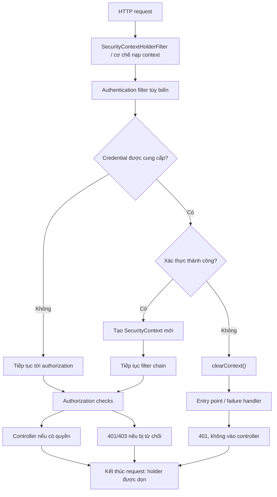

# Dọn SecurityContext khi xác thực thất bại

Trong một ứng dụng Spring Security, xác thực thất bại không chỉ là trả `401 Unauthorized`. Nếu một filter tùy biến để lại `Authentication` cũ trong `SecurityContext`, request thất bại có thể tiếp tục đi qua các tầng phía sau như một người dùng đã đăng nhập, hoặc một request sau đó có thể nhìn thấy sai danh tính do ngữ cảnh bị quản lý không đúng. Vì thế, kiểm thử an toàn phải xác minh **cả trạng thái HTTP, việc dọn ngữ cảnh và việc không thực thi nghiệp vụ trái phép**.

Bài thuộc chương **Filter và cơ chế tùy biến** của module **SPRING_SECURITY_TESTING**. Người học kiểm chứng xác thực, phân quyền và bảo vệ HTTP thực tế bằng `spring-security-test` cho Servlet và Reactive, sử dụng `MockMvc`, `WebTestClient`, `@WithMockUser`, `SecurityContext`, JWT/OAuth2/OIDC giả lập và các ca được phép/bị từ chối. Trọng tâm ở đây là cách xử lý **authentication failure** trong custom filter: khi nào gọi `SecurityContextHolder.clearContext()`, khi nào cần xóa state đã lưu, cách Reactive xử lý tương đương, và cách viết test phát hiện lỗi ngữ cảnh bị giữ lại.

> **Bất biến bảo mật:** Nếu một cơ chế xác thực bắt buộc đã xác định request **không hợp lệ**, request đó không được dùng lại một `Authentication` đã có để đi tiếp theo nhánh thành công, không được ghi tác vụ nghiệp vụ được bảo vệ, và phải được xử lý qua failure handler/entry point phù hợp. Việc xóa context của request không tự động thu hồi access token hoặc hủy mọi session hiện có.

## 1. Phân biệt authentication failure và authorization denial

Hai tình huống này có phản hồi HTTP giống nhau ở một số cấu hình, nhưng cần xử lý khác nhau:

- **Authentication failure:** Credential được đưa vào là sai hoặc không thể xác minh. Ví dụ API key không hợp lệ, JWT sai chữ ký, mật khẩu sai, token hết hạn. Không được xây dựng một `Authentication` đáng tin cậy từ credential đó.
- **Authorization denial:** Danh tính đã được xác thực nhưng thiếu quyền, scope, role hoặc không sở hữu tài nguyên. Ví dụ user Alice hợp lệ nhưng cố đọc hồ sơ Bob. Ở đây không nhất thiết cần xóa authentication: biết ai bị từ chối còn hữu ích cho audit và chính sách.

| Trạng thái | Ví dụ | Kết quả thường thấy | Cần dọn gì? |
|---|---|---|---|
| Chưa có credential | Không gửi `X-Api-Key`/Bearer | `401` nếu endpoint yêu cầu login | Không tạo context giả; để entry point xử lý |
| Credential không hợp lệ | API key sai, JWT signature sai | `401` | Loại bỏ authentication tạm, dừng nhánh success |
| Credential hết hạn | JWT `exp` đã qua | `401` | Không dùng token hết hạn để xây danh tính |
| Credential hợp lệ, thiếu scope | Token thiếu `reports.read` | `403` | Giữ đúng ngữ nghĩa authorization; không mặc định logout |
| Credential hợp lệ, sai owner | User A đọc record của B | `403` hoặc `404` theo contract | Không sửa record; không tự suy ra phải xóa session |
| Login thất bại ở session stateful | Password/OIDC callback sai | Xử lý thất bại theo flow | Dọn context của attempt; xóa session đã lưu **nếu chính sách yêu cầu** |

`ExceptionTranslationFilter` và các authentication entry point thường giúp chuyển lỗi thành HTTP response, nhưng không phải mọi custom authentication filter đều nằm ở vị trí để lỗi của nó được filter này bắt. Cơ chế xác thực nào tạo ra lỗi phải bảo đảm **failure path được xử lý đầy đủ**.

## 2. SecurityContext nằm ở đâu và ai có trách nhiệm dọn?

Trong Servlet, `SecurityContextHolder` mặc định dùng `MODE_THREADLOCAL`. Code phổ biến:

```java
Authentication current =
        SecurityContextHolder.getContext()
                .getAuthentication();
```

Giá trị đó thuộc **thread hiện tại**, không phải một đối tượng toàn cục có thể dùng tùy tiện qua mọi request. Spring Security sử dụng các filter để thiết lập, khôi phục và dọn `SecurityContext` quanh vòng đời request. Trong các cấu hình Spring Security 6, cần phân biệt hai cơ chế:

- `SecurityContextHolderFilter`: đọc `SecurityContext` thông qua `SecurityContextRepository`, đặt nó vào holder trong phạm vi request và dọn holder sau khi filter chain kết thúc. Mô hình này **yêu cầu lưu context tường minh** khi cần persistence.
- `SecurityContextPersistenceFilter`: mô hình cũ hơn có thể tự lưu context về repository ở cuối request theo cấu hình. Không nên giả định mọi dự án dùng cùng một filter/vòng đời lưu.
- `SecurityContextRepository`: có thể là repository dựa trên session, request attributes hoặc `NullSecurityContextRepository` cho ứng dụng stateless. Đây là phần **lưu/người dùng giữa các request**, khác với ThreadLocal đang được xử lý.



**Tách ba hành động khác nhau:**

1. `SecurityContextHolder.clearContext()` xóa context gắn với **thread/request xử lý hiện tại** của holder.
2. `SecurityContextRepository.saveContext(emptyContext, request, response)` hoặc logout/session invalidation tác động tới **context đã lưu** theo repository/chính sách.
3. Token revocation, refresh token revocation hoặc thay đổi trạng thái ở identity provider là **quy trình bên ngoài**; không xảy ra chỉ vì đã gọi `clearContext()`.

Một API stateless dùng JWT thường không lưu authentication vào session; khi token sai, mục tiêu là không xác thực request, không tạo session và không tiếp tục vào nghiệp vụ. Một ứng dụng web stateful có session hợp lệ từ trước cần chính sách rõ: **một credential sai trong một request có xóa toàn bộ session đăng nhập trước đó hay không?** Không phải trường hợp nào cũng nên xóa.

## 3. Lỗi điển hình: filter thất bại nhưng vẫn dùng authentication cũ

Giả sử filter tự viết đọc header `X-Api-Key`. Lỗi thường gặp là:

```java
// CỐ Ý SAI: ví dụ anti-pattern, không đưa vào ứng dụng.
try {
    Authentication authentication =
            apiKeyAuthenticator.authenticate(
                    request.getHeader("X-Api-Key"));

    SecurityContextHolder.getContext()
            .setAuthentication(authentication);
} catch (AuthenticationException ex) {
    // Bỏ qua lỗi và đi tiếp!
}

filterChain.doFilter(request, response);
```

Nếu `SecurityContextHolder` đã có Alice do một cơ chế cũ, một test setup hoặc sự cố dọn context trước đó, request có API key sai vẫn có thể tới controller với authentication của Alice. Ngay cả khi trước đó không có người dùng, lặng lẽ tiếp tục sau lỗi cũng phá yêu cầu fail-closed của endpoint.

Một anti-pattern khác:

```java
// CỐ Ý SAI: lỗi được chuyển thành status nhưng không kết thúc filter.
catch (AuthenticationException ex) {
    response.setStatus(HttpServletResponse.SC_UNAUTHORIZED);
}

filterChain.doFilter(request, response);
```

Trả `401` **không ngăn** các tác dụng phụ phía sau nếu code vẫn gọi `filterChain.doFilter`. Controller/service có thể ghi dữ liệu, phát event hoặc trả nội dung trước khi response kết thúc.

**Quy tắc bất biến cho failure branch của custom authentication filter:**

- Không tạo `Authentication` thành công từ credential bị từ chối.
- Nếu filter đã làm bẩn context hoặc cần loại bỏ authentication của attempt thất bại, dọn bằng `SecurityContextHolder.clearContext()`.
- Gọi `AuthenticationEntryPoint` hoặc `AuthenticationFailureHandler` thích hợp.
- **`return` ngay**, không gọi downstream filter chain ở nhánh lỗi.
- Không ghi raw credential vào log/error body.
- Có test đối chứng credential đúng vào được controller và credential sai bị chặn **trước** controller.

## 4. Mẫu Servlet custom filter an toàn cho request bắt buộc API key

Ta xây một API minh họa: `GET /api/private` yêu cầu một danh tính xác thực bằng header `X-Api-Key`. Mẫu này chủ động chọn chính sách: **hễ header API key được gửi nhưng không hợp lệ thì trả 401, không rơi về cơ chế xác thực khác trong cùng request**.

### 4.1. Ranh giới xác minh credential

Tách việc kiểm API key ra khỏi filter:

```java
public interface ApiKeyAuthenticator {
    Authentication authenticate(String rawApiKey)
            throws AuthenticationException;
}
```

Trong production, implementation có thể đọc một kho hash API key hoặc gọi dịch vụ chuyên trách, nhưng phải là **nguồn được tin cậy**. Nếu key không hợp lệ, trả lỗi kiểu `AuthenticationException` như `BadCredentialsException`. Nếu hợp lệ, trả một `Authentication` có `isAuthenticated() == true` với principal/authorities đã xác minh.

**Không** lấy role, username hoặc tenant từ một header khác do client tùy ý gửi rồi đặt trực tiếp vào `Authentication`. Credential kiểm tra thành công mới là cơ sở gắn quyền. Không ghi `rawApiKey` hoặc thông tin bí mật vào exception message được đưa ra client.

### 4.2. Filter xử lý thành công và thất bại ở hai nhánh khác nhau

```java
public final class ApiKeyAuthenticationFilter
        extends OncePerRequestFilter {

    private final ApiKeyAuthenticator authenticator;
    private final AuthenticationEntryPoint entryPoint;

    public ApiKeyAuthenticationFilter(
            ApiKeyAuthenticator authenticator,
            AuthenticationEntryPoint entryPoint) {
        this.authenticator = authenticator;
        this.entryPoint = entryPoint;
    }

    @Override
    protected void doFilterInternal(
            HttpServletRequest request,
            HttpServletResponse response,
            FilterChain filterChain)
            throws ServletException, IOException {

        String rawKey = request.getHeader("X-Api-Key");

        if (rawKey == null) {
            // Không có key: để authorization quyết định
            // xem endpoint có cho anonymous hay không.
            filterChain.doFilter(request, response);
            return;
        }

        Authentication authenticated;

        try {
            authenticated =
                    authenticator.authenticate(rawKey);

            if (authenticated == null
                    || !authenticated.isAuthenticated()) {
                throw new BadCredentialsException(
                        "Invalid API key");
            }
        } catch (AuthenticationException failure) {
            // Dọn authentication hiện có trên request thread,
            // tuyệt đối không tiếp tục filter chain.
            SecurityContextHolder.clearContext();

            entryPoint.commence(
                    request, response, failure);
            return;
        }

        SecurityContext newContext =
                SecurityContextHolder.createEmptyContext();
        newContext.setAuthentication(authenticated);
        SecurityContextHolder.setContext(newContext);

        filterChain.doFilter(request, response);
    }
}
```

Import chính:

```java
import java.io.IOException;

import jakarta.servlet.FilterChain;
import jakarta.servlet.ServletException;
import jakarta.servlet.http.HttpServletRequest;
import jakarta.servlet.http.HttpServletResponse;

import org.springframework.security.authentication.BadCredentialsException;
import org.springframework.security.core.Authentication;
import org.springframework.security.core.AuthenticationException;
import org.springframework.security.core.context.SecurityContext;
import org.springframework.security.core.context.SecurityContextHolder;
import org.springframework.security.web.AuthenticationEntryPoint;
import org.springframework.web.filter.OncePerRequestFilter;
```

**Vì sao code có chủ đích như vậy?**

1. Header **không có** thì filter không tự xác thực; endpoint `/api/private` vẫn cần `authenticated()` để từ chối request vô danh.
2. Header **có nhưng rỗng/sai** phải được authenticator từ chối. Đừng đối xử một chuỗi rỗng như “không có header” để né kiểm tra.
3. Chỉ đặt context **sau khi** đã có `Authentication` đáng tin. Nếu provider phát lỗi, context mới chưa được tạo.
4. Tạo **`SecurityContext` mới** thay vì lấy object cũ rồi sửa authentication. Điều này tránh vô tình sửa một context được chia sẻ/snapshot theo cơ chế persistence.
5. Nhánh `catch` chỉ bao quanh **việc xác thực**. Không gộp `filterChain.doFilter` vào `try` này, vì `AuthenticationException` từ tầng khác có thể cần được xử lý bởi cơ chế của chính tầng ấy.
6. `entryPoint.commence(...)` tạo response lỗi; `return` đảm bảo không gọi controller sau failure.
7. Vòng đời cuối request do filter chain Spring Security quản lý context. Với API stateless, filter **không lưu** authentication vào session.

Ví dụ chỉ minh họa API key authentication. Spring Security còn cung cấp các cơ chế chuẩn như Basic, Bearer/JWT, form login, OAuth2 Login, `AuthenticationFilter` hoặc `AuthenticationWebFilter`; nên ưu tiên cơ chế sẵn có khi chúng đáp ứng yêu cầu thay vì tự viết filter từ đầu.

### 4.3. Filter order và vì sao không ném lỗi rồi chờ ExceptionTranslationFilter

Một custom filter đặt bằng `.addFilterBefore(filter, UsernamePasswordAuthenticationFilter.class)` thường thực thi **trước** `ExceptionTranslationFilter`. Trong trường hợp ấy, việc ném thẳng `AuthenticationException` rồi giả định `ExceptionTranslationFilter` sẽ bắt có thể sai, vì filter dịch lỗi nằm **phía sau** filter đang ném.

Mẫu trên xử lý lỗi **ngay trong filter** bằng `AuthenticationEntryPoint`. Một lựa chọn khác là dùng `AuthenticationFilter` với `AuthenticationConverter`, `AuthenticationManager` và success/failure handler chuẩn; khi đó giao cho framework quản lý đường đi lỗi và ngữ cảnh.

Điều quan trọng không phải lựa chọn filter nào “luôn đúng”, mà là chọn **đúng vị trí, đúng handler và đúng hợp đồng của chain**, rồi kiểm bằng request thật.

## 5. Cấu hình SecurityFilterChain cho API stateless

Trong ví dụ, không cần lưu session authentication. Tạo filter bên trong bean `SecurityFilterChain`, tránh đồng thời đăng ký nó như servlet filter độc lập.

```java
@Configuration(proxyBeanMethods = false)
@EnableWebSecurity
public class ApiSecurityConfig {

    @Bean
    SecurityFilterChain apiChain(
            HttpSecurity http,
            ApiKeyAuthenticator authenticator)
            throws Exception {

        AuthenticationEntryPoint entryPoint =
                new HttpStatusEntryPoint(
                        HttpStatus.UNAUTHORIZED);

        ApiKeyAuthenticationFilter apiKeyFilter =
                new ApiKeyAuthenticationFilter(
                        authenticator, entryPoint);

        return http
                .securityContext(security -> security
                        .securityContextRepository(
                                new NullSecurityContextRepository()))
                .sessionManagement(session -> session
                        .sessionCreationPolicy(
                                SessionCreationPolicy.STATELESS))
                .httpBasic(AbstractHttpConfigurer::disable)
                .formLogin(AbstractHttpConfigurer::disable)
                .exceptionHandling(exceptions -> exceptions
                        .authenticationEntryPoint(entryPoint))
                .authorizeHttpRequests(auth -> auth
                        .requestMatchers("/api/private")
                            .authenticated()
                        .anyRequest().denyAll())
                .addFilterBefore(
                        apiKeyFilter,
                        UsernamePasswordAuthenticationFilter.class)
                .build();
    }
}
```

Import:

```java
import org.springframework.context.annotation.Bean;
import org.springframework.context.annotation.Configuration;
import org.springframework.http.HttpStatus;
import org.springframework.security.config.annotation.web.configuration.EnableWebSecurity;
import org.springframework.security.config.annotation.web.builders.HttpSecurity;
import org.springframework.security.config.annotation.web.configurers.AbstractHttpConfigurer;
import org.springframework.security.config.http.SessionCreationPolicy;
import org.springframework.security.web.SecurityFilterChain;
import org.springframework.security.web.authentication.HttpStatusEntryPoint;
import org.springframework.security.web.authentication.UsernamePasswordAuthenticationFilter;
import org.springframework.security.web.context.NullSecurityContextRepository;
import org.springframework.security.web.AuthenticationEntryPoint;
```

**Không tự động tắt CSRF chỉ để cho test chạy.** Ví dụ ở đây dùng GET; nếu API thực sự stateless và chỉ xác thực bằng header không được browser tự gửi, chính sách CSRF có thể khác mô hình dùng cookie/session. Hãy quyết định dựa trên threat model và test riêng các thao tác ghi.

**Không để filter được đăng ký hai lần.** Nếu một `OncePerRequestFilter` đồng thời là bean `Filter` mà Spring Boot tự đăng ký vào servlet container và còn được thêm vào Spring Security filter chain, nó có thể chạy ở sai vị trí hoặc hai lần. Mẫu tạo filter bằng `new` trong cấu hình chain để tránh auto-registration. Với filter cần làm Spring bean, dùng `FilterRegistrationBean` để vô hiệu đăng ký servlet độc lập khi thích hợp.

### 5.1. Controller minh họa

```java
@RestController
class PrivateController {

    @GetMapping("/api/private")
    Map<String, String> privateResource(
            Authentication authentication) {

        return Map.of(
                "principal", authentication.getName(),
                "data", "PRIVATE_MARKER");
    }
}
```

Import:

```java
import java.util.Map;
import org.springframework.security.core.Authentication;
import org.springframework.web.bind.annotation.GetMapping;
import org.springframework.web.bind.annotation.RestController;
```

`PRIVATE_MARKER` chỉ là chuỗi có chủ đích để kiểm không rò rỉ body. Ở API thật, bảo vệ theo role/scope và quyền sở hữu tài nguyên ở service/repository cũng cần được thử. `.authenticated()` không tự cho phép mọi người đọc mọi bản ghi.

## 6. Kiểm tra dọn context trực tiếp ở cấp filter unit test

Bộ unit test sau kiểm tra **failure branch** bằng cách cố ý đặt một authentication cũ lên thread test, sau đó gửi API key sai. Đây là phép đo trực tiếp `clearContext()`, bổ sung cho integration test HTTP ở mục tiếp theo.

```java
class ApiKeyAuthenticationFilterTest {

    @AfterEach
    void clearTestThread() {
        SecurityContextHolder.clearContext();
    }

    @Test
    void invalidKeyClearsStaleThreadAuthentication()
            throws Exception {

        Authentication stale =
                UsernamePasswordAuthenticationToken
                        .authenticated(
                                "old-alice",
                                null,
                                AuthorityUtils
                                    .createAuthorityList(
                                            "ROLE_USER"));

        SecurityContext staleContext =
                SecurityContextHolder.createEmptyContext();
        staleContext.setAuthentication(stale);
        SecurityContextHolder.setContext(staleContext);

        ApiKeyAuthenticator rejectAll =
                key -> {
                    throw new BadCredentialsException(
                            "Invalid key");
                };

        ApiKeyAuthenticationFilter filter =
                new ApiKeyAuthenticationFilter(
                        rejectAll,
                        new HttpStatusEntryPoint(
                                HttpStatus.UNAUTHORIZED));

        MockHttpServletRequest request =
                new MockHttpServletRequest(
                        "GET", "/api/private");
        request.addHeader("X-Api-Key", "wrong-key");

        MockHttpServletResponse response =
                new MockHttpServletResponse();

        AtomicBoolean downstreamReached =
                new AtomicBoolean(false);

        filter.doFilter(
                request,
                response,
                (req, res) ->
                        downstreamReached.set(true));

        assertThat(response.getStatus())
                .isEqualTo(401);

        assertThat(downstreamReached.get()).isFalse();

        assertThat(SecurityContextHolder.getContext()
                .getAuthentication()).isNull();
    }
}
```

Import:

```java
import java.util.concurrent.atomic.AtomicBoolean;

import org.junit.jupiter.api.AfterEach;
import org.junit.jupiter.api.Test;
import org.springframework.http.HttpStatus;
import org.springframework.mock.web.MockHttpServletRequest;
import org.springframework.mock.web.MockHttpServletResponse;
import org.springframework.security.authentication.BadCredentialsException;
import org.springframework.security.authentication.UsernamePasswordAuthenticationToken;
import org.springframework.security.core.Authentication;
import org.springframework.security.core.authority.AuthorityUtils;
import org.springframework.security.core.context.SecurityContext;
import org.springframework.security.core.context.SecurityContextHolder;
import org.springframework.security.web.authentication.HttpStatusEntryPoint;

import static org.assertj.core.api.Assertions.assertThat;
```

**Vì sao test này có giá trị?**

- Trước khi chạy filter, `SecurityContextHolder` có chủ đích chứa `old-alice`.
- Filter nhận credential không hợp lệ và đi vào nhánh thất bại.
- Test khẳng định `Authentication` trên **thread hiện tại** đã bị loại bỏ.
- Test khẳng định `FilterChain` phía sau **không được gọi**.
- Test khẳng định status là `401`.

Tuy nhiên, đây chỉ là **unit test của custom filter**. Nó chưa chứng minh session repository đã bị xóa, `SecurityContextHolderFilter` chạy đúng thứ tự hoặc request HTTP thật qua toàn bộ chain. Muốn xác minh những điều ấy cần integration test.

### 6.1. Test không đặt credential, không tự giả lập danh tính

Một test khác nên gọi filter khi header không có và ghi nhận nhánh này gọi chain:

```java
@Test
void noApiKeyDelegatesToAuthorizationLayer()
        throws Exception {

    ApiKeyAuthenticator authenticator = key -> {
        throw new AssertionError(
                "Không được gọi khi thiếu header");
    };

    ApiKeyAuthenticationFilter filter =
            new ApiKeyAuthenticationFilter(
                    authenticator,
                    new HttpStatusEntryPoint(
                            HttpStatus.UNAUTHORIZED));

    MockHttpServletRequest request =
            new MockHttpServletRequest(
                    "GET", "/api/private");
    MockHttpServletResponse response =
            new MockHttpServletResponse();

    AtomicBoolean nextCalled = new AtomicBoolean();

    filter.doFilter(request, response,
            (req, res) -> nextCalled.set(true));

    assertThat(nextCalled.get()).isTrue();
}
```

Điều này **không có nghĩa** endpoint `/api/private` cho phép anonymous. Khi chạy qua `SecurityFilterChain` đầy đủ, `.authenticated()` vẫn phải từ chối request không credential. Filter ở đây chỉ không xử lý request không thuộc phạm vi credential của nó.

## 7. MockMvc integration: test thật cả thành công, thất bại, và request kế tiếp

Ở mức tích hợp, nạp `SecurityFilterChain`, controller và bean xác minh API key; tránh bypass filter bằng `.with(user())` hoặc `@WithMockUser` trong những ca muốn kiểm credential sai.

Test mẫu dùng một `ApiKeyAuthenticator` giả lập **duy nhất ở ranh giới tra cứu key**, còn custom filter và chain vẫn thật.

```java
@SpringBootTest
@AutoConfigureMockMvc
class ApiKeyAuthenticationIT {

    @Autowired
    MockMvc mockMvc;

    @Test
    void validApiKeyAccessesProtectedResource()
            throws Exception {

        mockMvc.perform(get("/api/private")
                    .header("X-Api-Key",
                            "test-key-alice"))
                .andExpect(status().isOk())
                .andExpect(jsonPath("$.principal")
                        .value("alice"))
                .andExpect(jsonPath("$.data")
                        .value("PRIVATE_MARKER"));
    }

    @Test
    void invalidApiKeyCannotReuseAuthentication()
            throws Exception {

        mockMvc.perform(get("/api/private")
                    .header("X-Api-Key",
                            "wrong-key"))
                .andExpect(status().isUnauthorized())
                .andExpect(content().string(
                        not(containsString(
                                "PRIVATE_MARKER"))));
    }

    @Test
    void missingApiKeyIsUnauthorized()
            throws Exception {

        mockMvc.perform(get("/api/private"))
                .andExpect(status().isUnauthorized());
    }

    @Test
    void previousSuccessDoesNotAuthenticateNextRequest()
            throws Exception {

        mockMvc.perform(get("/api/private")
                    .header("X-Api-Key",
                            "test-key-alice"))
                .andExpect(status().isOk());

        mockMvc.perform(get("/api/private")
                    .header("X-Api-Key",
                            "wrong-key"))
                .andExpect(status().isUnauthorized());

        mockMvc.perform(get("/api/private"))
                .andExpect(status().isUnauthorized());
    }

    @TestConfiguration
    static class TestCredentials {

        @Bean
        @Primary
        ApiKeyAuthenticator testApiKeyAuthenticator() {
            return rawKey -> {
                if ("test-key-alice".equals(rawKey)) {
                    return UsernamePasswordAuthenticationToken
                            .authenticated(
                                    "alice",
                                    null,
                                    AuthorityUtils.createAuthorityList(
                                            "ROLE_USER"));
                }
                throw new BadCredentialsException(
                        "Invalid API key");
            };
        }
    }
}
```

Import chính:

```java
import org.junit.jupiter.api.Test;
import org.springframework.beans.factory.annotation.Autowired;
import org.springframework.context.annotation.Bean;
import org.springframework.context.annotation.Primary;
import org.springframework.boot.test.autoconfigure.web.servlet.AutoConfigureMockMvc;
import org.springframework.boot.test.context.SpringBootTest;
import org.springframework.boot.test.context.TestConfiguration;
import org.springframework.security.authentication.BadCredentialsException;
import org.springframework.security.authentication.UsernamePasswordAuthenticationToken;
import org.springframework.security.core.authority.AuthorityUtils;
import org.springframework.test.web.servlet.MockMvc;

import static org.hamcrest.Matchers.containsString;
import static org.hamcrest.Matchers.not;
import static org.springframework.test.web.servlet.request.MockMvcRequestBuilders.get;
import static org.springframework.test.web.servlet.result.MockMvcResultMatchers.*;
```

Đặt test trong package để Spring Boot tìm thấy `@SpringBootApplication`, `ApiSecurityConfig` và `PrivateController`. Nếu project chưa có bean production `ApiKeyAuthenticator`, nested `@TestConfiguration` có thể đóng vai bean duy nhất; nếu có bean production, `@Primary` giúp chọn bean test đúng mục tiêu. Không đưa string `"test-key-alice"` vào production: đây là key vô hại dành riêng cho test.

Các test trên kiểm **hành vi HTTP với filter thật**, nhưng không tự quan sát `SecurityContextHolder` sau mỗi request, vì Spring Security xóa ThreadLocal cuối request. Khi muốn bắt lỗi **bỏ qua `clearContext()` bên trong nhánh thất bại**, test unit mục 6 cố ý seed stale authentication để kiểm cơ chế trực tiếp.

### 7.1. Điều gì xảy ra nếu test dùng `@WithMockUser` ở ca âm tính?

```java
// Không phù hợp nếu muốn chứng minh request thật không có
// Authentication khi API key bị thiếu.
@WithMockUser(username = "alice")
@Test
void missingApiKeyIsUnauthorized() {
    // Test có sẵn authentication từ annotation.
}
```

Khi security test listener đặt authentication trước request, kết quả từ chối/thành công còn phụ thuộc thứ tự và cách filter dùng repository. Đó là một kịch bản khác với user thực sự không có credential. Với các test **thiếu/sai key**, không gắn mock user ở chính request. `@WithMockUser` phù hợp cho test authorization rule khi danh tính đã tồn tại.

### 7.2. Không chỉ xem HTTP status

Một test quan trọng nên xác nhận failure **không vào service**. Nếu controller gọi repository, event publisher hoặc gateway gửi email, dùng spy/fake thích hợp ở ranh giới nghiệp vụ để xác minh không có tác dụng phụ.

Ví dụ với một `AuditEventPublisher`/`OrderService` giả định:

```java
mockMvc.perform(post("/api/private/action")
        .header("X-Api-Key", "wrong-key"))
    .andExpect(status().isUnauthorized());

verifyNoInteractions(protectedBusinessService);
```

Đây là skeleton phụ thuộc vào endpoint/service thực và cách cấu hình test; không thể chạy nguyên văn nếu dự án không có những lớp đó. Trong một ứng dụng có audit authentication failure, **audit security hợp lệ vẫn có thể được phát**. Điều cần assert là không có **tác vụ nghiệp vụ được bảo vệ** hoặc ghi dữ liệu trái phép, không phải không có mọi loại log/event.

## 8. Dọn ThreadLocal không đồng nghĩa xóa session

Tình huống stateful cần được phân biệt. Giả sử ứng dụng web sử dụng session đăng nhập, `SecurityContextRepository` có thể đọc context Alice đã được lưu từ request trước. Nếu một request sau mang API key sai, có ít nhất hai chính sách hợp lệ:

- **Policy A — API key bắt buộc cho endpoint này:** Nếu header hiện diện nhưng không hợp lệ, từ chối request bằng `401`, dọn authentication của attempt trong request. Có thể còn giữ session login của Alice cho các trang khác nếu chính sách cho phép.
- **Policy B — Xác thực thất bại đồng nghĩa kết thúc phiên:** Ngoài từ chối request, ứng dụng chủ động logout và xóa session authentication đã lưu. Hành động này cần được xác định bằng hợp đồng, không mặc định mọi credential sai đều logout toàn bộ session.

### 8.1. Vì sao clearContext() chưa đủ cho Policy B?

```java
SecurityContextHolder.clearContext();
```

Lệnh đó làm sạch holder hiện tại. Với session-based repository, nếu authentication Alice đã được lưu trong session, request **sau** có thể nạp lại Alice từ session. Đây không nhất thiết là lỗi; có thể đúng theo Policy A.

Nếu chính sách yêu cầu loại bỏ context đã lưu, cần thao tác **với repository hoặc logout handler**:

```java
SecurityContext empty =
        SecurityContextHolder.createEmptyContext();

SecurityContextHolder.clearContext();

// Chỉ khi chính sách thực sự muốn xóa
// authentication đã lưu ở session/repository:
securityContextRepository.saveContext(
        empty, request, response);
```

Đây là skeleton minh họa yêu cầu **ghi lại state rỗng**. Với các repository/version/configuration khác nhau, cách xóa session entry, session invalidation, cookie và concurrent session có thể khác. Ưu tiên luồng logout chuẩn khi mục tiêu là kết thúc phiên:

```java
SecurityContextLogoutHandler logoutHandler =
        new SecurityContextLogoutHandler();

// Cần truyền authentication hiện tại
// theo contract của luồng logout.
logoutHandler.logout(
        request, response, currentAuthentication);
```

`SecurityContextLogoutHandler` theo cấu hình có thể invalidate HTTP session, clear context và xử lý repository. Nếu ứng dụng dùng lưu cookie/redis/token hoặc nhiều session/device, cần thiết kế riêng cơ chế thu hồi phù hợp; **đừng nghĩ `clearContext()` sẽ thu hồi JWT** hoặc xóa mọi refresh token ở authorization server.

### 8.2. Spring Security 6 và lưu context tường minh

Với `SecurityContextHolderFilter`, việc đặt:

```java
SecurityContextHolder.setContext(newContext);
```

không đảm bảo context sẽ được lưu qua request. Nếu cần session-based authentication tồn tại ở request tiếp theo và dự án sử dụng mô hình **explicit save**, cần gọi:

```java
securityContextRepository.saveContext(
        newContext, request, response);
```

ở vị trí phù hợp sau xác thực thành công và trước khi response được commit. Ở nhánh lỗi cần kết thúc session theo Policy B, dùng logout hoặc save empty context đúng repository. Trong API stateless của mục 5 sử dụng `NullSecurityContextRepository`, không có trạng thái cần lưu cho request sau.

Không nên ghi code “đã `clearContext()` nên phiên đăng nhập chắc chắn biến mất” mà không có test request thứ hai với cùng cookie/session để xác nhận.

## 9. Không để custom filter phá mô hình bảo mật nhiều cơ chế

Một ứng dụng có thể đồng thời bật form login cho giao diện web và Bearer/JWT cho API. Nếu chèn một filter API key vào **mọi request** rồi xóa context khi nhận bất kỳ header nào lạ, có thể gây logout hoặc từ chối sai người dùng hợp lệ.

Các quyết định cần rõ:

| Câu hỏi | Phương án |
|---|---|
| Filter xử lý URL nào? | Dùng `securityMatcher`/`RequestMatcher` chính xác, không áp dụng bừa lên static/login/callback |
| Header API key không có thì sao? | Bỏ qua để chain khác xử lý hay chủ động fail, tùy policy |
| Header API key có nhưng sai thì sao? | Fail-closed và kết thúc request, không fall back âm thầm |
| Một request có cả session và API key sai? | Chọn policy ưu tiên; test riêng, tránh dùng session cũ để bypass |
| JWT Bearer đã hợp lệ nhưng API key sai? | Quy định precedence; với endpoint yêu cầu API key, không cho JWT “cứu” credential sai |
| Sau failure, session cũ còn không? | Theo chính sách persistence/explicit logout |
| Có `SecurityFilterChain` khác? | Kiểm ordering/`securityMatcher`; filter chỉ thuộc chain mong muốn |

**Đừng tự sửa `SecurityContextHolderStrategy` global** để “chia sẻ login” giữa request hoặc thread. `MODE_GLOBAL` và `MODE_INHERITABLETHREADLOCAL` không thay thế được việc quản lý context theo request; dùng sai có nguy cơ lẫn danh tính giữa users.

Một mẫu an toàn cho những API khác nhau là tách chains:

```java
@Bean
@Order(1)
SecurityFilterChain api(HttpSecurity http) throws Exception {
    return http
        .securityMatcher("/api/**")
        .authorizeHttpRequests(auth -> auth
            .anyRequest().authenticated())
        .build();
}

@Bean
@Order(2)
SecurityFilterChain web(HttpSecurity http) throws Exception {
    return http
        .authorizeHttpRequests(auth -> auth
            .anyRequest().authenticated())
        .formLogin(Customizer.withDefaults())
        .build();
}
```

Đây chỉ là **skeleton minh họa phân chia matcher**, chưa thêm API key filter hoặc đầy đủ cơ chế bảo mật vào các chains. Trong dự án thực, filter API key chỉ được đặt vào chain `/api/**` tương ứng và cấu hình authorization/entry point phải hoàn chỉnh. Các URL OAuth2 callback, login, static assets cũng phải được tính rõ.

## 10. Reactive: không dùng SecurityContextHolder của test thread

Trong Spring WebFlux, context bảo mật chủ yếu đi theo **Reactor Context** thông qua `ReactiveSecurityContextHolder`, không phụ thuộc `ThreadLocal` của JUnit thread.

```java
Mono<String> currentUsername =
        ReactiveSecurityContextHolder.getContext()
                .map(SecurityContext::getAuthentication)
                .map(Authentication::getName);
```

`SecurityContextHolder.clearContext()` trên test thread **không phải** phương thức chung để xóa ngữ cảnh của một WebFlux request đang chạy trong Reactor. Cần để Spring Security Reactive xử lý authentication success/failure và subscription context đúng cách.

Spring Security đã cung cấp `AuthenticationWebFilter` với:

- `ServerAuthenticationConverter` trích credential từ `ServerWebExchange`;
- `ReactiveAuthenticationManager` xác minh credential;
- `ServerAuthenticationSuccessHandler` nối `SecurityContext` vào request chain khi thành công;
- `ServerAuthenticationFailureHandler` xử lý lỗi và kết thúc failure path;
- `ServerSecurityContextRepository` lưu/khôi phục context khi cấu hình yêu cầu.

**Ưu tiên các thành phần chuẩn này** thay vì viết một WebFilter tự đặt `SecurityContext` bằng `contextWrite` trong mọi nhánh rồi cố sửa thủ công khi xảy ra lỗi.

## 11. Ví dụ WebFlux AuthenticationWebFilter với credential giả lập

Ví dụ riêng cho API Reactive dùng header `X-Api-Key`, hoạt động stateless. Để tập trung vào ranh giới context, phần manager minh họa logic kiểm key trong chính cấu hình; **production cần thay bằng authentication manager/provider chuyên dụng** với key storage an toàn.

```java
@Configuration
@EnableWebFluxSecurity
class ReactiveApiKeySecurityConfig {

    @Bean
    SecurityWebFilterChain reactiveApi(
            ServerHttpSecurity http) {

        ReactiveAuthenticationManager manager =
                incoming -> {
                    Object value =
                            incoming.getCredentials();

                    if ("test-key-alice".equals(value)) {
                        Authentication alice =
                            UsernamePasswordAuthenticationToken
                                .authenticated(
                                    "alice",
                                    null,
                                    AuthorityUtils
                                        .createAuthorityList(
                                            "ROLE_USER"));

                        return Mono.just(alice);
                    }

                    return Mono.error(
                            new BadCredentialsException(
                                    "Invalid API key"));
                };

        AuthenticationWebFilter apiKeyFilter =
                new AuthenticationWebFilter(manager);

        apiKeyFilter.setServerAuthenticationConverter(
                exchange -> {
                    String rawKey = exchange.getRequest()
                            .getHeaders()
                            .getFirst("X-Api-Key");

                    if (rawKey == null) {
                        return Mono.empty();
                    }

                    Authentication unauthenticated =
                            UsernamePasswordAuthenticationToken
                                    .unauthenticated(
                                            "api-key",
                                            rawKey);

                    return Mono.just(unauthenticated);
                });

        apiKeyFilter.setSecurityContextRepository(
                NoOpServerSecurityContextRepository
                        .getInstance());

        apiKeyFilter.setAuthenticationFailureHandler(
                (webFilterExchange, failure) -> {
                    ServerHttpResponse response =
                            webFilterExchange.getExchange()
                                    .getResponse();

                    response.setStatusCode(
                            HttpStatus.UNAUTHORIZED);

                    // Không gọi tiếp chain ở failure branch.
                    return response.setComplete();
                });

        return http
                .securityContextRepository(
                        NoOpServerSecurityContextRepository
                            .getInstance())
                .httpBasic(
                        ServerHttpSecurity.HttpBasicSpec::disable)
                .formLogin(
                        ServerHttpSecurity.FormLoginSpec::disable)
                .authorizeExchange(auth -> auth
                        .pathMatchers("/api/private")
                            .authenticated()
                        .anyExchange().denyAll())
                .addFilterAt(
                        apiKeyFilter,
                        SecurityWebFiltersOrder.AUTHENTICATION)
                .build();
    }
}
```

Import chính:

```java
import org.springframework.context.annotation.Bean;
import org.springframework.context.annotation.Configuration;
import org.springframework.http.HttpStatus;
import org.springframework.http.server.reactive.ServerHttpResponse;
import org.springframework.security.authentication.BadCredentialsException;
import org.springframework.security.authentication.UsernamePasswordAuthenticationToken;
import org.springframework.security.authentication.ReactiveAuthenticationManager;
import org.springframework.security.core.Authentication;
import org.springframework.security.core.authority.AuthorityUtils;
import org.springframework.security.config.annotation.web.reactive.EnableWebFluxSecurity;
import org.springframework.security.config.web.server.ServerHttpSecurity;
import org.springframework.security.config.web.server.SecurityWebFiltersOrder;
import org.springframework.security.web.server.SecurityWebFilterChain;
import org.springframework.security.web.server.authentication.AuthenticationWebFilter;
import org.springframework.security.web.server.context.NoOpServerSecurityContextRepository;
import reactor.core.publisher.Mono;
```

`UsernamePasswordAuthenticationToken` trong ví dụ được dùng như **container tạm cho credential**, không nhằm khuyên dùng tên token đó cho mọi sản phẩm API key. Hệ thống có thể xây `Authentication` tùy biến và `ReactiveAuthenticationManager` phù hợp hơn. Không đưa giá trị `"test-key-alice"` vào production.

Điểm cốt lõi của luồng:

1. Request thiếu header → converter trả `Mono.empty()`, filter không tạo authentication; `.authenticated()` từ chối endpoint `/api/private`.
2. Request có key đúng → manager trả `Authentication` thành công; Spring Security Reactive tiếp tục chain với security context tương ứng.
3. Request có key sai → manager phát `AuthenticationException`; failure handler trả `401` và kết thúc response, không cho controller chạy.
4. `NoOpServerSecurityContextRepository` làm rõ hợp đồng **stateless**; không lưu Alice cho request kế tiếp.
5. Ngữ cảnh được quản lý trong Reactor subscription, không phải `SecurityContextHolder` của JUnit thread.

Nếu cấu hình thật dùng WebSession, Reactive repository hoặc một authentication mechanism khác, hãy giữ đúng repository/chain của sản phẩm trong integration test; không sao chép cấu hình NoOp bất kể yêu cầu.

## 12. WebTestClient test đúng request Reactive

Bộ test sau minh họa test bằng HTTP, không gọi `mockUser()` trong các ca API key sai:

```java
@SpringBootTest(
        webEnvironment =
                SpringBootTest.WebEnvironment.RANDOM_PORT)
class ReactiveApiKeyIT {

    @LocalServerPort
    int port;

    WebTestClient client;

    @BeforeEach
    void configureClient() {
        client = WebTestClient.bindToServer()
                .baseUrl("http://localhost:" + port)
                .build();
    }

    @Test
    void validKeyReceivesPrivateData() {
        client.get()
                .uri("/api/private")
                .header("X-Api-Key", "test-key-alice")
                .exchange()
                .expectStatus().isOk()
                .expectBody()
                .jsonPath("$.principal").isEqualTo("alice");
    }

    @Test
    void invalidKeyIsUnauthorized() {
        client.get()
                .uri("/api/private")
                .header("X-Api-Key", "wrong-key")
                .exchange()
                .expectStatus().isUnauthorized();
    }

    @Test
    void missingKeyIsUnauthorized() {
        client.get()
                .uri("/api/private")
                .exchange()
                .expectStatus().isUnauthorized();
    }

    @Test
    void successCannotAuthenticateNextRequest() {
        client.get()
                .uri("/api/private")
                .header("X-Api-Key", "test-key-alice")
                .exchange()
                .expectStatus().isOk();

        client.get()
                .uri("/api/private")
                .exchange()
                .expectStatus().isUnauthorized();
    }
}
```

Import:

```java
import org.junit.jupiter.api.BeforeEach;
import org.junit.jupiter.api.Test;
import org.springframework.boot.test.context.SpringBootTest;
import org.springframework.boot.test.web.server.LocalServerPort;
import org.springframework.test.web.reactive.server.WebTestClient;
```

Để chạy, ứng dụng WebFlux cần có **Reactive endpoint** `/api/private` trả JSON có `principal`, ví dụ:

```java
@RestController
class ReactivePrivateController {

    @GetMapping("/api/private")
    Mono<Map<String, String>> privateResource(
            Mono<Principal> principal) {

        return principal.map(p -> Map.of(
                "principal", p.getName(),
                "data", "PRIVATE_MARKER"));
    }
}
```

Import cần thiết: `java.security.Principal`, `java.util.Map`, `reactor.core.publisher.Mono`, `@RestController`, `@GetMapping`.

**Không dùng `.mutateWith(mockUser())` trong test này:** nếu test chèn authentication giả lập vào context, nó có thể thay đổi cơ chế đang thử. Test này muốn kiểm header được gửi đến **ứng dụng thực**; dùng `WebTestClient.bindToServer()` và cơ chế xác thực của server.

Nếu cần test Reactive ở mức component với context giả lập, `mockUser()`/`mockJwt()` rất hữu ích cho authorization test riêng, nhưng chúng không chứng minh authentication manager xử lý API key sai hoặc clear context đúng.

## 13. Phân biệt failure path trong Spring Security chuẩn với custom filter

Trong Spring Security, các cơ chế phổ biến thường đã xử lý failure đúng cách:

| Cơ chế | Nơi xử lý chính | Phần cần kiểm trong ứng dụng |
|---|---|---|
| Form Login (Servlet) | `UsernamePasswordAuthenticationFilter`, failure handler | Login sai không được thành công; session/context theo policy |
| HTTP Basic | Filter cơ chế Basic + entry point | Header sai không cấp user, request bị từ chối |
| JWT Bearer Resource Server | Bearer filter + decoder/validators + entry point | Chữ ký, issuer, audience, expiry, scope và HTTP status |
| OAuth2 Login | Authorization Code flow filters/handlers | `state`, code exchange, token/ID token, failure handler và session |
| Custom API key | Filter/provider của ứng dụng | Không reuse context cũ, không fall back sai, xử lý 401 |
| WebFlux custom auth | `AuthenticationWebFilter` và Reactor context | Failure không nối một principal không hợp lệ vào subscription |

Không nên “sửa” filter chuẩn bằng một filter chạy cuối chain gọi `clearContext()` trên mọi response `401`, vì:

- Có thể xóa authentication chính đáng của request đã bị **authorization denial** hoặc lỗi ở tầng khác.
- Ở thời điểm response đã commit, việc xóa session authentication có thể không còn tác dụng persistence như mong muốn.
- Với WebFlux, ThreadLocal của thread hiện tại không phải Reactor security context.
- Filter của Spring đã có lifecycle cleanup; một cleanup tùy biến không hiểu ngữ cảnh có thể tạo lỗi mới.

Khi triển khai custom mechanism, hãy dùng API và hook đúng của Spring Security. Khi kiểm thử, ưu tiên **request thật đi qua filter** và **assert trạng thái cuối** thay vì thao tác trực tiếp với holder để “làm cho test xanh”.

## 14. Những bẫy async và vòng đời context

Servlet không phải lúc nào cũng xử lý mọi bước hoàn toàn đồng bộ trên một thread. Có thể có async dispatch, `Callable`, `DeferredResult`, executor và scheduled tasks. `SecurityContextHolder` mặc định theo thread, nên nếu tự đưa công việc sang thread khác mà không có cơ chế truyền context phù hợp, authentication có thể không đi theo.

**Không giải quyết vấn đề bằng cách để ThreadLocal mãi mãi có user cũ.** Nếu cần truyền danh tính sang async task, sử dụng công cụ hỗ trợ context propagation như `DelegatingSecurityContextRunnable`/`DelegatingSecurityContextExecutor` ở đúng ranh giới, hoặc truyền principal/ID đã được xác minh một cách tường minh. Đảm bảo context được dọn sau task, đặc biệt với thread pools.

Đối với WebFlux, `Reactor Context` theo subscriber:

```java
Mono<String> name =
        ReactiveSecurityContextHolder.getContext()
            .map(SecurityContext::getAuthentication)
            .map(Authentication::getName);
```

Có thể kiểm bằng:

```java
Mono<String> testPublisher =
        name.contextWrite(
            ReactiveSecurityContextHolder.withAuthentication(
                UsernamePasswordAuthenticationToken
                    .authenticated(
                        "alice", null,
                        AuthorityUtils.createAuthorityList(
                            "ROLE_USER"))));

StepVerifier.create(testPublisher)
        .expectNext("alice")
        .verifyComplete();
```

Test này chứng minh context Reactive được truyền đến publisher; **không kiểm custom API key filter đã xác thực credential**. Tương tự, code WebFlux tự gọi `subscribe()` tách rời pipeline hoặc thoát sang `CompletableFuture` có thể làm mất correlation. Hãy thiết kế các luồng phản ứng được compose và trả về caller thay vì tự rẽ nhánh ngoài cơ chế security.

## 15. Test session persistence riêng khi ứng dụng stateful

Nếu ứng dụng dùng session để đăng nhập, nên có test **hai request với cùng session**:

1. Đăng nhập hợp lệ qua flow thật; xác minh session có authentication theo policy.
2. Gửi một attempt đăng nhập/API credential sai trong cùng session.
3. Kiểm response lỗi không làm phát sinh tác vụ nghiệp vụ.
4. Thực hiện request tiếp theo **không dùng `.with(user())`** và chỉ mang cookie/session từ trước.
5. Nếu policy là **giữ session** sau một credential sai, assert user vẫn đăng nhập đúng trên endpoint khác.
6. Nếu policy là **logout khi failure**, assert authentication đã lưu bị xóa và request kế tiếp bị yêu cầu đăng nhập lại.

Một assertion nhìn vào `SecurityContextHolder` ngay sau khi `MockMvc` trả response không đủ để kết luận session persistence, vì filter đã có thể dọn ThreadLocal ở cuối request. Đọc trạng thái qua **request tiếp theo** hoặc repository cụ thể mới đo đúng phạm vi cần kiểm.

Các trường hợp logout còn cần kiểm cookie, session invalidation, CSRF token rotation, refresh token cleanup hoặc token revocation tùy hệ thống. Đừng mặc định kết quả của một `SecurityContextHolder.clearContext()` đã thực hiện toàn bộ các thao tác đó.

## 16. Test ma trận failure và điều kiện đối chứng

| ID | Hoàn cảnh | Setup | Kỳ vọng |
|---|---|---|---|
| F01 | Thiếu header | MockMvc/WebTestClient không credential | `401` trên protected endpoint |
| F02 | Header rỗng | Gửi `X-Api-Key: ""` | Bị từ chối; không bỏ qua như thiếu header |
| F03 | Key sai | Gửi key không hợp lệ | `401`, không vào controller |
| F04 | Key đúng | Gửi key hợp lệ | `200`, đúng principal |
| F05 | Unit test có context cũ | Seed Alice rồi gửi key sai vào filter | Thread holder rỗng, downstream không được gọi |
| F06 | Success rồi failure cùng test | Request A đúng, request B sai | B từ chối; không mượn danh tính A |
| F07 | Success rồi anonymous | A đúng, B không credential | B `401` ở API stateless |
| F08 | Response đã đặt `401` | Custom filter có failure branch | Không gọi downstream, không ghi dữ liệu |
| F09 | AuthenticationException từ provider | Provider ném `BadCredentialsException` | Entry point/failure handler xử lý, không `500` |
| F10 | Credential sai nhưng session đã có | Test session stateful | Theo policy: không dùng session làm bypass API key; session khác xử lý rõ |
| F11 | Failed login có policy logout | Same session trước/sau | Repo/session xóa đúng; không chỉ ThreadLocal |
| F12 | Denied do thiếu role | Credential hợp lệ, thiếu quyền | `403`; không nhầm với authentication failure |
| F13 | Sai JWT signature | Bearer token ký sai qua HTTP | `401` bằng decoder/validator thật |
| F14 | JWT hợp lệ nhưng scope thiếu | Bearer ký đúng, thiếu authority | `403`, không logout mặc định |
| F15 | WebFlux key sai | HTTP qua `AuthenticationWebFilter` | `401`, subscription không có auth thành công |
| F16 | WebFlux thiếu key sau request đúng | HTTP request B không header | B từ chối, không lẫn Reactor context |
| F17 | Request ghi bị từ chối | POST/PATCH và DB snapshot | DB/event nghiệp vụ không thay đổi |
| F18 | Có nhiều filter/chain | URL thuộc API key chain | Đúng chain xử lý; không bypass |
| F19 | Tái dispatch async/error | Filter chạy theo dispatch policy | Context đúng phạm vi, không side effect lặp |
| F20 | Có credential kép | Session + API key sai hoặc Basic + API key | Precedence đúng policy, không fallback mập mờ |

**Ca đối chứng dương là bắt buộc.** Nếu mọi request đều trả `401`, test key sai vẫn xanh dù filter/entry point cấu hình sai. Test key đúng phải chứng minh controller nhận principal đã xác thực. Tương tự, test thiếu role `403` cần một ca role đúng thành công để xác minh matcher không chặn nhầm toàn bộ endpoint.

### 16.1. `@WithMockUser` dùng ở đâu?

Dùng `@WithMockUser` để test authorization khi **authentication được xem như đã tồn tại**:

```java
@Test
@WithMockUser(username = "alice", roles = "USER")
void roleUserCanAccessBusinessRule() {
    // Kiểm logic business/authorization riêng.
}
```

**Không** dùng annotation đó để làm đầu vào của test “request không credential bị từ chối” rồi coi kết quả là bằng chứng custom filter clear context. Với một bài test cần tạo stale ThreadLocal có chủ ý, đặt context **ngay trong unit test** và dọn bằng `finally` hoặc `@AfterEach` để không ảnh hưởng test tiếp theo.

## 17. Gỡ lỗi khi thấy context còn user sau khi xác thực thất bại

Khi một test hoặc production log cho thấy user cũ vẫn xuất hiện, hãy phân tích theo thứ tự:

1. **Cơ chế nào thực sự thất bại?** Credential sai ở API key, Bearer decoder, OIDC callback hay business rule?
2. **Filter nào bắt request?** Kiểm `SecurityFilterChain`/`SecurityWebFilterChain`, matcher và order.
3. **Failure branch có gọi downstream không?** Xác minh nhánh lỗi `return`/hoàn tất `Mono`, không tiếp tục filter chain.
4. **Có set authentication quá sớm không?** Chỉ xây/đặt context sau khi `AuthenticationManager`/provider xác thực thành công.
5. **Có dùng `SecurityContextHolder.clearContext()` đúng request thread không?** Đừng dọn trên một thread khác rồi mong nó xóa holder hiện tại.
6. **Session/repository có đang lưu Alice không?** Kiểm request thứ hai với cùng session và chính sách lưu/xóa.
7. **Test có `.with(user())` hoặc `@WithMockUser` không?** Chúng có thể tạo principal không xuất phát từ API key.
8. **Có auto-register filter hai lần không?** Xem `FilterRegistrationBean` và vị trí trong Spring Security chain.
9. **Có custom filter đặt trước/ngoài exception translation không?** Failure cần handler của chính nó hoặc cơ chế chuẩn tương ứng.
10. **Có custom global SecurityContextHolderStrategy không?** Tránh chế độ global/inheritable không phù hợp server nhiều request.
11. **Có async/scheduler context propagation sai?** Kiểm boundary `Executor`, `Callable`, `CompletableFuture`, Reactor subscription.
12. **Có rò rỉ dữ liệu dù status đúng không?** Kiểm body, DB và event, không chỉ HTTP status.

Không log raw API key, Basic password, Bearer token hoặc session cookie để gỡ lỗi. Trong test, có thể log **loại exception**, URL đã xử lý, trace ID và principal đã được kiểm chứng, nhưng không đưa credential vào log tập trung.

### 17.1. Vì sao `SecurityContextHolder.getContext().setAuthentication(null)` không phải lựa chọn mặc định?

Lệnh sau chỉ thay trường authentication trên object context hiện có:

```java
SecurityContextHolder.getContext()
        .setAuthentication(null);
```

Nó có thể đủ ở một ngữ cảnh riêng, nhưng khác với **xóa context khỏi holder**, đặc biệt nếu object context đang được chia sẻ/lưu. Trong failure branch cần dọn request context, API trực tiếp và dễ diễn giải hơn là:

```java
SecurityContextHolder.clearContext();
```

Khi cần đặt authentication thành công, tạo `SecurityContext` mới bằng `createEmptyContext()` rồi set authentication, tránh tái sử dụng một context có thể bị ảnh hưởng ngoài ý muốn.

## 18. Những khẳng định dễ gây hiểu sai

| Tuyên bố thiếu chính xác | Vì sao sai? | Cách diễn đạt phù hợp |
|---|---|---|
| “Đã trả `401`, chắc chắn nghiệp vụ không chạy.” | Code có thể tiếp tục gọi chain hoặc phát side effect | “Failure branch kết thúc chain và DB/event không đổi theo test.” |
| “`clearContext()` xóa luôn session.” | ThreadLocal và repository là hai phạm vi khác nhau | “Request context được dọn; persistence được kiểm riêng.” |
| “`clearContext()` thu hồi JWT.” | JWT/AS có vòng đời riêng | “Request hiện tại bị từ chối; revocation cần thiết kế riêng.” |
| “Authorization `403` luôn phải logout user.” | User vẫn có thể xác thực hợp lệ | “Giữ authentication và từ chối quyền theo policy.” |
| “Test `@WithMockUser` chứng minh API key/JWT thật hoạt động.” | Authentication đã được dựng sẵn | “Test chỉ kiểm logic với mock principal.” |
| “Thread JUnit rỗng nghĩa là WebFlux request không có auth.” | Reactor Context thuộc subscriber | “Đo qua WebTestClient/ReactiveSecurityContextHolder.” |
| “Filter chạy ở mọi URL nên bảo vệ toàn bộ app.” | Có thể bị bypass bởi chain/matcher/order khác | “Mỗi URL được kiểm qua đúng chain và phương thức auth.” |
| “Xóa hết session khi bất kỳ token sai sẽ an toàn hơn.” | Có thể phá các flow login khác và gây logout ngoài ý muốn | “Áp dụng policy cố định cho từng loại credential.” |
| “Filter tự bắt mọi AuthenticationException là tốt nhất.” | Có thể nuốt lỗi của thành phần downstream | “Chỉ xử lý lỗi thuộc trách nhiệm filter.” |

Bài test tốt cần có cả **đối chứng thất bại** và **đối chứng thành công**. Nếu một request không credential bị `401` nhưng cũng không có request credential đúng trả thành công, chưa có bằng chứng filter được tích hợp chính xác.

## 19. Bài thực hành và câu hỏi tự đánh giá

**Bài A — Sửa filter thiếu fail-closed.** Cho custom `OncePerRequestFilter` bắt `BadCredentialsException` nhưng vẫn gọi `filterChain.doFilter`. Hãy:

1. Dọn context của request bằng `SecurityContextHolder.clearContext()`.
2. Gọi entry point hoặc failure handler.
3. `return` ngay sau response lỗi.
4. Viết test seed stale authentication, gửi credential sai, assert downstream không được gọi.
5. Viết integration test gửi credential đúng và sai qua MockMvc.

**Bài B — Phân biệt request cleanup và session cleanup.** Một người dùng đã login bằng form. Sau đó nhập sai mật khẩu ở màn hình yêu cầu xác thực lại. Quy định hai chính sách:

- Có thể tiếp tục giữ session của user đã đăng nhập nhưng từ chối riêng thao tác re-authentication.
- Hoặc invalid session khi re-authentication thất bại nếu chính sách nhạy cảm yêu cầu.

Viết test hai request cùng session cho mỗi chính sách. **Không dùng `SecurityContextHolder.clearContext()` làm chứng cứ duy nhất của logout**.

**Bài C — Reactive API key.** Tạo `AuthenticationWebFilter` với converter đọc `X-Api-Key`, manager trả `Mono.error(new BadCredentialsException(...))` khi key sai và failure handler trả `401`. Kiểm bằng WebTestClient qua HTTP: key đúng trả principal, key sai `401`, request kế tiếp không header vẫn `401`.

**Bài D — Kiểm tra tác dụng phụ.** Với `PATCH /api/orders/{id}`, tạo order test và nhớ giá trị trước request. Gửi credential sai; assert status từ chối, body không rò rỉ và order trong DB không đổi. Nếu có outbox/event publisher, kiểm không phát sự kiện nghiệp vụ trái phép.

### Câu hỏi 1

*Đã gọi `SecurityContextHolder.clearContext()` trong nhánh sai API key. Tại sao request tiếp theo vẫn có thể thấy user cũ?*

**Đáp án:** Vì authentication có thể đã được lưu trong `HttpSession` hoặc `SecurityContextRepository`. `clearContext()` tác động lên holder của thread/request; persistence cần được xử lý theo chính sách riêng.

### Câu hỏi 2

*JWT hợp lệ thiếu scope nhận `403`. Có nên gọi logout và xóa SecurityContext không?*

**Đáp án:** Không mặc định. Đây là authorization denial của một principal hợp lệ. Cần từ chối quyền và kiểm dữ liệu không bị thay đổi; chỉ logout nếu có một chính sách cụ thể yêu cầu.

### Câu hỏi 3

*Nhánh API key sai đã đặt `response.setStatus(401)` nhưng tiếp tục `doFilter`. Vấn đề là gì?*

**Đáp án:** Handler/controller phía sau vẫn có thể thực thi, đọc/ghi tài nguyên hoặc phát event. Phải kết thúc failure path, không tiếp tục chain.

### Câu hỏi 4

*`@WithMockUser` làm test endpoint thành công. Điều đó có chứng minh custom authentication filter xử lý mật khẩu/API key đúng không?*

**Đáp án:** Không. Annotation đã chuẩn bị authentication cho test; muốn kiểm credential cần request mang credential thật/fixture và để authentication filter/provider xử lý.

### Câu hỏi 5

*Dọn context trong WebFlux bằng `SecurityContextHolder.clearContext()` trên JUnit thread có đủ không?*

**Đáp án:** Không. WebFlux sử dụng Reactor security context theo subscription; cần filter/manager/failure handler Reactive và kiểm hành vi qua WebTestClient hoặc StepVerifier ở đúng context.

## 20. Checklist khi đưa custom authentication filter vào dự án

1. **Định nghĩa policy fail-closed:** Credential không có, rỗng, sai, hết hạn hoặc bị thu hồi xử lý thế nào? Có fallback sang cơ chế khác không?
2. **Chọn đúng công cụ:** Dùng authentication filter/manager/handler chuẩn khi có thể; chỉ viết custom mechanism nếu thật sự cần.
3. **Đặt filter đúng chain và order:** Kiểm matcher, không auto-register trùng, không để URL nhạy cảm bypass.
4. **Chỉ tạo context sau thành công:** `Authentication` phải do nguồn tin cậy xác thực; tạo context mới thay vì sửa object cũ.
5. **Dọn và kết thúc nhánh thất bại:** `clearContext()` ở Servlet request khi cần, gọi handler, `return` hoặc hoàn tất Reactive response.
6. **Tách transient context khỏi persistent state:** Session/repository/logout/token revocation có vòng đời và chính sách khác nhau.
7. **Không lạm dụng ThreadLocal trên Reactive:** Dùng Reactor Context và `AuthenticationWebFilter`.
8. **Test ở hai cấp:** Unit test seed stale context để đo cleanup; HTTP integration test cho phép/từ chối với filter chain thật.
9. **Có đối chứng dương và âm:** Key đúng `200`, key sai/thiếu `401`, user hợp lệ thiếu quyền `403` nếu có rule.
10. **Kiểm hậu điều kiện:** Không đọc/ghi trái phép, không rò rỉ credential hay secret, audit theo chính sách.
11. **Kiểm request kế tiếp:** Đảm bảo không dùng lại principal cũ ở API stateless; với session, xác minh persistence đúng policy.
12. **Đối chiếu phiên bản framework:** Spring Security 6 có cơ chế explicit-save; cấu hình repository của dự án quyết định cách dọn/persist ngoài request.

## 21. Tài liệu tham khảo

- [Spring Security — Servlet Authentication Architecture](https://docs.spring.io/spring-security/reference/servlet/authentication/architecture.html)
- [Spring Security — SecurityContextHolder and SecurityContext](https://docs.spring.io/spring-security/reference/servlet/authentication/architecture.html#servlet-authentication-securitycontextholder)
- [Spring Security — SecurityContextRepository](https://docs.spring.io/spring-security/reference/servlet/authentication/persistence.html)
- [Spring Security — Servlet Security Filters](https://docs.spring.io/spring-security/reference/servlet/architecture.html)
- [Spring Security — Testing with MockMvc](https://docs.spring.io/spring-security/reference/servlet/test/mockmvc/index.html)
- [Spring Security — WebFlux Security](https://docs.spring.io/spring-security/reference/reactive/configuration/webflux.html)
- [Spring Security — Testing WebFlux](https://docs.spring.io/spring-security/reference/reactive/test/web/index.html)
- [Spring Security — Reactive Authentication](https://docs.spring.io/spring-security/reference/reactive/authentication/index.html)
- [Spring Security API — AuthenticationWebFilter](https://docs.spring.io/spring-security/site/docs/current/api/org/springframework/security/web/server/authentication/AuthenticationWebFilter.html)

**Kết luận:** Dọn `SecurityContext` khi xác thực thất bại là một phần của hợp đồng **không để credential sai tiếp tục sử dụng danh tính đã tin cậy**. Trên Servlet, điều này liên quan đến `SecurityContextHolder`, failure handler và vòng đời filter; với session cần quyết định rõ có xóa context đã lưu hay không. Trên WebFlux, context thuộc Reactor subscription và nên được quản lý qua `AuthenticationWebFilter`. Một bài test đáng tin phải chứng minh nhánh lỗi kết thúc trước nghiệp vụ, không lộ/ghi dữ liệu trái phép, và request sau không kế thừa authentication ngoài chính sách.
