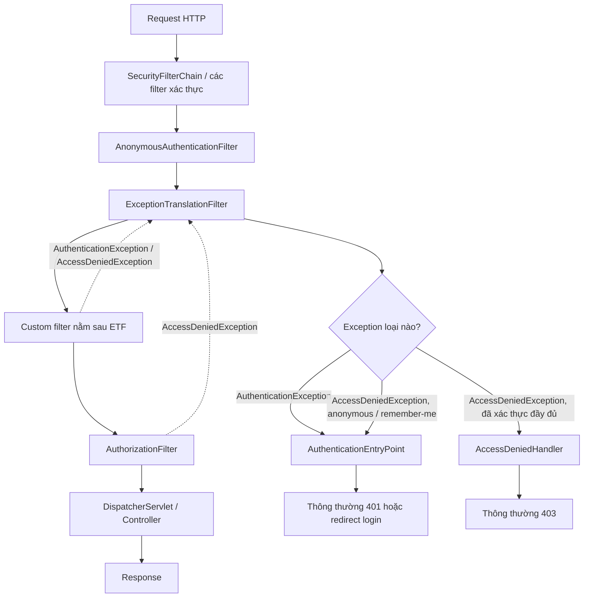

# ExceptionTranslationFilter và phạm vi chuyển lỗi sang phản hồi

Trong Spring Security Servlet, `ExceptionTranslationFilter` là cầu nối giữa **lỗi bảo mật** và **phản hồi HTTP**. Khi một thành phần *nằm phía sau nó trong security filter chain* ném `AuthenticationException` hoặc `AccessDeniedException`, filter này có thể chuyển quyền xử lý sang `AuthenticationEntryPoint` hoặc `AccessDeniedHandler`. Nhưng nó **không phải trình xử lý mọi exception của ứng dụng**: `NullPointerException`, lỗi database, validation, exception đã được Spring MVC giải quyết, lỗi xảy ra ở filter chạy trước nó hoặc lỗi phát sinh sau khi response đã được commit có ranh giới xử lý khác.

Bài học thuộc module **SPRING_SECURITY_TESTING**, dùng `spring-security-test` để kiểm chứng xác thực, phân quyền và bảo vệ HTTP. Trọng tâm là ứng dụng **Servlet + MockMvc**, bao gồm cách phân biệt các response `401`, `403` và lỗi nghiệp vụ; cách đặt custom filter đúng vị trí; và cách tạo test thực sự chứng minh thành phần nào đã biến exception thành HTTP response. Cuối bài đối chiếu với `ExceptionTranslationWebFilter` trong Spring Security Reactive và `WebTestClient`.

## 1. Vai trò thực sự của ExceptionTranslationFilter

Trong một security chain Servlet điển hình, thứ tự liên quan đến bài học có thể hình dung như sau:



Sơ đồ mô tả **đường xử lý exception phía sau `ExceptionTranslationFilter`**, không có nghĩa mọi `401` trong ứng dụng đều do filter này tạo ra. Ví dụ, `BasicAuthenticationFilter` hoặc `BearerTokenAuthenticationFilter` có thể xử lý lỗi xác thực ngay tại filter của chính nó, với entry point/failure handler riêng. Nếu exception được xử lý ở đó, nó không còn truyền đến `ExceptionTranslationFilter`.

Hai nhóm exception chính:

- `AuthenticationException`: biểu thị lỗi **xác thực** hoặc yêu cầu tái xác thực; `ExceptionTranslationFilter` gọi `AuthenticationEntryPoint.commence(...)` khi nhận exception thuộc phạm vi nó bắt.
- `AccessDeniedException`: biểu thị **không được phép** truy cập. Nếu request đang anonymous hoặc cơ chế trust resolver coi authentication chưa đủ, filter có thể khởi động authentication qua `AuthenticationEntryPoint`. Nếu caller đã được xác thực đầy đủ nhưng không đủ quyền, nó gọi `AccessDeniedHandler.handle(...)`.

**Quan trọng:** một `AccessDeniedException` không đồng nghĩa HTTP `403` trong mọi trường hợp. Người dùng **chưa xác thực** đi vào tài nguyên yêu cầu đăng nhập thường nhận `401` (hoặc redirect) qua entry point; người dùng **đã xác thực nhưng thiếu quyền** thường nhận `403` qua denied handler.

### 1.1. Ba thành phần, ba trách nhiệm

| Thành phần | Trách nhiệm | Ví dụ kết quả |
| --- | --- | --- |
| `ExceptionTranslationFilter` | Bắt exception bảo mật trong phần filter chain mà nó bao bọc; chọn đường xử lý | Chuyển exception đến entry point hoặc denied handler |
| `AuthenticationEntryPoint` | Bắt đầu hoặc yêu cầu quy trình xác thực khi xác thực chưa đủ | `401` + `WWW-Authenticate`, hoặc `302` tới trang đăng nhập |
| `AccessDeniedHandler` | Xử lý trường hợp đã xác thực nhưng bị từ chối quyền | `403`, JSON lỗi hoặc trang lỗi truy cập |
| `HandlerExceptionResolver` / `@ControllerAdvice` | Xử lý exception ở tầng Spring MVC | JSON lỗi nghiệp vụ, validation error, `4xx/5xx` phù hợp |
| Filter xác thực trước ETF | Có thể tự xử lý lỗi xác thực mà không ném tiếp đến ETF | `401` từ Bearer/Basic authentication entry point |

`ExceptionTranslationFilter` không tự kiểm tra mật khẩu, không xác minh chữ ký JWT và không quyết định business role có đúng hay không. Những việc đó thuộc authentication provider, authorization manager và các thành phần khác trong Spring Security.

## 2. Phạm vi exception: lúc nào filter có thể bắt được?

Hãy xét một đoạn code khái niệm:

```java
try {
    // Tiếp tục filter chain phía sau ExceptionTranslationFilter.
    filterChain.doFilter(request, response);
} catch (Exception ex) {
    // Tìm AuthenticationException/AccessDeniedException thích hợp
    // trong exception/cause chain rồi chuyển cho handler tương ứng.
}
```

Đây chỉ là **mô hình hóa hành vi** chứ không phải source code đầy đủ của Spring Security. Bộ lọc dùng cơ chế phân tích exception chain, kiểm tra trạng thái response và những thành phần cộng tác khác. Điểm then chốt là **phạm vi `filterChain.doFilter(...)` nằm phía sau ETF**, không phải toàn bộ quá trình HTTP.

### 2.1. Khi nào có thể chuyển sang entry point/denied handler?

| Tình huống | ETF có khả năng xử lý? | Lý do |
| --- | --- | --- |
| `AuthorizationFilter` phía sau ETF ném `AccessDeniedException` | Có | Exception đi ngược lại qua ETF |
| Custom filter nằm **sau** ETF ném `BadCredentialsException` | Có | `BadCredentialsException` là `AuthenticationException` |
| Custom filter nằm **sau** ETF ném `AccessDeniedException` | Có | Đúng loại exception và đúng phạm vi |
| Custom filter nằm **trước** ETF tự ném exception | Không qua ETF của chain đó | ETF chưa được vào để bao bọc filter |
| `BasicAuthenticationFilter` trước ETF tự xử lý lỗi login | Không cần ETF | Authentication filter có entry point/failure path riêng |
| Controller ném exception nghiệp vụ và `@ControllerAdvice` đã xử lý | Thông thường không | Exception được MVC chuyển thành response trước khi trở ra filter |
| Controller ném `AccessDeniedException` không được MVC xử lý | Có thể | Nếu exception thực sự lan ngược qua filter chain và response chưa commit |
| Controller ném `IllegalStateException` không được xử lý | Không chuyển bằng ETF | Không thuộc hai loại exception bảo mật mục tiêu |
| Exception xảy ra sau response đã commit | Không thể thay response an toàn | Header/status/body có thể đã gửi cho client |
| Exception trong công việc async tách rời khỏi request | Không bảo đảm | Không còn nằm trong invocation/filter chain mà ETF đang bao bọc |

**Không suy diễn chỉ từ tên exception.** `AccessDeniedException` bị ném ở đâu, có bị `@ExceptionHandler` bắt trước không, và response đã commit chưa là những yếu tố quyết định luồng xử lý.

### 2.2. AccessDeniedException ở controller hoặc method security

Với `@PreAuthorize` trên service, có thể có `AccessDeniedException` được phát sinh trong lời gọi từ controller. Trong ứng dụng Servlet, nếu exception đó không được Spring MVC hoặc exception resolver khác xử lý và tiếp tục lan qua filter chain, `ExceptionTranslationFilter` có thể bắt được. Nhưng một `@RestControllerAdvice` hoặc `HandlerExceptionResolver` có thể xử lý exception trước.

Do vậy không nên khẳng định rằng **mọi** `@PreAuthorize` thất bại đều được ETF chuyển thành `403`. Hãy viết test qua HTTP với configuration thực tế, kiểm tra cả body/header và nơi response được tạo.

### 2.3. Response đã được commit

Nếu ứng dụng đã gọi `flushBuffer()`, ghi body/headers đến client hoặc streaming response bắt đầu, việc đổi một response thành `401/403` có thể không còn thực hiện được. `ExceptionTranslationFilter` kiểm tra điều này và có thể ném lỗi thay vì gọi entry point/denied handler để ghi đè response.

Vì vậy custom filter hoặc controller không nên ghi một phần response rồi mới ném `AccessDeniedException` với kỳ vọng framework “quay lại” tạo JSON `403`. Ưu tiên xác thực, phân quyền **trước khi ghi nội dung** và trước các tác dụng phụ không thể hoàn tác.

## 3. Dựng ứng dụng Servlet để quan sát ai xử lý lỗi

Ví dụ dùng Java 17+, Spring Boot, Spring MVC, Spring Security và `spring-security-test`. Các đoạn code lược bỏ `package` và `import` để làm rõ thiết kế. Các class bên dưới cùng thuộc package được Spring Boot quét.

Dependency Gradle cơ bản:

```groovy
dependencies {
    implementation 'org.springframework.boot:spring-boot-starter-web'
    implementation 'org.springframework.boot:spring-boot-starter-security'

    testImplementation 'org.springframework.boot:spring-boot-starter-test'
    testImplementation 'org.springframework.security:spring-security-test'
}
```

Định nghĩa controller tối thiểu:

```java
@RestController
class ApiController {

    @GetMapping("/api/protected")
    Map<String, String> protectedResource() {
        return Map.of("result", "visible");
    }

    @GetMapping("/api/business-error")
    Map<String, String> businessError() {
        throw new IllegalStateException("Report service unavailable");
    }
}
```

Phần đầu sẽ được Spring Security bảo vệ bằng authority `SCOPE_reports.read`. Phần thứ hai minh họa **exception nghiệp vụ** được Spring MVC xử lý, không phải lỗi xác thực/ủy quyền.

### 3.1. Custom filter phát sinh lỗi có chủ đích

Tạo một filter mô phỏng cơ chế bảo mật tùy biến. Khi request chứa header `X-Demo-Reject: auth`, filter ném `BadCredentialsException`; với `X-Demo-Reject: access`, nó ném `AccessDeniedException`:

```java
final class DemoRejectingFilter extends OncePerRequestFilter {

    @Override
    protected void doFilterInternal(
            HttpServletRequest request,
            HttpServletResponse response,
            FilterChain chain)
            throws ServletException, IOException {

        String requestPath = request.getRequestURI()
            .substring(request.getContextPath().length());

        if (!"/api/protected".equals(requestPath)) {
            chain.doFilter(request, response);
            return;
        }

        String kind = request.getHeader("X-Demo-Reject");

        if ("auth".equals(kind)) {
            throw new BadCredentialsException("Simulated auth rejection");
        }

        if ("access".equals(kind)) {
            throw new AccessDeniedException("Simulated access rejection");
        }

        if ("other".equals(kind)) {
            throw new IllegalStateException("Not a security exception");
        }

        chain.doFilter(request, response);
    }
}
```

Filter này chỉ dùng để **quan sát hành vi ETF trong test**, không phải mẫu đề xuất cho production authentication. Một authentication filter thực thường có `AuthenticationManager`, cơ chế parse credential, success/failure handlers và thứ tự filter do Spring Security quy định.

### 3.2. SecurityFilterChain với entry point và denied handler riêng

Chọn hai response khác nhau và đánh dấu bằng header `X-Handled-By` để test chứng minh chính xác nhánh xử lý.

```java
@Configuration
class ApiSecurityConfig {

    @Bean
    SecurityFilterChain apiSecurity(HttpSecurity http) throws Exception {
        return http
            .securityMatcher("/api/**")
            .authorizeHttpRequests(auth -> auth
                .requestMatchers(HttpMethod.GET, "/api/protected")
                    .hasAuthority("SCOPE_reports.read")
                .anyRequest().authenticated()
            )
            .exceptionHandling(errors -> errors
                .authenticationEntryPoint((request, response, ex) ->
                    writeError(
                        response,
                        HttpServletResponse.SC_UNAUTHORIZED,
                        "authentication_required",
                        "entry-point"
                    )
                )
                .accessDeniedHandler((request, response, ex) ->
                    writeError(
                        response,
                        HttpServletResponse.SC_FORBIDDEN,
                        "access_denied",
                        "access-denied-handler"
                    )
                )
            )
            // API demo không giữ request chưa xác thực trong session.
            .requestCache(cache ->
                cache.requestCache(new NullRequestCache())
            )
            // Đặt sau ETF để ETF bao bọc lời gọi doFilter của filter này.
            .addFilterAfter(
                new DemoRejectingFilter(),
                ExceptionTranslationFilter.class
            )
            .build();
    }

    private static void writeError(
            HttpServletResponse response,
            int status,
            String error,
            String handledBy) throws IOException {

        response.setStatus(status);
        response.setContentType(MediaType.APPLICATION_JSON_VALUE);
        response.setCharacterEncoding(StandardCharsets.UTF_8.name());
        response.setHeader("X-Handled-By", handledBy);
        response.getWriter().write("{\"error\":\"" + error + "\"}");
    }
}
```

Cấu hình trên dùng custom JSON entry point và handler để minh họa. Trong API production, chọn entry point phù hợp với cơ chế xác thực thực (ví dụ `BearerTokenAuthenticationEntryPoint` hoặc HTTP Basic entry point), trả `WWW-Authenticate` phù hợp với giao thức và tránh tiết lộ chi tiết exception nội bộ. Không coi JSON demo là mẫu hoàn chỉnh cho mọi kiểu authentication.

**Vì sao `addFilterAfter(..., ExceptionTranslationFilter.class)`?** Filter mô phỏng phải chạy *phía sau* ETF mới có thể đẩy exception ngược về ETF. Trong thứ tự mặc định của Spring Security, `AuthorizationFilter` cũng nằm về phía sau ETF. Khi xây dựng custom filter thực, thứ tự còn phụ thuộc chức năng: không nên tùy tiện dời một filter đăng nhập/đọc token ra sau ETF chỉ để test pass.

**Không đăng ký `DemoRejectingFilter` như một Servlet `@Component`/`@Bean Filter` toàn cục** đồng thời với `http.addFilterAfter(...)`. Spring Boot có thể tự đăng ký filter kiểu Servlet ở container, khiến nó chạy hai lần hoặc chạy **ngoài** `springSecurityFilterChain`, làm kết luận vị trí filter sai.

### 3.3. Tách lỗi MVC bằng @RestControllerAdvice

Một `IllegalStateException` từ controller có thể được xử lý bởi MVC, **không qua entry point/denied handler**:

```java
@RestControllerAdvice
class ApiErrorAdvice {

    @ExceptionHandler(IllegalStateException.class)
    ResponseEntity<Map<String, String>> businessFailure(
            IllegalStateException ex) {

        return ResponseEntity
            .status(HttpStatus.SERVICE_UNAVAILABLE)
            .body(Map.of("error", "business_unavailable"));
    }
}
```

Đây là ví dụ cố ý gán HTTP `503` cho lỗi nghiệp vụ giả lập. Ứng dụng thực phải thiết kế mapping exception theo domain của mình; không nên biến mọi `IllegalStateException` thành `503` một cách máy móc.

## 4. Kiểm thử 401/403 đúng đường xử lý với MockMvc

Cấu hình test khởi chạy đầy đủ Spring Security filter chain:

```java
@SpringBootTest
@AutoConfigureMockMvc
class ExceptionTranslationMvcTest {

    @Autowired
    MockMvc mvc;

    @Test
    void anonymousUserIsSentToAuthenticationEntryPoint() throws Exception {
        mvc.perform(get("/api/protected"))
            .andExpect(status().isUnauthorized())
            .andExpect(header().string(
                "X-Handled-By", "entry-point"
            ))
            .andExpect(jsonPath("$.error")
                .value("authentication_required"));
    }

    @Test
    @WithMockUser(authorities = "SCOPE_other.read")
    void authenticatedUserWithoutAuthorityGets403() throws Exception {
        mvc.perform(get("/api/protected"))
            .andExpect(status().isForbidden())
            .andExpect(header().string(
                "X-Handled-By", "access-denied-handler"
            ))
            .andExpect(jsonPath("$.error")
                .value("access_denied"));
    }

    @Test
    @WithMockUser(authorities = "SCOPE_reports.read")
    void userWithAuthorityCanProceed() throws Exception {
        mvc.perform(get("/api/protected"))
            .andExpect(status().isOk())
            .andExpect(jsonPath("$.result").value("visible"))
            .andExpect(header().doesNotExist("X-Handled-By"));
    }
}
```

Trong ví dụ, `@WithMockUser` đến từ `org.springframework.security.test.context.support.WithMockUser`. Nó cung cấp `Authentication` giả cho test; mục đích là kiểm tra **authorization và exception mapping**, không kiểm tra mật khẩu thật. Không cần cấu hình `UserDetailsService` thực để ba ca trên chạy.

Ba test kết hợp nhau cung cấp bằng chứng rõ hơn một assertion `status().isForbidden()` đơn lẻ:

- Không có authentication, `AuthorizationFilter` từ chối, ETF dẫn đến **entry point**.
- Có authentication nhưng authority sai, ETF dẫn đến **access denied handler**.
- Có authentication và authority đúng, request đi đến controller mà không qua handler lỗi.

### 4.1. Custom filter phía sau ETF ném AuthenticationException

Bổ sung test:

```java
@Test
@WithMockUser(authorities = "SCOPE_reports.read")
void downstreamAuthenticationExceptionUsesEntryPoint() throws Exception {
    mvc.perform(get("/api/protected")
            .header("X-Demo-Reject", "auth"))
        .andExpect(status().isUnauthorized())
        .andExpect(header().string(
            "X-Handled-By", "entry-point"
        ))
        .andExpect(jsonPath("$.error")
            .value("authentication_required"));
}
```

Đây là ca cần thiết để không chỉ chứng minh `AuthorizationFilter` thông thường được xử lý mà còn xác minh rằng **custom filter đã đặt đúng về phía sau ETF** và exception được dẫn đến entry point.

Lưu ý dù `@WithMockUser` đã xác thực Alice, một `AuthenticationException` phát sinh phía sau ETF vẫn biểu thị lỗi cần bước authentication; do đó entry point có thể trả `401`. Không nên suy rằng cứ “đã có user” thì mọi exception đều chuyển thành `403`.

### 4.2. Custom filter phía sau ETF ném AccessDeniedException

```java
@Test
@WithMockUser(authorities = "SCOPE_reports.read")
void downstreamAccessDeniedExceptionUsesHandler() throws Exception {
    mvc.perform(get("/api/protected")
            .header("X-Demo-Reject", "access"))
        .andExpect(status().isForbidden())
        .andExpect(header().string(
            "X-Handled-By", "access-denied-handler"
        ))
        .andExpect(jsonPath("$.error")
            .value("access_denied"));
}
```

Caller có quyền theo `AuthorizationFilter` nhưng custom filter chủ ý từ chối. Vì authentication đã đầy đủ, ETF chọn denied handler. Test chứng minh **lỗi truy cập từ custom filter phía sau ETF** được xử lý, không chỉ policy `hasAuthority(...)`.

Để kiểm tra nhánh `AccessDeniedException` **khi caller anonymous**, có thể thêm:

```java
@Test
void anonymousAccessDeniedExceptionStartsAuthentication()
        throws Exception {

    mvc.perform(get("/api/protected")
            .header("X-Demo-Reject", "access"))
        .andExpect(status().isUnauthorized())
        .andExpect(header().string("X-Handled-By", "entry-point"));
}
```

Ca này làm rõ logic `AuthenticationTrustResolver`: cùng một `AccessDeniedException` nhưng ngữ cảnh authentication khác sẽ dẫn đến response khác.

### 4.3. Lỗi nghiệp vụ được MVC xử lý khác ETF

```java
@Test
@WithMockUser(authorities = "SCOPE_reports.read")
void businessExceptionIsHandledByMvcAdvice() throws Exception {
    mvc.perform(get("/api/business-error"))
        .andExpect(status().isServiceUnavailable())
        .andExpect(jsonPath("$.error")
            .value("business_unavailable"))
        .andExpect(header().doesNotExist("X-Handled-By"));
}
```

Nếu test trả `503` từ `ApiErrorAdvice` và không có header đánh dấu entry point/handler, đây là bằng chứng rằng exception nghiệp vụ đã được MVC xử lý theo đường riêng. Nếu không có `@ExceptionHandler`, hành vi có thể là exception lan lên container/test harness hoặc được cơ chế lỗi khác xử lý; **không** mặc định sẽ có JSON `500` chuẩn từ ETF.

## 5. Vị trí custom filter quyết định ai nhìn thấy exception

Một lỗi thường gặp là tự đăng ký filter xử lý token:

```java
http.addFilterBefore(
    new CustomAuthenticationFilter(),
    UsernamePasswordAuthenticationFilter.class
);
```

Vị trí trước `UsernamePasswordAuthenticationFilter` thường cũng nằm **trước** `ExceptionTranslationFilter` trong thứ tự chuẩn. Nếu `CustomAuthenticationFilter` tự ném `BadCredentialsException` và không bắt nó, ETF sẽ không thể xử lý exception do một filter trước ETF phát sinh, vì lời gọi của ETF chưa xảy ra.

**Cách thiết kế phù hợp** tùy cơ chế:

1. Để filter xác thực **tự xử lý thất bại** thông qua `AuthenticationFailureHandler` hoặc `AuthenticationEntryPoint` phù hợp, sau đó kết thúc response.
2. Sử dụng filter/framework mặc định như `BearerTokenAuthenticationFilter`, `BasicAuthenticationFilter` hoặc `AuthenticationFilter` cùng các extension points mà Spring Security cung cấp.
3. Khi tạo filter *chỉ kiểm tra authorization* và đặt phía sau ETF, có thể ném `AccessDeniedException` để ETF xử lý — với điều kiện response chưa commit và filter thực sự nằm trong chain do ETF bao bọc.

Không nên di chuyển bừa custom authentication filter xuống sau ETF để “sửa lỗi 500 thành 401”, vì điều đó có thể thay đổi thứ tự authentication, anonymous handling, request cache và authorization. Hãy hiểu **vai trò của filter** trước khi chọn vị trí.

### 5.1. Filter toàn cục ngoài Spring Security chain

Spring Boot có thể đăng ký một `Filter` bean như filter của Servlet container. Filter này có thể chạy *bên ngoài* `FilterChainProxy` do Spring Security quản lý. Nếu nó ném exception trước khi gọi `springSecurityFilterChain`, ETF sẽ không bao bọc được.

Để kiểm chứng:

- Chỉ đăng ký filter một lần và xác định nó thuộc **Servlet container** hay **Spring Security chain**.
- Với filter cần tham gia Spring Security, thêm vào `HttpSecurity` theo vị trí mong muốn.
- Nếu dùng Filter bean để inject vào security chain nhưng không muốn Boot auto-register ở container, cấu hình `FilterRegistrationBean` để vô hiệu hóa registration ở lớp container.
- Viết test làm filter ném `AuthenticationException` hoặc `AccessDeniedException`, kiểm tra entry point/handler có được gọi hay không. Assertion status đơn thuần chưa đủ.

Một lỗi `500` từ filter đứng trước ETF không tự chứng minh Spring Security bỏ qua lỗi bảo mật; nó có thể chỉ phản ánh **sai kỳ vọng về phạm vi bắt exception**.

### 5.2. Nhiều SecurityFilterChain cùng tồn tại

Spring Security cho phép nhiều `SecurityFilterChain` được chọn theo request matcher và thứ tự ưu tiên. Nếu bạn thêm `DemoRejectingFilter` vào chain dành cho `/api/**` nhưng thực tế request khớp một chain khác, custom filter sẽ không chạy. Các test nên dùng URL đúng matcher, và nếu cần, kiểm tra behavior của chain còn lại.

Trong ví dụ, `securityMatcher("/api/**")` giới hạn chain. Những request ngoài `/api/**` không thể dùng để kết luận filter có được cài đúng hay không.

## 6. RequestCache, entry point và redirect login

Khi ETF quyết định bắt đầu xác thực, nó có thể lưu request ban đầu qua `RequestCache` rồi gọi `AuthenticationEntryPoint`. Với form login, việc lưu request giúp người dùng quay lại URL đã định sau khi login; entry point có thể trả **redirect** chứ không phải `401`.

Trong API stateless, việc vô tình tạo session chỉ để lưu request thường không mong muốn. Ví dụ ở mục 3 dùng:

```java
.requestCache(cache ->
    cache.requestCache(new NullRequestCache())
)
```

Điều này tắt cơ chế lưu request phục vụ authentication entry point trong chain demo. Đừng kết luận cứ có ETF là có session; hành vi phụ thuộc request cache và session policy được cấu hình.

### 6.1. 401 không phải lúc nào cũng giống nhau

| Cơ chế xác thực | AuthenticationEntryPoint điển hình | Dạng phản hồi |
| --- | --- | --- |
| HTTP Basic | `BasicAuthenticationEntryPoint` | `401` và `WWW-Authenticate: Basic ...` |
| OAuth2 Resource Server Bearer | `BearerTokenAuthenticationEntryPoint` | `401` với Bearer challenge phù hợp |
| Form login | `LoginUrlAuthenticationEntryPoint` | Redirect tới trang login |
| API tùy biến | Entry point do ứng dụng định nghĩa | `401`/body JSON theo contract và challenge phù hợp |
| Denied handler cho caller đã xác thực | `AccessDeniedHandler` | Thường `403`, không khởi động login lại |

Đừng kiểm tra cứng `401` cho ứng dụng form login nếu thiết kế thật trả `302`. Ngược lại, đừng dùng trang HTML login như hành vi mặc định của một REST API chỉ chấp nhận Bearer token. Chọn assertion theo **entry point đang cấu hình**.

### 6.2. Không để response body tiết lộ chi tiết bảo mật

Một custom `AuthenticationEntryPoint` có thể đọc `authException.getMessage()`, nhưng không nên trả thẳng message chứa token, internal user lookup hay stack trace cho client. JSON mẫu trong bài chỉ trả mã lỗi ổn định:

```json
{"error":"authentication_required"}
```

Tương tự, denied handler có thể ghi log nội bộ cho phân tích bảo mật nhưng response gửi đến caller chỉ nên chứa thông tin cần thiết để họ hiểu quyền bị từ chối.

## 7. Exception trong Spring MVC khác với exception trong filter chain

Spring MVC có cơ chế riêng qua `HandlerExceptionResolver` và `@ControllerAdvice`. Một exception của controller có thể được resolver chuyển thành response trước khi lan ngược đến các filter.

Ví dụ:

```java
@RestControllerAdvice
class ValidationAdvice {

    @ExceptionHandler(IllegalArgumentException.class)
    ResponseEntity<Map<String, String>> invalidInput(
            IllegalArgumentException ex) {

        return ResponseEntity
            .badRequest()
            .body(Map.of("error", "invalid_input"));
    }
}
```

Nếu controller ném `IllegalArgumentException` và được advice này xử lý, kết quả là `400` do MVC. ETF không biến nó thành `401` hoặc `403`, vì nó không phải security exception thuộc trách nhiệm của ETF.

Đối với `AccessDeniedException` phát sinh từ service dưới controller, còn một điểm cần chú ý: nếu controller advice custom bắt quá rộng như `@ExceptionHandler(Exception.class)` và trả `500`, nó có thể **nuốt** cả exception bảo mật thay vì cho Spring Security xử lý theo mong muốn. Khi thiết kế global exception handler, cần xem xét để những exception bảo mật được giải quyết bởi cơ chế phù hợp, tránh biến lỗi phân quyền thành lỗi dịch vụ.

Không dùng `@RestControllerAdvice` để “vá” lỗi do custom filter trước ETF một cách tùy tiện. Exception phát sinh trong filter **trước DispatcherServlet** không đi qua cơ chế xử lý exception của MVC như exception được controller ném; filter cần xử lý đúng tại tầng filter hoặc thông qua entry point thích hợp.

## 8. Cách viết test chắc chắn hơn chỉ assert status

Để test một cơ chế custom filter, nên quan sát nhiều điểm:

| Assertion | Chứng minh được điều gì? |
| --- | --- |
| `status().isUnauthorized()` | Response HTTP là `401` |
| Header `X-Handled-By=entry-point` trong ví dụ | Entry point do test cấu hình đã được gọi |
| Header `X-Handled-By=access-denied-handler` | Denied handler đã được gọi |
| JSON body `$.error` | Contract thông báo lỗi được giữ |
| Mock controller/service có `verifyNoInteractions(...)` | Request bị từ chối trước khi chạy nghiệp vụ |
| Request hợp lệ `200` và service được gọi | Chain không chặn nhầm người có quyền |
| Request qua chain khác không kích hoạt filter demo | Matcher/ordering hoạt động theo thiết kế |
| Filter ném `IllegalStateException` nhưng ETF không tạo JSON bảo mật | ETF không bắt mọi loại exception |

Có thể dùng `@MockitoBean` để mock service thật trong một test controller rồi verify service không được gọi khi request bị từ chối. Tuy nhiên nếu mục tiêu bao gồm method security trên service, không được mock đi annotation `@PreAuthorize` cần kiểm tra; khi đó phải nạp service thật qua proxy hoặc dùng integration test phù hợp.

### 8.1. Phân biệt authentication helper và đường xác thực thực

`@WithMockUser`, `user("alice")`, `jwt()` và `opaqueToken()` của `spring-security-test` tạo authentication giả để kiểm tra authorization. Điều này phù hợp với bài học của ETF: ta muốn chọn ngữ cảnh anonymous/authenticated rồi kiểm tra handler.

Nhưng các helper đó **không chứng minh** mật khẩu Basic, chữ ký JWT hoặc opaque introspection thực tế. Nếu muốn xác minh Spring Security có thực sự từ chối Bearer token không hợp lệ, phải gửi header `Authorization: Bearer ...` và dùng decoder/introspector thực hoặc mock đúng ranh giới kiểm thử.

Đặc biệt, `BearerTokenAuthenticationFilter` và `BasicAuthenticationFilter` có thể xử lý lỗi xác thực tại chính chúng. Một test `401` vì token sai **không tự chứng minh** ETF đã gọi entry point; cần kiểm tra đường đi thực tế thay vì gán trách nhiệm cho ETF dựa trên status.

### 8.2. Khi test với MockMvc dựng thủ công

`@SpringBootTest` + `@AutoConfigureMockMvc` trong ví dụ sẽ nạp Spring Security filters theo cấu hình. Nếu tự dựng từ `WebApplicationContext`, cần:

```java
MockMvc mvc = MockMvcBuilders
    .webAppContextSetup(webApplicationContext)
    .apply(springSecurity())
    .build();
```

Không nên dùng `@AutoConfigureMockMvc(addFilters = false)` để kiểm chứng ETF: làm vậy bạn tắt chính filter chain cần quan sát. `MockMvcBuilders.standaloneSetup(controller)` cũng không tự động mang đầy đủ security chain production.

## 9. Những tình huống tinh vi cần kiểm chứng thêm

### 9.1. AccessDeniedException trong cause chain

Exception bảo mật có thể bị một thành phần phía sau bọc trong exception khác. ETF có logic tìm exception bảo mật trong nguyên nhân phù hợp để xử lý. Tuy nhiên không nên giả định nó sẽ tháo mọi lớp wrapping tùy ý, đặc biệt khi response đã được ghi hoặc exception được resolver khác xử lý.

Nếu ứng dụng có custom filter wrapping `AccessDeniedException`, hãy tạo test gửi request để kiểm tra filter chain/exception handler thực tế thay vì chỉ unit test class wrapper.

### 9.2. Streaming response và ghi body trước phân quyền

Với Servlet async, streaming hoặc Server-Sent Events, lỗi phát sinh sau khi response bắt đầu có thể không thể đổi sang `401/403`. Test nên cố tình kiểm tra việc xác thực/ủy quyền xảy ra **trước** khi xuất dữ liệu nhạy cảm. Nếu dùng `StreamingResponseBody`, async dispatch hoặc background task, hãy thêm integration tests phù hợp với transport thật; test MockMvc đơn giản có thể chưa bao phủ thời điểm commit.

### 9.3. Custom access denied response thiếu thông tin đúng chuẩn

Một API có thể yêu cầu body theo `ProblemDetail`/RFC 9457 hoặc một JSON schema chung. Handler cần giữ consistency về `status`, `Content-Type`, `WWW-Authenticate` (nếu authentication challenge yêu cầu) và headers khác. ETF chỉ chọn handler; **nội dung response là trách nhiệm của handler/entry point**.

Ví dụ body JSON mẫu của bài không áp dụng chuẩn Problem Details; trong production, hãy cân nhắc dùng format lỗi thống nhất và tránh để stack trace xuất hiện với client.

### 9.4. Không dùng AccessDeniedException cho lỗi nghiệp vụ

Một service báo “hết hàng”, “báo cáo chưa sẵn sàng” hoặc “tài nguyên không tồn tại” không nên ném `AccessDeniedException` chỉ để lấy status `403`. Hãy phân loại lỗi nghiệp vụ và dùng `@ControllerAdvice`/exception resolver phù hợp. `AccessDeniedException` biểu thị quyết định bảo mật, không phải generic bad request.

### 9.5. Không để entry point/handler tự ném lỗi sau khi response đã ghi

Nếu custom handler viết JSON lỗi rồi ném thêm exception, client có thể nhận response một phần hoặc container ghi lỗi mới. Test cần xác nhận body hoàn chỉnh, Content-Type và không có exception trong test runner. Giữ handler đơn giản, idempotent theo phạm vi gọi và không phát tán token/mật khẩu.

## 10. Phần tương đương trong Reactive: ExceptionTranslationWebFilter

**WebFlux không dùng Servlet `ExceptionTranslationFilter`.** Thành phần tương ứng là `ExceptionTranslationWebFilter` trong security web filter chain của Spring Security Reactive. Nó làm việc với `Mono<Void>`, `ServerAuthenticationEntryPoint` và `ServerAccessDeniedHandler`.

Một cấu hình minh họa:

```java
@Configuration(proxyBeanMethods = false)
@EnableWebFluxSecurity
class ReactiveApiSecurityConfig {

    @Bean
    SecurityWebFilterChain reactiveSecurity(ServerHttpSecurity http) {
        return http
            .authorizeExchange(exchanges -> exchanges
                .pathMatchers("/api/reactive-protected")
                    .hasAuthority("SCOPE_reports.read")
                .anyExchange().denyAll()
            )
            .exceptionHandling(errors -> errors
                .authenticationEntryPoint((exchange, ex) -> {
                    exchange.getResponse()
                        .setStatusCode(HttpStatus.UNAUTHORIZED);
                    return exchange.getResponse().setComplete();
                })
                .accessDeniedHandler((exchange, ex) -> {
                    exchange.getResponse()
                        .setStatusCode(HttpStatus.FORBIDDEN);
                    return exchange.getResponse().setComplete();
                })
            )
            .build();
    }
}

@RestController
class ReactiveApiController {

    @GetMapping("/api/reactive-protected")
    Mono<String> secured() {
        return Mono.just("reactive-visible");
    }
}
```

Với `WebTestClient` đã kết nối Spring Security:

```java
@WebFluxTest(controllers = ReactiveApiController.class)
@Import(ReactiveApiSecurityConfig.class)
class ReactiveExceptionMappingTest {

    @Autowired WebTestClient client;

    @Test
    void anonymousGets401() {
        client.get()
            .uri("/api/reactive-protected")
            .exchange()
            .expectStatus().isUnauthorized();
    }

    @Test
    void authenticatedWithoutScopeGets403() {
        client.mutateWith(mockUser("bob").authorities(
                new SimpleGrantedAuthority("SCOPE_inventory.read")
            ))
            .get()
            .uri("/api/reactive-protected")
            .exchange()
            .expectStatus().isForbidden();
    }

    @Test
    void authorizedUserGets200() {
        client.mutateWith(mockUser("alice").authorities(
                new SimpleGrantedAuthority("SCOPE_reports.read")
            ))
            .get()
            .uri("/api/reactive-protected")
            .exchange()
            .expectStatus().isOk();
    }
}
```

Nếu dự án tự dựng `WebTestClient.bindToApplicationContext(context)`, áp dụng `.apply(springSecurity())` để security test mutators hoạt động. `mockUser()` giả lập identity trong Reactor Context; nó không kiểm tra Basic/JWT/opaque token thực.

**Đặc điểm cần nhớ:** Reactor error signal, filter ordering và thời điểm response commit cũng quyết định khả năng chuyển exception trong WebFlux. Một exception trong publisher bị xử lý bởi `onErrorResume` hoặc `@ExceptionHandler` trước khi đi tới security handler sẽ không còn được giải quyết tại `ExceptionTranslationWebFilter`. Đừng đưa class Servlet `ExceptionTranslationFilter` vào WebFlux configuration.

## 11. Checklist phân tích một lỗi 401/403 bất thường

Khi người dùng hỏi “vì sao Spring Security trả 401/403?”, hãy kiểm tra theo thứ tự:

1. Request khớp **SecurityFilterChain nào**? Có `securityMatcher` hoặc `@Order` làm chọn chain khác không?
2. Lỗi xuất phát từ **authentication** hay **authorization**? Exception là `AuthenticationException`, `AccessDeniedException` hay loại khác?
3. Filter ném lỗi nằm **trước hay sau ExceptionTranslationFilter**? Nó có tự catch lỗi hay gọi failure handler không?
4. Nếu là `AccessDeniedException`, caller anonymous, remember-me hay đã xác thực đầy đủ theo `AuthenticationTrustResolver`?
5. Response do **AuthenticationEntryPoint**, **AccessDeniedHandler**, filter xác thực, hay **HandlerExceptionResolver** tạo?
6. Response đã **commit** trước khi exception bị ném chưa?
7. Test `@WithMockUser` hoặc `jwt()` có bỏ qua cơ chế authentication thật đang muốn kiểm chứng không?
8. Có request cache/session/challenge header/redirect khác kỳ vọng không?
9. Test có assert cả **trạng thái, header, body và việc controller/service không chạy** không?
10. Khi chuyển sang WebFlux, đã thay đúng sang `ExceptionTranslationWebFilter` và `SecurityWebFilterChain` chưa?

Các câu hỏi này giúp phân biệt lỗi cấu hình, vị trí filter sai, cơ chế authentication phù hợp nhưng thiếu quyền, và exception nghiệp vụ không thuộc phạm vi ETF.

## 12. Bài thực hành

1. Tạo `ApiController`, `ApiSecurityConfig`, `DemoRejectingFilter` và `ApiErrorAdvice` theo mục 3.
2. Viết ca anonymous gọi `/api/protected`, kỳ vọng `401` với header `X-Handled-By: entry-point`.
3. Dùng `@WithMockUser(authorities="SCOPE_other.read")`, kỳ vọng `403` với header `X-Handled-By: access-denied-handler`.
4. Dùng `@WithMockUser(authorities="SCOPE_reports.read")`, kỳ vọng `200` và JSON `result=visible`.
5. Với người dùng có quyền, gửi `X-Demo-Reject: auth` và `X-Demo-Reject: access`, xác nhận lần lượt vào entry point và denied handler. Tạo thêm ca anonymous + `access` để thấy cùng một exception có thể dẫn tới entry point.
6. Gọi `/api/business-error` với người dùng hợp lệ, khẳng định `503` do `@RestControllerAdvice`, không có `X-Handled-By`.
7. Thử chuyển vị trí demo filter lên **trước** ETF trên một nhánh thử nghiệm, quan sát khác biệt và giải thích vì sao không thể mặc nhiên mong ETF catch exception đó. Khôi phục cấu hình sau khi thử.
8. Viết biến thể WebFlux dùng `ExceptionTranslationWebFilter`/`WebTestClient`; kiểm tra ba ca `200/401/403`.

Ma trận tóm tắt:

| Caller | Exception hoặc nguyên nhân | Nơi xử lý trong cấu hình mẫu | Kết quả |
| --- | --- | --- | --- |
| Anonymous | Thiếu authentication cho resource yêu cầu quyền | ETF → Entry point | `401` |
| Đã xác thực, scope sai | `AccessDeniedException` từ authorization | ETF → Denied handler | `403` |
| Đã xác thực, scope đúng | Không có lỗi | Controller | `200` |
| Đã xác thực, custom filter ném `BadCredentialsException` sau ETF | `AuthenticationException` | ETF → Entry point | `401` |
| Đã xác thực, custom filter ném `AccessDeniedException` sau ETF | `AccessDeniedException` | ETF → Denied handler | `403` |
| Anonymous, custom filter ném `AccessDeniedException` sau ETF | `AccessDeniedException` + trust resolver | ETF → Entry point | `401` |
| Đã xác thực, controller ném `IllegalStateException` | Lỗi nghiệp vụ đã có MVC advice | `@RestControllerAdvice` | `503` |
| Custom filter trước ETF ném exception | Ngoài phạm vi catch của ETF | Filter/container/error handling khác | Không khẳng định cứng `401/403` |

**Tiêu chí hoàn thành:** bạn giải thích được vì sao `ExceptionTranslationFilter` chuyển một số exception thành phản hồi xác thực/ủy quyền nhưng **không phải mọi exception của ứng dụng**. Khi kiểm thử, bạn chứng minh được đúng entry point hoặc denied handler đã chạy, không chỉ dựa trên mã HTTP; đồng thời nhận diện được khác biệt giữa Spring Security Servlet và Reactive.

## Tài liệu tham khảo

- [Spring Security — ExceptionTranslationFilter](https://docs.spring.io/spring-security/reference/servlet/architecture.html#servlet-exceptiontranslationfilter): vai trò của filter và logic authentication/authorization exception.
- [Spring Security — Architecture (Servlet)](https://docs.spring.io/spring-security/reference/servlet/architecture.html): `FilterChainProxy`, thứ tự filter và nhiều security chains.
- [Spring Security — Handling Security Exceptions](https://docs.spring.io/spring-security/reference/servlet/architecture.html#servlet-exceptiontranslationfilter): `AuthenticationEntryPoint`, `AccessDeniedHandler` và request cache.
- [Spring Security — MockMvc Security Tests](https://docs.spring.io/spring-security/reference/servlet/test/mockmvc/index.html): `springSecurity()`, `@WithMockUser` và request post-processors.
- [Spring Security — Reactive WebFlux Security](https://docs.spring.io/spring-security/reference/reactive/configuration/webflux.html): `SecurityWebFilterChain` và `ServerHttpSecurity`.
- [Spring Security — Reactive WebTestClient Setup](https://docs.spring.io/spring-security/reference/reactive/test/web/setup.html): `WebTestClient` và `springSecurity()`.
