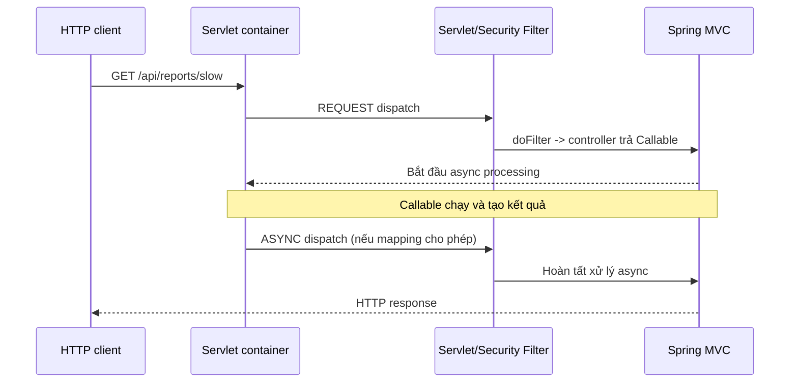

# Filter chạy theo dispatcher hoặc nhiều lần trên một request

Trong chương **Filter và cơ chế tùy biến** của module **SPRING_SECURITY_TESTING**, một ca kiểm thử dễ bị bỏ sót là **filter được thực thi nhiều lần trong quá trình xử lý cùng một HTTP request**. Trên Servlet, request có thể đi qua nhiều lần *dispatch* như `REQUEST`, `ASYNC`, `ERROR`, `FORWARD` và `INCLUDE`. Ngoài ra, cùng một filter có thể vô tình được đăng ký ở **hai vị trí**: vừa là servlet filter của container, vừa được thêm vào `SecurityFilterChain` của Spring Security. Một bài test chỉ kiểm tra endpoint trả `200 OK` chưa đủ để xác định filter đã chạy bao nhiêu lần, ở dispatcher nào và có tạo tác dụng phụ ngoài ý muốn hay không.

Bài học hướng dẫn cách quan sát và kiểm chứng số lần thực thi filter bằng `spring-security-test`, `MockMvc` và các ca HTTP được phép/bị từ chối. Phần cuối phân biệt Servlet `Filter` với Reactive `WebFilter`/`WebTestClient`, phù hợp mục tiêu của **SPRING_SECURITY_TESTING**: kiểm chứng bảo vệ HTTP thực tế trên Servlet và Reactive với `@WithMockUser`, `SecurityContext` và các danh tính JWT/OAuth2/OIDC giả lập.

## 1. Phân biệt request, dispatch và filter invocation

Trong Servlet, **một HTTP request từ client** có thể dẫn đến nhiều lượt servlet container điều phối (*dispatch*) tới ứng dụng. Mỗi lượt có một `DispatcherType`. Một filter chỉ tham gia lượt đó nếu đăng ký của nó cho phép dispatcher tương ứng và các điều kiện mapping đều khớp.

| `DispatcherType` | Khi nào xảy ra | Điều cần kiểm chứng |
| --- | --- | --- |
| `REQUEST` | Lượt xử lý HTTP ban đầu từ client | Authentication và authorization áp dụng trước khi controller xử lý |
| `ASYNC` | Request bắt đầu xử lý bất đồng bộ rồi được dispatch lại để hoàn tất | Filter có được gọi lại hay chủ động bỏ qua? Security context có được duy trì đúng? |
| `ERROR` | Container dispatch sang error handling theo cấu hình Servlet | Có chạy filter trên đường lỗi? Có gây vòng lặp hoặc ghi audit hai lần? |
| `FORWARD` | Server chuyển request nội bộ sang tài nguyên khác | Filter có tham gia lượt forward nếu dispatcher mapping cho phép? |
| `INCLUDE` | Server include nội dung từ tài nguyên khác | Filter có tham gia lượt include nếu dispatcher mapping cho phép? |

Sơ đồ ví dụ cho một HTTP request dùng `Callable` và sau đó hoàn tất qua `ASYNC`:



Một filter được cấu hình tham gia `REQUEST` và `ASYNC` **có thể được gọi ở cả hai lượt**, dù phía client chỉ gửi **một** request. Nhưng lời gọi `Filter.doFilter(...)` và việc chạy thân xử lý trong `OncePerRequestFilter.doFilterInternal(...)` cũng là **hai sự kiện khác nhau**: `OncePerRequestFilter` có thể nhận một lượt gọi rồi chủ động bỏ qua phần xử lý nội bộ.

Khi điều tra “filter chạy hai lần”, nên ghi nhận tối thiểu: tên/filter bean, dispatcher type, URI, thời điểm vào/ra `doFilterInternal`, nhánh `shouldNotFilter`, và việc có chạy controller hay không. Không ghi nguyên access token, cookie, password hoặc header `Authorization` vào log kiểm thử.

## 2. Hai lớp đăng ký filter: Servlet container và Spring Security

Trong ứng dụng Servlet dùng Spring Security, request thường đi qua:

```text
HTTP request
    |
    v
Servlet container filter chain
    |
    +--> Các Filter được container đăng ký (nếu mapping khớp)
    |
    +--> DelegatingFilterProxy("springSecurityFilterChain")
              |
              v
         FilterChainProxy
              |
              +--> Chọn SecurityFilterChain phù hợp request
              +--> Các filter authentication / authorization
              +--> Filter tùy chỉnh thêm bằng addFilterBefore/After/At
    |
    v
DispatcherServlet --> Controller
```

`DelegatingFilterProxy` là cầu nối từ servlet filter chain của container tới bean `springSecurityFilterChain`. `FilterChainProxy` chọn **một security chain phù hợp** theo matcher và thứ tự đã cấu hình. Filter bên trong `SecurityFilterChain` không đồng nghĩa với một filter riêng được container đăng ký trực tiếp.

Đây là nguồn gây **đăng ký trùng** phổ biến:

```java
@Component
class RequestAuditFilter extends OncePerRequestFilter {
    // ...
}

@Bean
SecurityFilterChain security(HttpSecurity http, RequestAuditFilter audit)
        throws Exception {
    return http
        .authorizeHttpRequests(auth -> auth.anyRequest().authenticated())
        .addFilterBefore(audit, AuthorizationFilter.class)
        .build();
}
```

Với cấu hình tự động đăng ký `Filter` bean của Spring Boot, `RequestAuditFilter` **có thể được đăng ký như servlet filter của container**, trong khi chính instance đó lại được đưa vào `SecurityFilterChain`. Tùy cách đăng ký, dispatcher, tên filter và cơ chế đánh dấu đã lọc, hậu quả có thể là lặp logic, sai thứ tự, hoặc khó hiểu vì `doFilter` chạy nhưng `doFilterInternal` chỉ chạy một lần. **Không kết luận luôn có đúng hai lượt gọi nội bộ** chỉ từ việc thấy hai đường đăng ký; phải kiểm tra cấu hình và hành vi thật.

Nếu filter chỉ thuộc Spring Security, có thể tắt đăng ký trực tiếp ở servlet container bằng `FilterRegistrationBean`:

```java
@Bean
RequestAuditFilter requestAuditFilter() {
    return new RequestAuditFilter();
}

@Bean
FilterRegistrationBean<RequestAuditFilter> auditFilterRegistration(
        RequestAuditFilter filter) {
    FilterRegistrationBean<RequestAuditFilter> registration =
        new FilterRegistrationBean<>(filter);
    registration.setEnabled(false);
    return registration;
}

@Bean
SecurityFilterChain apiSecurity(HttpSecurity http, RequestAuditFilter filter)
        throws Exception {
    return http
        .authorizeHttpRequests(auth -> auth
            .requestMatchers("/api/admin/**").hasRole("ADMIN")
            .requestMatchers("/api/**").authenticated()
            .anyRequest().permitAll())
        .httpBasic(Customizer.withDefaults())
        .addFilterBefore(filter, AuthorizationFilter.class)
        .build();
}
```

Trong ví dụ trên, `RequestAuditFilter` được đặt **bên trong security chain**; `FilterRegistrationBean` có `setEnabled(false)` ngăn Spring Boot đăng ký cùng filter trực tiếp ở container. `AuthorizationFilter` ở đây là `org.springframework.security.web.access.intercept.AuthorizationFilter`. Nếu cố ý cần một servlet filter ở ngoài Spring Security, hãy cấu hình **đăng ký container** của nó thay vì thêm lại vào `SecurityFilterChain`.

**Thứ tự cũng là một phần của hành vi:** `addFilterBefore`, `addFilterAfter` và `addFilterAt` xác định vị trí trong Spring Security, trong khi `@Order`/`FilterRegistrationBean#setOrder` kiểm soát đăng ký ở container. Đổi `@Order` của một `@Component` không thay thế được việc xác định đúng vị trí trong `SecurityFilterChain`.

## 3. `OncePerRequestFilter` bảo đảm điều gì?

`OncePerRequestFilter` là lớp cơ sở của Spring Framework dành cho Servlet filter muốn tránh thực thi thân xử lý nội bộ lặp lại **trong một request dispatch**. Nó sử dụng một request attribute đánh dấu *already filtered* và áp dụng các quy tắc bỏ qua theo dispatcher type. Cần hiểu đúng phạm vi của bảo đảm này:

- Lớp này không bảo đảm mã của bạn chỉ chạy đúng **một lần duy nhất cho toàn bộ vòng đời HTTP request**, bất kể bao nhiêu lần dispatch và thread.
- Các dispatcher khác nhau có thể tạo **những lượt thực thi riêng**. Đặc biệt, `ASYNC` có thể chạy trên thread khác và `ERROR` có thể có vòng dispatch riêng.
- Theo mặc định, `shouldNotFilterAsyncDispatch()` và `shouldNotFilterErrorDispatch()` của `OncePerRequestFilter` trả `true`: filter thường **bỏ qua** xử lý nội bộ trên `ASYNC` và `ERROR` dispatch.
- Có thể override hai phương thức trên để tham gia các dispatcher đó. Tuy nhiên, servlet container/`DelegatingFilterProxy` vẫn phải được **mapping** cho dispatcher tương ứng; override không tự mở rộng mapping container.
- Khi `ERROR` dispatch xảy ra **lồng bên trong** request đang được lọc, marker *already filtered* có thể vẫn còn; `doFilterNestedErrorDispatch(...)` là hook cần cân nhắc với filter phụ thuộc request/response wrapper. Không được mặc định mọi error dispatch có cùng hình thức.

Ví dụ filter dùng để quan sát các lượt thực thi nội bộ:

```java
final class RequestAuditFilter extends OncePerRequestFilter {

    private final AtomicInteger calls = new AtomicInteger();

    @Override
    protected void doFilterInternal(HttpServletRequest request,
            HttpServletResponse response, FilterChain chain)
            throws ServletException, IOException {
        calls.incrementAndGet();
        response.setHeader("X-Test-Filter-Dispatcher",
            request.getDispatcherType().name());
        chain.doFilter(request, response);
    }

    int internalCallCount() {
        return calls.get();
    }
}
```

`AtomicInteger` chỉ là thiết bị quan sát trong fixture test. Header `X-Test-Filter-Dispatcher` giúp xác định dispatch đã đi qua `doFilterInternal` **trên response đang xét**; nếu nhiều dispatch cùng đặt header, lần cuối có thể ghi đè giá trị trước. Vì vậy không dùng riêng header đó để suy luận số lần chạy. Ở test cần dùng bộ đếm hoặc dữ liệu ghi nhận theo dispatch để xác minh.

### Khi muốn xử lý cả `ASYNC` dispatch

```java
class AsyncAwareAuditFilter extends OncePerRequestFilter {

    private final AtomicInteger calls = new AtomicInteger();

    @Override
    protected boolean shouldNotFilterAsyncDispatch() {
        return false; // Cho phép doFilterInternal ở ASYNC dispatch.
    }

    @Override
    protected void doFilterInternal(HttpServletRequest request,
            HttpServletResponse response, FilterChain chain)
            throws ServletException, IOException {
        calls.incrementAndGet();
        chain.doFilter(request, response);
    }

    int count() {
        return calls.get();
    }
}
```

Nếu container map chain tới cả `REQUEST` và `ASYNC`, filter trên có thể tăng bộ đếm **hai lần cho một HTTP request có async redispatch**. Điều đó có thể đúng khi filter cần khởi tạo context cho từng thread/dispatch. Nhưng **ghi một bản ghi thanh toán, gửi email hoặc tạo audit event chỉ một lần** thì không thể chỉ dựa vào tên `OncePerRequestFilter`: cần thiết kế idempotency theo request/business event và kiểm thử side effect riêng.

### Khi muốn xử lý `ERROR` dispatch

```java
@Override
protected boolean shouldNotFilterErrorDispatch() {
    return false;
}
```

Override trên chỉ nói rằng lớp filter **không chủ động bỏ qua** error dispatch; việc container có dispatch kiểu `ERROR` đến filter hay không còn phụ thuộc dispatcher mapping. Nếu lỗi xảy ra lồng trong `REQUEST`, Spring Framework có cơ chế `doFilterNestedErrorDispatch(...)`; khi cần wrap request/response trên error dispatch, phải xem xét hook này theo phiên bản và mục tiêu của filter.

## 4. Dispatcher mapping và hành vi chạy lại

Servlet filter được container đăng ký với một tập `DispatcherType`. Với `FilterRegistrationBean` dành cho **filter container thuần**, có thể cấu hình rõ:

```java
@Bean
FilterRegistrationBean<TracingServletFilter> tracingRegistration(
        TracingServletFilter filter) {
    FilterRegistrationBean<TracingServletFilter> registration =
        new FilterRegistrationBean<>(filter);
    registration.addUrlPatterns("/api/*");
    registration.setDispatcherTypes(
        DispatcherType.REQUEST, DispatcherType.ASYNC, DispatcherType.ERROR);
    registration.setAsyncSupported(true);
    return registration;
}
```

Ví dụ này dành cho `TracingServletFilter` **không đồng thời được thêm vào security chain**. `setDispatcherTypes` nói container gọi filter với những dispatcher nào; `setAsyncSupported` thể hiện khả năng tham gia async processing của filter registration và phải phù hợp các filter/servlet trong chuỗi. Nó không tự ép `OncePerRequestFilter` chạy `doFilterInternal` khi lớp đó vẫn bỏ qua `ASYNC` theo mặc định.

Với filter được thêm vào **Spring Security chain**, dispatcher mapping quan trọng là mapping của **`DelegatingFilterProxy`** đại diện `springSecurityFilterChain`. Trong ứng dụng Spring Boot, property thường dùng để cấu hình là:

```properties
# Ví dụ cho test cần kiểm tra REQUEST, ASYNC và ERROR dispatch:
spring.security.filter.dispatcher-types=request,async,error
```

Chỉ cấu hình property theo yêu cầu thực tế và phiên bản Spring Boot đang dùng. Giá trị mặc định/mapping có thể thay đổi theo cách đăng ký security filter hoặc container, vì vậy test cần kiểm tra **cấu hình được áp dụng và hành vi request thực tế**. Ngay cả khi container đã map `ASYNC`, `OncePerRequestFilter` vẫn có thể bỏ qua xử lý nội bộ nếu `shouldNotFilterAsyncDispatch()` là `true`.

Không mở rộng bừa dispatcher types hoặc cấp `permitAll` cho mọi `ERROR`/`FORWARD` chỉ để test thành công. Nếu ứng dụng cần cho error page chạy sau lỗi authorization, phải thiết kế `dispatcherTypeMatchers(...)` cho đúng endpoint/dispatcher và vẫn bảo vệ yêu cầu `REQUEST` ban đầu.

## 5. Kiểm thử request thông thường bằng `MockMvc`

Với `MockMvc`, nên dùng `@SpringBootTest` kết hợp `@AutoConfigureMockMvc` hoặc một `@WebMvcTest` **có import đúng `SecurityFilterChain`**. Các filter phải thực sự được tích hợp trong client. Khi tự dựng `MockMvcBuilders`, dùng `.apply(springSecurity())` theo hợp đồng của Spring Security Test. Một test gọi controller trực tiếp không thể chứng minh filter đã chạy.

Ví dụ các endpoint minh họa:

```java
@RestController
class ReportController {

    @GetMapping("/api/admin/report")
    String adminReport() {
        return "admin-report";
    }

    @GetMapping("/api/reports/slow")
    Callable<String> slowReport() {
        return () -> "async-report";
    }
}
```

Cấu hình `apiSecurity(...)` ở mục 2 yêu cầu `ROLE_ADMIN` cho `/api/admin/**` và yêu cầu đăng nhập với `/api/**`. Dùng cùng bean `RequestAuditFilter` đã nạp trong context. Một bài test minh họa:

```java
@SpringBootTest
@AutoConfigureMockMvc
class RequestAuditSecurityTest {

    @Autowired
    MockMvc mvc;

    @Autowired
    RequestAuditFilter audit;

    @Test
    void anonymousIsRejectedAndFilterIsSeen() throws Exception {
        int before = audit.internalCallCount();

        mvc.perform(get("/api/admin/report"))
            .andExpect(status().isUnauthorized());

        assertEquals(before + 1, audit.internalCallCount());
    }

    @Test
    void authenticatedUserWithoutRoleIsForbidden() throws Exception {
        int before = audit.internalCallCount();

        mvc.perform(get("/api/admin/report")
                .with(user("fixture-reader").roles("USER")))
            .andExpect(status().isForbidden());

        assertEquals(before + 1, audit.internalCallCount());
    }

    @Test
    void adminCanReadAndFilterRunsOnceForRequest() throws Exception {
        int before = audit.internalCallCount();

        mvc.perform(get("/api/admin/report")
                .with(user("fixture-admin").roles("ADMIN")))
            .andExpect(status().isOk())
            .andExpect(content().string("admin-report"));

        assertEquals(before + 1, audit.internalCallCount());
    }
}
```

Các đoạn code giả định bean `RequestAuditFilter` chỉ được đăng ký trong security chain như mục 2 và HTTP Basic tạo challenge 401. Import static `user` từ `SecurityMockMvcRequestPostProcessors`, `get` từ `MockMvcRequestBuilders`, `status`/`content` từ `MockMvcResultMatchers` và `assertEquals` từ JUnit. Nếu dùng authentication khác HTTP Basic, anonymous có thể trả redirect hoặc mã khác; cần điều chỉnh expectation theo **chính sách thực**.

Các assertion đếm lượt chỉ có ý nghĩa khi test được cô lập, không có request song song dùng chung `AtomicInteger`. Với test suite chạy song song, nên dùng bộ đếm **theo request ID** hoặc spy có tương quan thay vì chênh lệch của một bộ đếm global.

Một ca 200 không chứng minh filter chạy. Các test 401/403 kèm đếm invocation giúp phát hiện khi `MockMvc` thiếu security chain hoặc rule bị bỏ qua. Tuy nhiên, chỉ đếm `doFilterInternal` chưa chứng minh filter container đã chạy đúng trên mọi dispatcher; cần các ca tiếp theo.

## 6. `MockMvc` với xử lý bất đồng bộ và `asyncDispatch()`

Spring MVC có thể xử lý bất đồng bộ khi controller trả `Callable`, `DeferredResult`, `WebAsyncTask` hoặc kiểu async được hỗ trợ. `MockMvc` cung cấp `asyncDispatch(MvcResult)` để mô phỏng vòng dispatch hoàn tất kết quả:

```java
@Test
void asyncRequestCompletesThroughRedispatch() throws Exception {
    MvcResult started = mvc.perform(get("/api/reports/slow")
            .with(user("fixture-reader").roles("USER")))
        .andExpect(request().asyncStarted())
        .andReturn();

    mvc.perform(asyncDispatch(started))
        .andExpect(status().isOk())
        .andExpect(content().string("async-report"));
}
```

`asyncDispatch` thuộc `MockMvcRequestBuilders`, còn `request().asyncStarted()` thuộc `MockMvcResultMatchers`. Test xác minh endpoint có xử lý async và kết thúc thành công. Để xác minh số lần xử lý của **filter**, cần kết hợp cấu hình mapping và bộ đếm:

- Với `RequestAuditFilter` dùng mặc định `shouldNotFilterAsyncDispatch() == true`, `doFilterInternal` thường chỉ chạy ở `REQUEST`, dù test có lượt `ASYNC` dispatch.
- Với `AsyncAwareAuditFilter` override `shouldNotFilterAsyncDispatch()` thành `false`, nếu security/container filter thực sự được áp dụng cho cả `REQUEST` và `ASYNC` và marker không còn giữ qua hai lượt, `doFilterInternal` có thể chạy hai lần.
- Nếu bộ đếm luôn bằng 1 trong khi mong 2, kiểm tra **filter mapping** trước, sau đó kiểm tra phương thức `shouldNotFilterAsyncDispatch()` và cách `MockMvc`/container mô phỏng redispatch.
- Nếu bộ đếm vượt quá 2, kiểm tra việc filter đăng ký trùng, các lượt dispatch bổ sung hoặc test chạy song song.

Không hard-code “filter phải chạy 2 lần” cho mọi ứng dụng. **Kỳ vọng phụ thuộc vào mục đích filter**. Filter đặt correlation ID một lần có thể chỉ cần chạy ở `REQUEST`; filter gắn context thread-local cho quá trình hoàn tất async có thể cần chạy cả `ASYNC`.

### Test riêng cho tác dụng phụ chỉ được phép một lần

Giả sử filter phát một audit event cho mỗi request nghiệp vụ. Dù `doFilterInternal` chạy nhiều lần theo dispatch, việc phát event phải idempotent:

```java
static final String AUDIT_EVENT_WRITTEN =
    RequestAuditFilter.class.getName() + ".AUDIT_EVENT_WRITTEN";

void writeAuditOnce(HttpServletRequest request, AuditSink sink) {
    if (request.getAttribute(AUDIT_EVENT_WRITTEN) == null) {
        request.setAttribute(AUDIT_EVENT_WRITTEN, Boolean.TRUE);
        sink.record("request-observed");
    }
}
```

Đây là **đoạn minh họa cơ chế đánh dấu trên cùng request**, chưa đủ cho xử lý đồng thời trên nhiều thread. Nếu có các dispatch/thread cùng truy cập request attributes, cần thiết kế đồng bộ và xác minh tính nguyên tử phù hợp; nếu yêu cầu idempotency xuyên nhiều HTTP request hoặc sau retry, cần khóa nghiệp vụ/idempotency key ở nơi lưu trạng thái bền vững. Việc test filter chạy 1 lần không thay thế kiểm tra event chỉ được ghi một lần.

## 7. Kiểm thử `ERROR`, `FORWARD` và `INCLUDE` đúng tầng

Với `ERROR` dispatch, cần phân biệt **controller báo lỗi** và **container tạo lượt ERROR dispatch**. `MockMvc` chủ yếu mô phỏng Spring MVC, không tự thực thi toàn bộ cơ chế error page của servlet container khi bạn gọi `sendError()` hoặc khi exception được xử lý. Do đó:

| Mục tiêu | Cách kiểm thử phù hợp |
| --- | --- |
| Filter tự chọn có bỏ qua `DispatcherType.ERROR` hay không | Unit test filter với `MockHttpServletRequest`, gắn dispatcher type và `MockFilterChain` |
| Security chain/registration có chạy trong error dispatch của container hay không | Test tích hợp với embedded servlet container qua `@SpringBootTest(webEnvironment = RANDOM_PORT)` |
| `FORWARD`/`INCLUDE` đã đăng ký đúng dispatcher mapping hay chưa | Test container thật với servlet/controller tạo forward/include, ghi nhận dispatcher type |
| Chính sách bảo vệ HTTP trả đúng status và view lỗi | Test HTTP end-to-end kết hợp positive/negative request, không chỉ assert số lần filter |

Ví dụ test đơn vị kiểm tra một `OncePerRequestFilter` **có override xử lý ERROR dispatch**:

```java
@Test
void errorDispatchCanBeObservedWhenEnabled() throws Exception {
    AsyncAwareAuditFilter filter = new AsyncAwareAuditFilter() {
        @Override
        protected boolean shouldNotFilterErrorDispatch() {
            return false;
        }
    };

    MockHttpServletRequest request =
        new MockHttpServletRequest("GET", "/api/example");
    request.setDispatcherType(DispatcherType.ERROR);
    MockHttpServletResponse response = new MockHttpServletResponse();

    filter.doFilter(request, response, new MockFilterChain());

    assertEquals(1, filter.count());
}
```

Đoạn code này chỉ kiểm tra **logic bên trong một filter khi nhận dispatcher type `ERROR`**. Nó không chứng minh container đã đăng ký filter cho `ERROR` và không kiểm tra error page thực. Nếu muốn thử `FORWARD` hoặc `INCLUDE` theo cách tương tự, có thể thay `request.setDispatcherType(...)`, nhưng test mapping thật vẫn phải đi qua servlet container.

Với Spring Security, cấu hình authorization có thể cần xử lý `DispatcherType.ERROR` và `FORWARD` để trang lỗi hoặc forward được render hợp lệ. Ví dụ minh họa khi ứng dụng chủ động cho phép các lượt dispatch này:

```java
http.authorizeHttpRequests(auth -> auth
    .dispatcherTypeMatchers(DispatcherType.ERROR, DispatcherType.FORWARD)
        .permitAll()
    .requestMatchers("/api/admin/**").hasRole("ADMIN")
    .anyRequest().authenticated());
```

Đây là **lựa chọn chính sách** cần đánh giá riêng: cho phép `ERROR`/`FORWARD` không có nghĩa request `REQUEST` ban đầu có quyền đi vào API được bảo vệ. Đồng thời, không dùng `permitAll` ở dispatcher để che giấu việc route ban đầu bị mở nhầm hoặc làm bypass endpoint nhạy cảm. Hãy kiểm thử quyền trên `REQUEST` và hành vi trang lỗi/forward như hai mục tiêu riêng biệt.

## 8. Filter có thể chạy nhiều lần do cấu hình bảo mật khác nhau

Không phải mọi lần gọi lặp lại đều do `ASYNC` hay `ERROR`. Các nguyên nhân hay gặp:

1. **Đăng ký trùng:** một bean implement `Filter` được container auto-register và lại được thêm vào `SecurityFilterChain`.
2. **Hai instance khác nhau:** hai filter cùng logic nhưng tên bean/marker khác nhau; `OncePerRequestFilter` của instance thứ nhất không ngăn instance thứ hai.
3. **Dispatcher khác nhau:** Servlet container phát sinh thêm `ASYNC`, `ERROR`, `FORWARD`, `INCLUDE`, và mapping cho phép filter được gọi lại.
4. **Nhiều request thật:** browser/client retry, redirect hoặc polling tạo những HTTP request mới; đây không phải “một request chạy hai lần”.
5. **Test dựng chain khác production:** `MockMvcBuilders.standaloneSetup(...)` tự thêm filter hoặc bỏ sót Spring Security; `@WebMvcTest` chỉ nạp một phần context, kết quả khác container thật.
6. **Filter phụ thuộc thứ tự:** filter chạy trước hoặc sau authentication/authorization khiến một nhánh xảy ra nhiều lần/khác kỳ vọng; cùng một response status không chứng minh cùng một pipeline.

Khi điều tra, thực hiện lần lượt: xác định **đếm `doFilter` hay `doFilterInternal`**, ghi `DispatcherType`, đọc đường đăng ký container/security, xác định filter instance và tên bean, kiểm tra async/error mapping, rồi đối chiếu với test request thực tế. Không sửa bằng cách thêm một biến `static boolean` “đã chạy” trên toàn ứng dụng: biến đó sẽ khiến các request của người dùng khác bỏ qua filter và tạo lỗi bảo mật nghiêm trọng.

## 9. Xác minh kiểm tra xác thực và phân quyền vẫn hoạt động

Chủ đề nhiều lượt filter không tách rời việc bảo vệ HTTP. Khi thay đổi mapping/thứ tự filter, cần chạy lại ma trận xác thực và phân quyền:

| Kịch bản | Fixture | Kỳ vọng với cấu hình HTTP Basic ở mục 2 |
| --- | --- | --- |
| Anonymous vào `/api/admin/report` | Không có principal | 401; không thực thi controller bảo vệ |
| User đã xác thực thiếu role | `user("fixture-reader").roles("USER")` | 403; không tiết lộ nội dung quản trị |
| User có role ADMIN | `user("fixture-admin").roles("ADMIN")` | 200 và body đúng |
| Request async hợp lệ | User có quyền, endpoint trả `Callable` | Có `asyncStarted`, redispatch hoàn tất 2xx; filter count theo chính sách |
| ERROR dispatch | Error endpoint/container test | Không vòng lặp, không mở route nhạy cảm, status theo handler |
| Filter được đăng ký trùng | Dựng cấu hình test cố ý trùng | Bài test quan sát được số lần/mốc thực thi không mong muốn |

`@WithMockUser` và `.with(user(...))` cung cấp một `SecurityContext` giả để kiểm tra authorization; chúng **không kiểm chứng cơ chế HTTP Basic/password, JWT decoder hay OAuth2/OIDC Login thật**. Nếu filter tùy chỉnh tự phân tích header, token hoặc API key, nên có ca gửi **HTTP header fixture thật** qua MockMvc hoặc server test, vì mock principal có thể bỏ qua đường parser/filter mà bạn muốn kiểm tra.

Ví dụ nếu filter đọc `X-Api-Key`, test gắn `@WithMockUser` không làm header đó tồn tại. Cần thử cả thiếu key, key sai và key fixture hợp lệ; nếu filter tạo `Authentication`, kiểm tra authentication được đặt trong `SecurityContext` đúng lúc và quyền được áp dụng cho request. Đừng bao giờ chấp nhận giá trị header tùy ý như một user đáng tin chỉ vì test đã có `@WithMockUser`.

## 10. Khác biệt quan trọng với Reactive `WebFilter`

**WebFlux không sử dụng Servlet `DispatcherType`**. Một `org.springframework.web.server.WebFilter` tham gia **chuỗi WebFilter** của Spring WebFlux, còn Spring Security Reactive dùng `SecurityWebFilterChain`/`WebFilterChainProxy` tương ứng. Vì vậy các hook `shouldNotFilterAsyncDispatch()` và `doFilterNestedErrorDispatch(...)` của `OncePerRequestFilter` **không áp dụng** cho Reactive WebFilter.

Trên Reactive, cần kiểm tra xem request đi qua đúng WebFilter chain, và có bị *subscribe* lại hoặc tạo request mới do retry hay không. `WebFilter` có thể thực thi lại theo cách pipeline được dựng, nhưng đó không phải `ASYNC` Servlet dispatch. Ví dụ filter đơn giản ghi nhận số lần gọi:

```java
@Component
class ReactiveTraceWebFilter implements WebFilter {

    private final AtomicInteger invocations = new AtomicInteger();

    @Override
    public Mono<Void> filter(ServerWebExchange exchange, WebFilterChain chain) {
        return Mono.defer(() -> {
            invocations.incrementAndGet();
            return chain.filter(exchange);
        });
    }

    int invocationCount() {
        return invocations.get();
    }
}
```

Trong bài test WebFlux đã tích hợp Spring Security, `WebTestClient` có thể gửi request anonymous và user có quyền/thiếu quyền để kiểm tra các WebFilter bảo mật:

```java
webTestClient.get().uri("/api/admin/report")
    .exchange()
    .expectStatus().isUnauthorized();

webTestClient.mutateWith(mockUser("fixture-user").roles("USER"))
    .get().uri("/api/admin/report")
    .exchange()
    .expectStatus().isForbidden();

webTestClient.mutateWith(mockUser("fixture-admin").roles("ADMIN"))
    .get().uri("/api/admin/report")
    .exchange()
    .expectStatus().isOk();
```

Đoạn trên giả định **ứng dụng WebFlux tương ứng** có `SecurityWebFilterChain` với HTTP Basic và rule cần `ROLE_ADMIN`. Với client bind vào application context, áp dụng `.apply(springSecurity())` và nạp đúng chain. Nếu dùng `bindToServer()` gửi HTTP thật, `mockUser()` phía client không tự tạo authentication ở server; phải dùng fixture đăng nhập/token được truyền qua HTTP. Trong Reactor, tránh tạo side effect nhạy cảm trên mỗi subscription nếu publisher có thể được retry hoặc subscribe lại.

Từ góc độ `SPRING_SECURITY_TESTING`, hai nhóm công cụ bổ sung nhau: **MockMvc** giúp phát hiện lỗi Servlet dispatcher/filter registration, còn **WebTestClient** giúp xác nhận đường WebFilter/Reactive security và request HTTP đúng quyền. Không áp dụng giả định về `DispatcherType` của Servlet sang WebFlux.

## 11. Bài thực hành: tìm nguyên nhân filter chạy hai lần

Cho ứng dụng Spring MVC có `RequestAuditFilter`, một endpoint `GET /api/admin/report`, một endpoint `GET /api/reports/slow` trả `Callable`, và security configuration yêu cầu `ROLE_ADMIN` cho admin path. Bài thực hành chia thành các vòng kiểm tra:

1. **Baseline:** chỉ gắn filter một lần trong `SecurityFilterChain` và tắt servlet registration trực tiếp. Với request GET thường, ghi nhận `DispatcherType.REQUEST`, xác minh `doFilterInternal` chạy đúng một lần, sau đó kiểm tra anonymous 401, thiếu role 403, ADMIN 200.
2. **Đăng ký trùng:** cố ý thử cấu hình thêm filter tại container và trong security chain ở một test fixture cô lập. Quan sát sự khác biệt giữa lượt vào `doFilter`, `doFilterInternal`, dispatcher type và thứ tự thực thi; giải thích khi nào marker *already filtered* khiến không đếm được hai lượt nội bộ.
3. **Async mặc định:** gọi `/api/reports/slow`, dùng `request().asyncStarted()` rồi `asyncDispatch(...)`. Với `OncePerRequestFilter` mặc định, kiểm tra phần xử lý `ASYNC` có bị bỏ qua không.
4. **Async có chủ đích:** đổi filter test thành `shouldNotFilterAsyncDispatch() == false` và cấu hình dispatcher mapping phù hợp. Xác minh filter có thể xử lý riêng các lượt `REQUEST`/`ASYNC`, đồng thời audit event nghiệp vụ chỉ phát một lần.
5. **Error dispatch:** tạo một endpoint lỗi trong embedded servlet container, bật/tắt `shouldNotFilterErrorDispatch` và mapper `ERROR`. Kiểm tra filter và trang lỗi thực sự chạy theo chính sách, không tạo loop hoặc bypass authorization.
6. **Forward/include:** nếu ứng dụng có chuyển nội bộ, kiểm tra mapping dispatcher tương ứng ở container và ghi nhận filter có/không chạy tại lượt đó.
7. **Reactive đối chiếu:** viết WebFlux `WebFilter` có bộ đếm và ba ca `WebTestClient` anonymous/USER/ADMIN. Giải thích tại sao số lần subscribe hoặc retry khác hoàn toàn `ASYNC` dispatch của Servlet.

### Tiêu chí hoàn thành

| Tiêu chí | Bằng chứng cần có |
| --- | --- |
| Hiểu các loại dispatch | Giải thích được `REQUEST`, `ASYNC`, `ERROR`, `FORWARD`, `INCLUDE` và mối liên hệ với filter mapping |
| Phân biệt hai đường đăng ký | Xác minh filter được đặt ở container hay trong Spring Security, không vô tình đăng ký trùng |
| Hiểu giới hạn `OncePerRequestFilter` | Có test `shouldNotFilterAsyncDispatch`, `shouldNotFilterErrorDispatch` và nhận diện `doFilter` khác `doFilterInternal` |
| Không có side effect lặp trái phép | Có assertion audit/event/ghi dữ liệu chỉ một lần theo chính sách nghiệp vụ |
| HTTP security vẫn đúng | 401/403/200 và nội dung response khớp quyền, không để thiếu filter làm test xanh giả |
| Phân biệt Servlet và Reactive | Không dùng `DispatcherType` cho WebFlux; test WebFilter bằng WebTestClient và security chain thật |

## Ghi nhớ

Một HTTP request Servlet có thể trải qua nhiều `DispatcherType`, và một filter có thể được container gọi nhiều lần theo mapping hoặc bị đăng ký ở cả container lẫn `SecurityFilterChain`. **`OncePerRequestFilter` không bảo đảm chỉ xử lý một lần tuyệt đối trong toàn bộ vòng đời request**: cần hiểu cách nó đánh dấu *already filtered* và xử lý `ASYNC`/`ERROR`. Với `MockMvc`, kiểm tra cả số lần thực thi filter và HTTP 401/403/200; dùng test có servlet container thực khi cần xác minh mapping/error dispatch. Với WebFlux, dùng `WebTestClient` và `WebFilter` theo mô hình Reactive riêng. Mục tiêu cuối cùng là chứng minh bảo vệ HTTP vẫn đúng và mã nghiệp vụ không phát sinh tác dụng phụ lặp ngoài ý muốn.
