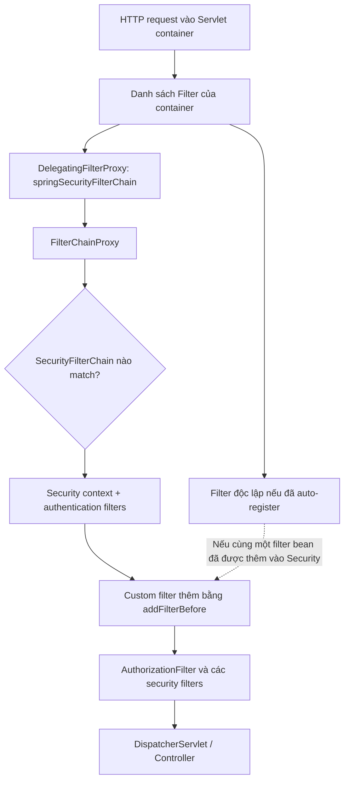

# Không gắn filter hai lần khi dùng cấu hình tự động và đăng ký thủ công

## 1. Tình huống và mục tiêu

Một ứng dụng Spring Boot dùng Spring Security để bảo vệ API. Nhóm phát triển tạo `RequestAuditFilter` nhằm ghi nhận mã truy vết và tên người dùng đã đăng nhập. Filter này được đánh dấu `@Component` để Spring có thể inject các dependency. Sau đó, nhóm thêm chính filter vào cấu hình bảo mật bằng `http.addFilterBefore(...)`.

Ứng dụng vẫn khởi động và nhiều test vẫn trả HTTP 200 đúng như mong đợi. Nhưng ở một số request, log bị ghi hai lần; ở những request khác, filter chạy khi `SecurityContextHolder` chưa có Authentication. Lý do có thể là cùng một filter đang được đăng ký ở **hai tầng khác nhau**: tầng Servlet container và tầng Spring Security.

Đây là chủ đề của chương **Filter và cơ chế tùy biến** trong module **SPRING_SECURITY_TESTING**. Người học cần kiểm chứng bảo mật HTTP thực tế bằng `spring-security-test` trên Servlet và Reactive, với MockMvc, WebTestClient, Authentication/SecurityContext và các ca truy cập được phép hoặc bị từ chối. Bài này đi sâu vào **tránh đăng ký filter trùng**, rồi dùng kiểm thử để xác định đúng phạm vi, vị trí và số lần thực thi.

Sau bài học, bạn có thể:

1. Phân biệt Servlet container filter với security filter do `FilterChainProxy` quản lý.
2. Giải thích vì sao Spring Boot tự đăng ký bean kiểu `jakarta.servlet.Filter` và vì sao `addFilterBefore` không thay thế bước đăng ký đó.
3. Chọn một cách sở hữu filter: chỉ Servlet container hoặc chỉ Spring Security.
4. Dùng `FilterRegistrationBean#setEnabled(false)` để giữ một filter là Spring bean nhưng không tự đăng ký với container.
5. Thiết kế test MockMvc và live HTTP để kiểm tra SecurityContext, vị trí filter, số lần thực thi và cấu hình registration.
6. Tránh các cách sửa sai như chỉ đổi `@Order`, chỉ thêm `OncePerRequestFilter` hoặc tắt filter của security framework tùy tiện.
7. Nhận biết cơ chế tương tự trong WebFlux với `WebFilter` và `SecurityWebFilterChain`.

## 2. Hai tầng filter khác nhau trên ứng dụng Servlet

Trong Servlet stack, có hai khái niệm trông giống nhau nhưng được cấu hình ở những vị trí khác nhau:

| Tầng | Nơi sở hữu | Cách đăng ký phổ biến | Phạm vi/thứ tự |
| --- | --- | --- | --- |
| **Servlet container** | Tomcat/Jetty/Undertow hoặc Servlet container khác | `FilterRegistrationBean`, `@WebFilter`, hoặc Spring Boot tự đăng ký bean kiểu `Filter` | Theo URL pattern, dispatcher type và registration order của container |
| **Spring Security** | `FilterChainProxy` qua `DelegatingFilterProxy` | `HttpSecurity#addFilterBefore`, `addFilterAfter`, `addFilterAt` hoặc security DSL | Theo `SecurityFilterChain` được matcher chọn và thứ tự security filter |

`DelegatingFilterProxy` là cầu nối để container gọi tới bean `springSecurityFilterChain`; bean này thường là `FilterChainProxy`. `FilterChainProxy` tìm **security chain đầu tiên khớp request**, rồi chạy danh sách security filter tương ứng.



Sơ đồ không cố định vị trí filter container đứng trước hay sau `DelegatingFilterProxy`: điều đó phụ thuộc registration order. Nó cho thấy **cùng một đối tượng hoặc hai đối tượng cùng loại có thể có hai đường đăng ký**. Khi đó một request có thể đi qua filter ở container, rồi gặp filter đó thêm lần nữa bên trong security chain.

### 2.1. Đăng ký qua `@Bean` và `@Component` có ý nghĩa gì?

Spring Boot ở chế độ Servlet nhúng tự đăng ký các Spring bean thuộc kiểu `Filter` với Servlet container, trừ khi đã có cấu hình registration phù hợp để điều khiển hoặc vô hiệu hóa việc đăng ký.

Ví dụ:

```java
@Component
class RequestAuditFilter extends OncePerRequestFilter {
    // ...
}
```

hoặc:

```java
@Bean
RequestAuditFilter requestAuditFilter() {
    return new RequestAuditFilter();
}
```

đều tạo bean `Filter` mà Spring Boot có thể **auto-register** vào Servlet container. Nếu sau đó bạn inject bean ấy và gọi:

```java
http.addFilterBefore(requestAuditFilter, AuthorizationFilter.class);
```

thì `addFilterBefore` chỉ thêm filter vào **Spring Security filter chain**; nó **không hủy** đăng ký Servlet của Spring Boot.

**Hậu quả có thể là hai lần thực thi, một lần thực thi ở tầng ngoài dự kiến, hoặc một trong hai lần bị chặn bởi cờ chống lặp**. Kết quả cụ thể phụ thuộc loại Filter, thứ tự đăng ký, dispatcher type và thời điểm request đi qua chain.

## 3. Cấu hình gây lỗi: cùng bean ở hai nơi

Ví dụ sau là **anti-pattern để nhận diện**, không dùng làm cấu hình production:

```java
import org.springframework.stereotype.Component;
import org.springframework.web.filter.OncePerRequestFilter;
import org.springframework.security.web.access.intercept.AuthorizationFilter;

@Component
class RequestAuditFilter extends OncePerRequestFilter {
    @Override
    protected void doFilterInternal(
            HttpServletRequest request,
            HttpServletResponse response,
            FilterChain chain)
            throws ServletException, IOException {
        // Muốn audit sau khi Spring Security đã xác thực người dùng.
        var auth = SecurityContextHolder.getContext()
            .getAuthentication();
        System.out.println("audit user = " +
            (auth == null ? "<none>" : auth.getName()));
        chain.doFilter(request, response);
    }
}

@Configuration
class SecurityConfiguration {
    @Bean
    SecurityFilterChain security(
            HttpSecurity http,
            RequestAuditFilter auditFilter) throws Exception {
        http.authorizeHttpRequests(auth -> auth
            .anyRequest().authenticated());
        // Sai về registration ownership:
        // cùng một @Component Filter đã có thể được Boot
        // auto-register ở container, lại bị thêm vào chain ở đây.
        http.addFilterBefore(auditFilter, AuthorizationFilter.class);
        return http.build();
    }
}
```

Ứng dụng có thể gặp những triệu chứng khó hiểu:

- Audit bị ghi thêm lần nữa so với số request ở một số code path.
- Audit xuất hiện khi Authentication vẫn `null` hoặc đang là anonymous vì filter chạy ở tầng container không đúng thứ tự mong muốn.
- Filter xử lý header, token, request body hoặc MDC hai lần, gây sai kết quả.
- Một request đã xác thực lại bị chặn bởi logic trong filter chạy ngoài security chain.
- Test `@WithMockUser` hoặc MockMvc đạt 200 nhưng request HTTP thật đi qua container khác hành vi.
- Khi thay đổi `@Order`, lỗi có vẻ thay hình thức nhưng registration kép vẫn tồn tại.

**Đừng mặc định log trùng nghĩa là cùng filter được thực thi hai lần.** Log có thể bị lặp do interceptor, retry, redirect, async/error dispatch hoặc hai instance khác nhau. Cần kiểm tra cả **cấu hình registration** và **luồng request thực tế**.

## 4. Chọn một nơi đăng ký: quy tắc thiết kế

Trước khi sửa code, hỏi filter này cần làm gì:

| Nhu cầu | Nơi nên đăng ký | Vì sao |
| --- | --- | --- |
| Kiểm tra Authentication/authorities hoặc thêm security policy | Bên trong Spring Security | Bảo đảm dùng chain/matcher và điểm thực thi sau authentication đã chọn |
| Bổ sung logic xác thực tùy chỉnh | Bên trong Spring Security | Cần phối hợp authentication, exception handling, context và authorization |
| Ghi nhận correlation ID trên mọi Servlet request, kể cả route không đi qua security chain | Servlet container | Logic hạ tầng tổng quát cần chạy ngoài phạm vi security matcher |
| CORS/security headers đã được Spring Security DSL hỗ trợ | Cấu hình DSL phù hợp | Tránh tự thêm filter làm trùng hoặc thay đổi thứ tự |
| Audit cần cả identity và các đặc tính HTTP trước authorization | Spring Security, tại vị trí xác định | Có thể truy cập Authentication và kiểm tra request bị từ chối theo mục tiêu |
| HTTP client outbound filter/interceptor | Filter/interceptor của HTTP client | Không thuộc Servlet inbound chain |
| Reactive request trên WebFlux | WebFlux `WebFilter` hoặc `SecurityWebFilterChain` | Không dùng Servlet `FilterRegistrationBean` |

Một filter có thể *về lý thuyết* cần xuất hiện ở nhiều chain khác nhau, nhưng khi đó phải thiết kế rõ **một instance, thứ tự và matcher trong từng chain**. Tránh tạo thêm đăng ký container chỉ để “bảo đảm nó luôn chạy”.

## 5. Cách A: tạo filter chỉ bên trong SecurityFilterChain

Nếu filter không cần là một Spring `Filter` bean, cách đơn giản nhất là tạo instance tại chỗ và chỉ đưa vào security chain:

```java
import org.springframework.context.annotation.Bean;
import org.springframework.context.annotation.Configuration;
import org.springframework.security.config.annotation.web.builders.HttpSecurity;
import org.springframework.security.web.SecurityFilterChain;
import org.springframework.security.web.access.intercept.AuthorizationFilter;

@Configuration(proxyBeanMethods = false)
class SecurityConfig {

    @Bean
    SecurityFilterChain security(HttpSecurity http) throws Exception {
        http
            .authorizeHttpRequests(auth -> auth
                .requestMatchers("/api/**").authenticated()
                .anyRequest().permitAll());

        http.addFilterBefore(
            new RequestAuditFilter(),
            AuthorizationFilter.class);

        return http.build();
    }
}
```

Ở phương án này, `RequestAuditFilter` **không được đánh dấu `@Component` và không được khai báo như một bean `Filter` riêng**. Spring Boot không phát hiện instance vừa tạo để auto-register nó như Servlet filter bean. Security chain sẽ là nơi đăng ký duy nhất của instance ấy.

Điểm mạnh: ít cấu hình, tránh nhầm lẫn giữa container filter và security filter. Giới hạn: nếu filter cần nhiều dependency, việc tạo thủ công bằng `new` có thể khó bảo trì. Có thể truyền dependency không phải Filter bean vào constructor từ `SecurityConfig`:

```java
@Bean
SecurityFilterChain security(
        HttpSecurity http, AuditService auditService) throws Exception {
    http.authorizeHttpRequests(auth -> auth
        .anyRequest().authenticated());
    http.addFilterBefore(
        new RequestAuditFilter(auditService),
        AuthorizationFilter.class);
    return http.build();
}
```

`AuditService` ở đây là bean thông thường. Filter do security chain sở hữu, còn dependency được inject qua constructor, nên không cần bean `Filter` để có dependency injection.

**Lưu ý:** Đây là các phương án minh họa thay thế nhau; không khai báo cả hai bean `SecurityFilterChain` với matcher catch-all cho cùng ứng dụng rồi kỳ vọng chúng đồng thời áp dụng.

## 6. Cách B: cần Spring bean Filter thì vô hiệu hóa container auto-registration

Đây là cách được tài liệu Spring Security/Spring Boot khuyến nghị khi filter cần trở thành Spring bean để nhận dependency hoặc dùng trong test:

```java
import org.springframework.boot.web.servlet.FilterRegistrationBean;
import org.springframework.context.annotation.Bean;
import org.springframework.context.annotation.Configuration;
import org.springframework.security.config.Customizer;
import org.springframework.security.config.annotation.web.builders.HttpSecurity;
import org.springframework.security.web.SecurityFilterChain;
import org.springframework.security.web.access.intercept.AuthorizationFilter;

@Configuration(proxyBeanMethods = false)
class SecurityConfig {

    @Bean
    RequestAuditFilter requestAuditFilter() {
        return new RequestAuditFilter();
    }

    @Bean
    FilterRegistrationBean<RequestAuditFilter>
            disableServletRegistration(RequestAuditFilter filter) {
        var registration =
            new FilterRegistrationBean<>(filter);
        registration.setEnabled(false);
        return registration;
    }

    @Bean
    SecurityFilterChain security(
            HttpSecurity http,
            RequestAuditFilter filter) throws Exception {
        http
            .authorizeHttpRequests(auth -> auth
                .requestMatchers("/api/**").authenticated()
                .anyRequest().permitAll())
            .httpBasic(Customizer.withDefaults());

        http.addFilterBefore(filter, AuthorizationFilter.class);
        return http.build();
    }
}
```

**Ba dòng thiết yếu của lời giải:**

1. `@Bean RequestAuditFilter`: tạo một instance do Spring quản lý.
2. `new FilterRegistrationBean<>(filter)` cùng `setEnabled(false)`: cho Spring Boot biết **không đăng ký instance này thành một Servlet filter độc lập**.
3. `http.addFilterBefore(filter, AuthorizationFilter.class)`: đưa instance vào security chain tại vị trí được chọn.

`setEnabled(false)` **chỉ vô hiệu hóa Servlet registration do registration bean ấy quản lý**; nó không “tắt” logic bên trong `SecurityFilterChain`. Nhờ vậy cùng filter có thể có dependency injection và vẫn chỉ chạy qua vị trí security mong muốn.

Trong code ở mục 5–6, vị trí trước `AuthorizationFilter` được chọn để filter có thể quan sát context sau các thành phần authentication phổ biến. Với cơ chế tùy chỉnh cụ thể, phải kiểm tra chính xác thứ tự của các security filter đang được sử dụng; không mặc định một điểm chèn phù hợp cho mọi filter.

### 6.1. Nếu dùng `@Component` thì sao?

Có thể giữ:

```java
@Component
class RequestAuditFilter extends OncePerRequestFilter {
    // ...
}
```

rồi khai báo **duy nhất** `FilterRegistrationBean<RequestAuditFilter>` với `setEnabled(false)`, đồng thời inject filter vào `SecurityFilterChain`. Khi đã dùng `@Component`, **không khai báo thêm một `@Bean RequestAuditFilter` thứ hai**. Hai cách tạo bean là hai lựa chọn thay thế nhau.

Nếu project có nhiều bean cùng class/filter type, hãy xác minh registration bean nhận **đúng instance** được thêm vào security chain; dùng `@Qualifier` khi cần. Vô hiệu hóa container registration cho instance A không có tác dụng với instance B khác được tạo hoặc đăng ký bằng cơ chế riêng.

## 7. Nếu filter thuộc Servlet container: không thêm vào SecurityFilterChain

Một filter thuần Servlet phục vụ correlation ID, thông số request hoặc logging có thể được đăng ký ở container:

```java
@Bean
FilterRegistrationBean<RequestCorrelationFilter>
        correlationFilterRegistration(
            RequestCorrelationFilter filter) {
    var registration = new FilterRegistrationBean<>(filter);
    registration.setUrlPatterns(List.of("/*"));
    registration.setOrder(Ordered.HIGHEST_PRECEDENCE);
    return registration;
}
```

Ở đây **không** gọi `http.addFilterBefore(filter, ...)` đối với instance này. Với filter container, `setOrder(...)` đặt thứ tự trong **chuỗi Servlet filter**, còn `setUrlPatterns(...)` định nghĩa URL pattern. Nó không chọn vị trí tương đối trong `SecurityFilterChain`; nếu cần Authentication đã xác thực, cân nhắc chuyển logic sang security chain.

Khi dùng `@WebFilter` và `@ServletComponentScan`, hoặc đăng ký filter qua Servlet API trong quá trình khởi tạo, cần xác định rõ chúng cũng là **nguồn đăng ký độc lập**. Nếu cùng một logic được đăng ký thêm qua `@Component` hoặc `FilterRegistrationBean`, nguy cơ trùng vẫn tồn tại.

Đừng dùng `@Order(Ordered.HIGHEST_PRECEDENCE)` như một cách chữa registration kép. `@Order` đổi thứ tự, không xóa nguồn registration. Tương tự, việc thay đổi `dispatcherTypes` có thể thay lúc filter được gọi nhưng không giải quyết nguyên nhân cùng filter xuất hiện ở hai tầng.

## 8. OncePerRequestFilter không giải quyết registration trùng

`OncePerRequestFilter` cung cấp cơ chế đánh dấu request đã được filter xử lý nhằm tránh chạy logic nội bộ quá một lần trong một **request dispatch** phù hợp. Nó hữu ích, nhưng **không phải công cụ quản lý registration**.

Một số tình huống:

| Hiện tượng | Lý do có thể xảy ra | Có được khắc phục chỉ bằng `OncePerRequestFilter`? |
| --- | --- | --- |
| Cùng filter nằm ở container và security chain | Có hai vị trí đăng ký | Không; cần bỏ một registration |
| `doFilter` của filter bị gọi hai lần nhưng `doFilterInternal` chỉ một lần | Guard `already filtered` có thể bỏ qua lần xử lý lồng nhau | Không; security filter vẫn ở sai tầng/thứ tự |
| Filter chạy ở container trước authentication | Container order khác security order | Không; guard có thể khiến lần trong security chain bị bỏ qua |
| Async/error dispatch tạo callback tiếp theo | Loại dispatch và cấu hình filter khác nhau | Cần xét `shouldNotFilterAsyncDispatch`, `shouldNotFilterErrorDispatch` và dispatcher types |
| Hai bean filter cùng loại, khác instance/name | Hai nguồn khai báo bean/registration | Guard có thể không chặn như dự kiến; cần loại bỏ đăng ký dư |

Guard của `OncePerRequestFilter` được quản lý theo thuộc tính request và có thể được tháo khi filter kết thúc. Với một đường đi qua container và security lồng nhau, lần gọi bên trong có thể bị bỏ qua; ở dispatch tiếp theo nó có thể chạy lại tùy cấu hình. Vì vậy **không thể kết luận “không bị đăng ký hai lần” chỉ vì counter ở `doFilterInternal` bằng 1**.

Nếu filter có tác dụng phụ quan trọng (ghi audit, tiêu thụ body, cập nhật SecurityContext hoặc chặn truy cập), registration kép vẫn có thể là lỗi bảo mật ngay cả khi guard làm log trông bình thường.

## 9. Ví dụ filter có thể quan sát trong bài kiểm thử

Để nhận biết filter chạy trong ngữ cảnh security mong muốn, ta dựng một filter đo số lần đi qua và tên Authentication. Đây là probe chỉ dành cho test/demo; ứng dụng production nên dùng logging/metrics phù hợp, tránh lưu Authentication chung trên một singleton.

```java
import jakarta.servlet.FilterChain;
import jakarta.servlet.ServletException;
import jakarta.servlet.http.HttpServletRequest;
import jakarta.servlet.http.HttpServletResponse;
import java.io.IOException;
import java.util.concurrent.atomic.AtomicInteger;
import java.util.concurrent.atomic.AtomicReference;
import org.springframework.security.core.Authentication;
import org.springframework.security.core.context.SecurityContextHolder;
import org.springframework.web.filter.OncePerRequestFilter;

public final class RequestAuditFilter extends OncePerRequestFilter {
    private final AtomicInteger executions = new AtomicInteger();
    private final AtomicReference<String> observedUser =
        new AtomicReference<>("<not-run>");

    @Override
    protected void doFilterInternal(
            HttpServletRequest request,
            HttpServletResponse response,
            FilterChain chain)
            throws ServletException, IOException {

        executions.incrementAndGet();
        Authentication authentication =
            SecurityContextHolder.getContext().getAuthentication();
        observedUser.set(authentication == null
            ? "<none>"
            : authentication.getName());

        chain.doFilter(request, response);
    }

    public int executions() {
        return executions.get();
    }

    public String observedUser() {
        return observedUser.get();
    }

    public void reset() {
        executions.set(0);
        observedUser.set("<not-run>");
    }
}
```

Đặt filter này làm bean và đăng ký bằng **phương án B ở mục 6**. Tên `RequestAuditFilter` thống nhất giữa các ví dụ, nhưng khi copy code vào project chỉ giữ **một định nghĩa class và một tập bean cấu hình**. Filter đo chung bằng `AtomicInteger` chỉ an toàn cho demo có các test không chạy song song hoặc có isolation; không dùng counter toàn cục này để theo dõi danh tính của người dùng production.

Thêm controller và người dùng test:

```java
@RestController
class HelloController {
    @GetMapping("/api/hello")
    String hello() {
        return "ok";
    }
}

@Bean
UserDetailsService testUsers() {
    UserDetails alice = User.withUsername("alice")
        .password("{noop}secret") // Chỉ dành cho test.
        .roles("USER")
        .build();
    return new InMemoryUserDetailsManager(alice);
}
```

Với `httpBasic()` trong `SecurityConfig`, endpoint `/api/hello` yêu cầu user đã xác thực. Thực tế có thể thay bằng JWT/OAuth2 login nhưng phải chọn vị trí filter và principal phù hợp với cơ chế đó.

## 10. MockMvc test: kiểm tra filter chạy trong Spring Security

Ở Spring Boot 3.x, một integration test có thể dùng `@SpringBootTest` và `@AutoConfigureMockMvc`. Mẫu dưới đây giả định `SecurityConfig`, `HelloController` và user test ở mục 9 đã nằm trong application context:

```java
import org.junit.jupiter.api.BeforeEach;
import org.junit.jupiter.api.Test;
import org.springframework.beans.factory.annotation.Autowired;
import org.springframework.boot.test.autoconfigure.web.servlet.AutoConfigureMockMvc;
import org.springframework.boot.test.context.SpringBootTest;
import org.springframework.security.web.FilterChainProxy;
import org.springframework.test.web.servlet.MockMvc;
import org.springframework.boot.web.servlet.FilterRegistrationBean;

import static org.assertj.core.api.Assertions.assertThat;
import static org.springframework.security.test.web.servlet.request
    .SecurityMockMvcRequestPostProcessors.user;
import static org.springframework.test.web.servlet.request
    .MockMvcRequestBuilders.get;
import static org.springframework.test.web.servlet.result
    .MockMvcResultMatchers.*;

@SpringBootTest
@AutoConfigureMockMvc
class RequestAuditFilterTest {

    @Autowired MockMvc mvc;
    @Autowired RequestAuditFilter auditFilter;
    @Autowired FilterRegistrationBean<RequestAuditFilter>
        disabledFilterRegistration;
    @Autowired FilterChainProxy springSecurityFilterChain;

    @BeforeEach
    void reset() {
        auditFilter.reset();
    }

    @Test
    void filterIsConfiguredOnlyInSecurityChain() {
        assertThat(disabledFilterRegistration.isEnabled()).isFalse();

        // Ví dụ ứng dụng chỉ có một SecurityFilterChain.
        long occurrences = springSecurityFilterChain.getFilterChains()
            .stream()
            .flatMap(chain -> chain.getFilters().stream())
            .filter(filter -> filter == auditFilter)
            .count();

        assertThat(occurrences).isEqualTo(1);
    }

    @Test
    void authenticatedRequestRunsAuditOnceWithIdentity()
            throws Exception {
        mvc.perform(get("/api/hello")
                .with(user("alice").roles("USER")))
            .andExpect(status().isOk())
            .andExpect(content().string("ok"));

        assertThat(auditFilter.executions()).isEqualTo(1);
        assertThat(auditFilter.observedUser()).isEqualTo("alice");
    }

    @Test
    void missingAuthenticationIsRejected() throws Exception {
        mvc.perform(get("/api/hello"))
            .andExpect(status().isUnauthorized());
    }
}
```

Ba lớp bằng chứng:

1. `disabledFilterRegistration.isEnabled()` là `false`, xác nhận việc đăng ký container đã được vô hiệu hóa tại nguồn.
2. `FilterChainProxy` thực sự chứa **đúng instance** `RequestAuditFilter` mà test inject.
3. Request với `with(user(...))` đi qua security chain, filter thấy `alice` và endpoint trả body đúng.

**Quan trọng:** `with(user("alice"))` đưa Authentication giả vào request MockMvc; nó kiểm tra vị trí và behavior của filter **sau khi Authentication đã được cấp**, không chạy kiểm tra mật khẩu. Test không có Authentication xác minh entry point HTTP Basic trả 401 theo cấu hình. Để kiểm chứng password, dùng `httpBasic("alice", "secret")` hoặc HTTP client có Basic credentials với user store test.

Trường hợp có nhiều security chains, cùng một filter có thể được chủ động thêm **một lần cho mỗi chain** và phép đếm `getFilterChains()` ở đây có thể lớn hơn 1. Khi đó cần xác định filter nào thực sự thuộc chain khớp `/api/hello` và tránh cấu hình chồng matcher. Không dùng assertion `occurrences == 1` như quy tắc bắt buộc cho mọi kiến trúc nhiều chain.

### 10.1. Tại sao count == 1 chưa đủ?

Một instance `OncePerRequestFilter` bị đăng ký kép vẫn có thể chỉ tăng `executions` một lần do cơ chế marker. Vì vậy bài test **cũng phải kiểm tra `FilterRegistrationBean` bị disabled và filter có mặt trong SecurityFilterChain**.

Với hệ thống quan trọng, test live HTTP ở mục sau giúp xác nhận hành vi đăng ký trên Servlet container thật. MockMvc mô phỏng Servlet request và có thể có khác biệt so với registration lifecycle thực của embedded container.

## 11. HTTP integration: xác minh Servlet container thật

Trong Spring Boot integration test, khởi động ứng dụng với embedded server trên random port để quan sát chính đường đi container → DelegatingFilterProxy → FilterChainProxy. Ví dụ Boot 3.x:

```java
import org.junit.jupiter.api.BeforeEach;
import org.junit.jupiter.api.Test;
import org.springframework.beans.factory.annotation.Autowired;
import org.springframework.boot.test.context.SpringBootTest;
import org.springframework.boot.test.web.client.TestRestTemplate;
import org.springframework.http.HttpStatus;
import org.springframework.http.ResponseEntity;

import static org.assertj.core.api.Assertions.assertThat;

@SpringBootTest(
    webEnvironment = SpringBootTest.WebEnvironment.RANDOM_PORT)
class RequestAuditLiveHttpTest {

    @Autowired TestRestTemplate rest;
    @Autowired RequestAuditFilter auditFilter;

    @BeforeEach
    void reset() {
        auditFilter.reset();
    }

    @Test
    void embeddedContainerRunsFilterOnceForSimpleGet() {
        ResponseEntity<String> response =
            rest.withBasicAuth("alice", "secret")
                .getForEntity("/api/hello", String.class);

        assertThat(response.getStatusCode()).isEqualTo(HttpStatus.OK);
        assertThat(response.getBody()).isEqualTo("ok");
        assertThat(auditFilter.executions()).isEqualTo(1);
        assertThat(auditFilter.observedUser()).isEqualTo("alice");
    }
}
```

Ca này chạy một request GET đồng bộ, không redirect, không async/error dispatch và dùng user giả do test context cấu hình. Không chạy song song nhiều test dùng chung bộ đếm singleton. Trong ứng dụng thực, HTTP client có thể tự follow redirect hoặc retry; nếu mục tiêu là đo số lượt filter, cần kiểm soát các hành vi ấy.

Kết quả có ý nghĩa nhất khi kết hợp với kiểm tra **cấu hình registration** ở mục 10. Một lần nữa, `OncePerRequestFilter` không đủ để chứng minh container không có registration thứ hai nếu chỉ nhìn một counter.

## 12. Đừng đăng ký thủ công hai lần trong MockMvc

Trong môi trường test Servlet, filter có thể bị đưa vào request pipeline hai lần ngay cả khi production đã cấu hình đúng:

```java
// Ví dụ cách dựng test cần tránh nếu đã apply springSecurity():
MockMvcBuilders.webAppContextSetup(context)
    .apply(springSecurity())
    .addFilters(springSecurityFilterChain) // thêm cùng chain lần nữa
    .build();
```

`springSecurity()` là `SecurityMockMvcConfigurers` giúp tích hợp bộ lọc Spring Security vào MockMvc; thêm cùng `FilterChainProxy` lần nữa có thể làm test đi qua security filters trùng hoặc gây hành vi không mong muốn.

**Cách thiết lập thủ công phù hợp:**

```java
MockMvc mvc = MockMvcBuilders
    .webAppContextSetup(context)
    .apply(springSecurity())
    .build();
```

Hoặc dùng `@SpringBootTest` + `@AutoConfigureMockMvc` rồi inject `MockMvc` được cấu hình bởi Spring Boot; không tự thêm lại filter chỉ vì test chưa trả status mong đợi.

Khi dùng `MockMvcBuilders.standaloneSetup(controller)`, không có đầy đủ application context/security chain như WebAppContext setup. `standaloneSetup` phù hợp test handler/controller đơn vị, nhưng không tự chứng minh auto-registration Servlet, filter order hoặc HTTP security thực tế.

`@AutoConfigureMockMvc(addFilters = false)` có thể hữu ích với những test controller chủ động bỏ qua filters, song **không thích hợp để kết luận Spring Security đã bảo vệ endpoint**. Trong bài test kiểm thử bảo mật, để filter hoạt động theo cấu hình của ứng dụng và assert cả nhánh anonymous bị từ chối.

## 13. Nhiều SecurityFilterChain: trùng registration khác với chain được chọn

Spring Security có thể có nhiều `SecurityFilterChain`:

```java
@Bean
@Order(1)
SecurityFilterChain api(
        HttpSecurity http, RequestAuditFilter audit) throws Exception {
    http.securityMatcher("/api/**")
        .authorizeHttpRequests(auth -> auth
            .anyRequest().authenticated());
    http.addFilterBefore(audit, AuthorizationFilter.class);
    return http.build();
}

@Bean
@Order(2)
SecurityFilterChain other(HttpSecurity http) throws Exception {
    return http.authorizeHttpRequests(auth -> auth
        .anyRequest().permitAll()).build();
}
```

Đây là **mẫu độc lập**, không ghép nguyên nó với `SecurityConfig` catch-all ở mục 6. Với `FilterChainProxy`, request khớp chain nào thì chạy danh sách security filter của chain đó. `/api/**` đi vào chain API có audit; các request khác đi vào fallback. `@Order` trong ví dụ đặt thứ tự chọn **SecurityFilterChain beans**, không thay thế cấu hình container registration.

Nếu một filter được thêm vào hai chain có matcher không chồng nhau, một request vẫn thường chỉ chọn **một chain**. Đây là khác biệt với filter bean được auto-register ở Servlet container, nơi nó có thể chạy bên ngoài mọi chain.

**Ma trận kiểm thử hữu ích:**

| Request | Chain mong đợi | Audit trong security? | Kỳ vọng |
| --- | --- | --- | --- |
| `GET /api/hello` | API | Có | Filter thấy Authentication nếu request được xác thực |
| `GET /health` | Fallback | Không | Filter không chạy qua Security chain |
| `GET /api/admin` thiếu quyền | API | Có | Filter chạy tại vị trí dự kiến, kết quả HTTP theo policy |
| `GET /unknown` | Tùy matcher | Tùy chain | Không suy ra đúng/sai chỉ từ 404 của route không tồn tại |

Phải kiểm tra các route có thật và các status cụ thể. Chỉ in danh sách filter một lần trong logs lúc startup không chứng minh security chain nào đã xử lý request.

## 14. Những lỗi khác có thể bị nhầm là “filter chạy hai lần”

**Async và error dispatch.** Servlet có các dispatcher type như `REQUEST`, `ASYNC`, `ERROR`. Một request tạo xử lý async hoặc chuyển tới error dispatch có thể khiến một số filter được gọi ở những lượt dispatch khác nhau. `OncePerRequestFilter` có các hook `shouldNotFilterAsyncDispatch()` và `shouldNotFilterErrorDispatch()` để điều khiển việc xử lý ở các tình huống liên quan; chúng không thay thế quản lý registration.

**Redirect hoặc retry.** Một HTTP client có thể gửi nhiều request liên tiếp do redirect, retry logic hoặc interceptor. Mỗi request là một lần đi qua chain hợp lệ; cần phân biệt số HTTP requests với số lần filter được đăng ký.

**Forward và include.** Dispatcher configuration của container ảnh hưởng phạm vi filter; nếu có forward/include, xác định đúng cách filter registration áp dụng trước khi kết luận trùng.

**Nhiều instance giống nhau.** Hai `@Bean` hoặc một `@Component` cộng với `new RequestAuditFilter()` trong security config có thể tạo **hai object** cùng class, với state và log riêng. Cấu hình `FilterRegistrationBean` cho bean A không vô hiệu hóa một instance B do container hoặc code khác đăng ký.

**Cùng tác dụng ở filter và interceptor.** Audit trong `HandlerInterceptor` và trong security filter có thể cùng ghi một sự kiện. Không kết luận filter duplicate chỉ từ hai dòng log giống nhau.

**Điểm chèn sai.** Khi đặt filter trước authentication, nó có thể thấy anonymous hoặc chưa có Authentication. Cần chọn vị trí theo yêu cầu thực tế và xác minh bằng test, thay vì cố sửa bằng `@Order` của Servlet container.

## 15. Phân biệt với WebFlux/Reactive

Trên WebFlux, bộ lọc HTTP là `org.springframework.web.server.WebFilter`, còn Spring Security sử dụng `SecurityWebFilterChain` và `ServerHttpSecurity`. Không áp dụng `jakarta.servlet.Filter`, `FilterRegistrationBean`, `HttpSecurity#addFilterBefore` hoặc `SecurityContextHolder` kiểu Servlet một cách máy móc.

Với Spring WebFlux, một `WebFilter` được đăng ký làm bean có thể trở thành **global WebFilter** do WebFlux infrastructure sử dụng. Nếu đồng thời đưa chính filter đó vào `ServerHttpSecurity`, hai cơ chế đăng ký cũng có thể khiến filter tham gia hơn một tầng xử lý.

Một cách tránh rủi ro là **tạo WebFilter không phải bean global** và thêm nó tường minh vào security chain:

```java
import org.springframework.context.annotation.Bean;
import org.springframework.security.config.annotation.web.reactive
    .EnableWebFluxSecurity;
import org.springframework.security.config.web.server.ServerHttpSecurity;
import org.springframework.security.config.web.server
    .SecurityWebFiltersOrder;
import org.springframework.security.web.server.SecurityWebFilterChain;
import org.springframework.web.server.WebFilter;
import reactor.core.publisher.Mono;

@EnableWebFluxSecurity
class ReactiveSecurityConfig {

    @Bean
    SecurityWebFilterChain security(ServerHttpSecurity http) {
        WebFilter audit = (exchange, chain) -> {
            // Có thể thêm logging/tracing phù hợp ở đây.
            return chain.filter(exchange);
        };

        return http
            .authorizeExchange(auth -> auth
                .anyExchange().authenticated())
            .addFilterBefore(audit, SecurityWebFiltersOrder.AUTHORIZATION)
            .build();
    }
}
```

Filter `audit` được tạo bên trong method và đưa vào một security chain; nó không được đánh dấu `@Component` hoặc khai báo như một `@Bean WebFilter` toàn cục. Nếu filter cần một service, inject **service bean** vào method `security(ServerHttpSecurity http, AuditService service)` rồi truyền nó vào constructor filter. Trên WebFlux, truy cập Authentication qua `ReactiveSecurityContextHolder` trong pipeline Reactive thay vì mặc định lấy `SecurityContextHolder` ThreadLocal.

Kiểm thử Reactive nên dùng `WebTestClient.bindToApplicationContext(context).apply(springSecurity())`, các mutator như `mockUser()`, `mockJwt()` và quan sát behavior theo path; không dùng `MockMvc` để kết luận về `SecurityWebFilterChain`.

| Servlet/Spring Security | Reactive/WebFlux |
| --- | --- |
| `Filter`, `OncePerRequestFilter` | `WebFilter` |
| `FilterRegistrationBean` kiểm soát container registration | Global `WebFilter` bean do WebFlux infrastructure tham gia |
| `HttpSecurity#addFilterBefore` | `ServerHttpSecurity#addFilterBefore` |
| `SecurityFilterChain` | `SecurityWebFilterChain` |
| `FilterChainProxy` | `WebFilterChainProxy` |
| `SecurityContextHolder` trong Servlet processing | `ReactiveSecurityContextHolder` trong Reactor Context |
| `MockMvc` | `WebTestClient` |

## 16. Kiểm tra registration ở từng nơi: checklist thực hành

Khi thấy nghi ngờ duplicate filter, hãy lần lượt đối chiếu:

1. **Định nghĩa object:** class filter có `@Component` không? Có bao nhiêu `@Bean` tạo cùng filter? Có `new` thêm instance thứ hai ở config không?
2. **Servlet registration:** có `FilterRegistrationBean`/`DelegatingFilterProxyRegistrationBean`/`@WebFilter`/`@ServletComponentScan` hoặc Boot auto-registration nào áp dụng cho filter không?
3. **Spring Security registration:** filter được thêm vào chain nào bằng `addFilterBefore/After/At`, matcher và `@Order` của chain là gì?
4. **Disable đúng cách:** khi chỉ muốn filter trong security chain, `FilterRegistrationBean` có `setEnabled(false)` và trỏ đúng instance không?
5. **Vị trí auth:** filter chạy trước hay sau các bước authentication cần thiết? Nó thấy principal nào trong request hợp lệ?
6. **Lượt request:** có redirect/retry/async/error dispatch hoặc hai HTTP calls thực sự không?
7. **Test setup:** MockMvc có được cấu hình security một lần hay bị thêm lại `FilterChainProxy`/custom filter?
8. **HTTP behavior:** anonymous, user đủ quyền, user thiếu quyền có được xử lý theo policy, và filter chạy trong đúng chain?

Khi debug, có thể kích hoạt mức log phù hợp cho Spring Security tại môi trường test, quan sát **danh sách filter trong `FilterChainProxy`** và log từng request có correlation ID. Cẩn thận không ghi JWT, cookie, access token hoặc mật khẩu vào log. Nên ưu tiên log tên class/filter và thứ tự thay vì thông tin credential.

## 17. Bộ ca kiểm thử tối thiểu

| Ca | Setup/kích thích | Assertion có ý nghĩa |
| --- | --- | --- |
| Filter chỉ thuộc Security | Bean filter + registration disabled | `isEnabled() == false` và đúng instance trong chain |
| Request hợp lệ | GET protected với `with(user(...))` | 200; filter thấy đúng Authentication |
| Request anonymous | GET protected không credential | 401/redirect theo entry point |
| Không đủ authority | GET endpoint yêu cầu role cao hơn | 403; filter chạy ở vị trí dự kiến |
| Request ngoài matcher security audit | GET endpoint khác chain | Không thực thi audit nếu chỉ chain API chứa audit |
| Container thật | `@SpringBootTest(RANDOM_PORT)` | Một request đơn giản cho kết quả đúng và không có dấu hiệu registration dư |
| Sai cấu hình kép | Tạm bật filter auto-registration cùng `addFilterBefore` | Test config phải phát hiện registration enabled hoặc vị trí audit bất thường |
| Async/error | Dispatch riêng có kiểm soát | Không kết luận sai rằng dispatch hợp lệ là duplicate registration |
| Manual MockMvc | `webAppContextSetup` + `springSecurity()` | Không thêm lại `FilterChainProxy` thủ công |
| Reactive | WebTestClient với security WebFilterChain | Không tạo cả global WebFilter bean và security-local filter ngoài ý muốn |

Điểm đo chỉ nên phục vụ test đơn lẻ, có isolation; không cần xây một framework đếm toàn bộ filter trong production chỉ để kiểm tra ví dụ này. Khi refactor code thực, ưu tiên assertion dựa trên config và HTTP behavior hơn là so sánh số dòng log.

## 18. Bài tập tự thực hành

**Bài 1 — Tái hiện lỗi.** Tạo `RequestAuditFilter` có `@Component` và thêm bean vào `HttpSecurity#addFilterBefore`. Trong môi trường test, quan sát filter registration của container và SecurityFilterChain, ghi lại lúc nào audit thấy `Authentication`. Giải thích tại sao một counter trong `doFilterInternal` chưa đủ kết luận.

**Bài 2 — Sửa bằng ownership.** Giữ filter là bean, thêm `FilterRegistrationBean` với `setEnabled(false)`. Kiểm tra bean registration bị disabled và filter vẫn có trong SecurityFilterChain.

**Bài 3 — Viết MockMvc integration test.** Với `@SpringBootTest` và `@AutoConfigureMockMvc`, thử request với `with(user("alice"))`, request anonymous và request có authority không đủ. Assert đúng HTTP status, body và principal audit quan sát được.

**Bài 4 — Live HTTP với Basic.** Chạy app trên random port, gửi Basic credentials hợp lệ bằng HTTP client test. So sánh kết quả khi Servlet filter registration được bật/tắt trong một nhánh thử nghiệm; khôi phục cấu hình đúng sau đó.

**Bài 5 — Phân biệt container và security filter.** Viết một filter correlation ID chỉ thuộc container và một filter kiểm tra Authentication chỉ thuộc security chain. Chọn matcher phù hợp và giải thích tại sao hai filter có thứ tự/điều kiện thực thi khác nhau.

**Bài 6 — Nhiều chain.** Cấu hình security chain riêng cho `/api/**` và fallback. Chỉ thêm audit vào chain API. Kiểm tra GET tới hai route không khiến audit tự chạy ở mọi path.

**Bài 7 — So sánh Servlet/Reactive.** Tạo một WebFlux demo với global `WebFilter` và filter nằm trong `SecurityWebFilterChain`; thay đổi setup để chỉ giữ đúng một nơi đăng ký. Dùng WebTestClient kiểm tra response và số lần logic audit được xử lý.

Một bài làm đạt yêu cầu phải chứng minh được **filter nằm ở đúng tầng**, **không còn container registration ngoài ý muốn**, **không bị thêm lại bởi cấu hình test**, và **request được xử lý đúng authentication/authorization**. Kết quả `OncePerRequestFilter` chạy một lần chỉ là một phần của bằng chứng, không thay thế kiểm tra cấu hình.

## 19. Tài liệu tham khảo

- [Spring Security — Architecture / Adding Filters to the Filter Chain](https://docs.spring.io/spring-security/reference/servlet/architecture.html): `DelegatingFilterProxy`, `FilterChainProxy`, `addFilterBefore/After/At` và cảnh báo filter bean được gọi hai lần.
- [Spring Boot — Embedded Web Servers / Disable Registration of a Servlet or Filter](https://docs.spring.io/spring-boot/how-to/webserver.html): ví dụ `FilterRegistrationBean#setEnabled(false)` cho filter bean.
- [Spring Framework — OncePerRequestFilter API](https://docs.spring.io/spring-framework/docs/current/javadoc-api/org/springframework/web/filter/OncePerRequestFilter.html): guard theo dispatch, async/error handling.
- [Spring Security — Testing MockMvc](https://docs.spring.io/spring-security/reference/servlet/test/mockmvc/index.html): tích hợp `springSecurity()`, `with(user(...))` và kiểm thử HTTP security.
- [Spring Security — Multiple SecurityFilterChain](https://docs.spring.io/spring-security/reference/servlet/configuration/java.html): `securityMatcher`, chain order và filter matching.
- [Spring Security — WebFlux Security](https://docs.spring.io/spring-security/reference/reactive/configuration/webflux.html): `SecurityWebFilterChain` và `ServerHttpSecurity`.
- [Spring Security — Testing WebFlux Security](https://docs.spring.io/spring-security/reference/reactive/test/web/setup.html): `WebTestClient` cùng `springSecurity()`.
