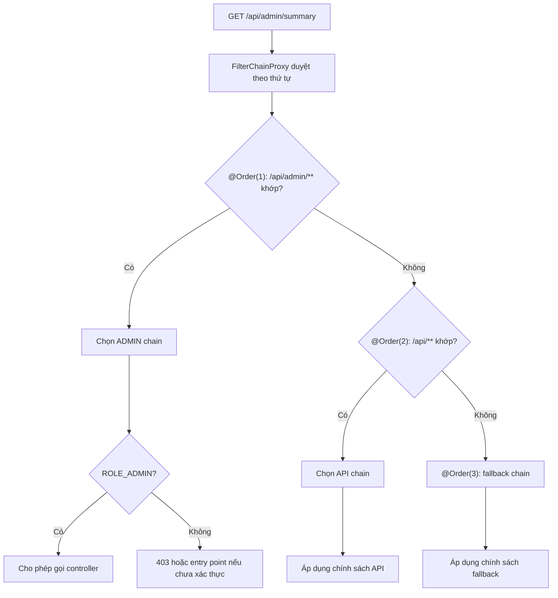

# Kiểm tra thứ tự chuỗi bảo mật cùng @Order và matcher

Ứng dụng Spring Security có thể cần nhiều **chuỗi filter bảo mật**: `/api/admin/**` yêu cầu quyền quản trị, `/api/**` còn lại cần quyền API, còn `/health/**` phục vụ kiểm tra sức khỏe không yêu cầu đăng nhập. Khi có nhiều `SecurityFilterChain`, thứ tự `@Order` và điều kiện `securityMatcher(...)` quyết định **chuỗi nào được chọn** cho từng HTTP request. Đặt sai thứ tự có thể khiến một chain rộng “nuốt” request dành cho chain đặc thù, gây cấp quyền sai, từ chối sai hoặc bỏ qua cơ chế xác thực dự kiến.

Bài thuộc chương **Filter và cơ chế tùy biến** của module `SPRING_SECURITY_TESTING`. Người học kiểm chứng xác thực, phân quyền và bảo vệ HTTP bằng `spring-security-test`, chủ yếu qua `MockMvc` trên Servlet; đồng thời đối chiếu `WebTestClient` và `SecurityWebFilterChain` trên Reactive. Trọng tâm là **kiểm thử lựa chọn chain**, không chỉ nhìn endpoint trả 200/403: bài test phải phát hiện đảo `@Order`, matcher quá rộng, thiếu chain dự phòng và custom filter đặt nhầm chain.

## 1. Quy tắc chọn chain: first matching chain wins

Trong Servlet, `DelegatingFilterProxy` đưa request đến bean `springSecurityFilterChain`, thường là một `FilterChainProxy` quản lý danh sách `SecurityFilterChain`. Proxy xét các chain theo thứ tự đã đăng ký. **Chain đầu tiên có `RequestMatcher` khớp request được chọn**; Spring Security không ghép filter của những chain khác và không thử chain sau nếu chain đã chọn từ chối quyền.



Nếu `@Order(1)` khớp nhưng user thiếu quyền, kết quả là bị từ chối trong **ADMIN chain**, không phải tiếp tục sang `@Order(2)` để thử quyền API. Đó là hành vi cần được test hồi quy bảo vệ.

### Ba thành phần có vai trò khác nhau

| Thành phần | Câu hỏi mà nó trả lời | Ví dụ |
|---|---|---|
| `@Order(1)` trên bean `SecurityFilterChain` | **Chain nào được xét trước?** | ADMIN đứng trước API. |
| `http.securityMatcher("/api/admin/**")` | **Toàn bộ chain có áp dụng cho request không?** | Chỉ các request trong vùng admin. |
| `authorizeHttpRequests().requestMatchers(...)` | **Trong chain đã chọn, luật nào áp dụng?** | Báo cáo yêu cầu role riêng. |
| `anyRequest()` trong authorization | Luật cuối **trong chain hiện tại** là gì? | Các URL còn lại được phép hoặc từ chối. |
| Không cấu hình `securityMatcher(...)` | Chain mặc định match những URL nào? | Thường là mọi request; có thể che chain phía sau. |

Trong các cấu hình thông dụng, `@Order(1)` được xét trước `@Order(2)`. `@Order` không thể cứu một chain đặc thù nếu chain tổng quát đã được chọn từ trước.

## 2. Một tập đường dẫn để quan sát thứ tự

Xét các vùng sau:

| HTTP request | Chain cần chọn | Chính sách |
|---|---|---|
| `GET /api/admin/summary` | ADMIN, `@Order(1)` | `ROLE_ADMIN`. |
| `GET /api/orders` | API, `@Order(2)` | `ROLE_API`. |
| `GET /api/adminish` | API, `@Order(2)` | Không nằm dưới `/api/admin/**`. |
| `GET /health/ping` | FALLBACK, `@Order(3)` | Cho phép anonymous. |
| `GET /unknown` | FALLBACK, `@Order(3)` | Có thể là HTTP 404 từ MVC, không phải lỗi security. |

Hai matcher `/api/admin/**` và `/api/**` **chồng lấn**. Request `/api/admin/summary` khớp cả hai về mặt đường dẫn; thứ tự phải bảo đảm ADMIN được xét trước. Những path sát biên như `/api/admin`, `/api/admin/` hoặc có context path/servlet path phải được kiểm tra bằng matcher thực tế theo phiên bản Spring đang dùng, không suy đoán bằng tiền tố chuỗi.

Chọn `GET` cho các ca kiểm tra thứ tự để tránh HTTP 403 do thiếu CSRF khi dùng các phương thức ghi dữ liệu. Nếu thêm `POST`, cần kiểm soát CSRF độc lập với authorization.

## 3. Ba Servlet SecurityFilterChain với @Order

Ví dụ dùng Java 17+, Spring Boot 3.x/Spring Security 6.x cùng `spring-boot-starter-web`, `spring-boot-starter-security`, `spring-boot-starter-test` và `spring-security-test`.

Để quan sát **chain nào được chọn** trong bài test, ta tạo một filter đánh dấu header `X-Test-Selected-Chain`. Đây là cơ chế **chỉ dành cho ví dụ/test**, không nên xuất header tiết lộ cấu trúc bảo mật nội bộ trên production.

```java
import java.io.IOException;
import jakarta.servlet.FilterChain;
import jakarta.servlet.ServletException;
import jakarta.servlet.http.HttpServletRequest;
import jakarta.servlet.http.HttpServletResponse;
import org.springframework.web.filter.OncePerRequestFilter;

final class TestChainMarkerFilter extends OncePerRequestFilter {
    private final String chainName;

    TestChainMarkerFilter(String chainName) {
        this.chainName = chainName;
    }

    @Override
    protected void doFilterInternal(
            HttpServletRequest request,
            HttpServletResponse response,
            FilterChain filterChain
    ) throws ServletException, IOException {
        response.setHeader("X-Test-Selected-Chain", chainName);
        filterChain.doFilter(request, response);
    }
}
```

Filter này nên được tạo **trực tiếp trong security chain**, không gắn `@Component`/`@Bean` rồi để Servlet container đăng ký toàn cục. Nếu một filter vừa nằm trong Spring Security chain vừa được container đăng ký, nó có thể chạy hai lần hoặc chạy tại các URL không thuộc chain cần thử.

```java
import org.springframework.context.annotation.Bean;
import org.springframework.context.annotation.Configuration;
import org.springframework.core.annotation.Order;
import org.springframework.security.config.Customizer;
import org.springframework.security.config.annotation.web.builders.HttpSecurity;
import org.springframework.security.config.annotation.web.configuration.EnableWebSecurity;
import org.springframework.security.web.SecurityFilterChain;
import org.springframework.security.web.access.intercept.AuthorizationFilter;

@Configuration
@EnableWebSecurity
class OrderedSecurityChains {

    @Bean
    @Order(1)
    SecurityFilterChain adminChain(HttpSecurity http) throws Exception {
        return http
                .securityMatcher("/api/admin/**")
                .authorizeHttpRequests(auth -> auth
                        .anyRequest().hasRole("ADMIN"))
                .addFilterBefore(new TestChainMarkerFilter("ADMIN"),
                        AuthorizationFilter.class)
                .httpBasic(Customizer.withDefaults())
                .build();
    }

    @Bean
    @Order(2)
    SecurityFilterChain apiChain(HttpSecurity http) throws Exception {
        return http
                .securityMatcher("/api/**")
                .authorizeHttpRequests(auth -> auth
                        .anyRequest().hasRole("API"))
                .addFilterBefore(new TestChainMarkerFilter("API"),
                        AuthorizationFilter.class)
                .httpBasic(Customizer.withDefaults())
                .build();
    }

    @Bean
    @Order(3)
    SecurityFilterChain fallbackChain(HttpSecurity http)
            throws Exception {
        return http
                .authorizeHttpRequests(auth -> auth
                        .anyRequest().permitAll())
                .addFilterBefore(new TestChainMarkerFilter("FALLBACK"),
                        AuthorizationFilter.class)
                .build();
    }
}
```

Đây là **cấu hình học tập**: fallback `permitAll()` và diagnostic header được chọn để thấy rõ chain. Trong production, fallback thường có quy tắc chặt hơn như `denyAll()`, `authenticated()` hoặc chỉ cho phép những endpoint công khai cụ thể.

Điểm cần đọc đúng:

- `@Order(1)` và `@Order(2)` quyết định thứ tự xét hai matcher chồng lấn; `@Order(3)` không có `securityMatcher` nên đóng vai trò fallback.
- `hasRole("ADMIN")` yêu cầu authority `ROLE_ADMIN`; `hasRole("API")` yêu cầu `ROLE_API`. `hasAuthority(...)` thì so sánh chuỗi trực tiếp.
- `httpBasic(...)` bật entry point Basic cho ADMIN/API; request chưa xác thực tới vùng bảo vệ thường nhận 401.
- Marker được đặt trước `AuthorizationFilter` nên có thể quan sát cả 200 và 403 do authorization. Nếu filter trước marker từ chối (ví dụ CSRF), header có thể không xuất hiện.
- Mỗi chain có danh sách filter riêng. Thêm marker vào ADMIN không có nghĩa marker đó chạy trong API hay FALLBACK.

### Bẫy khi thiếu securityMatcher

```java
@Bean
@Order(1)
SecurityFilterChain wrongAdminChain(HttpSecurity http) throws Exception {
    return http
            // SAI: không có .securityMatcher("/api/admin/**")
            .authorizeHttpRequests(auth -> auth
                    .requestMatchers("/api/admin/**").hasRole("ADMIN")
                    .anyRequest().permitAll())
            .build();
}
```

Ở đây `requestMatchers(...)` chỉ xét luật **bên trong chain được chọn**, không thu hẹp phạm vi của chain. Nếu chain đầu tiên không có `securityMatcher`, nó thường khớp mọi request; API chain phía sau không được chọn. `anyRequest().permitAll()` thậm chí có thể để `/api/orders` qua mà không cần `ROLE_API`.

## 4. Controller và nghiệp vụ để thấy request đã vượt qua bảo mật

Tạo endpoint có service để xác nhận **nghiệp vụ không chạy khi bị từ chối**, thay vì chỉ nhìn HTTP status:

```java
import org.springframework.stereotype.Service;
import org.springframework.web.bind.annotation.GetMapping;
import org.springframework.web.bind.annotation.RestController;

interface RouteService {
    String adminSummary();
    String orders();
}

@Service
class DefaultRouteService implements RouteService {
    public String adminSummary() {
        return "admin-summary";
    }

    public String orders() {
        return "orders";
    }
}

@RestController
class RouteController {
    private final RouteService routes;

    RouteController(RouteService routes) {
        this.routes = routes;
    }

    @GetMapping("/api/admin/summary")
    String adminSummary() {
        return routes.adminSummary();
    }

    @GetMapping("/api/orders")
    String orders() {
        return routes.orders();
    }

    @GetMapping("/api/adminish")
    String adminish() {
        return "belongs-to-api";
    }

    @GetMapping("/health/ping")
    String health() {
        return "healthy";
    }
}
```

Vì quyền được kiểm tra ở **HTTP SecurityFilterChain**, test có thể dùng Mockito thay `RouteService` để kiểm tra controller đã gọi nó hay chưa. Nếu quyền được đặt tại `@PreAuthorize` trên chính service, phải giữ service là **Spring bean thật** để method-security interceptor chạy rồi chỉ mock dependency phía sau.

## 5. MockMvc: kiểm tra đồng thời chain và kết quả phân quyền

Với Spring Boot test có security chain thật, sử dụng `@SpringBootTest` + `@AutoConfigureMockMvc`. Spring Boot tích hợp Spring Security filter vào MockMvc theo cấu hình test thông dụng. Nếu tự dựng `MockMvcBuilders.webAppContextSetup(context)`, hãy dùng `SecurityMockMvcConfigurers.springSecurity()`; không đăng ký filter hai lần.

```java
import org.junit.jupiter.api.Test;
import org.springframework.beans.factory.annotation.Autowired;
import org.springframework.boot.test.autoconfigure.web.servlet.AutoConfigureMockMvc;
import org.springframework.boot.test.context.SpringBootTest;
import org.springframework.test.context.bean.override.mockito.MockitoBean;
import org.springframework.test.web.servlet.MockMvc;

import static org.mockito.Mockito.verify;
import static org.mockito.Mockito.verifyNoInteractions;
import static org.mockito.Mockito.when;
import static org.springframework.security.test.web.servlet.request
        .SecurityMockMvcRequestPostProcessors.user;
import static org.springframework.test.web.servlet.request.MockMvcRequestBuilders.get;
import static org.springframework.test.web.servlet.result.MockMvcResultMatchers.content;
import static org.springframework.test.web.servlet.result.MockMvcResultMatchers.header;
import static org.springframework.test.web.servlet.result.MockMvcResultMatchers.status;

@SpringBootTest
@AutoConfigureMockMvc
class SecurityChainOrderTest {
    @Autowired
    MockMvc mockMvc;

    @MockitoBean
    RouteService routes;

    @Test
    void adminRequest_usesAdminChain_andAllowsAdmin() throws Exception {
        when(routes.adminSummary()).thenReturn("admin-summary");

        mockMvc.perform(get("/api/admin/summary")
                        .with(user("alice").roles("ADMIN")))
                .andExpect(status().isOk())
                .andExpect(header().string(
                        "X-Test-Selected-Chain", "ADMIN"))
                .andExpect(content().string("admin-summary"));

        verify(routes).adminSummary();
    }

    @Test
    void adminRequest_doesNotFallThroughToApiChain()
            throws Exception {
        mockMvc.perform(get("/api/admin/summary")
                        .with(user("api-user").roles("API")))
                .andExpect(status().isForbidden())
                .andExpect(header().string(
                        "X-Test-Selected-Chain", "ADMIN"));

        verifyNoInteractions(routes);
    }

    @Test
    void apiRequest_usesApiChain() throws Exception {
        when(routes.orders()).thenReturn("orders");

        mockMvc.perform(get("/api/orders")
                        .with(user("api-user").roles("API")))
                .andExpect(status().isOk())
                .andExpect(header().string(
                        "X-Test-Selected-Chain", "API"))
                .andExpect(content().string("orders"));

        verify(routes).orders();
    }

    @Test
    void adminRoleAlone_doesNotGrantApiRole() throws Exception {
        mockMvc.perform(get("/api/orders")
                        .with(user("admin").roles("ADMIN")))
                .andExpect(status().isForbidden())
                .andExpect(header().string(
                        "X-Test-Selected-Chain", "API"));

        verifyNoInteractions(routes);
    }

    @Test
    void similarPrefix_doesNotMatchAdminChain() throws Exception {
        mockMvc.perform(get("/api/adminish")
                        .with(user("api-user").roles("API")))
                .andExpect(status().isOk())
                .andExpect(header().string(
                        "X-Test-Selected-Chain", "API"))
                .andExpect(content().string("belongs-to-api"));

        verifyNoInteractions(routes);
    }

    @Test
    void healthRequest_usesFallbackWithoutLogin() throws Exception {
        mockMvc.perform(get("/health/ping"))
                .andExpect(status().isOk())
                .andExpect(header().string(
                        "X-Test-Selected-Chain", "FALLBACK"))
                .andExpect(content().string("healthy"));

        verifyNoInteractions(routes);
    }

    @Test
    void anonymousAdminRequest_isNotAuthenticated() throws Exception {
        mockMvc.perform(get("/api/admin/summary"))
                .andExpect(status().isUnauthorized())
                .andExpect(header().string(
                        "X-Test-Selected-Chain", "ADMIN"));

        verifyNoInteractions(routes);
    }
}
```

`@MockitoBean` thuộc Spring Framework 6.2+/Spring Boot 3.4+; nếu dự án dùng bản cũ hơn, thay bằng cơ chế mock bean tương thích. Ví dụ cần `OrderedSecurityChains` và `RouteController` nằm trong test application context. Nếu ứng dụng đã khai báo thêm security chains production, phải kiểm tra chính tập bean thực tế, không import thêm các chain chồng lấn chỉ để làm test xanh.

**Tại sao assertion kép mạnh hơn kiểm tra status đơn lẻ?**

- `ROLE_ADMIN` vào `/api/admin/summary` nhận **200 + ADMIN**, đồng thời service được gọi.
- `ROLE_API` vào cùng URL nhận **403 + ADMIN**: **vẫn chọn ADMIN**, không fallback sang API chỉ vì user có role API.
- `ROLE_API` vào `/api/orders` nhận **200 + API**: chứng minh chain API hoạt động trên vùng của mình.
- `ROLE_ADMIN` vào `/api/orders` nhận **403 + API**: role admin không tự mang role API.
- `/api/adminish` thuộc API chain, ngăn matcher kiểu `/api/admin*` chặn nhầm URL sát biên.
- `/health/ping` anonymous nhận **200 + FALLBACK**, chứng minh chain dự phòng và chính sách công khai.

Chỉ kiểm tra `status().isForbidden()` cho user API vào URL admin chưa đủ: một cấu hình từ chối tất cả cũng có thể làm test đó xanh. Cần **positive test, negative test và bằng chứng chain được chọn**.

## 6. Kiểm thử đảo @Order: chain tổng quát nuốt chain đặc thù

Một thay đổi tưởng nhỏ:

```java
// SAI: chain rộng đứng trước chain hẹp.
@Bean
@Order(1)
SecurityFilterChain apiChain(HttpSecurity http) throws Exception {
    return http.securityMatcher("/api/**")
            .authorizeHttpRequests(auth ->
                    auth.anyRequest().hasRole("API"))
            .httpBasic(Customizer.withDefaults())
            .build();
}

@Bean
@Order(2)
SecurityFilterChain adminChain(HttpSecurity http) throws Exception {
    return http.securityMatcher("/api/admin/**")
            .authorizeHttpRequests(auth ->
                    auth.anyRequest().hasRole("ADMIN"))
            .httpBasic(Customizer.withDefaults())
            .build();
}
```

Khi đảo như vậy:

1. `GET /api/admin/summary` khớp `/api/**` trước; API chain được chọn.
2. User chỉ có `ROLE_ADMIN` có thể nhận 403 dù lẽ ra được phép.
3. User chỉ có `ROLE_API` có thể nhận 200 trong vùng admin: lỗi phân quyền nghiêm trọng nếu service không có kiểm tra bổ sung.
4. Chain phía sau **không được thử** sau khi chain đầu đã khớp.

Bộ test ở mục 5 phát hiện cả việc **từ chối user admin đúng quyền** lẫn **chấp nhận API user vào vùng admin**. Có thể thử đảo `@Order` trong một bản sửa tạm thời và xác nhận test hồi quy thất bại, rồi phục hồi cấu hình; không giữ cấu hình cố tình sai trong production.

### Không suy diễn chain từ role hoặc status

Nếu hai chain cùng dùng `hasRole("ADMIN")`, một test chỉ kiểm tra 200 sẽ không biết chain nào được chọn. Để quan sát thứ tự, dùng marker **chỉ trong test**, một filter instrumented, phân biệt entry point của từng chain hoặc kiểm tra `FilterChainProxy`. Dấu hiệu phải thực sự được tạo bởi **chain đã chạy**, không chỉ là tên test.

## 7. Khảo sát FilterChainProxy và vị trí custom filter

Bean `springSecurityFilterChain` trong cấu hình Spring Security Servlet thông dụng là `FilterChainProxy`. Nó cung cấp `getFilterChains()` để xem danh sách chain đã đăng ký. Đây là công cụ hỗ trợ điều tra khi có nhiều bean `SecurityFilterChain` từ ứng dụng và thư viện.

```java
import org.springframework.beans.factory.annotation.Qualifier;
import org.springframework.security.web.FilterChainProxy;
import org.springframework.security.web.SecurityFilterChain;

@Autowired
@Qualifier("springSecurityFilterChain")
FilterChainProxy securityProxy;

@Test
void securityProxyContainsExpectedChains() {
    java.util.List<SecurityFilterChain> chains =
            securityProxy.getFilterChains();

    assertThat(chains).hasSizeGreaterThanOrEqualTo(3);
    // Xác minh thêm vị trí tương đối và matcher thực tế.
    // Test HTTP ở mục 5 là bằng chứng bổ sung về chain được chọn.
}
```

Đoạn này giả định bean có kiểu `FilterChainProxy` đúng như ứng dụng Servlet Spring Security tiêu chuẩn và `assertThat` là AssertJ. Một ứng dụng có thể có chain khác do cấu hình bổ sung; đừng chỉ assert cứng “chính xác ba chain” rồi coi đó là bằng chứng thứ tự đúng. Cần so sánh **vị trí tương đối và điều kiện match** của các chain quan trọng.

Khi kiểm tra matcher trực tiếp, sử dụng một `MockHttpServletRequest` có method, path, servlet path/context path và các thuộc tính phù hợp môi trường thực tế. Không nên tự tạo một request thiếu metadata rồi suy kết quả giống request do `DispatcherServlet`/`MockMvc` tạo ra, đặc biệt với MVC matcher.

| Cần chứng minh | Bằng chứng tốt | Bẫy thường gặp |
|---|---|---|
| ADMIN được xét trước API | Test request khớp cả hai, marker ADMIN và kết quả HTTP đúng | Chỉ kiểm tra 403 không cho biết chain nào chặn. |
| Custom filter chỉ nằm trong ADMIN | Quan sát filter/marker riêng khi vào và ra vùng ADMIN | Đăng ký cùng filter như Servlet filter toàn cục làm nó chạy ở mọi URL. |
| Filter nằm đúng vị trí **bên trong chain** | Kiểm tra trước/sau theo filter cụ thể và request test | `@Order` của chain **không** thay `addFilterBefore/After` của filter. |
| Fallback xử lý URL ngoài API | Anonymous request qua fallback và endpoint công khai | Không có fallback có thể khiến request không nằm trong security chain nào. |
| Từ chối trước nghiệp vụ | `verifyNoInteractions(service)` hoặc dữ liệu không bị sửa | Filter khác có thể gây side effect trước authorization; cần xét vị trí filter. |

Ví dụ với một filter đọc `X-Tenant-ID`, cần có test request thuộc chain yêu cầu tenant và request nằm ngoài chain ấy. Nếu filter bị đặt ở cấp Servlet container hoặc bị chèn sai chain, nó có thể áp đặt quy tắc tenant trên `/health/ping` hoặc vô tình bỏ qua tenant của `/api/admin/**`.

## 8. Quy tắc URL/method bên trong chain không thay đổi lựa chọn chain

Ví dụ một ADMIN chain có hai chính sách:

```java
@Bean
@Order(1)
SecurityFilterChain adminChain(HttpSecurity http) throws Exception {
    return http
            .securityMatcher("/api/admin/**")
            .authorizeHttpRequests(auth -> auth
                    .requestMatchers("/api/admin/reports/**")
                        .hasRole("AUDITOR")
                    .anyRequest().hasRole("ADMIN"))
            .build();
}
```

Có **hai bước khác nhau**:

1. `securityMatcher("/api/admin/**")` quyết định chain ADMIN có tham gia hay không.
2. Nếu chain đã được chọn, `requestMatchers("/api/admin/reports/**")` chọn luật `ROLE_AUDITOR` bên trong chain; các request admin còn lại dùng `ROLE_ADMIN`.

Quy tắc authorization không chuyển request qua chain khác. `anyRequest().permitAll()` trong chain cũng không tạo cơ chế “thử chain tiếp theo”.

Nếu có matcher phân biệt HTTP method, cần test `GET` và `POST` riêng. Điều kiện method được đặt trong authorization rule **không tự động** giới hạn security matcher của chain; trong khi `POST` thường chịu thêm `CsrfFilter`. Một test POST thiếu CSRF có thể nhận 403 **trước** khi đến `AuthorizationFilter`: phải thêm `.with(csrf())` để cô lập nguyên nhân từ chối khi đang kiểm tra quyền.

## 9. Kiểm thử cơ chế xác thực thật thay vì chỉ dùng mock user

`.with(user("alice").roles("ADMIN"))` từ `spring-security-test` đưa một `Authentication` giả lập vào `SecurityContext` của request `MockMvc`. Điều này kiểm tra **lựa chọn chain và phân quyền sau khi có danh tính**, nhưng **không** chứng minh mật khẩu HTTP Basic được xác minh hoặc một token JWT có chữ ký thật.

Muốn kiểm tra `httpBasic()` trong chain đã chọn:

1. Cấu hình `UserDetailsService`/`AuthenticationProvider` với user và password **chỉ dành cho môi trường test**.
2. Gửi `.with(httpBasic("alice", "test-password"))`, thay vì tự cài `Authentication` qua `user()`.
3. Với đúng credentials, assert HTTP 200 trên URL phù hợp; với sai credentials, assert 401 và bảo đảm service không chạy.
4. Nếu cần, kiểm tra header `WWW-Authenticate` và entry point do chain cấu hình.

Ví dụ request:

```java
import static org.springframework.security.test.web.servlet.request
        .SecurityMockMvcRequestPostProcessors.httpBasic;

mockMvc.perform(get("/api/admin/summary")
                .with(httpBasic("alice", "test-password")))
        .andExpect(status().isOk())
        .andExpect(header().string(
                "X-Test-Selected-Chain", "ADMIN"));
```

Đoạn này **chỉ có thể PASS khi context có provider thật sự xác thực `alice` với password đã nêu**. Không được sao chép vào test đang thiếu provider rồi coi 401 là lỗi `@Order`. Với JWT/OAuth2, có thể mock decoder để kiểm tra wiring và quyền sau decode, hoặc gửi bearer token ký thật cùng JWKS cục bộ nếu mục tiêu là kiểm chứng signature/claims. `.with(jwt())` giả lập kết quả xác thực và không chứng minh decoder production hoạt động.

## 10. Không có fallback: URL có thể nằm ngoài mọi Spring Security chain

Giả sử ứng dụng chỉ khai báo chain `/api/admin/**` và `/api/**` nhưng không có chain mặc định. Khi request `GET /billing/export` không khớp chain nào, `FilterChainProxy` sẽ không áp dụng các filter bảo mật của hai chain trên cho URL đó. Request có thể đi tiếp đến controller hoặc filter khác; nếu endpoint tồn tại, **không được mặc nhiên coi nó đã được bảo vệ bởi Spring Security**.

Đây không giống với chain fallback:

```java
@Bean
@Order(3)
SecurityFilterChain fallback(HttpSecurity http) throws Exception {
    return http
            .authorizeHttpRequests(auth -> auth
                    .anyRequest().denyAll())
            .build();
}
```

Fallback `denyAll()` vẫn được chọn và từ chối request. Status có thể khác tùy entry point và `Authentication` hiện tại; test cần chứng minh controller không chạy, thay vì chỉ dựa vào một mã status cố định không xét cấu hình.

Một endpoint chưa tồn tại có thể trả 404 và làm người viết test lầm tưởng hệ thống an toàn. Khi endpoint được bổ sung sau này, khoảng trống matcher có thể bộc lộ. Vì vậy nên có test hồi quy cho các URL “ngoài vùng” quan trọng hoặc một fallback có quy tắc rõ ràng.

## 11. Reactive: cùng nguyên tắc nhưng dùng SecurityWebFilterChain

Trên WebFlux, thứ tự cũng chọn **chain phù hợp đầu tiên**, song kiểu filter và matcher khác Servlet:

| Servlet | Reactive WebFlux |
|---|---|
| `SecurityFilterChain` | `SecurityWebFilterChain` |
| `HttpSecurity` | `ServerHttpSecurity` |
| `RequestMatcher` | `ServerWebExchangeMatcher` |
| `securityMatcher("/api/**")` | `securityMatcher(ServerWebExchangeMatchers.pathMatchers("/api/**"))` |
| `MockMvc` với `user()/csrf()` | `WebTestClient` với `mockUser()/csrf()` trong Reactive |
| `FilterChainProxy` và Servlet filters | `WebFilterChainProxy` và Reactive WebFilters |

Ví dụ:

```java
import org.springframework.context.annotation.Bean;
import org.springframework.context.annotation.Configuration;
import org.springframework.core.annotation.Order;
import org.springframework.security.config.Customizer;
import org.springframework.security.config.annotation.web.reactive.EnableWebFluxSecurity;
import org.springframework.security.config.web.server.ServerHttpSecurity;
import org.springframework.security.web.server.SecurityWebFilterChain;
import org.springframework.security.web.server.util.matcher.ServerWebExchangeMatchers;

@Configuration
@EnableWebFluxSecurity
class OrderedReactiveSecurityChains {

    @Bean
    @Order(1)
    SecurityWebFilterChain admin(ServerHttpSecurity http) {
        return http
                .securityMatcher(ServerWebExchangeMatchers
                        .pathMatchers("/api/admin/**"))
                .authorizeExchange(auth -> auth
                        .anyExchange().hasRole("ADMIN"))
                .httpBasic(Customizer.withDefaults())
                .build();
    }

    @Bean
    @Order(2)
    SecurityWebFilterChain api(ServerHttpSecurity http) {
        return http
                .securityMatcher(ServerWebExchangeMatchers
                        .pathMatchers("/api/**"))
                .authorizeExchange(auth -> auth
                        .anyExchange().hasRole("API"))
                .httpBasic(Customizer.withDefaults())
                .build();
    }

    @Bean
    @Order(3)
    SecurityWebFilterChain fallback(ServerHttpSecurity http) {
        return http
                .authorizeExchange(auth -> auth
                        .anyExchange().permitAll())
                .build();
    }
}
```

`WebTestClient` in-process phải được bind tới WebFlux `ApplicationContext` và áp dụng Reactive `springSecurity()`:

```java
import static org.springframework.security.test.web.reactive.server
        .SecurityMockServerConfigurers.mockUser;
import static org.springframework.security.test.web.reactive.server
        .SecurityMockServerConfigurers.springSecurity;

webTestClient = WebTestClient.bindToApplicationContext(context)
        .apply(springSecurity())
        .configureClient()
        .build();

webTestClient
        .mutateWith(mockUser("alice").roles("ADMIN"))
        .get()
        .uri("/api/admin/summary")
        .exchange()
        .expectStatus().isOk();

webTestClient
        .mutateWith(mockUser("bob").roles("API"))
        .get()
        .uri("/api/admin/summary")
        .exchange()
        .expectStatus().isForbidden();
```

Ví dụ giả định có controller **WebFlux** cho `/api/admin/summary` và Spring context thực sự chứa `OrderedReactiveSecurityChains`. Không dùng `TestChainMarkerFilter` Servlet cho WebFlux; nếu cần marker Reactive, thêm test-only `WebFilter` vào từng `SecurityWebFilterChain`. Nếu `WebTestClient` kết nối qua `bindToServer()` đến server HTTP riêng, `mockUser()` trong tiến trình test không tự gắn Authentication cho server; hãy gửi credentials/token thật.

## 12. Ma trận kiểm thử hồi quy @Order và matcher

| Kịch bản | Request + người dùng | Chain dự kiến | Kết quả |
|---|---|---|---|
| A | `/api/admin/summary` + ADMIN | ADMIN | 200, service chạy. |
| B | `/api/admin/summary` + API | ADMIN | 403, service không chạy. |
| C | `/api/admin/summary` + anonymous | ADMIN | 401 với Basic entry point của ví dụ. |
| D | `/api/orders` + API | API | 200, service chạy. |
| E | `/api/orders` + ADMIN-only | API | 403, không tự được cấp role API. |
| F | `/api/adminish` + API | API | 200, tránh matcher admin quá rộng. |
| G | `/health/ping` + anonymous | FALLBACK | 200 nếu fallback cho phép. |
| H | `/unknown` + anonymous | FALLBACK | Có thể 404 do không có handler nhưng chain vẫn được chọn. |
| I | Đảo thứ tự API/Admin | API bị chọn trước | Test A/B phát hiện quyền bị thay đổi. |
| J | Bỏ `securityMatcher` ở chain đầu | Chain đầu che toàn bộ | Test D/G phát hiện chính sách hoặc chain sai. |
| K | POST trong vùng admin, CSRF bật | ADMIN | Đưa CSRF hợp lệ vào test phân quyền để không nhầm 403. |
| L | URL ngoài mọi matcher khi không có fallback | Không có chain | Phải phát hiện rủi ro URL nằm ngoài Spring Security. |

Đối với các nhánh chính, giữ cả **positive test và negative test**. Bổ sung kiểm thử HTTP method, query, dấu gạch chéo cuối, URL encoding, context path hoặc servlet path nếu ứng dụng có quy tắc route đặc thù; sử dụng matcher của môi trường thực thay vì tự đoán cách phân tích đường dẫn.

## 13. Checklist kiểm tra chuỗi bảo mật

- [ ] Những `SecurityFilterChain`/`SecurityWebFilterChain` có matcher chồng lấn được đặt `@Order` tường minh, hẹp trước rộng.
- [ ] Phân biệt `securityMatcher` chọn **toàn bộ chain** với `requestMatchers` hoặc `pathMatchers` kiểm tra **quyền trong chain**.
- [ ] Có ca request khớp nhiều matcher để chứng minh **first-match-wins** ngay cả khi chain đầu từ chối.
- [ ] Có cả 200, 401/redirect và 403 theo entry point thực tế; không chỉ kiểm tra 403.
- [ ] Quan sát chain được chọn bằng marker chỉ trong test, instrumentation hoặc dấu hiệu tương đương có căn cứ.
- [ ] Custom filter chỉ chạy ở chain mong muốn, không bị Servlet container đăng ký toàn cục ngoài ý muốn.
- [ ] Có fallback rõ ràng, hoặc đã chủ động xác minh rủi ro của URL nằm ngoài tất cả chain.
- [ ] Với POST/PUT/DELETE, kiểm soát CSRF riêng để không nhầm 403 CSRF với 403 authorization.
- [ ] `user()`/`mockUser()` chỉ chứng minh quyền sau xác thực; thử Basic/JWT/OIDC thật cần đi qua cơ chế xác thực phù hợp.
- [ ] Servlet test dùng `MockMvc` và Servlet post-processors; WebFlux test dùng `WebTestClient` và `SecurityMockServerConfigurers`.
- [ ] Test bị từ chối bảo đảm nghiệp vụ không chạy; test được phép bảo đảm controller/service thực sự hoàn tất.

**Kết luận:** `@Order` quyết định **thứ tự xét chain**, `securityMatcher` quyết định **chain có tham gia không**, còn `requestMatchers` trong authorization quyết định **quyền sau khi đã chọn chain**. Chain rộng đứng trước chain hẹp có thể làm thay đổi hoàn toàn cơ chế bảo vệ. Kiểm thử tin cậy phải chứng minh **đúng chain, đúng quyền, đúng filter và đúng nghiệp vụ**, không chỉ xác nhận một mã HTTP.
