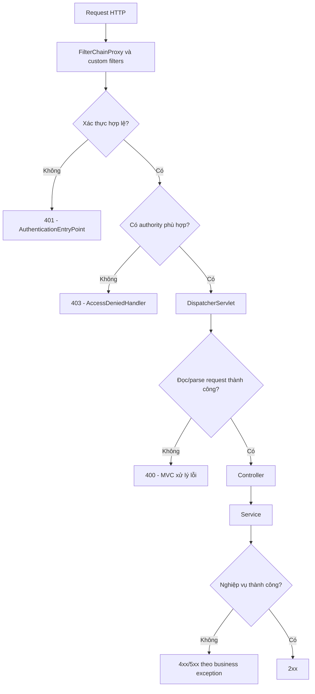

# Tách lỗi trong filter khỏi lỗi controller hoặc dịch vụ được bảo vệ

Một request API trả về **401 Unauthorized**, **403 Forbidden**, **400 Bad Request** hay **409 Conflict** chưa đủ để kết luận thành phần nào đã từ chối request. Một lỗi xác thực có thể được xử lý ngay trong custom filter; lỗi phân quyền có thể xuất hiện ở Spring Security authorization; JSON sai cú pháp được xử lý bởi Spring MVC; còn một exception nghiệp vụ có thể chỉ xuất hiện **sau khi service đã chạy**.

Bài học thuộc chương **Filter và cơ chế tùy biến** của module **SPRING_SECURITY_TESTING**, phục vụ mục tiêu kiểm chứng xác thực, phân quyền và bảo vệ HTTP bằng `spring-security-test` trên Servlet và Reactive. Người học sử dụng MockMvc, WebTestClient, `@WithMockUser`, SecurityContext, JWT/OAuth2/OIDC giả lập và các ca được phép hoặc bị từ chối. Trọng tâm ở đây là **phân biệt đúng nơi phát sinh lỗi** và **chứng minh bằng kiểm thử rằng tầng nghiệp vụ được gọi hoặc bị chặn đúng lúc**.

## 1. Bốn ranh giới xảy ra lỗi trong một request

Một request Servlet thường đi qua servlet filter, security filter chain, bộ xử lý Spring MVC rồi mới tới controller/service:



Sơ đồ minh họa thứ tự chung. Status chính xác phụ thuộc `AuthenticationEntryPoint`, `AccessDeniedHandler`, CSRF, `HandlerExceptionResolver` và cấu hình ứng dụng.

| Nguồn lỗi | Ví dụ | Nơi xử lý thường dùng | Service đã được gọi? |
| --- | --- | --- | --- |
| **Filter xác thực** | Thiếu/sai API key; bearer token không hợp lệ | `AuthenticationEntryPoint`, failure handler | **Không**, khi dừng filter chain đúng lúc |
| **Filter phân quyền** | Đã xác thực nhưng thiếu `SCOPE_orders.write` | `ExceptionTranslationFilter` → `AccessDeniedHandler` | **Không**, nếu chặn trước controller |
| **Spring MVC** | JSON sai cú pháp, thiếu dữ liệu bắt buộc | `HandlerExceptionResolver` / MVC exception handling | Thường **chưa**, nếu handler chưa được gọi |
| **Controller/service** | Hết hàng, xung đột nghiệp vụ | `@RestControllerAdvice`, `@ExceptionHandler` | **Có thể đã gọi**, cần kiểm tra interaction |
| **Lỗi hệ thống** | NullPointerException chưa được xử lý | Xử lý lỗi chung của server/application | Phụ thuộc thời điểm lỗi |

Điểm then chốt: cùng một status không chứng minh cùng nguyên nhân. Ví dụ `403` có thể đến từ thiếu CSRF, từ thiếu authority hoặc do controller tự trả `ResponseEntity.status(403)`.

## 2. Ai bắt exception: ExceptionTranslationFilter hay ControllerAdvice?

Trong Spring Security Servlet, `ExceptionTranslationFilter` xử lý các `AuthenticationException` và `AccessDeniedException` được ném ra bởi **phần filter chain chạy phía sau nó**.

- Khi chưa được xác thực, Spring Security thường gọi `AuthenticationEntryPoint` để khởi động cơ chế xác thực hoặc trả lỗi phù hợp.
- Khi đã xác thực nhưng thiếu quyền, Spring Security thường gọi `AccessDeniedHandler` để trả `403`.
- Các authentication filter dựng sẵn có thể tự xử lý authentication failure ngay trong filter, qua failure handler của chúng.

Ngược lại, `@RestControllerAdvice` thuộc **Spring MVC exception resolution**. Nó xử lý exception xuất hiện trong đường gọi MVC, không phải bộ bắt lỗi mặc định cho mọi servlet filter chạy trước `DispatcherServlet`.

Một custom filter được đăng ký trước `ExceptionTranslationFilter` mà ném `BadCredentialsException` **trước khi gọi** `chain.doFilter(...)` sẽ không được `ExceptionTranslationFilter` phía sau tự bắt. Filter phải chủ động xử lý authentication failure hoặc được bố trí trong một cơ chế đã thiết kế để chuyển exception.

**Lỗi nguy hiểm cần tránh:**

```java
try {
    filterChain.doFilter(request, response);
} catch (Exception error) {
    response.setStatus(401); // SAI: nuốt cả lỗi MVC và nghiệp vụ.
}
```

Đoạn này có thể biến `StockUnavailableException`, lỗi database hoặc lỗi lập trình sau khi đã gọi service thành `401`. Khi nhìn từ bên ngoài, client tưởng credential sai, còn hệ thống bỏ mất thông tin về nguồn lỗi thật.

## 3. Ứng dụng mẫu và ma trận kỳ vọng

Giả sử API `POST /api/orders` dùng custom header `X-API-Key` cho client có quyền tạo đơn. Đây là **cơ chế giả lập trong test**, không phải đề xuất bảo mật API key production bằng chuỗi hard-code.

| Input | Expected HTTP | `OrderService.create(...)` |
| --- | --- | --- |
| Thiếu API key | 401 | Không gọi |
| API key sai | 401 | Không gọi |
| API key chỉ có scope đọc | 403 | Không gọi |
| Key có scope ghi nhưng JSON lỗi | 400 | Không gọi |
| Key có scope ghi, service báo hết hàng | 409 | **Gọi một lần** |
| Key có scope ghi, service thành công | 201 | **Gọi một lần** |

Hai key thử nghiệm:

- `test-write-key` → `SCOPE_orders.write`.
- `test-read-key` → `SCOPE_orders.read`.

Trong production, phải có cơ chế kiểm chứng API key an toàn, kho lưu bí mật, thu hồi, rotation và xác định chính xác authorities. Không sử dụng khóa thử nghiệm trong hệ thống thật.

### Controller và contract nghiệp vụ

```java
import org.springframework.http.HttpStatus;
import org.springframework.http.ResponseEntity;
import org.springframework.web.bind.annotation.*;

record CreateOrderRequest(String sku, int quantity) {}
record OrderReceipt(String id) {}

interface OrderService {
    OrderReceipt create(String sku, int quantity);
}

@RestController
@RequestMapping("/api/orders")
class OrderController {
    private final OrderService orders;

    OrderController(OrderService orders) {
        this.orders = orders;
    }

    @PostMapping
    ResponseEntity<OrderReceipt> create(@RequestBody CreateOrderRequest input) {
        OrderReceipt receipt = orders.create(input.sku(), input.quantity());
        return ResponseEntity.status(HttpStatus.CREATED).body(receipt);
    }
}
```

Request chỉ gọi `OrderService.create` nếu đã qua security chain và Spring MVC parse body thành công. Chúng ta mock service trong integration test để xác minh được ranh giới đó.

## 4. Tách business exception bằng @RestControllerAdvice

Một trường hợp hết hàng là lỗi **nghiệp vụ**, không phải lỗi authentication:

```java
final class StockUnavailableException extends RuntimeException {
    StockUnavailableException(String message) {
        super(message);
    }
}
```

```java
import java.util.Map;
import org.springframework.http.*;
import org.springframework.web.bind.annotation.*;

@RestControllerAdvice
class OrderApiAdvice {

    @ExceptionHandler(StockUnavailableException.class)
    ResponseEntity<Map<String, String>> handleStockUnavailable(
            StockUnavailableException error) {
        return ResponseEntity.status(HttpStatus.CONFLICT)
            .body(Map.of(
                "code", "STOCK_UNAVAILABLE",
                "message", "Requested item is unavailable"
            ));
    }
}
```

Trong ca `409`, service đã được gọi và ném `StockUnavailableException`. Sau đó MVC nhận exception và dùng advice chuyển thành response. Vì thế điều kiện đúng của bài test là **HTTP 409 + đúng mã lỗi + service được gọi một lần**.

Không viết `@ExceptionHandler(Exception.class)` một cách quá rộng rồi đổi mọi lỗi thành `401` hoặc `200`. Handler tổng quát có thể che mất `AccessDeniedException`, `AuthenticationException` và lỗi lập trình nếu không thiết kế cẩn thận.

## 5. Custom filter xác thực hoặc dừng chuỗi xử lý

Một custom authentication filter cần phân biệt rõ hai nhánh:

1. **Header không hợp lệ**: gọi `AuthenticationEntryPoint`, trả response lỗi và **return**, tuyệt đối không gọi `FilterChain.doFilter`.
2. **Header hợp lệ**: tạo `Authentication` đã xác thực và authorities, đặt vào `SecurityContext`, cho request đi tiếp đến authorization rồi MVC.

Ví dụ `OncePerRequestFilter` để nghiên cứu cách kiểm thử:

```java
import java.io.IOException;
import java.util.List;
import jakarta.servlet.*;
import jakarta.servlet.http.*;

import org.springframework.security.authentication.BadCredentialsException;
import org.springframework.security.authentication.UsernamePasswordAuthenticationToken;
import org.springframework.security.core.Authentication;
import org.springframework.security.core.authority.SimpleGrantedAuthority;
import org.springframework.security.core.context.*;
import org.springframework.security.web.AuthenticationEntryPoint;
import org.springframework.web.filter.OncePerRequestFilter;

final class DemoApiKeyFilter extends OncePerRequestFilter {
    private final AuthenticationEntryPoint entryPoint;

    DemoApiKeyFilter(AuthenticationEntryPoint entryPoint) {
        this.entryPoint = entryPoint;
    }

    @Override
    protected boolean shouldNotFilter(HttpServletRequest request) {
        return !("POST".equals(request.getMethod())
            && "/api/orders".equals(request.getServletPath()));
    }

    @Override
    protected void doFilterInternal(
            HttpServletRequest request,
            HttpServletResponse response,
            FilterChain chain) throws ServletException, IOException {

        String supplied = request.getHeader("X-API-Key");
        String authority = switch (supplied == null ? "" : supplied) {
            case "test-write-key" -> "SCOPE_orders.write";
            case "test-read-key"  -> "SCOPE_orders.read";
            default -> null;
        };

        if (authority == null) {
            SecurityContextHolder.clearContext();
            entryPoint.commence(request, response,
                new BadCredentialsException("Invalid or missing API key"));
            return; // QUAN TRỌNG: controller chưa được gọi.
        }

        Authentication authentication =
            UsernamePasswordAuthenticationToken.authenticated(
                "demo-client", null,
                List.of(new SimpleGrantedAuthority(authority)));

        SecurityContext context = SecurityContextHolder.createEmptyContext();
        context.setAuthentication(authentication);
        SecurityContextHolder.setContext(context);

        try {
            chain.doFilter(request, response);
        } finally {
            SecurityContextHolder.clearContext();
        }
    }
}
```

**Đọc từng phần:**

- `shouldNotFilter` giới hạn filter cho đúng `POST /api/orders`. Nếu ứng dụng có servlet context path hoặc routing đặc biệt, phải dùng matcher phản ánh đường dẫn thực.
- Khi key sai, filter gọi entry point **trước** khi vào controller và lập tức `return`.
- Khi key hợp lệ, `Authentication` chứa authority tương ứng để `AuthorizationFilter` kiểm tra. Header không được chấp nhận nếu chưa được xác minh.
- `SecurityContextHolder.createEmptyContext()` tạo một context mới; không sửa một object context có thể được dùng lại giữa các request.
- `finally` giúp dọn ThreadLocal context của request Servlet.
- **Không bắt tất cả exception sau `chain.doFilter`**. Lỗi nghiệp vụ cần được giữ đúng nguồn gốc.

Trong ứng dụng production, phải thay nhánh `switch` với kho xác minh credential phù hợp (ví dụ hash/lookup an toàn), có chính sách cấp quyền và thu hồi rõ ràng. Code này chỉ nhằm minh họa cách xác thực, không phải hướng dẫn triển khai API-key authentication hoàn chỉnh.

## 6. Cấu hình filter trong Spring Security

Đặt custom filter vào Spring Security chain trước bộ filter xác thực dạng username/password, đồng thời sử dụng entry point thống nhất cho ca thiếu/sai API key:

```java
import org.springframework.context.annotation.*;
import org.springframework.http.*;
import org.springframework.security.config.annotation.web.builders.HttpSecurity;
import org.springframework.security.config.annotation.web.configurers.AbstractHttpConfigurer;
import org.springframework.security.config.http.SessionCreationPolicy;
import org.springframework.security.web.*;
import org.springframework.security.web.authentication.*;

@Configuration
class DemoApiSecurity {

    @Bean
    SecurityFilterChain apiFilterChain(HttpSecurity http) throws Exception {
        AuthenticationEntryPoint unauthorized =
            new HttpStatusEntryPoint(HttpStatus.UNAUTHORIZED);

        return http
            .securityMatcher("/api/**")
            .csrf(AbstractHttpConfigurer::disable)
            .sessionManagement(session -> session
                .sessionCreationPolicy(SessionCreationPolicy.STATELESS))
            .authorizeHttpRequests(auth -> auth
                .requestMatchers(HttpMethod.POST, "/api/orders")
                    .hasAuthority("SCOPE_orders.write")
                .anyRequest().denyAll())
            .exceptionHandling(errors ->
                errors.authenticationEntryPoint(unauthorized))
            .addFilterBefore(
                new DemoApiKeyFilter(unauthorized),
                UsernamePasswordAuthenticationFilter.class)
            .build();
    }
}
```

Lưu ý import `AuthenticationEntryPoint` thuộc gói `org.springframework.security.web`, còn `HttpStatusEntryPoint` và `UsernamePasswordAuthenticationFilter` thuộc `org.springframework.security.web.authentication`.

Đường đi chính:

```text
POST /api/orders
  -> Spring Security FilterChainProxy
       -> DemoApiKeyFilter
            thiếu/sai key -> EntryPoint -> 401 -> return
            key đúng -> SecurityContext -> tiếp tục
       -> ExceptionTranslationFilter / AuthorizationFilter
            thiếu SCOPE_orders.write -> 403
            đủ scope -> DispatcherServlet
  -> MVC JSON binding
       JSON sai -> 400
       JSON đúng -> OrderController -> OrderService
            StockUnavailableException -> OrderApiAdvice -> 409
            thành công -> 201
```

Trong Spring Security 6, `AuthorizationFilter` thường chạy sau `ExceptionTranslationFilter`; exception phân quyền được phát sinh phía sau có thể được translation filter bắt. Tuy nhiên `DemoApiKeyFilter` đặt **trước** `UsernamePasswordAuthenticationFilter` cũng nằm trước `ExceptionTranslationFilter`, nên nó chủ động gọi entry point khi key không hợp lệ.

Ở ví dụ, CSRF được tắt **chỉ với API stateless thuần header, không dựa vào cookie/session gửi tự động từ trình duyệt**. Nếu ứng dụng sử dụng cookie login hoặc có rủi ro CSRF, không tắt toàn ứng dụng chỉ để vượt qua test POST. Khi CSRF bật, một `403` có thể xuất hiện **trước** authorization vì thiếu CSRF token.

**Tránh đăng ký filter hai lần:** đừng đồng thời dùng `@Component` để container tự đăng ký một `Filter` và dùng `addFilterBefore` để thêm nó vào Spring Security chain. Việc đăng ký kép có thể gây chạy hai lần hoặc đổi thứ tự bạn đang cố kiểm thử.

## 7. MockMvc: phân biệt lỗi filter, authorization, MVC và service

Dùng `@SpringBootTest` cùng `@AutoConfigureMockMvc` để security filters thật của application context chạy; chỉ mock collaborator `OrderService`. Ví dụ dưới yêu cầu các lớp trước đó nằm trong component scan của ứng dụng test.

```java
import org.junit.jupiter.api.Test;
import org.springframework.beans.factory.annotation.Autowired;
import org.springframework.boot.test.autoconfigure.web.servlet.AutoConfigureMockMvc;
import org.springframework.boot.test.context.SpringBootTest;
import org.springframework.http.MediaType;
import org.springframework.test.context.bean.override.mockito.MockitoBean;
import org.springframework.test.web.servlet.MockMvc;

import static org.mockito.Mockito.*;
import static org.springframework.test.web.servlet.request.MockMvcRequestBuilders.post;
import static org.springframework.test.web.servlet.result.MockMvcResultMatchers.*;

@SpringBootTest
@AutoConfigureMockMvc
class FilterVsBusinessFailureTest {

    private static final String VALID_JSON =
        "{\"sku\":\"BOOK-1\",\"quantity\":2}";

    @Autowired MockMvc mvc;
    @MockitoBean OrderService orderService;

    @Test
    void missingApiKey_returns401_andDoesNotCallBusiness() throws Exception {
        mvc.perform(post("/api/orders")
                .contentType(MediaType.APPLICATION_JSON)
                .content(VALID_JSON))
            .andExpect(status().isUnauthorized());

        verifyNoInteractions(orderService);
    }

    @Test
    void incorrectApiKey_returns401_andDoesNotCallBusiness() throws Exception {
        mvc.perform(post("/api/orders")
                .header("X-API-Key", "unknown-key")
                .contentType(MediaType.APPLICATION_JSON)
                .content(VALID_JSON))
            .andExpect(status().isUnauthorized());

        verifyNoInteractions(orderService);
    }

    @Test
    void readOnlyKey_returns403_andDoesNotCallBusiness() throws Exception {
        mvc.perform(post("/api/orders")
                .header("X-API-Key", "test-read-key")
                .contentType(MediaType.APPLICATION_JSON)
                .content(VALID_JSON))
            .andExpect(status().isForbidden());

        verifyNoInteractions(orderService);
    }

    @Test
    void malformedJson_returns400_beforeService() throws Exception {
        mvc.perform(post("/api/orders")
                .header("X-API-Key", "test-write-key")
                .contentType(MediaType.APPLICATION_JSON)
                .content("{not-valid-json"))
            .andExpect(status().isBadRequest());

        verifyNoInteractions(orderService);
    }

    @Test
    void businessException_returns409_afterServiceCall() throws Exception {
        when(orderService.create("BOOK-1", 2))
            .thenThrow(new StockUnavailableException("No stock"));

        mvc.perform(post("/api/orders")
                .header("X-API-Key", "test-write-key")
                .contentType(MediaType.APPLICATION_JSON)
                .content(VALID_JSON))
            .andExpect(status().isConflict())
            .andExpect(jsonPath("$.code").value("STOCK_UNAVAILABLE"));

        verify(orderService, times(1)).create("BOOK-1", 2);
        verifyNoMoreInteractions(orderService);
    }

    @Test
    void successfulOrder_returns201_andCallsServiceOnce() throws Exception {
        when(orderService.create("BOOK-1", 2))
            .thenReturn(new OrderReceipt("order-100"));

        mvc.perform(post("/api/orders")
                .header("X-API-Key", "test-write-key")
                .contentType(MediaType.APPLICATION_JSON)
                .content(VALID_JSON))
            .andExpect(status().isCreated())
            .andExpect(jsonPath("$.id").value("order-100"));

        verify(orderService, times(1)).create("BOOK-1", 2);
        verifyNoMoreInteractions(orderService);
    }
}
```

`@MockitoBean` là annotation có sẵn từ Spring Framework 6.2+/Spring Boot 3.4+. Nếu dự án dùng Spring Boot cũ hơn, hãy chọn annotation mock bean tương ứng với phiên bản đó. Bộ mock trong Spring Test thường được reset giữa các phương thức test; nếu thay đổi cách reset, cần tránh tương tác cũ ảnh hưởng kết quả `verifyNoInteractions`.

## 8. Giải thích ma trận: 401/403 không đồng nghĩa 400/409

| Test | Xác thực | Phân quyền | MVC binding | Service | Kỳ vọng |
| --- | --- | --- | --- | --- | --- |
| Thiếu key | Chặn | Chưa xét | Chưa chạy | Không gọi | 401 |
| Key sai | Chặn | Chưa xét | Chưa chạy | Không gọi | 401 |
| Key chỉ đọc | Cho qua | Chặn | Chưa chạy | Không gọi | 403 |
| Key ghi + JSON hỏng | Cho qua | Cho qua | Lỗi parse | Không gọi | 400 |
| Key ghi + hết hàng | Cho qua | Cho qua | Hợp lệ | **Gọi rồi ném lỗi** | 409 |
| Key ghi + thành công | Cho qua | Cho qua | Hợp lệ | **Gọi thành công** | 201 |

Điểm kiểm tra độc lập:

- **HTTP status**: chứng minh client nhận kết quả như hợp đồng API.
- **Service interaction**: chứng minh request bị chặn trước nghiệp vụ hay đã đi vào nghiệp vụ.
- **Error code/body**: giúp phân biệt lỗi nghiệp vụ cụ thể với những lỗi khác dùng cùng status.
- **Authentication/authority**: xác minh chính filter và security chain đã đưa request vào nhánh đúng.

Test `malformedJson_returns400_beforeService` vẫn có thể xanh nếu cơ chế phân quyền bị hỏng nhưng MVC tiếp tục trả 400 vì JSON lỗi. Vì vậy, test `400` **không thể thay thế** test xác thực/phân quyền.

## 9. Vì sao verifyNoInteractions mạnh hơn một assertion status?

Một mã lỗi trả ra ở cuối chuỗi không loại trừ khả năng service đã chạy trước đó:

```java
mvc.perform(/* request cần bị chặn */)
    .andExpect(status().isForbidden());

verifyNoInteractions(orderService);
```

Cách này kiểm tra cả **đầu ra HTTP** và **mức độ chặn request**. Nếu controller vô tình gọi `orderService.create(...)` trước khi trả `403`, Mockito sẽ làm test thất bại.

Nếu chỉ cần ngăn **một thao tác ghi** nhưng các lệnh đọc khác vẫn được phép, có thể dùng:

```java
import static org.mockito.ArgumentMatchers.*;
import static org.mockito.Mockito.*;

verify(orderService, never()).create(anyString(), anyInt());
```

Tránh kiểm tra quá hẹp `verify(orderService, never()).create("BOOK-1", 2)` nếu service có thể bị gọi với tham số khác. Khi yêu cầu là không tạo **bất kỳ đơn hàng nào**, `verifyNoInteractions` hoặc matcher bao phủ tất cả các input hợp lệ phù hợp hơn.

Đừng khẳng định mock ở tầng service chứng minh mọi database/message broker khác đều không thay đổi. Nếu ứng dụng có đường ghi dữ liệu khác không đi qua mock, cần kiểm tra thêm repository hoặc downstream publisher thích hợp.

## 10. Unit test cho filter: chain có thực sự dừng không?

Bên cạnh MockMvc integration test, có thể kiểm tra trực tiếp `FilterChain.doFilter` bằng một mock. Điều này xác nhận **filter tự dừng** chứ không chỉ có một thành phần downstream nào đó tình cờ trả 401:

```java
import jakarta.servlet.FilterChain;
import org.junit.jupiter.api.Test;
import org.springframework.http.HttpStatus;
import org.springframework.mock.web.*;
import org.springframework.security.web.authentication.HttpStatusEntryPoint;

import static org.junit.jupiter.api.Assertions.assertEquals;
import static org.mockito.Mockito.*;

class DemoApiKeyFilterUnitTest {

    @Test
    void missingKeyDoesNotInvokeDownstreamChain() throws Exception {
        DemoApiKeyFilter filter = new DemoApiKeyFilter(
            new HttpStatusEntryPoint(HttpStatus.UNAUTHORIZED));

        MockHttpServletRequest request =
            new MockHttpServletRequest("POST", "/api/orders");
        request.setServletPath("/api/orders");
        MockHttpServletResponse response = new MockHttpServletResponse();
        FilterChain chain = mock(FilterChain.class);

        filter.doFilter(request, response, chain);

        assertEquals(401, response.getStatus());
        verifyNoInteractions(chain);
    }

    @Test
    void validKeyCallsDownstreamOnce() throws Exception {
        DemoApiKeyFilter filter = new DemoApiKeyFilter(
            new HttpStatusEntryPoint(HttpStatus.UNAUTHORIZED));

        MockHttpServletRequest request =
            new MockHttpServletRequest("POST", "/api/orders");
        request.setServletPath("/api/orders");
        request.addHeader("X-API-Key", "test-write-key");
        MockHttpServletResponse response = new MockHttpServletResponse();
        FilterChain chain = mock(FilterChain.class);

        filter.doFilter(request, response, chain);

        verify(chain, times(1)).doFilter(request, response);
    }
}
```

Hai test cấp thấp kiểm chứng filter **dừng đúng** và **cho qua đúng**. Nhưng chúng chưa thực thi `AuthorizationFilter`, controller hay service, nên **không** được dùng thay cho toàn bộ bài kiểm thử MockMvc.

## 11. MVC lỗi đầu vào khác filter lỗi authentication

Ví dụ thử đồng thời **key sai và JSON sai**:

```java
@Test
void badKeyWinsOverMalformedBodyBecauseFilterRunsFirst()
        throws Exception {
    mvc.perform(post("/api/orders")
            .header("X-API-Key", "wrong-key")
            .contentType(MediaType.APPLICATION_JSON)
            .content("{invalid-json"))
        .andExpect(status().isUnauthorized());

    verifyNoInteractions(orderService);
}
```

Với chain mẫu, filter dừng request **trước khi** `DispatcherServlet` parse JSON. Vì vậy kết quả là 401 chứ không phải 400. Thay bằng `test-write-key`, request đi qua filter rồi mới thất bại ở MVC binding, kết quả là 400.

Test cặp này giúp kiểm tra **thứ tự xử lý**, không chỉ giá trị status cuối cùng.

Một exception mặc định của MVC như `HttpMessageNotReadableException` thường được Spring MVC chuyển thành 400. Còn exception tùy biến phát sinh trong filter **trước DispatcherServlet** không tự động đi qua `@ControllerAdvice`.

## 12. Chú ý 500 và những exception chưa được MVC xử lý

Khi service ném một `NullPointerException` hoặc một exception bất ngờ và không có `@ExceptionHandler` phù hợp, ở HTTP server thực ứng dụng thường trả 5xx theo cơ chế xử lý lỗi chung.

Tuy nhiên, trong một số kiểu cấu hình `MockMvc`, exception chưa được `HandlerExceptionResolver` giải quyết có thể được **ném ngược ra từ `mvc.perform(...)`**, thay vì tự biến thành một response 500 mà test có thể assert bằng `status().isInternalServerError()`.

Vì vậy:

- Với lỗi nghiệp vụ đã được `OrderApiAdvice` xử lý, assert rõ 409 và error code.
- Với lỗi hệ thống chưa được xử lý, không tự giả định MockMvc luôn trả 500; kiểm tra behavior thực tế hoặc cấu hình error handler có chủ đích.
- Với lỗi từ filter, chỉ assert 401/403 khi filter/entry point/access-denied handler đã được cấu hình chuyển lỗi thành những status này.
- Không viết một handler tổng quát biến mọi exception thành lỗi credential.

Các bộ lọc authentication của Spring Security có thể tự xử lý failure (ví dụ thông qua `AuthenticationFailureHandler`); hãy xác minh cơ chế cụ thể thay vì suy luận rằng mọi `AuthenticationException` đều do `ExceptionTranslationFilter` bắt.

## 13. Filter của Servlet container và filter của Spring Security

Có hai nơi có thể đăng ký filter:

1. **Servlet container:** `@WebFilter`, `FilterRegistrationBean` hoặc một bean `Filter` được auto-register. Filter này có thể chạy ngoài vị trí bạn dự kiến trong Spring Security.
2. **Spring Security:** `HttpSecurity.addFilterBefore`, `addFilterAfter` hoặc `addFilterAt`, nằm trong `FilterChainProxy` được chọn bởi `SecurityFilterChain`.

Nếu một filter vừa được container đăng ký, vừa được thêm vào security chain, nó có thể chạy trùng hoặc khiến thứ tự exception handling khó dự đoán.

Muốn kiểm tra đúng security chain, nên dùng `@SpringBootTest + @AutoConfigureMockMvc` với filters được bật. Hai cấu hình có thể làm mất ý nghĩa test:

- `MockMvcBuilders.standaloneSetup(controller)` mà không thêm security filters hoặc `springSecurity()` tương ứng.
- `@AutoConfigureMockMvc(addFilters = false)` làm MockMvc bỏ qua các filter, khiến test xác thực/phân quyền không đi qua nơi cần kiểm chứng.

Nếu ứng dụng có **nhiều SecurityFilterChain**, phải kiểm tra `securityMatcher` và thứ tự `@Order`. Một request chạy vào chain khác có thể trả 401/403 nhưng không từ filter mà bài test nhắm đến.

## 14. Method security là ranh giới khác với web authorization

Ứng dụng có thể dùng `@PreAuthorize` trên service:

```java
@PreAuthorize("hasAuthority('SCOPE_orders.write')")
public OrderReceipt create(String sku, int quantity) {
    return repository.save(...);
}
```

Trong trường hợp này, controller có thể **đã gọi proxy service** trước khi `@PreAuthorize` chặn phần thân của phương thức. Nếu `verifyNoInteractions` được đặt lên mock/proxy sai tầng, assertion có thể không phản ánh chính xác “nghiệp vụ ghi dữ liệu có chạy hay không”.

Hãy xác minh collaborator gây tác dụng phụ **bên trong** method được bảo vệ, chẳng hạn `OrderRepository.save(...)` hoặc publisher sự kiện. Đây là bằng chứng rằng method body không thực hiện ghi dữ liệu khi thiếu quyền.

Mô hình test đầy đủ gồm hai nhóm:

- **HTTP security:** filter có cho request vào controller không? Kiểm tra 401/403 và service không được gọi khi chặn trước controller.
- **Method security:** lời gọi proxy có bị ngăn trước khi method body chạy không? Kiểm tra exception bảo mật và collaborator bên trong method không được gọi.

Trong Reactive, các method trả `Mono`/`Flux` cần bảo đảm side effect nằm trong pipeline và chỉ chạy khi subscribe; method security trực tiếp thường được kiểm tra bằng `StepVerifier` và `AccessDeniedException`, không phải HTTP status.

## 15. So sánh WebFlux: WebFilter và WebTestClient

Ứng dụng Reactive dùng `WebFilter` và `SecurityWebFilterChain` thay vì servlet `OncePerRequestFilter` và `HttpSecurity`.

Ví dụ `WebFilter` riêng để kiểm tra header **dữ liệu request**, trả 400 khi thiếu:

```java
import org.springframework.http.HttpStatus;
import org.springframework.web.server.*;
import reactor.core.publisher.Mono;

final class RequestTraceWebFilter implements WebFilter {
    @Override
    public Mono<Void> filter(
            ServerWebExchange exchange, WebFilterChain chain) {
        String trace = exchange.getRequest()
            .getHeaders().getFirst("X-Request-Trace");

        if (trace == null || trace.isBlank()) {
            exchange.getResponse().setStatusCode(HttpStatus.BAD_REQUEST);
            return exchange.getResponse().setComplete();
        }
        return chain.filter(exchange);
    }
}
```

Đây **không phải** bộ lọc authentication; nó chỉ kiểm tra dữ liệu. Nếu cần xác thực tùy biến Reactive, hãy sử dụng `ReactiveAuthenticationManager`, `AuthenticationWebFilter`, `ServerAuthenticationEntryPoint` hoặc cơ chế tương ứng, và đặt danh tính trong Reactor security context thay vì sử dụng ThreadLocal tùy tiện.

Ví dụ khung test khi filter trên được gắn vào mock WebFlux application context:

```java
// webTestClient đã bind vào ứng dụng có RequestTraceWebFilter.
// orderService là mock ở đúng ranh giới nghiệp vụ.
webTestClient.post()
    .uri("/api/orders")
    .bodyValue(new CreateOrderRequest("BOOK-1", 2))
    .exchange()
    .expectStatus().isBadRequest();

verifyNoInteractions(orderService);
```

Muốn chứng minh lỗi phân quyền 403 trong WebFlux, cần cho request **đi qua filter kiểm tra header trước**, rồi giả lập đúng principal bằng `mockUser()` / `mockJwt()` hoặc gửi credential thực. Nếu request thiếu header và nhận 400 trước, đó chưa phải test authorization.

## 16. Ma trận mutation test: bộ test có thật sự phát hiện sai phạm?

Trong nhánh thực hành tạm thời (khôi phục sau mỗi lần thử), hãy tạo các thay đổi sau:

| Thay đổi cố ý | Test nào phải thất bại? | Lý do |
| --- | --- | --- |
| Không `return` sau khi entry point báo 401 | Filter unit test và/hoặc service interaction | Request có thể lọt qua khi đã bị từ chối |
| Cấp scope ghi cho `test-read-key` | Ca 403 read-only | Người thiếu quyền đã được phép |
| Xóa rule `hasAuthority("SCOPE_orders.write")` | Ca 403 | Mất kiểm tra authorization |
| Biến `StockUnavailableException` thành 401 | Ca 409 | Lỗi service bị gắn sai là credential |
| Controller trả 201 mà không gọi service | Ca thành công có `verify(..., times(1))` | Status đơn lẻ không chứng minh nghiệp vụ thực thi |
| Bỏ custom filter khỏi chain | Ca 401 thiếu key | Không còn cơ chế xác thực được giao kiểm tra |
| Gửi key sai cùng JSON sai | Ca 401 ưu tiên filter | Chứng minh filter xử lý trước MVC |
| Bật CSRF rồi bỏ token CSRF ở POST | Ca 403 có thể do CSRF | Tránh nhầm CSRF với thiếu authority |

Mục tiêu là kiểm chứng **nguyên nhân** và **tác dụng**, không chỉ tối ưu số lượng assertion. Một test 403 vẫn xanh sau khi xóa rule authorization có thể đang bị chặn bởi CSRF hoặc một chain khác; cần điều tra, không kết luận bảo mật đúng.

## 17. Bài thực hành và tiêu chí hoàn thành

Mở rộng ví dụ thành `POST /api/refunds`, yêu cầu `SCOPE_refunds.write`. Dịch vụ `RefundService.issueRefund(orderId)` có thể ném `RefundAlreadyProcessedException` khi refund bị xử lý trước đó. Hãy xây những ca sau:

1. Thiếu credential → 401; custom filter không gọi chain và `RefundService` không có tương tác.
2. Credential sai → 401; response không tiết lộ giá trị key hoặc thông tin bí mật.
3. Credential hợp lệ nhưng thiếu scope ghi → 403; service không được gọi.
4. Credential đủ quyền nhưng body JSON sai cú pháp → 400; service không được gọi.
5. Credential đủ quyền và refund đã xử lý → 409; service được gọi **một lần**; advice trả mã lỗi nghiệp vụ.
6. Credential đủ quyền và refund thành công → response theo contract, service được gọi một lần.
7. Thử ném exception ngay trong custom filter; giải thích vì sao `@RestControllerAdvice` không phải cơ chế bắt lỗi mặc định ở đây.
8. Với WebFlux, thử `WebFilter`, `WebTestClient`, `SecurityWebFilterChain` và mock collaborator, rồi so sánh ý nghĩa của status 400/401/403.

**Tiêu chí đạt:** chỉ ra được request dừng ở **filter xác thực**, **filter phân quyền**, **MVC binding** hay **dịch vụ nghiệp vụ**; chọn đúng `AuthenticationEntryPoint`, `AccessDeniedHandler`, `ExceptionTranslationFilter` hoặc `@RestControllerAdvice`; kết hợp HTTP assertion với Mockito interaction; và không biến exception nghiệp vụ thành lỗi authentication.

### Tài liệu tham khảo

- [Spring Security — Servlet Architecture](https://docs.spring.io/spring-security/reference/servlet/architecture.html): `FilterChainProxy`, filter ordering và `ExceptionTranslationFilter`.
- [Spring Security — Servlet Authentication Architecture](https://docs.spring.io/spring-security/reference/servlet/authentication/architecture.html): `Authentication`, `SecurityContext`, entry point và authentication filters.
- [Spring Security — Servlet MockMvc Testing](https://docs.spring.io/spring-security/reference/servlet/test/mockmvc/index.html): tích hợp security filters và request postprocessor.
- [Spring Framework — Exception Handling in Spring MVC](https://docs.spring.io/spring-framework/reference/web/webmvc/mvc-controller/ann-exceptionhandler.html): `@ExceptionHandler` và `@ControllerAdvice`.
- [Spring Security — Reactive WebFlux Testing](https://docs.spring.io/spring-security/reference/reactive/test/web/index.html): `WebTestClient` và công cụ kiểm thử security Reactive.
