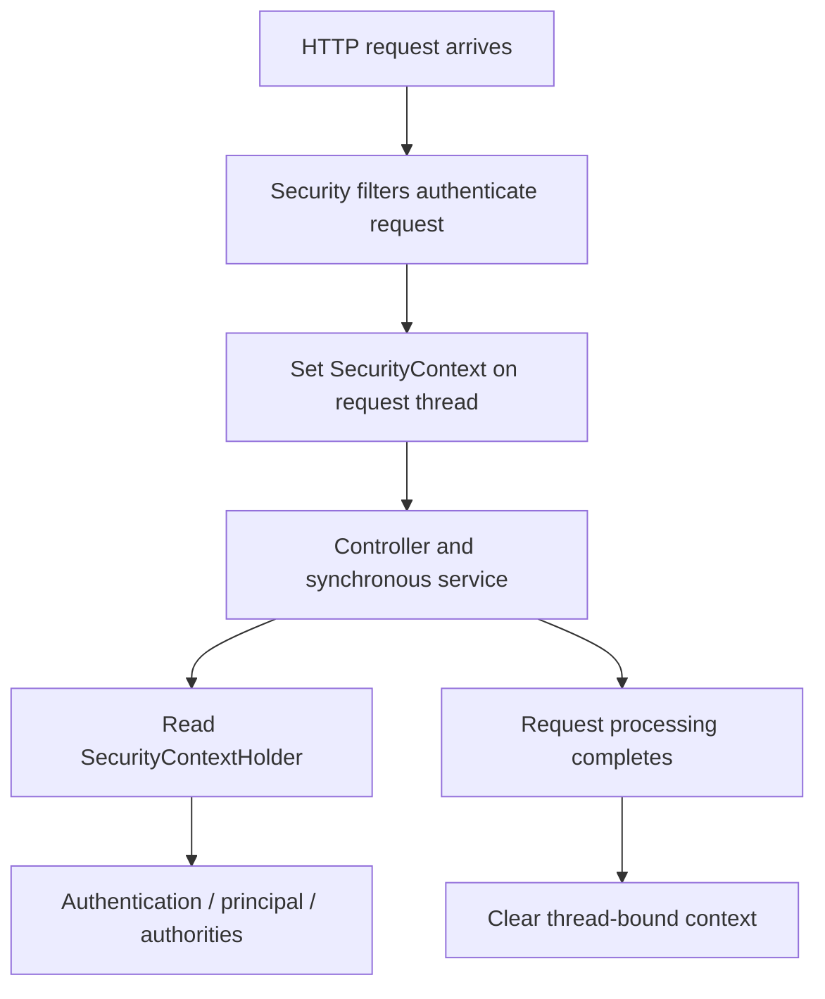
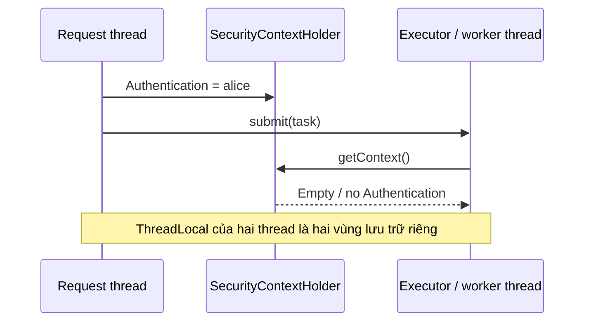

# ThreadLocal không tự truyền danh tính sang mọi luồng khác

Trong ứng dụng Spring Security Servlet, danh tính hiện tại thường được truy cập qua `SecurityContextHolder`. Mặc định, holder lưu `SecurityContext` trong `ThreadLocal` của thread đang xử lý request. Điều đó giúp controller và service đồng bộ cùng thread đọc được authentication hiện tại. Nhưng khi công việc chuyển sang thread khác — ví dụ `@Async`, `ExecutorService`, thread pool hoặc `CompletableFuture` — danh tính **không tự động đi theo**.

Nếu code nền đọc `SecurityContextHolder` mà không có cơ chế truyền context, nó có thể thấy context rỗng hoặc không có authentication. Nguy hiểm hơn, nếu tự đặt context trên thread dùng chung mà quên dọn dẹp, request tiếp theo có thể nhìn thấy danh tính của người dùng trước. Bài này giải thích vòng đời context, các cách truyền an toàn và cách kiểm thử để phát hiện lỗi.

Nội dung thuộc chương **Bất đồng bộ và ngữ cảnh** của mô-đun **SPRING_SECURITY_TESTING**. Mô-đun kiểm chứng xác thực, phân quyền và bảo vệ HTTP thực tế bằng `spring-security-test` trên ứng dụng Servlet và Reactive, sử dụng `MockMvc`, `WebTestClient`, `@WithMockUser`, `SecurityContext`, JWT/OAuth2/OIDC giả lập và các ca được phép hoặc bị từ chối.

## 1. Mục tiêu học tập

Sau bài này, người học có thể:

1. Giải thích `ThreadLocal` và lý do authentication không tự xuất hiện trên mọi thread.
2. Mô tả vòng đời `SecurityContextHolder` trong một request Servlet.
3. Phân biệt thread mới, thread pool, `@Async`, Servlet MVC async và Reactive pipeline.
4. Dùng `DelegatingSecurityContextRunnable`, `DelegatingSecurityContextExecutor` và `DelegatingSecurityContextAsyncTaskExecutor` để truyền context.
5. Nhận diện rủi ro của `MODE_INHERITABLETHREADLOCAL` và việc tự đặt context mà không dọn dẹp.
6. Hiểu vì sao WebFlux dùng Reactor Context và `ReactiveSecurityContextHolder` thay cho mô hình ThreadLocal truyền thống.
7. Viết test chứng minh authentication được truyền đúng vào công việc nền và không rò rỉ sang test/request khác.

## 2. ThreadLocal và SecurityContextHolder hoạt động thế nào?

`SecurityContextHolder` là điểm truy cập tới `SecurityContext` hiện tại. `SecurityContext` chứa `Authentication`, trong đó có principal, credentials và authorities. Mặc định, Spring Security sử dụng chiến lược `MODE_THREADLOCAL`.



Trong một request Servlet đồng bộ, các thành phần chạy trên cùng thread có thể đọc context hiện tại:

```java
Authentication authentication =
        SecurityContextHolder.getContext().getAuthentication();

String username = authentication.getName();
```

Điều này không có nghĩa context là biến toàn cục cho cả ứng dụng. Nó gắn với **thread hiện tại**. Thread khác có một vùng lưu trữ khác:

```java
SecurityContextHolder.getContext().getAuthentication();
```

Nếu đoạn trên chạy trên thread pool chưa được truyền context, authentication có thể là `null` hoặc context rỗng. Cách gọi `getContext()` có thể trả về một context rỗng được tạo theo chiến lược hiện tại; vì vậy không nên chỉ kiểm tra object context có tồn tại hay không, mà phải kiểm tra authentication có thực sự hiện diện.

### 2.1. Vòng đời context trong request

Security filter chain chịu trách nhiệm nạp và lưu context theo cơ chế cấu hình của ứng dụng. Với cấu hình hiện đại, `SecurityContextHolderFilter` đọc context từ `SecurityContextRepository` và đặt nó vào holder cho quá trình xử lý. Khi request hoàn tất, context gắn với thread được dọn dẹp.

Các điểm cần nhớ:

- Context của request không phải một biến static dùng chung cho tất cả người dùng.
- Mỗi request đã xác thực có authentication riêng theo cơ chế session/token của ứng dụng.
- Khi request kết thúc, Spring Security phải xóa context khỏi thread để thread có thể được tái sử dụng an toàn.
- Test trực tiếp gọi service mà không đi qua filter chain có thể phải thiết lập context riêng, chẳng hạn bằng `@WithMockUser` hoặc test helper thích hợp.

## 3. Vì sao chuyển thread làm mất danh tính?

`ThreadLocal` lưu dữ liệu theo thread. Khi code gọi một executor để gửi công việc sang thread khác, thread thực thi không tự đọc được ThreadLocal của thread gọi.



Các tình huống thường gặp:

| Cách chuyển công việc | Có tự mang SecurityContext theo không? | Cần làm gì? |
|---|---|---|
| Gọi method đồng bộ trên cùng thread | Có, vì vẫn là thread hiện tại | Không cần wrapper riêng |
| Tạo thread mới bằng `new Thread` | Không theo mặc định | Bọc Runnable/Callable hoặc dùng executor có context |
| `ExecutorService.submit` thông thường | Không | Dùng `DelegatingSecurityContextExecutorService` hoặc bọc task |
| `@Async` với executor thường | Không mặc định | Cấu hình `DelegatingSecurityContextAsyncTaskExecutor` |
| `CompletableFuture.supplyAsync` với common pool | Không | Truyền executor đã bọc hoặc bọc task |
| Spring MVC controller trả về `Callable` | Spring Security có tích hợp context cho luồng MVC Callable | Kiểm tra MVC/Security integration đang hoạt động |
| Ứng dụng tự submit task để hoàn tất `DeferredResult` | Không nên giả định tự truyền | Truyền context vào executor/task do ứng dụng quản lý |
| Reactor `publishOn`/`subscribeOn` | Reactor Context đi theo pipeline; ThreadLocal không tự đi theo | Dùng `ReactiveSecurityContextHolder` và Reactor Context |

Không thể kết luận chỉ dựa trên việc thread name thay đổi. Điều quan trọng là cơ chế lưu context của framework và việc task được submit qua executor nào.

## 4. Ví dụ lỗi: dùng executor thường rồi đọc ThreadLocal

Giả sử service chạy nền:

```java
public CompletableFuture<String> currentUsername() {
    return CompletableFuture.supplyAsync(() -> {
        Authentication authentication =
                SecurityContextHolder.getContext().getAuthentication();

        return authentication == null
                ? "anonymous"
                : authentication.getName();
    });
}
```

Trong test hoặc request thread, người dùng có thể đang là `alice`. Nhưng `supplyAsync` mặc định sử dụng common ForkJoinPool nếu không chỉ định executor. Worker thread không tự kế thừa ThreadLocal của request thread, nên task có thể trả về `anonymous`.

Không nên sửa bằng cách lưu username vào một biến static hoặc dùng một field singleton mutable để task đọc. Cách đó có thể trộn danh tính giữa các request đồng thời.

### 4.1. Thread pool làm lỗi khó phát hiện hơn

Thread pool tái sử dụng worker thread. Một worker có thể phục vụ nhiều task của nhiều người dùng khác nhau. Nếu task đầu đặt authentication vào ThreadLocal mà không xóa, task sau có thể đọc context cũ.

Ví dụ không an toàn:

```java
executor.execute(() -> {
    SecurityContextHolder.setContext(userContext);
    doWork();
    // Thiếu clearContext() trong finally.
});
```

Task kết thúc không có nghĩa ThreadLocal của worker tự mất. Thread pool giữ thread để tái sử dụng. Vì vậy, mọi code tự quản lý context phải có cleanup trong `finally`; ưu tiên dùng wrapper do Spring Security cung cấp để tránh tự viết cơ chế này.

## 5. Truyền context với DelegatingSecurityContextRunnable

`DelegatingSecurityContextRunnable` bọc một `Runnable` và thiết lập `SecurityContext` trước khi chạy task. Khi task kết thúc, wrapper dọn dẹp context theo cơ chế của Spring Security.

Ví dụ:

```java
import org.springframework.security.concurrent.DelegatingSecurityContextRunnable;
import org.springframework.security.core.Authentication;
import org.springframework.security.core.context.SecurityContext;
import org.springframework.security.core.context.SecurityContextHolder;

Runnable task = () -> {
    Authentication authentication =
            SecurityContextHolder.getContext().getAuthentication();

    generateReport(authentication.getName());
};

SecurityContext requestContext = SecurityContextHolder.getContext();
Runnable securedTask =
        new DelegatingSecurityContextRunnable(task, requestContext);

new Thread(securedTask).start();
```

Khi tạo wrapper trong lúc request/test thread đang có authentication, wrapper sử dụng context hiện tại để chạy task. Có thể truyền một context cụ thể khi ứng dụng cần xác định rõ danh tính của task:

```java
SecurityContext jobContext = SecurityContextHolder.createEmptyContext();
jobContext.setAuthentication(systemAuthentication);

Runnable securedTask =
        new DelegatingSecurityContextRunnable(task, jobContext);
```

Context tường minh nên được tạo theo mục đích công việc, có authority tối thiểu cần thiết. Đừng dùng authentication của một request làm danh tính hệ thống cho một tác vụ dài hạn hoặc chạy định kỳ nếu không có lý do nghiệp vụ rõ ràng.

## 6. Truyền context qua Executor và ExecutorService

Nếu nhiều task đều cần chạy với context của thread gửi task, có thể bọc executor thay vì tự bọc từng Runnable.

### 6.1. DelegatingSecurityContextExecutor

`DelegatingSecurityContextExecutor` bọc một `Executor`:

```java
import java.util.concurrent.Executor;
import java.util.concurrent.ExecutorService;
import java.util.concurrent.Executors;
import java.util.concurrent.Future;

import org.springframework.security.concurrent.DelegatingSecurityContextExecutor;
import org.springframework.security.concurrent.DelegatingSecurityContextExecutorService;
import org.springframework.security.core.Authentication;
import org.springframework.security.core.context.SecurityContextHolder;

Executor delegate = Executors.newFixedThreadPool(4);
Executor securityAwareExecutor =
        new DelegatingSecurityContextExecutor(delegate);

securityAwareExecutor.execute(() -> {
    Authentication authentication =
            SecurityContextHolder.getContext().getAuthentication();

    processFor(authentication.getName());
});
```

Khi gọi `execute` từ thread có context, task được thực thi với context được ủy quyền. Wrapper cũng đảm nhận việc dọn context sau khi task hoàn tất.

### 6.2. DelegatingSecurityContextExecutorService

Với API `ExecutorService` có `submit`, `invokeAll` hoặc `invokeAny`, dùng wrapper tương ứng:

```java
ExecutorService delegate = Executors.newFixedThreadPool(4);

ExecutorService securityAware =
        new DelegatingSecurityContextExecutorService(delegate);

Future<String> result = securityAware.submit(() ->
        SecurityContextHolder.getContext()
                .getAuthentication()
                .getName());
```

Hãy quản lý vòng đời executor như bình thường: shutdown khi ứng dụng dừng, không tạo pool mới cho mỗi request và đặt giới hạn tài nguyên phù hợp. Wrapper truyền security context; nó không thay thế việc quản lý queue, timeout, cancellation hoặc backpressure của hệ thống.

### 6.3. Truyền context tường minh cho tác vụ

Một số tác vụ không nên chạy với user hiện tại. Ví dụ một job định kỳ tổng hợp số liệu có thể cần service identity riêng. Khi đó, tạo context tường minh và dùng constructor nhận context của wrapper phù hợp:

```java
SecurityContext jobContext = SecurityContextHolder.createEmptyContext();
jobContext.setAuthentication(reportJobAuthentication);

Executor jobExecutor =
        new DelegatingSecurityContextExecutor(delegate, jobContext);
```

Đảm bảo context và authentication này không bị chia sẻ rồi sửa đổi đồng thời giữa các job. Nếu cần quyền của người gọi, dùng wrapper mặc định để truyền context lúc submit; nếu cần danh tính dịch vụ, dùng identity riêng được cấu hình có kiểm soát.

## 7. Tích hợp với @Async

`@Async` chạy method trên executor do Spring quản lý. Nếu executor là một `AsyncTaskExecutor` thông thường, ThreadLocal context của caller không tự xuất hiện trên worker. Có thể bọc delegate bằng `DelegatingSecurityContextAsyncTaskExecutor`.

### 7.1. Khai báo executor có security context

Ví dụ cấu hình:

```java
import org.springframework.beans.factory.annotation.Qualifier;
import org.springframework.context.annotation.Bean;
import org.springframework.context.annotation.Configuration;
import org.springframework.core.task.AsyncTaskExecutor;
import org.springframework.scheduling.annotation.EnableAsync;
import org.springframework.scheduling.concurrent.ThreadPoolTaskExecutor;
import org.springframework.security.task.DelegatingSecurityContextAsyncTaskExecutor;

@Configuration
@EnableAsync
class AsyncConfiguration {

    @Bean
    ThreadPoolTaskExecutor rawAsyncExecutor() {
        ThreadPoolTaskExecutor executor = new ThreadPoolTaskExecutor();
        executor.setCorePoolSize(2);
        executor.setMaxPoolSize(4);
        executor.setQueueCapacity(100);
        executor.setThreadNamePrefix("report-worker-");
        executor.setWaitForTasksToCompleteOnShutdown(true);
        return executor;
    }

    @Bean("securityAwareExecutor")
    AsyncTaskExecutor securityAwareExecutor(
            @Qualifier("rawAsyncExecutor") ThreadPoolTaskExecutor delegate) {
        return new DelegatingSecurityContextAsyncTaskExecutor(delegate);
    }
}
```

Spring quản lý bean `ThreadPoolTaskExecutor` và vòng đời khởi tạo/dừng của nó. Bean wrapper dùng delegate đó để thực thi task và truyền context.

### 7.2. Service chạy nền đọc username

```java
import java.util.concurrent.CompletableFuture;

import org.springframework.scheduling.annotation.Async;
import org.springframework.stereotype.Service;
import org.springframework.security.core.context.SecurityContextHolder;

@Service
class AsyncReportService {

    @Async("securityAwareExecutor")
    public CompletableFuture<String> currentUsername() {
        String username = SecurityContextHolder.getContext()
                .getAuthentication()
                .getName();

        return CompletableFuture.completedFuture(username);
    }
}
```

Khi method được gọi qua Spring proxy từ thread có authentication, executor wrapper truyền context vào worker. Không gọi method async bằng self-invocation trong cùng bean, vì lời gọi nội bộ không đi qua proxy `@Async`.

### 7.3. Test với @WithMockUser

```java
import java.util.concurrent.TimeUnit;

import org.junit.jupiter.api.Test;
import org.springframework.beans.factory.annotation.Autowired;
import org.springframework.boot.test.context.SpringBootTest;
import org.springframework.security.test.context.support.WithMockUser;

import static org.junit.jupiter.api.Assertions.assertEquals;

@SpringBootTest
class AsyncReportServiceTest {

    @Autowired
    AsyncReportService reportService;

    @Test
    @WithMockUser(username = "linh")
    void asyncTaskSeesCallingUser() throws Exception {
        String username = reportService.currentUsername()
                .get(2, TimeUnit.SECONDS);

        assertEquals("linh", username);
    }
}
```

Test phải chạy với cấu hình `@EnableAsync` và bean executor đã bọc. `@WithMockUser` đặt authentication trên thread test; khi method async submit công việc, wrapper truyền context sang worker. `get(timeout)` đợi task hoàn tất để test không kết thúc trước khi worker còn đang chạy.

Không dùng `Thread.sleep` để chờ task. Dùng `Future.get(timeout)`, `CompletableFuture.join` có timeout thích hợp hoặc cơ chế đồng bộ hóa rõ ràng để test ổn định.

## 8. CompletableFuture: truyền executor đúng cách

`CompletableFuture` cho phép truyền executor vào các phương thức async. Dùng executor đã bọc:

```java
CompletableFuture<String> result =
        CompletableFuture.supplyAsync(
                () -> SecurityContextHolder.getContext()
                        .getAuthentication().getName(),
                securityAwareExecutor);
```

Nếu không truyền executor, `supplyAsync` dùng common pool; context không tự được chuyển. Cũng cần chú ý các stage tiếp theo:

```java
CompletableFuture<String> result =
        CompletableFuture.supplyAsync(this::loadReport, securityAwareExecutor)
                .thenApplyAsync(this::authorizeAndFormat, securityAwareExecutor);
```

Một stage chạy async trên executor khác có thể lại mất context. Khi chuỗi có nhiều `thenApplyAsync`, `thenComposeAsync` hoặc callback tự submit task, kiểm tra **từng ranh giới chuyển executor**. Không giả định stage đầu được bọc thì mọi executor ở các stage sau đều tự được bọc.

Nếu callback không async như `thenApply` được thực thi trên thread hoàn thành stage trước hoặc thread đăng ký callback tùy trạng thái, không nên dựa vào thread cụ thể. Nếu callback cần security context, hãy thiết kế rõ executor/context thay vì phụ thuộc vào timing.

## 9. Spring MVC async: Callable và DeferredResult

Spring MVC hỗ trợ controller trả về `Callable<T>` hoặc `DeferredResult<T>` để xử lý request bất đồng bộ. Cần phân biệt hai trường hợp.

### 9.1. Callable do Spring MVC thực thi

Spring Security tích hợp với cơ chế async của Spring MVC. Với controller trả về `Callable`, `WebAsyncManagerIntegrationFilter` đăng ký xử lý để SecurityContext của request được truyền vào Callable do Spring MVC thực thi.

Ví dụ:

```java
import java.util.concurrent.Callable;

import org.springframework.security.core.context.SecurityContextHolder;

@GetMapping("/api/current-user")
Callable<String> currentUser() {
    return () -> SecurityContextHolder.getContext()
            .getAuthentication()
            .getName();
}
```

Khi filter chain và MVC async integration được cấu hình đúng, Callable có thể đọc authentication của request. Test nên dùng MockMvc async lifecycle để xác nhận response cuối cùng, không chỉ kiểm tra request đã bắt đầu async.

```java
import static org.springframework.security.test.web.servlet.request.SecurityMockMvcRequestPostProcessors.user;
import static org.springframework.test.web.servlet.request.MockMvcRequestBuilders.asyncDispatch;
import static org.springframework.test.web.servlet.request.MockMvcRequestBuilders.get;
import static org.springframework.test.web.servlet.result.MockMvcResultMatchers.content;
import static org.springframework.test.web.servlet.result.MockMvcResultMatchers.request;
import static org.springframework.test.web.servlet.result.MockMvcResultMatchers.status;

MvcResult pending = mvc.perform(get("/api/current-user")
        .with(user("linh")))
    .andExpect(request().asyncStarted())
    .andReturn();

mvc.perform(asyncDispatch(pending))
    .andExpect(status().isOk())
    .andExpect(content().string("linh"));
```

Ví dụ cần import static các request builder/result matcher tương ứng và controller được đăng ký trong context.

### 9.2. DeferredResult và task do ứng dụng tự quản lý

Với `DeferredResult`, ứng dụng thường tự gửi công việc sang executor rồi gọi `setResult` khi hoàn tất. Không nên mặc định rằng mọi task do ứng dụng tự submit đều được MVC tự bọc context.

Nếu worker cần danh tính hiện tại, truyền context qua `DelegatingSecurityContextExecutor` hoặc wrapper phù hợp:

```java
import java.util.concurrent.Executor;

import org.springframework.beans.factory.annotation.Qualifier;
import org.springframework.security.core.context.SecurityContextHolder;
import org.springframework.web.context.request.async.DeferredResult;

@GetMapping("/api/report-status")
DeferredResult<String> reportStatus(
        @Qualifier("securityAwareExecutor") Executor securityAwareExecutor) {
    DeferredResult<String> result = new DeferredResult<>();

    securityAwareExecutor.execute(() -> {
        String username = SecurityContextHolder.getContext()
                .getAuthentication().getName();
        result.setResult("ready for " + username);
    });

    return result;
}
```

Ví dụ minh họa; trong ứng dụng thực tế, inject executor qua constructor/service thay vì nhận trực tiếp tùy tiện ở controller. Nếu công việc không cần quyền người gọi, truyền một context dịch vụ riêng hoặc bỏ phụ thuộc vào SecurityContext.

## 10. MODE_INHERITABLETHREADLOCAL không phải giải pháp chung

Spring Security có chiến lược `MODE_INHERITABLETHREADLOCAL` để thread con kế thừa giá trị từ thread cha khi thread con được tạo. Điều đó có thể hữu ích trong một số tình huống thread con được tạo ngay trong phạm vi request và không tái sử dụng.

Nhưng với thread pool, worker thường được tạo trước khi request gửi task. Worker không được tạo mới cho từng request, nên không thể trông đợi nó kế thừa context đúng thời điểm submit. Nếu thread được tạo khi một user đang đăng nhập, nó còn có nguy cơ giữ context cũ lâu hơn dự kiến.

| Chiến lược | Hành vi | Lưu ý |
|---|---|---|
| `MODE_THREADLOCAL` | Context gắn với thread hiện tại | Mặc định, phù hợp với request Servlet đồng bộ |
| `MODE_INHERITABLETHREADLOCAL` | Thread con kế thừa giá trị tại thời điểm thread được tạo | Không giải quyết tổng quát cho thread pool/tái sử dụng worker |
| `MODE_GLOBAL` | Một context dùng chung toàn JVM | Không phù hợp ứng dụng server nhiều người dùng |

Không chuyển sang `MODE_INHERITABLETHREADLOCAL` chỉ để làm test async xanh. Hãy dùng wrapper executor, vì nó truyền context ở ranh giới submit và quản lý cleanup rõ ràng.

## 11. Dọn dẹp context và tránh rò rỉ giữa người dùng

Khi tự thiết lập context, luôn bảo đảm cleanup:

```java
SecurityContext previous = SecurityContextHolder.getContext();

try {
    SecurityContextHolder.setContext(jobContext);
    doSensitiveWork();
}
finally {
    SecurityContextHolder.setContext(previous);
}
```

Trong code quản lý request/thread riêng, có thể cần `clearContext()` thay cho restore nếu thread phải trở về trạng thái rỗng. Hãy chọn theo lifecycle của thread và framework đang quản lý nó. Với task chạy trên thread pool, wrapper Spring Security là lựa chọn an toàn hơn việc tự viết save/restore.

Các nguyên tắc:

- Không lưu authentication của request vào static field hoặc singleton mutable.
- Không chia sẻ một `SecurityContext` mutable cho nhiều task đồng thời nếu các task có thể thay đổi authentication.
- Không bỏ qua cleanup khi task ném exception hoặc bị cancel.
- Đảm bảo task nền hoàn tất hoặc được quản lý lifecycle rõ ràng trước khi request/test kết thúc nếu task phụ thuộc vào context request.
- Không giữ request authentication vô thời hạn cho scheduled job hoặc message consumer.

`SecurityContextHolder.clearContext()` chỉ xóa context khỏi thread hiện tại; nó không tự hủy context đã được truyền vào một task khác. Mỗi ranh giới bất đồng bộ cần lifecycle và chính sách quyền riêng.

## 12. Reactive: SecurityContext nằm trong Reactor Context

WebFlux không dựa vào ThreadLocal như mô hình Servlet truyền thống. Spring Security Reactive lưu authentication trong **Reactor Context** để context đi cùng subscription/pipeline, kể cả khi operator chuyển thread qua `publishOn` hoặc `subscribeOn`.

Truy cập context bằng `ReactiveSecurityContextHolder`:

```java
Mono<String> currentUsername =
        ReactiveSecurityContextHolder.getContext()
                .map(context -> context.getAuthentication().getName());
```

Có thể thiết lập context trong một pipeline:

```java
Mono<String> currentUsername =
        ReactiveSecurityContextHolder.getContext()
                .map(context -> context.getAuthentication().getName())
                .contextWrite(ReactiveSecurityContextHolder.withAuthentication(authentication));
```

Reactor Context là context gắn với subscription, không phải ThreadLocal. Vì vậy:

- Đổi thread bằng `publishOn` không tự làm mất Reactor Context.
- Không đọc `SecurityContextHolder` trong reactive operator rồi kỳ vọng nó có user hiện tại.
- Dùng `ReactiveSecurityContextHolder` hoặc API security reactive thích hợp.
- Không dùng `DelegatingSecurityContextExecutor` để thay thế cơ chế Reactor Context trong một pipeline Reactive thuần.

### 12.1. Kiểm tra Reactor Context bằng StepVerifier

```java
import java.util.List;

import org.junit.jupiter.api.Test;
import org.springframework.security.authentication.UsernamePasswordAuthenticationToken;
import org.springframework.security.core.Authentication;
import org.springframework.security.core.authority.SimpleGrantedAuthority;
import org.springframework.security.core.context.ReactiveSecurityContextHolder;
import reactor.core.publisher.Mono;
import reactor.test.StepVerifier;

@Test
void readsUserFromReactorContext() {
    Authentication authentication =
            new UsernamePasswordAuthenticationToken(
                    "linh", "n/a",
                    List.of(new SimpleGrantedAuthority("ROLE_USER")));

    Mono<String> username =
            ReactiveSecurityContextHolder.getContext()
                    .map(context -> context.getAuthentication().getName());

    StepVerifier.create(username.contextWrite(
                    ReactiveSecurityContextHolder.withAuthentication(authentication)))
            .expectNext("linh")
            .verifyComplete();
}
```

Đây là test publisher-level. Nó xác nhận pipeline đọc được context đã gắn, nhưng không chạy HTTP Security WebFilter chain. Muốn kiểm tra request WebFlux thực tế, dùng `WebTestClient` và `spring-security-test`.

### 12.2. Kiểm thử HTTP Reactive với WebTestClient

```java
import static org.springframework.security.test.web.reactive.server.SecurityMockServerConfigurers.mockUser;

client.mutateWith(mockUser("linh").roles("USER"))
        .get().uri("/api/profile")
        .exchange()
        .expectStatus().isOk();
```

`mockUser` gắn danh tính vào Reactive exchange qua test support của Spring Security. Nếu endpoint cần JWT scope, dùng `mockJwt` với authority tương ứng. Đây là giả lập authentication để kiểm tra authorization, không xác minh chữ ký hoặc issuer của token thật.

### 12.3. Khi cần bridge ThreadLocal với Reactor

Một số thư viện cũ chỉ đọc MDC hoặc ThreadLocal. Reactor và hệ sinh thái Micrometer có cơ chế context propagation để bridge một số giá trị giữa Reactor Context và ThreadLocal **khi ứng dụng cấu hình rõ ràng**. Cơ chế này không có nghĩa ThreadLocal mặc định tự đi theo mọi operator.

Nếu cần tích hợp, hãy đăng ký accessor và bật chế độ propagation theo hướng dẫn của phiên bản Reactor/Micrometer/Spring đang dùng. Với Spring Security WebFlux, vẫn ưu tiên API Reactive SecurityContext; đừng lấy ThreadLocal bridge làm mô hình lưu authentication chính.

## 13. Kiểm thử async: các tình huống nên có

Một bộ test async đáng tin cậy nên kiểm tra ít nhất:

| Ca kiểm thử | Mục tiêu |
|---|---|
| User đã xác thực submit task qua executor được bọc | Worker nhìn thấy đúng principal |
| Task chạy bằng executor thường | Không giả định authentication tự truyền |
| Task ném exception | Wrapper vẫn dọn context sau khi hoàn tất |
| Hai user submit task liên tiếp trên pool dùng chung | Không có context user trước rò sang task sau |
| Task chạy sau khi test kết thúc | Không phụ thuộc context ThreadLocal đã bị test listener clear |
| Reactive pipeline đổi scheduler | Authentication vẫn có trong Reactor Context |
| HTTP Reactive request | SecurityWebFilterChain và authorization được thực thi |

### 13.1. Test không rò rỉ context giữa các task

Có thể viết một test integration dùng executor một thread để hai task buộc tái sử dụng cùng worker. Task đầu chạy với user A; task sau được submit không có context. Kết quả mong đợi của task sau là không có authentication, chứng minh wrapper đã cleanup.

Ví dụ ý tưởng:

```java
import java.util.List;
import java.util.concurrent.Callable;
import java.util.concurrent.ExecutorService;
import java.util.concurrent.Executors;
import java.util.concurrent.Future;
import java.util.concurrent.TimeUnit;

import org.junit.jupiter.api.Test;
import org.springframework.security.authentication.UsernamePasswordAuthenticationToken;
import org.springframework.security.concurrent.DelegatingSecurityContextExecutorService;
import org.springframework.security.core.Authentication;
import org.springframework.security.core.authority.SimpleGrantedAuthority;
import org.springframework.security.core.context.SecurityContext;
import org.springframework.security.core.context.SecurityContextHolder;

import static org.junit.jupiter.api.Assertions.assertEquals;
import static org.junit.jupiter.api.Assertions.assertNull;

ExecutorService delegate = Executors.newSingleThreadExecutor();
ExecutorService secured =
        new DelegatingSecurityContextExecutorService(delegate);

Callable<String> currentUsername = () -> {
    Authentication authentication =
            SecurityContextHolder.getContext().getAuthentication();
    return authentication == null ? null : authentication.getName();
};

SecurityContext firstContext = SecurityContextHolder.createEmptyContext();
firstContext.setAuthentication(new UsernamePasswordAuthenticationToken(
        "alice", "n/a", List.of(new SimpleGrantedAuthority("ROLE_USER"))));

try {
    SecurityContextHolder.setContext(firstContext);
    Future<String> first = secured.submit(currentUsername);
    assertEquals("alice", first.get(2, TimeUnit.SECONDS));

    SecurityContextHolder.clearContext();
    Future<String> second = secured.submit(currentUsername);
    assertNull(second.get(2, TimeUnit.SECONDS));
}
finally {
    SecurityContextHolder.clearContext();
    secured.shutdownNow();
}
```

Đây là ví dụ khái niệm; trong test thực tế cần tạo authentication hợp lệ, bảo đảm context của caller được thiết lập trước lần submit đầu và dùng cleanup trong `finally`. Với executor wrapper mặc định, lần submit thứ hai từ thread không có authentication không được kế thừa danh tính của task trước.

### 13.2. Không để test kết thúc khi worker còn chạy

`@WithMockUser` được thiết lập và dọn dẹp theo vòng đời test. Nếu test gửi task rồi kết thúc ngay, listener có thể xóa context trên test thread trong khi worker vẫn chạy. Wrapper phải đã chụp/truyền context lúc submit; test vẫn nên chờ task hoàn tất để tránh race, resource leak và kết quả khó dự đoán.

Dùng future có timeout hoặc latch; tránh `Thread.sleep`. Khi timeout xảy ra, cancel task và dọn executor trong `finally`.

## 14. Lỗi thường gặp và cách chẩn đoán

| Triệu chứng | Nguyên nhân có thể | Cách xử lý |
|---|---|---|
| Controller thấy user nhưng `@Async` không thấy | Executor chưa được bọc | Dùng `DelegatingSecurityContextAsyncTaskExecutor` |
| `CompletableFuture` trả về anonymous | `supplyAsync` dùng common pool | Truyền executor có context hoặc bọc task |
| Task thứ hai thấy user của task trước | Tự set ThreadLocal nhưng không cleanup | Dùng delegating wrapper; kiểm tra `finally` |
| Chuyển sang `MODE_INHERITABLETHREADLOCAL` vẫn lỗi với pool | Worker đã được tạo trước request hoặc được tái sử dụng | Truyền context tại thời điểm submit |
| `@WithMockUser` không hiệu lực trên worker | Annotation thiết lập context trên test thread | Submit qua executor được bọc |
| Test async lúc xanh lúc đỏ | Không chờ future, task chạy sau cleanup hoặc race | Dùng `get(timeout)`/latch và quản lý task |
| MVC Callable không thấy context | MVC/Security async integration không tham gia hoặc test không đi qua filter chain | Kiểm tra `WebAsyncManagerIntegrationFilter`, filter chain và MockMvc setup |
| DeferredResult worker thiếu authentication | Task do ứng dụng tự submit chưa được bọc | Dùng delegating executor hoặc context tường minh |
| WebFlux không thấy authentication qua SecurityContextHolder | Dùng nhầm ThreadLocal API | Dùng `ReactiveSecurityContextHolder` |
| Reactor pipeline đổi thread nhưng vẫn giữ context | Đây là hành vi mong đợi của Reactor Context | Tiếp tục dùng reactive APIs, không ép ThreadLocal |
| Authentication bị rò qua scheduled job | Tái sử dụng request context ngoài lifecycle | Dùng service identity riêng hoặc không truyền user context |

## 15. Bài tập thực hành

Một ứng dụng quản lý báo cáo có:

- Endpoint Servlet `POST /api/reports/export` yêu cầu `ROLE_ANALYST`.
- Controller gửi công việc xuất báo cáo qua `@Async`.
- Worker cần ghi nhận username của người yêu cầu vào audit log.
- Một dịch vụ WebFlux khác phát dữ liệu báo cáo bằng `Flux<Report>` và dùng scope `SCOPE_reports.read`.

Thực hiện:

1. Viết test đồng bộ dùng `@WithMockUser(roles = "ANALYST")` và chứng minh controller đọc được authentication.
2. Cấu hình `DelegatingSecurityContextAsyncTaskExecutor` cho executor chạy export.
3. Viết test `@Async` chờ `CompletableFuture` hoàn tất và xác minh worker nhận đúng username.
4. Tạo một executor thường và quan sát rằng không có bảo đảm context tự truyền.
5. Dùng executor một thread để kiểm tra user A không rò sang task tiếp theo của user B hoặc task anonymous.
6. Viết một endpoint MVC trả `Callable` và kiểm tra async dispatch qua MockMvc.
7. Viết một test WebFlux dùng `StepVerifier` để đọc user từ `ReactiveSecurityContextHolder`.
8. Dùng `WebTestClient` + `mockJwt()` để xác minh scope đúng được phép, scope thiếu bị từ chối.
9. Nêu rõ vì sao `MODE_INHERITABLETHREADLOCAL` không thay thế được executor wrapper trong thread pool.

**Tiêu chí hoàn thành:** người học chứng minh được context được truyền tại ranh giới bất đồng bộ, cleanup không làm rò danh tính, test chờ task đúng cách và phân biệt ThreadLocal của Servlet với Reactor Context của WebFlux.

## 16. Tài liệu tham khảo chính thức

- [Spring Security — Concurrency Support](https://docs.spring.io/spring-security/reference/servlet/integrations/concurrency.html): `DelegatingSecurityContextRunnable`, `DelegatingSecurityContextExecutor` và các wrapper executor.
- [Spring Security API — DelegatingSecurityContextAsyncTaskExecutor](https://docs.spring.io/spring-security/site/docs/current/api/org/springframework/security/task/DelegatingSecurityContextAsyncTaskExecutor.html): tích hợp với Spring `AsyncTaskExecutor`.
- [Spring Security — Servlet Integrations](https://docs.spring.io/spring-security/reference/servlet/integrations/index.html): tích hợp Servlet và Spring MVC.
- [Spring Security API — WebAsyncManagerIntegrationFilter](https://docs.spring.io/spring-security/site/docs/current/api/org/springframework/security/web/context/request/async/WebAsyncManagerIntegrationFilter.html): tích hợp SecurityContext với Spring MVC async.
- [Spring Security — Reactive Security Context](https://docs.spring.io/spring-security/reference/reactive/authorization/method.html): context trong reactive pipeline.
- [Spring Security — Reactive Testing](https://docs.spring.io/spring-security/reference/reactive/test/index.html): WebTestClient và security mutators.
- [Project Reactor — Context](https://projectreactor.io/docs/core/release/reference/advancedFeatures/context.html): context gắn với subscription.
- [Spring Framework — Task Execution and Scheduling](https://docs.spring.io/spring-framework/reference/integration/scheduling.html): executor, task execution và scheduling.

> **Ghi nhớ:** ThreadLocal gắn với thread, không gắn với người dùng trên toàn ứng dụng. Khi task đổi thread, hãy truyền SecurityContext bằng wrapper phù hợp và để wrapper quản lý cleanup. Với WebFlux, dùng Reactor Context và ReactiveSecurityContextHolder thay vì mong đợi ThreadLocal tự lan truyền.
