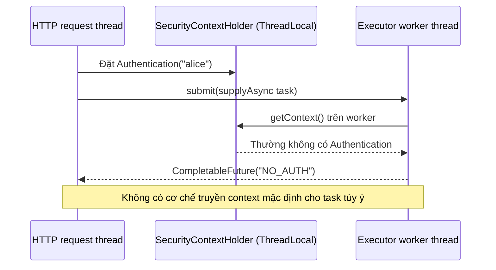

# Executor, CompletableFuture và phạm vi cần kiểm tra riêng

Một request Servlet có thể được xác thực chính xác bằng Spring Security, nhưng khi controller hoặc service chuyển công việc sang `Executor`, `@Async` hay `CompletableFuture`, đoạn mã chạy nền lại không nhìn thấy người dùng hiện tại. Nguy hiểm hơn, nếu một worker thread còn sót `SecurityContext` của công việc trước, nó có thể xử lý thao tác dưới danh tính sai.

Vấn đề không phải Spring Security “quên xác thực” request. Đó là **ranh giới thực thi bất đồng bộ**: `SecurityContextHolder` mặc định liên kết ngữ cảnh với thread đang chạy; một task được thực thi bởi thread khác không tự kế thừa ngữ cảnh ấy.

Bài học thuộc chương **Bất đồng bộ và ngữ cảnh** của module **`SPRING_SECURITY_TESTING`**. Trong module này, người học kiểm chứng xác thực, phân quyền và bảo vệ HTTP thực tế bằng `spring-security-test` trên Servlet và Reactive, sử dụng MockMvc, WebTestClient, `@WithMockUser`, `SecurityContext`, JWT/OAuth2/OIDC giả lập và các ca được phép/bị từ chối. Phạm vi bài này tập trung vào **Servlet + executor-based concurrency**, giải thích những trường hợp Spring MVC hỗ trợ truyền context sẵn và những trường hợp phải kiểm thử riêng; cuối bài đối chiếu với **Reactor Context** của WebFlux.

Sau khi hoàn thành, bạn có thể:

- Giải thích phạm vi của `SecurityContextHolder` theo thread và vì sao `CompletableFuture.supplyAsync(...)` thường không nhìn thấy Authentication của request.
- Sử dụng `DelegatingSecurityContextExecutor`, `DelegatingSecurityContextExecutorService` và `DelegatingSecurityContextAsyncTaskExecutor` đúng mục đích.
- Tạo test độc lập xác nhận task **được truyền đúng danh tính** và **không rò danh tính** qua lần sử dụng lại thread.
- Phân biệt Spring MVC `Callable` (có hỗ trợ tích hợp context theo cơ chế chuẩn) với task tự chạy, `DeferredResult` và `CompletableFuture`.
- Dùng `MockMvc`, `asyncDispatch`, `@WithMockUser` và assertion với thời hạn chờ hợp lý; kiểm tra cả body lẫn HTTP status/authorities.
- Nhận ra những giới hạn: context propagation không tự cấp quyền cho task, không phải session persistence, không thay thế phân quyền ở tầng service, và không áp dụng máy móc cho WebFlux.

## 1. Vì sao thay thread làm thay đổi SecurityContext?

Trong ứng dụng Servlet mặc định, `SecurityContextHolder` sử dụng chiến lược `MODE_THREADLOCAL`. Sau khi filter chain xử lý request, một `Authentication` đã xác thực thường có thể được đọc qua:

```java
Authentication auth =
        SecurityContextHolder.getContext().getAuthentication();

String name = auth == null ? "NO_AUTH" : auth.getName();
```

Nhưng khi service dùng:

```java
CompletableFuture<String> future =
        CompletableFuture.supplyAsync(() -> {
            Authentication auth =
                    SecurityContextHolder.getContext()
                            .getAuthentication();
            return auth == null ? "NO_AUTH" : auth.getName();
        });
```

`supplyAsync(...)` **không truyền executor** thường chạy trên `ForkJoinPool.commonPool()`; đó không phải request thread. Vì vậy kết quả thường là `NO_AUTH` ngay cả khi caller đang có `Authentication` “alice”. Một `CompletableFuture` hoàn thành thành công chỉ cho biết task hoàn thành, **không chứng minh task có security context đúng**.



### Ba phạm vi cần phân biệt

| Phạm vi | Context xuất phát từ đâu? | Có tự đi sang thread/publisher khác không? |
| --- | --- | --- |
| Servlet request đã qua Spring Security | Filter chain nạp Authentication vào `SecurityContextHolder` | Không tự đi vào một `Executor` bất kỳ |
| Task trong thread pool | Context riêng của worker thread | Phải có cơ chế truyền context rõ ràng; worker còn phải được dọn context |
| Reactive `Mono`/`Flux` của WebFlux | `ReactiveSecurityContextHolder` dựa trên **Reactor Context** | Có ngữ nghĩa theo subscription; không tương đương `ThreadLocal` |

**Không dùng `SecurityContextHolder.MODE_INHERITABLETHREADLOCAL` như giải pháp mặc định cho thread pool.** InheritableThreadLocal chỉ hỗ trợ cơ chế kế thừa khi tạo **thread mới**; pool thường tái sử dụng thread đã có, nên danh tính có thể không được truyền, bị cũ hoặc sai phạm vi. `MODE_GLOBAL` càng không phù hợp cho ứng dụng nhiều người dùng vì có thể trộn danh tính giữa các request.

## 2. Spring Security cung cấp cơ chế truyền context gì?

Spring Security có nhóm wrapper `DelegatingSecurityContext...`. Chúng thiết lập `SecurityContext` cần thiết trên worker ngay trước khi chạy task, sau đó khôi phục/xóa context thích hợp trong `finally`. Nhờ vậy task có thể nhìn thấy Authentication đúng và tránh để lại context cho công việc sau.

| API | Khi nào nên dùng? | Ý nghĩa |
| --- | --- | --- |
| `DelegatingSecurityContextRunnable` | Bao riêng một `Runnable` | Chạy runnable dưới context được chọn |
| `DelegatingSecurityContextCallable<V>` | Bao riêng một `Callable<V>` | Chạy callable dưới context được chọn |
| `DelegatingSecurityContextExecutor` | Code chỉ cần interface `Executor` | Wrapper cho `execute(Runnable)`; hữu ích với `CompletableFuture.supplyAsync(..., executor)` |
| `DelegatingSecurityContextExecutorService` | Code cần `submit`, `invokeAll` hoặc lifecycle của `ExecutorService` | Bao các task của `ExecutorService` |
| `DelegatingSecurityContextAsyncTaskExecutor` | Spring `@Async` dùng `AsyncTaskExecutor` | Bao task được submit qua Spring Task executor |

Hai cách chọn context:

```java
Executor rawExecutor = Executors.newFixedThreadPool(2);

// 1. Chọn SecurityContext của thread GỬI TASK tại mỗi lượt execute.
Executor currentCallerExecutor =
        new DelegatingSecurityContextExecutor(rawExecutor);

// 2. Chọn một SecurityContext CỤ THỂ có chủ đích.
SecurityContext fixed = SecurityContextHolder.createEmptyContext();
fixed.setAuthentication(serviceAuthentication);
Executor fixedIdentityExecutor =
        new DelegatingSecurityContextExecutor(rawExecutor, fixed);
```

Ở biến thể **không truyền context cố định**, wrapper lấy context của caller khi task được gửi để thực thi. Nó phù hợp với task phục vụ request hiện tại. Ở biến thể **truyền context cố định**, tất cả task qua wrapper đó chạy dưới danh tính được cung cấp: hữu ích cho một tác vụ hệ thống có danh tính kỹ thuật riêng nhưng **nguy hiểm nếu vô tình dùng context của Alice làm singleton** cho mọi request sau đó.

Lưu ý về object: context được chọn có thể chứa tham chiếu tới `Authentication` và các đối tượng mutable; wrapper không phải cơ chế deep-copy hay serialization. Không thay đổi `SecurityContext.setAuthentication(...)` của một context đang được dùng bởi task khác và không giữ context request sống lâu ngoài ý định. Nếu cần ảnh chụp ngữ cảnh, tạo `SecurityContextHolder.createEmptyContext()` riêng và đặt `Authentication` phù hợp; đánh giá thêm tính mutable của chính Authentication.

**Propagation không đồng nghĩa authorization:** khi worker thấy “alice”, điều đó không tự bảo đảm Alice được phép thực hiện công việc. Dịch vụ vẫn cần kiểm tra quyền với dữ liệu, ví dụ `hasAuthority("REPORT_EXPORT")` hay chính sách tenant, trước khi thực hiện side effect.

## 3. Ví dụ ứng dụng: CompletableFuture qua Executor có bảo vệ context

Ví dụ dưới đây dùng Java 17+, Spring Boot 3.x, Spring Security 6.x và các dependency:

```text
implementation:
  spring-boot-starter-web
  spring-boot-starter-security

testImplementation:
  spring-boot-starter-test
  spring-security-test
```

Các lớp `@Configuration`, `@Service` và `@RestController` đặt trong package được Spring Boot scan. Mỗi public class đặt ở file Java tương ứng. Đây là ví dụ **Servlet**; cấu hình `SecurityFilterChain` cho API có thể như sau:

```java
import org.springframework.context.annotation.Bean;
import org.springframework.context.annotation.Configuration;
import org.springframework.security.config.Customizer;
import org.springframework.security.config.annotation.web.builders.HttpSecurity;
import org.springframework.security.web.SecurityFilterChain;

@Configuration
class ServletSecurityConfig {
    @Bean
    SecurityFilterChain filterChain(HttpSecurity http) throws Exception {
        return http
                .authorizeHttpRequests(auth -> auth
                        .requestMatchers("/api/**").authenticated()
                        .anyRequest().permitAll())
                .httpBasic(Customizer.withDefaults())
                .build();
    }
}
```

### Tạo pool và wrapper thành hai bean

```java
import java.util.concurrent.Executor;
import java.util.concurrent.ExecutorService;
import java.util.concurrent.Executors;
import org.springframework.beans.factory.annotation.Qualifier;
import org.springframework.context.annotation.Bean;
import org.springframework.context.annotation.Configuration;
import org.springframework.security.concurrent
        .DelegatingSecurityContextExecutor;

@Configuration
class AuditExecutorConfig {

    @Bean(value = "auditPool", destroyMethod = "shutdown")
    ExecutorService auditPool() {
        return Executors.newFixedThreadPool(2);
    }

    @Bean("securedAuditExecutor")
    Executor securedAuditExecutor(
            @Qualifier("auditPool") ExecutorService pool) {
        // Context được chọn từ caller tại lúc execute().
        return new DelegatingSecurityContextExecutor(pool);
    }
}
```

Bean `auditPool` được Spring quản lý lifecycle; khi context đóng, `shutdown()` được gọi. Trong hệ thống thật, dùng pool có giới hạn thread/queue, timeout, shutdown policy và monitoring phù hợp. Pool không được tạo mới cho từng HTTP request.

### Service đọc context ở bên trong task

```java
import java.util.List;
import java.util.concurrent.CompletableFuture;
import java.util.concurrent.Executor;
import org.springframework.beans.factory.annotation.Qualifier;
import org.springframework.security.core.Authentication;
import org.springframework.security.core.GrantedAuthority;
import org.springframework.security.core.context.SecurityContextHolder;
import org.springframework.stereotype.Service;

@Service
class AsyncAuditService {

    private final Executor executor;

    AsyncAuditService(
            @Qualifier("securedAuditExecutor") Executor executor) {
        this.executor = executor;
    }

    record ActorView(String username, List<String> authorities) {}

    CompletableFuture<ActorView> actorSeenByWorker() {
        return CompletableFuture.supplyAsync(() -> {
            Authentication auth =
                    SecurityContextHolder.getContext()
                            .getAuthentication();

            if (auth == null) {
                return new ActorView("NO_AUTH", List.of());
            }

            return new ActorView(
                    auth.getName(),
                    auth.getAuthorities().stream()
                            .map(GrantedAuthority::getAuthority)
                            .sorted()
                            .toList());
        }, executor);
    }
}
```

### Controller trả CompletableFuture để Spring MVC hoàn thành async request

```java
import java.util.concurrent.CompletableFuture;
import org.springframework.web.bind.annotation.GetMapping;
import org.springframework.web.bind.annotation.RestController;

@RestController
class AsyncAuditController {

    private final AsyncAuditService audit;

    AsyncAuditController(AsyncAuditService audit) {
        this.audit = audit;
    }

    @GetMapping("/api/worker-identity")
    CompletableFuture<AsyncAuditService.ActorView> identity() {
        return audit.actorSeenByWorker();
    }
}
```

Servlet controller trả `CompletableFuture` mà không `join()` hay `get()` trên request thread. Spring MVC xử lý completion theo cơ chế async của framework. Còn **context trong chính task** được truyền bởi `DelegatingSecurityContextExecutor`, không phải vì Spring MVC thấy kiểu trả về `CompletableFuture`.

Nếu bỏ `, executor` khỏi `supplyAsync(...)`, task sẽ chạy bằng executor mặc định của CompletableFuture và không tự có context. Nếu thay bằng một `Executor` thường không bọc, kết quả cũng có thể là `NO_AUTH`. Vì vậy cần test cả **dữ liệu worker đọc được** chứ không chỉ status của HTTP response.

## 4. Unit test đối chứng: executor thường và executor đã bọc

Để học cơ chế propagation, bắt đầu bằng một phép thử độc lập với HTTP. Ta chủ động đặt Authentication trên **test thread**, gửi task tới một worker đã khởi động từ trước, rồi so sánh hai executor.

```java
import java.util.List;
import java.util.concurrent.CompletableFuture;
import java.util.concurrent.Executor;
import java.util.concurrent.ExecutorService;
import java.util.concurrent.Executors;
import java.util.concurrent.TimeUnit;

import org.junit.jupiter.api.Test;
import org.springframework.security.authentication
        .UsernamePasswordAuthenticationToken;
import org.springframework.security.concurrent
        .DelegatingSecurityContextExecutor;
import org.springframework.security.core.Authentication;
import org.springframework.security.core.authority.SimpleGrantedAuthority;
import org.springframework.security.core.context.SecurityContext;
import org.springframework.security.core.context.SecurityContextHolder;

import static org.assertj.core.api.Assertions.assertThat;

class ExecutorSecurityContextTest {

    private static void setUser(String username) {
        Authentication auth = new UsernamePasswordAuthenticationToken(
                username,
                null,
                List.of(new SimpleGrantedAuthority("REPORT_READ")));

        SecurityContext context =
                SecurityContextHolder.createEmptyContext();
        context.setAuthentication(auth);
        SecurityContextHolder.setContext(context);
    }

    private static String observedUsername() {
        Authentication auth =
                SecurityContextHolder.getContext().getAuthentication();
        return auth == null ? "NO_AUTH" : auth.getName();
    }

    @Test
    void rawExecutorLosesCallerContext_wrapperCarriesAndCleansIt()
            throws Exception {
        ExecutorService pool = Executors.newSingleThreadExecutor();
        try {
            // Tạo worker trước khi test thread có danh tính.
            pool.submit(SecurityContextHolder::clearContext)
                    .get(2, TimeUnit.SECONDS);

            setUser("alice");

            String raw = CompletableFuture
                    .supplyAsync(
                            ExecutorSecurityContextTest::observedUsername,
                            pool)
                    .get(2, TimeUnit.SECONDS);
            assertThat(raw).isEqualTo("NO_AUTH");

            Executor secured =
                    new DelegatingSecurityContextExecutor(pool);

            String propagated = CompletableFuture
                    .supplyAsync(
                            ExecutorSecurityContextTest::observedUsername,
                            secured)
                    .get(2, TimeUnit.SECONDS);
            assertThat(propagated).isEqualTo("alice");

            // Wrapper không để lại Alice trên worker sau task.
            String after = CompletableFuture
                    .supplyAsync(
                            ExecutorSecurityContextTest::observedUsername,
                            pool)
                    .get(2, TimeUnit.SECONDS);
            assertThat(after).isEqualTo("NO_AUTH");
        } finally {
            SecurityContextHolder.clearContext();
            pool.shutdownNow();
            pool.awaitTermination(2, TimeUnit.SECONDS);
        }
    }
}
```

Test này giả định `SecurityContextHolder` đang dùng chiến lược mặc định `MODE_THREADLOCAL`. Nếu test suite đã cấu hình lại sang `MODE_GLOBAL` hoặc `MODE_INHERITABLETHREADLOCAL`, kết quả đối chứng có thể khác và chính cấu hình đó cần được đánh giá riêng; không sửa assertion để che sự khác biệt.

Các bước có mục đích:

1. Khởi tạo và “làm nóng” worker thread trước khi gắn Authentication Alice, để không vô tình quan sát tính kế thừa khi tạo thread.
2. Với `pool` thường, worker không thấy context của test thread.
3. Với `DelegatingSecurityContextExecutor(pool)`, wrapper nạp context Alice cho task.
4. Ngay sau đó, một task chạy **trực tiếp** trên `pool` vẫn không thấy Alice: wrapper đã cleanup, giảm nguy cơ danh tính rò sang công việc sau.
5. `finally` xóa context trên test thread và đóng pool, tránh để lại state làm ảnh hưởng test khác.

Đây là một ví dụ kiểm thử **ngữ nghĩa truyền context**, không phải một benchmark hoặc cam kết rằng mọi executor đều dùng đúng một thread. Ta cố ý chọn single-thread executor để thứ tự và việc tái sử dụng worker được quan sát một cách xác định. `get(timeout)` tránh test treo vô hạn; trong code xử lý HTTP, không nên thay thế bất đồng bộ bằng cách chặn `get()` trên request thread.

## 5. Kiểm tra hai principal liên tiếp và không rò quyền

Kiểm tra “Alice thấy Alice” là cần thiết nhưng chưa đủ. Với thread pool, bug nghiêm trọng hơn là task thứ hai nhận **quyền của task đầu tiên**. Hãy kiểm tra hai lần submission khác nhau và bảo đảm principal được chọn **theo từng lượt gửi task**:

```java
@Test
void sameExecutorUsesEachSubmittingThreadsIdentity()
        throws Exception {
    ExecutorService pool = Executors.newSingleThreadExecutor();
    Executor secured =
            new DelegatingSecurityContextExecutor(pool);
    try {
        setUser("alice");
        String first = CompletableFuture.supplyAsync(
                    ExecutorSecurityContextTest::observedUsername,
                    secured)
                .get(2, TimeUnit.SECONDS);

        setUser("bob");
        String second = CompletableFuture.supplyAsync(
                    ExecutorSecurityContextTest::observedUsername,
                    secured)
                .get(2, TimeUnit.SECONDS);

        assertThat(first).isEqualTo("alice");
        assertThat(second).isEqualTo("bob");
        assertThat(first).isNotEqualTo(second);
    } finally {
        SecurityContextHolder.clearContext();
        pool.shutdownNow();
    }
}
```

Đoạn này là method `@Test` bổ sung **vào lớp `ExecutorSecurityContextTest` ở mục 4**, để dùng lại helper `setUser` và `observedUsername`.

Nếu một executor dùng context cố định của Alice cho tất cả task, test này sẽ phát hiện Bob không được quan sát đúng. Trong các tác vụ có quyền nhạy cảm, còn cần kiểm tra authorities:

```java
private static boolean hasAuthority(String expected) {
    Authentication auth =
            SecurityContextHolder.getContext().getAuthentication();
    return auth != null && auth.getAuthorities().stream()
            .anyMatch(a -> expected.equals(a.getAuthority()));
}
```

Ví dụ gửi một task có `REPORT_READ` và task thứ hai chỉ có `REPORT_VIEW`, rồi assert worker thứ hai không còn `REPORT_READ`. Đừng chỉ so sánh username: hai authentication có thể cùng tên nhưng mang các quyền khác nhau.

**Lưu ý về thời điểm capture:** wrapper chọn context tại lúc `execute(...)` được gọi, không phải “khi `CompletableFuture` được tạo ở một nơi nào đó rồi kích hoạt sau”. Nếu muốn trì hoãn việc gửi task, cần bảo đảm executor được gọi từ chính luồng có identity đúng. Nếu task được lên lịch từ scheduler hệ thống, lúc gửi task có thể không còn request SecurityContext.

## 6. CompletableFuture nhiều giai đoạn: đừng làm mất context giữa chuỗi

`CompletableFuture` có nhiều cách nối stage. Một stage bất đồng bộ mới có thể đổi executor:

```java
CompletableFuture<String> pipeline =
        CompletableFuture.supplyAsync(
                () -> currentUsername(), securedExecutor)
        .thenApplyAsync(firstName -> {
            // Nếu KHÔNG truyền executor, stage này có thể chạy
            // trong common pool, không mang SecurityContext.
            return firstName + "/" + currentUsername();
        });
```

Trong ví dụ, `currentUsername()` là helper đọc `SecurityContextHolder` như `observedUsername()` ở phần test. Nếu stage đầu trả `alice` nhưng stage sau chạy ở common pool, kết quả có thể là `alice/NO_AUTH`. Nó không phải lỗi authorization của Alice mà là **một async boundary mới không được bao bởi context-aware executor**.

Cách rõ ràng hơn:

```java
CompletableFuture<String> pipeline =
        CompletableFuture.supplyAsync(
                () -> currentUsername(), securedExecutor)
        .thenApplyAsync(
                firstName -> firstName + "/" + currentUsername(),
                securedExecutor);
```

Tuy nhiên, cần hiểu giới hạn của ví dụ: `thenApplyAsync(..., securedExecutor)` được **đăng ký** từ thread nào, thời điểm nào? Nếu future trước đã hoàn thành hoặc callback được kích hoạt từ một thread không có context, việc bao executor theo caller có thể capture context không mong muốn. Với chuỗi phức tạp, hãy **truyền dữ liệu đã được cấp phép một cách tường minh**, hoặc tạo một wrapper theo context đã chụp có chủ đích cho toàn bộ tác vụ cụ thể.

Ví dụ capture context cụ thể ngay trước khi gửi toàn bộ pipeline:

```java
SecurityContext snapshot = SecurityContextHolder.createEmptyContext();
snapshot.setAuthentication(
        SecurityContextHolder.getContext().getAuthentication());

Executor taskExecutor =
        new DelegatingSecurityContextExecutor(rawExecutor, snapshot);

CompletableFuture<String> future =
        CompletableFuture.supplyAsync(
                () -> currentUsername(), taskExecutor)
        .thenApplyAsync(
                name -> name + ":" + currentUsername(),
                taskExecutor);
```

**Chỉ dùng wrapper có context cố định trong phạm vi request/task đó**; không đăng ký wrapper mang context Alice thành bean singleton. Thực tế nên tránh chuyển toàn bộ Authentication đi xa khi service chỉ cần `userId`/`tenantId` đã được kiểm chứng. Truyền một DTO tối thiểu vào task thường rõ ràng và ít nguy cơ rò thông tin hơn.

### Phân biệt các API của CompletableFuture

| API | Executor được chọn thế nào? | Cảnh báo |
| --- | --- | --- |
| `supplyAsync(supplier)` | Thường `ForkJoinPool.commonPool()` | Không có context của request theo mặc định |
| `supplyAsync(supplier, executor)` | Executor được truyền | Hữu ích nếu executor có propagation đúng |
| `thenApply(fn)` | Có thể chạy trên thread hoàn thành stage trước hoặc thread gọi khi stage đã hoàn tất | Không dựa vào nó để bảo đảm SecurityContext |
| `thenApplyAsync(fn)` | Executor mặc định nếu không truyền đối số | Dễ đổi sang thread không có context |
| `thenApplyAsync(fn, executor)` | Executor chỉ định | Cần xét thời điểm và nguồn capture context |
| `whenComplete(...)` / `handle(...)` | Có các biến thể đồng bộ/async | Cần test cả nhánh thành công và thất bại, không chỉ happy path |

Trong code nghiệp vụ, cũng cần thiết lập timeout, xử lý cancellation và exception; đừng swallow `AccessDeniedException` rồi trả dữ liệu “mặc định cho phép”. Khi một stage phát sinh lỗi, `CompletableFuture` có thể hoàn thành exceptionally; HTTP controller/service nên chuyển lỗi thành response nhất quán với contract của ứng dụng.

## 7. Spring `@Async`: cấu hình đúng executor rồi kiểm tra riêng

Annotation `@Async` chạy method bằng Spring task executor, không tự bảo đảm `SecurityContextHolder` được truyền sang worker. Cách thường dùng là bọc `AsyncTaskExecutor`:

```java
import org.springframework.beans.factory.annotation.Qualifier;
import org.springframework.context.annotation.Bean;
import org.springframework.context.annotation.Configuration;
import org.springframework.scheduling.annotation.Async;
import org.springframework.scheduling.annotation.EnableAsync;
import org.springframework.scheduling.concurrent.ThreadPoolTaskExecutor;
import org.springframework.core.task.AsyncTaskExecutor;
import org.springframework.security.task
        .DelegatingSecurityContextAsyncTaskExecutor;

@Configuration
@EnableAsync
class AsyncConfiguration {

    @Bean("workerPool")
    ThreadPoolTaskExecutor workerPool() {
        ThreadPoolTaskExecutor pool = new ThreadPoolTaskExecutor();
        pool.setCorePoolSize(2);
        pool.setMaxPoolSize(4);
        pool.setQueueCapacity(32);
        pool.setThreadNamePrefix("secure-worker-");
        pool.initialize();
        return pool;
    }

    @Bean("contextAwareAsyncExecutor")
    AsyncTaskExecutor contextAwareAsyncExecutor(
            @Qualifier("workerPool") ThreadPoolTaskExecutor workerPool) {
        return new DelegatingSecurityContextAsyncTaskExecutor(
                workerPool);
    }
}
```

Service:

```java
import java.util.concurrent.CompletableFuture;
import org.springframework.scheduling.annotation.Async;
import org.springframework.security.core.Authentication;
import org.springframework.security.core.context.SecurityContextHolder;
import org.springframework.stereotype.Service;

@Service
class BackgroundReportService {

    @Async("contextAwareAsyncExecutor")
    public CompletableFuture<String> currentActor() {
        Authentication auth =
                SecurityContextHolder.getContext().getAuthentication();
        String name = auth == null ? "NO_AUTH" : auth.getName();
        return CompletableFuture.completedFuture(name);
    }
}
```

`@Async` tạo một boundary: caller nhận `CompletableFuture`; method thực thi trong executor được chỉ định. Vì task executor là context-aware, `SecurityContext` của caller được đặt vào worker trong lúc method chạy.

**Đừng đánh đồng `@Async` với `CompletableFuture.supplyAsync()` nằm trong method.** Nếu method `@Async` lại tự gọi `supplyAsync(..., rawPool)`, bạn vừa tạo **một boundary thứ hai** không tự truyền context. Cần cấu hình cho từng boundary hoặc truyền dữ liệu cần thiết bằng tham số.

Test với Spring Security Test:

```java
import java.util.concurrent.TimeUnit;
import org.junit.jupiter.api.Test;
import org.springframework.beans.factory.annotation.Autowired;
import org.springframework.boot.test.context.SpringBootTest;
import org.springframework.security.test.context.support.WithMockUser;

import static org.assertj.core.api.Assertions.assertThat;

@SpringBootTest
class BackgroundReportServiceTest {

    @Autowired
    BackgroundReportService service;

    @Test
    @WithMockUser(username = "alice",
            authorities = {"REPORT_RUN"})
    void asyncMethodReceivesAuthenticationFromCaller() throws Exception {
        String observed = service.currentActor()
                .get(2, TimeUnit.SECONDS);
        assertThat(observed).isEqualTo("alice");
    }
}
```

`@WithMockUser` đặt Authentication vào context của test thread thông qua Spring Security Test listener. Test dùng **Spring bean `BackgroundReportService`**, không tạo `new BackgroundReportService()`: lời gọi phải qua Spring AOP proxy để `@Async` có hiệu lực. `@EnableAsync` phải bật trong cấu hình được nạp.

Khi muốn xác minh task thật sự chạy khác thread, có thể trả kèm tên thread hoặc dùng một test hook/`CountDownLatch` phù hợp. Không dựa vào `Thread.sleep(...)` hoặc một race condition để “chứng minh” async. Nếu chỉ kiểm tra giá trị Alice, test sẽ chứng minh propagation khi cấu hình như mẫu, nhưng chưa đủ chứng minh thời gian/cách scheduling của production pool.

### Tránh hiểu sai về `@WithMockUser`

`@WithMockUser` giả lập một Authentication cho test, không kiểm tra mật khẩu hay HTTP bearer token. Nó phù hợp để test context propagation và quyền sau khi đã có danh tính. Test HTTP login/JWT/OIDC phải được bổ sung ở lớp khác nếu mục tiêu là kiểm chứng các bước xác thực thực tế.

## 8. Spring MVC Callable: trường hợp đã có tích hợp đặc biệt

Không phải mọi bất đồng bộ Servlet đều cần một wrapper bạn tự viết. Spring Security có tích hợp với **Spring MVC asynchronous `Callable`** qua `WebAsyncManagerIntegrationFilter` (khi filter chain được cấu hình đúng).

Ví dụ controller:

```java
import java.util.concurrent.Callable;
import org.springframework.security.core.Authentication;
import org.springframework.security.core.context.SecurityContextHolder;
import org.springframework.web.bind.annotation.GetMapping;
import org.springframework.web.bind.annotation.RestController;

@RestController
class CallableIdentityController {

    @GetMapping("/api/callable-identity")
    Callable<String> identity() {
        return () -> {
            Authentication auth =
                    SecurityContextHolder.getContext()
                            .getAuthentication();
            return auth == null ? "NO_AUTH" : auth.getName();
        };
    }
}
```

Spring MVC thực hiện `Callable` trên một task executor do MVC quản lý. Khi Spring Security filter chain bình thường đang hoạt động, tích hợp chuẩn lưu context cần thiết và thiết lập nó cho `Callable` trước khi chạy. Đây là hỗ trợ **dành riêng cho cơ chế Callable của Spring MVC**, không phải cam kết cho mọi `ExecutorService` hay `CompletableFuture` do bạn tạo.

Test MockMvc cần **hai bước**:

```java
import org.junit.jupiter.api.Test;
import org.springframework.beans.factory.annotation.Autowired;
import org.springframework.boot.test.autoconfigure.web.servlet
        .AutoConfigureMockMvc;
import org.springframework.boot.test.context.SpringBootTest;
import org.springframework.test.web.servlet.MockMvc;
import org.springframework.test.web.servlet.MvcResult;

import static org.springframework.security.test.web.servlet.request
        .SecurityMockMvcRequestPostProcessors.user;
import static org.springframework.test.web.servlet.request
        .MockMvcRequestBuilders.asyncDispatch;
import static org.springframework.test.web.servlet.request
        .MockMvcRequestBuilders.get;
import static org.springframework.test.web.servlet.result
        .MockMvcResultMatchers.*;

@SpringBootTest
@AutoConfigureMockMvc
class CallableIdentityMvcTest {

    @Autowired
    MockMvc mvc;

    @Test
    void mvcCallableSeesSecurityContextFromOriginalRequest()
            throws Exception {
        MvcResult pending = mvc.perform(
                    get("/api/callable-identity")
                        .with(user("alice").roles("USER")))
                .andExpect(request().asyncStarted())
                .andReturn();

        mvc.perform(asyncDispatch(pending))
                .andExpect(status().isOk())
                .andExpect(content().string("alice"));
    }
}
```

`request().asyncStarted()` kiểm tra request đã vào chế độ async; `asyncDispatch(pending)` mô phỏng dispatch lần hai khi kết quả `Callable` đã sẵn sàng. Không nên chỉ assert `status().isOk()` tại lần `perform(...)` đầu vì response cuối cùng chưa chắc đã được hoàn thành. Nếu có custom async timeout, exception resolver hoặc nhiều security filter chains, test phải quan sát response của dispatch cuối và behavior khi timeout.

**Điều kiện cần giữ:** filter chain của Spring Security phải được tích hợp với MockMvc. Spring Boot `@AutoConfigureMockMvc` thường đăng ký filters theo mặc định; nếu dùng setup thủ công, cần áp dụng `springSecurity()`. Cấu hình `addFilters = false` hoặc controller standalone không có Security sẽ làm test mất ý nghĩa về propagation.

## 9. DeferredResult, CompletableFuture và task do ứng dụng quản lý: kiểm tra riêng

Spring MVC cũng hỗ trợ `DeferredResult` và `CompletionStage/CompletableFuture` làm giá trị trả về bất đồng bộ. Tuy nhiên, việc Spring MVC **biết chờ kết quả** không đồng nghĩa Spring Security **tự sao chép ThreadLocal context vào bất kỳ task nào tạo ra kết quả**.

Ví dụ dễ sai:

```java
@GetMapping("/api/raw-future")
CompletableFuture<String> rawFuture() {
    return CompletableFuture.supplyAsync(() -> {
        Authentication auth =
                SecurityContextHolder.getContext().getAuthentication();
        return auth == null ? "NO_AUTH" : auth.getName();
    });  // Không truyền context-aware executor.
}
```

Controller có thể trả 200 khi future hoàn thành, nhưng body là `NO_AUTH`. Một test chỉ kiểm tra 200 sẽ không phát hiện bug. Để sửa, truyền executor có bọc context như mục 3, hoặc capture dữ liệu được phép trên request thread rồi truyền nó vào task một cách tường minh.

Với `DeferredResult`, application có thể tự hoàn tất kết quả từ một scheduler, message listener hoặc thread pool:

```java
@GetMapping("/api/deferred")
DeferredResult<String> deferred() {
    DeferredResult<String> result = new DeferredResult<>();

    rawExecutor.execute(() -> {
        Authentication auth =
                SecurityContextHolder.getContext().getAuthentication();
        result.setResult(
                auth == null ? "NO_AUTH" : auth.getName());
    });

    return result;
}
```

Ở đây `rawExecutor` là một executor do ứng dụng cung cấp. Kết quả không có Authentication là điều cần dự đoán trong cấu hình mặc định; Spring Security không thể tự biết cách truyền context vào **tất cả** callback bên ngoài của bạn. Nếu đoạn mã thực sự cần đọc SecurityContext, hãy bọc executor hoặc truyền identity tối thiểu vào task. Với `DeferredResult`, còn cần test việc kết quả được hoàn tất/timeout trước khi bắt đầu async dispatch, tránh treo request.

### So sánh phạm vi một cách chính xác

| Cơ chế Servlet | Ai chọn thread thực thi? | Context có đi theo mặc định? | Công cụ test |
| --- | --- | --- | --- |
| Controller đồng bộ | HTTP request thread | Có khi filter chain đúng | MockMvc request + status/body |
| Spring MVC `Callable<T>` | Spring MVC async infrastructure | Có tích hợp chuẩn của Spring Security cho `Callable` | MockMvc `asyncStarted()` + `asyncDispatch()` |
| `CompletableFuture.supplyAsync(...)` | Common pool hoặc executor do app chọn | Không bảo đảm; phải thiết kế propagation | Test service và MockMvc async response |
| Spring `@Async` | Spring `AsyncTaskExecutor` | Không mặc định bảo đảm mọi context; dùng context-aware wrapper | Test Spring bean + `@WithMockUser` |
| `DeferredResult<T>` được set từ thread ngoài | Application scheduler/worker/callback | Không tự truyền vào thread do ứng dụng quản lý | Test worker + MockMvc async dispatch |
| WebFlux `Mono/Flux` | Reactor pipeline/subscriber | Dùng Reactor Context, không phải Servlet ThreadLocal | WebTestClient + StepVerifier |

Trong ứng dụng thật, Spring Security version, filter chain custom, async support và executor configuration có thể ảnh hưởng chi tiết. Với một nhánh ít quen thuộc, hãy viết **một ca test quan sát tên/authorities ngay bên trong task** rồi xác nhận thực nghiệm trước khi coi nó là an toàn.

## 10. Kiểm thử end-to-end CompletableFuture qua MockMvc

Với `AsyncAuditController` ở mục 3, ta cần kiểm chứng context qua **hai boundary**: từ HTTP request tới service, rồi từ service tới worker:

```java
import org.junit.jupiter.api.Test;
import org.springframework.beans.factory.annotation.Autowired;
import org.springframework.boot.test.autoconfigure.web.servlet
        .AutoConfigureMockMvc;
import org.springframework.boot.test.context.SpringBootTest;
import org.springframework.test.web.servlet.MockMvc;
import org.springframework.test.web.servlet.MvcResult;

import static org.hamcrest.Matchers.hasItem;
import static org.springframework.security.test.web.servlet.request
        .SecurityMockMvcRequestPostProcessors.user;
import static org.springframework.test.web.servlet.request
        .MockMvcRequestBuilders.asyncDispatch;
import static org.springframework.test.web.servlet.request
        .MockMvcRequestBuilders.get;
import static org.springframework.test.web.servlet.result
        .MockMvcResultMatchers.*;

@SpringBootTest
@AutoConfigureMockMvc
class AsyncAuditMvcTest {

    @Autowired
    MockMvc mvc;

    @Test
    void workerReceivesNameAndAuthoritiesThroughExecutor()
            throws Exception {
        MvcResult pending = mvc.perform(
                    get("/api/worker-identity")
                        .with(user("alice")
                                .authorities(() -> "REPORT_READ")))
                .andExpect(request().asyncStarted())
                .andReturn();

        mvc.perform(asyncDispatch(pending))
                .andExpect(status().isOk())
                .andExpect(jsonPath("$.username").value("alice"))
                .andExpect(jsonPath("$.authorities",
                        hasItem("REPORT_READ")));
    }

    @Test
    void anotherRequestDoesNotInheritPreviousIdentity()
            throws Exception {
        MvcResult pending = mvc.perform(
                    get("/api/worker-identity")
                        .with(user("bob")
                                .authorities(() -> "REPORT_VIEW")))
                .andExpect(request().asyncStarted())
                .andReturn();

        mvc.perform(asyncDispatch(pending))
                .andExpect(status().isOk())
                .andExpect(jsonPath("$.username").value("bob"))
                .andExpect(jsonPath("$.authorities",
                        hasItem("REPORT_VIEW")));
    }
}
```

Trong ví dụ, `ActorView` được serialize thành JSON có `username` và `authorities`. Kết quả cần có đúng authority của request; test thứ hai nên bổ sung assertion rằng không có `REPORT_READ` nếu hệ thống có nguy cơ dùng context cũ.

**Lưu ý về async timing:** `MockMvc` chạy ứng dụng trong môi trường mô phỏng, có thể nhận `CompletableFuture` đã hoàn thành rất nhanh. Spring MVC vẫn xử lý return type async, nhưng nếu dự án có custom return value handler, bạn nên xác nhận `request().asyncStarted()` theo cấu hình thực tế. Với các tác vụ cần chờ lâu, dùng `MvcResult.getAsyncResult(timeout)` hoặc một cơ chế đồng bộ hóa thử nghiệm để tránh chạy `asyncDispatch` trước khi kết quả sẵn sàng, không dùng `Thread.sleep` tùy ý.

Không cần gọi `@WithMockUser` và `.with(user(...))` cho cùng request nếu không có lý do; chọn một nguồn Authentication có thể quan sát và nhất quán. Ở đây `.with(user(...))` tiện cho việc thử hai danh tính trên các request riêng.

## 11. SecurityContext, session và quyền trong tác vụ kéo dài

Khi giao một task mất nhiều giây/phút, câu hỏi bảo mật quan trọng hơn “wrapper có copy context không?” là **task được phép dùng danh tính và quyền của thời điểm nào?**

Một số ví dụ:

- Người dùng Alice nhấn “xuất báo cáo”; request được ủy quyền, task chạy sau khi HTTP response kết thúc. Task được phép tiếp tục hay phải kiểm tra lại quyền khi bắt đầu chạy?
- Trong khi task nằm trong queue, quản trị viên thu hồi quyền `REPORT_EXPORT`. Một snapshot Authentication cũ có còn được chấp nhận không?
- Session của Alice hết hạn nhưng task nền vẫn giữ một tham chiếu Authentication. Có nên sử dụng nó để truy cập hệ thống ngoài?
- Nếu task được retry bởi scheduler khác hoặc sau khi ứng dụng restart, `ThreadLocal`/`SecurityContext` ban đầu còn tồn tại không?

**Không có một câu trả lời “tự động an toàn” cho mọi hệ thống.** `DelegatingSecurityContextExecutor` chỉ truyền context để code nhìn thấy danh tính tại boundary; nó **không cập nhật quyền theo thời gian thực**, không refresh session và không lưu một durable identity cho job retry. Với job kéo dài hoặc có side effect nhạy cảm, thường nên:

1. Kiểm tra quyền **tại thời điểm nhận lệnh**.
2. Ghi lại ID người yêu cầu, tenant, mục đích công việc và quyền cần thiết vào một job record đã xác thực.
3. Quy định rõ có cần **revalidate** quyền khi task bắt đầu, trước khi ghi dữ liệu hoặc khi retry hay không.
4. Dùng service identity riêng cho phần thao tác hạ tầng nếu phù hợp, không lưu access token của người dùng lâu hơn cần thiết.
5. Ghi audit về hành động được phép/từ chối, nhưng không log password, bearer token, session ID hoặc toàn bộ SecurityContext.

Khi kiểm thử, cần tách **propagation** (“worker thấy Alice”) và **authorization** (“Alice có quyền thực thi export trong tenant hiện tại”). Hai phép thử có thể dùng setup Authentication giống nhau nhưng assertion khác mục tiêu. Một worker nhìn thấy `ROLE_ADMIN` cũ trong snapshot có thể là test propagation PASS nhưng vẫn vi phạm chính sách thu hồi quyền của ứng dụng.

### Rò context qua pooled worker là vấn đề bảo mật thực sự

Tình huống nguy hiểm:

```text
Request Alice (REPORT_EXPORT) -> worker #2
                      worker #2 còn ThreadLocal Alice
Request Bob (REPORT_VIEW)   -> worker #2
                      công việc của Bob bị nhìn thành Alice
```

Không khắc phục bằng cách cứ `SecurityContextHolder.setContext(...)` rồi quên `clearContext()`. Hãy dùng các wrapper được thiết kế để restore/clear trong `finally` hoặc chủ động quản lý try/finally khi tích hợp thư viện khác; thêm test dùng lại cùng worker với hai danh tính như mục 5.

Đặc biệt, một pooled worker có thể thực thi task đã bị hủy hoặc ném exception. Test nhánh exception cần chứng minh context được dọn **ngay cả khi task thất bại**, không chỉ sau khi task hoàn thành bình thường. Nếu dùng wrapper của Spring Security, cleanup là một phần trách nhiệm của wrapper; với wrapper tự viết, cần test và code `finally` rõ ràng.

## 12. Reactor Context: không áp nguyên mẫu Servlet sang WebFlux

Trong Spring WebFlux, SecurityContext đi theo **Reactor Context của subscriber**, không theo `SecurityContextHolder` kiểu ThreadLocal của Servlet. Ví dụ service Reactive:

```java
import org.springframework.security.core.context
        .ReactiveSecurityContextHolder;
import reactor.core.publisher.Mono;

Mono<String> reactiveUsername() {
    return ReactiveSecurityContextHolder.getContext()
            .map(ctx -> ctx.getAuthentication().getName());
}
```

`publishOn(...)` chuyển scheduler trong cùng reactive chain vẫn có thể giữ Reactor Context theo cơ chế của Reactor; không cần bọc mỗi operator bằng `DelegatingSecurityContextExecutor` để đọc `ReactiveSecurityContextHolder`. Ngược lại, nếu bên trong một service Reactive bạn tự gọi `CompletableFuture.supplyAsync(...)`, worker trong `CompletableFuture` **không tự nhận một ThreadLocal SecurityContext** từ WebFlux.

Một cách an toàn, khi task bên ngoài chỉ cần danh tính, là lấy thông tin **đã được xác thực trong pipeline** rồi truyền dữ liệu tường minh:

```java
import java.util.concurrent.CompletableFuture;
import java.util.concurrent.Executor;
import org.springframework.security.core.context
        .ReactiveSecurityContextHolder;
import reactor.core.publisher.Mono;

Mono<String> reactiveToExternalTask(Executor rawPool) {
    return ReactiveSecurityContextHolder.getContext()
            .map(ctx -> ctx.getAuthentication().getName())
            .flatMap(name -> Mono.fromFuture(
                    CompletableFuture.supplyAsync(
                            () -> "audit:" + name, rawPool)));
}
```

Ở đây task không cố đọc `SecurityContextHolder` của worker, nên không cần truyền toàn bộ Authentication qua ThreadLocal. Khi policy của task cần nhiều dữ liệu, có thể truyền một DTO immutable chứa `userId`, `tenantId` và quyền đã được xác minh; đồng thời đặt chính sách revalidation cho các thao tác nhạy cảm.

Test service Reactive có thể dùng `StepVerifier` và:

```java
Authentication alice = new UsernamePasswordAuthenticationToken(
        "alice",
        null,
        List.of(new SimpleGrantedAuthority("REPORT_READ")));

StepVerifier.create(
        reactiveUsername().contextWrite(
                ReactiveSecurityContextHolder
                        .withAuthentication(alice)))
        .expectNext("alice")
        .verifyComplete();
```

Đây là **đoạn test minh họa**, cần các import JUnit/Reactor tương ứng và định nghĩa `reactiveUsername()` như trên trong service được kiểm thử. Nếu muốn kiểm tra HTTP filters hoặc quyền tại WebFlux handler, dùng `WebTestClient` với `springSecurity()` và `mockUser()/mockJwt()/mockOidcLogin()` phù hợp. `MockMvc.asyncDispatch()` là công cụ của Spring MVC Servlet, không dùng cho WebFlux.

| Câu hỏi | Servlet / Executor | Reactive / WebFlux |
| --- | --- | --- |
| Đọc current user ở đâu? | `SecurityContextHolder` | `ReactiveSecurityContextHolder` |
| Context đi theo gì? | Thread, hoặc wrapper task cụ thể | Reactor subscription `Context` |
| Test HTTP async bằng gì? | `MockMvc` + `asyncDispatch` | `WebTestClient` |
| Test service bằng gì? | JUnit + `CompletableFuture.get(timeout)` | `StepVerifier` + `contextWrite(...)` |
| Khi gọi external executor? | `DelegatingSecurityContextExecutor` hoặc truyền identity | Ưu tiên lấy dữ liệu từ Reactor Context rồi truyền rõ ràng |

## 13. Ma trận kiểm thử và các lỗi thường gặp

| Kịch bản | Đường thực thi | Assertion quan trọng |
| --- | --- | --- |
| Task `supplyAsync` không truyền executor | Common pool | Worker thường không có request Authentication |
| Task qua `DelegatingSecurityContextExecutor` | Context-aware pool | Worker thấy đúng username và authorities |
| Hai request dùng lại worker | Pooled thread | Bob không nhìn thấy Alice/quyền của Alice |
| Task ném exception | Context-aware pool | Future lỗi đúng và task sau không thấy context bị rò |
| `@Async("contextAwareAsyncExecutor")` | Spring AOP + task executor | Service method thấy Authentication của caller |
| MVC `Callable` | WebAsyncManager integration | `asyncStarted`, `asyncDispatch`, body có đúng name |
| MVC `DeferredResult` tạo từ raw executor | Custom application worker | Phải kiểm tra propagation riêng |
| MVC controller trả `CompletableFuture` | App-controlled future | HTTP 200 không đủ; assert data trong worker |
| Reactive `Mono/Flux` | Reactor Context | `StepVerifier` đọc đúng principal |
| Task kéo dài sau khi quyền bị thu hồi | Job queue | Quyền được kiểm tra lại theo policy, không chỉ dựa vào snapshot |

Những lỗi nên chủ động tìm trong code review/test:

1. **Không truyền executor cho `supplyAsync`** rồi mong context của request tự hiện diện.
2. **Đặt `SecurityContextHolder.MODE_INHERITABLETHREADLOCAL` toàn cục** để xử lý pooled workers, gây context cũ hoặc kết quả không đoán trước.
3. **Đăng ký wrapper dùng context của một người dùng làm singleton**, khiến các task của người khác chạy bằng danh tính cũ.
4. **Chỉ assert `CompletableFuture` hoàn thành**, không assert principal/authorities worker thực sự quan sát.
5. **Không có test cleanup** sau task hoặc sau exception, để quyền rò sang request tiếp theo.
6. **Trộn hai task executors**: task đầu có wrapper nhưng stage `thenApplyAsync` sau dùng common pool.
7. **Gọi `@Async` bằng self-invocation hoặc `new`**, bỏ qua Spring AOP proxy.
8. **Nhầm MVC `Callable` có tích hợp với mọi `CompletableFuture` và `DeferredResult`** do ứng dụng tự lập lịch.
9. **Quên `MockMvc asyncDispatch`**, nên chỉ quan sát response chưa hoàn thành.
10. **Đọc ThreadLocal SecurityContext trong WebFlux**, thay vì Reactor Context.
11. **Không làm sạch SecurityContext trong test**, dẫn đến test phụ thuộc thứ tự chạy.
12. **Mang toàn bộ token/credential sang job nền**, trong khi chỉ cần user ID/tenant ID.
13. **Coi context propagation là quyền vĩnh viễn**, bỏ qua token expiry, session invalidation và thu hồi role.
14. **Chạy task không có giới hạn hoặc timeout**, làm request/test có thể treo vô hạn.

## 14. Bài tập thực hành và checklist

### Bài tập 1 — Phát hiện mất context khi đổi thread

Đặt Authentication Alice trên test thread rồi gọi `CompletableFuture.supplyAsync(...)` với executor thường. Assert kết quả `NO_AUTH` trong chế độ `MODE_THREADLOCAL`; thay bằng `DelegatingSecurityContextExecutor` và assert `alice`. Giải thích vì sao `assertThat(future).isCompleted()` không đủ.

### Bài tập 2 — Kiểm tra cách ly hai danh tính

Sử dụng cùng `Executors.newSingleThreadExecutor()`, lần đầu gửi task dưới Alice với `REPORT_EXPORT`, lần sau dưới Bob với `REPORT_VIEW`. Kiểm tra name và authorities ở cả hai lượt. Sau task, gửi một raw task để xác minh worker không còn Authentication của lượt trước.

### Bài tập 3 — Kiểm tra async stage thứ hai

Tạo pipeline `supplyAsync(..., securedExecutor).thenApplyAsync(...)`, rồi thêm executor vào stage thứ hai. So sánh hành vi và giải thích vì sao việc dùng `thenApply` không phải một cam kết context propagation. Viết variant truyền một DTO immutable `actorId` thay vì đọc ThreadLocal ở stage sau.

### Bài tập 4 — Từ WebMvc Callable đến CompletableFuture

Viết controller `Callable<String>` trả username và test bằng `MockMvc` + `asyncDispatch`. Sau đó chuyển sang `CompletableFuture<String>` do raw executor tự chạy. Chỉ ra nơi cần wrapper; khôi phục test PASS bằng context-aware executor.

### Bài tập 5 — `@Async` và quyền nghiệp vụ

Tạo `BackgroundReportService.export()` có `@Async("contextAwareAsyncExecutor")`. Test với `@WithMockUser(username="alice", authorities={"REPORT_EXPORT"})` và người dùng không có authority. Xác minh cả context propagation **và** policy permission thực sự ngăn side effect khi thiếu quyền.

### Bài tập 6 — Đối chiếu WebFlux

Viết một `Mono<String>` đọc `ReactiveSecurityContextHolder.getContext()`. Test bằng `StepVerifier` và `contextWrite(withAuthentication(...))`, sau đó dùng `publishOn(...)`. So sánh cơ chế này với ThreadLocal của Servlet, không dùng `MockMvc` để kiểm tra WebFlux.

### Checklist trước khi merge

- [ ] Xác định rõ **thread/subscription boundary** mà công việc sẽ đi qua.
- [ ] Nếu task cần Authentication, chọn **context-aware executor** phù hợp hoặc truyền identity tối thiểu rõ ràng.
- [ ] Có test cho **đúng user**, **đúng authorities** và **không rò context**.
- [ ] Có test exception/cancellation hoặc ít nhất có chính sách cleanup/finally phù hợp.
- [ ] `@Async` được gọi qua Spring proxy và dùng đúng executor bean.
- [ ] Nếu dùng Spring MVC Callable, test bằng `asyncDispatch` và filter chain thật; với custom future/deferred, test propagation riêng.
- [ ] Job lâu dài có policy kiểm tra lại quyền, không dùng snapshot Authentication làm quyền vĩnh viễn.
- [ ] Không dùng `ThreadLocal` của Servlet để suy luận ngữ cảnh của `Mono/Flux` WebFlux.

### Tài liệu tham khảo

- [Spring Security — Concurrency Support](https://docs.spring.io/spring-security/reference/features/integrations/concurrency.html)
- [Spring Security — Spring MVC Async Integration](https://docs.spring.io/spring-security/reference/servlet/integrations/mvc.html)
- [Spring Security — Testing Spring MVC](https://docs.spring.io/spring-security/reference/servlet/test/mockmvc/index.html)
- [Spring Framework — MVC Asynchronous Requests](https://docs.spring.io/spring-framework/reference/web/webmvc/mvc-ann-async.html)
- [Spring Security — Reactive Test Support](https://docs.spring.io/spring-security/reference/reactive/test/index.html)

**Kết luận:** Khi một request Servlet gửi công việc qua `Executor`, `@Async` hoặc `CompletableFuture`, context của người dùng không tự động đi theo mọi boundary. `DelegatingSecurityContext...` giúp thiết lập và dọn context trong task, còn Spring MVC `Callable` có tích hợp riêng với Spring Security. Vì vậy test cần xem **worker đã thấy ai, có quyền gì và đã dọn context chưa**, chứ không chỉ xem HTTP trả 200 hoặc future hoàn thành. Với WebFlux, hãy kiểm chứng Reactor Context bằng WebTestClient và StepVerifier thay vì giả định mô hình ThreadLocal vẫn áp dụng.
