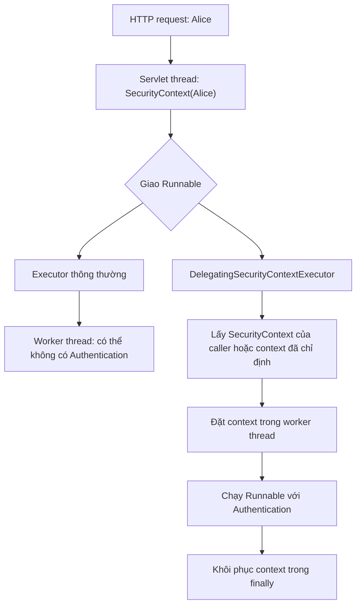

# DelegatingSecurityContextExecutor và bộ thực thi được bảo vệ

## 1. Bài toán: công việc bất đồng bộ cần biết ai đã khởi chạy nó

Một API Servlet nhận yêu cầu của người dùng đã đăng nhập. Controller chuyển một công việc sang thread pool để tạo báo cáo hoặc ghi nhật ký:

```java
@GetMapping("/api/async/whoami")
CompletableFuture<String> whoAmI() {
    return CompletableFuture.supplyAsync(() -> {
        Authentication authentication =
            SecurityContextHolder.getContext().getAuthentication();
        return authentication.getName();
    }, workerExecutor);
}
```

Nếu `workerExecutor` chỉ là `Executors.newFixedThreadPool(...)` thông thường, `SecurityContextHolder` trên thread xử lý HTTP **không tự động** truyền authentication sang thread của pool. Kết quả có thể là `null`, lỗi `NullPointerException` hoặc dữ liệu user không đúng trong trường hợp ứng dụng tự quản lý thread-local sai.

Đây là vấn đề quan trọng của chương **Bất đồng bộ và ngữ cảnh** trong module **SPRING_SECURITY_TESTING**. Mục tiêu học là kiểm chứng xác thực, phân quyền và bảo vệ HTTP qua `spring-security-test` trên Servlet/Reactive; ở bài này, ta tập trung vào việc bảo toàn `SecurityContext` khi giao việc cho `Executor`, đồng thời phân biệt với `WebTestClient`, `@WithMockUser`, JWT/OAuth2/OIDC giả lập và Reactor Context của WebFlux.

Spring Security cung cấp `DelegatingSecurityContextExecutor` để bọc một `Executor` khác. Mỗi `Runnable` được wrapper chuyển thành một công việc có nhiệm vụ:

1. Đặt `SecurityContext` thích hợp vào `SecurityContextHolder` trước khi chạy mã nghiệp vụ.
2. Thực thi `Runnable` trên executor thật.
3. Phục hồi/giải phóng ngữ cảnh của thread trong `finally`, kể cả khi tác vụ ném exception.

Nhờ đó, công việc có thể chạy trong thread pool mà vẫn nhìn thấy danh tính tương ứng, **nếu context được chọn đúng thời điểm và đúng phạm vi**.

Sau bài học, bạn sẽ:

- Phân biệt cơ chế `ThreadLocal` và `SecurityContext` trong luồng Servlet với Reactor Context của WebFlux.
- Hiểu hai cách khởi tạo `DelegatingSecurityContextExecutor` và sự khác nhau giữa **context cố định** với **context của người gọi tại lúc `execute(...)`**.
- Cấu hình một executor bảo vệ cho `CompletableFuture` và `@Async`.
- Kiểm thử kế thừa danh tính, chuyển đổi hai user trên cùng thread pool, xử lý ngoại lệ và tránh rò rỉ authentication.
- Dùng `MockMvc`, `@WithMockUser` và `asyncDispatch(...)` để xác nhận kết quả HTTP.
- Biết khi nào cần `DelegatingSecurityContextExecutorService`, khi nào nên truyền dữ liệu nghiệp vụ thay vì toàn bộ security context, và tại sao wrapper này không thay thế `ReactiveSecurityContextHolder`.

## 2. SecurityContextHolder và vấn đề khi chuyển thread

Theo chiến lược mặc định trong ứng dụng Servlet, `SecurityContextHolder` sử dụng `ThreadLocal`. Spring Security thiết lập `SecurityContext` cho thread xử lý request, trong đó thường có `Authentication` (principal, authorities, trạng thái xác thực).

```java
Authentication authentication =
    SecurityContextHolder.getContext().getAuthentication();
```

Đoạn code có thể hoạt động trên thread xử lý HTTP. Tuy nhiên, khi tạo một task và đưa tới thread pool, task được chạy bởi **thread khác**. Thread đó không có `SecurityContext` của người gọi theo cơ chế mặc định.



**Không nên giải quyết bằng `MODE_INHERITABLETHREADLOCAL` theo thói quen.** Thread pool thường tái sử dụng các thread đã được tạo trước khi request hiện tại bắt đầu; việc kế thừa thread-local lúc tạo thread không tương đương truyền ngữ cảnh theo **từng task**. Kế thừa nhầm còn có nguy cơ để thông tin người dùng xuất hiện ở thread không thuộc request.

### 2.1. SecurityContext khác Authentication

| Đối tượng | Ý nghĩa |
|---|---|
| `SecurityContext` | Container chứa `Authentication` hiện hành |
| `Authentication` | Người dùng/chủ thể đã xác thực, credentials, authorities và details |
| `SecurityContextHolder` | API truy cập context của thread/strategy hiện hành |
| `Executor` | Nhận `Runnable` qua `execute(...)`; không mặc định hiểu security |
| `DelegatingSecurityContextExecutor` | Decorator của `Executor`, đưa context thích hợp vào công việc |
| `DelegatingSecurityContextRunnable` | Wrapper của `Runnable` đặt và khôi phục security context |
| `DelegatingSecurityContextExecutorService` | Decorator cho `ExecutorService` với các tác vụ trả `Future` và lifecycle tương ứng |

Không chỉ kiểm tra `Authentication.getName()` mà bỏ qua quyền. Một công việc có thể nhìn thấy tên `alice` nhưng thiếu `GrantedAuthority` mà nghiệp vụ cần; hoặc tệ hơn, thấy `ROLE_ADMIN` do context của request khác bị rò rỉ.

### 2.2. Thời điểm “chụp” ngữ cảnh quan trọng hơn tên thread

Có ba thời điểm khác nhau:

1. Khi tạo bean `DelegatingSecurityContextExecutor`.
2. Khi thread gọi `executor.execute(runnable)` hoặc khi `CompletableFuture` giao task.
3. Khi thread pool thực sự chạy `runnable.run()`.

Hai constructor của wrapper quyết định context lấy từ đâu. Không phải lúc nào “cứ tạo executor ở startup” thì nó tự có context của người dùng, và cũng không phải mỗi task tự tìm authentication trên worker thread.

## 3. Hai cách tạo DelegatingSecurityContextExecutor

### 3.1. Không truyền SecurityContext: dùng context của caller khi giao task

Đây là cách thường phù hợp với công việc do request hiện tại khởi chạy:

```java
Executor rawExecutor = Executors.newFixedThreadPool(4);

Executor securedExecutor =
    new DelegatingSecurityContextExecutor(rawExecutor);
```

Với constructor chỉ nhận delegate, wrapper sử dụng `SecurityContextHolder` **ở thời điểm gọi `execute(...)`** để bọc công việc.

```java
// Đoạn này chạy trên request thread của Alice.
securedExecutor.execute(() -> {
    Authentication auth =
        SecurityContextHolder.getContext().getAuthentication();
    audit("requested-by-" + auth.getName());
});
```

Ngữ nghĩa mong muốn: công việc của Alice chạy với context của Alice; khi Bob gọi `execute(...)`, công việc của Bob chạy với context của Bob. Wrapper không phải một user global được cố định khi tạo bean.

**Điều kiện:** lời gọi `execute(...)` phải diễn ra trong phạm vi có security context cần thiết. Nếu task được giao từ một callback khác đã mất context, wrapper sẽ lấy context hiện có của callback đó (có thể rỗng). Wrapper không tự khám phá request gốc ở nơi khác.

### 3.2. Truyền SecurityContext tường minh: cùng một context cho các task

Constructor còn lại nhận context rõ ràng:

```java
SecurityContext serviceContext =
    SecurityContextHolder.createEmptyContext();

Authentication serviceAuth =
    new UsernamePasswordAuthenticationToken(
        "internal-service",
        "N/A",
        List.of(
            new SimpleGrantedAuthority("ROLE_SYSTEM")
        )
    );

serviceContext.setAuthentication(serviceAuth);

Executor serviceExecutor =
    new DelegatingSecurityContextExecutor(
        rawExecutor,
        serviceContext
    );
```

Tất cả tác vụ đi qua `serviceExecutor` được chạy với **context đã truyền vào**. Cách này có ích cho một tác vụ hệ thống đã được kiểm soát và có danh tính dịch vụ phù hợp; **không** dùng nó như executor chung cho các request của nhiều người dùng, vì mọi task có thể cùng nhận `ROLE_SYSTEM` hoặc context của người khởi tạo đầu tiên.

### 3.3. So sánh hai constructor

| Cách tạo | Context được chọn từ đâu? | Tình huống phù hợp | Rủi ro cần kiểm soát |
|---|---|---|---|
| `new DelegatingSecurityContextExecutor(delegate)` | Context hiện hành tại lời gọi `execute(...)` | Task do user request khởi chạy | Caller đã mất context trước khi giao task |
| `new DelegatingSecurityContextExecutor(delegate, context)` | Context đã cấp khi tạo wrapper | Tác vụ service account có phạm vi rõ | Tất cả task dùng chung quyền, dễ vượt quyền |
| `delegate.execute(runnable)` trực tiếp | Không có propagation do Spring Security wrapper | Task không liên quan security | Task cần principal lại nhận null hoặc context không mong muốn |

**Lưu ý tính mutable:** context được truyền/chọn là một đối tượng `SecurityContext`, không nhất thiết là bản sao bất biến sâu của authentication. Tránh sửa `setAuthentication(...)` trên **cùng một context object** sau khi đã giao task và cho rằng task chắc chắn giữ ảnh chụp cũ. Khi tạo context riêng cho mỗi principal, dùng `SecurityContextHolder.createEmptyContext()` và một đối tượng authentication không bị tái sử dụng để sửa quyền giữa các request.

## 4. Một executor bảo vệ hoạt động như thế nào?

Cơ chế có thể hiểu tương đương (mã giả lược bớt chi tiết implementation):

```java
class ConceptualSecurityAwareRunnable implements Runnable {
    private final Runnable delegate;
    private final SecurityContext taskContext;

    @Override
    public void run() {
        SecurityContext previous =
            SecurityContextHolder.getContext();
        try {
            SecurityContextHolder.setContext(taskContext);
            delegate.run();
        } finally {
            // Phục hồi/giải phóng context trước khi
            // trả thread cho thread pool.
            SecurityContextHolder.setContext(previous);
        }
    }
}
```

Đây là **mã giả để giải thích cơ chế**, không phải bản sao mã nguồn Spring Security; framework có xử lý cụ thể cho context rỗng và strategy. Với trường hợp thread trước đó chưa có context, wrapper có thể xóa context thay vì giữ một context rỗng.

Hai đặc tính cần kiểm chứng:

- **Correctness:** bên trong task nhìn thấy đúng `Authentication` và authorities.
- **Cleanup:** sau task, thread pool không giữ authentication của user cho công việc được giao **không qua wrapper** sau đó.

Cleanup phải xảy ra cả khi `Runnable` thất bại. Không thể coi “task trả đúng tên Alice” là đủ để kết luận wrapper đã an toàn khi thread pool tái sử dụng.

### 4.1. Có nên tự viết setContext/clearContext?

Thay vì tự dùng:

```java
SecurityContextHolder.setContext(captured);
try {
    work.run();
} finally {
    SecurityContextHolder.clearContext();
}
```

nên ưu tiên decorator của Spring Security. Tự viết propagation dễ quên `finally`, ghi đè context vốn đã có trên worker thread, hoặc dùng sai `SecurityContextHolderStrategy` đã được cấu hình. Nếu nghiệp vụ thực sự cần propagation tùy biến, hãy test cả việc **khôi phục ngữ cảnh cũ** và **dọn sạch ngữ cảnh mới**, không chỉ test happy path.

## 5. Cấu hình Executor trong Spring Boot Servlet

Ví dụ bài học dùng Java 17+, Spring Boot 3 và Spring Security 6. Các class/import phải đồng bộ với phiên bản Spring Security thực tế của dự án.

```kotlin
// build.gradle.kts (minh họa)
dependencies {
    implementation("org.springframework.boot:spring-boot-starter-web")
    implementation("org.springframework.boot:spring-boot-starter-security")

    testImplementation("org.springframework.boot:spring-boot-starter-test")
    testImplementation("org.springframework.security:spring-security-test")
}
```

### 5.1. Bean raw executor có lifecycle và bean được bảo vệ

```java
@Configuration
@EnableAsync
class WorkerExecutorConfig {

    @Bean(destroyMethod = "shutdown")
    ExecutorService rawWorkerPool() {
        return Executors.newFixedThreadPool(2);
    }

    @Bean("securityAwareExecutor")
    Executor securityAwareExecutor(
            @Qualifier("rawWorkerPool") ExecutorService rawWorkerPool) {
        return new DelegatingSecurityContextExecutor(
            rawWorkerPool
        );
    }
}
```

`@EnableAsync` chỉ cần cho `@Async`; `CompletableFuture.supplyAsync(..., executor)` có thể dùng ngay khi có bean executor. `@Bean(destroyMethod = "shutdown")` giúp đóng thread pool khi Spring context kết thúc; với production nên sử dụng executor có cấu hình kích thước pool, hàng đợi, thời gian timeout và monitoring phù hợp.

**Quan trọng:** Bean `securityAwareExecutor` được tạo một lần khi ứng dụng khởi động, nhưng constructor **không truyền context** nên không cố định authentication của thread khởi động. Context được lấy khi **request/service gọi `execute(...)`**.

Các import chính:

```java
import java.util.concurrent.Executor;
import java.util.concurrent.ExecutorService;
import java.util.concurrent.Executors;

import org.springframework.beans.factory.annotation.Qualifier;
import org.springframework.context.annotation.Bean;
import org.springframework.context.annotation.Configuration;
import org.springframework.scheduling.annotation.EnableAsync;
import org.springframework.security.concurrent.DelegatingSecurityContextExecutor;
```

### 5.2. Controller minh họa dùng CompletableFuture

```java
@RestController
class AsyncIdentityController {

    private final Executor securedExecutor;

    AsyncIdentityController(
            @Qualifier("securityAwareExecutor")
            Executor securedExecutor) {
        this.securedExecutor = securedExecutor;
    }

    @GetMapping("/api/async/whoami")
    CompletableFuture<String> whoAmI() {
        return CompletableFuture.supplyAsync(() -> {
            Authentication authentication =
                SecurityContextHolder.getContext()
                    .getAuthentication();

            if (authentication == null) {
                throw new IllegalStateException(
                    "Missing delegated authentication");
            }

            return authentication.getName();
        }, securedExecutor);
    }
}
```

Controller trên không cần đưa `Authentication` qua constructor. Spring Security filter đã xác thực request; controller giao task khi còn trong request thread; `DelegatingSecurityContextExecutor` mang context cho worker.

Nếu `CompletableFuture` fail, Spring MVC xử lý lỗi theo cấu hình exception handling của ứng dụng. Không che exception bằng cách tự trả tên user mặc định hay cấp quyền hệ thống.

### 5.3. Cấu hình SecurityFilterChain HTTP

```java
@Configuration
@EnableWebSecurity
class AsyncHttpSecurity {

    @Bean
    SecurityFilterChain api(HttpSecurity http) throws Exception {
        return http
            .authorizeHttpRequests(auth -> auth
                .requestMatchers("/api/async/**")
                    .authenticated()
                .anyRequest().denyAll()
            )
            .httpBasic(Customizer.withDefaults())
            .build();
    }
}
```

Với Basic entry point, anonymous gọi endpoint sẽ nhận **401**. Nếu ứng dụng bật form/OAuth2 login, response unauthenticated có thể là **302**. Ở ví dụ này, quyền truy cập HTTP chỉ yêu cầu authenticated; có thể thêm `hasAuthority(...)` nếu cần phân biệt 403 với 200.

## 6. Kiểm thử HTTP bất đồng bộ bằng MockMvc và asyncDispatch

Với Spring MVC, controller trả `CompletableFuture` là một trường hợp xử lý **asynchronous request**. `MockMvc` cần kiểm tra hai giai đoạn:

1. Request ban đầu chạy qua security chain và bắt đầu xử lý bất đồng bộ.
2. `asyncDispatch` chuyển kết quả hoàn thành trở lại pipeline MVC để assert status/body.

```java
@SpringBootTest
@AutoConfigureMockMvc
class AsyncIdentityMvcTest {

    @Autowired
    MockMvc mvc;

    @Test
    void aliceIsAvailableInsideExecutorWorker() throws Exception {
        MvcResult started = mvc.perform(
                get("/api/async/whoami")
                    .with(user("alice").roles("USER"))
            )
            .andExpect(request().asyncStarted())
            .andReturn();

        mvc.perform(asyncDispatch(started))
            .andExpect(status().isOk())
            .andExpect(content().string("alice"));
    }

    @Test
    void bobDoesNotInheritAliceIdentity() throws Exception {
        MvcResult started = mvc.perform(
                get("/api/async/whoami")
                    .with(user("bob").roles("USER"))
            )
            .andExpect(request().asyncStarted())
            .andReturn();

        mvc.perform(asyncDispatch(started))
            .andExpect(status().isOk())
            .andExpect(content().string("bob"));
    }

    @Test
    void anonymousRequestIsRejectedBeforeWorkerTask() throws Exception {
        mvc.perform(get("/api/async/whoami"))
            .andExpect(status().isUnauthorized());
    }
}
```

Cần dùng `@SpringBootTest`, `@AutoConfigureMockMvc`, `@Autowired`, `@Test`, `MockMvc`, `MvcResult`; static imports từ `MockMvcRequestBuilders.get/asyncDispatch`, `MockMvcResultMatchers.request/status/content` và `SecurityMockMvcRequestPostProcessors.user`. Test giả định context tải đủ `AsyncIdentityController`, `WorkerExecutorConfig` và `AsyncHttpSecurity`.

**Ý nghĩa test:** `user("alice")` và `user("bob")` là post-processor của Spring Security Test cho Servlet. Nó tạo security context của request; controller sau đó mới giao công việc cho executor được bảo vệ. Việc body trả đúng từng username chứng minh đường đi HTTP → SecurityContext → worker executor → CompletableFuture → MVC async response.

### 6.1. Tại sao cần asyncDispatch?

Kiểu test sau thường chưa đủ cho một controller trả `CompletableFuture`:

```java
mvc.perform(get("/api/async/whoami")
        .with(user("alice")))
    .andExpect(status().isOk());
```

Request có thể đang ở giai đoạn async, nên phần assert status/body cuối cùng phải đi qua `asyncDispatch(...)`. Test không nên giả định CompletableFuture luôn hoàn thành đồng bộ trước khi `MockMvc.perform` kết thúc.

### 6.2. Dùng @WithMockUser thay vì request post-processor

Một ca chỉ có một danh tính có thể dùng:

```java
@Test
@WithMockUser(username = "carol", roles = "USER")
void annotationIdentityIsDelegated() throws Exception {
    MvcResult started = mvc.perform(
            get("/api/async/whoami"))
        .andExpect(request().asyncStarted())
        .andReturn();

    mvc.perform(asyncDispatch(started))
        .andExpect(status().isOk())
        .andExpect(content().string("carol"));
}
```

`@WithMockUser` được `spring-security-test` gắn vào test `SecurityContext`. Lúc controller giao task qua executor wrapper, caller context thích hợp được truyền sang worker. Không cần mật khẩu của Carol hoặc gọi login endpoint thật.

Nếu một ca cần chuyển đổi nhiều danh tính, `with(user(...))` theo từng request thường diễn đạt ý định dễ hơn `@WithMockUser` đặt ở cấp lớp.

### 6.3. Phân biệt lỗi xác thực và phân quyền

Thay rule HTTP thành:

```java
.requestMatchers("/api/async/whoami")
    .hasAuthority("SCOPE_audit:read")
```

Khi đó các kết quả dự kiến:

| Request | Authentication | Quyền | Kết quả |
|---|---|---|---|
| Anonymous | Không có | Không | 401 (với Basic entry point) |
| Alice | Có | `SCOPE_audit:read` | 200, body `alice` |
| Bob | Có | Chỉ `ROLE_USER` | 403 |
| Carol | Có | `SCOPE_audit:read` | 200, body `carol` |

Muốn kiểm tra chuyển security context qua executor, trước tiên phải để request đủ quyền đi đến controller; nếu test Bob bị 403 trước controller, nó chỉ chứng minh authorization, không chứng minh bất kỳ task async nào đã nhận context.

## 7. Unit test: cùng một pool nhưng các task có identity khác nhau

Kiểm tra HTTP là hữu ích, song để khẳng định wrapper không để lộ authentication khi worker thread được tái sử dụng, cần test trực tiếp `Executor`.

### 7.1. Fixture context cho từng user

```java
private static SecurityContext contextFor(String username) {
    SecurityContext context =
        SecurityContextHolder.createEmptyContext();

    Authentication authentication =
        new UsernamePasswordAuthenticationToken(
            username,
            "N/A",
            List.of(new SimpleGrantedAuthority("ROLE_USER"))
        );

    context.setAuthentication(authentication);
    return context;
}
```

Ở đây mỗi lần gọi tạo **SecurityContext object mới**, tránh việc Alice và Bob cùng tham chiếu vào một context mutable rồi thay authentication.

### 7.2. Test capture tại thời điểm giao task và cleanup

```java
class DelegatingExecutorTest {

    private final ExecutorService raw =
        Executors.newSingleThreadExecutor();

    private final Executor secured =
        new DelegatingSecurityContextExecutor(raw);

    @AfterEach
    void cleanup() {
        SecurityContextHolder.clearContext();
        raw.shutdownNow();
    }

    @Test
    void propagatesTwoUsersAndDoesNotLeakToRawWorker()
            throws Exception {

        SecurityContextHolder.setContext(contextFor("alice"));
        CompletableFuture<String> alice =
            CompletableFuture.supplyAsync(
                this::currentUserName,
                secured
            );

        assertThat(alice.get(3, TimeUnit.SECONDS))
            .isEqualTo("alice");

        // Giao task tiếp theo từ cùng caller thread, context mới.
        SecurityContextHolder.setContext(contextFor("bob"));
        CompletableFuture<String> bob =
            CompletableFuture.supplyAsync(
                this::currentUserName,
                secured
            );

        assertThat(bob.get(3, TimeUnit.SECONDS))
            .isEqualTo("bob");

        // Raw task chạy sau cùng một single-thread pool, nhưng
        // không qua wrapper. Nó không được nhìn thấy Bob.
        Future<Authentication> workerAuthentication =
            raw.submit(() ->
                SecurityContextHolder.getContext()
                    .getAuthentication()
            );

        assertThat(workerAuthentication.get(3, TimeUnit.SECONDS))
            .isNull();
    }

    private String currentUserName() {
        Authentication authentication =
            SecurityContextHolder.getContext().getAuthentication();

        return authentication == null
            ? "NO_AUTH"
            : authentication.getName();
    }

    // Đặt contextFor(...) của mục 7.1 trong cùng lớp.
}
```

Các import quan trọng: `@Test`, `@AfterEach`, `Executor`, `ExecutorService`, `Executors`, `CompletableFuture`, `Future`, `TimeUnit`, `Authentication`, `SecurityContext`, `SecurityContextHolder`, `DelegatingSecurityContextExecutor`, `SimpleGrantedAuthority`, `UsernamePasswordAuthenticationToken` và `assertThat`.

Test dùng một worker thread để kiểm tra rõ tình huống **thread pool tái sử dụng**:

1. Alice giao task qua `secured`, task nhìn thấy Alice.
2. Bob giao task qua cùng `secured`, task nhìn thấy Bob.
3. Task raw chạy sau đó trên cùng worker thread, không nhìn thấy authentication đã đặt bởi hai task trước.

**Đừng kết luận raw executor an toàn để chạy code dựa trên security context.** Raw task ở đây chỉ dùng để quan sát cleanup; công việc nghiệp vụ cần authentication phải đi qua wrapper hoặc nhận thông tin chủ thể bằng tham số rõ ràng.

### 7.3. Test khôi phục context kể cả khi task lỗi

```java
@Test
void clearsWorkerContextAfterTaskFailure() throws Exception {
    SecurityContextHolder.setContext(contextFor("alice"));

    CompletableFuture<Void> failed =
        CompletableFuture.runAsync(
            () -> {
                assertThat(
                    SecurityContextHolder.getContext()
                        .getAuthentication().getName()
                ).isEqualTo("alice");

                throw new IllegalStateException("planned failure");
            },
            secured
        );

    assertThatThrownBy(
        () -> failed.get(3, TimeUnit.SECONDS)
    ).isInstanceOf(ExecutionException.class);

    Future<Authentication> leftover = raw.submit(
        () -> SecurityContextHolder.getContext()
            .getAuthentication()
    );
    assertThat(leftover.get(3, TimeUnit.SECONDS))
        .isNull();
}
```

Đặt test này trong cùng lớp ở mục 7.2. `CompletableFuture` gói exception của task bên trong `ExecutionException` khi gọi `get()`. Phép thử kiểm tra `finally` cleanup sau khi task thất bại; nếu dùng `join()`, kiểu wrapper exception sẽ khác.

Điều cần tránh: một task thất bại không được để `SecurityContextHolder` của worker giữ `ROLE_ADMIN` cho task tiếp theo.

### 7.4. Test cố định context có chủ đích

```java
@Test
void explicitContextIsForSystemTaskOnly()
        throws Exception {
    SecurityContext system = contextFor("service-account");

    Executor fixed = new DelegatingSecurityContextExecutor(
        raw, system
    );

    SecurityContextHolder.setContext(contextFor("alice"));

    String observed = CompletableFuture
        .supplyAsync(this::currentUserName, fixed)
        .get(3, TimeUnit.SECONDS);

    assertThat(observed).isEqualTo("service-account");
}
```

Đây là hành vi đúng **theo lựa chọn constructor**, nhưng có thể là lỗi bảo mật nghiêm trọng nếu dùng `fixed` để chạy công việc người dùng trong một endpoint. Vì vậy cần test và review quyền của system account tách biệt.

## 8. @Async và Executor có security context

Một ứng dụng thường không tự gọi `CompletableFuture.supplyAsync(...)` mà đánh dấu phương thức service bằng `@Async`. Nếu `@Async` sử dụng executor thường, security context từ request không tự truyền sang task. Có thể dùng bean `securityAwareExecutor` từ mục 5.

```java
@Service
class AsyncAuditService {

    @Async("securityAwareExecutor")
    public CompletableFuture<String> auditWhoRequested() {
        Authentication authentication =
            SecurityContextHolder.getContext()
                .getAuthentication();

        if (authentication == null) {
            return CompletableFuture.failedFuture(
                new IllegalStateException("No authentication"));
        }

        return CompletableFuture.completedFuture(
            "audit-by-" + authentication.getName());
    }
}
```

Với `@EnableAsync`, khi một bean Spring **khác** gọi `auditWhoRequested()` qua proxy, interceptor giao thực thi sang executor được chỉ định. Wrapper chọn security context của caller ở thời điểm task được giao, và worker nhìn thấy cùng danh tính.

Một test minh họa:

```java
@SpringBootTest
class AsyncAuditServiceTest {

    @Autowired
    AsyncAuditService service;

    @Test
    @WithMockUser(username = "alice")
    void propagatesTestIdentity() throws Exception {
        String result = service.auditWhoRequested()
            .get(3, TimeUnit.SECONDS);

        assertThat(result).isEqualTo("audit-by-alice");
    }
}
```

Những chú ý:

- Không gọi `new AsyncAuditService()` vì như vậy bypass Spring proxy.
- Không trông chờ self-invocation `this.auditWhoRequested()` trong cùng class kích hoạt `@Async` theo cơ chế proxy thông thường.
- Không cấu hình `@Async` dùng executor khác nếu muốn áp dụng `DelegatingSecurityContextExecutor`.
- Test `@WithMockUser` ở trên hoạt động nhờ Spring Security Test thiết lập context cho test thread trước khi gọi service.
- `@Async` và `DelegatingSecurityContextExecutor` giải quyết việc chuyển **task**, không thay thế annotation method security như `@PreAuthorize`. Nếu method có `@PreAuthorize` hoặc kiểm tra quyền bên trong, cần test quyền đúng ở tầng xử lý thực tế.

### 8.1. @Async được bảo vệ chưa chắc an toàn để dùng “context hệ thống”

Một service có thể thực thi nhiều loại công việc: tác vụ theo người dùng và tác vụ hệ thống. Không nên đưa tất cả vào cùng executor có `SecurityContext` của tài khoản đặc quyền chỉ để tránh lỗi authentication rỗng. Tách ranh giới bằng API, quyền tối thiểu và executor/identity phù hợp. Nếu task phải chạy sau khi request đã kết thúc hoặc sẽ được xử lý bởi hàng đợi bên ngoài tiến trình, truyền một **job identity có chủ đích** và tái xác thực/ủy quyền khi xử lý, thay vì coi thread-local đã được bảo toàn mãi mãi.

## 9. Executor và ExecutorService: chọn wrapper theo API được dùng

`DelegatingSecurityContextExecutor` thực hiện interface `Executor`, thích hợp cho:

```java
securedExecutor.execute(runnable);
CompletableFuture.supplyAsync(supplier, securedExecutor);
```

Nếu ứng dụng làm việc trực tiếp với `ExecutorService` và các phương thức `submit(...)`, `invokeAll(...)`, `Future`, lựa chọn phù hợp là `DelegatingSecurityContextExecutorService`:

```java
ExecutorService rawPool =
    Executors.newFixedThreadPool(2);

ExecutorService securePool =
    new DelegatingSecurityContextExecutorService(rawPool);

try {
    Future<String> future = securePool.submit(() ->
        SecurityContextHolder.getContext()
            .getAuthentication()
            .getName()
    );
    String user = future.get();
} finally {
    securePool.shutdown();
}
```

Mã trên giả định **thread gọi `securePool.submit(...)` đã có authentication**; nếu không, task có thể không thấy user như mong muốn. Ví dụ minh họa API, còn trong ứng dụng thực pool nên được quản lý bằng Spring bean và lifecycle phù hợp để tránh tạo thread tràn lan.

Không nên ép kiểu `(ExecutorService) new DelegatingSecurityContextExecutor(...)` vì wrapper này được định nghĩa như `Executor`, không cam kết implement `ExecutorService`. Tương tự, nếu cần scheduling định kỳ, hãy xem xét loại wrapper phù hợp với `ScheduledExecutorService` và xác định context của công việc tại thời điểm nào, bởi job chạy hàng giờ sau request không nên phụ thuộc mù vào authentication của request đã kết thúc.

## 10. Phân biệt với async support tích hợp sẵn của Spring MVC

Spring Security có tích hợp với cơ chế xử lý **Servlet async**; chẳng hạn, một số luồng dùng `Callable` được Spring MVC/Spring Security hỗ trợ truyền security context qua `WebAsyncManagerIntegrationFilter`.

Vì vậy không nên khẳng định **mọi** `Callable` controller đều bắt buộc bọc thêm `DelegatingSecurityContextExecutor`. Nhiệm vụ của bài này là kiểm thử **task tự giao vào executor tùy biến** hoặc executor của `@Async`, nơi bạn phải chủ động xác định cơ chế propagation.

Bảng phân biệt:

| Cách chạy bất đồng bộ | Ai quản lý việc truyền context? | Test nên tập trung vào |
|---|---|---|
| Controller trả `Callable` theo tích hợp MVC/Security mặc định | Cơ chế Servlet async của framework | Kiểm tra authentication trong Callable qua MockMvc |
| `CompletableFuture.supplyAsync(..., rawExecutor)` | Không tự có security wrapper | Tái hiện mất context, tránh đọc thread-local không được truyền |
| `CompletableFuture.supplyAsync(..., securedExecutor)` | `DelegatingSecurityContextExecutor` | Task thấy đúng user và cleanup sau hoàn thành |
| `@Async("securityAwareExecutor")` | Spring async proxy + executor bảo vệ | Được gọi qua bean/proxy, capture đúng caller context |
| `ExecutorService.submit(...)` | `DelegatingSecurityContextExecutorService` nếu dùng wrapper | Future, exception và cleanup |
| Công việc gửi qua message queue/worker process khác | Không phải cùng JVM/thread pool | Truyền job metadata được tin cậy và đánh giá quyền ở worker |

Đối với HTTP test, sử dụng `asyncDispatch(...)` khi xử lý MVC được đánh dấu async, bất kể cơ chế propagation nằm ở framework hay executor tùy biến. Không lấy một test “asyncStarted” làm bằng chứng security context đã được bảo toàn: cần assert kết quả user hoặc kiểm tra quyền ngay **bên trong task**.

## 11. Tại sao DelegatingSecurityContextExecutor không phải lời giải chung cho WebFlux?

Trong WebFlux, Spring Security lưu authentication bằng **Reactor Context**, truy cập qua `ReactiveSecurityContextHolder`. Reactor Context gắn với subscription, không phụ thuộc `SecurityContextHolder` thread-local theo cách của Servlet.

```java
Mono<String> currentUser() {
    return ReactiveSecurityContextHolder.getContext()
        .map(SecurityContext::getAuthentication)
        .map(Authentication::getName);
}
```

Khi chuyển scheduler **bên trong cùng Reactor pipeline** bằng `publishOn(...)` hoặc `subscribeOn(...)`, Reactor Context thường được duy trì. Không cần đưa `DelegatingSecurityContextExecutor` vào WebFlux chỉ vì có scheduler hop; làm vậy có thể khiến người viết code nhầm giữa `ThreadLocal` và Reactor Context.

```java
Mono<String> userAfterSchedulerHop() {
    return Mono.just("work")
        .publishOn(Schedulers.parallel())
        .flatMap(ignored ->
            ReactiveSecurityContextHolder.getContext())
        .map(context ->
            context.getAuthentication().getName());
}
```

Một test ở lớp Reactive:

```java
@Test
void reactiveSubscriberKeepsIdentity() {
    Authentication alice =
        new UsernamePasswordAuthenticationToken(
            "alice", "N/A",
            List.of(new SimpleGrantedAuthority("ROLE_USER"))
        );

    Mono<String> publisher = userAfterSchedulerHop()
        .contextWrite(
            ReactiveSecurityContextHolder.withAuthentication(
                alice
            )
        );

    StepVerifier.create(publisher)
        .expectNext("alice")
        .verifyComplete();
}
```

Đoạn này cần phương thức `userAfterSchedulerHop()` nằm trong test class hoặc service; `StepVerifier` của `reactor-test`, `Schedulers` và các kiểu security tương ứng. Test xác nhận **Reactor Context**, không kiểm tra wrapper `Executor`.

Với WebFlux HTTP tests, `WebTestClient.mutateWith(mockUser(...))`, `mockJwt()`, `mockOAuth2Login()` hoặc `mockOidcLogin()` có thể dựng principal để test authorization. Nhưng các mock không tự chứng minh JWT signature hoặc OAuth2/OIDC protocol. Nếu ứng dụng gọi một thư viện blocking bên ngoài Reactor, nên truyền username/subject/permission đã được xác minh thành tham số rõ ràng, hoặc thiết kế bridge context riêng và kiểm thử nó; không giả định `SecurityContextHolder` của worker thread được Reactor tự nạp.

## 12. JWT, OAuth2 và OIDC: đúng phạm vi test khi công việc được giao cho executor

`DelegatingSecurityContextExecutor` chuyển **`SecurityContext` đã có** sang worker. Nó không xác thực credential mới và không sửa loại principal.

| Nguồn authentication tại request | Test phù hợp | Wrapper có tự kiểm chứng giao thức không? |
|---|---|---|
| `@WithMockUser` hoặc `with(user(...))` | MockMvc Servlet unit/integration authorization | Không; mock principal do test tạo |
| `with(jwt())` | Servlet Resource Server với `JwtAuthenticationToken` giả lập | Không xác minh chữ ký JWT/claims qua decoder |
| `with(oauth2Login())` | OAuth2 login principal giả lập | Không chạy authorization-code flow |
| `with(oidcLogin())` | OIDC principal giả lập, ID Token/UserInfo test fixture | Không xác minh ID Token hoặc gọi UserInfo |
| Bearer JWT đã ký thật qua HTTP | Servlet/Reactive Resource Server test decoder | Xác minh diễn ra ở filter/decoder **trước khi giao task** |
| `WebTestClient.mutateWith(mockJwt())` | Reactive authorization test | Dựa trên Reactor security context, không phải Servlet thread-local |

Nếu test dùng `with(jwt())` rồi task nhìn thấy `JwtAuthenticationToken`, kết luận phù hợp là wrapper mang **authentication đã dựng** sang worker. Không được suy ra rằng chữ ký của token đã được xác minh; muốn kiểm tra điều đó, bổ sung test bearer token thật qua HTTP và `JwtDecoder` hoặc `ReactiveJwtDecoder`.

### 12.1. Phân quyền ngay tại thời điểm chạy task

Việc một caller có quyền khi bắt đầu request không có nghĩa mọi công việc trì hoãn chạy sau đó đều nên có quyền vô hạn. Nếu công việc chứa thao tác nhạy cảm, cân nhắc:

- Kiểm tra quyền ở HTTP/service boundary **trước khi giao task**.
- Truyền dữ liệu đầu vào đã kiểm tra cùng subject cần thiết thay vì giữ nguyên principal đầy quyền quá lâu.
- Nếu job được xếp hàng và thực thi sau một thời gian dài, kiểm tra lại quyền hiện hành ở thời điểm xử lý theo yêu cầu nghiệp vụ.
- Không copy authentication của một request rồi tái dùng cho request khác.
- Không lưu toàn bộ bearer token hoặc thông tin nhạy cảm của principal trong job payload chỉ để tiện tái sử dụng.

`SecurityContext` được wrapper truyền là một cơ chế **propagation trong cùng tiến trình**, không phải một proof mới rằng user còn được phép làm mọi việc ở thời điểm bất kỳ.

## 13. Lỗi hay gặp và hướng chẩn đoán

| Hiện tượng | Nguyên nhân khả dĩ | Kiểm chứng/cách sửa |
|---|---|---|
| Task đọc `Authentication == null` | Giao qua raw executor, caller không có context khi submit | Kiểm tra nơi gọi `execute`, dùng wrapper phù hợp |
| Task của Bob thấy Alice | Context bị cố định cho cả executor hoặc cùng context mutable bị sửa/dùng chung | Dùng constructor không truyền context cho request-scoped tasks; context riêng |
| Task sau bị giữ quyền admin | Không cleanup/restoration hoặc mã tự quản lý ThreadLocal sai | Test raw task sau khi secured task hoàn tất |
| Task lỗi để lại context trên pool | Thiếu `finally` trong wrapper tự viết | Dùng Spring Security wrapper và test lỗi |
| `@Async` không có hiệu lực | Self-invocation hoặc bean không do Spring quản lý | Gọi qua proxy; bật `@EnableAsync` |
| `@Async` chạy nhưng context rỗng | Executor của `@Async` không phải secured executor | Chỉ rõ `@Async("securityAwareExecutor")` |
| Test Servlet async chỉ assert response ban đầu | Quên `asyncDispatch(...)` | Đảm bảo asyncStarted rồi dispatch kết quả |
| Test anonymous trả 302 thay vì 401 | Form/OAuth2 entry point | Assert theo chain thực, không mặc định 401 |
| Đã xác thực nhưng trả 403 | Thiếu authority hoặc method security | Kiểm tra `GrantedAuthority` và rule |
| Test `@WithMockUser` pass, token thực fail | Mock bỏ qua xác minh token | Test thêm bearer credential thật |
| WebFlux `publishOn` không thấy principal | Dùng `SecurityContextHolder` thay vì Reactor API | Đọc `ReactiveSecurityContextHolder` |
| Background job chạy sau request không thấy user | Task được giao khi context đã mất hoặc ở process khác | Truyền job identity rõ ràng; xác thực lại khi cần |
| Pool không dừng sau test | Không shutdown executor | Quản lý lifecycle bean và shutdown test fixture |

### 13.1. Thứ tự kiểm tra khi task không thấy Authentication

Kiểm tra từng ranh giới:

1. **HTTP:** Request đã đi qua Spring Security filter chain và có authentication chưa?
2. **Caller:** Ngay trước `securedExecutor.execute(...)`, `SecurityContextHolder.getContext()` có giá trị đúng không?
3. **Wrapper:** Code có dùng `DelegatingSecurityContextExecutor` / `DelegatingSecurityContextExecutorService` không?
4. **Constructor:** Wrapper lấy context mỗi lần giao task hay dùng context cố định?
5. **Worker:** Task có đọc bằng `SecurityContextHolder` đúng trong luồng Servlet imperative không?
6. **Cleanup:** Sau task, worker còn giữ context cũ không?
7. **Test:** Test có bypass security chain hoặc truyền mock principal không đúng loại không?

Đừng sửa bằng cách thêm `Thread.sleep(...)`, đổi pool size hoặc ép mọi task chạy trên cùng thread. Những biện pháp đó không giải quyết được ranh giới context và thường che giấu vấn đề khi hệ thống có nhiều request đồng thời.

## 14. Bài thực hành: kiểm chứng executor được bảo vệ

Dùng cấu hình `WorkerExecutorConfig` và `AsyncIdentityController` trong bài. Viết ít nhất các ca sau:

1. **Anonymous:** `GET /api/async/whoami` không có authentication → 401 với HTTP Basic entry point.
2. **Alice:** `with(user("alice"))` → request async bắt đầu; `asyncDispatch` trả body `alice`.
3. **Bob:** request riêng với `with(user("bob"))` → kết quả `bob`, không bị rò Alice.
4. **@WithMockUser:** `@WithMockUser(username="carol")` → async body là `carol`.
5. **Không có wrapper:** chạy một task raw quan sát `Authentication == null` trên thread pool test sạch.
6. **Có wrapper:** cùng task đi qua `DelegatingSecurityContextExecutor` → nhìn thấy authentication của caller khi giao.
7. **Cleanup:** sau task Alice, giao task raw trên cùng single-thread pool → authentication không còn.
8. **Exception:** task bọc wrapper ném exception; task raw sau vẫn không thấy context cũ.
9. **System context cố định:** tạo wrapper với `SecurityContext` của service account; xác minh nó **không** lấy identity của Alice, rồi giải thích vì sao không phù hợp cho request-scoped executor.
10. **ExecutorService:** dùng `DelegatingSecurityContextExecutorService.submit(...)`, xác nhận `Future` nhìn thấy đúng identity.
11. **@Async:** gọi method có `@Async("securityAwareExecutor")` qua Spring proxy, xác nhận identity.
12. **Reactive đối chứng:** dùng `StepVerifier`, `ReactiveSecurityContextHolder.withAuthentication(...)` và `publishOn(...)` để giải thích cách propagation khác trong WebFlux.

### Bảng kỳ vọng nhanh

| Ngữ cảnh thực thi | Principal trong task | Lý do |
|---|---|---|
| Raw executor từ request Alice | Không được tự động có Alice | ThreadLocal không tự truyền theo task |
| Delegating executor, execute bởi Alice | Alice | Lấy caller context lúc giao task |
| Delegating executor, execute bởi Bob | Bob | Context khác cho mỗi task |
| Executor cố định với system context | System account | Constructor nhận explicit context |
| Raw task sau secured task trên cùng pool | Không có context còn sót | Wrapper cleanup/restoration |
| Reactor `publishOn` trong cùng subscription | Principal của subscriber | Reactor Context đi theo subscription |

**Tiêu chí hoàn thành:** Bạn phải chứng minh được `DelegatingSecurityContextExecutor` giúp task bất đồng bộ trên Servlet giữ **đúng security context của người giao task**, chứ không phải “kế thừa thread” chung chung. Test phải phân biệt constructor lấy context khi `execute` với constructor dùng context cố định, xác nhận **không rò authentication** khi thread pool tái sử dụng và khi task ném exception, đồng thời kiểm chứng HTTP bằng `MockMvc.asyncDispatch`. Cần chỉ ra sự khác nhau với **Reactor Context trong WebFlux** và giới hạn của `@WithMockUser`, JWT/OAuth2/OIDC mock khi kiểm thử xác thực thực tế.
