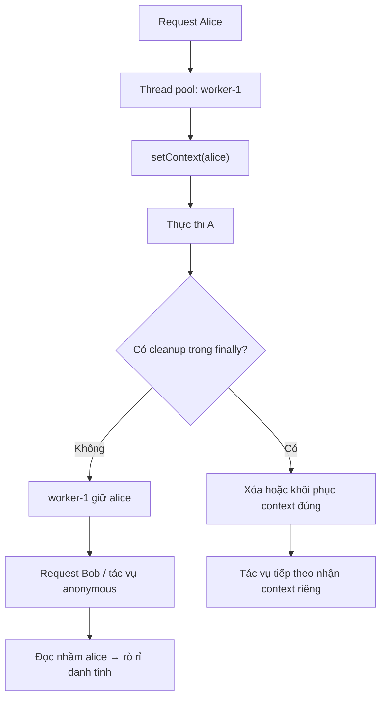

# Không rò rỉ người dùng giữa các tác vụ dùng lại cùng worker

> **Chương:** Bất đồng bộ và ngữ cảnh  
> **Module:** `SPRING_SECURITY_TESTING`  
> **Mục tiêu:** Kiểm chứng xác thực, phân quyền và tính cô lập danh tính khi ứng dụng chạy nhiều tác vụ trên thread pool hoặc Reactor scheduler. Sử dụng `spring-security-test`, `SecurityContextHolder`, `ReactiveSecurityContextHolder`, `@WithMockUser`, `MockMvc`, `WebTestClient` và các ca được phép/bị từ chối. Chủ đề trọng tâm là **không để authentication của người dùng trước tồn tại trong worker được tái sử dụng cho người dùng sau**.

## 1. Lỗi bảo mật: tác vụ B nhìn thấy danh tính của tác vụ A

Giả sử ứng dụng có một thread pool chỉ gồm một worker. Alice thực hiện tác vụ tạo báo cáo; ngay sau đó Bob thực hiện tác vụ tương tự. Nếu tác vụ Alice tự gắn `SecurityContext` vào worker nhưng không dọn sạch sau khi hoàn thành, Bob có thể thấy `Authentication` của Alice. Tình huống nguy hiểm hơn là một tác vụ **không có người dùng** được thực thi dưới danh tính của tác vụ trước, dẫn đến đọc sai tenant, ghi audit sai chủ thể hoặc vượt quyền.

Trong ứng dụng có nhiều worker, hiện tượng này dễ bị bỏ sót vì chỉ xuất hiện khi scheduler chọn lại đúng thread chứa ngữ cảnh cũ. Test dùng pool một thread sẽ buộc tái sử dụng worker và làm lỗi hiện ra có tính quyết định.

| Tác vụ | Danh tính mong đợi | Điều nguy hiểm khi worker rò rỉ context |
| --- | --- | --- |
| A — xem báo cáo của Alice | `alice` | Worker giữ lại `Authentication(alice)` sau A |
| B — xem báo cáo của Bob | `bob` | B nhìn thấy `alice` và có thể truy cập dữ liệu Alice |
| C — tác vụ chưa xác thực | Không có authentication | C kế thừa `alice` hoặc `bob` dù không được cấp quyền |
| D — tác vụ ném exception | Context được dọn sau lỗi | Worker giữ context nếu thiếu `finally` |

Chỉ kiểm tra “Alice được phép” là chưa đủ. Một bộ test ngăn rò rỉ cần chạy **ít nhất hai danh tính khác nhau và một request/tác vụ không có danh tính trên cùng worker**, sau đó kiểm tra cả dữ liệu trả về lẫn sự vắng mặt của danh tính tồn dư.

### 1.1. Luồng rò rỉ và luồng an toàn



## 2. Hiểu đúng phạm vi của SecurityContextHolder

Spring Security Servlet thường sử dụng `SecurityContextHolder` với chiến lược `MODE_THREADLOCAL`: context gắn với thread, **không gắn tự động với user, HTTP request hay logical task**. Nếu thread được dùng lại, ThreadLocal cũng tồn tại cho đến khi bị xóa hoặc thay đổi.

`SecurityContextHolder.getContext()` lấy context của thread hiện tại. `SecurityContextHolder.setContext(context)` đặt một context cho thread hiện tại. `SecurityContextHolder.clearContext()` xóa ngữ cảnh khỏi chiến lược hiện tại. Khi code tự tạo luồng bất đồng bộ, người viết phải kiểm soát cả thao tác truyền và dọn ngữ cảnh, hoặc dùng wrapper của Spring Security.

| Hạ tầng thực thi | Nguồn danh tính thường dùng | Rủi ro / lưu ý |
| --- | --- | --- |
| Servlet request đồng bộ | `SecurityContextHolder` trong filter chain | Spring Security quản lý lifecycle HTTP; đừng thay đổi context tùy tiện |
| `ExecutorService` / thread pool tự tạo | Context của từng thread worker | Không tự truyền từ thread submit; dùng lại thread có thể giữ context cũ |
| `@Async` trên `TaskExecutor` | Thread trong executor của Spring | Cần executor hoặc decorator có cơ chế truyền/cleanup security context |
| Spring MVC `Callable` | Tích hợp Spring Security với `WebAsyncManager` | Có cơ chế hỗ trợ riêng; không suy rộng sang mọi callback bất đồng bộ |
| Spring MVC `DeferredResult` với callback bên ngoài | Phụ thuộc thread hoàn tất callback | Không mặc định context được truyền tới thread tự tạo |
| WebFlux `Mono` / `Flux` | Reactor Context qua `ReactiveSecurityContextHolder` | Context gắn với subscription; đừng dùng ThreadLocal làm nguồn principal |
| `CompletableFuture`, scheduler hoặc event listener ngoài Reactor | Phụ thuộc cách tổ chức thực thi | Không mặc định `@WithMockUser` hay Reactor Context tự đi qua boundary |

### 2.1. Tại sao MODE_INHERITABLETHREADLOCAL không giải quyết bài toán?

`SecurityContextHolder.MODE_INHERITABLETHREADLOCAL` cho phép **thread con mới tạo** nhận ngữ cảnh từ thread tạo nó ở thời điểm khởi tạo. Điều đó không đồng nghĩa context được chuyển đúng theo **mỗi lần submit task** vào thread pool.

Thread pool thường tạo worker một lần và tái sử dụng lâu dài. Worker có thể thừa hưởng ngữ cảnh của người đã kích hoạt việc tạo thread đầu tiên, rồi tiếp tục dùng cho hàng nghìn tác vụ khác. Vì thế không nên bật `MODE_INHERITABLETHREADLOCAL` trên toàn JVM để “sửa” một test `@Async` bị mất danh tính.

Không thay đổi `SecurityContextHolder.setStrategyName(...)` trong các test chạy song song: đây là cấu hình toàn cục, có thể khiến test khác bị ảnh hưởng. Cách đúng là **truyền context theo từng task**.

## 3. Ví dụ sai: gắn SecurityContext nhưng không dọn

Đoạn test sau được viết cố ý để tái hiện lỗi. Nó **không phải mẫu nên dùng trong production**:

```java
@Test
void demonstratesLeakedIdentityOnReusedWorker() throws Exception {
    ExecutorService raw = Executors.newSingleThreadExecutor();
    try {
        raw.submit(() -> {
            SecurityContext context =
                SecurityContextHolder.createEmptyContext();
            context.setAuthentication(
                new TestingAuthenticationToken(
                    "alice", "N/A", "ROLE_USER"));
            SecurityContextHolder.setContext(context);
            // Sai: không có finally để dọn context.
        }).get(2, TimeUnit.SECONDS);

        String leakedUser = raw.submit(() ->
            SecurityContextHolder.getContext()
                .getAuthentication().getName()
        ).get(2, TimeUnit.SECONDS);

        // Bằng chứng LỖI: task sau không truyền identity vẫn thấy Alice.
        assertEquals("alice", leakedUser);

        // Dọn lại môi trường minh họa, tránh để test tự gây ảnh hưởng.
        raw.submit(SecurityContextHolder::clearContext)
            .get(2, TimeUnit.SECONDS);
    } finally {
        raw.shutdownNow();
    }
}
```

Thử nghiệm này xác nhận một **lỗ hổng thiết kế** chứ không phải hành vi mong muốn. Worker vẫn sống sau tác vụ A, do đó `ThreadLocal` vẫn giữ `Authentication(alice)`. Không cần nhiều thread hay race condition để tái hiện.

Một lỗi tương tự xảy ra khi code tự viết:

```java
executor.submit(() -> {
    SecurityContextHolder.setContext(capturedContext);
    doBusinessWork(); // Nếu ném exception, context không được xóa.
    SecurityContextHolder.clearContext();
});
```

Trong trường hợp này, `clearContext()` không chạy nếu `doBusinessWork()` ném exception. Kể cả với đường thành công, tự đặt context bằng tay có thể vô tình ghi đè một ngữ cảnh đã được quản lý bởi framework. Ưu tiên wrapper truyền context được Spring Security cung cấp.

## 4. Cách đúng cho ExecutorService: truyền context theo từng task

Spring Security có các lớp trong package `org.springframework.security.concurrent` như:

- `DelegatingSecurityContextRunnable` và `DelegatingSecurityContextCallable`: gắn một context khi chạy task rồi dọn/khôi phục trạng thái theo cơ chế wrapper.
- `DelegatingSecurityContextExecutor` và `DelegatingSecurityContextExecutorService`: bọc executor, tạo wrapper cho những task được submit.
- Các biến thể task executor phục vụ Spring `@Async` trong `org.springframework.security.task`.

Với một executor dùng chung cho nhiều request, dạng **không truyền một SecurityContext cố định vào constructor** thường phù hợp vì context cần được lấy theo từng lần submit:

```java
ExecutorService raw = Executors.newSingleThreadExecutor();
ExecutorService secured =
    new DelegatingSecurityContextExecutorService(raw);

// Submit qua secured để có security context của người gửi task.
Future<String> future = secured.submit(() ->
    SecurityContextHolder.getContext()
        .getAuthentication().getName());
```

Đây là đoạn minh họa, giả định thread submit đã có authentication hợp lệ. Khi thực thi, wrapper áp dụng context của từng task trong worker và bảo đảm cleanup/khôi phục theo hợp đồng của wrapper. Cần quản lý vòng đời và shutdown executor đúng cách.

**Tránh dùng một context cố định chứa Alice** để khởi tạo executor dùng chung cho Alice, Bob và tác vụ anonymous. Dạng constructor nhận `SecurityContext` cố định là phù hợp cho các worker **cố tình chạy bằng một service identity duy nhất**, không phù hợp cho các request mang danh tính khác nhau.

### 4.1. Không chia sẻ SecurityContext có thể bị sửa giữa các task

`SecurityContext` là đối tượng chứa `Authentication` có thể được thay đổi. Việc copy tham chiếu context không có nghĩa tạo một snapshot bất biến của mọi thuộc tính principal. Khi ứng dụng có mã thay đổi authentication, hãy tạo một `SecurityContext` riêng thay vì sửa trực tiếp context có thể đang được sử dụng bởi task khác:

```java
SecurityContext isolated = SecurityContextHolder.createEmptyContext();
isolated.setAuthentication(authenticationForThisTask);
SecurityContextHolder.setContext(isolated);
```

Đoạn này chỉ minh họa tạo context riêng trên thread nguồn. Vòng đời của thread nguồn phải được giữ đúng (đặt và khôi phục trong `try/finally`) và task nên được submit qua wrapper bảo mật. Không lưu context mutable vào một singleton rồi phát lại cho nhiều tài khoản.

## 5. Test quyết định: Alice, Bob và anonymous trên cùng một worker

Thay vì phụ thuộc thứ tự chạy của nhiều phương thức JUnit, hãy kiểm tra cả ba danh tính **trong một phương thức test**. Executor chỉ có một worker giúp xác nhận đúng thread đã được tái sử dụng.

### 5.1. Helper dựng danh tính tại thời điểm submit

```java
record Seen(String username, Thread worker) {}

static Seen observeIdentity() {
    Authentication auth =
        SecurityContextHolder.getContext().getAuthentication();
    String username = auth == null ? "<none>" : auth.getName();
    return new Seen(username, Thread.currentThread());
}

static <T> T submitAs(String username, Supplier<T> action) {
    SecurityContext before = SecurityContextHolder.getContext();
    SecurityContext temporary = SecurityContextHolder.createEmptyContext();
    temporary.setAuthentication(
        new TestingAuthenticationToken(username, "N/A", "ROLE_USER"));

    SecurityContextHolder.setContext(temporary);
    try {
        return action.get();
    } finally {
        SecurityContextHolder.setContext(before);
    }
}
```

`submitAs(...)` chỉ tạo identity trong **thread chạy test** trong thời gian submit task. Nó không tự truyền identity cho worker; nhiệm vụ truyền/cleanup thuộc `DelegatingSecurityContextExecutorService`. Helper dùng `finally` để khôi phục context trước đó của thread test, tránh tác động lên test khác.

### 5.2. Kiểm tra cùng worker nhưng không chia sẻ principal

```java
@Test
void eachSubmissionHasItsOwnIdentity() throws Exception {
    ExecutorService raw = Executors.newSingleThreadExecutor();
    ExecutorService secured =
        new DelegatingSecurityContextExecutorService(raw);

    try {
        Seen alice = submitAs(
            "alice", () -> secured.submit(
                AsyncContextTest::observeIdentity))
            .get(2, TimeUnit.SECONDS);

        Seen bob = submitAs(
            "bob", () -> secured.submit(
                AsyncContextTest::observeIdentity))
            .get(2, TimeUnit.SECONDS);

        Seen anonymous = secured.submit(
            AsyncContextTest::observeIdentity)
            .get(2, TimeUnit.SECONDS);

        Seen rawAfterward = raw.submit(
            AsyncContextTest::observeIdentity)
            .get(2, TimeUnit.SECONDS);

        assertSame(alice.worker(), bob.worker());
        assertSame(bob.worker(), anonymous.worker());
        assertSame(anonymous.worker(), rawAfterward.worker());

        assertEquals("alice", alice.username());
        assertEquals("bob", bob.username());
        assertEquals("<none>", anonymous.username());
        assertEquals("<none>", rawAfterward.username());
    } finally {
        raw.shutdownNow();
    }
}
```

Trong ví dụ, `AsyncContextTest` là tên lớp test chứa helper `observeIdentity()`; thay bằng tên lớp thực tế của bạn, hoặc dùng một method reference phù hợp.

Ý nghĩa của từng assertion:

1. `assertSame(worker, worker)` chứng minh **cùng một Thread** xử lý nhiều task. Test không thể xanh chỉ vì scheduler tình cờ phân các user cho thread khác nhau.
2. Alice thấy Alice và Bob thấy Bob: context được gắn theo **từng lần submit**, không khóa cứng một người dùng ở executor.
3. Anonymous thấy `<none>`: tác vụ không có authentication không được kế thừa người dùng trước.
4. `rawAfterward` thấy `<none>`: sau wrapper, worker không còn dư context của Alice hoặc Bob. Đây là assertion trực tiếp về **cleanup trong thread pool**, không chỉ về giá trị trả về qua wrapper.

Với mã production dùng service thật, cần kiểm tra thêm rằng kết quả trả về và quyền truy cập đúng theo chủ thể, thay vì chỉ đọc `Authentication.getName()`. Ví dụ Alice không được xem bản ghi Bob, và một tác vụ anonymous không được gọi endpoint cần đăng nhập.

### 5.3. Exception không được để lại context

```java
@Test
void failedTaskStillCleansWorkerContext() throws Exception {
    ExecutorService raw = Executors.newSingleThreadExecutor();
    ExecutorService secured =
        new DelegatingSecurityContextExecutorService(raw);

    try {
        Callable<String> crashes = () -> {
            throw new IllegalStateException("simulated failure");
        };

        Future<String> failed = submitAs(
            "alice", () -> secured.submit(crashes));

        assertThrows(ExecutionException.class,
            () -> failed.get(2, TimeUnit.SECONDS));

        Seen next = raw.submit(
            AsyncContextTest::observeIdentity)
            .get(2, TimeUnit.SECONDS);

        assertEquals("<none>", next.username());
    } finally {
        raw.shutdownNow();
    }
}
```

Test này kiểm tra cơ chế cleanup kể cả khi task ném exception. Có thể bổ sung cancellation, timeout và shutdown theo yêu cầu ứng dụng; việc future bị cancel **không tự thay thế** kiểm tra worker đã được cleanup sau khi tác vụ thực sự kết thúc.

## 6. @Async: phải dùng đúng executor được cấu hình

Một phương thức `@Async` không tự đảm bảo context từ HTTP request được chuyển sang worker pool. Có thể dùng `DelegatingSecurityContextAsyncTaskExecutor` bọc `ThreadPoolTaskExecutor`:

```java
@Configuration
@EnableAsync
class AsyncConfiguration {

    @Bean("securityAwareExecutor")
    AsyncTaskExecutor securityAwareExecutor() {
        ThreadPoolTaskExecutor raw = new ThreadPoolTaskExecutor();
        raw.setCorePoolSize(1);
        raw.setMaxPoolSize(1);
        raw.setQueueCapacity(16);
        raw.setThreadNamePrefix("audit-worker-");
        raw.initialize();

        return new DelegatingSecurityContextAsyncTaskExecutor(raw);
    }
}

@Service
class AsyncAuditService {
    @Async("securityAwareExecutor")
    public CompletableFuture<String> currentUser() {
        Authentication authentication =
            SecurityContextHolder.getContext().getAuthentication();
        String name = authentication == null
            ? "<none>" : authentication.getName();
        return CompletableFuture.completedFuture(name);
    }
}
```

`DelegatingSecurityContextAsyncTaskExecutor` không cần giữ một `Authentication` cố định. Nó lấy security context từ bên gọi khi task được giao cho executor; wrapper áp dụng context trong worker. `ThreadPoolTaskExecutor` được cấu hình chỉ một worker trong bài học để việc tái sử dụng có thể quan sát rõ.

Test có Spring TestContext:

```java
@SpringBootTest
class AsyncAuditIT {
    @Autowired AsyncAuditService auditService;

    @Test
    @WithMockUser(username = "alice")
    void asyncTaskReceivesTestPrincipal() throws Exception {
        assertEquals("alice",
            auditService.currentUser().get(2, TimeUnit.SECONDS));
    }

    @Test
    void noUserDoesNotInheritPreviousPrincipal() throws Exception {
        assertEquals("<none>",
            auditService.currentUser().get(2, TimeUnit.SECONDS));
    }
}
```

Hai phương thức test chứng minh tính độc lập theo vòng đời TestContext; không dùng thứ tự thực thi JUnit để suy ra rằng method thứ nhất nhất định chạy trước method thứ hai. Phép thử một phương thức ở mục 5 là bằng chứng chặt chẽ hơn về thứ tự Alice → Bob → anonymous trên **cùng worker**.

**Lưu ý proxy:** `@Async` được Spring thực thi khi gọi qua bean được quản lý. Lời gọi nội bộ `this.currentUser()` từ cùng instance có thể không đi qua proxy và không bất đồng bộ. Nếu trong test tự `new AsyncAuditService()`, annotation cũng không tự hoạt động.

### 6.1. TaskDecorator tự viết có thay thế được wrapper không?

`ThreadPoolTaskExecutor` cho phép cấu hình `TaskDecorator`, nhưng decorator dùng để truyền thêm tracing, MDC hoặc context tùy chỉnh chưa chắc truyền đúng `SecurityContext`. Nếu tự viết, tối thiểu phải:

- Lấy danh tính của **thread submit**, không dùng giá trị cố định của task trước.
- Áp dụng identity cho worker trong khoảng chạy task.
- Bảo đảm `finally` dọn hoặc khôi phục context kể cả khi task lỗi.
- Tránh mang mutable `SecurityContext` chung giữa nhiều tác vụ.
- Kiểm tra cách decorator và executor wrapper phối hợp, để không áp dụng context hai lần hoặc khôi phục sai.

Ưu tiên các wrapper sẵn có của Spring Security khi mục tiêu chỉ là truyền security context. Dù dùng decorator hay wrapper, luôn có test mô phỏng worker reuse và exception như mục 5.

## 7. Spring MVC Callable và DeferredResult có mức hỗ trợ khác nhau

Với Servlet MVC, Spring Security tích hợp với xử lý asynchronous `Callable` của Spring MVC. Khi request đi qua filter chain chuẩn (bao gồm cơ chế tích hợp WebAsyncManager), context của request có thể được truyền vào `Callable` được MVC thực thi.

```java
@RestController
class ServletAsyncController {

    @GetMapping("/api/async/me")
    Callable<String> me() {
        return () -> {
            Authentication auth =
                SecurityContextHolder.getContext().getAuthentication();
            return auth.getName();
        };
    }
}
```

Kiểm thử bằng `MockMvc` cần thực hiện **async dispatch**, không dừng ở request ban đầu:

```java
@SpringBootTest
@AutoConfigureMockMvc(addFilters = true)
class ServletAsyncIdentityIT {
    @Autowired MockMvc mvc;

    @Test
    void callableReceivesAuthenticatedPrincipal() throws Exception {
        MvcResult pending = mvc.perform(
                get("/api/async/me").with(user("alice")))
            .andExpect(request().asyncStarted())
            .andReturn();

        mvc.perform(asyncDispatch(pending))
            .andExpect(status().isOk())
            .andExpect(content().string("alice"));
    }
}
```

Các import tĩnh thường dùng là `SecurityMockMvcRequestPostProcessors.user`, `MockMvcRequestBuilders.get/asyncDispatch`, `MockMvcResultMatchers.request/status/content`.

**Không suy rộng cơ chế của Spring MVC `Callable` sang mọi bất đồng bộ.** `DeferredResult` có thể được hoàn tất bởi một thread khác do ứng dụng hoặc hệ thống nhắn tin điều phối; callback này cần context propagation riêng nếu phải thực hiện kiểm tra quyền. Tương tự, một `CompletableFuture.supplyAsync(...)` tự tạo không mặc định sử dụng executor tích hợp Spring Security.

## 8. WebFlux: Reactor Context thay đổi phạm vi cách ly

Trong WebFlux, Spring Security đặt ngữ cảnh xác thực trong **Reactor Context**, gắn với từng subscription. Việc các publisher được thực thi trên cùng một scheduler worker không có nghĩa phải dùng chung authentication. Đọc danh tính qua:

```java
Mono<String> currentUser() {
    return ReactiveSecurityContextHolder.getContext()
        .map(SecurityContext::getAuthentication)
        .map(Authentication::getName)
        .defaultIfEmpty("<none>");
}
```

Không dùng `SecurityContextHolder.getContext()` bên trong operator bất đồng bộ để đoán user của request. Reactor Context có thể đi qua `publishOn`/`subscribeOn` trong cùng pipeline, trong khi ThreadLocal không có ngữ nghĩa theo subscription.

### 8.1. Test cùng một Reactor scheduler nhưng ba subscription riêng

```java
@Test
void reactorContextIsIsolatedAcrossSubscriptions() {
    Scheduler scheduler = Schedulers.newSingle("security-context-test");
    try {
        Authentication aliceAuth =
            new TestingAuthenticationToken(
                "alice", "N/A", "ROLE_USER");
        Authentication bobAuth =
            new TestingAuthenticationToken(
                "bob", "N/A", "ROLE_USER");

        Mono<String> identity =
            ReactiveSecurityContextHolder.getContext()
                .map(SecurityContext::getAuthentication)
                .map(Authentication::getName)
                .defaultIfEmpty("<none>");

        Mono<String> alice = identity.subscribeOn(scheduler)
            .contextWrite(
                ReactiveSecurityContextHolder.withAuthentication(aliceAuth));
        Mono<String> bob = identity.subscribeOn(scheduler)
            .contextWrite(
                ReactiveSecurityContextHolder.withAuthentication(bobAuth));
        Mono<String> anonymous = identity.subscribeOn(scheduler);

        StepVerifier.create(Flux.concat(alice, bob, anonymous))
            .expectNext("alice", "bob", "<none>")
            .verifyComplete();
    } finally {
        scheduler.dispose();
    }
}
```

Test này kiểm tra Reactor Context theo từng subscription. `Schedulers.newSingle(...)` cố ý dùng một worker; `contextWrite(withAuthentication(...))` đặt danh tính theo nhánh pipeline. `identity` không phải biến toàn cục chứa “user hiện tại”; nó là publisher đọc context tại thời điểm subscribe.

Không dùng `Thread.sleep(...)` hoặc dựa vào thread name để suy ra danh tính. Nếu publisher tự tách ra bằng `subscribe()` riêng hoặc đi qua một API callback không biết Reactor Context, cần kiểm tra việc truyền context qua boundary đó.

### 8.2. Kiểm thử HTTP WebFlux bằng WebTestClient

Với application context WebFlux:

```java
WebTestClient client =
    WebTestClient.bindToApplicationContext(applicationContext)
        .apply(SecurityMockServerConfigurers.springSecurity())
        .configureClient()
        .build();
```

Giả sử handler sau đọc `ReactiveSecurityContextHolder` và trả `username`:

```java
@RestController
class ReactiveIdentityController {
    @GetMapping("/api/me")
    Mono<Map<String, String>> me() {
        return ReactiveSecurityContextHolder.getContext()
            .map(SecurityContext::getAuthentication)
            .map(auth -> Map.of("username", auth.getName()));
    }
}
```

Test hai request với principal khác nhau:

```java
@Test
void webFluxRequestsDoNotReuseThePreviousPrincipal() {
    client.mutateWith(
            SecurityMockServerConfigurers.mockUser("alice"))
        .get().uri("/api/me")
        .exchange()
        .expectStatus().isOk()
        .expectBody()
        .jsonPath("$.username").isEqualTo("alice");

    client.mutateWith(
            SecurityMockServerConfigurers.mockUser("bob"))
        .get().uri("/api/me")
        .exchange()
        .expectStatus().isOk()
        .expectBody()
        .jsonPath("$.username").isEqualTo("bob");
}
```

Đoạn test thuộc lớp đã cấu hình `client` và nạp `SecurityWebFilterChain` thực. Với endpoint yêu cầu xác thực, thêm ca anonymous để kỳ vọng `401` hoặc redirect tùy entry point. Nếu ứng dụng dùng `WebTestClient.bindToServer()` qua HTTP thật, annotation `@WithMockUser` trong JUnit và `mockUser()` phía test không tự mang danh tính qua mạng; phải gửi HTTP Basic, cookie phiên hoặc Bearer token thật.

### 8.3. Tính cách ly khi xử lý song song

Test lần lượt Alice rồi Bob kiểm tra tái sử dụng scheduler; nhưng ứng dụng có workload song song nên thêm bài test:

- Hai request A/B chạy đồng thời với hai identities khác nhau, dùng latch/virtual time hoặc publisher được điều phối để buộc đan xen.
- Response A luôn gắn user A, response B luôn gắn user B; không có cross-tenant read/write.
- Nếu một pipeline lỗi hoặc bị cancel, pipeline khác tiếp tục có đúng Reactor Context của nó.
- Các nhánh `flatMap`, `publishOn`, `subscribeOn` hoạt động dưới context đúng khi được compose, không tự `subscribe()` tách khỏi luồng.

Không dùng test chỉ dựa vào may rủi timing. Nếu cần xác nhận isolation khi có contention, điều phối publisher/executor bằng các cơ chế đồng bộ test, thay vì trông đợi load máy làm tái hiện lỗi.

## 9. JWT, OAuth2/OIDC và SecurityContext không được xem như nhau

Tùy cơ chế xác thực, `Authentication.getPrincipal()` có thể là `UserDetails`, `Jwt`, `OAuth2User`, `OidcUser` hoặc một principal custom. Rò rỉ context khi dùng worker pool có thể dẫn đến dùng nhầm token, sai tài khoản nội bộ hoặc lộ tenant.

| Loại test | Identity giả lập | Có kiểm tra cách tạo identity thật không? | Điều cần chú ý khi chạy async |
| --- | --- | --- | --- |
| `@WithMockUser(username = "alice")` | Principal kiểu user và authority do test cấp | Không | Truyền context theo task, cleanup worker |
| `MockMvc.with(user("alice"))` | Request Servlet có user giả | Không | Giữ filter chain; test `asyncDispatch` nếu dùng MVC Callable |
| `WebTestClient.mutateWith(mockUser("alice"))` | Principal cho request WebFlux test | Không | Reactor Context theo subscription |
| `jwt()` hoặc `mockJwt()` | JWT principal/authorities giả lập | Không xác minh chữ ký | Không giữ `JwtAuthenticationToken` của user A cho B |
| `oauth2Login()`/`oidcLogin()`, `mockOidcLogin()` | OAuth2/OIDC principal đã xác thực giả lập | Không chạy authorization-code callback | Giữ đúng local account, role và token theo từng principal |
| Bearer JWT ký thật / HTTP Basic login thật | Identity tạo qua filter/decoder/provider thật | Có, trong phạm vi fixture | Kiểm tra identity sau async boundary và không rò qua worker reuse |

Một test `@WithMockUser` chứng minh service hoạt động với principal đã có; nó không chứng minh JWT/OIDC callback, `UserDetailsService` hoặc password encoder hoạt động. Để chứng minh luồng xác thực HTTP, phải gửi credential/token qua entry point và giữ filter chain/decoder thích hợp.

Khi cần truyền **outbound OAuth2 authorized client** sang một tác vụ nền, `SecurityContext` không tự giải quyết việc lưu access token hoặc refresh token. `OAuth2AuthorizedClient` được quản lý theo registration và principal/authorized client store; đừng lấy token A từ một singleton rồi gắn vào request B. Cần test riêng cơ chế lựa chọn authorized client và failure handler.

## 10. SecurityContext khác MDC, tenant context và transaction context

Một số hệ thống có cả MDC logging, tenant ID, trace/span, locale và transaction. Mỗi loại context có cơ chế truyền khác nhau. Việc bọc executor bằng `DelegatingSecurityContextExecutorService` chỉ giải quyết **Spring SecurityContext**; nó không tự bảo đảm MDC, tenant resolver hoặc transaction được truyền đúng.

Nguy cơ thường gặp:

1. Context bảo mật của Bob đúng, nhưng MDC vẫn ghi `user=alice` từ tác vụ trước.
2. Authentication đúng người, nhưng `ThreadLocal<TenantId>` chưa được xóa và query sang tenant cũ.
3. Một interceptor lấy tenant từ MDC thay vì principal đã xác thực nên vô tình dùng dữ liệu không đáng tin cậy.
4. Task lỗi giữa chừng, cleanup cho SecurityContext có chạy nhưng cleanup cho tenant context không chạy.

Nếu ứng dụng còn giữ custom ThreadLocal, phải có lifecycle riêng với `try/finally`, tốt hơn là thiết kế nhận tenant từ identity đã xác minh và đưa dữ liệu cần thiết qua tham số bất biến. Kiểm thử isolation cần assert cả principal và tenant ID; bảo mật theo user mà bỏ qua tenant vẫn có thể lộ dữ liệu.

### 10.1. Không coi trace ID là định danh bảo mật

Trace ID và correlation ID phục vụ quan sát, không chứng minh quyền. Không sử dụng header trace do client gửi để chọn user hoặc tenant. Danh tính bảo mật phải đến từ `Authentication` đã xác minh và policy authorization đang áp dụng.

## 11. Thiết kế bộ test phòng rò rỉ đủ mạnh

Một bộ regression test nên bao phủ các trục sau:

| Tình huống | Phải xác nhận |
| --- | --- |
| Alice rồi Bob trên cùng worker | Bob thấy Bob, không thấy Alice |
| Alice rồi anonymous | Tác vụ anonymous không thừa hưởng authentication |
| Task ném exception | Context được dọn dù tác vụ thất bại |
| Task bị cancel | Không còn context sót lại sau khi worker thực sự hoàn tất |
| Thao tác bị từ chối quyền | Không gọi repository/client gây side effect |
| Scheduler/task được dùng lại lâu dài | Context không phụ thuộc thứ tự tác vụ |
| Nhiều request Reactive đan xen | Mỗi subscriber giữ đúng principal |
| JWT/OIDC có scope/tenant khác nhau | Không dùng token/authorities của người khác |
| Thread submit ban đầu có user cố định | Không truyền user đó cho task được yêu cầu chạy anonymous |
| Test cleanup | Shutdown/dispose executor và scheduler, không làm nhiễu test sau |

Ví dụ một test chặn side effect trong Spring Security Test:

```java
@Test
@WithMockUser(username = "alice", roles = "VIEWER")
void deniedIdentityMustNotWrite() {
    // Một service @PreAuthorize("hasRole('EDITOR')") được inject từ Spring.
    StepVerifier.create(documentService.update("doc-7"))
        .expectError(AccessDeniedException.class)
        .verify();

    verifyNoInteractions(documentGateway);
}
```

Ví dụ trên thuộc bộ test **Reactive Method Security** có `@EnableReactiveMethodSecurity` và `DocumentService` thật, `DocumentGateway` mock. Không phải test cho executor ThreadLocal. Nó bổ sung bằng chứng rằng việc không rò rỉ identity phải đi cùng phân quyền ngăn tác vụ không được phép.

### 11.1. Những phép kiểm tra dễ tạo cảm giác an toàn giả

- **Chỉ chạy một user:** Không thể phát hiện context giữ từ người dùng trước.
- **Pool nhiều thread nhưng không kiểm tra thread reuse:** Task có thể chạy trên worker khác và che lỗi.
- **Tất cả test dùng `@WithMockUser("admin")`:** Không chứng minh phân quyền của user thường và anonymous.
- **Mock luôn `SecurityContextHolder` hoặc service bảo mật:** Test bỏ qua cơ chế propagation/cleanup cần kiểm chứng.
- **Chỉ assert HTTP 403:** CSRF hoặc matcher khác có thể chặn; chưa chắc context đúng.
- **Truy cập `SecurityContextHolder` trong Reactive code:** Kết quả phụ thuộc thread, không phản ánh Reactor Context của subscription.
- **Gọi `Thread.sleep(...)` để tạo race:** Test chập chờn, không đảm bảo worker được tái sử dụng đúng lúc.
- **Tin rằng context được xóa khi task return:** Chỉ đúng khi có wrapper/lifecycle cleanup thực sự; phải kiểm tra.

## 12. Bài thực hành

Xây dựng một ứng dụng có chức năng xuất báo cáo bất đồng bộ, quyền `ROLE_REPORTER` và dữ liệu của nhiều tenant. Thực hiện hai biến thể: Servlet dùng `@Async`/executor pool, Reactive dùng `Mono`/`Flux` trên scheduler chia sẻ.

1. Bắt đầu với một executor một worker, tự `setContext(alice)` nhưng thiếu cleanup; chạy task kế tiếp và chứng minh rò rỉ bằng một assertion trong test minh họa.
2. Chuyển sang `DelegatingSecurityContextExecutorService` hoặc `DelegatingSecurityContextAsyncTaskExecutor`, không dùng context cố định cho mọi user.
3. Trong một test, submit Alice → Bob → anonymous trên cùng worker. Assert user đúng và worker thread thật sự được tái sử dụng.
4. Tạo một task ném exception, rồi submit anonymous để kiểm tra context được xóa sau thất bại.
5. Với `@Async`, viết test `@WithMockUser` gọi bean qua proxy và một test không có identity; so sánh với việc tự gọi nội bộ `this.method()`.
6. Với Spring MVC `Callable`, dùng `MockMvc.asyncDispatch` và `SecurityFilterChain` thật. Với callback tự tạo ngoài MVC, thêm propagation rõ ràng.
7. Với WebFlux, dùng `ReactiveSecurityContextHolder` và `contextWrite(withAuthentication(...))`; chạy hai identities và anonymous trên cùng Reactor scheduler.
8. Tích hợp `WebTestClient.apply(springSecurity())`, test `mockUser("alice")`/`mockUser("bob")` và một request anonymous; kiểm tra 200/401/403 theo entry point và role matcher.
9. Nếu có JWT/OAuth2/OIDC, thêm test cho principal đúng kiểu và scope/tenant khác nhau. Giải thích vì sao helper giả lập không chứng minh chữ ký hoặc callback thật.
10. Bổ sung test lỗi, cancellation, stale tenant/MDC và verify không gọi tác vụ ghi khi không được phép.

**Tiêu chí đạt:** Trong mọi lần dùng lại worker/scheduler, identity của tác vụ hiện tại được lấy từ **ngữ cảnh riêng của tác vụ hoặc subscription**, không từ giá trị còn lại của người dùng trước. Các task sai quyền không tạo side effect; mọi đường thành công, từ chối và lỗi đều có test; test không tự sửa chiến lược SecurityContextHolder toàn JVM.

**Ghi nhớ:** `SecurityContextHolder` thường gắn với thread, trong khi thread pool phục vụ nhiều người dùng. Phải **truyền và dọn context theo từng task** bằng cơ chế phù hợp. Trong Reactive, dùng **Reactor Context theo subscription**. Bài test quan trọng nhất không phải “Alice có danh tính đúng”, mà là **Alice → Bob → anonymous trên cùng worker vẫn luôn có danh tính độc lập và không để lại dấu vết**.
