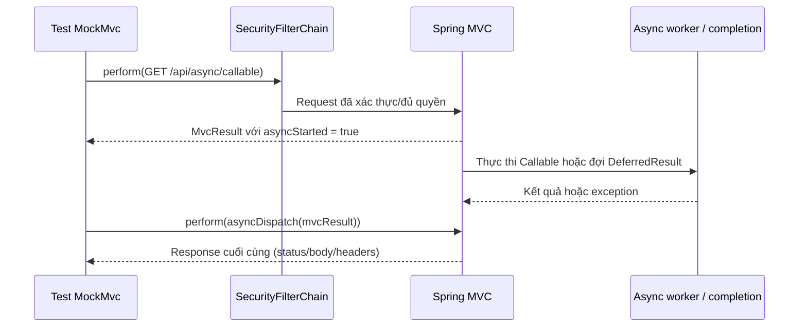
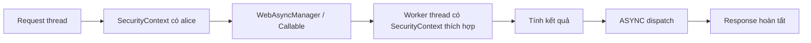

# MockMvc async dispatch và các lần xử lý tiếp theo

Trong chương **Bất đồng bộ và ngữ cảnh** của module **SPRING_SECURITY_TESTING**, người học kiểm chứng xác thực, phân quyền và bảo vệ HTTP thực tế bằng `spring-security-test`. Ở ứng dụng Servlet, `MockMvc` và `SecurityContext` hỗ trợ kiểm thử những request được phép hoặc bị từ chối; ở ứng dụng Reactive, `WebTestClient` và Reactor context phục vụ mục tiêu tương ứng. Khi controller Spring MVC trả về một kết quả **bất đồng bộ** như `Callable` hoặc `DeferredResult`, bài kiểm thử phải xử lý **hai giai đoạn**: request ban đầu bắt đầu xử lý async và request được **dispatch trở lại** để Spring MVC hoàn tất response.

Đây là một khác biệt quan trọng so với controller trả dữ liệu đồng bộ. Nếu chỉ gọi `mockMvc.perform(...)` rồi assert `200` hoặc response body ngay, test có thể quan sát trạng thái *chưa hoàn tất*. Nếu chỉ kiểm tra phần body sau dispatch mà bỏ qua authentication/authorization ở request đầu, ta cũng dễ bỏ sót lỗi bảo mật. Bài này minh họa `request().asyncStarted()`, `request().asyncResult()`, `asyncDispatch(...)`, cách xác minh `SecurityContext` trong `Callable`, nhánh `DeferredResult` hoàn tất từ bên ngoài và những lần xử lý tiếp theo của filter/interceptor.

## 1. Bản chất của một request MVC bất đồng bộ

Với controller thông thường, servlet thread nhận request, controller xử lý và response hoàn tất trong một lượt. Với Spring MVC async, controller có thể trả một **đại diện cho kết quả tương lai**, để Servlet request tạm rời khỏi thread xử lý ban đầu. Khi kết quả sẵn sàng, Spring MVC thực hiện **async dispatch**, khôi phục quá trình xử lý MVC nhằm ghi response.



Hai bước test tương ứng:

```java
MvcResult first = mockMvc.perform(get("/api/async/callable"))
        .andExpect(request().asyncStarted())
        .andReturn();

mockMvc.perform(asyncDispatch(first))
        .andExpect(status().isOk())
        .andExpect(content().string("done"));
```

Đây là **mẫu quy trình**, chưa đầy đủ authentication của endpoint bảo vệ. Các ca chạy được trong ví dụ sau sẽ dùng `httpBasic(...)` để lọc request qua Spring Security thật.

| Giai đoạn | API kiểm thử | Câu hỏi cần trả lời |
| --- | --- | --- |
| Request ban đầu | `mockMvc.perform(...)` | Authentication và authorization có cho request tới controller không? |
| Bắt đầu async | `request().asyncStarted()` | Handler có thực sự chuyển request sang async? |
| Kết quả tác vụ | `request().asyncResult(...)` hoặc `MvcResult#getAsyncResult(...)` | Công việc async đã trả đúng giá trị hay exception chưa? |
| Dispatch tiếp theo | `mockMvc.perform(asyncDispatch(first))` | Spring MVC có hoàn tất status/body/header và xử lý kết quả đúng không? |
| Sau dispatch | `status()`, `content()`, `jsonPath()`, `header()` | Response cuối cùng có tuân thủ hợp đồng HTTP? |

**Đừng nhầm:** `asyncDispatch` là bước giả lập servlet async dispatch trên **cùng request**, không phải gửi một request HTTP mới từ client. Do đó không tự tạo một authentication khác, không thay token hoặc username giữa hai pha để “thử lại” phân quyền. Muốn kiểm thử một người dùng khác, hãy tạo **request ban đầu mới** với credential của người ấy.

## 2. `Callable` và `DeferredResult` khác nhau thế nào?

Hai kiểu kết quả async thường gặp:

| Kiểu | Ai quyết định lúc chạy công việc? | Cách test chủ động kiểm soát |
| --- | --- | --- |
| `Callable<T>` | Spring MVC đăng ký tác vụ với async executor, rồi nhận giá trị trả về | Đợi kết quả async bằng công cụ MockMvc; assert principal trong tác vụ và response sau dispatch |
| `WebAsyncTask<T>` | Giống Callable nhưng có thể cấu hình executor, timeout và callback | Kiểm tra luồng thành công, timeout/callback theo hợp đồng |
| `DeferredResult<T>` | Ứng dụng hoặc callback bên ngoài quyết định lúc gọi `setResult(...)` hoặc `setErrorResult(...)` | Giữ reference tới `DeferredResult` và **chủ động hoàn thành từ test** |
| `CompletableFuture<T>` / `CompletionStage<T>` | Do executor hoặc nguồn hoàn thành future điều phối | Hoàn thành future một cách xác định, không ngủ chờ |

Với `Callable`, request ban đầu tạo cơ hội cho Spring Security gắn context vào xử lý async. Với `DeferredResult`, công việc hoàn tất trên một thread khác có thể do chính ứng dụng quản lý; **không được giả định mọi thread tùy ý đều tự nhận `SecurityContext`**.

## 3. Spring Security hoạt động ở những thời điểm nào?

Trong Servlet, `SecurityContextHolder` thường dùng `ThreadLocal` để lưu authentication cho thread đang xử lý request. Nhưng async task có thể chạy trên thread khác, và thread servlet ban đầu được trả về pool ngay sau khi bắt đầu async. Spring Security có cơ chế tích hợp với Spring MVC async, đặc biệt `WebAsyncManagerIntegrationFilter`, để hỗ trợ truyền `SecurityContext` khi xử lý `Callable`.



Các quy tắc quan trọng:

- `Callable` được Spring MVC quản lý có thể nhận security context đã được Spring Security tích hợp vào lúc bắt đầu tác vụ; đây là hành vi nên chứng minh bằng một test HTTP thật.
- `DeferredResult` không tự đồng nghĩa với “copy context sang mọi callback/thread hoàn tất”. Một callback tùy ý trên scheduler hoặc executor khác cần được thiết kế truyền context hoặc nhận dữ liệu identity một cách tường minh.
- `@Async`, `CompletableFuture.supplyAsync(...)` và thread tự tạo không mặc nhiên có cùng `SecurityContext` với servlet thread. Khi cần truyền context, có thể dùng `DelegatingSecurityContextExecutor` hoặc công cụ tương đương, và phải quản lý vòng đời executor.
- Một filter dựa trên `OncePerRequestFilter` có thể bỏ qua async dispatch theo cấu hình/default của chính nó. Không suy rằng tất cả custom filters chắc chắn chạy lại ở pha dispatch.
- Một số servlet filter còn phụ thuộc `DispatcherType.ASYNC` có nằm trong tập dispatcher types mà container/test đăng ký hay không. Phải kiểm tra hành vi của **filter chain ứng dụng thực tế**, không chỉ đọc tên `asyncDispatch` rồi kết luận mọi filter chạy lại.

**Chốt phạm vi:** truyền context phục vụ tác vụ async không thay thế việc kiểm tra authorization. Chỉ vì `Callable` đọc được tên `alice` không có nghĩa `alice` được phép truy cập mọi dữ liệu. Các rule `hasRole`, `hasAuthority`, tenant và chủ sở hữu tài nguyên vẫn cần test riêng.

## 4. Ví dụ đầy đủ: controller Callable, DeferredResult và exception async

Để test rõ cả hai pha, ta dựng một Spring MVC application nhỏ. Đường dẫn `/api/async/**` yêu cầu `ROLE_READER` với HTTP Basic. Người dùng `alice` có role đó, `bob` thì không. Controller có ba tình huống: trả tên principal từ `Callable`, nhận kết quả bên ngoài bằng `DeferredResult` và ném lỗi từ `Callable`.

```java
import java.util.concurrent.Callable;
import java.util.concurrent.atomic.AtomicReference;
import org.springframework.http.HttpStatus;
import org.springframework.http.ResponseEntity;
import org.springframework.security.core.Authentication;
import org.springframework.security.core.context.SecurityContextHolder;
import org.springframework.web.bind.annotation.ExceptionHandler;
import org.springframework.web.bind.annotation.GetMapping;
import org.springframework.web.bind.annotation.RestController;
import org.springframework.web.context.request.async.DeferredResult;

@RestController
class AsyncReportController {

    private final AtomicReference<DeferredResult<String>> pending =
            new AtomicReference<>();

    @GetMapping("/api/async/callable")
    Callable<String> callable() {
        return () -> {
            Authentication authentication =
                    SecurityContextHolder.getContext().getAuthentication();
            if (authentication == null) {
                throw new IllegalStateException(
                        "Missing SecurityContext in Callable");
            }
            return "user=" + authentication.getName();
        };
    }

    @GetMapping("/api/async/deferred")
    DeferredResult<String> deferred() {
        DeferredResult<String> result = new DeferredResult<>();
        pending.set(result);
        return result;
    }

    void completeDeferred(String value) {
        DeferredResult<String> result = pending.getAndSet(null);
        if (result == null) {
            throw new IllegalStateException("No pending result");
        }
        result.setResult(value);
    }

    @GetMapping("/api/async/failure")
    Callable<String> failure() {
        return () -> {
            throw new IllegalStateException("async-work-failed");
        };
    }

    @ExceptionHandler(IllegalStateException.class)
    ResponseEntity<String> handleAsyncFailure(
            IllegalStateException error) {
        return ResponseEntity.status(HttpStatus.INTERNAL_SERVER_ERROR)
                .body("async-error");
    }
}
```

`AtomicReference` trong ví dụ giúp test hoàn tất `DeferredResult` **không dùng `Thread.sleep(...)`**. Đây là thiết bị kiểm thử đơn giản, không phải mẫu lưu trạng thái request production cho nhiều người dùng: nếu hai request cùng chờ, một reference duy nhất có thể ghi đè kết quả của request trước. Hệ thống thật nên dùng cơ chế tương quan theo request ID, hàng đợi, map an toàn hoặc event publisher phù hợp; trong test không chạy song song, một reference đủ minh họa.

Không cần thêm `@Async` vào các method controller trên. Spring MVC tự nhận diện `Callable` và `DeferredResult` rồi kích hoạt quy trình asynchronous request handling.

### Cấu hình SecurityFilterChain và tài khoản test

```java
import org.springframework.context.annotation.Bean;
import org.springframework.context.annotation.Configuration;
import org.springframework.security.config.Customizer;
import org.springframework.security.config.annotation.web.builders.HttpSecurity;
import org.springframework.security.config.annotation.web.configuration.EnableWebSecurity;
import org.springframework.security.core.userdetails.User;
import org.springframework.security.core.userdetails.UserDetailsService;
import org.springframework.security.provisioning.InMemoryUserDetailsManager;
import org.springframework.security.web.SecurityFilterChain;

@Configuration
@EnableWebSecurity
class AsyncSecurityConfig {

    @Bean
    SecurityFilterChain apiSecurity(HttpSecurity http) throws Exception {
        return http
                .securityMatcher("/api/async/**")
                .authorizeHttpRequests(authorize -> authorize
                        .anyRequest().hasRole("READER"))
                .httpBasic(Customizer.withDefaults())
                .build();
    }

    @Bean
    UserDetailsService users() {
        return new InMemoryUserDetailsManager(
                User.withUsername("alice")
                    .password("{noop}pw")
                    .roles("READER")
                    .build(),
                User.withUsername("bob")
                    .password("{noop}pw")
                    .roles("GUEST")
                    .build());
    }
}
```

`securityMatcher("/api/async/**")` giới hạn phạm vi áp dụng của chain minh họa. Ứng dụng thật cần bảo vệ các đường dẫn khác bằng chain tương ứng hoặc fallback chain. Trong bài test, chỉ dùng endpoint thuộc `/api/async/**` để tránh hiểu nhầm rằng mọi đường dẫn ngoài matcher cũng được bảo vệ.

Các ví dụ trên dùng Spring Boot 3.x / Spring Security 6.x với Servlet Jakarta, HTTP Basic và mật khẩu `{noop}` **chỉ dành cho test**. Không sử dụng no-op password encoder hoặc tài khoản mẫu trong production.

## 5. Tạo MockMvc có Spring Security filters thật

Đối với bài kiểm thử tích hợp, có thể dùng `@SpringBootTest` và `@AutoConfigureMockMvc`. Để ví dụ không phụ thuộc vào component scan của dự án khác, ta khai báo một test application tối thiểu và import controller/security configuration ở mục 4:

```java
import org.springframework.boot.SpringBootConfiguration;
import org.springframework.boot.autoconfigure.EnableAutoConfiguration;
import org.springframework.boot.test.autoconfigure.web.servlet.AutoConfigureMockMvc;
import org.springframework.boot.test.context.SpringBootTest;
import org.springframework.context.annotation.Import;

@SpringBootTest(classes = AsyncDispatchSecurityTest.TestApp.class)
@AutoConfigureMockMvc
class AsyncDispatchSecurityTest {

    @SpringBootConfiguration
    @EnableAutoConfiguration
    @Import({AsyncReportController.class, AsyncSecurityConfig.class})
    static class TestApp {}

    // Các trường và test method đặt ở mục kế tiếp.
}
```

Trong Spring Boot test, `@AutoConfigureMockMvc` tích hợp Servlet filters theo cấu hình test mặc định để request đi qua `springSecurityFilterChain`. Nếu tự dựng `MockMvc`, cần áp dụng Spring Security:

```java
MockMvc mockMvc = MockMvcBuilders.webAppContextSetup(context)
        .apply(SecurityMockMvcConfigurers.springSecurity())
        .build();
```

Đoạn này cần `WebApplicationContext` tên `context` cùng import `MockMvcBuilders` và `SecurityMockMvcConfigurers`. **Không** dùng `MockMvcBuilders.standaloneSetup(controller)` rồi khẳng định đã test security nếu chưa cấu hình Spring Security filters cho nó.

## 6. Các bài test hoàn chỉnh: hai pha async và các nhánh 200/401/403/500

Phần dưới là nội dung cần đặt **bên trong** class `AsyncDispatchSecurityTest` ở mục 5 (cùng với các import). Test gửi credential HTTP Basic thật qua security filter, không dựng sẵn `Authentication` cho controller.

```java
import static org.springframework.security.test.web.servlet.request
        .SecurityMockMvcRequestPostProcessors.httpBasic;
import static org.springframework.test.web.servlet.request
        .MockMvcRequestBuilders.asyncDispatch;
import static org.springframework.test.web.servlet.request
        .MockMvcRequestBuilders.get;
import static org.springframework.test.web.servlet.result
        .MockMvcResultMatchers.content;
import static org.springframework.test.web.servlet.result
        .MockMvcResultMatchers.request;
import static org.springframework.test.web.servlet.result
        .MockMvcResultMatchers.status;

import org.junit.jupiter.api.Test;
import org.springframework.beans.factory.annotation.Autowired;
import org.springframework.test.web.servlet.MockMvc;
import org.springframework.test.web.servlet.MvcResult;

@Autowired
MockMvc mockMvc;

@Autowired
AsyncReportController controller;

@Test
void callable_giuDanhTinhVaHoanTatSauAsyncDispatch()
        throws Exception {
    MvcResult initial = mockMvc.perform(
            get("/api/async/callable")
                .with(httpBasic("alice", "pw")))
        .andExpect(request().asyncStarted())
        .andExpect(request().asyncResult("user=alice"))
        .andReturn();

    mockMvc.perform(asyncDispatch(initial))
        .andExpect(status().isOk())
        .andExpect(content().string("user=alice"));
}

@Test
void deferredResult_hoanTatDoTestChuDongDieuKhien()
        throws Exception {
    MvcResult initial = mockMvc.perform(
            get("/api/async/deferred")
                .with(httpBasic("alice", "pw")))
        .andExpect(request().asyncStarted())
        .andReturn();

    controller.completeDeferred("ready");

    mockMvc.perform(asyncDispatch(initial))
        .andExpect(status().isOk())
        .andExpect(content().string("ready"));
}

@Test
void anonymous_biChanTruocKhiBatDauAsync()
        throws Exception {
    mockMvc.perform(get("/api/async/callable"))
        .andExpect(status().isUnauthorized())
        .andExpect(request().asyncNotStarted());
}

@Test
void daXacThucNhungThieuQuyen_biChanTruocAsync()
        throws Exception {
    mockMvc.perform(get("/api/async/callable")
            .with(httpBasic("bob", "pw")))
        .andExpect(status().isForbidden())
        .andExpect(request().asyncNotStarted());
}

@Test
void callableNemLoi_exceptionDuocXuLyKhiDispatch()
        throws Exception {
    MvcResult initial = mockMvc.perform(
            get("/api/async/failure")
                .with(httpBasic("alice", "pw")))
        .andExpect(request().asyncStarted())
        .andReturn();

    mockMvc.perform(asyncDispatch(initial))
        .andExpect(status().isInternalServerError())
        .andExpect(content().string("async-error"));
}
```

Các test chứng minh năm điểm:

1. HTTP Basic xác thực `alice`; `Callable` đọc lại `SecurityContext` trên thread xử lý async và trả tên đúng. **Giá trị async** và **HTTP response cuối** đều được kiểm tra.
2. Với `DeferredResult`, test hoàn thành tác vụ bằng `setResult(...)` rồi dispatch. Không cần đợi scheduler hoặc đặt một thời gian ngủ giả.
3. Request chưa đăng nhập bị chặn `401` **ngay ở pha ban đầu**, nên không được khởi động async.
4. `bob` đăng nhập hợp lệ nhưng thiếu `ROLE_READER`, bị `403` trước khi vào controller.
5. Exception phát sinh trong `Callable` chỉ trở thành response `500` sau khi MVC xử lý kết quả/exception ở pha dispatch.

Giả định `AsyncReportController` được Spring tạo như bean để có thể inject vào test. Các phép kiểm thử dùng một request đang chờ cho `DeferredResult` và không chạy song song; nếu bật parallel test execution, cần cô lập `pending` theo từng request/test.

**Rất quan trọng:** `request().asyncStarted()` phải được assert ở lần `perform` đầu. Sau khi `asyncDispatch(...)` hoàn tất theo một chu kỳ async thông thường, response sẽ sẵn sàng cho `status()`, `content()` hoặc `jsonPath()`. Không chỉ assert status `200` ở lần perform đầu rồi bỏ qua dispatch.

## 7. `asyncResult(...)` và `getAsyncResult(...)` dùng lúc nào?

`request().asyncResult(...)` phù hợp khi biết trước giá trị `Callable`/`DeferredResult` phải tạo ra:

```java
MvcResult initial = mockMvc.perform(
        get("/api/async/callable").with(httpBasic("alice", "pw")))
    .andExpect(request().asyncStarted())
    .andExpect(request().asyncResult("user=alice"))
    .andReturn();
```

Khi cần tự kiểm tra kiểu dữ liệu hoặc predicate phức tạp, có thể lấy result rồi đọc kết quả async:

```java
MvcResult initial = mockMvc.perform(
        get("/api/async/callable").with(httpBasic("alice", "pw")))
    .andExpect(request().asyncStarted())
    .andReturn();

Object value = initial.getAsyncResult(5000);
assertEquals("user=alice", value);

mockMvc.perform(asyncDispatch(initial))
    .andExpect(status().isOk());
```

`getAsyncResult(5000)` chờ tối đa **5.000 mili giây trong test**, không phải TTL của login session hoặc timeout mặc định của endpoint production. Cần import `org.junit.jupiter.api.Assertions.assertEquals`. Với task chạy lỗi, async result có thể mang exception; nên kiểm tra exception hoặc xử lý `asyncDispatch(...)` và assert HTTP response từ exception handler tùy mục tiêu.

Nếu ứng dụng định nghĩa `WebAsyncTask` với timeout, các callback timeout/error hoặc `DeferredResult#setErrorResult(...)`, hãy tách test thành từng nhánh. Không giả định chỉ tăng timeout trong `getAsyncResult(...)` là đã kích hoạt cơ chế timeout Servlet của ứng dụng: đây là hai loại timeout khác nhau.

## 8. Các lần xử lý tiếp theo: interceptor và DispatcherType.ASYNC

Sau khi controller bắt đầu async, MVC sẽ tiếp tục công việc trên một lần dispatch sau đó. Điều này ảnh hưởng đến `HandlerInterceptor`:

- `preHandle(...)` thường chạy ở request ban đầu và có thể chạy lại khi async dispatch tiếp tục xử lý MVC.
- Với `AsyncHandlerInterceptor`, `afterConcurrentHandlingStarted(...)` được gọi khi request chuyển sang xử lý bất đồng bộ.
- `postHandle(...)` và `afterCompletion(...)` thông thường không chạy như request đồng bộ ngay trong lượt đầu mà được thực thi khi kết quả async đã được dispatch và hoàn tất (tùy nhánh lỗi/handler).

Ví dụ interceptor chỉ ghi lại các mốc lifecycle vào request attribute:

```java
import jakarta.servlet.http.HttpServletRequest;
import jakarta.servlet.http.HttpServletResponse;
import java.util.ArrayList;
import java.util.List;
import org.springframework.lang.Nullable;
import org.springframework.web.servlet.AsyncHandlerInterceptor;
import org.springframework.web.servlet.ModelAndView;

final class AsyncTraceInterceptor implements AsyncHandlerInterceptor {

    @SuppressWarnings("unchecked")
    private static void mark(HttpServletRequest request, String value) {
        List<String> trace = (List<String>) request.getAttribute(
                "probe.mvcTrace");
        if (trace == null) {
            trace = new ArrayList<>();
            request.setAttribute("probe.mvcTrace", trace);
        }
        trace.add(value);
    }

    @Override
    public boolean preHandle(
            HttpServletRequest request,
            HttpServletResponse response,
            Object handler) {
        mark(request, "pre:" + request.getDispatcherType());
        return true;
    }

    @Override
    public void afterConcurrentHandlingStarted(
            HttpServletRequest request,
            HttpServletResponse response,
            Object handler) {
        mark(request, "async-started");
    }

    @Override
    public void postHandle(
            HttpServletRequest request,
            HttpServletResponse response,
            Object handler,
            @Nullable ModelAndView modelAndView) {
        mark(request, "post");
    }

    @Override
    public void afterCompletion(
            HttpServletRequest request,
            HttpServletResponse response,
            Object handler,
            Exception ex) {
        mark(request, "completed");
    }
}
```

Để áp dụng interceptor, đăng ký nó với `WebMvcConfigurer#addInterceptors(...)` trong test context. Khi test `Callable` thành công, có thể assert trace gồm mốc request ban đầu, `async-started`, mốc dispatch tiếp theo, `post` và `completed`. Kiểm tra theo **thứ tự tương đối** thay vì hardcode mọi callback/dispatcher type của tất cả servlet container, đặc biệt khi ứng dụng còn có error handling hoặc custom interceptors.

`AsyncHandlerInterceptor` không phải Servlet filter. Lời gọi vào MVC interceptor trên async dispatch và việc Servlet `Filter` chạy lại phụ thuộc vào **hai cơ chế riêng**. Muốn khẳng định custom filter chạy ở `DispatcherType.ASYNC`, phải kiểm tra dispatcher types khi đăng ký filter và các nhánh `shouldNotFilterAsyncDispatch()` nếu dùng `OncePerRequestFilter`.

## 9. SecurityContext trên worker thread: đừng suy rộng từ Callable

Ví dụ `Callable` ở mục 6 kiểm tra rằng Spring Security đã giúp truyền context trong đường xử lý async do Spring MVC quản lý. Nhưng một executor tự quản lý không nhất thiết có cơ chế đó.

```java
CompletableFuture.supplyAsync(() -> {
    Authentication auth =
            SecurityContextHolder.getContext().getAuthentication();
    return auth == null ? "anonymous" : auth.getName();
});
```

Đoạn này chạy trên executor mặc định của `CompletableFuture`, **không nên giả định** nó có cùng authentication với request hiện tại. Dùng `DelegatingSecurityContextExecutor` khi tác vụ cần context và bạn kiểm soát executor:

```java
import java.util.concurrent.Executor;
import org.springframework.security.concurrent.DelegatingSecurityContextExecutor;

Executor delegate = applicationExecutor; // Executor do ứng dụng quản lý
Executor contextAware =
        new DelegatingSecurityContextExecutor(delegate);

contextAware.execute(() -> {
    Authentication authentication =
            SecurityContextHolder.getContext().getAuthentication();
    // Thực hiện công việc với context thích hợp.
});
```

`DelegatingSecurityContextExecutor` giúp gắn SecurityContext cho runnable và dọn context sau đó theo cơ chế thư viện; bạn vẫn phải quản lý executor nền, lifecycle, cancellation và xử lý exception. Tránh lưu `SecurityContext` của người dùng vào singleton hoặc cache dùng chung, vì có thể làm rò danh tính giữa các request.

Với `DeferredResult` hoàn tất qua callback bên ngoài, cách bền vững thường là **truyền định danh nghiệp vụ đã được xác minh ở request ban đầu** (chẳng hạn user ID, tenant ID) cho công việc cần thiết, thay vì mặc nhiên lấy một thread-local không được bảo đảm. Nếu công việc thực sự cần quyền thực thi hiện tại, hãy có chính sách truyền context rõ ràng và test cả tình huống không có context.

## 10. Async dispatch nhiều chu kỳ và các request kế tiếp

Thông thường một lần `Callable` hoặc `DeferredResult` tạo **một** lượt bắt đầu async và **một** lượt dispatch để hoàn tất response. `asyncDispatch(initial)` chỉ hợp lệ khi `MvcResult` ban đầu đã bắt đầu async và kết quả cần thiết sẵn sàng.

Nếu thiết kế handler hoặc interceptor thực sự khởi động một chu kỳ async tiếp theo, hãy kiểm tra từng lượt:

```java
MvcResult first = mockMvc.perform(get("/api/work")
        .with(httpBasic("alice", "pw")))
    .andExpect(request().asyncStarted())
    .andReturn();

MvcResult next = mockMvc.perform(asyncDispatch(first))
    .andReturn();

// Chỉ thực hiện thêm asyncDispatch(next) NẾU lượt kế tiếp
// thực sự đã bắt đầu async lần nữa theo thiết kế của handler.
```

Đoạn trên là **khung điều khiển**, không phải ví dụ endpoint có thật. Đừng gọi lặp `asyncDispatch` vô điều kiện trên một response đã hoàn tất; cũng đừng gửi request mới chỉ để “dispatch tiếp” cho kết quả cũ. Với ứng dụng có streaming hoặc long polling, mô hình xử lý và kiểm thử có thể khác `Callable` đơn giản; cần chọn API test đúng loại response.

Mỗi request HTTP kế tiếp (ví dụ lần gọi sau khi async response đã xong) là một **request mới** với authentication và điều kiện authorization của chính nó. SecurityContext của `alice` không được phép “rò” sang request anonymous được gửi sau đó. Một regression test hữu ích là:

```java
// Sau khi asyncDispatch của alice hoàn tất...
mockMvc.perform(get("/api/async/callable"))
    .andExpect(status().isUnauthorized())
    .andExpect(request().asyncNotStarted());
```

Test này không chứng minh mọi thứ về lifecycle thread, nhưng giúp phát hiện lỗi cấu hình dẫn tới giữ identity giữa các request nếu hiện tượng đó xảy ra trong test context.

## 11. Ma trận kiểm thử tối thiểu

Với `AsyncSecurityConfig` và controller của ví dụ:

| Request / tình huống | Pha ban đầu | Pha async dispatch | Kết quả cần chứng minh |
| --- | --- | --- | --- |
| `alice` có `ROLE_READER`, `Callable` thành công | `asyncStarted=true` | `200` và body `user=alice` | SecurityContext hợp lệ trong Callable và MVC hoàn tất response |
| `alice`, `DeferredResult` chờ kết quả | `asyncStarted=true` | `200` và body do test đặt | Có thể hoàn tất bất đồng bộ mà không `sleep` |
| Anonymous gọi `Callable` | `401`, `asyncNotStarted` | Không dispatch | Bị chặn trước controller |
| `bob` chỉ có `ROLE_GUEST` | `403`, `asyncNotStarted` | Không dispatch | Đã xác thực nhưng thiếu quyền |
| `alice`, `Callable` ném exception | `asyncStarted=true` | `500` và body lỗi | Exception async được map thành response khi dispatch |
| `alice`, test sau đó gửi request anonymous | `401` ở request mới | Không dispatch | Không giả định danh tính request trước còn hiệu lực |

Với endpoint có JWT/OAuth2, có thể thay HTTP Basic bằng `Authorization: Bearer <token>` để kiểm thử decoder/introspector thật; `.with(jwt())` hoặc `.with(user(...))` phù hợp khi mục tiêu là kiểm tra logic authorization với authentication giả lập, **không** chứng minh filter Bearer hoặc bước xác minh token đã chạy.

## 12. Những lỗi thường gặp

**Quên `asyncDispatch(...)`.** Test chỉ thấy request async được bắt đầu, chưa assert được status/body cuối. Phải gọi dispatch rồi kiểm tra HTTP response.

**Assert status `200` ngay ở request ban đầu.** Trong nhiều tình huống response ban đầu chưa được hoàn tất; test có thể đi qua sai giai đoạn. Dùng `request().asyncStarted()` và `request().asyncResult(...)` trước khi assert status sau dispatch.

**Thử `asyncDispatch` trên request bị chặn `401/403`.** Authorization có thể từ chối **trước khi controller khởi động async**. Kiểm tra `request().asyncNotStarted()`; không dispatch một request không async.

**Dùng `@WithMockUser` rồi khẳng định HTTP Basic hoạt động.** `@WithMockUser` hoặc `.with(user(...))` cấp authentication giả; nó có ích để kiểm tra rule và một số trường hợp truyền context, nhưng không chạy xác thực mật khẩu thật. Dùng `httpBasic(...)` khi cần kiểm tra đường Basic authentication.

**Cho rằng mọi async thread đều có SecurityContext.** `Callable` do Spring MVC quản lý được tích hợp với Spring Security khác với `CompletableFuture`/scheduler tùy ý. Cần truyền context có kiểm soát hoặc truyền dữ liệu danh tính theo hợp đồng.

**Dùng `Thread.sleep(...)` để đợi `DeferredResult`.** Test trở nên chậm và dễ lỗi trên CI. Giữ reference/future trong fixture, hoàn tất theo sự kiện và dùng `getAsyncResult(timeout)` khi cần.

**Không kiểm tra lần dispatch tiếp theo của filter/interceptor.** Request qua pha ban đầu nhưng lỗi có thể xảy ra khi Spring MVC map body, chọn exception handler hoặc khi custom interceptor hoàn tất. Có thể bổ sung trace theo `DispatcherType` và test response cuối.

**Giả định mọi Servlet filter chạy lại ở ASYNC dispatch.** Tùy dispatcher registration và `OncePerRequestFilter`, điều này có thể sai. Test điều kiện thực và không hardcode cách container xử lý nếu policy không yêu cầu.

**Dùng chung fixture `DeferredResult` khi test chạy song song.** Một `AtomicReference` toàn cục có thể bị request khác ghi đè. Cô lập theo request hoặc tắt parallel execution cho fixture minh họa.

**Nhầm async Servlet với Reactive.** `MockMvc` và `asyncDispatch` áp dụng cho Spring MVC Servlet. Với `Mono`, `Flux`, `WebTestClient` và `ReactiveSecurityContextHolder` trong WebFlux, quy trình kiểm thử khác và không sử dụng `asyncDispatch` của MockMvc để “đẩy tiếp” Reactor pipeline.

## 13. Checklist trước khi hoàn thành

- Endpoint trả một loại kết quả async thực sự (`Callable`, `DeferredResult`, `WebAsyncTask` hoặc kiểu được MVC hỗ trợ).
- `MockMvc` đã tích hợp đúng Spring Security Servlet filters của ứng dụng.
- Request ban đầu được assert `request().asyncStarted()` khi có quyền hoặc `asyncNotStarted()` khi bị chặn trước controller.
- Kết quả async được chờ/hoàn tất có kiểm soát, không dùng thời gian ngủ tùy tiện.
- `asyncDispatch(mvcResult)` được gọi để kiểm tra response HTTP cuối cùng: status, body, headers, lỗi.
- Có ca `200` với quyền hợp lệ, `401` chưa xác thực, `403` thiếu quyền và nhánh exception async nếu contract yêu cầu.
- Nếu test `Callable` đọc authentication, đã xác minh context trong tác vụ thực sự thuộc đúng principal.
- Không suy diễn context của `Callable` được truyền sang mọi executor hoặc callback của `DeferredResult`.
- Filter/interceptor cần quan sát async dispatch được kiểm tra theo dispatcher type/lifecycle thực tế.
- Một request mới sau response async không kế thừa danh tính của request trước.
- Phân biệt cơ chế async Servlet của `MockMvc` với Reactor context/WebFlux của `WebTestClient`.

**Điểm cốt lõi:** kiểm thử controller Servlet bất đồng bộ với Spring Security không kết thúc ở `request().asyncStarted()`. Hãy tách rõ **kiểm tra pha bắt đầu**, **kiểm tra kết quả tác vụ**, rồi **async dispatch để kiểm tra HTTP response cuối cùng**. Đồng thời kiểm chứng rằng request bị chặn trước khi bắt đầu async, và rằng `SecurityContext` chỉ được truyền tới tác vụ phù hợp theo cơ chế đã cấu hình, không rò rỉ sang các request hoặc thread khác.
