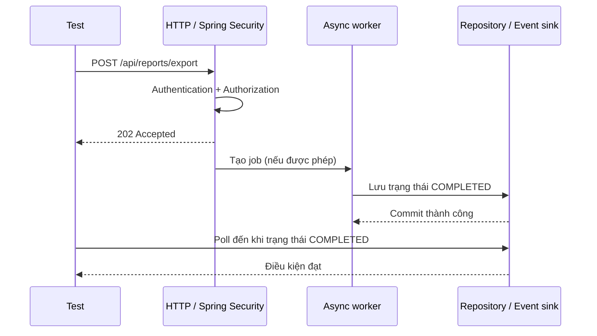

# Chờ kết quả có điều kiện và giới hạn thời gian của ca kiểm thử

Một bài kiểm thử Spring Security đôi khi thất bại không phải vì phân quyền sai, mà vì **assertion chạy trước khi công việc bất đồng bộ hoàn tất**. Ví dụ, API `POST /reports` trả `202 Accepted`, một worker xử lý yêu cầu rồi ghi sự kiện `REPORT_READY` sau đó; test kiểm tra database ngay lập tức sẽ báo thiếu bản ghi. Nếu sửa bằng `Thread.sleep(3000)`, test có thể chạy xanh trên máy cá nhân nhưng tiếp tục chập chờn trên CI. Nguy hiểm hơn, một test chỉ nhìn HTTP `401`/`403` mà không chờ đủ để quan sát tác vụ bất đồng bộ có thể bỏ sót việc ghi dữ liệu trái phép **sau khi response đã kết thúc**.

Bài này thuộc chương **Bất đồng bộ và ngữ cảnh** của module **SPRING_SECURITY_TESTING**: kiểm chứng xác thực, phân quyền và bảo vệ HTTP thực tế bằng `spring-security-test` trên Servlet và Reactive, với `MockMvc`, `WebTestClient`, `@WithMockUser`, `SecurityContext`, JWT/OAuth2/OIDC giả lập và các ca được phép/bị từ chối. Mục tiêu trực tiếp là **chờ theo điều kiện cần kiểm và đặt giới hạn thời gian rõ ràng cho mỗi ca**, đồng thời không đánh đồng việc một test đã hoàn thành với việc request/nghiệp vụ hoặc các tác vụ phụ của nó đã hoàn thành.

> **Nguyên tắc:** Chờ một *điều kiện có thể quan sát* thay vì chờ một khoảng thời gian đoán trước. Mọi thao tác chờ trong test phải có **hạn chót hữu hạn**. Đối với bảo mật, kết quả HTTP và hậu điều kiện (database, event, quyền truy cập, danh tính) phải được kiểm đúng ranh giới bất đồng bộ.

## 1. Bốn thời điểm thường bị trộn lẫn

Giả sử một API nhận lệnh xuất báo cáo. Luồng thực tế có thể như sau:



Bốn dấu mốc cần phân biệt:

1. **HTTP request được tiếp nhận:** Filter chain và controller đã bắt đầu xử lý.
2. **Response HTTP hoàn tất:** Test nhận status/body; có thể chỉ mang ý nghĩa “đã nhận job”.
3. **Publisher/`Future` hoàn tất:** Kết quả của một công việc bất đồng bộ đã phát terminal signal hoặc hoàn thành.
4. **Tác dụng phụ được quan sát:** Một transaction commit, sự kiện được ghi, trạng thái bên ngoài được thay đổi.

`200 OK` hoặc `202 Accepted` không tự bảo đảm (3) và (4) đã xảy ra; ngược lại, `401 Unauthorized` ở ranh giới HTTP phải được đối chiếu thêm với việc **không có tác vụ được bảo vệ nào được tạo ra**.

### 1.1. Chờ đúng bằng chứng

| Câu hỏi | Điểm quan sát | Cơ chế chờ phù hợp |
|---|---|---|
| Servlet `Callable`/`DeferredResult` đã cho kết quả? | `MvcResult` và async dispatch | `request().asyncStarted()`, `getAsyncResult(timeout)`, `asyncDispatch` |
| `CompletableFuture` đã hoàn tất? | Future terminal state | `get(timeout, unit)`, `orTimeout` khi thích hợp |
| Một trạng thái DB sẽ xuất hiện? | Repository/query | Awaitility `untilAsserted`/`until` với `atMost` |
| Một event đã phát tới listener? | Captured event hoặc queue | Latch có timeout, Awaitility, Mockito `timeout(...)` |
| Một `Mono`/`Flux` đã phát tín hiệu đúng? | Reactor subscriber | `StepVerifier` với `verify(Duration)` |
| Logic chỉ phụ thuộc đồng hồ/delay? | Virtual Scheduler | `StepVerifier.withVirtualTime(...)` |
| Server WebFlux có trả response đúng hạn? | HTTP response | `WebTestClient.responseTimeout(...)` |
| Dịch vụ async đã dừng sau lỗi auth? | DB/outbox/queue + gate kiểm soát được | Quan sát hậu điều kiện và xác nhận không tạo tác vụ trái phép |

**Không dùng cùng một timeout cho mọi ranh giới.** Timeout từ client HTTP, timeout của test assertion, `Mono.timeout()` ở ứng dụng, database transaction timeout và deadline của một job thực tế là các chính sách khác nhau.

## 2. Vì sao `Thread.sleep()` làm test bất ổn?

Đây là anti-pattern:

```java
mockMvc.perform(post("/api/reports/export")
        .with(user("alice").roles("REPORT_USER")))
    .andExpect(status().isAccepted());

Thread.sleep(2000);

assertThat(exportRepository.findLatestFor("alice"))
    .isPresent();
```

Nếu worker hoàn tất sau 100 ms, test lãng phí 1,9 giây. Nếu CI chậm hơn 2 giây, test thất bại dù hệ thống hoạt động đúng. Nếu worker nhanh bất thường, test vẫn không chứng minh **điều kiện đạt trước deadline nghiệp vụ nào**; nó chỉ đo một ảnh chụp sau khoảng chờ cố định.

Một phép chờ tốt có hai tính chất:

- **Dừng sớm:** Kết thúc ngay khi điều kiện được thỏa mãn.
- **Hữu hạn:** Nếu điều kiện không bao giờ thỏa mãn, báo lỗi có ngữ cảnh sau một khoảng tối đa.

Với event/repository, nên viết:

```java
await()
    .atMost(Duration.ofSeconds(3))
    .pollInterval(Duration.ofMillis(50))
    .untilAsserted(() ->
        assertThat(exportRepository.findLatestFor("alice"))
            .isPresent()
            .get()
            .extracting(ExportJob::getStatus)
            .isEqualTo(ExportStatus.COMPLETED));
```

Ví dụ dùng [Awaitility](https://github.com/awaitility/awaitility), các import cơ bản:

```java
import static org.awaitility.Awaitility.await;
import static org.assertj.core.api.Assertions.assertThat;
import java.time.Duration;
```

Ở đây `untilAsserted` lặp lại assertion cho tới khi nó đạt hoặc vượt giới hạn. Mỗi lần poll cần là một phép đọc **an toàn, không có side effect đáng kể**; đừng dùng polling để gọi lại endpoint `POST` tạo job.

### 2.1. Điều kiện đúng phải tương ứng với contract

Kiểm một bản ghi `exists()` có thể chưa đủ nếu nghiệp vụ yêu cầu trạng thái hoàn tất và owner chính xác. Chọn assertion mô tả trạng thái thực:

```java
await().atMost(Duration.ofSeconds(3))
    .untilAsserted(() -> {
        ExportJob job = exportRepository
                .findByCorrelationId(correlationId)
                .orElseThrow();

        assertThat(job.getOwner()).isEqualTo("alice");
        assertThat(job.getStatus())
                .isEqualTo(ExportStatus.COMPLETED);
        assertThat(job.getDownloadUrl()).isNotBlank();
    });
```

Khi repository đọc từ read replica có eventual consistency, nên biết rõ khả năng nhìn thấy dữ liệu trễ và chọn hạn chót phù hợp. Không tăng timeout vô hạn để che lỗi transaction hoặc xử lý job không ổn định.

## 3. Đặt ngân sách thời gian theo từng tầng

Có ít nhất bốn loại timeout:

| Loại | Mục tiêu | Nơi cấu hình | Nếu hết hạn thì sao? |
|---|---|---|---|
| **Business deadline** | Job/API phải hoàn tất trong thời hạn nghiệp vụ | App/service/SLA | Hệ thống xử lý lỗi/cancel/compensate theo contract |
| **HTTP client timeout** | Test không treo khi chờ response | `WebTestClient.responseTimeout(...)` hoặc HTTP client khác | Test fail ở ranh giới I/O |
| **Async result wait** | Chờ callback/Servlet async result hữu hạn | `MvcResult.getAsyncResult(timeout)` | Test fail nếu không có kết quả kịp |
| **Assertion deadline** | Chờ hậu điều kiện/eventual consistency | Awaitility `atMost`, `Future.get`, `StepVerifier.verify(Duration)` | Test fail với điều kiện còn sai |
| **Build/test runner timeout** | Ngăn cả suite treo do deadlock | JUnit/Gradle/CI | Runner hủy hoặc đánh dấu test fail |

Không nên dựa hoàn toàn vào timeout của CI. Nó thường quá rộng, khiến một test đơn lẻ hỏng kéo dài cả suite và không cho biết ranh giới nào kẹt.

Một chính sách thử nghiệm có thể là:

```java
private static final Duration HTTP_TIMEOUT =
        Duration.ofSeconds(3);

private static final Duration EVENTUAL_TIMEOUT =
        Duration.ofSeconds(5);

private static final Duration POLL_INTERVAL =
        Duration.ofMillis(50);
```

Đây chỉ là **giá trị minh họa**. Số thực tế phải được chọn từ contract của hệ thống, môi trường CI, và độ trễ hợp lệ; test unit dùng virtual time thường cần deadline khác integration test có network/database.

### 3.1. Cẩn thận về thứ tự timeout

Đặt một deadline quá nhỏ ở tầng HTTP rồi mong assertion DB có thể chạy sẽ không có ý nghĩa: HTTP đã fail trước khi trả correlation ID. Ngược lại, đặt `atMost(30 giây)` cho một logic `Mono` thuần không có I/O có thể làm sai phạm vi test.

Hãy làm rõ từng bước:

```text
T0: test gửi request
T1: request hoàn tất và cung cấp jobId
T2: job COMPLETED hoặc FAILED được quan sát
T3: test kết luận

HTTP timeout: giới hạn T0 → T1
Business deadline: giới hạn hợp đồng của T1 → T2
Awaitility timeout: thời gian test dành để quan sát T1 → T2
```

Một **assertion timeout** không nhất thiết kích hoạt **business timeout**. Nếu service không có timeout production, việc `await().atMost(...)` bị lỗi chỉ làm test kết thúc; tác vụ có thể vẫn chạy sau đó. Khi cần kiểm cancellation hoặc rollback, phải xác minh riêng.

## 4. Servlet: MockMvc và request xử lý bất đồng bộ

Spring MVC hỗ trợ `Callable`, `DeferredResult`, `CompletionStage` và các return type async tương ứng. Một request có thể **bắt đầu** xử lý bất đồng bộ trước khi response cuối cùng sẵn sàng. `MockMvc` hỗ trợ kiểm theo hai bước:

1. Gửi request ban đầu; assert `request().asyncStarted()`.
2. Chờ async result hữu hạn và gọi `asyncDispatch` để chạy phần dispatch còn lại, rồi assert status/body cuối.

Ví dụ controller minh họa:

```java
@RestController
@RequestMapping("/api/async")
class AsyncGreetingController {

    @GetMapping("/name")
    Callable<Map<String, String>> name() {
        return () -> Map.of(
                "name",
                SecurityContextHolder.getContext()
                    .getAuthentication()
                    .getName());
    }
}
```

Import tiêu biểu:

```java
import java.util.Map;
import java.util.concurrent.Callable;
import org.springframework.security.core.context.SecurityContextHolder;
import org.springframework.web.bind.annotation.GetMapping;
import org.springframework.web.bind.annotation.RequestMapping;
import org.springframework.web.bind.annotation.RestController;
```

Spring Security tích hợp `WebAsyncManagerIntegrationFilter` giúp truyền SecurityContext sang luồng xử lý `Callable` của Spring MVC trong các thiết lập chuẩn. Điều này **không mặc định áp dụng** cho mọi `CompletableFuture.supplyAsync(...)`/`@Async` do ứng dụng tự tạo.

### 4.1. Test bằng asyncStarted, bounded wait và asyncDispatch

```java
@SpringBootTest
@AutoConfigureMockMvc
class AsyncGreetingIT {

    @Autowired
    MockMvc mockMvc;

    @Test
    void callableUsesAuthenticatedPrincipal()
            throws Exception {

        MvcResult started =
                mockMvc.perform(
                        get("/api/async/name")
                            .with(user("alice")
                                .roles("REPORT_USER")))
                    .andExpect(request().asyncStarted())
                    .andReturn();

        // Chờ tối đa 2 giây để Spring MVC tạo kết quả async.
        assertThat(started.getAsyncResult(2000))
                .isNotNull();

        mockMvc.perform(asyncDispatch(started))
                .andExpect(status().isOk())
                .andExpect(jsonPath("$.name")
                        .value("alice"));
    }
}
```

Static imports chính:

```java
import static org.assertj.core.api.Assertions.assertThat;
import static org.springframework.security.test.web.servlet.request
        .SecurityMockMvcRequestPostProcessors.user;
import static org.springframework.test.web.servlet.request
        .MockMvcRequestBuilders.get;
import static org.springframework.test.web.servlet.request
        .MockMvcRequestBuilders.asyncDispatch;
import static org.springframework.test.web.servlet.result
        .MockMvcResultMatchers.request;
import static org.springframework.test.web.servlet.result
        .MockMvcResultMatchers.status;
import static org.springframework.test.web.servlet.result
        .MockMvcResultMatchers.jsonPath;
```

Lưu ý: `getAsyncResult(2000)` dùng timeout tính bằng **mili giây**. Nếu async result không xuất hiện kịp, test sẽ thất bại/throw theo Spring Test thay vì chờ vô hạn. `asyncDispatch` là bước cần thiết để kiểm response cuối cùng, không chỉ trạng thái của request trước khi async hoàn tất.

Bộ test giả định ứng dụng có security chain cho phép `REPORT_USER` vào `/api/async/name`, và `MockMvc` tích hợp Spring Security filters. Nếu controller không được map hoặc chain không chạy, một kết quả status riêng lẻ không phải bằng chứng đầy đủ.

### 4.2. Lỗi phổ biến: assert response trước asyncDispatch

```java
// SAI về mặt ý nghĩa đối với response được tạo sau async.
mockMvc.perform(get("/api/async/name")
        .with(user("alice")))
    .andExpect(status().isOk());
```

Status ban đầu có thể là giá trị tạm trước khi async dispatch hoàn tất; body chưa chắc chứa dữ liệu cuối. Test có thể xanh mà không thực hiện assertion trên phần trả về sau cùng.

Tương tự, nếu dùng `@WithMockUser` trong test Callable, phải kiểm security context được truyền đến **luồng Callable** qua Spring Security integration. Một assertion chỉ đọc `SecurityContextHolder` trên thread JUnit không chứng minh worker async nhận đúng principal.

## 5. Kiểm soát hoàn thành bằng CompletableFuture thay cho sleep

Đối với luồng async có thể chủ động điều khiển kết thúc, dùng một **test-controlled Future** để tránh phụ thuộc đồng hồ. Mẫu sau minh họa một service trả future; controller chỉ tiếp tục khi future được hoàn tất.

```java
public interface ReportQuery {
    CompletableFuture<String> fetch(String reportId);
}

@RestController
class AsyncReportController {

    private final ReportQuery query;

    AsyncReportController(ReportQuery query) {
        this.query = query;
    }

    @GetMapping("/api/reports/{id}/async")
    CompletableFuture<Map<String, String>> report(
            @PathVariable String id) {

        return query.fetch(id)
                .thenApply(value -> Map.of(
                        "id", id,
                        "value", value));
    }
}
```

Imports:

```java
import java.util.Map;
import java.util.concurrent.CompletableFuture;
import org.springframework.web.bind.annotation.GetMapping;
import org.springframework.web.bind.annotation.PathVariable;
import org.springframework.web.bind.annotation.RestController;
```

Một fake có thể điều khiển:

```java
final class ControlledReportQuery implements ReportQuery {

    private final ConcurrentMap<String, CompletableFuture<String>>
            pending = new ConcurrentHashMap<>();

    @Override
    public CompletableFuture<String> fetch(String id) {
        return pending.computeIfAbsent(
                id, key -> new CompletableFuture<>());
    }

    void complete(String id, String result) {
        CompletableFuture<String> future = pending.get(id);
        if (future == null) {
            throw new IllegalStateException(
                    "Chưa có request cho " + id);
        }
        future.complete(result);
    }

    void reset() {
        pending.clear();
    }
}
```

Dùng fake như test bean thay cho cổng đọc báo cáo; giữ **MVC controller và SecurityFilterChain** thật. Nếu test đang kiểm security flow, chỉ thay ranh giới I/O bên ngoài, không thay toàn bộ filter chain.

```java
@Test
void completesOnlyAfterControlledSignal() throws Exception {
    String reportId = "r-42";

    MvcResult pending = mockMvc.perform(
                get("/api/reports/{id}/async", reportId)
                    .with(user("alice")
                        .roles("REPORT_USER")))
            .andExpect(request().asyncStarted())
            .andReturn();

    controlledQuery.complete(reportId, "READY");

    assertThat(pending.getAsyncResult(2000))
            .isNotNull();

    mockMvc.perform(asyncDispatch(pending))
            .andExpect(status().isOk())
            .andExpect(jsonPath("$.id").value(reportId))
            .andExpect(jsonPath("$.value").value("READY"));
}
```

`controlledQuery` là bean test được inject, có trạng thái riêng cho mỗi test; cần reset để không rò rỉ `CompletableFuture` giữa các ca. Khi chạy test song song, dùng report ID khác nhau hoặc một fake được cô lập theo test context.

### 5.1. Kiểm auth trước khi tạo công việc async

Ca âm tính quan trọng:

```java
@Test
void forbiddenRequestMustNotEnqueueAsyncWork()
        throws Exception {

    String reportId = "r-forbidden";

    mockMvc.perform(
                get("/api/reports/{id}/async", reportId)
                    .with(user("mallory")
                        .roles("GUEST")))
            .andExpect(status().isForbidden());

    assertThat(controlledQuery.hasPending(reportId))
            .isFalse();
}
```

`hasPending(reportId)` là một helper read-only cần bổ sung vào fake (`return pending.containsKey(reportId)`). Test này phù hợp khi authorization diễn ra **trước controller**. Nếu ứng dụng tạo work ở một filter/service trước khi kiểm quyền, có thể phải dùng spy/fake ở cổng phát job và assert không có invocation.

Đừng cố gọi `asyncDispatch` trong ca request đã bị chặn trước khi async bắt đầu. Khi `403` được tạo ngay tại security filter, `request().asyncStarted()` phải **không** được dùng làm assertion bắt buộc.

## 6. Awaitility: chờ repository hoặc event đến trạng thái mong đợi

Nhiều hệ thống dùng message broker, outbox, scheduler, webhook hoặc job queue. Kết quả cần xác minh có thể không gắn với một `Future` của controller. Khi đó chờ theo **điều kiện nghiệp vụ có thể quan sát** là phù hợp.

Dependency Maven hoặc Gradle (ví dụ):

```groovy
dependencies {
    testImplementation 'org.awaitility:awaitility'
}
```

Một test sau request thành công:

```java
@Test
void allowedExportEventuallyCreatesCompletedJob()
        throws Exception {

    String correlationId = UUID.randomUUID().toString();

    mockMvc.perform(post("/api/exports")
                .with(user("alice")
                    .roles("EXPORTER"))
                .with(csrf())
                .header("X-Correlation-Id", correlationId))
            .andExpect(status().isAccepted());

    await()
        .atMost(Duration.ofSeconds(5))
        .pollInterval(Duration.ofMillis(50))
        .untilAsserted(() -> {
            ExportJob job = repository
                .findByCorrelationId(correlationId)
                .orElseThrow();

            assertThat(job.getStatus())
                    .isEqualTo(ExportStatus.COMPLETED);
            assertThat(job.getOwner())
                    .isEqualTo("alice");
        });
}
```

Các thành phần `ExportJob`, `ExportStatus`, repository, endpoint là ví dụ nghiệp vụ; cần có implementation tương ứng mới chạy nguyên đoạn. `.with(csrf())` đúng khi ứng dụng Servlet đang bảo vệ request ghi bằng CSRF; trong API Bearer stateless có cấu hình khác, test nên giữ chính sách production.

`untilAsserted` không kết luận job sẽ thành công ngay lập tức. Nó kiểm tra eventual completion **trước deadline test**. Nếu job chạy quá hạn, assertion cuối gần nhất giúp debug trạng thái không mong đợi.

### 6.1. Dùng correlation ID thay vì đọc “job cuối cùng”

Trong test song song, `findLatestJob()` có thể trả job do test khác tạo. Mỗi request nên có `correlationId`/job ID riêng và query đúng đối tượng:

```java
String correlationId =
        "it-" + UUID.randomUUID();

await().atMost(Duration.ofSeconds(5))
    .untilAsserted(() ->
        assertThat(repository.findByCorrelationId(
                correlationId))
            .isPresent());
```

Ngoài giảm flaky, correlation ID giúp kiểm rằng **sự kiện đến từ đúng user/tenant/request**. Với bảo mật, đây là điều kiện quan trọng: một job xuất hiện cho Alice không chứng minh job của Bob đã bị ngăn nếu query quá rộng.

### 6.2. Poll interval không phải business timeout

`pollInterval(50 ms)` chỉ quyết định tần suất đọc trạng thái; `atMost(5 s)` quyết định hạn chót kiểm thử. Chọn poll interval quá nhỏ có thể tăng tải DB/queue, tạo lỗi giả do cạnh tranh tài nguyên. Chọn quá lớn thì test chậm nhận biết điều kiện đã đúng. Giá trị phù hợp phụ thuộc hệ thống.

Không đặt `atMost` quá lớn để bỏ qua dấu hiệu hệ thống treo. Nếu worker không phát được event, test cần fail nhanh và hiện được thông tin: job ID, trạng thái cuối quan sát được, nguyên nhân exception, số lần retry và trace ID (không in credential).

## 7. Kiểm rằng điều **không xảy ra**: nguy cơ âm tính giả

Test này là bằng chứng yếu:

```java
mockMvc.perform(post("/api/exports")
        .with(user("mallory").roles("GUEST"))
        .with(csrf()))
    .andExpect(status().isForbidden());

assertThat(repository.countFor("mallory"))
    .isZero();
```

Ngay tại thời điểm assertion, worker có thể **chưa kịp** ghi job vào DB; vài trăm mili giây sau mới xuất hiện. Trên CI chậm, test có thể xanh dù có lỗi bảo mật.

Có hai phương pháp bổ trợ, tùy kiến trúc.

### 7.1. Bảo đảm không gọi cổng phát job

Ở ranh giới controller/service, inject một fake hoặc spy đồng bộ cho hành động enqueue/publish. Sau HTTP `403`, assert chưa có enqueue:

```java
mockMvc.perform(post("/api/exports")
        .with(user("mallory").roles("GUEST"))
        .with(csrf()))
    .andExpect(status().isForbidden());

verifyNoInteractions(exportQueue);
```

Nếu authorization diễn ra trước handler, test này có thể chứng minh **request không tạo job qua cổng đang quan sát**. Tuy nhiên nếu cổng đã gọi một phương thức khác hoặc hệ thống có đường xử lý phụ, cần quan sát đúng collaborator.

### 7.2. Quan sát sự vắng mặt trong một cửa sổ hữu hạn

Awaitility có khả năng yêu cầu điều kiện giữ đúng liên tục trong một khoảng:

```java
await()
    .during(Duration.ofMillis(300))
    .atMost(Duration.ofSeconds(2))
    .pollInterval(Duration.ofMillis(25))
    .until(() ->
        repository.findByCorrelationId(
                correlationId).isEmpty());
```

Test trên kiểm rằng điều kiện “không có job” **tiếp tục đúng trong cửa sổ quan sát**. Nó không thể chứng minh sẽ không có event sau cửa sổ đó, nên chỉ dùng khi có lý do thực tế để chọn cửa sổ (ví dụ worker/queue có deadline xử lý đã biết). Với lỗi security quan trọng, ưu tiên thêm bằng chứng rằng lệnh **không được enqueue ngay từ đầu**, hoặc dùng gate/signal có thể điều khiển chắc chắn trong pipeline.

`await().during(...)` có thể tiêu tốn khoảng thời gian chủ động; đó là chi phí có chủ đích cho **negative temporal assertion**, khác với `Thread.sleep` không gắn điều kiện.

### 7.3. Dùng gate để loại bỏ giả định về thời gian

Với một fake queue xử lý khi test chủ động phát tín hiệu, có thể:

1. Gửi request bị từ chối.
2. Xác minh fake queue không nhận message.
3. Mở gate cho worker và đợi đồng bộ cho mọi message **đã được nhận** xử lý xong.
4. Assert repository không thay đổi.

Cách này mạnh hơn “ngủ một lúc rồi xem DB” vì test biết chính xác công việc nào đã được nhận và khi nào pipeline đã yên. Tuy nhiên **gate** phải được thiết kế đúng: nếu producer không được phép tạo message ở nhánh lỗi, assert ở điểm enqueue mới là điều kiện quan trọng nhất.

## 8. CompletableFuture và CountDownLatch: chờ có hạn

Đối với task Java bất đồng bộ, `Future.get` có overload nhận timeout:

```java
CompletableFuture<String> result =
        asyncService.generateReport("r-42");

String value =
        result.get(2, TimeUnit.SECONDS);

assertThat(value).isEqualTo("READY");
```

Nếu task không hoàn thành, `get` ném `TimeoutException`; test không treo vô hạn. Phân biệt:

- `future.get(timeout, unit)`: giới hạn **thời gian thread test đợi**.
- `future.orTimeout(timeout, unit)`: làm future **hoàn thành ngoại lệ** nếu hết hạn (thay đổi trạng thái future, có thể ảnh hưởng các consumer khác).
- `future.completeOnTimeout(value, timeout, unit)`: hoàn tất bằng giá trị dự phòng khi hết hạn; không nên dùng để “làm cho test xanh” nếu bài test cần bắt lỗi timeout.

Nếu dùng `CountDownLatch`, cũng luôn dùng overload có timeout:

```java
CountDownLatch delivered = new CountDownLatch(1);

eventBus.register(event -> {
    if (event.correlationId().equals(correlationId)) {
        delivered.countDown();
    }
});

triggerAction();

assertThat(delivered.await(3, TimeUnit.SECONDS))
        .as("Chờ event của đúng correlationId")
        .isTrue();
```

Dùng latch khi đã có một **tín hiệu chính xác** từ producer/consumer. Không chuyển `CountDownLatch` thành khóa toàn cục dùng chung cho test song song; một event của test A không được làm xanh test B.

### 8.1. Cẩn thận với `join()`

`CompletableFuture.join()` có thể chờ vô hạn nếu future không được hoàn thành. Trong test async có nguy cơ lỗi, prefer `get(timeout, unit)` hoặc cấu hình deadline tập trung. Khi future ném lỗi, giữ nguyên nguyên nhân bằng assertion/expection phù hợp, đừng chỉ bắt mọi `Exception` rồi coi test đã thành công.

## 9. Mockito.timeout: dùng đúng phạm vi

Mockito hỗ trợ kiểm một invocation cuối cùng **có thể đến sau**:

```java
verify(eventPublisher,
        timeout(2000).times(1))
    .publish(argThat(event ->
        correlationId.equals(
                event.correlationId())));
```

Cách này hữu ích khi kiểm test double nhận lời gọi trong khoảng thời gian ngắn. Nhưng `verify(..., timeout(...))` chỉ cho biết **invocation xảy ra**, không chứng minh transaction DB đã commit hoặc consumer đã xử lý thành công.

Một số lưu ý:

- Invocation verification với `timeout` **không thay thế** việc kiểm kết quả của việc xử lý bất đồng bộ.
- Với điều kiện không xuất hiện trong một cửa sổ, Mockito có `after(...)`, nhưng kiểm vắng mặt vẫn chỉ áp dụng trong thời gian quan sát hữu hạn.
- Không dùng `verifyNoInteractions` ngay sau khi gọi một producer async rồi kết luận sự kiện không bao giờ được phát; cần biết producer đã qua ranh giới được quan sát hay chưa.
- Không dùng `times(1)` nếu contract chấp nhận retry/idempotency khiến số lần gọi vật lý khác số lần tác dụng nghiệp vụ; hãy kiểm trạng thái cuối và tính idempotent.

## 10. Reactor: StepVerifier kiểm tín hiệu hoàn tất theo deadline

Trong WebFlux, một `Mono`/`Flux` chỉ thực thi khi được subscribe. `StepVerifier` vừa subscribe, vừa kiểm chuỗi signal. Dạng có thời hạn:

```java
Mono<String> result =
        reportService.readReport("r-42");

StepVerifier.create(result)
        .expectNext("READY")
        .expectComplete()
        .verify(Duration.ofSeconds(3));
```

Phân biệt:

- `.expectComplete()` mô tả terminal signal mong đợi; nó **chưa** subscribe hoặc block.
- `.verify(Duration.ofSeconds(3))` bắt đầu verify và giới hạn thời gian chờ.
- `.verifyComplete()` là cú pháp ngắn để đợi complete; nếu muốn deadline tường minh theo test, dùng `.expectComplete().verify(Duration)` như trên.
- `.expectError(...)` chỉ nên dùng nếu service **thực sự** được yêu cầu phát lỗi, không dùng để che lỗi do thiếu Reactor security context.

Dependency:

```groovy
dependencies {
    testImplementation 'io.projectreactor:reactor-test'
}
```

Import:

```java
import java.time.Duration;
import reactor.core.publisher.Mono;
import reactor.test.StepVerifier;
```

### 10.1. Dữ liệu bất đồng bộ và thứ tự sự kiện

Một `Flux` có thể phát nhiều event. Nếu thứ tự là một phần của contract:

```java
StepVerifier.create(eventStream)
    .expectNext("QUEUED")
    .expectNext("RUNNING")
    .expectNext("COMPLETED")
    .expectComplete()
    .verify(Duration.ofSeconds(3));
```

Nếu stream không hứa thứ tự (ví dụ `Flux.merge(...)` từ các nguồn đồng thời), đừng viết assertion `expectNext` cố định; kiểm tập kết quả bằng `collectList()` và `containsExactlyInAnyOrder`, hoặc các predicate phù hợp. Test phải khớp **contract**, không ép scheduler tình cờ chạy theo một thứ tự.

### 10.2. Tín hiệu không xuất hiện trong khoảng thời gian

`StepVerifier.expectNoEvent(Duration)` hữu ích cho các contract có khoảng im lặng. Nhớ rằng **subscription** cũng là một event trong StepVerifier; đặt `.expectSubscription()` trước:

```java
StepVerifier.create(
        Flux.just("READY").delayElements(
                Duration.ofMillis(200)))
    .expectSubscription()
    .expectNoEvent(Duration.ofMillis(100))
    .expectNext("READY")
    .expectComplete()
    .verify(Duration.ofSeconds(2));
```

Ví dụ có timing thật nên có thể bị ảnh hưởng bởi scheduler/CI. Nếu muốn test thời gian xử lý như logic thuần, nên chuyển sang **virtual time**.

## 11. Virtual time: không đợi thời gian thật cho logic delay

Khi logic chỉ phụ thuộc vào timer hoặc Reactor scheduler, `StepVerifier.withVirtualTime` có thể cho thời gian **ảo** tiến nhanh, không cần `Thread.sleep`.

```java
@Test
void reportBecomesReadyAfterFiveVirtualMinutes() {
    StepVerifier.withVirtualTime(() ->
            Mono.delay(Duration.ofMinutes(5))
                    .map(ignored -> "READY"))
        .expectSubscription()
        .expectNoEvent(Duration.ofMinutes(4))
        .thenAwait(Duration.ofMinutes(1))
        .expectNext("READY")
        .verifyComplete();
}
```

**Vì sao publisher được tạo bên trong lambda?** `withVirtualTime` cấu hình `VirtualTimeScheduler` cho các operator dựa trên scheduler được tạo trong phạm vi thích hợp. Nếu dựng publisher chứa `delay` **trước** lambda, nó có thể đã chọn real scheduler, khiến virtual time không tác động như mong đợi.

Virtual time phù hợp với:

- Delay có chủ đích (`Mono.delay`, `Flux.interval`).
- Retry/backoff dùng Reactor scheduler.
- Pipeline dùng `timeout(Duration)`.
- Tình huống thời hạn logic mà ta điều khiển scheduler.

Virtual time **không làm** một database thật commit nhanh hơn, không làm network request kết thúc và không thay đổi clock của JWT decoder, DB hoặc worker bên ngoài nếu chúng không được thiết kế dùng cùng test clock.

### 11.1. Kiểm timeout của ứng dụng, không nhầm với timeout test

Giả sử service có timeout production:

```java
Mono<String> withDeadline =
        remoteService.call()
            .timeout(Duration.ofSeconds(2));
```

Đây là timeout **bên trong ứng dụng**, có thể phát `TimeoutException` tới caller. Test:

```java
@Test
void serviceTimesOutWhenRemoteNeverReplies() {
    StepVerifier.withVirtualTime(() ->
            Mono.<String>never()
                .timeout(Duration.ofSeconds(2)))
        .expectSubscription()
        .thenAwait(Duration.ofSeconds(2))
        .expectError(TimeoutException.class)
        .verify(Duration.ofSeconds(3));
}
```

Tham số `verify(Duration.ofSeconds(3))` là **safety bound của test**; `.timeout(Duration.ofSeconds(2))` là **hành vi của publisher**. Hai con số không phải một: 2 giây là virtual duration của domain flow, còn 3 giây là thời gian thật test tối đa để xác minh.

Import:

```java
import java.util.concurrent.TimeoutException;
```

Nếu test đặt `verify(Duration)` nhưng ứng dụng không có `.timeout(...)`, việc hết giờ của StepVerifier chỉ báo **test không nhận được kết quả**, không chứng minh app tự hủy công việc đang chạy.

### 11.2. Test retry/backoff bằng virtual time

```java
AtomicInteger attempts = new AtomicInteger();

StepVerifier.withVirtualTime(() ->
        Mono.defer(() -> {
            int attempt = attempts.incrementAndGet();
            if (attempt < 3) {
                return Mono.error(
                        new IllegalStateException("not-ready"));
            }
            return Mono.just("READY");
        }).retryWhen(
            Retry.backoff(2, Duration.ofSeconds(1))))
    .expectSubscription()
    .thenAwait(Duration.ofSeconds(10))
    .expectNext("READY")
    .verifyComplete();

assertThat(attempts.get()).isEqualTo(3);
```

Đây là ví dụ đơn giản; `Retry.backoff` có jitter mặc định và thời gian tăng theo số lần retry. Việc `thenAwait(10 giây)` virtual bảo đảm đủ dư địa minh họa, không phải con số chính xác về từng delay. Nếu yêu cầu kiểm từng mốc retry, hãy cấu hình jitter/cơ chế scheduler có kiểm soát và dùng `thenAwait` theo contract.

**Lưu ý:** Retry một request được bảo vệ không được lặp lại thao tác ghi không idempotent hoặc bypass authorization. Với OAuth2 Client, retry/refresh token là flow riêng; kiểm token mới và danh tính sau retry, không chỉ số lần gọi.

## 12. WebTestClient: giới hạn chờ response của HTTP request

Với ứng dụng Spring WebFlux chạy cổng ngẫu nhiên, `WebTestClient` có thể cấu hình `responseTimeout`:

```java
@SpringBootTest(
        webEnvironment =
            SpringBootTest.WebEnvironment.RANDOM_PORT)
class ReactiveReportHttpIT {

    @LocalServerPort
    int port;

    WebTestClient client;

    @BeforeEach
    void setUp() {
        client = WebTestClient.bindToServer()
                .baseUrl("http://localhost:" + port)
                .responseTimeout(Duration.ofSeconds(3))
                .build();
    }

    @Test
    void validBearerGetsReport() {
        client.get()
            .uri("/api/reports/current")
            .headers(headers ->
                headers.setBearerAuth(validSignedTestToken))
            .exchange()
            .expectStatus().isOk()
            .expectBody()
            .jsonPath("$.owner").isEqualTo("alice");
    }
}
```

Các biến/endpoint `validSignedTestToken` và `/api/reports/current` là cấu hình nghiệp vụ giả định. Muốn kiểm **JWT thực**, token phải được ký hợp lệ và server giữ `ReactiveJwtDecoder`/validators production. Nếu chỉ kiểm policy với mock principal trong runtime WebTestClient bind-to-context, có thể dùng `mockJwt()` nhưng không tuyên bố đã kiểm chữ ký/issuer/audience.

`responseTimeout` bảo vệ **test client** khỏi một response không xuất hiện trong thời hạn đã chọn. Nó không mặc định hủy tất cả DB writes, message events hay task nội bộ của server. Khi server bị timeout ở phía client, cần kiểm thêm log/correlation ID và cleanup/cancellation theo contract.

### 12.1. Dòng HTTP hoàn tất chưa chắc job đã xong

Một WebFlux endpoint có thể trả `202 Accepted` với `jobId`. Khi đó nên tách:

```java
EntityExchangeResult<JobAccepted> accepted =
        client.post()
            .uri("/api/exports")
            .headers(h ->
                h.setBearerAuth(validSignedTestToken))
            .bodyValue(request)
            .exchange()
            .expectStatus().isAccepted()
            .expectBody(JobAccepted.class)
            .returnResult();

JobAccepted job = accepted.getResponseBody();
assertThat(job).isNotNull();

await().atMost(Duration.ofSeconds(5))
    .untilAsserted(() ->
        assertThat(jobRepository
            .findById(job.jobId()))
            .isPresent()
            .get()
            .extracting(ExportJob::status)
            .isEqualTo(ExportStatus.COMPLETED));
```

Đây là skeleton: `JobAccepted`, `jobRepository`, `request` và DTO cần được triển khai trong ứng dụng. Nếu ứng dụng Reactive lưu DB bằng `Mono<ExportJob>`, có thể dùng `StepVerifier` với timeout thay cho repository blocking query, hoặc cổng test đã được thiết kế để query async.

**Đừng poll cùng endpoint tạo job**. Poll endpoint đọc trạng thái (hoặc repository/fake cổng ngoài), tránh vô tình tạo thêm N job.

## 13. SecurityContext trong công việc bất đồng bộ Servlet

Một test được chờ đúng nhưng vẫn nhận principal sai nếu security context không được truyền qua executor.

### 13.1. Spring MVC Callable và WebAsyncManager

Với `Callable<T>` được trả trực tiếp từ Spring MVC controller, Spring Security có hỗ trợ tích hợp context qua `WebAsyncManagerIntegrationFilter` trong filter chain chuẩn. Test cần xác minh:

- Request có authentication `alice`.
- Trong `Callable`, `SecurityContextHolder.getContext().getAuthentication()` là `alice`.
- `asyncDispatch` trả đúng kết quả.
- Request thiếu quyền bị từ chối trước khi chạy Callable.

Mẫu ở mục 4 thực hiện được bước đầu, còn quyền ở `SecurityFilterChain` của dự án cần được cấu hình tương ứng.

### 13.2. @Async hoặc Executor tự quản lý cần propagation tường minh

Đoạn sau **không được mặc định** có principal của caller:

```java
CompletableFuture<String> future =
        CompletableFuture.supplyAsync(() ->
            SecurityContextHolder.getContext()
                .getAuthentication()
                .getName());
```

Nó có thể chạy ở common pool, nơi ThreadLocal của request **không được truyền**. Không nên sửa bằng `MODE_INHERITABLETHREADLOCAL` cho thread pools. Khi cần context ở worker, dùng các wrapper Spring Security chuyên dụng hoặc truyền danh tính/identity claims đã được xác minh theo hợp đồng.

Ví dụ có thể kiểm:

```java
ExecutorService delegate =
        Executors.newSingleThreadExecutor();

try {
    SecurityContext context =
        SecurityContextHolder.createEmptyContext();

    context.setAuthentication(
        UsernamePasswordAuthenticationToken
            .authenticated(
                "alice", "N/A",
                AuthorityUtils.createAuthorityList(
                    "ROLE_REPORT_USER")));

    SecurityContextHolder.setContext(context);

    Executor secured =
        new DelegatingSecurityContextExecutor(delegate);

    CompletableFuture<String> future =
        CompletableFuture.supplyAsync(
            () -> SecurityContextHolder.getContext()
                .getAuthentication()
                .getName(),
            secured);

    assertThat(future.get(2, TimeUnit.SECONDS))
        .isEqualTo("alice");
} finally {
    SecurityContextHolder.clearContext();
    delegate.shutdownNow();
}
```

Import:

```java
import java.util.concurrent.Executor;
import java.util.concurrent.ExecutorService;
import java.util.concurrent.Executors;
import java.util.concurrent.TimeUnit;
import org.springframework.security.concurrent.DelegatingSecurityContextExecutor;
```

Đây là ví dụ cấp thấp để giải thích propagation. Trong ứng dụng thực, `DelegatingSecurityContextAsyncTaskExecutor`, `DelegatingSecurityContextExecutorService` hoặc adapter phù hợp cần được cấu hình ở chính ranh giới executor mà `@Async`/các task sử dụng. Kiểm cả cleanup của context sau task; đừng cố giữ shared `Authentication` thay đổi được giữa các request.

### 13.3. Awaitility không tự mang SecurityContextHolder của JUnit thread

Awaitility thường poll điều kiện ở một thread khác. Không nên viết:

```java
// Dễ hiểu sai: SecurityContextHolder phụ thuộc thread.
await().atMost(Duration.ofSeconds(2))
    .until(() ->
        SecurityContextHolder.getContext()
            .getAuthentication() != null);
```

Test có thể chỉ quan sát ThreadLocal của polling thread, không phải principal trong async job. Thay vào đó, đo kết quả được worker ghi vào fake/repository theo **correlation ID**, hoặc dùng synchronization primitive/callback tại ranh giới đang quan sát. Nếu nghiệp vụ cần principal trong worker, test phải khẳng định **kết quả công việc gắn với principal đúng**, không nhìn holder trên thread khác từ xa.

## 14. Reactor Context: identity đi theo subscriber, không theo test thread

Spring WebFlux lưu security context ở `ReactiveSecurityContextHolder` thông qua Reactor Context của subscription. Test thuần Reactive nên cấp context ngay cho pipeline:

```java
Authentication alice =
    UsernamePasswordAuthenticationToken
        .authenticated(
            "alice", "N/A",
            AuthorityUtils.createAuthorityList(
                "SCOPE_reports.read"));

Mono<String> current =
    ReactiveSecurityContextHolder.getContext()
        .map(SecurityContext::getAuthentication)
        .map(Authentication::getName)
        .delayElement(Duration.ofMillis(20))
        .contextWrite(
            ReactiveSecurityContextHolder
                .withAuthentication(alice));

StepVerifier.create(current)
    .expectNext("alice")
    .expectComplete()
    .verify(Duration.ofSeconds(2));
```

`delayElement` minh họa việc operator có thể chuyển scheduler/thread mà danh tính vẫn thuộc Reactor subscription. Test không cần gọi `SecurityContextHolder.setContext(...)` trên JUnit thread.

Với HTTP WebFlux, dùng:

```java
client.mutateWith(mockJwt()
        .authorities(new SimpleGrantedAuthority(
            "SCOPE_reports.read")))
    .get()
    .uri("/api/reports")
    .exchange()
    .expectStatus().isOk();
```

Chỉ dùng `mockJwt()` khi mục tiêu là **authorization với authentication giả lập**. Để kiểm decoder JWT, gửi header Bearer ký thật qua HTTP. Việc `StepVerifier.verify(Duration)` hết hạn cũng không chứng minh thiếu quyền; nó chỉ cho biết publisher không tạo tín hiệu mong đợi kịp.

### 14.1. Không tạo subscription phụ mất correlation

Code như sau là anti-pattern trong service:

```java
// Tránh tự subscribe bên trong service.
auditPublisher.publish(event).subscribe();
return Mono.just("ACCEPTED");
```

Test chờ response `ACCEPTED` có thể kết thúc trước khi audit/publish chạy, và Reactor Context không chắc được bảo toàn theo cách mong muốn trong subscription tự tách ra. Thay bằng một chuỗi được compose có chủ đích:

```java
return auditPublisher.publish(event)
        .thenReturn("ACCEPTED");
```

Nếu domain thật sự yêu cầu fire-and-forget qua queue, hãy dùng một cổng enqueue rõ ràng và đo ack/commit của cổng đó; không coi response của một `Mono` riêng lẻ là chứng cứ đã xử lý xong toàn bộ queue.

## 15. Test JWT hết hạn: dùng đồng hồ test, không chờ token chết

Một anti-pattern khác:

```java
String token = createJwtExpiringInOneSecond();
Thread.sleep(1500);
assertUnauthorized(token);
```

Cách này vừa chậm vừa nhạy với clock skew, CI timing và cache. Hãy **tạo JWT có `exp` đã nằm trong quá khứ đủ xa** để validator từ chối:

```java
Instant now = Instant.now();

String expiredJwt = signJwt(
        now.minusSeconds(3600),
        now.minusSeconds(600),
        Set.of("reports.read"));
```

Hoặc nếu đang kiểm ranh giới `exp/nbf` cụ thể, cấu hình `Clock.fixed(...)` vào validator/decoder/test fixture nơi thư viện hỗ trợ và kiểm bằng mốc cố định. Không dùng Reactor virtual time để giả định JWT decoder hoặc authorization server tự đổi đồng hồ theo Reactor scheduler.

Khi nhận `401` cho JWT sai, test phải kiểm:

- Một JWT ký đúng, issuer/audience/expiry hợp lệ **được chấp nhận**.
- JWT hết hạn nhưng các điều kiện khác đúng bị từ chối.
- JWT chữ ký sai nhưng thời gian/claims đúng bị từ chối.
- Request bị từ chối không phát job ghi dữ liệu bất đồng bộ.

Với OAuth2 Client làm refresh token hoặc OIDC login, cơ chế cần thử khác với Resource Server; hãy chọn đúng manager/provider và clock tương ứng, không dùng `@WithMockUser` để kết luận refresh thực đã chạy.

## 16. Timeout của ứng dụng và cancellation: hai việc khác nhau

Giả sử WebFlux service dùng:

```java
return remoteApi.fetchReport()
        .timeout(Duration.ofSeconds(2))
        .onErrorResume(TimeoutException.class,
                ex -> Mono.error(
                    new ReportUnavailableException(
                        "Remote API quá hạn")));
```

Ứng dụng có hành vi timeout rõ ràng. Test có thể mô phỏng remote không phát response:

```java
StepVerifier.withVirtualTime(() ->
        Mono.<String>never()
            .timeout(Duration.ofSeconds(2))
            .onErrorMap(
                TimeoutException.class,
                ex -> new ReportUnavailableException(
                    "Remote API quá hạn")))
    .expectSubscription()
    .thenAwait(Duration.ofSeconds(2))
    .expectError(ReportUnavailableException.class)
    .verify(Duration.ofSeconds(3));
```

Ở tầng HTTP, custom exception handler của ứng dụng có thể map sang `503`, `504`, hoặc mã khác theo contract; test controller/request riêng phải kiểm mapping này.

**Timeout không đồng nghĩa mọi tác vụ phụ đã bị hủy.** Ví dụ một `CompletableFuture`, blocking database call hoặc message đã enqueue có thể vẫn tiếp tục sau khi client ngắt kết nối. Do đó, thêm test idempotency, cancellation propagation và bảo vệ dữ liệu theo thiết kế; đặc biệt ở request bị `401/403`, tuyệt đối không để công việc nghiệp vụ được khởi tạo trước bước authorization thích hợp.

### 16.1. Phân biệt deadline kiểm thử và deadline hệ thống

Một test dùng `StepVerifier.verify(Duration.ofSeconds(3))` mà không có `.timeout(...)` trong publisher **không chứng minh** production xử lý chậm thế nào. Nếu yêu cầu bảo mật/năng lực vận hành là request phải timeout trong 2 giây, test phải chạy implementation của timeout và assert lỗi/mapping phù hợp, không chỉ để build runner giết test sau 3 giây.

### 16.2. Đảm bảo cleanup khi test thất bại

Mọi resource được tạo để thử async cần được giải phóng:

```java
ExecutorService executor =
        Executors.newSingleThreadExecutor();

try {
    // Test có hạn chót.
} finally {
    executor.shutdownNow();
}
```

Nếu dùng queue fake, latch hoặc future pending, bổ sung cleanup trong `@AfterEach`; nếu dùng server/consumer thật, dùng lifecycle theo test context. Một test fail vì timeout mà để worker chạy mãi có thể làm test kế tiếp xanh/sai do side effect muộn.

## 17. Tránh hai loại flaky thường gặp

### 17.1. Race giữa “đăng ký listener” và “phát event”

Ví dụ sai:

```java
startAction();
eventBus.register(listener);
```

Nếu event được phát trước khi listener đăng ký, latch sẽ đợi mãi dù ứng dụng hoạt động đúng. Cần đăng ký listener/fake sink **trước** khi kích hoạt sự kiện, hoặc dùng durable queue có offset/cursor được thiết lập trước request.

Một test tốt:

```java
CountDownLatch received = new CountDownLatch(1);

eventBus.register(event -> {
    if (correlationId.equals(
            event.correlationId())) {
        received.countDown();
    }
});

startAction();

assertThat(received.await(
        3, TimeUnit.SECONDS)).isTrue();
```

### 17.2. Test song song dùng chung state hoặc timeout global

Một `static CompletableFuture` dùng chung cho Alice/Bob có thể khiến test A hoàn tất future của test B. Một `Awaitility` global default bị thay trong một test có thể ảnh hưởng toàn suite. Một `StepVerifier.setDefaultTimeout` toàn cục có thể thay deadline của test khác.

Ưu tiên:

- Mỗi test có fake, queue, `correlationId`, fixture DB và timeouts riêng.
- Đặt `atMost(...)`, `responseTimeout(...)`, `verify(Duration)` **tường minh tại nơi sử dụng**.
- Dọn `SecurityContextHolder` và test resources sau test.
- Nếu cùng ApplicationContext chứa worker dùng chung, đảm bảo reset có kiểm soát giữa test hoặc tách context khi cần.
- Chỉ bật chạy song song khi dữ liệu và lịch thực thi không thể lẫn danh tính/tenants.

## 18. Kiểm thử an ninh trên luồng bất đồng bộ

Bộ test bảo mật phải kiểm **ai được thực thi công việc** và **thời điểm công việc được thực thi**:

| Ca | Principal/credential | Tình huống async | Kỳ vọng |
|---|---|---|---|
| A01 | Alice có `REPORT_USER` | Controller trả `Callable` | Sau `asyncDispatch`, response đúng chủ thể |
| A02 | Mallory thiếu quyền | Gọi cùng endpoint | `403` ngay; không tạo future/job |
| A03 | Không có credential | Gọi endpoint có auth | `401`; không có work được enqueue |
| A04 | JWT chữ ký sai | HTTP Bearer qua decoder thật | `401`; DB/event không đổi |
| A05 | JWT hợp lệ thiếu scope | Header Bearer ký thật | `403`; không tạo export trái phép |
| A06 | Alice hợp lệ | Job hoàn tất sau response `202` | Awaitility đạt `COMPLETED` đúng correlationId |
| A07 | Mallory bị từ chối | Worker queue có thể trễ | Không enqueue; quan sát DB/event trong cửa sổ phù hợp |
| A08 | Alice/Bob chạy đồng thời | Hai subscription/future | Không trộn identity/tenant |
| A09 | Worker quá hạn | Remote `Mono.never()` hoặc fake không hoàn tất | Contract timeout được thực thi, test bounded |
| A10 | Lỗi giữa job | Exception ở future/Flux | Error được truyền hoặc recorded, không báo success giả |
| A11 | Retry | Token refresh/event handling | Không lặp tác vụ ghi trái phép, idempotency đúng |
| A12 | Test cleanup | Timeout làm test fail | Không để worker/queue chạy sang test khác |
| A13 | Async Http response nhưng DB commit chậm | `202` rồi trạng thái `COMPLETED` | Cả HTTP và persistence được đo |
| A14 | Reactive pipeline có scheduler switch | `publishOn`/`delayElement` | Reactor Context giữ principal |
| A15 | Servlet tự tạo executor | DelegatingSecurityContext wrapper | Principal đúng trên worker; cleanup đúng |
| A16 | Có session và async request | Authentication lấy qua session | Chỉ đúng user của request, không dùng context của test thread |

Các ca âm tính phải có **đối chứng dương**: nếu tất cả job đều không được tạo do queue cấu hình sai, test “user không có quyền không tạo job” có thể xanh; nhưng test user hợp lệ tạo job đúng sẽ báo lỗi. Khi đo quyền đối tượng, kiểm tài nguyên cụ thể thay vì chỉ HTTP status.

### 18.1. Assertion cho dữ liệu trái phép cần mạnh hơn response

Giả sử có endpoint async ghi `Order`:

```java
mockMvc.perform(post("/api/orders/{id}/approve", orderId)
        .with(user("mallory").roles("GUEST"))
        .with(csrf()))
    .andExpect(status().isForbidden());

assertThat(orderRepository.findById(orderId)
        .orElseThrow().getStatus())
    .isEqualTo(OrderStatus.PENDING);
```

Nếu có worker chỉ chạy sau khi queue nhận message, nên bổ sung assertion không có enqueue hoặc một cửa sổ quan sát đủ gắn với contract. Không gọi `await().untilAsserted(() -> assertThat(status).isEqualTo(PENDING))` rồi coi nó chứng minh không bao giờ ghi: điều kiện có thể đúng **ngay ở lần poll đầu**, trước khi worker bất hợp lệ thực thi. Dùng gate, spy cổng enqueue hoặc `during(...)` đúng mục tiêu.

## 19. Chiến lược debug một ca test hết hạn

Khi test fail vì timeout, **trước khi tăng timeout**, hãy phân loại vấn đề:

1. **Không có request async?** Kiểm `request().asyncStarted()` và mapping endpoint; có thể request đã bị security filter từ chối trước controller.
2. **Có asyncStarted nhưng không có result?** Kiểm future/latch có được complete, worker có ném exception, deadlock hoặc không được schedule.
3. **HTTP response đã có nhưng DB chưa đổi?** Kiểm job queue, transaction commit, eventual consistency, correlation ID.
4. **StepVerifier bị treo?** Kiểm publisher có `Mono.never()` ngoài dự kiến, thiếu subscription, `Flux` không complete theo contract.
5. **Virtual time không tiến?** Kiểm publisher có được tạo *trong* supplier `withVirtualTime`, scheduler có dùng virtual time, có I/O thật trộn vào không.
6. **WebTestClient response timeout?** Kiểm server port, downstream network, connection pool, response streaming/infinite SSE (cần test theo signals thay vì đợi body hoàn tất).
7. **Authentication của worker rỗng?** Kiểm `DelegatingSecurityContextExecutor`/`@Async` boundary hoặc Reactor Context, không nhìn JUnit ThreadLocal rồi suy ra worker đã có identity.
8. **Chỉ fail khi CI chạy song song?** Kiểm test data, latches, timeouts global, clock, shared ApplicationContext và worker tài nguyên.
9. **Test âm tính xanh quá dễ?** Thử đối chứng dương; kiểm không có job bị chặn vì service/queue luôn hỏng.
10. **Side effect đến sau test?** Kiểm cleanup resources, future còn pending, event retries và test isolation.

Nếu cần log, ghi **correlation ID, trạng thái job, thời điểm bắt đầu/kết thúc, loại exception**; không ghi access token, refresh token, mật khẩu, cookie phiên hoặc thông tin nhạy cảm của user.

### 19.1. Thông điệp lỗi có ích hơn “Timed out”

Khi một test ngừng do Awaitility, ngoài timeout nên gắn mô tả:

```java
await("report export " + correlationId)
    .atMost(Duration.ofSeconds(5))
    .pollInterval(Duration.ofMillis(50))
    .untilAsserted(() ->
        assertThat(repository.statusOf(correlationId))
            .isEqualTo(ExportStatus.COMPLETED));
```

Với `StepVerifier`, đặt tên test theo tín hiệu mong đợi (`shouldFailWhenRemoteNeverReplies`) và kiểm loại lỗi chính xác; với `MockMvc`, giữ `MvcResult` và correlation ID để debug quá trình async dispatch. Không biến một failure thành `catch (Exception ignored)` chỉ để test kết thúc đúng hạn.

## 20. Bài thực hành tổng hợp: export chỉ chạy khi được phép

Bài thực hành này kết hợp **Spring Security và công việc bất đồng bộ có thể quan sát**. Giả sử endpoint `POST /api/exports` yêu cầu `ROLE_EXPORTER`; khi được phép, nó trả `202` và một `jobId`, sau đó worker ghi trạng thái `COMPLETED`.

### Phần A — Có quyền

1. Gửi `MockMvc` request với `.with(user("alice").roles("EXPORTER"))` và `.with(csrf())` nếu cấu hình yêu cầu.
2. Assert HTTP `202` và nhận `jobId`/correlation ID.
3. Dùng `await().atMost(...).untilAsserted(...)` chờ `ExportJob.status == COMPLETED`.
4. Assert `owner == alice`, đúng tenant và output không bị nhầm với job khác.
5. Nếu xuất file hoặc phát event, kiểm nội dung qua cổng thực hoặc fake tại ranh giới thích hợp.

### Phần B — Thiếu quyền

1. Gửi request với role `GUEST`.
2. Assert `403`.
3. Assert cổng enqueue/export worker không được gọi cho correlation ID bị từ chối.
4. Nếu công việc có thể xuất hiện chậm, dùng `during(...)` hoặc gate control để đo **sự vắng mặt trong cửa sổ có ý nghĩa**.
5. Assert không có DB write/output/event nghiệp vụ trái phép.

### Phần C — Phản ứng và token

1. Tạo endpoint WebFlux tương đương; dùng `WebTestClient` với `responseTimeout` hữu hạn.
2. Với unit/service test, dùng `StepVerifier` và Reactor Context của Alice để kiểm publisher.
3. Với token JWT thật, gửi header `Bearer` qua HTTP và decoder/validators production; kiểm thiếu/sai token `401`, token hợp lệ thiếu scope `403`, token hợp lệ đủ scope `202`.
4. Với logic timer/retry/backoff thuần, dùng `withVirtualTime` thay vì `Thread.sleep`.
5. Nếu client hết thời gian đợi, xác minh cancellation/cleanup theo hợp đồng riêng — không suy ra từ `responseTimeout` của test.

### Câu hỏi tự kiểm tra

**1.** Tại sao `Thread.sleep(2000)` không phải giải pháp đáng tin cho eventual consistency? Vì nó không quan sát điều kiện, luôn chờ đủ 2 giây và có thể vẫn quá ngắn trên CI.

**2.** Khi `MockMvc` báo `asyncStarted()`, đã được phép assert body cuối chưa? Chưa. Cần chờ async result và `asyncDispatch` để kiểm response cuối.

**3.** `StepVerifier.verify(Duration)` hết hạn có chứng minh service phát `TimeoutException` không? Không. Nó chỉ là deadline của phép verify; muốn test service timeout, pipeline phải có hành vi timeout được kiểm.

**4.** Tại sao `assertThat(repository.count()).isZero()` ngay sau `403` có thể cho cảm giác an toàn giả? Vì một task bất đồng bộ tạo trái phép có thể ghi sau đó. Cần chứng minh không enqueue và kiểm hậu điều kiện phù hợp.

**5.** `SecurityContextHolder` của JUnit thread có tự đi vào `CompletableFuture.supplyAsync()` không? Không được bảo đảm. Cần propagation qua executor Spring Security hoặc truyền identity tường minh.

**6.** `WebTestClient.responseTimeout(3 s)` có đảm bảo server hủy toàn bộ tác vụ ở giây thứ ba không? Không. Nó giới hạn thời gian client test chờ response; cancellation/rollback là trách nhiệm riêng.

**7.** Khi nào nên dùng virtual time? Khi kiểm hành vi phụ thuộc timer/delay/retry trong Reactor, không phải để giả lập I/O của database hoặc JWKS server thật.

## 21. Checklist trước khi đưa test async lên CI

- [ ] Test mô tả đúng **điều kiện cần đạt**, không chỉ một khoảng sleep.
- [ ] Mọi phép chờ `Future`, latch, `StepVerifier`, Awaitility và HTTP đều có **timeout hữu hạn**.
- [ ] Có **đối chứng dương** (request hợp lệ hoàn thành) cho các ca âm tính bảo mật.
- [ ] Có correlation ID/job ID riêng, không lấy bản ghi “mới nhất” không gắn request.
- [ ] Nếu Spring MVC dùng async, đã assert `asyncStarted` và `asyncDispatch` đúng thứ tự.
- [ ] Nếu WebFlux dùng publisher, test subscribe và kiểm terminal signal; không chỉ assembly.
- [ ] Không dùng `@WithMockUser` để chứng minh JWT decoder/authorization server đã xác minh token thật.
- [ ] Có assert principal/tenant/scope đúng **bên trong** tác vụ bất đồng bộ hoặc kết quả của nó.
- [ ] Test `401/403` kiểm không enqueue, không ghi DB/event trái phép.
- [ ] Quan sát sự vắng mặt trong một **khoảng có cơ sở** nếu pipeline có độ trễ; không coi snapshot tức thời là chứng minh vĩnh viễn.
- [ ] Logic timer được test bằng virtual time khi khả thi; không dùng `Thread.sleep` để đợi token hết hạn.
- [ ] Có cleanup executor, listener, future, queue và test data ở `finally`/`@AfterEach`.
- [ ] Không chỉnh các global timeout/scheduler/security context settings làm ảnh hưởng test khác.
- [ ] Failure message cho biết ranh giới hết hạn, correlation ID và trạng thái cuối có thể quan sát.
- [ ] Deadline của test được tách khỏi timeout/cancellation của ứng dụng và được ghi rõ trong contract.

## 22. Tài liệu đối chiếu

- [Spring Framework — MockMvc asynchronous requests](https://docs.spring.io/spring-framework/reference/testing/mockmvc/hamcrest/async-requests.html)
- [Spring Framework — Asynchronous requests](https://docs.spring.io/spring-framework/reference/web/webmvc/mvc-ann-async.html)
- [Spring Security — Servlet integration with concurrency](https://docs.spring.io/spring-security/reference/servlet/integrations/concurrency.html)
- [Spring Security — Servlet integration with Spring MVC asynchronous processing](https://docs.spring.io/spring-security/reference/servlet/integrations/mvc.html)
- [Spring Security — Reactive Security Context](https://docs.spring.io/spring-security/reference/reactive/authorization/method.html)
- [Spring Security — Testing WebFlux](https://docs.spring.io/spring-security/reference/reactive/test/web/index.html)
- [Project Reactor — Testing](https://projectreactor.io/docs/core/release/reference/testing.html)
- [Project Reactor — Virtual Time](https://projectreactor.io/docs/core/release/reference/testing.html#_manipulating_time)
- [Awaitility — Usage documentation](https://github.com/awaitility/awaitility/wiki/Usage)
- [Mockito — VerificationWithTimeout](https://javadoc.io/doc/org.mockito/mockito-core/latest/org/mockito/verification/VerificationWithTimeout.html)

**Kết luận:** Một phép thử bất đồng bộ đáng tin phải trả lời ba câu hỏi: **chờ điều kiện nào**, **chờ tối đa bao lâu**, và **bằng chứng đó thuộc ranh giới nào của hệ thống**. `MockMvc` async dispatch, Awaitility, `Future`/latch, `StepVerifier` và `WebTestClient` giải quyết những vấn đề chờ khác nhau. Trong kiểm thử Spring Security, hãy thêm đối chứng quyền được phép/bị từ chối, truyền đúng security context qua ranh giới async, và kiểm tra không có tác dụng phụ trái phép dù response HTTP đã hoàn tất.
