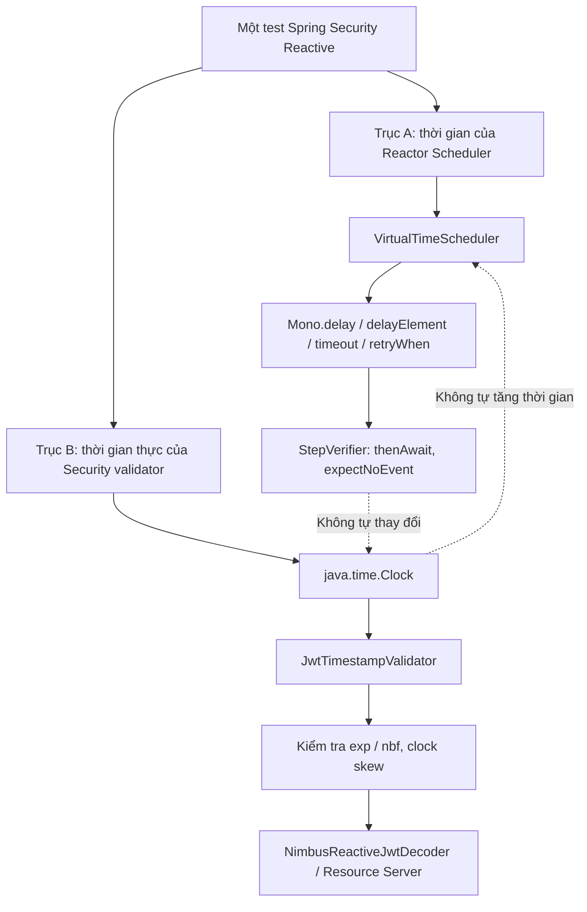

# Virtual time cho timer Reactor khác với Clock dùng để xác minh hạn token

Trong kiểm thử Spring Security Reactive, hai câu hỏi nghe có vẻ giống nhau nhưng thuộc **hai cơ chế thời gian hoàn toàn khác nhau**:

1. “Một chuỗi Reactor dùng `delay`, `timeout` hoặc `retryWhen` sẽ làm gì sau 10 phút?” — kiểm thử bằng **virtual time** của Reactor, thường thông qua `StepVerifier.withVirtualTime(...)`.
2. “JWT này đã hết hạn theo claim `exp` hoặc chưa được phép dùng theo `nbf` chưa?” — kiểm thử bằng **đồng hồ `java.time.Clock` mà JWT validator sử dụng**, cùng chính sách clock skew và các validator khác.

Khi gọi `thenAwait(Duration.ofHours(2))` trong `StepVerifier`, **không có nghĩa đồng hồ hệ thống hoặc đồng hồ của Spring Security đã tăng thêm hai giờ**. Một test chạy xanh với `StepVerifier.withVirtualTime(...)` chưa chứng minh token quá hạn sẽ bị từ chối. Ngược lại, `Clock.fixed(...)` giúp test JWT expiration ổn định nhưng không làm `Mono.delay(...)` chạy ngay.

Bài học nằm trong module **SPRING_SECURITY_TESTING**, kết hợp kiểm thử xác thực/phân quyền HTTP với `WebTestClient`, `SecurityContext`, JWT/OAuth2/opaque token và kiểm thử luồng bất đồng bộ bằng Reactor. Mục tiêu là lựa chọn **đúng loại đồng hồ cho đúng trách nhiệm**, tránh ca kiểm thử giả lập timer nhưng lại kết luận sai về hiệu lực token.

## 1. Nhìn tổng quan: hai trục thời gian độc lập



| Khái niệm | Thời gian lấy từ đâu? | Thay đổi trong test bằng gì? | Ý nghĩa |
| --- | --- | --- | --- |
| `Mono.delay(Duration)` | Reactor `Scheduler` | `VirtualTimeScheduler`, `StepVerifier.withVirtualTime` | Khi nào publisher phát tín hiệu |
| `Flux.interval(Duration)` | Reactor `Scheduler` | Virtual time | Khi nào có tick định kỳ |
| `Mono.timeout(Duration)` | Reactor scheduler cho timeout | Virtual time | Khi nào phát lỗi `TimeoutException` |
| `retryWhen(Retry.fixedDelay(...))` | Scheduler được retry strategy dùng | Virtual time khi scheduler được thiết lập đúng | Khi nào thực hiện lần retry |
| `JwtTimestampValidator` | `Clock` của validator | `setClock(Clock)` | `exp`/`nbf` có hợp lệ tại “bây giờ” không |
| `JwtValidators.createDefault...` | Các validator hiện hành; timestamp thường dùng clock hệ thống | Cấu hình validator/Clock đúng phiên bản | Chính sách xác thực token |
| `Instant.now()` trong code bất kỳ | Đồng hồ hệ thống (khi không truyền `Clock`) | Đưa `Clock` vào code thay cho gọi trực tiếp | Thời điểm của logic ứng dụng |
| Trạng thái opaque token `active` | Introspection endpoint / nhà cung cấp | Stub endpoint HTTP hoặc môi trường thử nghiệm | Token còn active theo nguồn xác thực |
| OAuth2 authorized-client expiration | Clock/chính sách của OAuth2 client provider | Test seam/clock của provider phù hợp | Có tái dùng, refresh hoặc xin token mới không |

Điểm đáng nhớ: **virtual time không có nghĩa là “mọi đồng hồ trong JVM đều ảo”**. Nó thay cách một nhóm scheduler Reactor lập lịch; `Clock.systemUTC()`, `System.currentTimeMillis()`, JWT claims, HTTP server khác và Authorization Server không tự thay đổi theo.

## 2. Thiết lập môi trường ví dụ

Sử dụng Java 17+, Reactor, Spring Boot 3.x, Spring Security và JUnit 5. Các ví dụ được chia thành **unit test thời gian Reactor**, **unit test validator JWT**, và **integration test Reactive Resource Server**. Đừng ghép tất cả vào một test class nếu các cách thiết lập bean khác nhau.

Dependency Gradle điển hình:

```groovy
dependencies {
    implementation 'org.springframework.boot:spring-boot-starter-webflux'
    implementation 'org.springframework.boot:spring-boot-starter-security'
    implementation 'org.springframework.boot:spring-boot-starter-oauth2-resource-server'

    testImplementation 'org.springframework.boot:spring-boot-starter-test'
    testImplementation 'org.springframework.security:spring-security-test'
}
```

`spring-boot-starter-test` thường cung cấp `reactor-test` trong dự án Spring Boot WebFlux; nếu dependency management của dự án không mang theo, khai báo `testImplementation 'io.projectreactor:reactor-test'` theo BOM đang dùng. Trong mã test sử dụng:

```java
import java.time.Clock;
import java.time.Duration;
import java.time.Instant;
import java.time.ZoneOffset;
import java.util.concurrent.TimeoutException;

import reactor.core.publisher.Mono;
import reactor.test.StepVerifier;
```

Các static import của AssertJ, Mockito, Spring Security và JUnit được thêm tại test class tương ứng. `reactor-test` không phải API bảo mật: nó kiểm thử tiến trình phát tín hiệu của publisher.

## 3. Dùng StepVerifier.withVirtualTime đúng mục đích

Một cách test ngây thơ như sau sẽ chờ thời gian thật:

```java
@Test
void delayedSignalUsingWallTime() {
    StepVerifier.create(
            Mono.delay(Duration.ofMinutes(10))
                .map(tick -> "ready")
        )
        .expectNext("ready")
        .verifyComplete();
}
```

Thực tế bạn không muốn bài kiểm thử CI phải chạy 10 phút. Virtual time giúp chuyển thời gian scheduler về phía trước ngay trong test:

```java
@Test
void reactorDelayRunsWithVirtualTime() {
    StepVerifier.withVirtualTime(() ->
            Mono.delay(Duration.ofMinutes(10))
                .map(tick -> "ready")
        )
        .expectSubscription()
        .expectNoEvent(Duration.ofMinutes(9))
        .thenAwait(Duration.ofMinutes(1))
        .expectNext("ready")
        .verifyComplete();
}
```

`withVirtualTime` nhận **`Supplier<Publisher<?>>`**, không phải một publisher đã dựng sẵn. Supplier được chạy sau khi test thiết lập virtual scheduler, nhờ vậy `Mono.delay(...)` dùng scheduler ảo thay vì giữ một scheduler thật đã được capture trước đó.

Diễn giải:

- `expectSubscription()` xác nhận việc subscribe trước khi chờ tín hiệu tiếp theo. Không gọi `expectNoEvent(...)` trước khi đã nhận subscription nếu không muốn bắt nhầm tín hiệu `onSubscribe`.
- `expectNoEvent(9 phút)` cho biết chưa có `onNext`/`onComplete` sớm.
- `thenAwait(1 phút)` đẩy thêm virtual time, không chờ một phút trên đồng hồ thật.
- `expectNext("ready")` và `verifyComplete()` chứng minh logic phát tín hiệu sau tổng 10 phút virtual time.

Đây là bằng chứng tốt cho **cơ chế timer Reactor**, không phải bằng chứng JWT sau 10 phút phải hết hạn.

### 3.1. Kiểm tra timeout và retry

Ví dụ timeout:

```java
@Test
void timeoutUsesReactorVirtualClock() {
    StepVerifier.withVirtualTime(() ->
            Mono.<String>never()
                .timeout(Duration.ofMinutes(5))
        )
        .expectSubscription()
        .thenAwait(Duration.ofMinutes(5))
        .expectError(TimeoutException.class)
        .verify();
}
```

Ví dụ retry với backoff cố định:

```java
@Test
void retryDelayUsesVirtualTime() {
    AtomicInteger attempts = new AtomicInteger();

    StepVerifier.withVirtualTime(() ->
            Mono.defer(() -> {
                attempts.incrementAndGet();
                return Mono.<String>error(
                    new IllegalStateException("Temporary failure")
                );
            }).retryWhen(
                Retry.fixedDelay(2, Duration.ofSeconds(30))
            )
        )
        .expectSubscription()
        .thenAwait(Duration.ofSeconds(60))
        .expectErrorMatches(ex ->
            Exceptions.isRetryExhausted(ex)
                && ex.getCause() instanceof IllegalStateException
        )
        .verify();

    assertThat(attempts.get()).isEqualTo(3);
}
```

Test thứ hai kỳ vọng một lần đăng ký ban đầu và **hai lần retry**. Khi vượt số lần thử, Reactor phát lỗi *retry exhausted* bọc lỗi `IllegalStateException` ban đầu, nên test dùng `Exceptions.isRetryExhausted(...)` (thuộc `reactor.core.Exceptions`) thay vì mong lỗi gốc xuất hiện trực tiếp. Độ trễ 30 giây giữa các lần được tiến nhanh bằng virtual scheduler. Khi dùng `Retry.backoff(...)`, jitter có thể làm thời điểm không hoàn toàn xác định; nếu đang test mốc thời gian chính xác, cấu hình backoff/jitter minh bạch hoặc dùng `Retry.fixedDelay`.

**Lưu ý:** scheduler được tạo ngoài supplier, các publisher đã được subscribe trước test, `ScheduledExecutorService`, `Thread.sleep`, network timeout và những đồng hồ không thuộc Reactor có thể vẫn chạy theo thời gian thật. Không sử dụng virtual time như một phép “đóng băng” toàn bộ hệ thống.

## 4. JWT expiration sử dụng Clock, không sử dụng VirtualTimeScheduler

Trong JWT, claim `exp` và `nbf` biểu thị thời điểm tuyệt đối, thường được mã hóa dưới dạng NumericDate. Spring Security cung cấp `JwtTimestampValidator` để đánh giá các mốc thời gian đó dựa trên `Clock` và một mức clock skew cho phép.

- `exp` (*expiration time*): token không còn hợp lệ sau khi vượt qua mốc hết hạn, có xét clock skew theo policy.
- `nbf` (*not before*): token chưa được sử dụng trước mốc bắt đầu hiệu lực, cũng có xét clock skew.
- `iat` (*issued at*): thời điểm phát hành. **Đừng tự suy rằng có `iat` là có kiểm tra TTL**; nếu ứng dụng cần giới hạn tuổi token theo `iat`, phải cấu hình validator/chính sách tương ứng.

### 4.1. Unit test JwtTimestampValidator với Clock cố định

Đoạn test này không liên quan đến Reactor scheduler và không cần WebTestClient. Nó cho thấy đúng cơ chế xác minh hạn token.

```java
class JwtTimestampValidatorClockTest {

    private static final Instant T0 =
        Instant.parse("2026-11-25T09:00:00Z");

    private static Jwt jwt(
            Instant notBefore,
            Instant expiresAt) {

        return Jwt.withTokenValue("fixture-not-a-signed-jwt")
            .header("alg", "RS256")
            .subject("alice")
            .issuedAt(T0.minusSeconds(3600))
            .notBefore(notBefore)
            .expiresAt(expiresAt)
            .build();
    }

    private static JwtTimestampValidator validatorAt(Instant instant) {
        JwtTimestampValidator validator =
            new JwtTimestampValidator(Duration.ZERO);

        validator.setClock(Clock.fixed(instant, ZoneOffset.UTC));
        return validator;
    }

    @Test
    void tokenWithExpiryInTheFutureIsAccepted() {
        Jwt token = jwt(
            T0.minusSeconds(60),
            T0.plusSeconds(30)
        );

        assertThat(validatorAt(T0).validate(token).hasErrors())
            .isFalse();
    }

    @Test
    void expiredTokenIsRejectedByFixedClock() {
        Jwt token = jwt(
            T0.minusSeconds(3600),
            T0.minusSeconds(30)
        );

        assertThat(validatorAt(T0).validate(token).hasErrors())
            .isTrue();
    }

    @Test
    void notBeforeInTheFutureIsRejected() {
        Jwt token = jwt(
            T0.plusSeconds(120),
            T0.plusSeconds(3600)
        );

        assertThat(validatorAt(T0).validate(token).hasErrors())
            .isTrue();
    }

    @Test
    void advancingInjectedClockChangesValidationResult() {
        Jwt token = jwt(
            T0.minusSeconds(60),
            T0.plusSeconds(30)
        );

        assertThat(validatorAt(T0).validate(token).hasErrors())
            .isFalse();

        assertThat(
            validatorAt(T0.plusSeconds(90))
                .validate(token)
                .hasErrors()
        ).isTrue();
    }
}
```

Trong unit test, `Jwt` được dựng trực tiếp bằng `Jwt.withTokenValue(...)`, vì mục tiêu **chỉ là thử `JwtTimestampValidator`**. Chuỗi `fixture-not-a-signed-jwt` không có chữ ký thật; một test này không kiểm tra JWS signature. Khi muốn xác minh cả chữ ký lẫn claim, dùng decoder thật như mục 7.

Dùng `Duration.ZERO` cho clock skew để phân biệt các mốc rõ ràng. Spring Security có thể cho phép một độ lệch đồng hồ mặc định (thường 60 giây, tùy cấu hình/phiên bản). Tránh đặt token hết hạn chỉ vài giây trong quá khứ rồi kỳ vọng `401` nếu validator production vẫn cho phép skew. Trong test sát ranh giới, phải ghi rõ chính sách skew; để tránh khác biệt tại **đúng giây bằng `exp`**, test ví dụ dùng các thời điểm cách xa ranh giới.

### 4.2. Vì sao Clock.fixed() không làm timer chạy ngay?

`Clock.fixed(T0, UTC)` luôn trả `T0` khi gọi `clock.instant()`. Nó không tiến theo thời gian thật hoặc virtual time. Tương tự, `Clock.offset(base, duration)` biểu diễn đồng hồ cơ sở được dịch đi một khoảng, chứ không sửa cách Reactor scheduling được thực hiện.

Vì vậy:

- Muốn test **khi nào publisher hoàn thành**: kiểm soát `Scheduler`.
- Muốn test **token có hiệu lực tại một mốc Instant**: kiểm soát `Clock` của validator.
- Muốn test **cả hai**: phải kiểm soát *cả hai thành phần một cách tường minh*.

## 5. Minh họa bẫy: tăng virtual time nhưng JWT vẫn được coi là hợp lệ

Đây là một ví dụ đặc biệt hữu ích vì nó có thể tạo ra kết luận sai nếu chỉ nhìn test pass.

```java
@Test
void twoHoursOfVirtualTimeDoNotExpireJwtByThemselves() {
    Instant t0 = Instant.parse("2026-11-25T09:00:00Z");

    Jwt token = Jwt.withTokenValue("fixture")
        .header("alg", "RS256")
        .subject("alice")
        .expiresAt(t0.plusSeconds(60))
        .build();

    JwtTimestampValidator validator =
        new JwtTimestampValidator(Duration.ZERO);

    validator.setClock(Clock.fixed(t0, ZoneOffset.UTC));

    StepVerifier.withVirtualTime(() ->
            Mono.delay(Duration.ofHours(2))
                .map(unused -> validator.validate(token).hasErrors())
        )
        .expectSubscription()
        .thenAwait(Duration.ofHours(2))
        .expectNext(false) // JWT vẫn hợp lệ theo Clock.fixed(t0).
        .verifyComplete();
}
```

Mặc dù `Mono.delay` đã “đi qua” hai giờ virtual time, `JwtTimestampValidator` vẫn đọc `T0` từ `Clock.fixed`. Token hết hạn tại `T0 + 60 giây` nên **vẫn được coi là chưa hết hạn bởi đồng hồ đó**.

Ví dụ này cố ý kiểm chứng sự độc lập của hai đồng hồ, **không phải cách viết test mong muốn để bảo đảm expiration**. Để xác minh hết hạn, phải cho validator đọc một `Clock` ở sau `exp`:

```java
Instant afterExpiry = t0.plusSeconds(61);

JwtTimestampValidator validatorAfterExpiry =
    new JwtTimestampValidator(Duration.ZERO);
validatorAfterExpiry.setClock(
    Clock.fixed(afterExpiry, ZoneOffset.UTC)
);

assertThat(
    validatorAfterExpiry.validate(token).hasErrors()
).isTrue();
```

Một biến thể khác là dùng `Clock` test có thể điều chỉnh và đặt giá trị mới trước khi subscribe. Nếu làm vậy, cần quản lý tính thread-safe khi nhiều subscription hoặc test chạy song song; không sử dụng đồng hồ mutable static chia sẻ toàn bộ suite.

**Không đồng nhất `thenAwait(2 giờ)` với `clock.instant().plus(2 giờ)`.** Đây là khác biệt cốt lõi của bài.

## 6. Clock skew và các ranh giới thời gian của token

Máy phát token, Resource Server và hệ thống chạy test có thể lệch đồng hồ nhau một ít. `JwtTimestampValidator` hỗ trợ `clockSkew` để tránh từ chối một token hợp lệ chỉ vì khác biệt rất nhỏ của đồng hồ.

Ví dụ cho phép 60 giây lệch:

```java
JwtTimestampValidator withSkew =
    new JwtTimestampValidator(Duration.ofSeconds(60));
withSkew.setClock(Clock.fixed(T0, ZoneOffset.UTC));
```

Khi viết test:

| Token | `Clock` kiểm tra | Clock skew | Kết luận kỳ vọng |
| --- | --- | --- | --- |
| `exp = T0 + 5 phút` | `T0` | 0 | Hợp lệ theo `exp` |
| `exp = T0 - 5 phút` | `T0` | 0 hoặc 60 giây | Hết hạn |
| `exp = T0 - 30 giây` | `T0` | 60 giây | Có thể được chấp nhận trong khoảng skew |
| `nbf = T0 + 5 phút` | `T0` | 0 hoặc 60 giây | Chưa có hiệu lực |
| `nbf = T0 + 30 giây` | `T0` | 60 giây | Có thể được chấp nhận trong khoảng skew |
| Không có `exp` | `T0` | Bất kỳ | Không được tự khẳng định token có TTL nếu validator/policy không yêu cầu claim |

Khi policy yêu cầu `exp`/`nbf` bắt buộc, cần **validator riêng kiểm tra sự hiện diện của claim** nếu implementation mặc định chỉ kiểm tra khi claim có mặt. Đừng coi test “không có `exp` vẫn pass” là kết luận an toàn theo nghiệp vụ; đó có thể là lỗ hổng cấu hình policy.

Nếu API yêu cầu issuer, audience, token type hoặc max token age, bổ sung validators tương ứng. Điều chỉnh `Clock` chỉ giúp test thời gian, **không thay thế** các kiểm tra identity, chữ ký, issuer hoặc audience.

### 6.1. Đừng làm thay đổi production skew chỉ để test pass

Nếu production cho phép 60 giây skew và test dùng `Duration.ZERO`, cần nói rõ test đó đang kiểm chứng **một policy thử nghiệm**. Có thể thêm test riêng với cấu hình chính xác như production để kiểm chứng ranh giới skew thực.

Trường hợp test decoder thật ở mục 7 dùng `Duration.ZERO` để minh họa rõ hiệu ứng của `Clock.fixed`. Khi chuyển vào dự án, thay nó bằng skew được phê duyệt trong production và viết cả test ở gần/lâu hơn ngưỡng.

## 7. Xác minh hạn JWT trên HTTP bằng decoder thật và WebTestClient

Unit test `JwtTimestampValidator` chứng minh validator hoạt động theo `Clock`. Nhưng một API Spring Security còn phải nhận Bearer header, parse JWT, xác minh chữ ký, gọi validator và áp dụng authorization. Để kiểm tra toàn bộ đường đi, dùng **JWT được ký thật + `NimbusReactiveJwtDecoder` thật + `WebTestClient`**.

Các đoạn sau mô tả một **test application context riêng**, không dùng `mockJwt()` hay `@WithMockUser` trong các ca xác thực mật mã.

### 7.1. Controller và SecurityWebFilterChain mẫu

```java
@RestController
class TimeProbeController {

    @GetMapping("/api/time-probe")
    Mono<Map<String, String>> current(
            @AuthenticationPrincipal Jwt jwt) {

        return Mono.just(Map.of(
            "subject", jwt.getSubject(),
            "result", "authorized"
        ));
    }
}

@Configuration(proxyBeanMethods = false)
@EnableWebFluxSecurity
class JwtTimeSecurityConfig {

    @Bean
    SecurityWebFilterChain security(ServerHttpSecurity http) {
        return http
            .authorizeExchange(exchanges -> exchanges
                .pathMatchers(HttpMethod.GET, "/api/time-probe")
                    .hasAuthority("SCOPE_reports.read")
                .anyExchange().denyAll()
            )
            .oauth2ResourceServer(oauth2 ->
                oauth2.jwt(Customizer.withDefaults())
            )
            .build();
    }
}
```

Với cấu hình Resource Server JWT thông thường, `scope: "reports.read"` được chuyển thành `SCOPE_reports.read`. Nếu ứng dụng dùng custom converter hoặc multiple security chains, integration test phải nạp đúng chain và converter production tương ứng.

### 7.2. Tạo một test-only ReactiveJwtDecoder sử dụng Clock cố định

Đặt test class dưới application context WebFlux có `TimeProbeController` và `JwtTimeSecurityConfig`, hoặc dùng `@Import` hai thành phần này vào context test thích hợp. Ví dụ dùng Spring Boot application đã chứa chúng:

```java
@SpringBootTest(
    webEnvironment = SpringBootTest.WebEnvironment.RANDOM_PORT,
    properties = "spring.main.web-application-type=reactive"
)
@AutoConfigureWebTestClient
@Import(JwtExpirationHttpIT.TestDecoderConfig.class)
class JwtExpirationHttpIT {

    private static final Instant T0 =
        Instant.parse("2026-11-25T09:00:00Z");

    private static final String ISSUER =
        "https://issuer.example.test";

    private static final KeyPair TRUSTED_KEYS = newRsaKeyPair();

    @Autowired
    WebTestClient http;

    @TestConfiguration
    static class TestDecoderConfig {

        @Bean
        @Primary
        ReactiveJwtDecoder decoderForTest() {
            NimbusReactiveJwtDecoder decoder =
                NimbusReactiveJwtDecoder.withPublicKey(
                    (RSAPublicKey) TRUSTED_KEYS.getPublic()
                ).build();

            JwtTimestampValidator timestamp =
                new JwtTimestampValidator(Duration.ZERO);
            timestamp.setClock(
                Clock.fixed(T0, ZoneOffset.UTC)
            );

            decoder.setJwtValidator(
                new DelegatingOAuth2TokenValidator<>(
                    timestamp,
                    new JwtIssuerValidator(ISSUER)
                )
            );

            return decoder;
        }
    }

    private static KeyPair newRsaKeyPair() {
        try {
            KeyPairGenerator generator =
                KeyPairGenerator.getInstance("RSA");
            generator.initialize(2048);
            return generator.generateKeyPair();
        } catch (GeneralSecurityException ex) {
            throw new IllegalStateException(ex);
        }
    }

    // Hàm ký token và các @Test nằm trong cùng class.
}
```

`JwtTimestampValidator.setClock(...)` kiểm soát `bây giờ` của bước xác minh claim. `NimbusReactiveJwtDecoder.withPublicKey(...)` kiểm soát bước kiểm tra chữ ký JWS. Các bước này **tách biệt** và đều được giữ thật trong integration test.

Ví dụ đã thay bộ validator mặc định bằng `DelegatingOAuth2TokenValidator` gồm timestamp và issuer. Đây là **cấu hình minh họa có chủ đích**; trong dự án thực, khi gọi `setJwtValidator(...)` bạn phải giữ/khôi phục **mọi validator cần thiết** (audience, token type, max age, các custom constraints), tránh vô tình bỏ sót một quy tắc production. `@Primary` không thay decoder đã được gắn cố định vào một filter chain khác; nếu có bean/DSL tùy biến, phải cô lập test context hoặc import đúng cấu hình.

### 7.3. Tạo JWT compact có chữ ký RSA thật

Nimbus JOSE + JWT có thể tạo một `SignedJWT` và ký bằng private key trong test. Không dùng private key sản xuất, không ghi token thật ra log.

```java
private static String signedJwt(
        PrivateKey privateKey,
        Instant notBefore,
        Instant expiresAt,
        String scope) throws JOSEException {

    JWTClaimsSet claims = new JWTClaimsSet.Builder()
        .issuer(ISSUER)
        .subject("alice")
        .issueTime(Date.from(T0.minusSeconds(60)))
        .notBeforeTime(Date.from(notBefore))
        .expirationTime(Date.from(expiresAt))
        .claim("scope", scope)
        .build();

    SignedJWT signed = new SignedJWT(
        new JWSHeader.Builder(JWSAlgorithm.RS256)
            .type(JOSEObjectType.JWT)
            .build(),
        claims
    );

    signed.sign(new RSASSASigner(
        (RSAPrivateKey) privateKey
    ));

    return signed.serialize();
}
```

Hàm `signedJwt` được đặt bên trong `JwtExpirationHttpIT` ở mục 7.2. `SignedJWT.serialize()` trả chuỗi compact `header.payload.signature`; chữ ký đúng khi test sử dụng `TRUSTED_KEYS.getPrivate()`.

### 7.4. Các trường hợp hợp lệ, hết hạn, chưa có hiệu lực và sai quyền

```java
@Test
void signedJwtWithFutureExpiryIsAccepted() throws Exception {
    String token = signedJwt(
        TRUSTED_KEYS.getPrivate(),
        T0.minusSeconds(60),
        T0.plusSeconds(300),
        "reports.read"
    );

    http.get()
        .uri("/api/time-probe")
        .headers(h -> h.setBearerAuth(token))
        .exchange()
        .expectStatus().isOk()
        .expectBody()
        .jsonPath("$.subject").isEqualTo("alice");
}

@Test
void expiredSignedJwtIsRejectedWith401() throws Exception {
    String token = signedJwt(
        TRUSTED_KEYS.getPrivate(),
        T0.minusSeconds(3600),
        T0.minusSeconds(120),
        "reports.read"
    );

    http.get()
        .uri("/api/time-probe")
        .headers(h -> h.setBearerAuth(token))
        .exchange()
        .expectStatus().isUnauthorized();
}

@Test
void notBeforeInFutureIsRejectedWith401() throws Exception {
    String token = signedJwt(
        TRUSTED_KEYS.getPrivate(),
        T0.plusSeconds(120),
        T0.plusSeconds(3600),
        "reports.read"
    );

    http.get()
        .uri("/api/time-probe")
        .headers(h -> h.setBearerAuth(token))
        .exchange()
        .expectStatus().isUnauthorized();
}

@Test
void validJwtWithoutReadScopeGets403() throws Exception {
    String token = signedJwt(
        TRUSTED_KEYS.getPrivate(),
        T0.minusSeconds(60),
        T0.plusSeconds(300),
        "inventory.read"
    );

    http.get()
        .uri("/api/time-probe")
        .headers(h -> h.setBearerAuth(token))
        .exchange()
        .expectStatus().isForbidden();
}

@Test
void signatureFromUntrustedKeyGets401() throws Exception {
    KeyPair untrusted = newRsaKeyPair();

    String token = signedJwt(
        untrusted.getPrivate(),
        T0.minusSeconds(60),
        T0.plusSeconds(300),
        "reports.read"
    );

    http.get()
        .uri("/api/time-probe")
        .headers(h -> h.setBearerAuth(token))
        .exchange()
        .expectStatus().isUnauthorized();
}
```

Điều mà bộ test chứng minh:

- `200`: token có chữ ký khớp public key, đã qua validator timestamp/issuer đã cấu hình và có scope cần thiết.
- `401` với `exp` cũ: token bị decoder/validator thời gian từ chối. Kết quả **không** dựa vào virtual time.
- `401` với `nbf` tương lai: token chưa đến thời điểm cho phép sử dụng.
- `403` với scope sai: token qua được authentication nhưng không qua authorization.
- `401` với khóa không tin cậy: JWS signature verification thực sự được thử.

Những test này chưa chứng minh OAuth2 Authorization Server production cấp token, JWKS rotation hay issuer discovery. Chúng xác minh **một public key được test tin cậy** và những validators được cấu hình trong test. Muốn kiểm tra `jwk-set-uri`, `kid`, cache và xoay khóa, cần test riêng với JWKS HTTP server giả lập.

### 7.5. Không lấy Instant.now() trong test xác minh hạn cố định

Nếu một test cố tạo token như sau:

```java
Instant expiry = Instant.now().plusMillis(50);
String token = signWithExpiry(expiry);
```

thì kết quả có thể thay đổi theo máy chạy CI, tải hệ thống, scheduler, network và clock skew. Trong ví dụ integration phía trên, token dùng mốc `T0` rõ ràng và decoder cũng dùng `Clock.fixed(T0)`; vì thế test chạy hôm nay hoặc tháng sau vẫn kiểm tra cùng tình huống.

**Chú ý:** một số logic khác trong ứng dụng có thể vẫn dùng `Clock.systemUTC()` và không tuân theo test Clock. Test cần bảo đảm decoder thực sự được cấu hình với `Clock` kiểm soát; không tự cho rằng chỉ `@Bean Clock` là Spring Security tự động dùng bean đó.

## 8. mockJwt() không thay thế test hết hạn token

Ở tầng test policy, `mockJwt()` rất hữu ích:

```java
client.mutateWith(mockJwt()
        .jwt(jwt -> jwt
            .claim("sub", "alice")
            .claim("scope", "reports.read")
            .expiresAt(Instant.parse("2020-01-01T00:00:00Z"))
        )
        .authorities(
            new SimpleGrantedAuthority("SCOPE_reports.read")
        )
    )
    .get()
    .uri("/api/time-probe")
    .exchange()
    .expectStatus().isOk();
```

Đây là ví dụ **trong WebFlux test in-process có `springSecurity()` được áp dụng**. Nó có thể trả `200` dù claim `exp` đã ở quá khứ, vì `mockJwt()` tạo `JwtAuthenticationToken` giả và **không gọi `ReactiveJwtDecoder`/`JwtTimestampValidator` để xác minh token**.

Không kết luận rằng API production chấp nhận token đã hết hạn từ test này. Test trên chỉ kiểm tra authorization khi principal và authority được cung cấp sẵn.

Để kiểm tra Resource Server nhận Bearer header và gọi đúng decoder interface nhưng không xác minh crypto, có thể mock `ReactiveJwtDecoder`:

```java
when(decoder.decode("raw-fixture"))
    .thenReturn(Mono.just(jwtFromFixture));

client.get()
    .uri("/api/time-probe")
    .headers(h -> h.setBearerAuth("raw-fixture"))
    .exchange()
    .expectStatus().isOk();

verify(decoder).decode("raw-fixture");
```

Đây là mức kiểm thử nằm giữa `mockJwt()` và decoder thật. Mockito có thể trả một `Jwt` với `exp` bất kỳ, nên test này vẫn **không khẳng định validator đã kiểm tra expiration**. Cần ca với decoder thật và JWT ký thật ở mục 7 nếu muốn có bằng chứng về xác minh hạn token.

## 9. Timeout của API và hạn token là hai loại lỗi khác nhau

Giả sử endpoint gọi một downstream API theo Reactive pipeline và đặt timeout:

```java
Mono<Report> loadReport() {
    return downstream.fetch()
        .timeout(Duration.ofSeconds(3));
}
```

`timeout(3 giây)` phản ánh **thời gian chờ completion signal** của publisher. Khi vượt ngưỡng, nó phát `TimeoutException` (hoặc đi theo fallback đã thiết kế). JWT expiration phản ánh **thời điểm token không còn hợp lệ để xác thực**. Hai điều kiện này không tương đương.

| Hiện tượng | Cơ chế kiểm tra | Test phù hợp |
| --- | --- | --- |
| Downstream không phát dữ liệu trong 3 giây | Reactor `timeout` | `StepVerifier.withVirtualTime` |
| Retry sau 30 giây | Reactor `retryWhen` + scheduler | Virtual time và kiểm tra số lần retry |
| Token hết hạn theo `exp` | `JwtTimestampValidator` với `Clock` | Fixed/adjustable Clock và negative test |
| Token chưa đến thời điểm `nbf` | JWT timestamp validator | Clock trước/sau `nbf` |
| JWT có chữ ký sai | `ReactiveJwtDecoder`/JWS verifier | Token ký bằng private key khác, kỳ vọng `401` |
| Access token bị thu hồi | Introspection/authorization server | HTTP introspection hoặc integration với test issuer |
| Authorization client thấy token sắp hết hạn và xin lại token | `ReactiveOAuth2AuthorizedClientManager` và policy của provider | Test manager/provider và clock seam tương ứng |
| Response stream bị timeout sau khi đã gửi body | Reactor và HTTP transport/commit | Integration test thích hợp, không chỉ `StepVerifier` |

### 9.1. Đừng quy mọi timeout thành 401

Nếu JWT đã xác thực thành công nhưng downstream API bị timeout, ứng dụng có thể trả `504`, `503` hoặc error response khác theo chính sách. Đây **không mặc nhiên là `401 Unauthorized`**. Ngược lại, khi `ReactiveJwtDecoder` từ chối token hết hạn, request có thể bị chặn ngay ở security filter chain mà không hề gọi service downstream.

Một test HTTP tốt nên phân biệt:

- `401`: Bearer credential không hợp lệ theo decoder/validators thực.
- `403`: đã xác thực nhưng thiếu authority.
- Timeout/`5xx`/fallback: hệ thống phụ thuộc không đáp ứng hoặc lỗi nghiệp vụ; xử lý theo contract, không ngụy trang thành lỗi xác thực.

## 10. Bẫy thường gặp với virtual time trong test bảo mật

### 10.1. Dựng publisher trước withVirtualTime

Sai về ý nghĩa test:

```java
Mono<Long> delay = Mono.delay(Duration.ofMinutes(10));

StepVerifier.withVirtualTime(() -> delay)
    .thenAwait(Duration.ofMinutes(10))
    .expectNext(0L)
    .verifyComplete();
```

Publisher có thể đã capture scheduler trước lúc virtual time được cài đặt (tùy operator và assembly). Hãy tạo các time-based publishers **bên trong supplier**, đặc biệt nếu code của bạn tạo scheduler hoặc cache các publisher ở giai đoạn khởi tạo.

### 10.2. Dùng Thread.sleep để “đợi exp”

Không viết:

```java
Thread.sleep(61_000); // Chờ token thực sự quá hạn.
assertThat(responseIsUnauthorized()).isTrue();
```

Test chậm, khó ổn định và phụ thuộc CI. Dùng `Clock.fixed`/`Clock.offset` hoặc clock test điều chỉnh được để kiểm tra expiration có tính quyết định. Nếu cần kiểm tra một hệ thống bên ngoài không cho inject clock, tách loại test và chọn token fixture có `exp` cách xa thời điểm hiện tại để tránh race ở ranh giới.

### 10.3. Tưởng VirtualTimeScheduler thay System.currentTimeMillis

`StepVerifier.withVirtualTime` không tự thay `System.currentTimeMillis()`, `Instant.now()`, `Clock.systemUTC()` hoặc đồng hồ của OAuth2 Authorization Server ngoài process. Nếu code dùng các hàm đó, virtual time sẽ không giúp “token quá hạn”.

Nếu service tự tính TTL bằng `Instant.now()`, thiết kế lại để inject `Clock`. Không dùng monkey-patch global time API hoặc ép clock mutable dùng chung cho các test chạy song song.

### 10.4. Đổi default scheduler trong test khác

`VirtualTimeScheduler` và Scheduler factory có yếu tố chia sẻ trạng thái trong quá trình dùng test. Nếu nhiều test phụ thuộc virtual scheduler toàn cục chạy song song hoặc tự gọi `Schedulers.resetFactory()` không đúng lúc, test có thể ảnh hưởng lẫn nhau.

Ưu tiên `StepVerifier.withVirtualTime` và tạo publisher bên trong supplier. Nếu cần điều khiển `VirtualTimeScheduler` trực tiếp, quản lý vòng đời và làm sạch scheduler theo API đang sử dụng; không thay factory global cho toàn test suite khi không cần.

### 10.5. Đem mutator vào integration test rồi kỳ vọng time validator chạy

`mockJwt()` và `mockOpaqueToken()` tạo authentication giả để test authorization. Chúng không chạy JWT decoder/introspector, bất kể bạn có dùng virtual scheduler hay fixed Clock. Khi muốn thử `exp`, hãy gửi compact Bearer token qua HTTP vào một decoder thật; với opaque token, hãy kiểm tra `active` từ introspection endpoint.

### 10.6. Quên Reactor Context / SecurityContext

`ReactiveSecurityContextHolder` lưu thông tin xác thực theo **Reactor Context**. Nó không lấy thời gian từ `Clock` và không được “reset” chỉ vì bạn chuyển virtual time. Một test ghép nhiều request dùng cùng `WebTestClient` nên giữ authentication độc lập:

```java
WebTestClient alice = base.mutateWith(mockUser("alice"));
WebTestClient bob = base.mutateWith(mockUser("bob"));
```

Khi muốn kiểm tra danh tính và thời gian đồng thời, cần assertion **identity** và **time behavior** riêng. Đừng dùng một `SecurityContextHolder` static/ThreadLocal để mô phỏng request reactive.

### 10.7. Quên skew khi so sánh thời điểm cực sát

Test đặt `exp` đúng bằng `now` hoặc cách vài mili-giây rất dễ phụ thuộc cách làm tròn NumericDate, độ chính xác epoch seconds và logic so sánh của validator. Trong bài này, các mốc cố tình cách nhau hàng chục/ hàng trăm giây. Test biên chính xác chỉ nên viết khi contract quy định rõ độ chính xác và skew.

## 11. Chiến lược kết hợp hai loại test

Một ứng dụng Reactive thực có thể vừa chạy tác vụ chờ/timeout, vừa phải bảo vệ endpoint bằng JWT. Thay vì viết một test dài trộn mọi trách nhiệm, tổ chức thành các lớp:

1. **Reactor unit test:** test `Mono.delay`, `Flux.interval`, `timeout`, `retryWhen` với `StepVerifier.withVirtualTime`. Không cần security context hoặc access token.
2. **JWT validator unit test:** dựng `Jwt` fixture và `JwtTimestampValidator.setClock(Clock.fixed(...))`. Kiểm tra `exp`, `nbf` và skew. Không khẳng định chữ ký đã được xác minh.
3. **Decoder integration test:** ký token RSA test, sử dụng `NimbusReactiveJwtDecoder` thật với validator sử dụng Clock test. Kiểm tra ký đúng/sai, hết hạn, chưa có hiệu lực và issuer.
4. **HTTP authorization test:** gửi header Bearer qua `WebTestClient`, kiểm tra `200/401/403` và controller không được gọi khi authentication thất bại.
5. **OAuth2 provider test (nếu có):** kiểm tra token refresh/client credentials theo clock hoặc fake server; không nhầm thời gian retry HTTP của Reactor với vòng đời token phía Authorization Server.

Một bảng so sánh giúp khi review PR:

| Tên test | Có virtual scheduler? | Có Clock kiểm soát? | Có xác minh JWS? | Phát biểu phù hợp |
| --- | :---: | :---: | :---: | --- |
| `delayTenMinutesEmitsOnce` | Có | Không | Không | Reactor delay phát tín hiệu đúng |
| `timeoutAfterFiveMinutes` | Có | Không | Không | Reactor timeout đúng ngưỡng |
| `jwtExpiredAtFixedInstant` | Không | Có | Không | Timestamp validator từ chối token fixture hết hạn |
| `jwtSignedButExpiredReturns401` | Không | Có | Có | Decoder và HTTP chain từ chối JWS đã ký nhưng hết hạn |
| `mockJwtAllowsReader` | Không bắt buộc | Không | Không | Authorization cho authentication giả hoạt động |
| `opaqueTokenActiveFalseReturns401` | Không bắt buộc | Theo introspector/server | Không áp dụng | Introspection HTTP từ chối token inactive |

Khi đối chiếu kết quả, đặc biệt cần phân biệt **không có cryptographic verification** với **test cryptographic verification có negative cases**.

## 12. Bài thực hành

1. Viết `Mono.delay(Duration.ofMinutes(20))` và kiểm thử bằng `StepVerifier.withVirtualTime`. Dùng `expectNoEvent` sau 19 phút rồi `thenAwait` 1 phút, khẳng định tín hiệu đến đúng lúc.
2. Viết pipeline `Mono.never().timeout(Duration.ofMinutes(3))`. Dùng virtual time để kiểm tra `TimeoutException` mà không chờ ba phút thật.
3. Dựng một `Jwt` có `exp = T0 + 60 giây`, `nbf = T0 - 60 giây`. Dùng `JwtTimestampValidator(Duration.ZERO)` với `Clock.fixed(T0)` và `Clock.fixed(T0 + 120 giây)`. Khẳng định trước/sau hạn có kết quả khác nhau.
4. Dùng `StepVerifier.withVirtualTime` đẩy `Mono.delay` hai giờ nhưng **giữ nguyên `Clock.fixed(T0)`** của validator. Giải thích vì sao token vẫn được đánh giá hợp lệ.
5. Cấu hình `NimbusReactiveJwtDecoder` thật với public key kiểm thử và custom timestamp validator sử dụng Clock cố định. Ký token với private key test, gửi qua `WebTestClient`: token hợp lệ `200`, hết hạn `401`, `nbf` tương lai `401`, scope sai `403` và chữ ký sai `401`.
6. Thử thay token ở bước 5 bằng `mockJwt()` với `exp` quá khứ. Quan sát test policy có thể vẫn `200` và giải thích vì sao đây không phải kết quả của decoder.
7. Kiểm tra thiết kế test có ghi rõ timestamp, skew, issuer validator và sự khác biệt giữa scheduler ảo với Clock không.

**Tiêu chí hoàn thành:** bạn sử dụng `VirtualTimeScheduler` để kiểm thử timer Reactor nhanh và ổn định, nhưng dùng `Clock` kiểm soát để kiểm chứng hiệu lực JWT. Khi cần tuyên bố HTTP Resource Server từ chối token hết hạn, bạn có test **Bearer token đã ký thật**, decoder/validators thật, và negative case `401` — không chỉ một test `StepVerifier.thenAwait(...)` hoặc `mockJwt()` chạy xanh.

## Tài liệu tham khảo

- [Project Reactor — Testing / Manipulating Time](https://projectreactor.io/docs/core/release/reference/testing.html): `StepVerifier.withVirtualTime`, `thenAwait` và `expectNoEvent`.
- [Reactor Test API — StepVerifier](https://projectreactor.io/docs/test/release/api/reactor/test/StepVerifier.html): API cho virtual time và verification.
- [Spring Security — Reactive OAuth2 Resource Server JWT](https://docs.spring.io/spring-security/reference/reactive/oauth2/resource-server/jwt.html): `ReactiveJwtDecoder`, JWT validation và scope authorities.
- [Spring Security — JwtTimestampValidator API](https://docs.spring.io/spring-security/reference/api/java/org/springframework/security/oauth2/jwt/JwtTimestampValidator.html): `clockSkew` và `setClock(Clock)`.
- [Spring Security — Reactive OAuth2 Testing](https://docs.spring.io/spring-security/reference/reactive/test/web/oauth2.html): `mockJwt()`, `mockOpaqueToken()` và ranh giới của mutator.
- [Spring Security — Reactive WebTestClient Setup](https://docs.spring.io/spring-security/reference/reactive/test/web/setup.html): `springSecurity()` trong test WebFlux.
- [RFC 7519 — JSON Web Token](https://www.rfc-editor.org/rfc/rfc7519): NumericDate, `exp`, `nbf` và `iat`.
