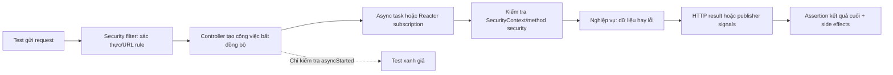

# Tránh một test đạt chỉ vì nhánh bất đồng bộ chưa được thực thi

Trong chương **Bất đồng bộ và ngữ cảnh** của module **SPRING_SECURITY_TESTING**, một nguy cơ đặc biệt dễ gây **dương tính giả** là bài test kết thúc thành công khi phần xử lý quan trọng chưa chạy. Một controller có thể đã trả `Callable`, `DeferredResult`, `CompletableFuture` hoặc `Mono`/`Flux`, trong khi xác thực, phân quyền, truy vấn dữ liệu và ngoại lệ chỉ xuất hiện **khi công việc được thực thi hoặc publisher được subscribe**. Nếu test chỉ khẳng định request bắt đầu async, nhận status ban đầu hoặc tạo ra publisher mà không kiểm tra kết quả cuối cùng, test có thể xanh ngay cả khi nhánh được bảo vệ thực tế thất bại.

Mục tiêu của bài là kiểm chứng **hoàn tất, lỗi, danh tính bảo mật và tác dụng phụ** của nhánh bất đồng bộ bằng `spring-security-test`: `MockMvc` và `asyncDispatch(...)` cho Servlet; `StepVerifier` và `WebTestClient` cho Reactive. Những ca test cần bao phủ cả người dùng **được phép** và **bị từ chối**; có thể dùng `@WithMockUser`, request post-processor, `SecurityContext`, hoặc principal JWT/OAuth2/OIDC giả lập tùy mục tiêu. Khi cần kiểm tra xác thực token thật, không được nhầm test mock principal với test đi qua decoder/introspection.

## 1. Thế nào là một bài test “xanh trước khi công việc bắt đầu”?

Xem ba đoạn mã test sau:

```java
// Servlet: chỉ biết controller bắt đầu async, chưa xác minh kết quả.
mvc.perform(get("/api/jobs/42"))
    .andExpect(request().asyncStarted());

// Reactive: chưa có subscriber => chưa biết publisher phát dữ liệu hay lỗi.
Mono<String> result = securedService.readJob("42");
assertNotNull(result);

// Async service: chỉ biết CompletableFuture đã được tạo.
CompletableFuture<String> future = worker.startJob("42");
assertNotNull(future);
```

Cả ba assertion đều có thể đúng dù công việc phía sau ném lỗi, trả sai dữ liệu, không được thực thi hoặc bị từ chối vì mất `SecurityContext`.

| Mô hình | Dấu hiệu mới chỉ kiểm tra phần đầu | Bằng chứng hoàn tất nên có |
| --- | --- | --- |
| Spring MVC `Callable` | `request().asyncStarted()` | `asyncDispatch` rồi assert status và body cuối cùng; kiểm tra tác dụng phụ |
| Spring MVC `DeferredResult` | Đã nhận đối tượng `DeferredResult` | Nguồn dữ liệu đã `setResult`/`setErrorResult`; redispatch và kiểm tra kết quả |
| `CompletableFuture`/`@Async` | `future != null`, `isDone()` ngay thời điểm nào đó | `get(timeout, unit)` hoặc assert completion/error, xác nhận công việc thật chạy |
| Reactor `Mono` | `Mono` không `null` | `StepVerifier` subscribe và xác minh `onNext`/`onComplete` hoặc `onError` |
| Reactor `Flux` | Publisher được tạo | Kiểm tra phần tử và kết thúc, hoặc hủy có chủ đích với stream vô hạn |
| `WebTestClient` | Chỉ `expectStatus().isOk()` | Kiểm tra body/stream/error và hành vi security filter thực tế |

**Quy tắc:** Với một nhánh async cần thực hiện nghiệp vụ, *khởi động công việc không đồng nghĩa hoàn thành công việc*. Hãy viết assertion mà **chắc chắn thất bại** nếu chủ động làm nhánh async ném exception hoặc không bao giờ trả kết quả.



## 2. Xác định đúng tầng kiểm thử trước khi viết assertion

Một hệ thống Spring Security thường có nhiều điểm kiểm tra khác nhau:

1. **HTTP filter chain:** `SecurityFilterChain` (Servlet) hoặc `SecurityWebFilterChain` (Reactive) có thể từ chối request **trước khi** controller tạo công việc. Ở đây, anonymous thường nhận 401 với HTTP Basic/Bearer, còn user xác thực nhưng thiếu quyền thường nhận 403.
2. **Method security:** `@PreAuthorize`, `@PostAuthorize` hoặc policy trong service có thể chạy **bên trong** công việc bất đồng bộ, không phải ở thời điểm HTTP request bắt đầu. Kết quả lỗi có thể chỉ xuất hiện khi `Callable` chạy hoặc publisher được subscribe.
3. **Business policy:** kiểm tra subject, tenant, scope hoặc các thuộc tính JWT/OAuth2/OIDC sau khi đã có principal. Nếu phần này nằm trong nhánh async, test phải bắt lỗi và xác nhận không có side effect trái phép.
4. **Exception handling:** lỗi trong async task/publisher có thể được ánh xạ thành status HTTP **sau redispatch** hoặc bởi handler WebFlux. Lỗi ở tầng service không tự động là 403/500 tại tầng HTTP nếu chưa qua exception handler.

Đừng đồng nhất `AccessDeniedException` trong một `Mono` với HTTP 403 hoặc cho rằng tất cả lỗi bên trong `CompletableFuture` sẽ tự trả 500. Kết quả HTTP cuối cùng phụ thuộc Spring Security, cơ chế xử lý async và exception mapping của ứng dụng.

## 3. Servlet: dùng `asyncDispatch` để buộc kết quả `Callable` lộ ra

Spring MVC hỗ trợ controller trả `Callable<T>`. Controller trả về ngay, còn logic trong `call()` có thể được thực thi ở thread khác. Ví dụ:

```java
@RestController
class JobController {

    private final JobService jobs;

    JobController(JobService jobs) {
        this.jobs = jobs;
    }

    @GetMapping("/api/jobs/{id}")
    Callable<String> read(@PathVariable String id) {
        return () -> jobs.load(id);
    }
}

@Service
class JobService {

    private final AtomicInteger executions = new AtomicInteger();

    @PreAuthorize("hasAuthority('SCOPE_jobs.read')")
    public String load(String id) {
        executions.incrementAndGet();
        return "job:" + id;
    }

    public int executions() {
        return executions.get();
    }
}
```

Service phải được quản lý như **Spring bean**, và `@EnableMethodSecurity` phải được kích hoạt để `@PreAuthorize` chạy qua proxy. Nếu test khởi tạo `new JobService()` hoặc tự gọi method nội bộ bỏ qua proxy, nó không kiểm tra method security thật.

Ví dụ cấu hình HTTP chỉ chặn request thiếu đăng nhập ở filter, còn quyền scope của job được service xác minh trong async task:

```java
@Bean
SecurityFilterChain httpSecurity(HttpSecurity http) throws Exception {
    return http
        .authorizeHttpRequests(auth -> auth
            .requestMatchers("/api/jobs/**").authenticated()
            .anyRequest().permitAll())
        .httpBasic(Customizer.withDefaults())
        .build();
}
```

Trong lớp `@SpringBootTest` với `@AutoConfigureMockMvc`, có `MockMvc mvc`, bean `JobService jobs` và filter chain thật, test **phải thực hiện cả hai lượt MockMvc**:

```java
@Test
void authorizedAsyncJobActuallyCompletes() throws Exception {
    int before = jobs.executions();

    MvcResult started = mvc.perform(get("/api/jobs/42")
            .with(user("fixture-reader")
                .authorities(new SimpleGrantedAuthority("SCOPE_jobs.read"))))
        .andExpect(request().asyncStarted())
        .andReturn();

    mvc.perform(asyncDispatch(started))
        .andExpect(status().isOk())
        .andExpect(content().string("job:42"));

    assertEquals(before + 1, jobs.executions());
}
```

`asyncDispatch` là `MockMvcRequestBuilders.asyncDispatch`, `request().asyncStarted()` là `MockMvcResultMatchers.request`, `user(...)` đến từ `SecurityMockMvcRequestPostProcessors`. Sau `asyncDispatch`, test mới quan sát **response cuối cùng**. Bộ đếm bổ sung chứng cứ phần service đã thực sự chạy; chỉ dùng khi test không chạy song song với các request khác thay đổi cùng bộ đếm.

`MvcResult` của lần gọi đầu tiên có thể đã chứa giá trị `asyncResult`, nhưng **status ban đầu không phải status nghiệp vụ cuối**. Một bài test kết thúc ngay sau `.andExpect(request().asyncStarted())` sẽ không phát hiện nội dung `job:42` bị lỗi hoặc exception xuất hiện ở async task. Có thể thêm `.andExpect(request().asyncResult("job:42"))` nếu cần kiểm tra riêng kết quả Callable; vẫn nên dùng `asyncDispatch` để kiểm tra ánh xạ HTTP.

## 4. Đường lỗi async: đừng chỉ kiểm tra một HTTP status thành công

Một lỗi từ nhánh `Callable` có thể chỉ xuất hiện khi kết quả được đưa về `DispatcherServlet`. Ví dụ service cố ý có một trường hợp lỗi chỉ dành cho test:

```java
@PreAuthorize("hasAuthority('SCOPE_jobs.read')")
public String load(String id) {
    executions.incrementAndGet();
    if ("unavailable".equals(id)) {
        throw new IllegalStateException("fixture-downstream-unavailable");
    }
    return "job:" + id;
}
```

Nếu ứng dụng có chính sách chuyển lỗi của dependency thành HTTP 503, có thể khai báo handler cho ví dụ này:

```java
@RestControllerAdvice
class JobErrorHandler {

    @ExceptionHandler(IllegalStateException.class)
    ResponseEntity<String> downstreamFailure(IllegalStateException error) {
        return ResponseEntity.status(HttpStatus.SERVICE_UNAVAILABLE)
            .body("dependency-unavailable");
    }

    // Quy tắc phản hồi minh họa cho lỗi method security bên trong Callable.
    @ExceptionHandler(AccessDeniedException.class)
    ResponseEntity<String> accessDenied(AccessDeniedException error) {
        return ResponseEntity.status(HttpStatus.FORBIDDEN)
            .body("access-denied");
    }
}
```

Với handler nạp trong context test, viết cả lượt `REQUEST` lẫn redispatch:

```java
@Test
void errorRaisedInsideCallableAppearsAtFinalResponse() throws Exception {
    MvcResult started = mvc.perform(get("/api/jobs/unavailable")
            .with(user("fixture-reader")
                .authorities(new SimpleGrantedAuthority("SCOPE_jobs.read"))))
        .andExpect(request().asyncStarted())
        .andReturn();

    mvc.perform(asyncDispatch(started))
        .andExpect(status().isServiceUnavailable())
        .andExpect(content().string("dependency-unavailable"));
}
```

HTTP 503 ở đây là **contract minh họa của `JobErrorHandler`**, không phải giá trị mặc định của mọi exception trong Spring MVC. Nếu bỏ handler, exception có thể được ném lại hoặc được xử lý khác theo cấu hình. Bài học quan trọng là test phải đi đến **điểm xử lý cuối cùng**, nơi lỗi async mới hiển lộ.

### Test thiếu quyền ở đâu?

Vì rule URL trong ví dụ chỉ yêu cầu `.authenticated()`, một user có `SCOPE_profile.read` vẫn có thể qua filter và bắt đầu `Callable`, nhưng **method security** của `JobService` phải từ chối ở nhánh async. Với `JobErrorHandler` ở trên, có thể kiểm tra cụ thể:

```java
@Test
void forbiddenInsideCallableIsObservedAfterRedispatch() throws Exception {
    int before = jobs.executions();

    MvcResult started = mvc.perform(get("/api/jobs/42")
            .with(user("fixture-reader")
                .authorities(new SimpleGrantedAuthority("SCOPE_profile.read"))))
        .andExpect(request().asyncStarted())
        .andReturn();

    mvc.perform(asyncDispatch(started))
        .andExpect(status().isForbidden())
        .andExpect(content().string("access-denied"));

    assertEquals(before, jobs.executions());
}
```

Test này xác minh lỗi xảy ra **khi `Callable` thực thi**, được chuyển thành HTTP 403 bởi exception handler minh họa, và thân `load` không chạy. Nếu ứng dụng không có handler này, hãy khẳng định exception/status theo **cấu hình thực tế**, không mặc định mọi `AccessDeniedException` trong worker đều có cùng body hoặc status. Tuyệt đối không dùng `request().asyncStarted()` như assertion duy nhất cho ca bị từ chối.

Nếu đổi rule URL thành `.hasAuthority("SCOPE_jobs.read")`, request thiếu quyền có thể bị chặn **trước controller**: trường hợp đó phải assert 403 và **không mong `asyncStarted()`**. Hai kết quả đều có thể đúng, nhưng chứng minh hai tầng bảo vệ khác nhau.

## 5. `DeferredResult`: test có thể xanh dù chưa ai gọi `setResult`

`DeferredResult<T>` cho phép một thành phần khác hoàn tất response sau khi controller đã trả về. Nhánh tạo dữ liệu có thể chạy trong thread pool, callback từ event, message listener hay một service bất đồng bộ. Vì thế cần tách hai khẳng định:

1. Request đã chuyển sang xử lý async.
2. Nguồn kết quả đã phát `setResult(...)` hoặc `setErrorResult(...)`, rồi HTTP redispatch hoàn thành.

Để test có thể tái lập **không dùng `Thread.sleep()`**, hãy tạo một cổng callback điều khiển được trong test. Ví dụ một fixture lưu `DeferredResult` chờ hoàn tất:

```java
final class PendingReplyStore {
    private final AtomicReference<DeferredResult<String>> pending =
        new AtomicReference<>();

    DeferredResult<String> begin() {
        DeferredResult<String> reply = new DeferredResult<>(3_000L);
        pending.set(reply);
        return reply;
    }

    void complete(String value) {
        DeferredResult<String> reply = pending.getAndSet(null);
        if (reply == null || !reply.setResult(value)) {
            throw new IllegalStateException("No pending async reply");
        }
    }
}

@RestController
class DeferredController {
    private final PendingReplyStore replies;

    DeferredController(PendingReplyStore replies) {
        this.replies = replies;
    }

    @GetMapping("/api/deferred")
    DeferredResult<String> deferred() {
        return replies.begin();
    }
}
```

Đây là **fixture một request tại một thời điểm** để minh họa kiểm soát completion, không phải implementation production hoặc hệ thống phục vụ nhiều request đồng thời. Trong test:

```java
MvcResult started = mvc.perform(get("/api/deferred")
        .with(user("fixture-reader")))
    .andExpect(request().asyncStarted())
    .andReturn();

replies.complete("completed-by-callback");

mvc.perform(asyncDispatch(started))
    .andExpect(status().isOk())
    .andExpect(content().string("completed-by-callback"));
```

Nếu quên gọi `replies.complete(...)`, test không nên được chấp nhận là thành công: đoạn `asyncDispatch` không thể cho body mong đợi, hoặc phải kết thúc bằng timeout/error có kiểm soát. Để kiểm tra lỗi, fixture có thể thêm `reply.setErrorResult(exception)` và kiểm tra exception handler sau redispatch.

**Lưu ý bảo mật:** Với `DeferredResult`, công việc do ứng dụng tự đưa vào executor **không mặc nhiên thừa hưởng `SecurityContext` của HTTP thread**. Nếu callback cần phân quyền hoặc principal, phải thiết kế propagation rõ ràng; việc dùng `@WithMockUser` trên thread test không tự biến worker thread thành authenticated user.

## 6. `CompletableFuture`, `@Async` và thời điểm quan sát lỗi

Test như sau không chứng minh nhánh trong `CompletableFuture` đã được thực thi:

```java
CompletableFuture<String> future = reportWorker.fetch("r-7");
assertNotNull(future); // Không kiểm tra giá trị, lỗi hoặc completion.
```

Một bài test service phù hợp cần chờ có giới hạn và quan sát chính xác kết quả:

```java
@Test
void futureCompletesWithExpectedValue() throws Exception {
    CompletableFuture<String> future = reportWorker.fetch("r-7");

    assertEquals("report:r-7", future.get(3, TimeUnit.SECONDS));
    verify(reportGateway).load("r-7");
}
```

Nếu test cố tình làm worker thất bại, xác minh `ExecutionException` và **nguyên nhân gốc**:

```java
@Test
void futureFailureIsObserved() {
    CompletableFuture<String> future = reportWorker.fetch("fail");

    ExecutionException error = assertThrows(ExecutionException.class,
        () -> future.get(3, TimeUnit.SECONDS));

    assertInstanceOf(IllegalStateException.class, error.getCause());
}
```

Hai đoạn là các method trong lớp test đã cấu hình `reportWorker`, `reportGateway`, dependency Mockito/JUnit và import `CompletableFuture`, `ExecutionException`, `TimeUnit`. Không dùng `join()` nếu muốn giới hạn chờ dễ nhận biết bằng `get(timeout, unit)`: `join()` không có tham số timeout, và lỗi được bọc dưới `CompletionException` thay vì `ExecutionException`.

Khi controller Spring MVC trả `CompletableFuture` hoặc `CompletionStage` được hỗ trợ, cần thêm bài `MockMvc` dùng `request().asyncStarted()` và `asyncDispatch(...)` để khẳng định **HTTP response cuối**, tương tự `Callable`. Chỉ test `future.get()` ở service không chứng minh filter chain và HTTP exception handling hoạt động.

### Đừng dùng kiểm tra tức thời hoặc `sleep` tùy tiện

`assertFalse(future.isDone())` ngay sau `fetch()` không ổn định: job có thể hoàn thành trước khi assertion chạy. Ngược lại, `Thread.sleep(500)` rồi kiểm tra có thể thất bại trên CI chậm hoặc tạo bài test xanh ngẫu nhiên. Nếu cần kiểm soát thứ tự, dùng `CountDownLatch`, một test executor điều khiển được, hoặc completion object của fixture; phải bảo đảm thời hạn chờ và cleanup để test không treo vô hạn.

## 7. Truyền `SecurityContext` vào nhánh Servlet async

Servlet security thường dùng `SecurityContextHolder` gắn với thread xử lý request. Khi chuyển công việc sang thread khác, không thể mặc định danh tính sẽ tự xuất hiện ở mọi loại async task:

| Cơ chế | Khả năng giữ context | Cách test |
| --- | --- | --- |
| Spring MVC `Callable` qua Spring Security filter chain | Spring Security có tích hợp với WebAsyncManager để truyền context vào `Callable` | Đọc principal **bên trong `call()`**, kiểm tra quyền và kết quả sau redispatch |
| `DeferredResult` được hoàn tất từ executor tùy chỉnh | Context của thread nguồn **không mặc định** được truyền tới worker do ứng dụng tạo | Dùng wrapper executor/runnable và test cả nhánh có và không có quyền |
| `@Async`/`CompletableFuture.supplyAsync` với executor riêng | Không tự thừa hưởng `SecurityContext` thread-local một cách đáng tin cậy | Dùng `DelegatingSecurityContext*` hoặc cơ chế propagation được thiết kế, rồi await completion |
| Reactive `Mono`/`Flux` | Context bảo mật đi qua **Reactor Context**, không phải Servlet thread-local | Dùng `ReactiveSecurityContextHolder`, `StepVerifier` và subscription đúng publisher |

Ví dụ test chính `Callable` nhìn thấy danh tính thực sự trên worker thread:

```java
@GetMapping("/api/async/whoami")
Callable<String> whoAmI() {
    return () -> {
        Authentication auth = SecurityContextHolder
            .getContext().getAuthentication();
        if (auth == null) {
            throw new IllegalStateException("Missing async SecurityContext");
        }
        return auth.getName();
    };
}

@Test
void callableReceivesSecurityContext() throws Exception {
    MvcResult started = mvc.perform(get("/api/async/whoami")
            .with(user("fixture-user")))
        .andExpect(request().asyncStarted())
        .andReturn();

    mvc.perform(asyncDispatch(started))
        .andExpect(status().isOk())
        .andExpect(content().string("fixture-user"));
}
```

Ca test chỉ có ý nghĩa nếu filter chain Spring Security và cơ chế tích hợp Servlet async đã được nạp; `MockMvc` cần `.apply(springSecurity())` khi tự dựng client, hoặc cấu hình phù hợp như `@AutoConfigureMockMvc`. Không đọc `SecurityContextHolder` **sau khi `mvc.perform(...)` kết thúc** để suy luận context của worker, vì servlet filter có thể đã dọn thread-local.

### Dùng executor có propagation cho công việc tự tạo

Với `DeferredResult`/`@Async`, có thể dùng wrapper `DelegatingSecurityContextExecutor` hoặc `DelegatingSecurityContextAsyncTaskExecutor` của Spring Security. Ví dụ:

```java
@Bean
Executor securityAwareExecutor(TaskExecutor underlyingExecutor) {
    return new DelegatingSecurityContextExecutor(underlyingExecutor);
}

@Bean
AsyncTaskExecutor securityAwareAsyncTaskExecutor(
        ThreadPoolTaskExecutor workerPool) {
    return new DelegatingSecurityContextAsyncTaskExecutor(workerPool);
}
```

Đây là **hai mẫu lựa chọn**, không nhất thiết khai báo đồng thời trong ứng dụng thật. Phải bảo đảm task được **gửi vào đúng executor đã wrap**, và context được capture tại thời điểm phù hợp với request; đừng tạo một `SecurityContext` ADMIN cố định làm default cho mọi task. Với `@Async`, executor phải được Spring Async thực sự chọn, có thể qua `AsyncConfigurer` hoặc qualifier; chỉ tạo bean wrapper mà không dùng bean đó thì không có tác dụng.

Trong test, hãy tạo user A và user B có quyền khác nhau, kiểm tra context **trong mỗi task**, kết quả cuối và không rò rỉ authentication từ task trước sang task sau khi thread pool tái sử dụng thread. Wrapper của Spring Security có nhiệm vụ thiết lập và dọn context, nhưng test vẫn nên phát hiện cấu hình sai gây *context leak*.

## 8. Reactive: `Mono`/`Flux` chỉ thực thi khi có subscription phù hợp

Trong WebFlux, nguy cơ test xanh giả còn rõ hơn vì `Mono`/`Flux` thường là **lazy publisher**:

```java
@Service
class ReactiveReportService {

    private final AtomicInteger subscriptions = new AtomicInteger();

    @PreAuthorize("hasAuthority('SCOPE_reports.read')")
    public Mono<String> read(String id) {
        return Mono.defer(() -> {
            subscriptions.incrementAndGet();
            return Mono.just("report:" + id);
        });
    }

    int subscriptionCount() {
        return subscriptions.get();
    }
}
```

Nếu test chỉ gọi `read("r-1")` và kiểm tra publisher không `null`, **`Mono.defer` chưa chạy**. Dùng `reactor-test` với `StepVerifier` và thiết lập Reactor security context:

```java
Authentication reader = new UsernamePasswordAuthenticationToken(
    "fixture-reader", "N/A",
    List.of(new SimpleGrantedAuthority("SCOPE_reports.read")));

int before = reports.subscriptionCount();

Mono<String> result = reports.read("r-1")
    .contextWrite(ReactiveSecurityContextHolder.withAuthentication(reader));

StepVerifier.create(result)
    .expectNext("report:r-1")
    .verifyComplete();

assertEquals(before + 1, reports.subscriptionCount());
```

Test phải nạp service dưới dạng **Spring bean được proxy**, bật `@EnableReactiveMethodSecurity` và import `StepVerifier`. Nếu tạo `new ReactiveReportService()` thì `@PreAuthorize` không chạy; việc pass `StepVerifier` chỉ chứng minh `Mono.defer` phát dữ liệu, không chứng minh phân quyền.

Với principal thiếu quyền, kết quả mong đợi tại tầng method là **lỗi publisher**, không phải một HTTP status:

```java
Authentication wrongScope = new UsernamePasswordAuthenticationToken(
    "fixture-reader", "N/A",
    List.of(new SimpleGrantedAuthority("SCOPE_profile.read")));

int beforeDenied = reports.subscriptionCount();

Mono<String> denied = reports.read("r-1")
    .contextWrite(ReactiveSecurityContextHolder
        .withAuthentication(wrongScope));

StepVerifier.create(denied)
    .expectError(AccessDeniedException.class)
    .verify();

assertEquals(beforeDenied, reports.subscriptionCount());
```

Đây là cách kiểm tra **cả từ chối quyền lẫn việc nhánh `Mono.defer` không thực thi**. Một test chỉ assert `Mono` được tạo hoặc không có `onNext` trong vài mili giây không đủ để chứng minh điều đó.

### Dùng `PublisherProbe` để xác minh một nhánh đã được subscribe

Khi service có nhiều nhánh, có thể dùng `PublisherProbe` của Reactor Test để phát hiện nhánh thực sự được subscribe:

```java
PublisherProbe<String> selected =
    PublisherProbe.of(Mono.just("visible-report"));

Mono<String> result = selected.mono()
    .map(value -> value.toUpperCase(Locale.ROOT));

StepVerifier.create(result)
    .expectNext("VISIBLE-REPORT")
    .verifyComplete();

selected.assertWasSubscribed();
selected.assertWasRequested();
```

Đoạn này chỉ minh họa kỹ thuật probe. Trong test thực tế, hãy đưa `selected.mono()` vào **dependency/nhánh bên trong service cần kiểm tra** thay vì probe một publisher độc lập rồi cho rằng đã test service. Ở ca thiếu quyền, có thể dùng `probe.assertWasNotSubscribed()` để chứng minh method interceptor chặn trước khi downstream thực thi.

## 9. `WebTestClient`: `exchange()` có request thật nhưng chưa đủ nếu chỉ assert header

Trong Reactive HTTP test, `.exchange()` thực sự khởi tạo một HTTP exchange qua client đang được bind vào ứng dụng hoặc server. Tuy nhiên, chỉ khẳng định `expectStatus().isOk()` không nhất thiết chứng minh toàn bộ dữ liệu **đã được phát và xử lý thành công**; với streaming response, status/header có thể được gửi trước khi một phần tử thất bại.

Với response hữu hạn (`Mono` hoặc `Flux` ngắn), hãy kiểm tra **body cuối cùng**:

```java
webTestClient.mutateWith(mockUser("fixture-reader")
        .authorities(new SimpleGrantedAuthority("SCOPE_reports.read")))
    .get().uri("/api/reports/r-1")
    .exchange()
    .expectStatus().isOk()
    .expectBody(String.class).isEqualTo("report:r-1");
```

Client cần bind vào application context có `SecurityWebFilterChain`, ví dụ `.bindToApplicationContext(context).apply(springSecurity())`, hoặc dùng client được Spring Boot test cấu hình đúng. Nếu dùng `bindToServer()` gửi HTTP qua socket thật, `mockUser()` phía test **không trở thành authentication ở server**; hãy dùng Basic/Bearer fixture phù hợp.

Với API trả `Flux<AuditEvent>` dưới dạng NDJSON **hữu hạn**, có thể lấy body stream và dùng `StepVerifier`:

```java
FluxExchangeResult<AuditEvent> response = webTestClient.get()
    .uri("/api/audit/stream")
    .accept(MediaType.APPLICATION_NDJSON)
    .exchange()
    .expectStatus().isOk()
    .returnResult(AuditEvent.class);

StepVerifier.create(response.getResponseBody())
    .assertNext(event -> assertEquals("opened", event.type()))
    .assertNext(event -> assertEquals("closed", event.type()))
    .expectComplete()
    .verify(Duration.ofSeconds(5));
```

Ví dụ giả định endpoint thực sự trả NDJSON với hai `AuditEvent` và người gọi đã được xác thực theo chính sách của endpoint (hoặc endpoint được phép công khai trong profile test). `AuditEvent` là DTO của ứng dụng, ví dụ `record AuditEvent(String type) {}`. Nếu stream **vô hạn**, không đợi `onComplete` mà dùng số phần tử có chủ đích rồi `.thenCancel().verify(...)`; hãy ghi rõ test chỉ chứng minh đoạn stream đã quan sát, **không chứng minh tất cả sự kiện tương lai**.

### Ca bị từ chối phải kiểm tra filter và side effect

Trong API yêu cầu `SCOPE_reports.read`, tạo ba ca độc lập:

| Request | Kết quả mong đợi với Bearer/Basic resource server minh họa | Nhánh nghiệp vụ |
| --- | --- | --- |
| Anonymous | 401 hoặc challenge theo entry point được cấu hình | Không được thực hiện thao tác bảo vệ |
| Principal có `SCOPE_profile.read` nhưng không có `SCOPE_reports.read` | 403 khi đã xác thực nhưng thiếu quyền | Không được phát dữ liệu bị bảo vệ |
| Principal có `SCOPE_reports.read` | 200 và body/stream đúng | Thực thi đúng một lần theo contract |

`mockJwt()`, `mockOpaqueToken()` hoặc `mockOidcLogin()` có thể tạo danh tính phù hợp cho **test quyền sau xác thực**, nhưng không kiểm tra chữ ký JWT, HTTP introspection hoặc OIDC callback. Khi mục tiêu là xác thực thật, cần gửi header/token test qua decoder hoặc provider stub; vẫn phải assert body/completion của async branch.

## 10. Tránh `subscribe()` tách rời và lỗi bị nuốt

Một anti-pattern trong controller WebFlux:

```java
@PostMapping("/api/process")
Mono<String> process() {
    securedService.process().subscribe(); // Fire-and-forget, tách khỏi HTTP chain.
    return Mono.just("started");
}
```

HTTP response `200` có thể được gửi dù `securedService.process()` thất bại sau đó, vì phần việc đã được subscribe riêng, khó quan sát lỗi, cancellation và `SecurityContext`. **Test chỉ assert body `started` không chứng minh processing thành công**. Nếu công việc là một phần của hợp đồng response, hãy kết hợp vào cùng pipeline:

```java
@PostMapping("/api/process")
Mono<String> process() {
    return securedService.process().thenReturn("completed");
}
```

Bây giờ lỗi từ `securedService.process()` được truyền lên publisher HTTP và phải được xử lý theo exception policy. Với công việc cần chạy nền có chủ đích (job queue), thiết kế **hợp đồng bất đồng bộ thực sự**: response `202 Accepted` với job ID, theo dõi trạng thái cuối qua API hoặc event test, retry/idempotency rõ ràng. Test HTTP 202 chỉ chứng minh job được **nhận**, không chứng minh job hoàn tất. Phải có bài test riêng chờ trạng thái cuối và kiểm tra quyền/side effect của worker.

Tương tự, một `.onErrorResume(error -> Mono.empty())` có thể biến lỗi bảo mật thành publisher hoàn tất rỗng; nếu test chỉ dùng `.verifyComplete()`, nó có thể xanh dù logic từ chối đã bị nuốt. Hãy assert **dữ liệu chính xác** ở happy path và **loại lỗi chính xác** ở negative path; không chuyển `AccessDeniedException` thành một kết quả được phép chỉ để tránh lỗi.

## 11. Đồng bộ hóa test mà không tạo flakiness

Một test async thường thất bại khi chạy nhanh/chậm khác nhau, đặc biệt trên CI. Một số nguyên tắc:

- **Ưu tiên completion signal:** `asyncDispatch`, `CompletableFuture.get(timeout, unit)`, `StepVerifier.verify(Duration)` hoặc các terminal signal thay cho `Thread.sleep`.
- **Có thời hạn chờ hữu hạn:** không để `future.get()` không timeout hoặc `StepVerifier` chờ stream vô hạn mãi mãi; thời hạn nên đủ rộng cho môi trường CI nhưng đủ nhỏ để lỗi bị phát hiện.
- **Điều khiển thứ tự bằng fixture:** `CountDownLatch`, `Sinks.One`, `CompletableFuture` chưa hoàn tất hoặc `DeferredResult` test-controlled; tránh dựa vào độ trễ của OS.
- **Tránh bộ đếm global trong test song song:** nếu kiểm tra side effects, đo theo request ID hoặc dùng spy/mock cô lập cho từng bài test.
- **Đảm bảo cleanup:** khi tạo executor, task, server stub hay subscription cho test, cần dọn hoặc cancel trong `finally`/`@AfterEach` để tránh rò thread và context sang test tiếp theo.
- **Có test âm tính chẩn đoán:** cố ý làm nhánh async ném lỗi, mất quyền hoặc không phát tín hiệu để xác minh bài test thực sự thất bại hoặc nhận lỗi mong đợi.

Ví dụ tạo một tín hiệu bất đồng bộ có thể điều khiển bằng Reactor `Sinks.One` mà không cần ngủ:

```java
Sinks.One<String> sink = Sinks.one();

StepVerifier.create(sink.asMono())
    .then(() -> assertEquals(
        Sinks.EmitResult.OK, sink.tryEmitValue("completed")))
    .expectNext("completed")
    .verifyComplete();
```

Đoạn này kiểm tra publisher đã phát dữ liệu và hoàn tất **sau subscription**. Trong test service thật, đưa `sink.asMono()` vào dependency của nhánh đang kiểm tra để bảo đảm completion của chính nhánh đó được điều khiển và quan sát, không phải một publisher độc lập.

## 12. Ma trận kiểm chứng không bỏ sót nhánh async

| Trường hợp | Công cụ | Bằng chứng bắt buộc |
| --- | --- | --- |
| MVC `Callable` được phép | `MockMvc` + `asyncDispatch` | `asyncStarted`, HTTP 200 cuối, body đúng, service đã chạy |
| MVC `Callable` ném lỗi | `MockMvc` + exception mapping | Status/body lỗi **sau** redispatch; không chỉ status ban đầu |
| MVC user thiếu quyền ở URL | MockMvc + security filter | 401/403 trước async nếu URL rule chặn; controller không chạy |
| MVC user thiếu quyền bên trong `Callable` | MockMvc + method security | Nhánh async bị từ chối, không tạo dữ liệu bảo vệ, lỗi được quan sát sau redispatch |
| `DeferredResult` chưa hoàn tất | Fixture điều khiển `setResult` | Test không xanh chỉ vì `asyncStarted`; cần completion thật |
| Future được phép | `get(timeout, unit)` + spy | Giá trị cuối và lời gọi nghiệp vụ đúng |
| Future lỗi | `ExecutionException.getCause()` | Không nuốt exception async |
| Worker thread cần principal | `DelegatingSecurityContext*` + test worker | Đúng user trong task; không rò context giữa hai user |
| Reactive `Mono` được phép | `StepVerifier` | `onNext` đúng và `onComplete`, nhánh đã subscribe |
| Reactive `Mono` thiếu quyền | `StepVerifier` | `onError(AccessDeniedException)`, downstream chưa chạy |
| WebFlux HTTP response hữu hạn | `WebTestClient.expectBody(...)` | Status và toàn bộ body đúng |
| WebFlux streaming | `returnResult(...)` + `StepVerifier` | Phần tử thực sự phát; completion/cancellation có chủ đích |
| Fire-and-forget hoặc queued job | API + trạng thái job/event | `202` chỉ là accepted; cần kiểm tra trạng thái worker cuối cùng riêng |

## 13. Bài thực hành: phát hiện và sửa test xanh giả

Tạo hai endpoint thử nghiệm: Servlet `GET /api/jobs/{id}` trả `Callable<String>` và WebFlux `GET /api/reactive/reports/{id}` trả `Mono<String>`. Cả hai yêu cầu `SCOPE_reports.read` hoặc một quyền tương ứng, có thêm nhánh lỗi và bộ đếm để quan sát việc chạy nghiệp vụ.

1. **Tạo test sai có chủ ý:** chỉ assert `request().asyncStarted()` trên MockMvc hoặc `assertNotNull(mono)` trên Reactor. Thêm nhánh trong service luôn ném lỗi để quan sát test vẫn xanh và giải thích nguyên nhân.
2. **Sửa test Servlet:** gọi `asyncDispatch(...)`, kiểm tra body thực tế, thử một đường lỗi `IllegalStateException` với handler trả mã riêng; xác minh test không thể xanh khi Callable không chạy hoặc trả sai.
3. **Kiểm thử quyền:** dùng principal có đúng/thiếu `SCOPE_reports.read`. Tách trường hợp bị chặn tại HTTP filter (không có asyncStarted) khỏi trường hợp method security từ chối bên trong Callable (có thể cần redispatch mới thấy lỗi).
4. **Thử `DeferredResult`:** dùng fixture chờ completion; assert request bắt đầu async, sau đó chủ động `setResult` và kiểm tra final response. Lặp lại với `setErrorResult`.
5. **Thử `CompletableFuture`:** kiểm tra thành công bằng `get(3, SECONDS)` và kiểm tra thất bại bằng `ExecutionException.getCause()`. Nếu dùng `@Async`, xác minh đúng executor và context propagation.
6. **Kiểm thử Reactive:** dùng `StepVerifier` cho `Mono` được phép và `Mono` bị từ chối; kiểm tra downstream `PublisherProbe` không bị subscribe khi thiếu quyền.
7. **Kiểm thử HTTP Reactive:** dùng `WebTestClient` qua `SecurityWebFilterChain` thật, kiểm tra anonymous/thiếu quyền/đủ quyền và **body hoàn chỉnh**. Với `Flux`, xác minh từng phần tử và completion hoặc cancellation đúng chính sách.
8. **Chống context leak:** chạy hai tác vụ async với danh tính khác nhau trên executor tái sử dụng thread; bảo đảm công việc B không nhìn thấy Authentication của A.
9. **Kiểm tra CI:** loại bỏ `Thread.sleep` phụ thuộc timing, đặt timeout hữu hạn, dọn executor/subscription. Không dùng tài khoản, JWT, OAuth2 token hoặc OIDC session thật của môi trường triển khai.

### Tiêu chí hoàn thành

- Test không dừng tại `asyncStarted`, HTTP header/status ban đầu hay một publisher/future không `null`; nó quan sát **kết quả hoặc lỗi cuối cùng**.
- Có ít nhất một ca âm tính chứng minh **nhánh async thật sự được thực thi và lỗi của nó được phát hiện**.
- `SecurityContext` được kiểm tra **bên trong task hoặc Reactor subscription**, không suy đoán từ thread test.
- Các nhánh từ chối quyền không lộ dữ liệu và không tạo side effect trái phép.
- Test Servlet phân biệt initial request và async redispatch; test Reactive phân biệt tạo publisher và subscribe.
- Test HTTP sử dụng đúng security filter chain và dữ liệu xác thực fixture, có ca được phép và bị từ chối.

## Ghi nhớ

**Một test có thể xanh dù mã bất đồng bộ chưa hề chạy.** Trên Servlet, `request().asyncStarted()` chỉ chứng minh đã bắt đầu xử lý async; dùng `asyncDispatch(...)` để quan sát response cuối, kèm assertion nội dung/lỗi và side effect. Với `CompletableFuture`, chờ completion bằng timeout. Với Reactor, `StepVerifier` phải subscribe vào đúng publisher và kiểm tra `onNext`/`onComplete` hoặc `onError`; `WebTestClient` cần kiểm tra cả body/stream khi đó là hợp đồng. Cuối cùng, hãy xác minh `SecurityContext` đến được đúng nhánh async và thử cả user có quyền lẫn thiếu quyền. Đó là cách tránh dương tính giả trong **SPRING_SECURITY_TESTING** mà không dựa vào đồng hồ, may rủi của thread scheduler hay dữ liệu xác thực thật.
