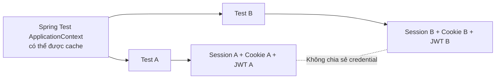

# Khóa, token, phiên và cookie riêng cho từng ca cần độc lập

## 1. Vì sao tính độc lập là yêu cầu bảo mật của bộ kiểm thử?

Hãy tưởng tượng hai bài test cùng chạy trên một ứng dụng Spring Security:

- Test A đăng nhập bằng tài khoản `alice`, nhận session cookie rồi kiểm tra `GET /api/me`.
- Test B đăng nhập bằng tài khoản `bob`, kiểm tra rằng Bob **không** xem được tài nguyên chỉ thuộc Alice.

Nếu test B vô tình sử dụng lại session cookie của A, cả hai test có thể vẫn trả 200 và làm nhóm phát triển hiểu sai cơ chế phân quyền. Lỗi tương tự xuất hiện khi các test dùng chung JWT ký bằng khóa tạm, refresh token, CSRF token, remember-me cookie, `OAuth2AuthorizedClientService` hay `SecurityContext` còn sót từ ca trước.

Trong module **SPRING_SECURITY_TESTING**, chúng ta sử dụng `spring-security-test` để kiểm chứng xác thực, phân quyền và HTTP security trên Servlet với MockMvc cũng như Reactive với WebTestClient. Mục tiêu của bài là **cô lập khóa, token, phiên và cookie đúng theo ranh giới từng ca**: test nào cần trạng thái thì tự tạo và tự sở hữu trạng thái ấy; các ca độc lập không phụ thuộc vào dữ liệu của nhau.

Sau bài này, người học có thể:

1. Phân biệt fixture giả lập danh tính với credential thực sự được xác minh bởi Spring Security.
2. Chọn phạm vi riêng cho signing key, JWT, token OAuth2, `HttpSession`, CSRF token và cookie.
3. Dùng `MockMvc` để xác minh hai session không trộn Authentication; hiểu sự khác nhau giữa `with(user(...))` và login qua filter thật.
4. Dùng `WebTestClient` với user/JWT giả đúng phạm vi, không vô tình tái sử dụng client đã mutate hoặc cookie của ca khác.
5. Viết ca kiểm thử token thiếu, sai, hết hạn hoặc ký bằng khóa không được tin cậy mà không chạm tới bí mật production.
6. Phát hiện test flake do Spring TestContext cache, fixture static, stateful bean, thứ tự test và thực thi song song.

> Nguyên tắc: **Mỗi ca kiểm thử phải tự giải thích nguồn danh tính và credential mà nó sử dụng.** Một test chỉ được dùng dữ liệu từ ca khác khi đây là một kịch bản nhiều bước được thiết kế có chủ đích và diễn ra **trong chính test đó**.

## 2. Lập bản đồ trạng thái cần cô lập

Tính độc lập không có nghĩa mọi thứ bắt buộc tạo lại mỗi giây. Ta cần chọn ranh giới phù hợp với dữ liệu, mức độ nhạy cảm và mục tiêu kiểm thử.

| Dữ liệu | Nơi có thể lưu | Rủi ro khi chia sẻ ngầm | Phạm vi fixture nên chọn |
| --- | --- | --- | --- |
| Khóa ký JWT / khóa HMAC test | Bean decoder/encoder, file hoặc biến test | Token của ca A bất ngờ hợp lệ với bộ giải mã ca B | Theo test hoặc theo context **có chủ đích**, cùng vòng đời encoder/decoder |
| JWT access token | Request header, object `Jwt` hoặc HTTP client | Claim/role/subject của ca trước lọt sang ca sau | Tạo theo từng test/request |
| Refresh token | Authorized-client store, database hoặc cookie | Ca khác sử dụng lại quyền truy cập và state refresh | Per-test principal + store riêng, hoặc cleanup có kiểm chứng |
| OAuth2 authorized client | `OAuth2AuthorizedClientService`/repository | Cache token bị chia sẻ giữa principal/client registration | Kho riêng mỗi test hoặc khóa principal riêng và cleanup |
| Session | `HttpSession` / `WebSession` và session store | Identity Alice bị dùng cho Bob | Session mới cho mỗi người dùng và mỗi test |
| Session cookie | Cookie `JSESSIONID` (Servlet) hoặc cookie resolver của WebFlux | HTTP client tiếp tục gửi session ID cũ | Cookie jar riêng từng test; không copy cookie tùy tiện |
| Remember-me cookie | Trình duyệt, remember-me store | Tái đăng nhập ngoài ý muốn trong test khác | Lấy cookie mới từ flow login của **cùng ca** |
| CSRF token | Session/cookie và HTTP request | Token của ca khác làm POST test sai kết quả | Tạo qua repository của đúng session hoặc mutator riêng từng request |
| `SecurityContext` | Servlet request/session, Reactor Context, Spring Security Test | Authentication còn sót hoặc bị tái sử dụng | Gắn theo test/request/subscription và dọn sau mỗi test |
| Clock / token expiry | Clock injected hoặc timestamp trong token | Test thất bại khi đồng hồ chạy qua thời điểm hết hạn | Clock cố định/điều khiển được trong phạm vi test |

### 2.1. Ba mức độ độc lập

**Theo request:** JWT/CSRF/header/cookie chỉ gắn vào request đang kiểm thử. Mức này phù hợp khi kiểm chứng authorization không cần lưu state.

**Theo test method:** Một phiên đăng nhập và chuỗi request liên tiếp được thực hiện trong cùng một `@Test`. Các request có thể cố ý dùng chung session trong nội bộ test; test tiếp theo tạo session khác.

**Theo ApplicationContext:** Các bean như `JwtDecoder`, signing key fixture và authorization server giả có thể được dùng chung **nếu chúng bất biến hoặc được reset đúng cách**. Spring TestContext thường cache context giữa các test class; do đó bean không tự động là dữ liệu riêng của từng method.



Nếu hai test có nhu cầu khác nhau về cấu hình khóa hoặc decoder, hoặc cùng sửa một bean singleton, cần **tách application context**, dùng thiết kế inject fixture theo test, hoặc reset có kiểm soát. Đừng coi việc đặt tên test khác nhau là đủ để tách state.

## 3. Mock Authentication không giống credential thật

`spring-security-test` cho phép đưa Authentication giả vào request hoặc Reactor Context để kiểm tra tầng **authorization** mà không cần login hay giải mã token:

| Kỹ thuật | Điều giả lập | Điều **không** tự chứng minh |
| --- | --- | --- |
| `@WithMockUser` | User, roles/authorities trong test security context | Password, session login, cookie và token |
| `with(user("alice"))` (MockMvc) | SecurityContext của một mock request | UserDetailsService/PasswordEncoder đã xác minh mật khẩu |
| `with(jwt())` (MockMvc) | `JwtAuthenticationToken` đã được tạo | Chữ ký, issuer, audience, `exp` và JWK decoder |
| `mockJwt()` (WebTestClient) | JWT Authentication cho mock Reactive request | Decoder/JWKS, token endpoint |
| `oauth2Login()` / `oidcLogin()` | Principal đã login OAuth2/OIDC | Authorization code flow và ID Token verification |
| `with(csrf())` / `mutateWith(csrf())` | CSRF token hợp lệ cho mock request | Toàn bộ browser cookie lifecycle |

Trong một test có `with(jwt())`, fixture có thể chứa claim `exp` đã qua hạn mà request vẫn được cho vào authorization; helper đang thiết lập Authentication giả, **không** bắt buộc decoder phải kiểm tra `exp`. Nếu cần khẳng định token thật bị từ chối, hãy gửi raw bearer token qua cấu hình resource server có decoder thực.

### 3.1. Chọn mục tiêu test trước khi tạo dữ liệu

- **Kiểm tra 403 khi thiếu role:** dùng Authentication giả với tập authority rõ ràng, không cần ký JWT.
- **Kiểm tra 401 khi JWT sai chữ ký:** phải dùng token dạng compact JWT và decoder thật, không dùng `with(jwt())`.
- **Kiểm tra cookie nhớ đăng nhập:** cần cookie do remember-me filter/service tạo (hoặc fixture có định dạng hợp lệ theo cấu hình), không thay bằng `with(user())`.
- **Kiểm tra session không trộn danh tính:** tạo hai session khác nhau, đảm bảo từng request mang đúng session.
- **Kiểm tra CSRF theo session:** lấy CSRF token và cookie/session theo cùng chính sách repository, không ghép token bất kỳ từ ca khác.

## 4. Tạo JWT fixture riêng cho từng request

Khi chỉ cần kiểm tra quyền của resource server trong MockMvc, hãy khai báo rõ subject, tenant, claim và authority ở chính request:

```java
import org.junit.jupiter.api.Test;
import org.springframework.beans.factory.annotation.Autowired;
import org.springframework.boot.test.autoconfigure.web.servlet.AutoConfigureMockMvc;
import org.springframework.boot.test.context.SpringBootTest;
import org.springframework.security.core.authority.SimpleGrantedAuthority;
import org.springframework.test.web.servlet.MockMvc;

import static org.springframework.security.test.web.servlet.request
    .SecurityMockMvcRequestPostProcessors.jwt;
import static org.springframework.test.web.servlet.request
    .MockMvcRequestBuilders.get;
import static org.springframework.test.web.servlet.result
    .MockMvcResultMatchers.*;

@SpringBootTest
@AutoConfigureMockMvc
class TenantAuthorizationTest {
    @Autowired MockMvc mvc;

    @Test
    void tenantAReaderCanReadItsReport() throws Exception {
        mvc.perform(get("/api/tenants/tenant-a/reports")
                .with(jwt()
                    .jwt(token -> token.subject("alice")
                        .claim("tenant_id", "tenant-a"))
                    .authorities(new SimpleGrantedAuthority(
                        "SCOPE_reports.read"))))
            .andExpect(status().isOk());
    }

    @Test
    void unrelatedScopeCannotReadReports() throws Exception {
        mvc.perform(get("/api/tenants/tenant-a/reports")
                .with(jwt()
                    .jwt(token -> token.subject("bob")
                        .claim("tenant_id", "tenant-a"))
                    .authorities(new SimpleGrantedAuthority(
                        "SCOPE_profile"))))
            .andExpect(status().isForbidden());
    }
}
```

Đoạn test giả định ứng dụng đã có controller `GET /api/tenants/{tenant}/reports` và security policy thực kiểm tra authority cần thiết. **Quan trọng:** `tenant_id` ở token không tự bảo đảm quyền theo tenant. Muốn chứng minh tenant A không đọc được dữ liệu tenant B, phải có authorization rule/method security đối chiếu tenant trong path với tenant/permission của principal và viết ca negative riêng.

### 4.1. Có cần một chuỗi token JWT hoàn toàn mới cho mỗi mock request?

Với `with(jwt())`, điều quan trọng là **mỗi request nhận đối tượng Authentication và các claim/authority đúng kịch bản**. Helper không gửi compact bearer token qua `JwtDecoder`. Vì vậy mã token giả trùng nhau không phải bằng chứng bug cache nếu test đang dùng mock Authentication. Ngược lại, với test integration đi qua decoder/token store, hãy tạo `jti` và giá trị token riêng khi cần kiểm tra revocation, replay protection hoặc cache.

Không nên đặt một object `JwtAuthenticationToken` mutable ở static field rồi thay authorities/claims của nó giữa các test. Hãy dùng factory tạo object mới hoặc DSL `jwt()` trực tiếp tại request.

## 5. Khi kiểm tra chữ ký: khóa và JWT phải thuộc cùng fixture

Kiểm tra JWT **thực sự được ký và giải mã** cần một cặp encoder/decoder tin cậy lẫn nhau. Có thể tạo RSA key pair ngẫu nhiên dùng riêng cho test:

```java
import java.security.KeyPair;
import java.security.KeyPairGenerator;
import java.security.interfaces.RSAPublicKey;
import java.security.interfaces.RSAPrivateKey;
import java.time.Instant;
import java.util.List;
import java.util.UUID;

import com.nimbusds.jose.jwk.JWKSet;
import com.nimbusds.jose.jwk.RSAKey;
import com.nimbusds.jose.jwk.source.ImmutableJWKSet;
import org.springframework.security.oauth2.jose.jws.SignatureAlgorithm;
import org.springframework.security.oauth2.jwt.*;

final class SignedJwtFixture {
    private final JwtEncoder encoder;
    private final JwtDecoder decoder;

    SignedJwtFixture() throws Exception {
        KeyPairGenerator generator = KeyPairGenerator.getInstance("RSA");
        generator.initialize(2048);
        KeyPair pair = generator.generateKeyPair();

        RSAPublicKey publicKey = (RSAPublicKey) pair.getPublic();
        RSAPrivateKey privateKey = (RSAPrivateKey) pair.getPrivate();
        String kid = UUID.randomUUID().toString();

        RSAKey jwk = new RSAKey.Builder(publicKey)
            .privateKey(privateKey)
            .keyID(kid)
            .build();

        encoder = new NimbusJwtEncoder(
            new ImmutableJWKSet<>(new JWKSet(jwk)));

        NimbusJwtDecoder nimbusDecoder =
            NimbusJwtDecoder.withPublicKey(publicKey).build();
        nimbusDecoder.setJwtValidator(
            JwtValidators.createDefaultWithIssuer(
                "https://issuer.example.test"));
        decoder = nimbusDecoder;
    }

    String tokenFor(String username, Instant now) {
        JwtClaimsSet claims = JwtClaimsSet.builder()
            .issuer("https://issuer.example.test")
            .subject(username)
            .issuedAt(now)
            .expiresAt(now.plusSeconds(300))
            .id(UUID.randomUUID().toString())
            .audience(List.of("reports-api"))
            .claim("scope", "reports.read")
            .build();

        return encoder.encode(
            JwtEncoderParameters.from(
                JwsHeader.with(SignatureAlgorithm.RS256).build(),
                claims)).getTokenValue();
    }

    JwtDecoder decoder() {
        return decoder;
    }
}
```

**Ý tưởng chính:** instance `SignedJwtFixture` sở hữu cả khóa ký và decoder. Không cần một private key production, không ghi file PEM có bí mật, và token tạo bằng fixture khác sẽ không hợp lệ nếu decoder không tin public key tương ứng.

Để ví dụ ngắn gọn, decoder trên kiểm tra các validation mặc định và issuer. `audience("reports-api")` **chưa tự được bảo đảm** trừ khi ứng dụng cấu hình thêm `OAuth2TokenValidator<Jwt>` kiểm tra `aud`. Nếu authorization policy đòi audience cụ thể, phải khai báo validator và test trường hợp audience sai. Tương tự, hệ thống hỗ trợ multiple issuers/JWK rotation cần integration setup riêng.

Một test đơn giản để chứng minh khóa độc lập:

```java
import org.junit.jupiter.api.Test;
import java.time.Instant;

import static org.assertj.core.api.Assertions.*;

class JwtKeyIsolationTest {

    @Test
    void tokenSignedByOneFixtureIsNotTrustedByAnother()
            throws Exception {
        SignedJwtFixture fixtureA = new SignedJwtFixture();
        SignedJwtFixture fixtureB = new SignedJwtFixture();

        String compactJwt =
            fixtureA.tokenFor("alice", Instant.now());

        assertThat(fixtureA.decoder().decode(compactJwt)
            .getSubject()).isEqualTo("alice");

        assertThatThrownBy(() ->
            fixtureB.decoder().decode(compactJwt))
            .isInstanceOf(JwtException.class);
    }
}
```

Test này kiểm chứng **đúng cặp khóa** ở tầng decoder. Để kiểm chứng HTTP 401 trên resource server, hãy cấu hình `JwtDecoder` của application context dùng public key của fixture tương ứng, rồi gửi:

```java
mvc.perform(get("/api/reports")
        .header("Authorization", "Bearer " + compactJwt))
    .andExpect(status().isOk());
```

Khối này chỉ là một **bước** trong integration test: cần endpoint, security chain bật `oauth2ResourceServer().jwt()`, decoder được inject và authority converter phù hợp. Với request ký bằng key không được tin cậy hoặc hết hạn, mong đợi 401 theo Bearer entry point của cấu hình đó.

### 5.1. Không tạo khóa mới mỗi request khi decoder vẫn giữ khóa cũ

Nếu ứng dụng dùng một singleton `JwtDecoder` trong cached `ApplicationContext`, mà test tạo signing key mới cho từng method, token của method tiếp theo đương nhiên không giải mã được. Đó là **lỗi fixture lifecycle**, không phải bug validation của Spring Security.

Hai thiết kế hợp lý:

- **Một key pair theo context**, immutable, test methods vẫn tạo token riêng với `sub`/`jti`/`exp` khác nhau; chỉ thay context nếu cần thay trust root.
- **Một key pair theo test**, mỗi test dựng encoder và decoder đồng bộ, hoặc tạo context riêng để decoder tương ứng được inject.

Không dùng `@DirtiesContext` vô điều kiện chỉ vì muốn token ngẫu nhiên; đây là lựa chọn tốn thời gian. Dùng nó khi test có chủ đích sửa singleton config hoặc trạng thái context không thể reset an toàn.

## 6. Phân biệt token mới, hết hạn, sai chữ ký và bị thu hồi

Đừng gộp mọi token bị từ chối vào một fixture chung. Các lỗi có nguồn khác nhau:

| Ca | Fixture đúng | Bằng chứng cần kiểm tra |
| --- | --- | --- |
| Hợp lệ | Key được tin cậy, issuer/audience/scope đúng, `exp` còn hiệu lực | Decode thành công; HTTP được phép theo authority |
| Hết hạn | Token thực có `exp` trước thời điểm kiểm tra | Decoder từ chối, thường HTTP 401 |
| Chưa đến `nbf` | Token có not-before trong tương lai | Token validator từ chối nếu cấu hình xử lý |
| Sai chữ ký | Ký bằng private key không tương ứng decoder | Decoder từ chối |
| Sai issuer | `iss` không thuộc allowlist | Issuer validator từ chối |
| Sai audience | `aud` khác resource server | Validator do app cấu hình từ chối |
| Thiếu scope | Token hợp lệ nhưng không có authority cần thiết | Authenticated request thường HTTP 403 |
| Bị revoke | JTI/opaque token có trạng thái revoked trong store | Cần app có cơ chế revocation/introspection và test state |

JWT ký hợp lệ **không tự biết đã bị revoke** nếu hệ thống không triển khai revocation list, introspection hoặc cơ chế tương ứng. Test JWT expired và revoked là hai hợp đồng khác nhau.

### 6.1. Thời gian trong fixture

Dùng `Clock` inject được hoặc tạo token với `Instant.now()` ngay tại thời điểm test. Tránh timestamp cố định kiểu “ngày X ở tương lai” vì sau một thời gian, token mẫu sẽ hết hạn và test bắt đầu thất bại không liên quan code.

Khi kiểm tra hạn token trong môi trường tích hợp, phải đối chiếu độ lệch đồng hồ (clock skew) mà `JwtTimestampValidator` hoặc decoder cấu hình chấp nhận. Đặt `exp` cách đủ xa thời điểm hiện tại hoặc kiểm soát đồng hồ validator nếu chính sách cho phép. Không dùng `Thread.sleep` dài để chờ token hết hạn trong unit test.

## 7. Servlet: mỗi test sở hữu một MockHttpSession

Trong Servlet, session nhận diện phía client bằng session ID, thường được truyền qua cookie `JSESSIONID`. Trong test MockMvc, `MockHttpSession` cho phép mô phỏng session theo request; khi test muốn kiểm chứng **session isolation**, hãy khởi tạo session khác nhau và không lưu chúng vào static field dùng chung.

Ví dụ tạo hai SecurityContext khác nhau gắn vào hai session:

```java
import java.util.List;
import org.springframework.mock.web.MockHttpSession;
import org.springframework.security.authentication
    .UsernamePasswordAuthenticationToken;
import org.springframework.security.core.context.SecurityContext;
import org.springframework.security.core.context.SecurityContextHolder;
import org.springframework.security.core.authority.SimpleGrantedAuthority;
import org.springframework.security.web.context.HttpSessionSecurityContextRepository;

final class Sessions {
    private Sessions() {}

    static MockHttpSession forUser(String username) {
        SecurityContext context =
            SecurityContextHolder.createEmptyContext();
        context.setAuthentication(
            new UsernamePasswordAuthenticationToken(
                username,
                "test-only",
                List.of(new SimpleGrantedAuthority("ROLE_USER"))));

        MockHttpSession session = new MockHttpSession();
        session.setAttribute(
            HttpSessionSecurityContextRepository
                .SPRING_SECURITY_CONTEXT_KEY,
            context);
        return session;
    }
}
```

Một controller dùng để quan sát principal:

```java
@RestController
class IdentityController {
    @GetMapping("/api/me")
    Map<String, String> me(Authentication authentication) {
        return Map.of("username", authentication.getName());
    }
}
```

Với `SecurityFilterChain` có `/api/me` yêu cầu authenticated và dùng security-context repository dựa trên `HttpSession`, kiểm thử:

```java
@Test
void sessionsKeepAliceAndBobSeparate() throws Exception {
    MockHttpSession alice = Sessions.forUser("alice");
    MockHttpSession bob = Sessions.forUser("bob");

    assertThat(alice.getId()).isNotEqualTo(bob.getId());

    mvc.perform(get("/api/me").session(alice))
        .andExpect(status().isOk())
        .andExpect(jsonPath("$.username").value("alice"));

    mvc.perform(get("/api/me").session(bob))
        .andExpect(status().isOk())
        .andExpect(jsonPath("$.username").value("bob"));

    mvc.perform(get("/api/me").session(alice))
        .andExpect(jsonPath("$.username").value("alice"));
}
```

Ví dụ này **tự đặt SecurityContext vào session**; nó không chứng minh password login hay session-fixation protection. Nó là phép thử rõ ràng rằng repository và application code không trộn người dùng khi nhận hai session khác nhau.

Nếu ứng dụng cấu hình `SessionCreationPolicy.STATELESS`, hoặc một `SecurityContextRepository` không lấy context từ session, không thể kỳ vọng code này xác thực người dùng qua session. Khi đó, dùng test request JWT/Basic phù hợp thay vì ép session fixture vào kiến trúc stateless.

## 8. Session được tạo bởi login thực: giữ cookie/session trong cùng test

Khi mục tiêu là kiểm tra form login, hãy để authentication filter tạo session rồi tái sử dụng session ấy trong **cùng ca**:

```java
import org.springframework.mock.web.MockHttpSession;
import org.springframework.test.web.servlet.MvcResult;

import static org.springframework.security.test.web.servlet.request
    .SecurityMockMvcRequestBuilders.formLogin;

@Test
void loginSessionIsUsedOnlyWithinThisScenario() throws Exception {
    MvcResult login = mvc.perform(formLogin()
            .user("alice")
            .password("secret"))
        .andExpect(status().is3xxRedirection())
        .andReturn();

    MockHttpSession session =
        (MockHttpSession) login.getRequest().getSession(false);
    assertThat(session).isNotNull();

    mvc.perform(get("/api/me").session(session))
        .andExpect(status().isOk())
        .andExpect(jsonPath("$.username").value("alice"));
}
```

Điều kiện: ứng dụng đã cấu hình form login, user/password test hợp lệ và session-based security. `formLogin()` là request builder phục vụ Spring Security Test; tùy cách đăng ký CSRF/handler, test cần đáp ứng đúng điều kiện form submission. Trên Spring Security mặc định, builder `formLogin()` cung cấp tham số login thích hợp, nhưng đừng dùng nó để giả lập một flow OIDC khác.

Test kế tiếp muốn login Bob phải **thực hiện login mới**, không dùng `MockHttpSession` lấy từ test Alice. Khi sử dụng một HTTP client thật có cookie jar tự động, hãy tạo client/cookie store riêng cho mỗi test hoặc xóa cookie jar giữa các ca.

### 8.1. Session fixation và logout

Để kiểm chứng session fixation protection, bắt đầu với một session trước login và so sánh ID trước/sau theo policy mà ứng dụng dùng (change session ID, migrate session hoặc tạo session mới). Không khẳng định mọi cấu hình giữ nguyên hoặc luôn thay ID. Khi kiểm tra logout, thực hiện logout trên session đã login, rồi thử dùng session/cookie cũ gọi endpoint bảo vệ và assert bị yêu cầu xác thực.

Test logout bằng `with(user("alice"))` ở từng request không thể chứng minh cookie/session bị vô hiệu hóa: request mới vẫn được helper gắn lại Authentication dù session cũ đã bị invalidate.

## 9. Cookie riêng theo kịch bản: cookie thường, session và remember-me

Cookie là dữ liệu HTTP phía client. Không phải cookie nào cũng là credential, nhưng nếu cookie là session/remember-me token thì nó mang ý nghĩa bảo mật.

| Cookie | Chức năng | Điều cần kiểm tra |
| --- | --- | --- |
| `JSESSIONID` | Mang định danh session Servlet | Tái sử dụng chỉ trong kịch bản login/session được chủ ý |
| Cookie session Reactive | ID của `WebSession` qua resolver | Không dùng nhầm cookie của user khác |
| `remember-me` | Khôi phục Authentication khi session không còn | Chỉ chấp nhận cookie hợp lệ từ đúng cấu hình/khóa/store |
| `XSRF-TOKEN` hoặc cookie CSRF được app cấu hình | Cung cấp CSRF token cho browser client | Token header/request khớp chính sách repository |
| `tenant` / `locale` | Dữ liệu ứng dụng | Không tự coi giá trị cookie chưa xác minh là quyền truy cập |

MockMvc có thể gửi cookie cho **một request**:

```java
import jakarta.servlet.http.Cookie;

mvc.perform(get("/api/preferences")
        .cookie(new Cookie("locale", "vi-VN")))
    .andExpect(status().isOk());
```

Cookie `locale` không tạo Authentication. Không dùng `new Cookie("remember-me", "alice")` và giả định user đã được xác thực: remember-me cookie thực sự thường có chữ ký/token và quy tắc validation riêng. Muốn test luồng này, hãy đăng nhập với `remember-me` được bật, đọc `Set-Cookie` từ response, bỏ session cũ và thực hiện request có cookie được phát hành trong cùng kịch bản.

Đối với cookie `Secure`, `HttpOnly` và `SameSite`, hãy kiểm tra `Set-Cookie` từ response thật hoặc mock response tương thích cấu hình; đừng suy ra các cờ đó chỉ từ việc `Cookie#getValue()` đúng. `SameSite` không phải là thuộc tính có mặt nhất quán trong API `jakarta.servlet.http.Cookie` của mọi phiên bản; có thể cần assert chuỗi header.

## 10. CSRF: token phải đi cùng session/cookie của đúng ca

CSRF token thường gắn với session hoặc một repository riêng. Một token của session A không nên tự động được coi là token hợp lệ của session B. Để kiểm tra **authorization** ở endpoint POST, `spring-security-test` cung cấp mutator tạo CSRF fixture hợp lệ cho request:

```java
import static org.springframework.security.test.web.servlet.request
    .SecurityMockMvcRequestPostProcessors.csrf;
import static org.springframework.security.test.web.servlet.request
    .SecurityMockMvcRequestPostProcessors.user;
import static org.springframework.test.web.servlet.request
    .MockMvcRequestBuilders.post;

@Test
void writerNeedsCsrfForPost() throws Exception {
    mvc.perform(post("/api/notes")
            .with(user("alice").roles("WRITER"))
            .contentType("text/plain")
            .content("draft"))
        .andExpect(status().isForbidden());

    mvc.perform(post("/api/notes")
            .with(user("alice").roles("WRITER"))
            .with(csrf())
            .contentType("text/plain")
            .content("draft"))
        .andExpect(status().isOk());
}
```

Ví dụ yêu cầu `SecurityFilterChain` bật CSRF và endpoint `POST /api/notes` tồn tại, trả 200 khi request hợp lệ. `with(csrf())` phục vụ kiểm chứng security filters trong MockMvc và dùng repository phù hợp với request test, nhưng **không đủ để chứng minh browser nhận/lưu/trả CSRF cookie đúng**.

Để test token theo **session thật**, thực hiện trong một test:

1. Tạo session A và lấy CSRF token từ cơ chế phát token của ứng dụng cho A.
2. Gửi POST với token và session A; expect allowed nếu Authentication và quyền cũng hợp lệ.
3. Tạo session B khác; gửi token A kèm session B, expect từ chối **theo repository và cấu hình thực**.
4. Lấy token B hợp lệ cho B và thử lại; expect allowed.

Chú ý: bước 3 không phải quy luật bất biến cho mọi CSRF repository. Ví dụ một số cấu hình `CookieCsrfTokenRepository` không ràng buộc token trực tiếp với server-side session theo cách `HttpSessionCsrfTokenRepository` làm. Khi kiểm thử ranh giới session-CSRF, hãy chọn repository có đặc tính đó và assert theo contract thật. Nếu token nằm trong cookie, phải kiểm tra cả cookie, header và cơ chế cookie/header binding thay vì chỉ một chuỗi token.

**Đừng tắt CSRF chỉ để làm POST test đỗ.** Nếu API thật stateless dùng Bearer token trong header và không dùng credential tự gửi từ browser, policy CSRF có thể khác; đó là quyết định theo threat model, không phải mẹo chỉnh test.

## 11. WebTestClient: cô lập Reactive SecurityContext và cookie

Trong WebFlux, `ReactiveSecurityContextHolder` sử dụng **Reactor Context** chứ không dựa trên Servlet session hay ThreadLocal. `WebTestClient` với Spring Security Test có mutator đặt Authentication cho request mô phỏng:

```java
import static org.springframework.security.test.web.reactive.server
    .SecurityMockServerConfigurers.mockUser;
import static org.springframework.security.test.web.reactive.server
    .SecurityMockServerConfigurers.mockJwt;
import static org.springframework.security.test.web.reactive.server
    .SecurityMockServerConfigurers.springSecurity;

WebTestClient baseClient =
    WebTestClient.bindToApplicationContext(context)
        .apply(springSecurity())
        .configureClient()
        .build();

baseClient.mutateWith(mockUser("alice").roles("READER"))
    .get().uri("/api/whoami")
    .exchange()
    .expectStatus().isOk()
    .expectBody(String.class).isEqualTo("alice");

baseClient.mutateWith(mockUser("bob").roles("READER"))
    .get().uri("/api/whoami")
    .exchange()
    .expectStatus().isOk()
    .expectBody(String.class).isEqualTo("bob");
```

Đoạn này giả định WebFlux app có route `/api/whoami` đọc principal từ Reactor Context và `SecurityWebFilterChain` phù hợp. `mutateWith(...)` tạo WebTestClient tùy biến; ở đây từng request bắt đầu từ **baseClient không gắn user**, tránh giữ một client có user Alice làm biến dùng chung cho mọi test.

Ví dụ mock JWT:

```java
baseClient.mutateWith(mockJwt()
        .jwt(jwt -> jwt.subject("alice")
            .claim("tenant_id", "tenant-a"))
        .authorities(new SimpleGrantedAuthority(
            "SCOPE_reports.read")))
    .get().uri("/api/tenants/tenant-a/reports")
    .exchange()
    .expectStatus().isOk();
```

`mockJwt()` không phát bearer string thật để gửi đến một HTTP server ở tiến trình khác. Nó chỉ có tác dụng trong bộ hạ tầng mock Reactive phù hợp. Để test server thật, hãy gửi header `Authorization: Bearer <compact JWT>` được ký và cấu hình decoder kiểm tra token ấy.

### 11.1. Cookie session trong WebFlux

Ở Reactive web application, cookie session được quản lý qua `WebSessionIdResolver`; tên cookie thông dụng có thể là `SESSION` nhưng **không nên hardcode nếu ứng dụng đã tùy chỉnh resolver**. Một kịch bản session hợp lệ:

```java
// Sau một request THỰC SỰ tạo WebSession trong app:
var issued = client.get().uri("/test/session-start")
    .exchange()
    .expectStatus().isOk()
    .returnResult(String.class);

var sessionCookie = issued.getResponseCookies()
    .getFirst("SESSION");
assertThat(sessionCookie).isNotNull();

client.get().uri("/api/me")
    .cookie("SESSION", sessionCookie.getValue())
    .exchange()
    .expectStatus().isOk();
```

Ví dụ chỉ là **mẫu lifecycle**: cần route `/test/session-start` thực sự tạo/lưu WebSession và một security setup mà session đó gắn với Authentication phù hợp. Nếu chỉ tạo session rỗng, request thứ hai không tự được xác thực. Test khác phải tạo session riêng; không đặt `sessionCookie` làm static field. Nếu ứng dụng dùng stateless JWT, đừng chuyển test JWT thành test session vô nghĩa.

## 12. OAuth2/OIDC: authorized client, access token và state cũng có vòng đời

Trong OAuth2 Client, một `OAuth2AuthorizedClient` có thể chứa access token và refresh token, được lưu theo registration ID và principal name qua `OAuth2AuthorizedClientService` hoặc repository. Nếu dùng cùng instance `InMemoryOAuth2AuthorizedClientService` cho nhiều test và tái sử dụng cùng principal, trạng thái authorized client của ca trước có thể lọt sang ca sau.

Để cô lập:

- Dùng `OAuth2AuthorizedClientManager` mock nếu mục tiêu chỉ là service lấy token và gọi API outbound; mỗi test trả một `OAuth2AuthorizedClient` mới.
- Dùng `OAuth2AuthorizedClientService`/repository **riêng từng test** khi đang kiểm tra lưu trữ hoặc refresh.
- Nếu dùng shared bean theo context, bảo đảm test có khóa client registration + principal riêng hoặc cleanup bằng `removeAuthorizedClient(registrationId, principalName)`.
- Không lưu access/refresh token thật vào YAML test fixture, file log hoặc snapshot của CI.
- Với OIDC login giả, dùng `oidcLogin()` hoặc `mockOidcLogin()` để đặt principal và claims riêng; chúng **không** kiểm chứng authorization code, nonce hay ID Token signature.

Ví dụ fixture tên principal:

```java
String principalForThisTest =
    "test-" + UUID.randomUUID();
OAuth2AuthorizeRequest authorizeRequest =
    OAuth2AuthorizeRequest.withClientRegistrationId("reports")
        .principal(principalForThisTest)
        .build();
```

Tên principal ngẫu nhiên có thể phù hợp với test độc lập về cache, nhưng **không được thay bừa principal trong test nghiệp vụ vốn yêu cầu user ID thật hoặc principal từ Authentication**. Muốn kiểm tra cách manager cache token theo user, phải dùng cùng principal trong một ca để quan sát cache hit, rồi user khác để quan sát isolation.

### 12.1. Authorization Code và `state`

Luồng OAuth2 authorization code lưu trạng thái request (chẳng hạn `state` và PKCE verifier) qua session/cookie/repository. Test hai lần bắt đầu authorization phải có state riêng và không được tráo state giữa hai callback. Một callback dùng `state` từ luồng A nhưng session B cần bị từ chối nếu ứng dụng dùng state repository gắn session.

Không tạo một `state` cố định cho cả suite rồi kết luận CSRF của OAuth2 login được bảo vệ. Với test real flow, dùng authorization server giả, lấy redirect/`state` được phát hành trong **chính kịch bản** và thử cả callback đúng lẫn callback sai/mất state.

## 13. Spring TestContext cache và trạng thái singleton

Spring Test thường **tái sử dụng ApplicationContext** giữa các test có cấu hình tương đương để tiết kiệm thời gian. Vì vậy một bean được inject vào test không đồng nghĩa với một instance mới cho mỗi `@Test`.

Ví dụ các nguồn rò rỉ:

```java
// Những mẫu cần tránh nếu state được thay đổi giữa các test:
static MockHttpSession sharedSession;
static String sharedAccessToken;
static Map<String, OAuth2AuthorizedClient> sharedClients =
    new HashMap<>();
```

Hoặc một singleton test bean ghi nhớ user/token cuối cùng và không reset trong `@AfterEach`. Khi JUnit chạy các test ở thứ tự khác hoặc song song, kết quả trở nên không xác định.

**Giải pháp ưu tiên theo mức độ:**

1. **Không dùng shared mutable fixture.** Khởi tạo token/cookie/session ở từng test hoặc bằng `@BeforeEach`.
2. **Tách dữ liệu và khóa lưu trữ.** Dùng principal ID, session ID, JTI riêng khi behavior cần state.
3. **Reset có kiểm chứng.** Xóa authorized client, session, Redis key, cookie jar hoặc dữ liệu test khi ca kết thúc.
4. **Thay bean bằng mock per context** khi muốn cô lập phụ thuộc, reset mock theo cơ chế Spring Test/Mockito đang dùng.
5. Dùng `@DirtiesContext` **chỉ khi cần**, chẳng hạn test có chủ đích thay đổi singleton configuration không thể khôi phục. Nó làm test chậm do phải tạo context mới.

Với cơ sở dữ liệu, `@Transactional` có thể rollback giao dịch test, nhưng không bảo đảm rollback các thao tác đã commit ở thread/request khác, external HTTP service, Redis, message queue hoặc cache ngoài transaction. Đối với state bảo mật trong các hệ thống đó, cần key namespace riêng và cleanup theo từng test.

### 13.1. Thứ tự test và chạy song song

Một test độc lập phải chạy được khi:

- Chỉ chạy riêng mình.
- Chạy cùng toàn bộ class ở thứ tự khác.
- Chạy lại nhiều lần.
- Chạy song song, **nếu** suite được cấu hình hỗ trợ concurrency và fixture không dùng chung mutable state.

Không dùng `@TestMethodOrder` để che giấu sự phụ thuộc giữa các ca. Nếu một kịch bản cần “login → gọi API → logout”, thực hiện ba bước trong **cùng method** thay vì chia làm ba `@Test` phụ thuộc thứ tự.

## 14. SecurityContext: dọn đúng vị trí

Với `@WithMockUser`, Spring Security Test listeners thường thiết lập và dọn test SecurityContext theo lifecycle, nên không cần tự tạo static holder:

```java
@Test
@WithMockUser(username = "alice", roles = "USER")
void aliceCanRead() {
    // SecurityContext được fixture của test này quản lý.
}
```

Nếu test **tự** đặt `SecurityContextHolder.setContext(...)` hoặc custom `TestSecurityContextHolder`, cần cleanup thích hợp trong `@AfterEach`, tránh để principal tồn tại ở test sau. Cẩn thận: cleanup của Spring Test không có nghĩa nó tự xóa **HTTP session server-side**, token trong database hoặc cookie jar của client mà bạn tạo thủ công.

Với Reactive, Authentication đi theo **Reactor Context** của subscription. Dùng `contextWrite(ReactiveSecurityContextHolder.withAuthentication(auth))` ở publisher cần kiểm tra thay vì ghi user vào một biến static hoặc `ThreadLocal` rồi hy vọng scheduler nào cũng thấy:

```java
Mono<String> name =
    ReactiveSecurityContextHolder.getContext()
        .map(ctx -> ctx.getAuthentication().getName())
        .contextWrite(
            ReactiveSecurityContextHolder.withAuthentication(auth));

StepVerifier.create(name)
    .expectNext("alice")
    .verifyComplete();
```

`auth` là fixture Authentication được tạo cho test. Với một publisher mới/ca mới, gắn một Authentication mới nếu đó là danh tính khác. Không dùng `subscribe()` thủ công để tách pipeline rồi bỏ quên context; ưu tiên `StepVerifier` để kiểm soát subscription và error signal.

## 15. Bộ kiểm thử phát hiện lộ trạng thái giữa hai user

Tối thiểu nên có một **ca negative cross-user** bên cạnh các ca thông thường.

| Tình huống | Dữ liệu riêng | Assertion bắt buộc |
| --- | --- | --- |
| Alice / Bob trong Servlet | `MockHttpSession` A và B | `/api/me` trả đúng tên theo từng session |
| Alice / Bob trong Reactive | `mockUser` riêng từng request | `/api/whoami` không tái sử dụng principal |
| Reader / Admin | Authorities khác nhau | Reader bị 403, Admin được phép |
| Token ký khóa A / decoder B | Hai key pair khác nhau | Decode bị từ chối |
| JWT hết hạn | `exp` có chủ đích trước now | Decoder thực từ chối; mock JWT không dùng làm bằng chứng |
| CSRF theo session | Session A/B và token đúng/sai | Token sai bị chặn theo repository thực |
| Remember-me cookie giả | Cookie không hợp lệ | Không tái xác thực chỉ vì có tên cookie |
| Logout | Session/cookie cũ sau logout | Không tái truy cập endpoint bảo vệ |
| OAuth2 cache | Registration/principal khác nhau | Authorized clients không trộn token |
| Đổi thứ tự chạy | Không có static mutable state | Kết quả giữ nguyên |

### 15.1. Thử nghiệm đối chứng rất quan trọng

Chỉ assert Alice nhận 200 và Bob nhận 200 không đủ để chứng minh cô lập. Hai request có thể đều bị phục vụ bằng cùng một Authentication. Cần assert **identity cụ thể** hoặc tài nguyên được trả về thuộc đúng user, đồng thời thử Bob truy cập tài nguyên Alice và mong bị từ chối.

Ví dụ:

```java
mvc.perform(get("/api/users/alice/private")
        .session(Sessions.forUser("bob")))
    .andExpect(status().isForbidden());
```

Đoạn này chỉ đúng khi ứng dụng có endpoint thật và **authorization rule kiểm tra chủ sở hữu**, không chỉ `authenticated()`. Test security cần phù hợp policy hiện có, không tự giả định Spring Security suy luận owner từ path.

## 16. Những lỗi phổ biến khi cô lập fixture

**1. Dùng chung JWT string trong mọi test.** Dễ làm test phụ thuộc `exp` cố định và che sự khác biệt của `sub`/scope. Tạo claims rõ theo test; nếu cần token thật, ký bằng fixture phù hợp decoder.

**2. Tạo khóa mới mỗi test nhưng decoder vẫn thuộc cached context cũ.** Token bị từ chối ngoài ý muốn. Phối hợp vòng đời encoder/decoder; tạo context riêng khi thay trust root.

**3. Gắn `with(jwt())` rồi kết luận token hết hạn bị từ chối.** Helper bỏ qua decoder; phải gửi raw bearer JWT qua resource server thực.

**4. Dùng `MockHttpSession` static.** Người dùng của ca trước có thể tồn tại trong ca sau. Tạo session riêng và giữ trong local variable.

**5. Tái sử dụng session của login A trong test B.** Dẫn đến false positive hoặc false negative về Authentication. Mỗi test login lại, trừ khi đang viết một kịch bản multi-step duy nhất.

**6. Tái sử dụng một WebTestClient đã mutate với Alice.** Request sau có thể vẫn sử dụng Authentication fixture của Alice. Luôn bắt đầu từ base client chưa gắn user và tạo biến cục bộ theo test.

**7. Chuyển cookie `remember-me` thành giá trị tùy ý.** Cookie được bảo vệ bởi định dạng và xác minh riêng; chỉ có tên đúng không làm nó hợp lệ.

**8. Dùng CSRF token của session khác rồi mặc định mọi repository phải trả 403.** Phụ thuộc loại `CsrfTokenRepository` và cách cookie/header gắn với request; xây test theo chính sách thật.

**9. Tạo state OAuth2 cố định rồi chia sẻ cho callback khác.** Che lỗi chống CSRF trong authorization flow. Mỗi authorization request cần state và session/repository có chủ đích.

**10. Chỉ reset Mockito nhưng quên database/cache.** `reset(mock)` không xóa token đã lưu trong `OAuth2AuthorizedClientService`, Redis hay session store.

**11. Dùng `@DirtiesContext` ở mọi method.** Chậm và không dọn chắc chắn những hệ thống bên ngoài. Chọn test fixture per-method, namespace và cleanup trước.

**12. Phụ thuộc thứ tự chạy.** Một test “prepare user” tạo dữ liệu cho test “assert access” là hai test không độc lập. Gộp chúng thành một kịch bản hoặc fixture setup idempotent.

**13. Log cả JWT/refresh token/secret để debug.** Dễ rò rỉ credential qua CI. Dùng dữ liệu giả, log ID/correlation đã làm sạch và che giá trị token.

**14. Dùng cùng tên principal cho test OAuth2 cache nhiều người dùng.** Authorized client có thể được lấy theo principal name; phải mô phỏng chính xác ranh giới người dùng.

**15. Nhầm 401 và 403 vì cookie/CSRF.** Cookie session không hợp lệ có thể dẫn đến unauthenticated; thiếu role dẫn đến 403; thiếu CSRF cũng có thể 403. Tạo ca đối chứng để biết cơ chế gây từ chối.

## 17. Bài thực hành

**Bài 1 — Session độc lập.** Tạo hai `MockHttpSession`, gắn context Alice/Bob và assert `GET /api/me` trả đúng người tương ứng. Viết thêm request Bob truy cập tài nguyên Alice và xác minh bị chặn bởi rule chủ sở hữu.

**Bài 2 — JWT mock per-request.** Với MockMvc và `with(jwt())`, kiểm tra role và tenant bằng hai principals độc lập. Giải thích vì sao helper không xác minh signature, expiry hoặc audience.

**Bài 3 — JWT ký thật.** Tạo hai `SignedJwtFixture` RSA khác nhau. Ký token bằng A rồi giải mã qua decoder A/B; bổ sung token hết hạn và issuer sai. Nếu muốn assert HTTP 401, gắn decoder A vào resource-server context rồi gửi bearer token thật.

**Bài 4 — CSRF/session.** Với repository dựa trên session, tạo session A/B, lấy token đúng từng session và thực hiện POST. Kiểm tra cùng user nhưng CSRF token sai bị từ chối, token đúng được phép.

**Bài 5 — Remember-me.** Cho ứng dụng thật tạo remember-me cookie trong login flow. Xóa/bỏ session, gửi cookie của chính ca và thử cookie bị sửa. Ghi rõ kết quả được kiểm chứng từ remember-me filter/service, không phải `with(user())`.

**Bài 6 — WebTestClient.** Tạo base client bảo mật, dùng `mutateWith(mockUser("alice"))` và `mutateWith(mockUser("bob"))` cho hai request riêng. Assert Reactive SecurityContext và quyền truy cập phù hợp từng user; không lưu mutated client dạng static.

**Bài 7 — OAuth2 authorized client store.** Tạo store độc lập hoặc principal riêng cho mỗi test. Ghi/lấy token cho Alice rồi Bob, kiểm tra không bị trộn; xóa trạng thái sau test nếu dùng shared repository.

**Bài 8 — Chạy lại/ngẫu nhiên thứ tự.** Chạy từng test riêng, chạy cả class và khi bộ test hỗ trợ concurrency thì chạy song song. Gỡ các shared mutable fixtures và giữ kết quả không đổi.

**Tiêu chí đạt:** Một test mô tả chính xác nguồn key/token/session/cookie, độc lập với test trước/sau, có ít nhất một ca cross-user bị chặn và phân biệt được **authorization mock** với **credential/session validation thật**.

## 18. Tài liệu tham khảo

- [Spring Security — Testing MockMvc](https://docs.spring.io/spring-security/reference/servlet/test/mockmvc/index.html): tích hợp MockMvc với Spring Security.
- [Spring Security — Testing HTTP Authorization](https://docs.spring.io/spring-security/reference/servlet/test/mockmvc/authorization.html): `with(user(...))` và phân quyền HTTP.
- [Spring Security — Testing JWT](https://docs.spring.io/spring-security/reference/servlet/test/mockmvc/oauth2.html): `jwt()` và OAuth2/OIDC giả lập trong Servlet.
- [Spring Security — Testing WebFlux Security](https://docs.spring.io/spring-security/reference/reactive/test/web/setup.html): `WebTestClient` và `springSecurity()`.
- [Spring Security — Reactive OAuth2 Testing](https://docs.spring.io/spring-security/reference/reactive/test/web/oauth2.html): `mockJwt()` và mock OAuth2/OIDC.
- [Spring Security — Testing with CSRF](https://docs.spring.io/spring-security/reference/servlet/test/mockmvc/csrf.html): tạo CSRF fixture bằng MockMvc.
- [Spring Security — Session Management](https://docs.spring.io/spring-security/reference/servlet/authentication/session-management.html): session, SecurityContext và lifecycle.
- [Spring Security — OAuth2 Client Core](https://docs.spring.io/spring-security/reference/servlet/oauth2/client/core.html): authorized client, repository và service.
- [Spring Framework — Context Caching](https://docs.spring.io/spring-framework/reference/testing/testcontext-framework/ctx-management/caching.html): phạm vi cache của Spring Test ApplicationContext.
- [Spring Security — JWT Resource Server](https://docs.spring.io/spring-security/reference/servlet/oauth2/resource-server/jwt.html): xác minh bearer JWT bằng decoder.
