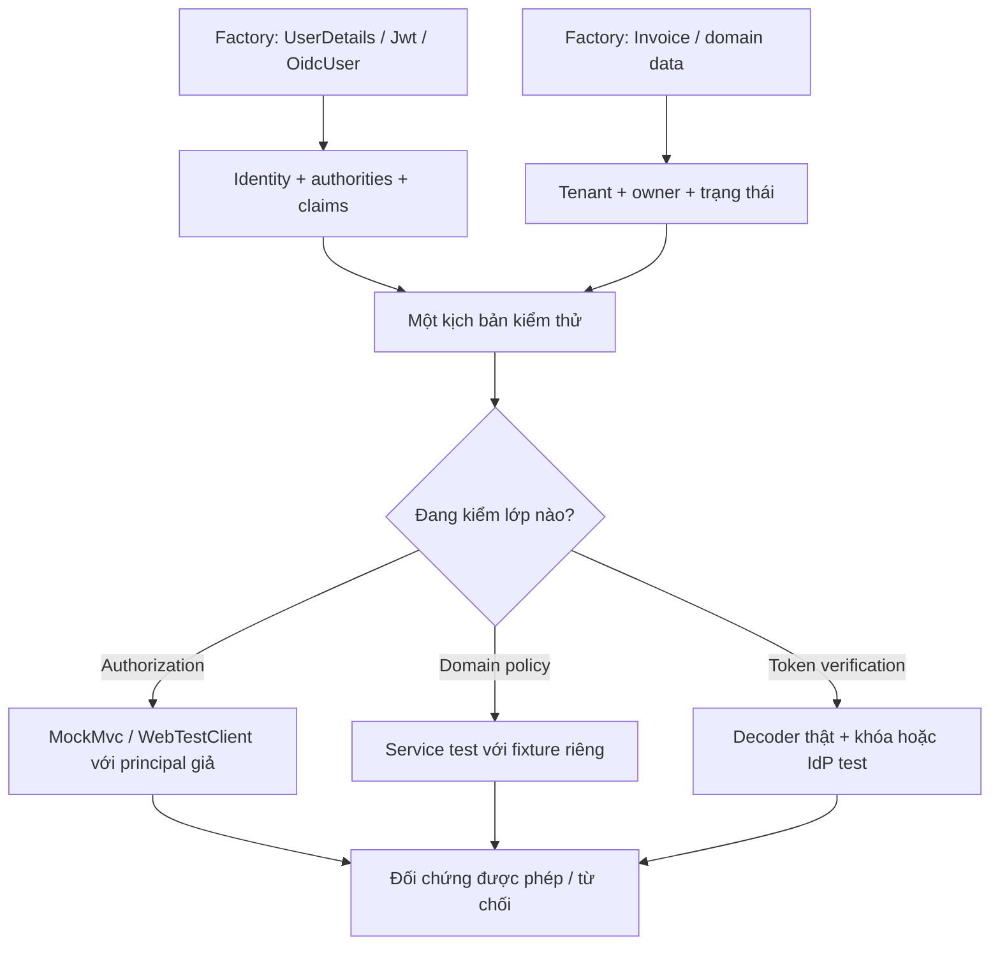
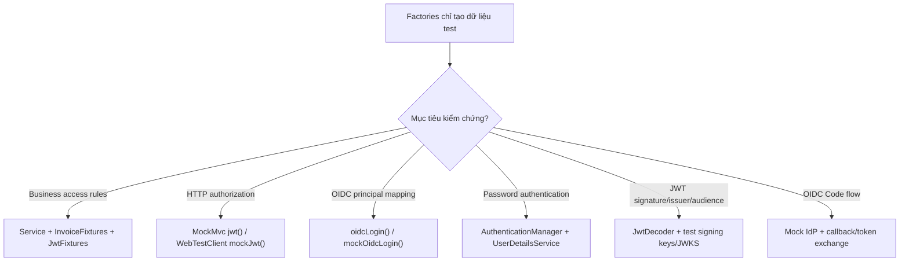

# Test factory cho UserDetails, Jwt, OidcUser và dữ liệu miền

Một bài kiểm thử Spring Security tốt phải cho người đọc biết **ai đang gọi API, có những quyền gì, yêu cầu truy cập bản ghi nào và kết quả phải được cho phép hay từ chối vì lý do nào**. Nếu mỗi test tự dựng hàng chục claims, authorities, user và bản ghi miền, lỗi đánh máy hoặc một mặc định không rõ ràng có thể làm test thành công vì sai nguyên nhân. Nếu tái sử dụng object mutable giữa các test, thứ tự thực thi có thể làm kết quả thay đổi.

Trong chương **Dữ liệu và cô lập** của module **SPRING_SECURITY_TESTING**, ta xây dựng các **test factory** cho `UserDetails`, `Jwt`, `OidcUser` và đối tượng miền; sau đó dùng chúng trong `MockMvc`, `WebTestClient`, `@WithMockUser`/`SecurityContext` và các helper JWT/OAuth2/OIDC giả lập. Mục tiêu module là kiểm chứng xác thực, phân quyền và bảo vệ HTTP thực tế trên cả **Servlet** và **Reactive**. Bài này chú trọng dữ liệu kiểm thử có ý nghĩa, có thể tái tạo và không làm lẫn trạng thái của người dùng hay tenant giữa các ca.

## 1. Test factory giải quyết vấn đề gì?

**Test factory** là một phương thức hoặc lớp chuyên tạo **fixture**—dữ liệu được đưa vào phép thử—với những mặc định xác định và những tham số cố ý thay đổi. Nó khác với factory của code production: mục đích ở đây là giúp người đọc nhận ra sự khác nhau giữa các scenario và tránh thiết lập test quá dài.

Thay vì lặp lại ở mọi test:

```java
var user = User.withUsername("alice")
        .password("{noop}test-password")
        .authorities("ROLE_READER")
        .build();
// Lặp lại gần như y hệt cho bob, admin, user bị khóa...
```

Ta dùng tên phản ánh ý định:

```java
UserDetails alice = UserDetailsFixtures.reader("alice");
UserDetails bob = UserDetailsFixtures.withAuthorities(
        "bob", "ROLE_GUEST");
Jwt tenantAJwt = JwtFixtures.invoiceReader("alice", "tenant-a");
OidcUser staff = OidcUserFixtures.employee(
        "staff-101", "tenant-a");
Invoice invoice = InvoiceFixtures.aDraftInvoice()
        .tenant("tenant-a")
        .owner("alice")
        .build();
```

Các factory trong những đoạn sau dùng **thông tin giả** và được thiết kế cho test, không lấy thông tin nhận dạng hay secret production.

| Đối tượng | Factory nên điều khiển | Lỗi test thường che khuất |
|---|---|---|
| `UserDetails` | username, password giả, trạng thái khóa/vô hiệu hóa, authorities | Lẫn `ROLE_...` và `SCOPE_...`; principal sai |
| `Jwt` | subject, issuer, audience, tenant claim, scopes, mốc thời gian | Claim có nhưng authority chưa được chuyển đổi; token chưa được verify |
| `OidcUser` | subject, issuer, audience, ID token claims, UserInfo, authorities | Nhầm ID token với API JWT; user thiếu claim cần thiết |
| Dữ liệu miền | ID, tenant, owner, trạng thái, số tiền, liên kết | Test chỉ đổi principal nhưng không đổi dữ liệu; lộ dữ liệu tenant khác |
| State dùng chung | thời gian, kho dữ liệu, session, cache, security context | Test pass khi chạy riêng nhưng fail khi chạy cả suite |

### Bốn nguyên tắc thiết kế

1. **Ý nghĩa rõ ràng:** tên factory nói được user là ai, thuộc tenant nào, có quyền gì.
2. **Một biến mỗi phép thử:** khi test lỗi tenant, giữ nguyên scope và bản ghi; chỉ thay tenant của principal hoặc dữ liệu.
3. **Fixture mới mỗi lần gọi:** không trả về một object mutable toàn cục để nhiều test cùng sửa.
4. **Không giả mạo độ tin cậy:** `Jwt` hoặc `OidcUser` do factory dựng **không phải** token đã được kiểm chứng chữ ký/issuer qua HTTP.



## 2. Vị trí factory và dependency

Đối với một dự án Spring Boot dùng Java 17+, có thể đặt factory **chỉ trong test source set**, ví dụ:

```text
src/test/java/com/example/testing/fixtures/
    UserDetailsFixtures.java
    JwtFixtures.java
    OidcUserFixtures.java
    InvoiceFixtures.java
src/test/java/com/example/testing/
    InvoiceServiceTest.java
    InvoiceMvcSecurityTest.java
    InvoiceWebFluxSecurityTest.java
```

Danh sách này minh họa cách tổ chức; bài học **không tạo thêm file trong repository**. Mục đích là không đưa dữ liệu kiểm thử hoặc secret giả vào artifact production.

Các ví dụ giả định có những dependency phù hợp:

```kotlin
dependencies {
    implementation("org.springframework.boot:spring-boot-starter-security")
    implementation("org.springframework.boot:spring-boot-starter-oauth2-resource-server")
    implementation("org.springframework.boot:spring-boot-starter-oauth2-client")

    testImplementation("org.springframework.boot:spring-boot-starter-test")
    testImplementation("org.springframework.security:spring-security-test")
}
```

Ứng dụng Servlet còn cần Spring Web MVC; ứng dụng Reactive cần Spring WebFlux. **Không nhất thiết thêm cả hai web starter vào một ứng dụng** chỉ để chạy tất cả snippet: các ví dụ Servlet/Reactive là hai cấu hình kiểm thử thay thế. Nếu test trực tiếp `Mono`/`Flux` với `StepVerifier`, cần `reactor-test` (nhiều cấu hình Spring Boot test đã cung cấp qua dependency quản lý).

## 3. UserDetailsFixtures: tên user, role và trạng thái tài khoản

`UserDetails` thường phục vụ user/password authentication và các API nghiệp vụ có phụ thuộc principal kiểu user. Tạo factory với mặc định tối thiểu:

```java
import org.springframework.security.core.userdetails.User;
import org.springframework.security.core.userdetails.UserDetails;

public final class UserDetailsFixtures {

    private UserDetailsFixtures() {}

    public static UserDetails reader(String username) {
        return withAuthorities(username, "ROLE_READER");
    }

    public static UserDetails withAuthorities(
            String username, String... authorities) {
        return User.withUsername(username)
                .password("{noop}test-password")
                .authorities(authorities)
                .build();
    }

    public static UserDetails disabledReader(String username) {
        return User.withUsername(username)
                .password("{noop}test-password")
                .authorities("ROLE_READER")
                .disabled(true)
                .build();
    }

    public static UserDetails lockedReader(String username) {
        return User.withUsername(username)
                .password("{noop}test-password")
                .authorities("ROLE_READER")
                .accountLocked(true)
                .build();
    }
}
```

`{noop}test-password` là password **giả dành riêng cho fixture**, không phải khuyến nghị lưu password plaintext trong production. Khi kiểm tra login/password thật, dùng `PasswordEncoder` cùng cơ chế xác thực của ứng dụng; khi chỉ kiểm authorization với principal giả, thường không cần thực hiện xác minh password.

### Role khác authority

- `hasRole("READER")` thường tìm authority `ROLE_READER`.
- `hasAuthority("ROLE_READER")` kiểm tra chính xác chuỗi đó.
- `hasAuthority("SCOPE_invoices.read")` kiểm tra scope authority, **không đồng nghĩa** với `ROLE_READER`.

Vì factory trên dùng `.authorities(...)` thay vì `.roles(...)`, test kiểm soát chính xác chuỗi authority mà Spring Security nhận. Đây là lựa chọn hữu ích khi muốn tạo các ca thiếu một authority cụ thể.

### Dùng UserDetails trong MockMvc

```java
import static org.springframework.security.test.web.servlet.request
        .SecurityMockMvcRequestPostProcessors.user;
import static org.springframework.test.web.servlet.request
        .MockMvcRequestBuilders.get;

mockMvc.perform(get("/api/profile")
        .with(user(UserDetailsFixtures.reader("alice"))))
        .andExpect(status().isOk());
```

Trong WebFlux, dùng API Reactive:

```java
import static org.springframework.security.test.web.reactive.server
        .SecurityMockServerConfigurers.mockUser;

webTestClient
    .mutateWith(mockUser(UserDetailsFixtures.reader("alice")))
    .get().uri("/api/profile")
    .exchange()
    .expectStatus().isOk();
```

Những đoạn này giả định endpoint tồn tại, client chạy filter bảo mật phù hợp và `ROLE_READER` được cho phép. Chúng kiểm tra authorization với **principal đã giả lập**, không chứng minh password được xác minh bằng database hay LDAP.

### @WithMockUser và @WithUserDetails

`@WithMockUser` không trực tiếp gọi factory:

```java
@Test
@WithMockUser(username = "alice", authorities = "ROLE_READER")
void readerCanAccessProfile() throws Exception {
    mockMvc.perform(get("/api/profile"))
            .andExpect(status().isOk());
}
```

Nếu muốn annotation lấy `UserDetails` từ repository/service đã cấu hình, có thể dùng `@WithUserDetails("alice")` với `UserDetailsService` test cung cấp factory:

```java
@Bean
UserDetailsService testUserDetailsService() {
    return username -> {
        if ("alice".equals(username)) {
            return UserDetailsFixtures.reader("alice");
        }
        throw new UsernameNotFoundException(username);
    };
}
```

Tuy nhiên `@WithUserDetails` cần đúng test execution listener và `UserDetailsService` tương ứng. Trong unit test `Mono` độc lập ngoài WebFilter, annotation không mặc định truyền principal qua mọi Reactor subscription; khi đó dùng `ReactiveSecurityContextHolder.withAuthentication(...)`.

**Cẩn thận:** factory `disabledReader` chỉ dựng `UserDetails.isEnabled() == false`. Nếu đưa user này vào `.with(user(...))` hoặc `mockUser(...)`, helper có thể dựng Authentication đã xác thực mà **không đi qua kiểm tra tài khoản disabled**. Muốn chứng minh người bị khóa không đăng nhập được, phải test `AuthenticationManager`/`UserDetailsService`/password mechanism thật.

## 4. JwtFixtures: kiểm soát claims và thời gian

Một `Jwt` test fixture là object chứa header, token value và claims; có thể dùng để tạo `JwtAuthenticationToken` mà không cần gọi JWKS. Ta chọn thời gian cố định để test có thể tái hiện:

```java
import java.time.Instant;
import java.util.List;
import org.springframework.security.oauth2.jwt.Jwt;

public final class JwtFixtures {

    private static final Instant ISSUED_AT =
            Instant.parse("2025-01-01T00:00:00Z");
    private static final Instant EXPIRES_AT =
            Instant.parse("2035-01-01T00:00:00Z");
    private static final String ISSUER =
            "https://identity.example.test/realms/testing";

    private JwtFixtures() {}

    public static Jwt invoiceReader(
            String subject, String tenantId) {
        return forTenant(subject, tenantId, "invoices.read");
    }

    public static Jwt invoiceWriter(
            String subject, String tenantId) {
        return forTenant(subject, tenantId, "invoices.write");
    }

    public static Jwt forTenant(
            String subject, String tenantId, String scope) {
        return Jwt.withTokenValue(
                    "fixture-" + subject + "-" + tenantId + "-" + scope)
                .header("alg", "RS256")
                .subject(subject)
                .issuedAt(ISSUED_AT)
                .expiresAt(EXPIRES_AT)
                .claim("iss", ISSUER)
                .claim("aud", List.of("invoice-api"))
                .claim("tenant_id", tenantId)
                .claim("scope", scope)
                .build();
    }
}
```

Factory **tạo Jwt mới mỗi lần gọi**. `tokenValue` và `alg=RS256` trong snippet là metadata minh họa, **không phải compact JWT có chữ ký RS256 hợp lệ**. Khi test với `jwt()` hoặc `mockJwt()`, framework dựng authentication giả từ object này; nó không tự xác minh chữ ký hay issuer.

Tại sao nên dùng mốc thời gian cố định? Nếu factory gọi `Instant.now()` ở mọi test, một snapshot không còn hoàn toàn xác định, và các case ranh giới `exp`/`nbf` có thể bị flaky. Khi thật sự test token hết hạn, nên điều khiển `Clock`/validator hoặc thời gian tương đối có dư địa rõ ràng; **thay `exp` trong JWT giả không bảo đảm decoder sẽ chạy**.

### Dùng JwtFixtures trong Servlet

```java
import org.springframework.security.core.authority.SimpleGrantedAuthority;
import static org.springframework.security.test.web.servlet.request
        .SecurityMockMvcRequestPostProcessors.jwt;

mockMvc.perform(get("/api/invoices/inv-100")
        .with(jwt()
            .jwt(JwtFixtures.invoiceReader("alice", "tenant-a"))
            .authorities(new SimpleGrantedAuthority(
                    "SCOPE_invoices.read"))))
        .andExpect(status().isOk());
```

### Dùng JwtFixtures trong WebFlux

```java
import static org.springframework.security.test.web.reactive.server
        .SecurityMockServerConfigurers.mockJwt;

webTestClient
    .mutateWith(mockJwt()
        .jwt(JwtFixtures.invoiceReader("alice", "tenant-a"))
        .authorities(new SimpleGrantedAuthority(
            "SCOPE_invoices.read")))
    .get().uri("/api/invoices/inv-100")
    .exchange()
    .expectStatus().isOk();
```

Ở đây, test **chủ động cấp** `SCOPE_invoices.read`. Nó chứng minh HTTP authorization theo authority, **không** chứng minh converter production sẽ tự biến claim `"scope": "invoices.read"` thành authority. Hãy dành một unit test riêng cho `JwtAuthenticationConverter`/reactive converter hoặc integration test Bearer token qua decoder thật khi cần xác minh đường chuyển đổi.

### Các biến thể có chủ đích

```java
Jwt sameTenant = JwtFixtures.invoiceReader(
        "alice", "tenant-a");
Jwt otherTenant = JwtFixtures.invoiceReader(
        "alice", "tenant-b");
Jwt wrongScope = JwtFixtures.invoiceWriter(
        "alice", "tenant-a");
```

Giữ `subject=alice` trong cả ba trường hợp giúp phân tách **tenant mismatch** khỏi **identity mismatch**. Nếu thay cả subject, scope, tenant và invoice cùng lúc, status 403 chưa đủ cho biết lỗi thuộc chính sách nào.

## 5. OidcUserFixtures: ID token, UserInfo và authorities

`OidcUser` thường là principal sau **OIDC Login**, không phải cùng loại với `JwtAuthenticationToken` của Resource Server. Một factory OIDC cần ID token có claims đủ để code đọc danh tính; có thể thêm UserInfo khi nghiệp vụ phụ thuộc dữ liệu từ UserInfo endpoint.

```java
import java.time.Instant;
import java.util.LinkedHashMap;
import java.util.List;
import java.util.Map;
import org.springframework.security.core.authority.SimpleGrantedAuthority;
import org.springframework.security.oauth2.core.oidc.OidcIdToken;
import org.springframework.security.oauth2.core.oidc.OidcUserInfo;
import org.springframework.security.oauth2.core.oidc.user.DefaultOidcUser;
import org.springframework.security.oauth2.core.oidc.user.OidcUser;

public final class OidcUserFixtures {

    private static final Instant ISSUED_AT =
            Instant.parse("2025-01-01T00:00:00Z");
    private static final Instant EXPIRES_AT =
            Instant.parse("2035-01-01T00:00:00Z");

    private OidcUserFixtures() {}

    public static OidcUser employee(
            String subject, String tenantId) {
        return build(subject, tenantId, true);
    }

    public static OidcUser withoutEmail(
            String subject, String tenantId) {
        return build(subject, tenantId, false);
    }

    private static OidcUser build(
            String subject, String tenantId, boolean includeEmail) {
        Map<String, Object> claims = new LinkedHashMap<>();
        claims.put("sub", subject);
        claims.put("iss", "https://identity.example.test/realms/staff");
        claims.put("aud", List.of("portal-web"));
        claims.put("tenant_id", tenantId);
        if (includeEmail) {
            claims.put("email", subject + "@example.test");
        }

        OidcIdToken idToken = new OidcIdToken(
                "id-token-fixture-" + subject,
                ISSUED_AT,
                EXPIRES_AT,
                Map.copyOf(claims));

        return new DefaultOidcUser(
                List.of(new SimpleGrantedAuthority("ROLE_EMPLOYEE")),
                idToken,
                "sub");
    }
}
```

Ở đây `DefaultOidcUser` được tạo từ `OidcIdToken` giả với `sub` là thuộc tính tên principal. Chúng ta có **dữ liệu OIDC hợp lý để test code đọc principal**, nhưng chưa xác minh chữ ký, nonce, issuer hoặc audience qua OIDC login thật.

Nếu controller phụ thuộc `UserInfo`, có thể mở rộng factory:

```java
OidcIdToken idToken = /* ID token fixture có sub=staff-101 */;
OidcUserInfo userInfo = new OidcUserInfo(Map.of(
        "sub", "staff-101",
        "preferred_username", "alice",
        "department", "sales"));

OidcUser user = new DefaultOidcUser(
        List.of(new SimpleGrantedAuthority("ROLE_EMPLOYEE")),
        idToken,
        userInfo,
        "sub");
```

Đoạn này là **minh họa bổ sung**, giả định đã có biến `idToken` được dựng đúng trong factory. Trong OIDC, `sub` của ID token và UserInfo cần tương thích; test nên cố ý kiểm tra sự nhất quán đó. Đừng cho mọi claim vào một map tùy tiện rồi quên mất ứng dụng thật đọc chúng từ ID token hay UserInfo.

### Dùng OidcUserFixtures ở Servlet và Reactive

```java
// MockMvc, Servlet
mockMvc.perform(get("/account")
        .with(oidcLogin().oidcUser(
            OidcUserFixtures.employee("staff-101", "tenant-a"))))
        .andExpect(status().isOk());
```

```java
// WebTestClient, Reactive
webTestClient
    .mutateWith(mockOidcLogin().oidcUser(
        OidcUserFixtures.employee("staff-101", "tenant-a")))
    .get().uri("/account")
    .exchange()
    .expectStatus().isOk();
```

Các đoạn này giả định controller bảo vệ `/account` đã tồn tại và cho phép `ROLE_EMPLOYEE`. `oidcLogin()` và `mockOidcLogin()` tạo principal giả để test logic **sau đăng nhập**, không đi qua browser redirect, token endpoint, JWKS hay validate ID token thật.

Nếu API dùng JWT Bearer và controller chờ `@AuthenticationPrincipal Jwt`, không thay bằng `OidcUser` vì cả hai “đều chứa JWT”. Kiểu principal của Resource Server và OIDC Login là **hai ngữ cảnh xác thực khác nhau**.

## 6. InvoiceFixtures: dựng dữ liệu miền độc lập với identity

Một test kiểm tra phân quyền không chỉ cần người dùng. Nó còn cần **tài nguyên được truy cập** có tenant, owner và trạng thái xác định. Giả sử ứng dụng quản lý hóa đơn, một hóa đơn có:

```java
enum InvoiceStatus {
    DRAFT, ISSUED, PAID
}

record Invoice(
        String id,
        String tenantId,
        String ownerId,
        long amountCents,
        InvoiceStatus status) {
}
```

Sử dụng `record` giúp dữ liệu miền mang tính bất biến ở cấp các trường đơn giản; không có setter làm các test vô tình sửa đối tượng dùng chung. Nếu model production của bạn có entity mutable, factory vẫn nên **tạo một entity mới mỗi lần gọi**.

Factory sau dùng một builder **mới cho mỗi scenario**:

```java
public final class InvoiceFixtures {

    private InvoiceFixtures() {}

    public static Builder aDraftInvoice() {
        return new Builder();
    }

    public static final class Builder {
        private String id = "inv-100";
        private String tenantId = "tenant-a";
        private String ownerId = "alice";
        private long amountCents = 129_900L;
        private InvoiceStatus status = InvoiceStatus.DRAFT;

        private Builder() {}

        public Builder id(String value) {
            this.id = value;
            return this;
        }

        public Builder tenant(String value) {
            this.tenantId = value;
            return this;
        }

        public Builder owner(String value) {
            this.ownerId = value;
            return this;
        }

        public Builder amountCents(long value) {
            this.amountCents = value;
            return this;
        }

        public Builder status(InvoiceStatus value) {
            this.status = value;
            return this;
        }

        public Invoice build() {
            return new Invoice(
                id, tenantId, ownerId, amountCents, status);
        }
    }
}
```

Đặt tên `aDraftInvoice()` cho biết **mặc định là hóa đơn nháp**. Nếu cần hóa đơn đã phát hành, test gọi `status(InvoiceStatus.ISSUED)` thay vì tự gõ lại mọi trường.

### Dữ liệu miền phải phản ánh mục đích test

```java
Invoice owned = InvoiceFixtures.aDraftInvoice()
        .id("inv-100")
        .tenant("tenant-a")
        .owner("alice")
        .build();

Invoice anotherTenant = InvoiceFixtures.aDraftInvoice()
        .id("inv-200")
        .tenant("tenant-b")
        .owner("alice")
        .build();

Invoice anotherOwner = InvoiceFixtures.aDraftInvoice()
        .id("inv-300")
        .tenant("tenant-a")
        .owner("bob")
        .build();
```

Ba hóa đơn có **các lý do bị từ chối khác nhau**: sai tenant và sai owner là hai rule độc lập, dù cuối cùng cùng nhận HTTP 403 (hoặc 404 che giấu sự tồn tại bản ghi theo thiết kế). Giữ giá trị `amountCents` và `status` giống nhau giúp phép thử không bị nhiễu bởi policy tài chính.

Không dùng `static final Invoice` làm fixture mutable rồi thay `tenantId` giữa các test. Với record trên, object không có setter, nhưng builder là mutable: **không chia sẻ cùng một Builder giữa nhiều test/thread**.

## 7. Test policy dữ liệu: kiểm tra cả user và tài nguyên

Giả sử miền có quy tắc: chỉ chủ sở hữu hóa đơn trong đúng tenant mới được đọc. Scope `invoices.read` được HTTP security kiểm tra **trước khi** service gọi policy owner/tenant. Một service minh họa:

```java
import java.util.Objects;
import java.util.Optional;
import org.springframework.security.access.AccessDeniedException;
import org.springframework.security.oauth2.jwt.Jwt;

interface InvoiceLookup {
    Optional<Invoice> findById(String id);
}

final class InvoiceReadService {

    private final InvoiceLookup lookup;

    InvoiceReadService(InvoiceLookup lookup) {
        this.lookup = lookup;
    }

    Invoice read(String invoiceId, Jwt jwt) {
        Invoice invoice = lookup.findById(invoiceId)
                .orElseThrow(() ->
                    new IllegalArgumentException("Invoice not found"));

        boolean sameTenant = Objects.equals(
                invoice.tenantId(),
                jwt.getClaimAsString("tenant_id"));
        boolean sameOwner = Objects.equals(
                invoice.ownerId(),
                jwt.getSubject());

        if (!sameTenant || !sameOwner) {
            throw new AccessDeniedException(
                "Invoice access denied");
        }
        return invoice;
    }
}
```

Đây là **policy minh họa**, không phải mô hình phân quyền hoàn chỉnh. Trong một ứng dụng thực có thể có quyền kế toán xem hóa đơn của nhóm, owner nhiều loại, hoặc lựa chọn trả 404 thay vì 403 để tránh tiết lộ bản ghi. Không áp chính sách trên cho production mà không đối chiếu yêu cầu nghiệp vụ.

### Unit test độc lập không cần database

```java
import java.util.Map;
import java.util.Optional;
import org.junit.jupiter.api.Test;

import static org.assertj.core.api.Assertions.assertThat;
import static org.junit.jupiter.api.Assertions.assertThrows;

class InvoiceReadServiceTest {

    private static InvoiceReadService serviceFor(Invoice invoice) {
        Map<String, Invoice> rows =
                Map.of(invoice.id(), invoice);
        InvoiceLookup lookup = id ->
                Optional.ofNullable(rows.get(id));
        return new InvoiceReadService(lookup);
    }

    @Test
    void ownerInSameTenantCanRead() {
        Invoice invoice = InvoiceFixtures.aDraftInvoice().build();
        var service = serviceFor(invoice);

        var result = service.read(
                invoice.id(),
                JwtFixtures.invoiceReader("alice", "tenant-a"));

        assertThat(result).isEqualTo(invoice);
    }

    @Test
    void sameUserInOtherTenantCannotRead() {
        Invoice invoice = InvoiceFixtures.aDraftInvoice().build();
        var service = serviceFor(invoice);

        assertThrows(AccessDeniedException.class,
                () -> service.read(
                    invoice.id(),
                    JwtFixtures.invoiceReader(
                        "alice", "tenant-b")));
    }

    @Test
    void otherUserInSameTenantCannotRead() {
        Invoice invoice = InvoiceFixtures.aDraftInvoice().build();
        var service = serviceFor(invoice);

        assertThrows(AccessDeniedException.class,
                () -> service.read(
                    invoice.id(),
                    JwtFixtures.invoiceReader(
                        "bob", "tenant-a")));
    }
}
```

Mỗi test tạo **Invoice, Map, InvoiceLookup và Service mới**. Không có static repository để ca khác ghi đè dữ liệu. Test “same user, other tenant” cố tình giữ `subject=alice`; test “other user, same tenant” cố tình giữ `tenant-a`. Đây là cách dựng đối chứng giúp phân biệt lý do policy từ chối.

### Ma trận dữ liệu và identity

| Principal | Tenant của JWT | Owner trong hóa đơn | Tenant của hóa đơn | Điều kiện policy |
|---|---|---|---|---|
| alice | tenant-a | alice | tenant-a | Được đọc |
| alice | tenant-b | alice | tenant-a | Từ chối vì tenant |
| bob | tenant-a | alice | tenant-a | Từ chối vì owner |
| bob | tenant-b | alice | tenant-a | Từ chối cả tenant và owner; không dùng làm test phân biệt một lỗi |
| alice | *thiếu claim* | alice | tenant-a | Từ chối; không cấp tenant mặc định |

Tránh kiểu kiểm thử chỉ đổi tên test thành “other tenant” nhưng fixture vẫn tạo cả principal và invoice ở `tenant-a`. Khi đó test có thể pass mà chưa thật sự kiểm tra tenant isolation.

## 8. MockMvc: dùng factory để tách scope khỏi quyền dữ liệu

Giả sử endpoint thật `GET /api/invoices/{id}` đi qua:

1. Spring Security kiểm HTTP authority `SCOPE_invoices.read`.
2. Controller lấy JWT principal đã xác thực.
3. Service kiểm tenant và owner của hóa đơn.

Trong một test class đã cấu hình `MockMvc`, SecurityFilterChain và kho dữ liệu **riêng cho từng ca**, test có thể viết:

```java
import static org.springframework.security.test.web.servlet.request
        .SecurityMockMvcRequestPostProcessors.jwt;
import static org.springframework.test.web.servlet.request
        .MockMvcRequestBuilders.get;
import static org.springframework.test.web.servlet.result
        .MockMvcResultMatchers.status;

@Test
void allowedScopeAndSameTenantCanReadInvoice() throws Exception {
    invoiceRepository.save(
        InvoiceFixtures.aDraftInvoice()
            .tenant("tenant-a")
            .owner("alice")
            .build());

    mockMvc.perform(get("/api/invoices/inv-100")
            .with(jwt()
                .jwt(JwtFixtures.invoiceReader(
                    "alice", "tenant-a"))
                .authorities(new SimpleGrantedAuthority(
                    "SCOPE_invoices.read"))))
            .andExpect(status().isOk());
}
```

Ca thiếu scope phải thay đúng **authority**:

```java
@Test
void writeOnlyUserCannotReadInvoice() throws Exception {
    invoiceRepository.save(
        InvoiceFixtures.aDraftInvoice().build());

    mockMvc.perform(get("/api/invoices/inv-100")
            .with(jwt()
                .jwt(JwtFixtures.invoiceWriter(
                    "alice", "tenant-a"))
                .authorities(new SimpleGrantedAuthority(
                    "SCOPE_invoices.write"))))
            .andExpect(status().isForbidden());
}
```

Ca sai tenant giữ scope đọc hợp lệ:

```java
@Test
void readerFromAnotherTenantCannotReadInvoice()
        throws Exception {
    invoiceRepository.save(
        InvoiceFixtures.aDraftInvoice()
            .tenant("tenant-a")
            .owner("alice")
            .build());

    mockMvc.perform(get("/api/invoices/inv-100")
            .with(jwt()
                .jwt(JwtFixtures.invoiceReader(
                    "alice", "tenant-b"))
                .authorities(new SimpleGrantedAuthority(
                    "SCOPE_invoices.read"))))
            .andExpect(status().isForbidden());
}
```

Các phương thức ở trên là **minh họa ghép vào integration test có endpoint, repository và security rule tương ứng**; chúng không tự chạy nếu chưa cung cấp ứng dụng mẫu. Đoạn `invoiceRepository.save(...)` cũng giả định kiểu repository của dự án có method `save`.

Điều quan trọng: `jwt()` **không gọi decoder thật**. Nó cho phép test riêng HTTP authority và domain policy. Nếu ứng dụng cố ý trả 404 khi truy cập bản ghi tenant khác, thay assertion 403 theo contract và vẫn kiểm rằng dữ liệu không lộ ra. Đối chứng cùng tenant/owner được phép phải có để khẳng định test không bị chặn vì lỗi route hay thiếu dependency.

### @WithMockUser có thay cho JwtFixtures được không?

Nếu controller khai báo `@AuthenticationPrincipal Jwt jwt` hoặc cast principal thành `Jwt`, **không thể** dùng `@WithMockUser` làm thay thế tương đương: principal tạo ra thường là user kiểu username/password, không có `tenant_id` claim. Dùng `jwt()` khi API được bảo vệ bằng JWT Resource Server; dùng `oidcLogin()` cho principal OIDC Login; dùng `@WithMockUser` khi code thực chỉ cần user/roles.

## 9. WebTestClient: cùng dữ liệu, khác cách gắn Authentication

Ở WebFlux, cú pháp tương ứng dùng `mockJwt()`, không dùng `.with(jwt())` của MockMvc:

```java
import static org.springframework.security.test.web.reactive.server
        .SecurityMockServerConfigurers.mockJwt;

@Test
void reactiveReaderCanAccessSameTenantInvoice() {
    invoiceTestRepository.put(
        InvoiceFixtures.aDraftInvoice()
            .tenant("tenant-a")
            .owner("alice")
            .build());

    webTestClient
        .mutateWith(mockJwt()
            .jwt(JwtFixtures.invoiceReader(
                "alice", "tenant-a"))
            .authorities(new SimpleGrantedAuthority(
                "SCOPE_invoices.read")))
        .get().uri("/api/invoices/inv-100")
        .exchange()
        .expectStatus().isOk();
}
```

Đoạn này cũng là **method mẫu trong WebFlux integration test** có `invoiceTestRepository` riêng cho từng test (ví dụ adapter bộ nhớ) và `SecurityWebFilterChain` thật. Không ghép tên repository tùy ý vào production code mà không dựng implementation tương ứng.

Ca bị từ chối giữ nguyên authority:

```java
webTestClient
    .mutateWith(mockJwt()
        .jwt(JwtFixtures.invoiceReader(
            "alice", "tenant-b"))
        .authorities(new SimpleGrantedAuthority(
            "SCOPE_invoices.read")))
    .get().uri("/api/invoices/inv-100")
    .exchange()
    .expectStatus().isForbidden();
```

**Lưu ý cô lập request:** tạo cấu hình `mutateWith(...)` cho từng test/request; không tái sử dụng một client đã được cấu hình thành principal của ca khác rồi dùng làm global shared mutable fixture. Đồng thời, nếu app dùng nhiều WebFilterChain hoặc method security, test phải thực sự chạy security filter chain tương ứng.

### Test service Reactive ngoài HTTP

Nếu test trực tiếp publisher không có HTTP exchange, dùng `ReactiveSecurityContextHolder`:

```java
Authentication alice = new JwtAuthenticationToken(
        JwtFixtures.invoiceReader("alice", "tenant-a"),
        List.of(new SimpleGrantedAuthority(
            "SCOPE_invoices.read")));

Mono<String> currentUser =
        ReactiveSecurityContextHolder.getContext()
            .map(context ->
                context.getAuthentication().getName());

StepVerifier.create(currentUser.contextWrite(
        ReactiveSecurityContextHolder.withAuthentication(alice)))
    .expectNext("alice")
    .verifyComplete();
```

`contextWrite(...)` gắn security context cho **subscription được tạo bởi StepVerifier**. Nó không làm session/WebSession trở thành đã đăng nhập và không phải một test HTTP authorization. Để kiểm tra policy owner/tenant trong reactive service, lấy JWT hoặc principal từ Reactor Context ở service và test các nhánh dữ liệu như mục 7.

## 10. Các test factory phải bảo đảm cô lập theo từng tầng

| Tầng có state | Rủi ro rò rỉ giữa các test | Biện pháp |
|---|---|---|
| Java fixture | Shared mutable builder, static map/claims, object bị sửa | Dựng object mới; dùng record, `Map.copyOf`, `List.copyOf` |
| Thread-bound security context | Test đặt `SecurityContextHolder` thủ công nhưng không xóa | Dọn trong `@AfterEach` nếu test tự đặt; ưu tiên helper test |
| Reactor Context | Tự `subscribe()`, chia sẻ publisher đã `cache()` với dữ liệu user | Gắn context mỗi subscription; không cache dữ liệu identity trên singleton |
| MockMvc HTTP session | Request khác vô tình dùng session đã đăng nhập | Session mới cho test độc lập; cùng session chỉ khi chủ ý test persistence |
| WebFlux WebSession | Cookie hoặc WebSession từ test trước còn tồn tại | Client/session riêng, không chia sẻ cookie jar tùy tiện |
| Database | Bản ghi cùng ID/tenant từ test trước | Rollback/cleanup, namespace fixture, reset seed |
| Cache/authorized client store | Authorities/token/tenant cũ còn cache | Reset hoặc cấu hình isolated store, clear đúng key |
| Clock/randomness | Test phụ thuộc thời gian thật hoặc ID ngẫu nhiên | Clock cố định, ID mô tả và duy nhất theo nhu cầu |
| External IdP/JWKS | Gọi mạng thật, cache khóa/tokens không ổn định | Stub/mock server cục bộ và decoder mới khi cần |

### Cô lập SecurityContextHolder ở test đồng bộ

Khi một unit test **tự thao tác** `SecurityContextHolder`, phải xóa state sau test, nhất là khi JUnit tái sử dụng thread:

```java
@AfterEach
void clearManualSecurityContext() {
    SecurityContextHolder.clearContext();
}
```

Spring Security Test có những cơ chế tự quản lý context của annotation/test listener; không cần tự set static context để dùng `@WithMockUser`. Dòng `clearContext()` ở đây dành cho tình huống test chủ động thay context bằng API thủ công.

Trong Reactive, `ReactiveSecurityContextHolder.clearContext()` chỉ biến đổi Reactor Context trong một chuỗi publisher; nó **không xóa** state đã lưu trong WebSession/repository của các request khác.

## 11. Cô lập database và HTTP session đúng cách

Một lỗi phổ biến là nghĩ `@Transactional` trên class test luôn tự rollback **mọi thay đổi**. Điều này đúng với những thao tác nằm trong **test-managed transaction** phù hợp, nhưng không đảm bảo rollback các thao tác do HTTP server đang chạy ở thread/process khác thực hiện. Chẳng hạn:

- `MockMvc` trong cùng test thread thường dễ tham gia transaction test-managed, tùy cách controller/service thực thi và ranh giới transaction.
- `WebTestClient` gọi server thật với `@SpringBootTest(webEnvironment = RANDOM_PORT)` có thể kích hoạt transaction **phía server** riêng; rollback của transaction test không tự động rollback transaction bên kia.
- Reactive repository có transaction management bất đồng bộ riêng; `@Transactional` kiểu imperative trên test không phải giải pháp chung cho mọi reactive pipeline.

Do đó, với database test cần chọn một chiến lược rõ ràng: tạo schema/test database riêng, cleanup theo từng test, transaction được kiểm chứng trong đúng ranh giới, hoặc container/database tách biệt cho suite. Với integration test dùng server thực, nên tạo dữ liệu bằng repository setup chủ động và xóa đúng các ID đã tạo sau test, hoặc reset database bằng quy trình xác định.

### Chiến lược tách fixture theo ID

```java
Invoice invoice = InvoiceFixtures.aDraftInvoice()
        .id("inv-invoice-access-001")
        .tenant("tenant-test-a")
        .owner("alice")
        .build();
```

ID có ý nghĩa giúp điều tra lỗi. Tuy nhiên, nếu chạy song song mà nhiều test cùng ghi ID trên một database chung, cần namespace riêng theo test hoặc kho dữ liệu cô lập. Không dùng `UUID.randomUUID()` khắp nơi như phản xạ: ngẫu nhiên tránh trùng ID nhưng làm failure log khó tái tạo. Có thể sinh ID từ test case + một hậu tố deterministic theo phạm vi thực thi khi cần.

Với fake repository trong unit test, đơn giản nhất là **mỗi test có một Map riêng**:

```java
Invoice invoice = InvoiceFixtures.aDraftInvoice().build();
Map<String, Invoice> stored = Map.of(invoice.id(), invoice);
InvoiceLookup lookup = id -> Optional.ofNullable(stored.get(id));
```

Không có dữ liệu bên ngoài test có thể ảnh hưởng Map bất biến này. Khi cần test thao tác ghi, dùng một repository fake mới cho mỗi test và reset nó trong setup thay vì chia sẻ một static mutable map.

### Khi thật sự cần session giữa hai request

Một test OIDC Login thành công có thể cần giữ cùng cookie/session giữa authorization redirect và callback. Điều đó **khác** với việc vô tình chia sẻ session giữa hai bài test độc lập. Hãy cố ý phân tách:

| Mục đích | Session/cookie |
|---|---|
| Test role/tenant độc lập | Tạo mới, không dựa vào session của test khác |
| Test hai request trong cùng phiên login | Giữ session một cách tường minh trong **cùng test** |
| Test logout | Bắt đầu bằng session xác thực, logout, xác minh request tiếp theo bị từ chối |
| Test concurrent users | Hai session riêng, hai principal riêng, không dùng chung SecurityContext |

Không dùng thứ tự `@Order` để test A “đăng nhập hộ” test B. Mỗi test phải chuẩn bị đủ tiền điều kiện của chính nó.

## 12. Dùng Clock, dữ liệu mặc định và biến thể một cách an toàn

Những giá trị ngầm định thường làm test flaky:

| Nguồn biến thiên | Ví dụ | Cách xử lý |
|---|---|---|
| Thời gian thực | Token hết hạn tại đúng giây thực thi | `Clock.fixed(...)` cho service/validator có hỗ trợ |
| Múi giờ mặc định | Chuyển ngày thanh toán ở UTC và local khác nhau | `Instant`/`ZoneOffset.UTC` hoặc zone chỉ định |
| UUID ngẫu nhiên | Assert toàn chuỗi response chứa ID bất định | ID fixture cố định khi test độc lập, namespace khi dùng DB chung |
| Thứ tự collection | Assert authority đầu tiên mà collection không có thứ tự | Assert set membership hoặc sort trước khi so sánh |
| Thứ tự chạy test | Ca trước đã sửa dữ liệu mặc định | Factory mới và cleanup rõ ràng |
| Cache của decoder/IdP | Test JWKS mất mạng vẫn dùng khóa từ cache | Decoder/cache mới khi cần test đường tải khóa |

Ví dụ điều khiển thời gian nghiệp vụ:

```java
Clock testClock = Clock.fixed(
        Instant.parse("2030-02-01T12:00:00Z"),
        ZoneOffset.UTC);

Instant now = Instant.now(testClock);
assertThat(now).isEqualTo(
        Instant.parse("2030-02-01T12:00:00Z"));
```

Đây là ví dụ dùng `java.time.Clock`, không thay đồng hồ toàn JVM. Service muốn dùng clock test phải nhận `Clock` qua constructor hoặc cấu hình test. Không assert dựa vào `LocalDate.now()` của máy chạy CI nếu behavior phụ thuộc ngày và timezone.

**Ranh giới quan trọng của JwtFixtures:** `expiresAt(...)` trong object `Jwt` do factory dựng giúp dữ liệu có tính nhất quán, nhưng `jwt()`/`mockJwt()` không nhất thiết chạy `JwtDecoder` hoặc token validators. Vì vậy không viết “token hết hạn bị 401” chỉ bằng cách truyền một fixture Jwt có `exp` trong quá khứ rồi kỳ vọng mock từ chối. Muốn kiểm validation, dùng decoder thật có clock/policy kiểm soát hoặc unit test validator trực tiếp.

## 13. Factory cho phép diễn đạt cả negative case mà không “vô tình cấp quyền”

Mỗi factory nên giữ các biến thể bị từ chối dễ đọc. Ví dụ:

```java
// Đối chứng thành công: scope đọc, đúng user và tenant.
Jwt allowed = JwtFixtures.invoiceReader(
        "alice", "tenant-a");

// Chỉ đổi tenant, scope và subject vẫn đúng.
Jwt wrongTenant = JwtFixtures.invoiceReader(
        "alice", "tenant-b");

// Chỉ đổi subject, scope và tenant vẫn đúng.
Jwt wrongOwner = JwtFixtures.invoiceReader(
        "bob", "tenant-a");

// Chỉ đổi scope; các thuộc tính còn lại vẫn đúng.
Jwt wrongScope = JwtFixtures.invoiceWriter(
        "alice", "tenant-a");
```

Với test HTTP, cần điều khiển riêng authority được gắn vào Authentication:

```java
// Chính sách HTTP yêu cầu SCOPE_invoices.read.
mockMvc.perform(get("/api/invoices/inv-100")
        .with(jwt()
            .jwt(wrongScope)
            .authorities(new SimpleGrantedAuthority(
                    "SCOPE_invoices.write"))))
    .andExpect(status().isForbidden());
```

Nếu dùng `wrongScope` nhưng lại cố ý gắn `SCOPE_invoices.read` trong helper, HTTP security vẫn có thể cho phép request vì **authority giả** đã được test cấp quyền đọc. Đây không phải lỗi Spring Security; đó là lỗi thiết kế fixture/test làm **claim và authority mâu thuẫn**.

Giữ claim-to-authority nhất quán trong hầu hết test. Khi muốn kiểm converter thật, tạo một **test riêng** đặt claim và để converter của ứng dụng quyết định authorities, thay vì tự cấp authority rồi khẳng định converter đúng.

### Missing-claim và fail-closed

Test dữ liệu xấu phải có cách bỏ claim quan trọng. Ví dụ dựng một JWT giả không có `tenant_id`:

```java
Jwt noTenant = Jwt.withTokenValue("fixture-no-tenant")
        .header("alg", "RS256")
        .subject("alice")
        .issuedAt(Instant.parse("2025-01-01T00:00:00Z"))
        .expiresAt(Instant.parse("2035-01-01T00:00:00Z"))
        .claim("scope", "invoices.read")
        .build();

assertThrows(AccessDeniedException.class,
        () -> service.read("inv-100", noTenant));
```

Đoạn này đặt trong test của `InvoiceReadService` ở mục 7, với `service` đã chứa hóa đơn `inv-100` thuộc tenant-a. Vì `jwt.getClaimAsString("tenant_id")` là `null`, điều kiện so sánh với tenant hóa đơn thất bại. **Không tự mặc định tenant-a khi claim thiếu**; một fallback như vậy có thể biến lỗi dữ liệu identity thành truy cập trái phép.

## 14. Phân loại test theo tầng để tránh kết luận quá mức



| Bài test dùng factory | Chứng minh điều gì | Chưa chứng minh điều gì |
|---|---|---|
| `UserDetailsFixtures` + `user()` | Controller/rule nhìn thấy user và authorities giả | Password encoder, khóa tài khoản trong authentication provider |
| `JwtFixtures` + `jwt()` | HTTP authorization với claims/authorities được dựng | Chữ ký, issuer/audience, JWKS, Bearer token parsing |
| `JwtFixtures` + `mockJwt()` | Reactive authorization với principal JWT giả | ReactiveJwtDecoder và JWKS ngoài mạng |
| `OidcUserFixtures` + `oidcLogin()` | Logic đọc `OidcUser`/claims sau login | Browser redirect, ID token signature, nonce/token endpoint |
| `InvoiceFixtures` + fake repository | Business policy owner/tenant, không phụ thuộc DB | Transaction, query filter, unique constraints của database |
| Factory + database test riêng | Entity mapping, repository query và isolation theo seed | Quyền HTTP nếu chưa đưa security filters vào |

Phân lớp giúp mỗi test thất bại với một nguyên nhân rõ ràng. Nếu mục tiêu là kiểm quyền tenant, không cần làm integration test gọi nhà cung cấp OIDC thật. Ngược lại, nếu mục tiêu là xác thực chữ ký JWT, test với `JwtFixtures` và `mockJwt()` sẽ **bỏ qua chính phần cần kiểm**.

## 15. Những lỗi thiết kế fixture thường gặp

| Dấu hiệu | Nguyên nhân | Cách sửa |
|---|---|---|
| Test pass riêng nhưng fail khi chạy toàn suite | Static mutable fixture, DB/cache/session từ test trước | Fixture mới, repository riêng, cleanup có kiểm soát |
| Test “khác tenant” vẫn trả 200 | Principal và invoice vô tình cùng tenant | Đổi duy nhất tenant ID và đọc lại giá trị fixture |
| Test thiếu scope vẫn trả 200 | Claim khác nhưng test helper vẫn gắn authority cho phép | Tách claim và authorities, không tự nâng quyền |
| Test user disabled vẫn được phép vào controller | Helper đã mock Authentication, bỏ qua login provider | Test provider/AuthenticationManager thật nếu mục tiêu là khóa account |
| Test token hết hạn vẫn trả 200 | `mockJwt()` không gọi JWT validation | Test decoder/validator với clock xác định |
| Test OIDC có email nhưng production thiếu | Fixture tự mặc định email ở mọi case | Bổ sung `withoutEmail(...)` và test fallback |
| Test đọc hóa đơn khác tenant nhưng không phát hiện | Chỉ stub repository trả hóa đơn của đúng tenant | Dựng domain data độc lập từ principal, kiểm negative case |
| Test dựa vào test trước đã login | Chia sẻ `MockHttpSession`/WebSession giữa ca độc lập | Session mới mỗi test, cùng session chỉ khi chủ ý |
| Test đổi issuer nhưng kết luận chữ ký sai | Factory JWT chỉ đổi claim, không kiểm chữ ký | Tách token validation khỏi policy test |
| Reactive test thấy principal khác | Cache publisher chứa identity hoặc subscribe tách chain | Không chia sẻ cached user data, gắn Reactor Context mỗi subscription |

## 16. Checklist hoàn thiện một test factory

Trước khi sử dụng factory chung cho toàn module, kiểm tra:

1. Mỗi lần gọi có tạo object/collection mới hoặc object bất biến, không chia sẻ mutable state không?
2. Tên factory có diễn đạt đúng mục đích như `invoiceReader`, `withoutEmail` hay `aDraftInvoice` không?
3. Dữ liệu mặc định có giả, không chứa credential/PII production và không mở quyền quản trị ngoài ý muốn không?
4. Có thể tạo user khác tenant, owner khác, scope sai, role thiếu, claim thiếu không?
5. Có bảo đảm `sub`, `tenant_id`, `ownerId`, `iss`/`aud` trong đối chứng phù hợp với policy đang test không?
6. Có hiểu khác nhau giữa claim `scope` và `GrantedAuthority` thực tế mà helper gắn vào authentication không?
7. Có dùng đúng principal cho ngữ cảnh: `UserDetails`, `Jwt` hoặc `OidcUser` không?
8. Test có dọn DB/cache/session/SecurityContext thủ công khi cần và không phụ thuộc thứ tự chạy không?
9. Có dùng clock cố định cho quy tắc thời gian, không để expiry tạo kết quả bất định không?
10. Có test được phép đối chứng với các test bị từ chối, và chỉ thay một điều kiện ở mỗi ca không?
11. Có tách mock principal test khỏi kiểm chứng password provider, JWT decoder và OIDC callback/token exchange thật không?

## 17. Bài thực hành

Xây dựng test suite cho API hóa đơn nhiều tenant. Hóa đơn có các trường `id`, `tenantId`, `ownerId`, `amountCents` và `status`. HTTP GET yêu cầu `SCOPE_invoices.read`, còn service chỉ cho owner cùng tenant đọc bản ghi.

1. Viết `UserDetailsFixtures` tạo reader, user thiếu role và user bị khóa. Nêu lý do test authorization với `user()` khác test xác thực password thật.
2. Viết `JwtFixtures` tạo token giả cho `alice/tenant-a` với scope đọc, scope ghi và biến thể `alice/tenant-b`. Không dùng token production.
3. Viết `OidcUserFixtures` có ID token claims `sub`, `iss`, `aud`, `tenant_id`; thêm một biến thể thiếu `email`.
4. Viết `InvoiceFixtures` với builder mới mỗi lần gọi; tạo một hóa đơn owner alice/tenant-a và một hóa đơn owner bob/tenant-a.
5. Test policy service bằng fake repository riêng: alice/tenant-a được đọc, alice/tenant-b bị từ chối, bob/tenant-a bị từ chối. Giữ một biến thay đổi mỗi test.
6. Dùng `MockMvc.jwt()` để kiểm endpoint được phép với `SCOPE_invoices.read` và bị từ chối với `SCOPE_invoices.write`; bổ sung ca đúng scope nhưng sai tenant.
7. Viết test Reactive tương đương dùng `WebTestClient.mutateWith(mockJwt())`; giải thích vì sao dùng `jwt()` của Servlet không phù hợp.
8. Dùng `oidcLogin()` hoặc `mockOidcLogin()` để kiểm controller dùng `OidcUser`; bổ sung test trường `email` bị thiếu.
9. Viết một ca nhận Jwt thiếu `tenant_id`, bảo đảm service từ chối thay vì tự chọn tenant mặc định.
10. Chạy các test theo thứ tự khác nhau và song song ở môi trường thích hợp; chứng minh không có static mutable fixture, session hay cache làm rò rỉ identity.
11. Đề xuất test riêng cho JWT signature/issuer bằng decoder thật, OIDC callback bằng mock IdP và đăng nhập người dùng bị khóa bằng authentication provider; không dùng factory mock để thay thế.

**Tiêu chí hoàn thành:** Factory làm rõ **identity, authorities, claims và tài nguyên miền**, mỗi scenario có fixture độc lập, có đối chứng thành công và negative case với một biến thay đổi. Test HTTP sử dụng helper phù hợp Servlet/Reactive; test dữ liệu kiểm soát tenant/owner; test token thật được tách khỏi test principal giả. Bộ test không phụ thuộc thứ tự thực thi và không vô tình cấp quyền bằng các mặc định quá rộng.
