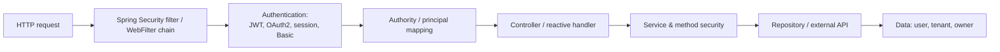
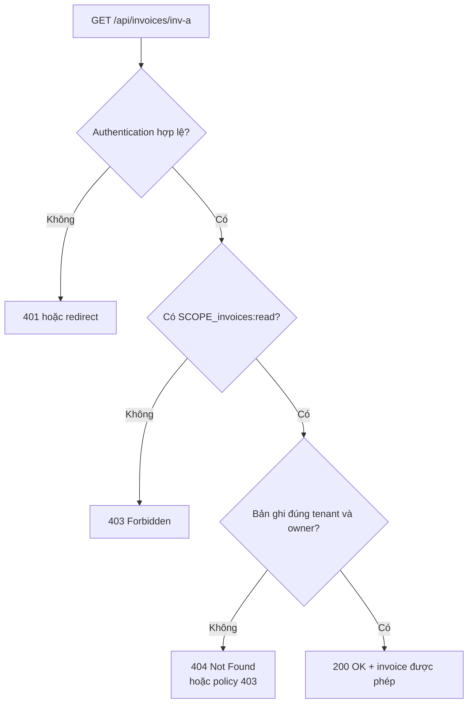

# Giữ dữ liệu giả lập giống hợp đồng mà runtime thực sự sử dụng

> **Chương:** Dữ liệu và cô lập  
> **Module:** `SPRING_SECURITY_TESTING`  
> **Mục tiêu:** Kiểm chứng xác thực, phân quyền và bảo vệ HTTP bằng `spring-security-test` trên Servlet và Reactive. Bài học tập trung vào cách thiết kế fixture, principal, JWT/OAuth2/OIDC, kho dữ liệu và mock dependency **giữ đúng hợp đồng của ứng dụng lúc chạy thật**, để các phép thử cho phép/bị từ chối không xanh giả và không che giấu lỗi truy cập chéo người dùng hoặc tenant.

## 1. Vì sao mock “dễ dùng” vẫn có thể khiến kiểm thử bảo mật sai?

Giả sử production nhận Bearer JWT có `sub = "alice"` và `scope = "invoices:read"`. Resource server ánh xạ scope thành authority `SCOPE_invoices:read`. Controller dùng `Authentication.getName()` để giới hạn truy vấn theo chủ sở hữu. Một test vội vàng tạo user với `roles = "ADMIN"`, mock repository trả bất kỳ hóa đơn nào và chỉ assert HTTP `200`. Test đó không phản ánh đối tượng thực sự đi qua ứng dụng:

- Quyền trong test là `ROLE_ADMIN`, trong khi runtime dùng `SCOPE_invoices:read`.
- Repository mock bỏ qua điều kiện chủ sở hữu hoặc tenant.
- `@WithMockUser` cung cấp principal sẵn có, không chạy Bearer filter hay JWT decoder.
- Dữ liệu trả về có thể thuộc user khác, nhưng test không kiểm tra.

Kết quả là test xanh dù chính sách thực có thể hỏng. **Một test double hữu ích phải tương thích với hợp đồng ở ranh giới đang kiểm chứng**, chứ không đơn giản là đưa vào dữ liệu vừa đủ để không bị `NullPointerException`.

### 1.1. Hợp đồng không chỉ là tên phương thức

| Phần của hợp đồng | Ví dụ runtime | Fixture dễ tạo lỗi | Điều cần khớp |
| --- | --- | --- | --- |
| Danh tính | `sub` từ JWT hoặc cặp `iss + sub` từ OIDC | Dùng email/display name làm user ID | Khóa định danh ổn định đúng nguồn |
| Kiểu principal | `Jwt`, `OidcUser`, `OAuth2User`, custom principal | Luôn dùng `@WithMockUser` mặc định | Test đúng kiểu khi code cần cast/claim |
| Authority | `SCOPE_invoices:read` | `roles = "invoices:read"` tạo `ROLE_invoices:read` | Giá trị sau mapping giống runtime |
| Claims | `aud` là danh sách, `exp` là thời điểm, `tenant_id` là chuỗi | Mọi claim đều là chuỗi hoặc `Map<String, String>` | Kiểu, tên và ngữ nghĩa của claim |
| Dữ liệu | Invoice thuộc `tenant-a` và `alice` | Repository trả invoice `tenant-b` bất kể filter | Khóa liên kết và điều kiện query |
| Token | Access token có expiry, scope, registration | Token bất biến không bao giờ hết hạn | Thời gian và nơi lưu token đúng |
| HTTP | Session cookie, CSRF, Bearer header, status | Gọi thẳng controller, bỏ filters | Giữ chain và request shape cần kiểm tra |
| Reactive | `Mono/Flux`, Reactor Context theo subscription | `Mono.just` chung và `SecurityContextHolder` ThreadLocal | Publisher, propagation, trạng thái từng subscription |

**Tính chân thực của fixture có phạm vi.** Nếu đang test một biểu thức `hasAuthority(...)` thì có thể cấp `Authentication` giả với đúng authority; không nhất thiết khởi động IdP thật. Nhưng nếu test quy tắc chuyển claim thành authority, không được tạo authority sẵn rồi tuyên bố converter đã chạy.

## 2. Chọn ranh giới test để biết điều gì thật, điều gì giả

Trong `SPRING_SECURITY_TESTING`, bộ test có thể sử dụng `MockMvc`, `WebTestClient`, `@WithMockUser`, `SecurityContext` và các helper JWT/OAuth2/OIDC. Hãy chọn rõ phần đang kiểm chứng trước khi mock.



| Mục tiêu chính | Có thể giả lập | Nên giữ thật |
| --- | --- | --- |
| Controller dùng đúng principal | Principal đã xác thực bằng `@WithMockUser`, `jwt()`, `oidcLogin()` | Argument resolution, controller và HTTP security chain |
| HTTP authorization | Identity với đúng authorities | Request matcher, `SecurityFilterChain`/`SecurityWebFilterChain` |
| Ánh xạ JWT claims → authorities | JWT claims theo hợp đồng | Converter đang được test |
| Xác minh JWT, `kid` và JWKS | IdP/JWKS HTTP server của test, private key test | Bearer filter và `JwtDecoder`/`ReactiveJwtDecoder` |
| OIDC account mapping | Responses IdP hoặc delegate `OidcUserService` | Service ánh xạ cặp issuer–subject và local roles |
| Tenant isolation của query | Database chứa các tenant được seed | Query/criteria và ràng buộc dữ liệu trong repository |
| Cách service truyền tenant/owner xuống repository | Repository mock với argument matching chặt | Controller, service, principal extraction |
| Reactive identity propagation | Principal đưa vào Reactor Context cho test | Pipeline `Mono/Flux`, security context access, business logic |

Không nên mock đúng thành phần mà test đang muốn chứng minh. Nếu muốn kiểm tra `JwtAuthenticationConverter`, đừng dùng `jwt().authorities(...)` làm bằng chứng cho converter. Nếu muốn kiểm tra query cô lập tenant, đừng mock repository bằng `thenReturn(invoice)` bất kể đầu vào.

## 3. Tách identity, quyền và dữ liệu sở hữu

Một thiết kế đơn giản cho API hóa đơn:

- JWT có `sub = alice` và scope `invoices:read`.
- Kho người dùng hoặc ánh xạ claims cho biết `tenantId = tenant-a`.
- Hóa đơn `inv-a` thuộc `tenant-a` và owner `alice`; `inv-b` thuộc `tenant-b` và owner `bob`.
- Người dùng chỉ được đọc hóa đơn nếu đã xác thực, có quyền cần thiết và dữ liệu thuộc phạm vi được phép.

Đừng gộp ba câu hỏi thành một: **đúng người**, **đúng quyền** và **đúng bản ghi**.



Việc trả `404` cho bản ghi ngoài phạm vi giúp giảm nguy cơ tiết lộ sự tồn tại của ID; một số ứng dụng chọn `403` theo hợp đồng API. Chọn một chính sách, ghi rõ và test nhất quán. Tuyệt đối không cho phép test trả dữ liệu chéo tenant rồi bỏ qua vì status là `200`.

## 4. Ví dụ Servlet: MockMvc và repository mock giữ nguyên điều kiện truy vấn

### 4.1. Mô hình và hợp đồng truy vấn

```java
public record Invoice(
    String id,
    String tenantId,
    String ownerId,
    long amountInCents
) {}

public interface InvoiceStore {
    Optional<Invoice> findVisible(
        String invoiceId, String tenantId, String ownerId);
}
```

Hợp đồng của `findVisible(...)` là **trả invoice chỉ nếu đồng thời khớp ID, tenant và owner**. Để kiểm tra code gọi service, có thể mock interface này; nhưng để chứng minh câu SQL/criteria thật thi hành đúng, cần một repository integration test riêng trên dữ liệu có các bản ghi đối nghịch.

Thiết kế dịch vụ:

```java
@Service
public class InvoiceService {
    private final InvoiceStore store;

    public InvoiceService(InvoiceStore store) {
        this.store = store;
    }

    public Optional<Invoice> findVisible(
            String invoiceId, String tenantId, String ownerId) {
        return store.findVisible(invoiceId, tenantId, ownerId);
    }
}
```

Để tránh suy diễn sai về JWT, giả sử ứng dụng dùng một tầng xác minh tenant:

```java
public interface TenantResolver {
    String resolveTenant(Authentication authentication);
}

@RestController
@RequestMapping("/api/invoices")
class InvoiceController {
    private final InvoiceService service;
    private final TenantResolver tenants;

    InvoiceController(InvoiceService service, TenantResolver tenants) {
        this.service = service;
        this.tenants = tenants;
    }

    @GetMapping("/{id}")
    ResponseEntity<Invoice> read(
            @PathVariable String id, Authentication authentication) {
        String ownerId = authentication.getName();
        String tenantId = tenants.resolveTenant(authentication);

        return service.findVisible(id, tenantId, ownerId)
            .map(ResponseEntity::ok)
            .orElseGet(() -> ResponseEntity.notFound().build());
    }
}
```

Điểm quan trọng: `TenantResolver` là **thành phần đáng tin cậy của ứng dụng**, không được lấy tenant tùy ý từ header do client kiểm soát nếu chưa kiểm tra membership. Ví dụ mã chỉ cho thấy chỗ kiểm chứng; implementation của resolver có thể dùng claim JWT đã xác minh kết hợp membership DB hoặc session đã xác thực.

### 4.2. SecurityFilterChain cho GET

```java
@Configuration
class InvoiceApiSecurity {
    @Bean
    SecurityFilterChain invoiceFilterChain(HttpSecurity http)
            throws Exception {
        return http
            .authorizeHttpRequests(auth -> auth
                .requestMatchers(
                    HttpMethod.GET, "/api/invoices/**")
                .hasAuthority("SCOPE_invoices:read")
                .anyRequest().denyAll())
            .oauth2ResourceServer(oauth ->
                oauth.jwt(Customizer.withDefaults()))
            .build();
    }
}
```

Các ví dụ chỉ dùng GET để tránh lẫn CSRF với quyền đọc. Khi thêm POST/PATCH/DELETE, hãy kiểm tra CSRF theo cơ chế xác thực thật (session cookie hay Bearer-only API) và chính sách cấu hình của ứng dụng, không tắt CSRF chỉ để test pass.

### 4.3. MockMvc với principal và dữ liệu có liên hệ thực tế

```java
@SpringBootTest
@AutoConfigureMockMvc(addFilters = true)
class InvoiceSecurityMvcIT {

    @Autowired MockMvc mvc;
    @MockitoBean InvoiceStore store;
    @MockitoBean TenantResolver tenants;

    @Test
    void aliceCanReadOnlyHerInvoice() throws Exception {
        Invoice allowed =
            new Invoice("inv-a", "tenant-a", "alice", 4500);
        when(tenants.resolveTenant(any(Authentication.class)))
            .thenReturn("tenant-a");
        when(store.findVisible("inv-a", "tenant-a", "alice"))
            .thenReturn(Optional.of(allowed));

        mvc.perform(get("/api/invoices/inv-a")
                .with(jwt()
                    .jwt(jwt -> jwt.subject("alice"))
                    .authorities(new SimpleGrantedAuthority(
                        "SCOPE_invoices:read"))))
            .andExpect(status().isOk())
            .andExpect(jsonPath("$.id").value("inv-a"))
            .andExpect(jsonPath("$.tenantId").value("tenant-a"))
            .andExpect(jsonPath("$.ownerId").value("alice"));

        verify(store).findVisible(
            "inv-a", "tenant-a", "alice");
    }

    @Test
    void aliceCannotReadBobsInvoice() throws Exception {
        when(tenants.resolveTenant(any(Authentication.class)))
            .thenReturn("tenant-a");
        when(store.findVisible("inv-b", "tenant-a", "alice"))
            .thenReturn(Optional.empty());

        mvc.perform(get("/api/invoices/inv-b")
                .with(jwt()
                    .jwt(jwt -> jwt.subject("alice"))
                    .authorities(new SimpleGrantedAuthority(
                        "SCOPE_invoices:read"))))
            .andExpect(status().isNotFound());

        verify(store).findVisible(
            "inv-b", "tenant-a", "alice");
    }
}
```

`@MockitoBean` có từ Spring Framework 6.2+; phiên bản Spring Boot cũ hơn có thể dùng `@MockBean`. Các static import gồm `SecurityMockMvcRequestPostProcessors.jwt`, `MockMvcRequestBuilders.get`, `MockMvcResultMatchers.status/jsonPath` và Mockito `when/verify/any`.

Hai ca trên giữ filter chain thật và kiểm tra controller truyền đúng `invoiceId`, `tenantId`, `ownerId`. **Chúng chưa kiểm tra implementation của `TenantResolver` hay `InvoiceStore`** vì hai bean đó được mock. Mỗi hợp đồng cần thêm test riêng nếu đây là chỗ nguy cơ rò rỉ dữ liệu.

Tránh cách sau:

```java
// Nguy hiểm trong test cô lập dữ liệu:
when(store.findVisible(anyString(), anyString(), anyString()))
    .thenReturn(Optional.of(
        new Invoice("inv-b", "tenant-b", "bob", 9000)));
```

Fixture này bỏ qua mọi điều kiện truy vấn và có thể làm sai ý nghĩa của test authorization. Một mock dùng `anyString()` có ích khi các tham số không liên quan mục tiêu test; nhưng khi kiểm chứng isolation, **argument chính là một phần của chính sách** nên phải match chặt.

## 5. Test riêng dữ liệu lưu trữ: đừng mock cả điều kiện cô lập

Unit test ở mục 4 chứng minh controller truyền đúng tham số. Nó không biết repository có thật sự lọc tenant/owner không. Để kiểm tra persistence:

1. Seed tối thiểu các bản ghi: `inv-a` của Alice/tenant-a, `inv-b` của Bob/tenant-a và `inv-c` của Bob/tenant-b.
2. Gọi repository với cùng invoice ID nhưng sai owner hoặc sai tenant.
3. Assert chỉ bản ghi đủ điều kiện mới trả về.
4. Kiểm tra query được áp dụng trong DB, không chỉ trong controller sau khi đã fetch tất cả bản ghi.

Giả sử ứng dụng có Spring Data JPA repository và bảng `invoices`:

```java
public interface JpaInvoiceRepository
        extends JpaRepository<InvoiceEntity, String> {

    Optional<InvoiceEntity> findByIdAndTenantIdAndOwnerId(
        String id, String tenantId, String ownerId);
}
```

Ví dụ repository test (giả định entity có constructor/getter tương ứng):

```java
@DataJpaTest
class InvoiceRepositoryIsolationIT {

    @Autowired TestEntityManager em;
    @Autowired JpaInvoiceRepository invoices;

    @Test
    void dataQueryNeverReturnsOtherTenantOrOwner() {
        em.persist(new InvoiceEntity(
            "inv-a", "tenant-a", "alice", 4500L));
        em.persist(new InvoiceEntity(
            "inv-b", "tenant-a", "bob", 9000L));
        em.persist(new InvoiceEntity(
            "inv-c", "tenant-b", "bob", 7200L));
        em.flush();
        em.clear();

        assertTrue(invoices.findByIdAndTenantIdAndOwnerId(
            "inv-a", "tenant-a", "alice").isPresent());
        assertTrue(invoices.findByIdAndTenantIdAndOwnerId(
            "inv-a", "tenant-a", "bob").isEmpty());
        assertTrue(invoices.findByIdAndTenantIdAndOwnerId(
            "inv-c", "tenant-a", "bob").isEmpty());
    }
}
```

Đoạn mã repository là **minh họa bổ trợ**: ứng dụng cần entity `InvoiceEntity`, schema và dependency JPA nếu sử dụng nó. Nếu production dùng R2DBC hoặc MongoDB Reactive, thay bằng test repository tương ứng trên engine dữ liệu phù hợp; không dùng JPA slice để suy ra behavior của reactive query.

Test repository trên database thật hoặc container test giúp phát hiện query thiếu tenant criterion. H2 in-memory có thể khác PostgreSQL/MySQL về kiểu dữ liệu, collation, constraint, row-level security và câu SQL. Khi bảo mật dựa vào tính năng database cụ thể, nên chạy một test với engine tương thích production.

### 5.1. Mã hóa dữ liệu và quy tắc tenant

Nếu hệ thống dùng row-level security, tenant filter, soft-delete hoặc unique constraint ghép `(tenant_id, external_id)`, fixture phải seed đủ những trường này. Chỉ tạo một bản ghi hợp lệ không thể phát hiện query bị thiếu tenant filter; cần ít nhất một bản ghi **đối nghịch có cùng các trường còn lại**.

Nên kiểm tra cả trường hợp bản ghi đã xóa mềm, tài khoản bị vô hiệu hóa, quyền membership hết hiệu lực và ràng buộc owner thay đổi. Các điều kiện này là một phần của hợp đồng bảo mật dữ liệu, không phải chi tiết trang trí của fixture.

## 6. Dữ liệu authentication: role không phải scope

`@WithMockUser(roles = "READER")` tạo authority `ROLE_READER`, còn:

```java
@WithMockUser(authorities = "SCOPE_invoices:read")
```

đặt chính xác authority `SCOPE_invoices:read`. Nếu ứng dụng bảo vệ endpoint bằng `hasAuthority("SCOPE_invoices:read")`, hai thiết lập không tương đương.

Trong MockMvc:

```java
@Test
void scopeIsRequiredNotArbitraryRole() throws Exception {
    mvc.perform(get("/api/invoices/inv-a")
            .with(user("alice").roles("READER")))
        .andExpect(status().isForbidden());
}
```

Trong WebFlux:

```java
client.mutateWith(
        SecurityMockServerConfigurers.mockUser("alice")
            .roles("READER"))
    .get()
    .uri("/api/invoices/inv-a")
    .exchange()
    .expectStatus().isForbidden();
```

Các đoạn trên giả định endpoint thật yêu cầu `SCOPE_invoices:read` và filter chain thực được áp dụng. Chúng kiểm tra **quy tắc authorization**, không kiểm tra nguồn gốc scope.

### 6.1. JWT claims và authority converter là hai hợp đồng khác nhau

Trong nhiều cấu hình Spring Security Resource Server, `JwtGrantedAuthoritiesConverter` ánh xạ claim `scope` hoặc `scp` thành các authority có prefix `SCOPE_`. Kiểu claim, dấu phân cách và prefix có thể được cấu hình. Đừng giả định:

- Claim `roles=["ADMIN"]` tự tạo `ROLE_ADMIN` nếu không có converter tương ứng.
- Claim `scope="invoices:read"` tự trở thành `ROLE_READER`.
- Test đặt `.authorities(...)` đã chứng minh được code đọc scope thật.
- JWT có `tenant_id` tự được kiểm tra membership.

Ví dụ test converter trực tiếp:

```java
@Test
void convertsScopeClaimToExpectedAuthority() {
    Jwt jwt = Jwt.withTokenValue("test-token")
        .header("alg", "RS256")
        .subject("alice")
        .claim("scope", "invoices:read invoices:write")
        .build();

    JwtGrantedAuthoritiesConverter converter =
        new JwtGrantedAuthoritiesConverter();

    Set<String> authorityNames = converter.convert(jwt)
        .stream()
        .map(GrantedAuthority::getAuthority)
        .collect(Collectors.toSet());

    assertTrue(authorityNames.contains(
        "SCOPE_invoices:read"));
    assertTrue(authorityNames.contains(
        "SCOPE_invoices:write"));
}
```

Ở đây `Jwt` được tạo trong bộ test; nó **không được ký hay giải mã**. Test chứng minh behavior của converter với claim đã cho. Với converter tùy chỉnh của ứng dụng, hãy inject/test **chính converter ấy** thay vì tạo lại một đối tượng mặc định khác.

## 7. JWT/OAuth2/OIDC fixture phải đúng kiểu dữ liệu và cấu trúc

Một mock claim đúng tên nhưng sai kiểu có thể xanh ở controller test và vỡ ở runtime. Dưới đây là những dữ liệu cần giữ theo hợp đồng của provider và thư viện.

| Dữ liệu | Kiểu/ngữ nghĩa cần cân nhắc | Test dễ sai |
| --- | --- | --- |
| `sub` | Chuỗi định danh subject ổn định trong phạm vi issuer | Dùng email/display name để thay |
| `iss` | Issuer chính xác của nhà cung cấp | Dùng host staging thay production mà bỏ qua validation |
| `aud` | Audience có thể là danh sách giá trị | Đặt một chuỗi ngẫu nhiên rồi không kiểm tra audience |
| `iat`, `exp`, `nbf` | Thời điểm có timezone và clock skew | Viết timestamp như chuỗi ngày giờ địa phương |
| `scope` hoặc `scp` | Chuỗi phân tách bằng khoảng trắng hoặc danh sách, tùy provider | Test gắn role trực tiếp, bỏ qua parsing |
| `tenant_id` | Có thể là claim tùy chỉnh, chưa đủ chứng minh membership | Tin header/claim mà không qua policy của ứng dụng |
| OIDC `id_token` | Claims đã xác minh, có subject/issuer và dữ liệu ID Token | Chỉ tạo `OAuth2User` thiếu `OidcUser` |
| OIDC UserInfo | Có thể không được trả về; có chính sách claim riêng | Giả định `getUserInfo()` luôn không null |
| OAuth2 authorized client | Registration ID, principal name, access token, refresh token có thể null, thời hạn | Dùng cùng token cho mọi user hoặc registration |
| Principal trong `SecurityContext` | `UserDetails`/`Jwt`/`OidcUser`/custom, tùy authentication | Controller ép kiểu từ `@WithMockUser` mặc định |

### 7.1. Test JWT cho phép/không cho phép ở tầng HTTP

```java
@Test
void jwtSubjectAndScopeMustMatchExpectedContract()
        throws Exception {
    mvc.perform(get("/api/invoices/inv-a")
            .with(jwt()
                .jwt(builder -> builder
                    .subject("alice")
                    .claim("scope", "invoices:read")
                    .claim("tenant_id", "tenant-a"))
                .authorities(new SimpleGrantedAuthority(
                    "SCOPE_invoices:read"))))
        .andExpect(status().isOk());
}
```

Ca minh họa trên cần setup repository/tenant resolver như mục 4 để trả dữ liệu hợp lệ. Phần `.authorities(...)` **chủ động cấp authority**, không gọi converter. Cách này phù hợp nếu mục tiêu test là controller/authorization với principal JWT đã xác thực; nó không chứng minh `JwtDecoder`, claim-to-authority mapping hay tenant membership.

Muốn kiểm tra Bearer JWT thật, tạo token được ký bằng private key test, xuất public JWKS tại stub IdP và gửi:

```http
GET /api/invoices/inv-a HTTP/1.1
Authorization: Bearer <test-signed-jwt>
```

Khi ấy, giữ filter chain, decoder và validator của ứng dụng. Assert `401` cho chữ ký sai, issuer/audience/time sai theo chính sách, `403` cho token xác thực thành công nhưng thiếu scope, và `200` chỉ khi dữ liệu cũng thuộc phạm vi cho phép. Tránh gọi `jwt()` rồi kết luận chữ ký token đã được kiểm tra.

### 7.2. OIDC fixture: subject có issuer, role có nguồn

Trong OIDC Login, `OidcUser` có `getIdToken()`, `getUserInfo()`, `getSubject()` và `getAuthorities()`. Nếu ứng dụng ánh xạ tài khoản nội bộ, khóa liên kết nên là **cặp `issuer + subject`**, không phải email hiển thị. Một builder test tối thiểu có thể tạo ID Token:

```java
static OidcIdToken testOidcToken(
        String issuer, String subject) {
    Instant now = Instant.now();
    return new OidcIdToken(
        "mock-id-token",
        now.minusSeconds(10),
        now.plusSeconds(600),
        Map.of(
            "iss", issuer,
            "sub", subject,
            "aud", List.of("example-client"),
            "iat", now.minusSeconds(10).getEpochSecond(),
            "exp", now.plusSeconds(600).getEpochSecond()));
}
```

Đây là fixture cho test **sau bước xác thực**, không phải ID Token ký thật. Có thể đưa `OidcUser` tạo từ token này vào `oidcLogin().oidcUser(...)` trên MockMvc hoặc `mockOidcLogin().oidcUser(...)` trên WebTestClient. Nếu controller đòi một custom principal có `localUserId`, phải dùng đúng kiểu custom principal và có test riêng cho service ánh xạ.

Nên seed hai provider có cùng `sub = "42"` nhưng khác `iss` và kiểm tra chúng không ánh xạ vào một local account. Cần thêm ca email đổi nhưng liên kết không bị mất, user bị vô hiệu hóa, role nội bộ bị thu hồi và provider không trả UserInfo.

### 7.3. OAuth2 client/token fixture phải theo registration

Khi ứng dụng là OAuth2 client gọi API khác, `OAuth2AuthorizedClient` thường được lưu theo `registrationId` và `principalName`. Fixture chỉ đặt một access token vào singleton rồi gắn cho mọi request có thể che lỗi cross-user. Với `authorization_code`, refresh token có thể tồn tại; với `client_credentials`, thường lấy lại access token bằng grant chứ không dựa vào refresh token.

Các ca test cần tạo:

- Hai người dùng cùng registration nhưng token khác nhau, xác nhận không dùng nhầm token.
- Cùng người dùng nhưng hai registration/scopes khác nhau, xác nhận token được chọn đúng nguồn.
- Token sắp hết hạn/hết hạn, xác nhận manager áp dụng clock skew/provider và cập nhật storage.
- Refresh token không có hoặc bị thu hồi, xác nhận failure handling và không gửi token hết hạn tới downstream.

Nếu mục tiêu là logic refresh, giữ `OAuth2AuthorizedClientManager` thật và stub token endpoint thay vì mock luôn manager. Principal fixture phải khớp tên dùng để lookup authorized client.

## 8. Cô lập test data giữa các lần chạy

Ngay cả khi dữ liệu từng fixture hợp đồng đúng, test có thể chập chờn hoặc rò dữ liệu nếu các test dùng chung trạng thái:

| Trạng thái chia sẻ | Rủi ro | Cách cô lập |
| --- | --- | --- |
| Repository in-memory static | Test B thấy bản ghi test A | Tạo instance riêng hoặc reset rõ ràng |
| Database chung | Bản ghi/tenant từ ca trước còn tồn tại | Transaction rollback khi phù hợp, truncate/dọn fixture hoặc schema riêng |
| `SecurityContextHolder` | Worker ThreadLocal giữ principal cũ | Dọn trong `finally`, dùng framework propagation đúng |
| Reactor Context | Tự tách subscription mang sai context | Compose publisher, context theo subscription |
| OAuth2AuthorizedClientService | Token của user/registration trước còn lưu | Store riêng hoặc clear theo key đúng |
| MockWebServer/IdP stub | Queue responses lệch giữa test | Khởi tạo stub per-test, reset dispatcher và request count |
| JWKS decoder cache | Test thay key nhưng decoder còn key cũ | Cô lập decoder/cache hoặc test chính sách TTL rõ ràng |
| Mock bean | Stubbing/interaction của test trước ảnh hưởng test sau | Reset theo lifecycle hoặc mock riêng |
| Clock, UUID, random fixture | Case không tái lập được | Dùng clock/test ID ổn định có kiểm soát |

### 8.1. Đừng lạm dụng @Transactional như một nút reset vạn năng

Với nhiều JPA slice test đồng bộ, `@Transactional` và rollback sau test có thể giúp cô lập DB. Nhưng không nên mặc định rollback bao trùm tác vụ `@Async`, transaction riêng trên thread khác, HTTP server thật hay reactive subscription có transaction lifecycle khác. Với R2DBC, dùng cơ chế transaction và test cleanup phù hợp hệ Reactive.

Nếu test dùng ứng dụng chạy HTTP server ở port ngẫu nhiên, test transaction bên JUnit thread thường không phải cùng transaction của request xử lý ở server thread. Kiểm chứng rõ việc dọn dữ liệu sau mỗi ca. Với DB sử dụng row-level security, cần reset session variable/tenant context của kết nối pool, không chỉ xóa dữ liệu.

### 8.2. Mỗi test cần dữ liệu đối nghịch

Một fixture cô lập tốt không có chỉ một người dùng và một invoice. Tối thiểu nên có:

```text
tenant-a:
  alice -> inv-a (được phép)
  bob   -> inv-b (cùng tenant nhưng khác owner)

tenant-b:
  alice -> inv-c (cùng username nhưng khác tenant)
  carol -> inv-d (khác tenant và khác owner)
```

Các cặp đối nghịch giúp phát hiện việc chỉ kiểm tra `ownerId` mà quên tenant, chỉ kiểm tra tenant mà quên owner, hoặc dùng nhầm `Authentication.getName()` của request khác. Trong hệ thống cho phép nhiều user cùng tên hiển thị, test cũng nên dùng subject/local ID không phụ thuộc display name.

## 9. Reactive: fixture phải đi cùng Reactor Context và publisher thật

WebFlux xử lý `SecurityContext` trong Reactor Context, không thể áp dụng nguyên xi kiểm thử dựa vào `SecurityContextHolder` ThreadLocal. Test với `Mono` không subscribe sẽ không phát hiện data access xảy ra trong lúc subscription.

Ví dụ service được bảo vệ:

```java
public interface ReactiveInvoiceStore {
    Mono<Invoice> findVisible(
        String invoiceId, String tenantId, String ownerId);
}

@Service
class ReactiveInvoiceService {
    private final ReactiveInvoiceStore store;
    private final TenantDirectory tenantDirectory;

    ReactiveInvoiceService(
            ReactiveInvoiceStore store,
            TenantDirectory tenantDirectory) {
        this.store = store;
        this.tenantDirectory = tenantDirectory;
    }

    @PreAuthorize("hasAuthority('SCOPE_invoices:read')")
    Mono<Invoice> read(String id) {
        return ReactiveSecurityContextHolder.getContext()
            .map(SecurityContext::getAuthentication)
            .flatMap(auth ->
                tenantDirectory.resolveTenant(auth)
                    .flatMap(tenant ->
                        store.findVisible(
                            id, tenant, auth.getName())));
    }
}

public interface TenantDirectory {
    Mono<String> resolveTenant(Authentication authentication);
}
```

Để `@PreAuthorize` áp dụng, cần `@EnableReactiveMethodSecurity` và gọi service qua bean Spring được intercept. Lời gọi nội bộ `this.read(...)` hoặc tự tạo instance bằng `new` có thể không đi qua proxy. Cần kiểm tra cả phương thức service và HTTP chain khi mục tiêu là end-to-end.

### 9.1. StepVerifier kiểm tra đúng owner/tenant

```java
@SpringBootTest
class ReactiveInvoiceIsolationIT {
    @Autowired ReactiveInvoiceService service;

    @MockitoBean ReactiveInvoiceStore store;
    @MockitoBean TenantDirectory tenants;

    @Test
    @WithMockUser(
        username = "alice",
        authorities = "SCOPE_invoices:read")
    void onlyMatchingTenantAndOwnerCanBeRequested() {
        Invoice invoice =
            new Invoice("inv-a", "tenant-a", "alice", 4500);
        when(tenants.resolveTenant(any(Authentication.class)))
            .thenReturn(Mono.just("tenant-a"));
        when(store.findVisible("inv-a", "tenant-a", "alice"))
            .thenReturn(Mono.just(invoice));

        StepVerifier.create(service.read("inv-a"))
            .expectNext(invoice)
            .verifyComplete();

        verify(store).findVisible(
            "inv-a", "tenant-a", "alice");
    }

    @Test
    @WithMockUser(username = "bob", roles = "VIEWER")
    void missingScopeNeverTouchesRepository() {
        StepVerifier.create(service.read("inv-a"))
            .expectError(AccessDeniedException.class)
            .verify();

        verifyNoInteractions(store, tenants);
    }
}
```

Ví dụ giả định ứng dụng đã bật `@EnableReactiveMethodSecurity` và có Spring TestContext/Reactor Context integration. Trong test method security, `@WithMockUser` là đủ để xác nhận role/authority ở service; nó không phải JWT/OIDC được xác minh thật. Quan trọng là dùng `StepVerifier` để **subscribe** và assert `onNext/onError/onComplete`.

### 9.2. WebTestClient: test request HTTP và danh tính theo từng subscription

```java
WebTestClient client = WebTestClient
    .bindToApplicationContext(applicationContext)
    .apply(SecurityMockServerConfigurers.springSecurity())
    .configureClient()
    .build();
```

Với handler GET bảo vệ hóa đơn, một request giả lập JWT:

```java
client.mutateWith(
        SecurityMockServerConfigurers.mockJwt()
            .jwt(jwt -> jwt
                .subject("alice")
                .claim("tenant_id", "tenant-a")
                .claim("scope", "invoices:read"))
            .authorities(new SimpleGrantedAuthority(
                "SCOPE_invoices:read")))
    .get()
    .uri("/api/invoices/inv-a")
    .exchange()
    .expectStatus().isOk();
```

Đoạn này là **mảnh test**: cần handler WebFlux, `SecurityWebFilterChain`, service và fixture store/tenant directory phù hợp, như các ví dụ trước. `mockJwt()` cung cấp principal và authority giả, không chạy `ReactiveJwtDecoder`. Nếu muốn kiểm chứng claim-to-authority conversion hay chữ ký JWT, phải thêm bài test với converter/decoder thật.

Kiểm tra isolation với các request Alice/Bob/anonymous có thể dùng `mockUser()` hoặc `mockJwt()` khác nhau theo từng request. Tránh ghi một `Authentication` mutable vào static field rồi tái sử dụng cho mọi subscription. Khi có scheduler dùng lại worker, Reactor Context mới phải là nguồn danh tính; không lấy thông tin từ ThreadLocal còn sót.

## 10. Test data chuẩn không đồng nghĩa chỉ test happy path

Một fixture “giống production” cần có cả các biến thể bất thường mà hệ thống thực tế có thể gặp:

- JWT thiếu claim tenant hoặc sai kiểu, subject không khớp local account.
- Authority đủ nhưng tenant membership không còn hiệu lực.
- OIDC ID Token có subject hợp lệ nhưng user nội bộ bị khóa.
- Repository trả empty vì bản ghi thuộc owner khác dù ID có tồn tại.
- OAuth2 client có access token hết hạn hoặc refresh token bị từ chối.
- Đăng nhập hợp lệ nhưng POST thiếu CSRF khi ứng dụng dùng cookie/session.
- Principal thay đổi qua hai request liên tiếp trên cùng worker/scheduler.
- JSON request thiếu thuộc tính bắt buộc, giá trị null, giá trị ngoài phạm vi mà runtime validator phải chặn.
- Dữ liệu phân trang hoặc danh sách có item của nhiều tenant, không chỉ một bản ghi.

### 10.1. Ma trận tối thiểu cho test HTTP

| Authentication | Authority | Dữ liệu | Điều kiện bổ sung | Kết quả điển hình |
| --- | --- | --- | --- | --- |
| Thiếu | — | Bất kỳ | GET cần login | `401` hoặc redirect theo entry point |
| Có | Thiếu `SCOPE_invoices:read` | Bất kỳ | GET | `403` |
| Có | Đúng scope | Owner và tenant khớp | GET | `200` + đúng ID/owner |
| Có | Đúng scope | Owner khác | GET | `404` hoặc `403` theo hợp đồng |
| Có | Đúng scope | Tenant khác | GET | Không trả dữ liệu chéo tenant |
| Có | Đúng role ghi | Đúng record | POST thiếu CSRF ở ứng dụng session-based | `403`, không side effect |
| Có | Sai role ghi | Đúng record | POST với CSRF hợp lệ | `403`, không side effect |
| Có | Đúng role ghi | Đúng record | POST với CSRF hợp lệ | `2xx`, side effect đúng phạm vi |
| JWT không hợp lệ | Có thể tự công bố scope | Bất kỳ | Decoder/validator thật | `401` |

Các status có thể phụ thuộc loại entry point và hợp đồng API; đừng hardcode `401` cho mọi ứng dụng dùng OAuth2 login có chuyển hướng. Điều cần chứng minh là **không có dữ liệu hoặc side effect trái phép**.

### 10.2. Assertion quan trọng hơn việc test chạy không ném exception

Đừng chỉ assert `status().isOk()`. Với test cô lập dữ liệu, cần thêm:

1. Response không chứa record của user/tenant khác.
2. Repository/query được gọi với đúng tenant và owner, hoặc DB thật trả rỗng với record sai phạm vi.
3. Không có side effect khi bị từ chối (`verifyNoInteractions(...)` hoặc kiểm tra DB/event).
4. Không có token/cookie/claim nhạy cảm được trả về trong DTO.
5. Test sau hoặc concurrent request không nhận danh tính/trạng thái của test trước.

Những assertion này đóng vai trò **kiểm tra bất biến bảo mật** (security invariants) chứ không chỉ kiểm tra tính tiện dụng của API.

## 11. Thiết kế fixture builder có tính chuẩn hóa, tránh dữ liệu tuỳ hứng

Thay vì rải `Map.of(...)` không nhất quán khắp test, có thể tạo một factory kiểm soát kiểu dữ liệu và tên trường:

```java
final class IdentityFixtures {
    private IdentityFixtures() {}

    static Jwt invoiceReader(String subject, String tenantId) {
        Instant now = Instant.now();
        return Jwt.withTokenValue("unit-test-token")
            .header("alg", "RS256")
            .subject(subject)
            .issuer("https://idp.example.test/tenant-a")
            .audience(List.of("invoice-api"))
            .issuedAt(now.minusSeconds(10))
            .expiresAt(now.plusSeconds(600))
            .claim("tenant_id", tenantId)
            .claim("scope", "invoices:read")
            .build();
    }
}
```

Factory làm nhất quán shape JWT trong bài test **sau xác thực**. Nó không ký token; không nên gửi chuỗi `unit-test-token` trong Bearer header rồi kỳ vọng decoder thật chấp nhận. Nếu cần test chữ ký, tạo một factory khác phát hành JWS thực bằng khóa riêng cho test.

Để tăng độ tin cậy:

- Đặt tên fixture theo **vai trò và trạng thái**, ví dụ `aliceReaderTenantA()`, `bobViewerTenantB()`, thay vì `validUser()`.
- Cung cấp override có kiểm soát cho ca âm tính, ví dụ `expiredJwt()`, `missingTenantClaim()`.
- Giữ các mối quan hệ nhất quán giữa user, membership, invoice và authorized client.
- Dùng `Clock` cố định hoặc có thể điều khiển khi cần test ranh giới thời gian, thay vì tính giờ bất định khắp bộ test.
- Tách fixture giả lập principal với fixture JWS được ký thật; tên helper phải phản ánh mức độ bảo đảm.
- Không đặt token, secret hoặc private key production vào source/test snapshot.

### 11.1. Khi nào dùng strict mocking?

Mockito strict stubs có thể phát hiện stubbing thừa hoặc lời gọi khác với dự định, nhưng **không tự bảo vệ** chính sách dữ liệu. Trong test security cần assert rõ argument và kết quả. Tránh `lenient()` bừa bãi ở mock store/tenant resolver nếu nó khiến sai ranh giới không bị phát hiện.

Với dữ liệu thật, test fixture builder không thay thế unique constraint, foreign key, row-level security và transaction semantics. Cần có các integration test tương ứng.

## 12. Bài thực hành

Xây dựng API hóa đơn có `GET /api/invoices/{id}` yêu cầu `SCOPE_invoices:read`, có tenant và owner. Thực hiện các cấp kiểm thử:

1. **Controller/HTTP Servlet:** Giữ `SecurityFilterChain`, dùng `MockMvc.with(jwt())` với subject/authority khớp. Mock `InvoiceStore` bằng argument chính xác; kiểm tra `200`, `403` và không lộ invoice của người khác.
2. **Converter:** Tạo JWT claims có kiểu đúng và kiểm tra `JwtGrantedAuthoritiesConverter` hoặc converter thực của ứng dụng tạo authority mong muốn. Không dùng `authorities(...)` để thay kết quả converter.
3. **Data:** Seed Alice/Bob trên cùng tenant và cùng username trên tenant khác. Kiểm tra repository thật giới hạn cả owner và tenant, kể cả khi biết chính xác invoice ID.
4. **OIDC:** Seed hai issuer có cùng subject; ánh xạ đến hai local accounts độc lập. Kiểm tra custom `OidcUser` có ID Token/UserInfo đúng hợp đồng và role nội bộ đúng nguồn.
5. **Reactive:** Dùng `@EnableReactiveMethodSecurity`, `StepVerifier` và `WebTestClient.apply(springSecurity())`. Kiểm tra publisher thật, `ReactiveSecurityContextHolder` và no-side-effect khi thiếu quyền.
6. **HTTP thực:** Gửi JWT ký thật qua Bearer header tới decoder/JWKS test; kiểm tra token sai chữ ký, hết hạn hoặc sai issuer và token hợp lệ.
7. **State isolation:** Chạy hai người dùng kế tiếp và song song, reset repository/mock/token store; kiểm tra không rò principal, token, tenant hoặc dữ liệu giữa các test.
8. **Negative fixtures:** Thử thiếu `tenant_id`, scope sai kiểu, authorized client hết hạn, user bị khóa, invoice soft-deleted và POST thiếu CSRF theo cấu hình ứng dụng.

**Tiêu chí đạt:** Người học có thể trả lời cho từng test: **dữ liệu nào giả, hợp đồng nào vẫn phải giữ, thành phần nào chạy thật và bất biến bảo mật nào đang được chứng minh**. Bộ test phải có dữ liệu đối nghịch và assertion về tenant/owner, không chỉ có test thành công với một user và một bản ghi.

**Ghi nhớ:** Mock không cần sao chép toàn bộ production, nhưng **phần giao tiếp qua ranh giới đang test phải giữ đúng kiểu, trạng thái và ngữ nghĩa của runtime**. Hãy giả lập vừa đủ để cô lập lỗi, đồng thời giữ thật bộ lọc/phân quyền/query/mapper mà test muốn kiểm chứng. Dữ liệu test đúng hợp đồng, có các trường hợp chéo user/tenant và được dọn sạch sau mỗi ca sẽ tạo bằng chứng đáng tin cậy hơn nhiều so với một loạt test `200 OK` không kiểm tra dữ liệu trả về.
