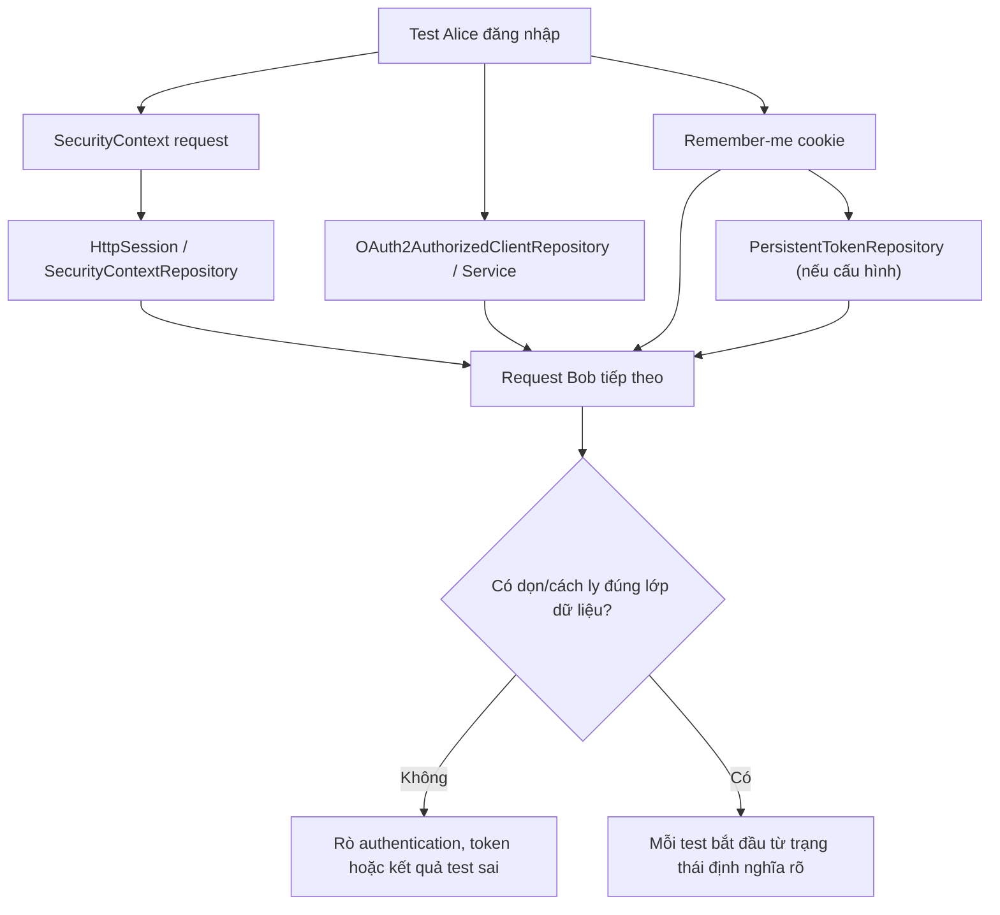

# Dọn dữ liệu lưu phiên, authorized client và remember-me trong kiểm thử Spring Security

Một bài kiểm thử xác thực có thể chạy xanh khi đứng riêng nhưng thất bại khi chạy cùng cả test suite. Nguyên nhân thường không nằm ở mật khẩu hay rule phân quyền, mà ở **dữ liệu bảo mật được lưu từ lần thực thi trước**: HTTP session còn `SecurityContext`, OAuth2 authorized client vẫn giữ access token, hoặc remember-me cookie/persistent token vẫn cho phép khôi phục danh tính. Khi các trạng thái đó bị tái sử dụng ngoài chủ đích, test có thể nhìn thấy Alice trong request của Bob hoặc báo đăng nhập thành công mà thực tế đã bỏ qua bước authentication đang muốn kiểm chứng.

Trong chương **Dữ liệu và cô lập** của module **`SPRING_SECURITY_TESTING`**, người học cần kiểm chứng xác thực, phân quyền và bảo vệ HTTP thực tế bằng `spring-security-test` trên Servlet và Reactive: MockMvc, WebTestClient, `@WithMockUser`, `SecurityContext`, các dạng JWT/OAuth2/OIDC giả lập và đường đi được phép hoặc từ chối. Bài này tập trung vào đề tài **“Dọn dữ liệu lưu phiên, authorized client và remember-me”**, với cả hướng dẫn chạy test có chủ đích lẫn quy tắc cleanup sau từng ca.

Mục tiêu học tập:

- Chỉ ra dữ liệu nào thuộc **thread**, **HTTP session**, **cookie trình duyệt**, **OAuth2 authorized-client repository/service** và **persistent token repository**.
- Viết test MockMvc chứng minh hai session khác nhau không chia sẻ principal; logout làm mất phiên đã xác thực.
- Tạo và dọn `OAuth2AuthorizedClient` đúng theo `registrationId` và `principalName`, thay vì xóa bừa toàn bộ dữ liệu.
- Phân biệt remember-me dựa trên token ký trong cookie với remember-me có token **lưu phía server**, và kiểm tra cookie lẫn persistent token nếu có.
- Xây dựng bộ test độc lập về dữ liệu khi dùng `@SpringBootTest`, `@WithMockUser`, `@Sql`, Spring Session, WebTestClient hoặc chạy song song.
- Biết giới hạn của `@Transactional`, `@DirtiesContext` và `SecurityContextHolder.clearContext()`: mỗi cách chỉ dọn một phạm vi nhất định.

## 1. Những trạng thái nào có thể sống lâu hơn một request?

Không có một lệnh “reset security” chung bảo đảm dọn mọi trạng thái. Trước khi chọn phương án, hãy xác định **chủ thể sở hữu dữ liệu** và **vị trí lưu**.

| Dữ liệu | Nơi lưu thường gặp | Ai thường tạo/đọc? | Cách dọn đúng phạm vi |
| --- | --- | --- | --- |
| `SecurityContextHolder` hiện tại | `ThreadLocal` của Servlet | Filter và code đang chạy trên thread | `SecurityContextHolder.clearContext()` trong đúng thread |
| `SecurityContext` của request đăng nhập | HTTP session hoặc `SecurityContextRepository` tùy cấu hình | Form login, OAuth2 Login, security filters | Logout/invalidate session hoặc xóa bằng repository phù hợp |
| Saved request, CSRF state, OAuth2 authorization request | HTTP session hoặc repository tùy cấu hình | Request cache, OAuth2 redirect/callback, CSRF | Hoàn tất flow hoặc invalidation/cleanup repository tương ứng |
| `OAuth2AuthorizedClient` | `OAuth2AuthorizedClientService`, `OAuth2AuthorizedClientRepository`, session hoặc database | OAuth2 Client, login, token manager | `removeAuthorizedClient(...)` theo registration/principal |
| Remember-me cookie | Cookie ở phía client | Remember-me services và browser | Phản hồi xóa cookie; không gửi lại cookie trong request test |
| Persistent remember-me token | `PersistentTokenRepository`, ví dụ bảng `persistent_logins` | `PersistentTokenBasedRememberMeServices` | `removeUserTokens(username)` hoặc cơ chế logout/revocation được cấu hình |
| Session lưu ngoài ứng dụng | Redis/JDBC qua Spring Session | `SessionRepository` | Invalidate/delete session qua API thực sự được dùng; kiểm tra repository |

Các lớp trạng thái có vòng đời khác nhau. Một cookie remember-me có thể còn sau khi server session hết hạn; authorized client đã lưu trong database có thể tồn tại sau khi HTTP session của ứng dụng bị xóa; xóa context ở thread test cũng không làm browser mất cookie đã phát.



Điểm mấu chốt: **cô lập không luôn đồng nghĩa xóa tất cả**. Nếu bài test muốn kiểm chứng “Alice đã đăng nhập, request tiếp theo vẫn là Alice”, nó **phải** giữ session/cookie đúng lúc. Nhưng khi kết thúc test, trạng thái đó không được vô tình ảnh hưởng một test khác. Thiết kế test phải chỉ rõ nơi giữ trạng thái *bên trong kịch bản* và điểm cleanup *sau kịch bản*.

## 2. SecurityContext trên thread khác với SecurityContext trong session

Trong ứng dụng Servlet, `SecurityContextHolder` mặc định sử dụng `ThreadLocal` để truy cập Authentication ở thread hiện tại:

```java
Authentication authentication =
        SecurityContextHolder.getContext().getAuthentication();

SecurityContextHolder.clearContext();
```

Lệnh `clearContext()` giúp dọn **thread hiện tại**. Nó **không tự xóa** `SecurityContext` đã được lưu trong HTTP session, Redis, database, OAuth2 client repository hoặc remember-me cookie. Nếu request mới vẫn mang session hợp lệ, security filter có thể nạp lại Authentication từ `SecurityContextRepository`.

Trong Spring Security Servlet, `HttpSessionSecurityContextRepository` là một implementation phổ biến của `SecurityContextRepository`. Nó lưu context trong session bằng key được định nghĩa bởi `HttpSessionSecurityContextRepository.SPRING_SECURITY_CONTEXT_KEY`. Khi không dùng session (ví dụ một số REST API stateless), security context có thể không được lưu ở đó.

```text
Request đăng nhập thành công
    ↓
SecurityContextHolder(Authentication=alice) trong request thread
    ↓
SecurityContextRepository lưu vào HttpSession (nếu cấu hình stateful)
    ↓
Request mới mang cùng JSESSIONID/session
    ↓
SecurityContextRepository nạp Alice vào request mới
```

Vì vậy việc `clearContext()` trong test có tác dụng dọn dữ liệu giả lập ở thread JUnit, nhưng không phải bằng chứng logout đã xóa phiên của người dùng. Để kiểm chứng logout, phải thực hiện **request logout** rồi kiểm tra HTTP session/cookie và khả năng truy cập endpoint bảo vệ.

**Lưu ý về Spring Security version:** từ các phiên bản hiện đại, cơ chế lưu context có thể sử dụng `SecurityContextHolderFilter` với yêu cầu lưu tường minh trong một số luồng; API filter và repository tùy cấu hình. Đừng tự viết controller gọi `SecurityContextHolder.setContext(...)` rồi mặc định context sẽ được lưu bền qua request mới. Test nên đi qua cơ chế đăng nhập mà ứng dụng thật dùng.

## 3. Ứng dụng Servlet mẫu để kiểm tra session isolation

Ví dụ dùng Java 17+, Spring Boot 3.x, Spring Security 6.x với `spring-boot-starter-web`, `spring-boot-starter-security`, `spring-boot-starter-test` và `spring-security-test`. Chúng ta tạo **hai tài khoản thử nghiệm Alice/Bob**, form login, remember-me và một endpoint trả username:

```java
import org.springframework.boot.SpringApplication;
import org.springframework.boot.autoconfigure.SpringBootApplication;

@SpringBootApplication
public class SessionIsolationDemoApplication {
    public static void main(String[] args) {
        SpringApplication.run(SessionIsolationDemoApplication.class, args);
    }
}
```

```java
import org.springframework.context.annotation.Bean;
import org.springframework.context.annotation.Configuration;
import org.springframework.security.config.Customizer;
import org.springframework.security.config.annotation.web.builders.HttpSecurity;
import org.springframework.security.core.userdetails.User;
import org.springframework.security.core.userdetails.UserDetailsService;
import org.springframework.security.provisioning.InMemoryUserDetailsManager;
import org.springframework.security.web.SecurityFilterChain;

@Configuration
class SessionIsolationSecurityConfig {

    @Bean
    SecurityFilterChain securityFilterChain(HttpSecurity http)
            throws Exception {
        return http
                .authorizeHttpRequests(auth -> auth
                        .requestMatchers("/private").authenticated()
                        .anyRequest().permitAll())
                .formLogin(Customizer.withDefaults())
                .rememberMe(remember -> remember
                        .key("test-only-remember-me-signing-key")
                        .tokenValiditySeconds(600))
                .build();
    }

    @Bean
    UserDetailsService testUsers() {
        return new InMemoryUserDetailsManager(
                User.withUsername("alice")
                        .password("{noop}alice-pass")
                        .roles("USER")
                        .build(),
                User.withUsername("bob")
                        .password("{noop}bob-pass")
                        .roles("USER")
                        .build());
    }
}
```

```java
import java.security.Principal;
import org.springframework.web.bind.annotation.GetMapping;
import org.springframework.web.bind.annotation.RestController;

@RestController
class SessionIsolationController {
    @GetMapping("/private")
    String currentUser(Principal principal) {
        return principal.getName();
    }
}
```

`{noop}` và signing key ở đây **chỉ phục vụ bài thực hành**, không dành cho production. Với ứng dụng thật, phải chọn password encoder an toàn, key bí mật đủ mạnh và lifecycle key phù hợp. Bài test có thể sử dụng form login thực tế của ứng dụng hoặc cấu hình test tương đương; không cần Identity Provider bên ngoài.

### MockMvc không tự tái sử dụng mọi HTTP session giữa các request

Khi gọi `mockMvc.perform(get(...))` ở hai lần khác nhau, đừng giả định một browser/cookie jar thật đang tự chuyển session của lần trước. Nếu muốn mô phỏng cùng người dùng, hãy **lấy `MockHttpSession` từ request đăng nhập và truyền nó vào request kế tiếp**.

```java
import org.junit.jupiter.api.Test;
import org.springframework.beans.factory.annotation.Autowired;
import org.springframework.boot.test.autoconfigure.web.servlet
        .AutoConfigureMockMvc;
import org.springframework.boot.test.context.SpringBootTest;
import org.springframework.mock.web.MockHttpSession;
import org.springframework.test.web.servlet.MockMvc;
import org.springframework.test.web.servlet.MvcResult;

import static org.assertj.core.api.Assertions.assertThat;
import static org.springframework.security.test.web.servlet.request
        .SecurityMockMvcRequestPostProcessors.csrf;
import static org.springframework.test.web.servlet.request
        .MockMvcRequestBuilders.get;
import static org.springframework.test.web.servlet.request
        .MockMvcRequestBuilders.post;
import static org.springframework.test.web.servlet.result
        .MockMvcResultMatchers.content;
import static org.springframework.test.web.servlet.result
        .MockMvcResultMatchers.status;

@SpringBootTest(classes = SessionIsolationDemoApplication.class)
@AutoConfigureMockMvc
class SessionIsolationMvcTest {

    @Autowired
    MockMvc mvc;

    private MockHttpSession login(String username, String password)
            throws Exception {
        MvcResult result = mvc.perform(post("/login")
                        .with(csrf())
                        .param("username", username)
                        .param("password", password))
                .andExpect(status().is3xxRedirection())
                .andReturn();

        MockHttpSession session =
                (MockHttpSession) result.getRequest().getSession(false);
        assertThat(session).isNotNull();
        return session;
    }

    @Test
    void twoUsers_haveIndependentSessions() throws Exception {
        MockHttpSession alice =
                login("alice", "alice-pass");
        MockHttpSession bob =
                login("bob", "bob-pass");

        assertThat(alice).isNotSameAs(bob);

        mvc.perform(get("/private").session(alice))
                .andExpect(status().isOk())
                .andExpect(content().string("alice"));

        mvc.perform(get("/private").session(bob))
                .andExpect(status().isOk())
                .andExpect(content().string("bob"));

        // Không truyền session của Alice/Bob vào request mới.
        mvc.perform(get("/private"))
                .andExpect(status().is3xxRedirection());
    }
}
```

Test trên kiểm chứng **một phiên cho Alice, một phiên cho Bob** và request độc lập chưa đăng nhập sẽ bị dẫn tới login. Đây là ví dụ quan trọng hơn việc chỉ kiểm tra “đăng nhập thành công” một lần: nó giúp phát hiện code test vô tình dùng chung `MockHttpSession`, cookie hoặc SecurityContext.

Trong bài thực hành dùng Spring Session (Redis/JDBC), phải xác nhận session thực sự được quản lý bởi implementation phù hợp, không chỉ nhìn object `MockHttpSession`. Nếu hệ thống dùng session ID/cookie được lưu bên ngoài, các request và bước cleanup phải đi qua tầng đó để kiểm chứng persistence thật.

## 4. Dọn phiên qua logout và kiểm tra lại trạng thái

Sau khi đăng nhập, `POST /logout` của Spring Security mặc định cần CSRF token khi CSRF được bật. Một `LogoutHandler` chuẩn thường làm mất authentication và invalidates HTTP session; đồng thời security context được clear theo cơ chế logout.

Đặt test sau trong `SessionIsolationMvcTest`:

```java
@Test
void logout_invalidatesSession_andNextAnonymousRequestIsDenied()
        throws Exception {
    MockHttpSession session =
            login("alice", "alice-pass");

    mvc.perform(get("/private").session(session))
            .andExpect(status().isOk())
            .andExpect(content().string("alice"));

    mvc.perform(post("/logout")
                    .session(session)
                    .with(csrf()))
            .andExpect(status().is3xxRedirection());

    // Spring Security logout mặc định làm session mất hiệu lực.
    assertThat(session.isInvalid()).isTrue();

    // Không cố reuse MockHttpSession đã invalidated.
    mvc.perform(get("/private"))
            .andExpect(status().is3xxRedirection());
}
```

**Không gửi lại một `MockHttpSession` đã invalidated** rồi coi mọi exception phát sinh là “logout đã hoạt động đúng”. Sau logout, mô phỏng browser không có phiên hợp lệ (hoặc dùng session/cookie mới), kiểm tra request đến endpoint bảo vệ không còn danh tính.

Thay vì gọi trực tiếp:

```java
SecurityContextHolder.clearContext();
```

trong test và kết luận “Alice đã logout”, hãy thực hiện request logout qua filter chain rồi kiểm tra session, response cookie và trạng thái endpoint. `clearContext()` chỉ dọn thread hiện tại, không chạy đầy đủ các `LogoutHandler`.

### Session repository không luôn là bộ nhớ MockMvc

Nếu ứng dụng sử dụng Spring Session:

- `SessionRepository` có thể lưu session bằng Redis/JDBC và chia sẻ giữa nhiều instance.
- `HttpSession.invalidate()` qua luồng HTTP đúng có thể kích hoạt thao tác xóa/bất hoạt tại repository.
- Test nên tạo session thật theo cấu hình, thực hiện logout, rồi truy vấn repository hoặc gửi request có session ID cũ để xác nhận bị từ chối.
- `@DirtiesContext` chỉ đóng/nạp lại Spring context; nó không phải lệnh đảm bảo Redis/JDBC đã xóa session.

Trong test có dữ liệu thật trong kho dùng chung, phải xóa theo **session ID của chính test**, không xóa toàn bộ sessions của môi trường khác. Tốt nhất dùng một Redis namespace/database hoặc JDBC schema tách riêng cho mỗi suite.

## 5. `@WithMockUser` và `.with(user(...))` không phải thao tác lưu phiên

Spring Security Test có shortcut tạo Authentication:

```java
@Test
@WithMockUser(username = "alice", roles = "USER")
void canReadPrivateController() throws Exception {
    mvc.perform(get("/private"))
            .andExpect(status().isOk())
            .andExpect(content().string("alice"));
}
```

`@WithMockUser` tạo context thử nghiệm cho test đang chạy; Spring Security Test listener dọn context đó khi test kết thúc theo lifecycle thông thường. `SecurityMockMvcRequestPostProcessors.user("alice")` cũng cho phép gắn danh tính vào request.

Nhưng chúng **không chứng minh** form login đã set session, remember-me cookie đã được phát hay authorized client đã được lưu. Nếu mục tiêu là xác minh login/logout/session persistence, phải chạy đường HTTP thực tế như `POST /login` và `POST /logout`. Dùng `@WithMockUser` khi chỉ cần xác minh quyền hoặc xử lý controller **sau khi đã có danh tính**.

Các nguồn contamination vẫn có thể tồn tại ngoài SecurityContext trên test thread:

- Test gọi một service singleton có cache chứa thông tin user.
- Test tự dùng lại một `MockHttpSession` trong field chia sẻ giữa nhiều method.
- Test lưu OAuth2 authorized client vào service bean dùng chung Spring test context.
- Test ghi persistent remember-me token hoặc server session vào database/Redis.
- Test tự đặt SecurityContext trong executor và không dọn worker thread.

Không kỳ vọng `@AfterEach SecurityContextHolder.clearContext()` giải quyết tất cả các trường hợp này. Nó chỉ là một phần của vệ sinh test, còn dữ liệu có persistence phải có teardown đúng tầng.

## 6. Authorized client là trạng thái riêng của OAuth2 Client

Sau OAuth2/OIDC Login hoặc một OAuth2 grant khác, Spring Security có thể lưu một `OAuth2AuthorizedClient` để ứng dụng sử dụng access token/refresh token khi gọi API khác. Một authorized client thường gắn với:

- `ClientRegistration.getRegistrationId()`: ví dụ `billing` hay `login-provider`.
- `principalName`: ví dụ `alice` hoặc tên client kỹ thuật.
- `OAuth2AccessToken` và tùy grant có thể có `OAuth2RefreshToken`.

Đối tượng đó **không đồng nhất** với `Authentication` của HTTP session. Một hệ thống có thể đã hủy session browser nhưng authorized client vẫn tồn tại trong `OAuth2AuthorizedClientService` được lưu bằng database hoặc in-memory store của application context.

Hai API quan trọng trên Servlet:

| API | Khi nào dùng? | Phương thức dọn |
| --- | --- | --- |
| `OAuth2AuthorizedClientService` | Lưu/tra cứu theo client registration và principal, có thể in-memory/JDBC | `removeAuthorizedClient(registrationId, principalName)` |
| `OAuth2AuthorizedClientRepository` | Gắn authorized client với request/response, có thể dựa vào session hoặc service tùy Authentication | `removeAuthorizedClient(registrationId, authentication, request, response)` |

Một cấu hình phổ biến dùng `AuthenticatedPrincipalOAuth2AuthorizedClientRepository`: với người dùng đã xác thực, nó có thể delegate sang `OAuth2AuthorizedClientService`; còn với anonymous user, nó có thể dùng repository theo session. Vì vậy trước khi cleanup, cần biết **bean/repository mà code thực sự đã sử dụng** và cách lưu ứng với principal đó.

### Test tự chứa cho `InMemoryOAuth2AuthorizedClientService`

Ví dụ dưới đây không cần IdP hoặc network. Nó dùng token giá trị giả và cho thấy **xóa client của Alice không được xóa client của Bob**.

```java
import java.time.Instant;
import java.util.List;
import java.util.Set;
import org.junit.jupiter.api.Test;
import org.springframework.security.authentication
        .UsernamePasswordAuthenticationToken;
import org.springframework.security.core.Authentication;
import org.springframework.security.core.authority.SimpleGrantedAuthority;
import org.springframework.security.oauth2.client.OAuth2AuthorizedClient;
import org.springframework.security.oauth2.client
        .InMemoryOAuth2AuthorizedClientService;
import org.springframework.security.oauth2.client.registration
        .ClientRegistration;
import org.springframework.security.oauth2.client.registration
        .InMemoryClientRegistrationRepository;
import org.springframework.security.oauth2.core.AuthorizationGrantType;
import org.springframework.security.oauth2.core.OAuth2AccessToken;

import static org.assertj.core.api.Assertions.assertThat;

class AuthorizedClientIsolationTest {

    private static Authentication authenticatedUser(String name) {
        return new UsernamePasswordAuthenticationToken(
                name, null,
                List.of(new SimpleGrantedAuthority("ROLE_USER")));
    }

    private static OAuth2AuthorizedClient authorizedClient(
            ClientRegistration registration, String principalName) {
        Instant now = Instant.now();
        OAuth2AccessToken token = new OAuth2AccessToken(
                OAuth2AccessToken.TokenType.BEARER,
                "test-token-" + principalName,
                now.minusSeconds(30),
                now.plusSeconds(300),
                Set.of("invoices.read"));
        return new OAuth2AuthorizedClient(
                registration, principalName, token);
    }

    @Test
    void cleanupRemovesOnlyMatchingRegistrationAndPrincipal() {
        ClientRegistration registration =
                ClientRegistration.withRegistrationId("billing")
                        .clientId("test-billing-client")
                        .clientSecret("fake-secret")
                        .authorizationGrantType(
                                AuthorizationGrantType.CLIENT_CREDENTIALS)
                        .tokenUri("https://issuer.example.test/token")
                        .build();

        var registrations =
                new InMemoryClientRegistrationRepository(registration);
        var service =
                new InMemoryOAuth2AuthorizedClientService(registrations);

        service.saveAuthorizedClient(
                authorizedClient(registration, "alice"),
                authenticatedUser("alice"));
        service.saveAuthorizedClient(
                authorizedClient(registration, "bob"),
                authenticatedUser("bob"));

        assertThat(service.loadAuthorizedClient("billing", "alice"))
                .isNotNull();
        assertThat(service.loadAuthorizedClient("billing", "bob"))
                .isNotNull();

        // Dọn đúng một cặp (registrationId, principalName).
        service.removeAuthorizedClient("billing", "alice");

        assertThat(service.loadAuthorizedClient("billing", "alice"))
                .isNull();
        assertThat(service.loadAuthorizedClient("billing", "bob"))
                .isNotNull();
    }
}
```

Test dùng service **tạo mới trong chính test method**, nên không ảnh hưởng một service singleton đang dùng bởi các test khác. Trong bài test tích hợp với bean thực tế, service có thể là shared Spring singleton hoặc JDBC-backed; khi ấy cần dọn các cặp registration/principal mà test đã ghi ở `@AfterEach` hoặc dùng data fixture riêng.

**Quan trọng:** `ClientRegistration` ở ví dụ có grant `client_credentials` nhưng authorized client được gắn với hai tên principal giả để minh họa khóa lưu trong service. Đây là bài test **persistence semantics** của `OAuth2AuthorizedClientService`, không phải mô phỏng authorization grant tới token endpoint thực. Trong ứng dụng production, client-credentials grant thường dùng một principal kỹ thuật nhất quán với policy của `OAuth2AuthorizedClientManager`.

### Cleanup khi controller dùng repository theo request

Nếu ứng dụng lấy authorized client bằng `@RegisteredOAuth2AuthorizedClient` và repository theo HTTP request, API xóa có signature:

```java
authorizedClientRepository.removeAuthorizedClient(
        "billing",
        authentication,
        httpServletRequest,
        httpServletResponse);
```

Đây là ví dụ ở **mã ứng dụng hoặc mã test đã có đủ request/response thực**. Việc cleanup phải diễn ra với đúng Authentication và session/repository đang được dùng. Gọi `service.removeAuthorizedClient("billing","alice")` sẽ không xóa một bản ghi chỉ nằm trong `HttpSessionOAuth2AuthorizedClientRepository` nếu repository không delegate sang service.

Ngược lại, nếu authorized client được lưu trong `JdbcOAuth2AuthorizedClientService`, chỉ invalidating HTTP session có thể không xóa row của authorized client. Test cần kiểm tra việc xóa theo cặp registration/principal trong **database test riêng**, chứ không dựa vào kết quả của request logout để suy ra database đã sạch.

## 7. Authorization request tạm thời khác authorized client đã được cấp token

Trong OAuth2/OIDC Login, có một trạng thái khác dễ bị bỏ sót: **authorization request đang chờ callback**. Spring Security thường lưu `OAuth2AuthorizationRequest` cùng `state` trong `HttpSessionOAuth2AuthorizationRequestRepository` hoặc một repository tùy biến.

```text
GET /oauth2/authorization/demo
  → lưu authorization request có state vào session
  → redirect đến IdP

GET /login/oauth2/code/demo?code=...&state=...
  → tìm authorization request ban đầu theo session/state
  → trao đổi code với token endpoint
  → sau thành công tạo Authentication + OAuth2AuthorizedClient
```

**Authorization request đang chờ** và **OAuth2AuthorizedClient có token** là hai loại dữ liệu khác nhau, có lifecycle và API xóa khác nhau. Với test:

- Mỗi kịch bản login nên bắt đầu từ session/cookie riêng, lấy `state` mới từ redirect thật.
- Callback không được dùng state và session của người dùng khác.
- Sau callback thành công hoặc lỗi, test nên kiểm tra request state không thể bị tái sử dụng ngoài ý định.
- Nếu test chủ động abort luồng giữa chừng, hãy invalidating session hoặc dùng API cleanup của `OAuth2AuthorizationRequestRepository` phù hợp.
- Không hardcode một giá trị `state` chung cho toàn suite; việc đó làm test dễ phụ thuộc thứ tự.

Đối với `oauth2Login()`, `oidcLogin()` và `oauth2Client()` trong `spring-security-test`, các post-processor có thể tạo authentication/authorized client giả lập **không cần redirect/callback thật**. Chúng thích hợp test quyền hoặc controller sau login, nhưng không nên dùng để tuyên bố đã kiểm chứng request state được xóa đúng sau OAuth2 code flow.

## 8. Remember-me: cookie phía client và token phía server

Remember-me bổ sung khả năng nhận diện người dùng khi HTTP session thông thường đã mất. Hai kiểu phổ biến của Spring Security Servlet có mức độ cleanup khác nhau.

### 8.1. Token-based remember-me

`TokenBasedRememberMeServices` lưu thông tin xác thực remember-me trong một cookie đã được bảo vệ bằng chữ ký/khóa theo thuật toán và cấu hình cụ thể. Nó không cần một bảng persistent token riêng.

Khi logout, hệ thống thường **gửi cookie hết hạn** để trình duyệt xóa remember-me cookie. Nhưng một bản sao của cookie token-based cũ có thể vẫn hợp lệ cho đến lúc hết hạn hoặc các yếu tố xác minh bị thay đổi (ví dụ password/key). Chỉ “xóa cookie ở browser” **không đồng nghĩa đã thu hồi mọi bản sao bị đánh cắp**.

Các phép thử nên phân biệt:

1. Login có chọn remember-me có phát cookie hay không.
2. Request mới không mang session nhưng **mang cookie remember-me** có tự xác thực hay không.
3. Logout có gửi chỉ thị xóa cookie hay không.
4. Nếu yêu cầu nghiệp vụ bắt buộc thu hồi cookie đã bị sao chép ngay, token-based remember-me có đáp ứng được không; có cần cơ chế lưu token server-side hoặc thay đổi thiết kế?

### Test remember-me cookie bằng MockMvc

Sử dụng ứng dụng mẫu ở mục 3, trong đó cấu hình `rememberMe(...)` dùng cơ chế token-based. Đặt ví dụ sau trong một lớp `@SpringBootTest`/`@AutoConfigureMockMvc` có `MockMvc mvc`:

```java
import java.util.Arrays;
import jakarta.servlet.http.Cookie;
import org.junit.jupiter.api.Test;
import org.springframework.test.web.servlet.MvcResult;

import static org.assertj.core.api.Assertions.assertThat;
import static org.springframework.security.test.web.servlet.request
        .SecurityMockMvcRequestPostProcessors.csrf;
import static org.springframework.test.web.servlet.request
        .MockMvcRequestBuilders.get;
import static org.springframework.test.web.servlet.request
        .MockMvcRequestBuilders.post;
import static org.springframework.test.web.servlet.result
        .MockMvcResultMatchers.content;
import static org.springframework.test.web.servlet.result
        .MockMvcResultMatchers.status;

@Test
void rememberMeCookieRestoresUserWithoutOldSession()
        throws Exception {
    MvcResult login = mvc.perform(post("/login")
                    .with(csrf())
                    .param("username", "alice")
                    .param("password", "alice-pass")
                    .param("remember-me", "on"))
            .andExpect(status().is3xxRedirection())
            .andReturn();

    Cookie rememberCookie = Arrays.stream(
                    login.getResponse().getCookies())
            .filter(c -> "remember-me".equals(c.getName()))
            .findFirst()
            .orElseThrow();

    assertThat(rememberCookie.getValue()).isNotBlank();

    // Mô phỏng browser quay lại không mang JSESSIONID cũ.
    mvc.perform(get("/private").cookie(rememberCookie))
            .andExpect(status().isOk())
            .andExpect(content().string("alice"));
}
```

Trong snippet, `@Test` được đặt **bên trong test class** có `MockMvc mvc` được inject; các import được tách ra để người học dễ ghép vào test. `MockMvc` không tự mô phỏng toàn bộ cookie jar của trình duyệt giữa các `perform(...)`: test phải chủ động truyền `.cookie(rememberCookie)` cho request mới.

Để kiểm tra logout gửi chỉ thị xóa cookie, dùng session đã đăng nhập và remember-me cookie:

```java
MvcResult logout = mvc.perform(post("/logout")
                .session(sessionOfLoggedInUser)
                .cookie(rememberCookie)
                .with(csrf()))
        .andExpect(status().is3xxRedirection())
        .andReturn();

Cookie deleted = Arrays.stream(
                logout.getResponse().getCookies())
        .filter(c -> "remember-me".equals(c.getName()))
        .findFirst()
        .orElseThrow();

assertThat(deleted.getMaxAge()).isZero();
```

Đoạn thứ hai giả định test đã lưu `sessionOfLoggedInUser` và `rememberCookie` từ chính **một lần đăng nhập có chọn remember-me**, không lấy cookie/session từ hai user khác nhau. Khi ứng dụng cấu hình tên cookie, path, secure flag hay logout handlers tùy biến, assertion cần theo đúng tên/cấu hình thực tế. Với `TokenBasedRememberMeServices`, **không viết test “đã logout nên bản sao cookie cũ chắc chắn không còn dùng được” như một giả định bảo mật**.

### 8.2. Persistent remember-me

`PersistentTokenBasedRememberMeServices` dùng `PersistentTokenRepository` để lưu một chuỗi (series) và token phía server. Một implementation JDBC thường lưu vào bảng `persistent_logins` (schema phải được khởi tạo ở database test).

```text
Browser: remember-me cookie (series, token)
                         │
                         ▼
PersistentTokenBasedRememberMeServices
                         │
                         ▼
PersistentTokenRepository
    createNewToken(...)
    getTokenForSeries(...)
    updateToken(...)
    removeUserTokens(username)
```

Vì có trạng thái phía server, hệ thống có thể **thu hồi các persistent remember-me tokens của một username** qua `removeUserTokens(username)`. Điều này khác với việc chỉ yêu cầu browser xóa cookie. Khi test, cần kiểm chứng cookie đã phát và trạng thái repository tương ứng.

Để không phụ thuộc database thật trong unit test, có thể mock `PersistentTokenRepository` để verify một service có gọi cleanup hay không. Nhưng một Mockito `verify(...)` **không chứng minh row đã bị xóa**; muốn kiểm tra persistence, dùng repository thật trên database test riêng.

Ví dụ về thao tác cleanup có chủ đích:

```java
// Trong một test đã có bean PersistentTokenRepository thực:
tokenRepository.removeUserTokens("alice-test-123");
```

Lệnh này xóa **các token của username được chỉ định** trong implementation phù hợp. Nếu cùng một username được dùng chung bởi nhiều test chạy song song, cleanup của test này có thể phá test kia. Tốt nhất dùng username test duy nhất hoặc tách database/schema.

Đối với persistent remember-me, logout tiêu chuẩn có thể phối hợp xóa cookie và repository tokens thông qua remember-me services được cấu hình. Hãy test cả hai hiệu ứng với handler/repository của chính ứng dụng, không mặc định chỉ nhìn response cookie là đủ chứng minh server-side revocation.

### Remember-me không tương đương phiên hoặc OAuth2 refresh token

| Dữ liệu | Chức năng | Cleanup kiểm chứng |
| --- | --- | --- |
| `JSESSIONID` / server session | Giữ trạng thái phiên HTTP | Session invalidated và request mới không còn xác thực |
| Remember-me cookie | Giúp khôi phục Authentication khi thiếu session | Cookie phát/xóa đúng; thử request không session với cookie |
| Persistent remember-me token | Cho phép kiểm tra/thu hồi remember-me phía server | Kiểm tra repository và hành vi sau xóa |
| OAuth2 access token / refresh token trong authorized client | Dùng để truy cập hệ thống OAuth2 khác | Xóa/thu hồi client theo registration và principal, kiểm tra manager/repository |

Xóa remember-me token không mặc nhiên xóa authorized client; xóa authorized client không mặc nhiên hủy HTTP session. Ngay cả khi cùng một giao diện có nút logout, test phải xác minh **các lớp dữ liệu được yêu cầu phải xóa** theo hợp đồng sản phẩm.

## 9. Đặt cleanup ở đâu trong vòng đời test?

Không có một “best practice” duy nhất cho mọi loại dữ liệu. Chọn theo việc test đang kiểm chứng và nơi lưu dữ liệu:

| Chiến lược | Phạm vi phù hợp | Giới hạn |
| --- | --- | --- |
| Biến `MockHttpSession` cục bộ từng test | Session của MockMvc | Không dọn persistent session database/Redis |
| `@AfterEach` xóa client theo (registrationId, principalName) | In-memory/JDBC `OAuth2AuthorizedClientService` | Không dọn repository theo session nếu dữ liệu ở nơi khác |
| `@AfterEach` xóa remember-me tokens theo username test duy nhất | `PersistentTokenRepository` | Không xóa cookie đã nằm ngoài browser test |
| `SecurityContextHolder.clearContext()` | Thread test hiện tại | Không hủy session/cookie/token database |
| `@Transactional` rollback | Dữ liệu DB nằm trong transaction của test | Không bao phủ cookies, in-memory stores, Redis; không chắc bao phủ transaction ở thread/process khác |
| `@Sql` hoặc test fixture cleanup | Bảng dữ liệu của database test | Cần script/SQL scoped, tránh xóa dữ liệu ngoài test |
| `@DirtiesContext` | Spring application context/cache và singleton bean state | Tốn thời gian; không tự xóa DB, Redis, cookie hoặc dữ liệu bên ngoài |
| Testcontainers/isolated external store | Cô lập DB/Redis cho suite hoặc test | Tốn tài nguyên; vẫn cần vòng đời và namespace hợp lý |

### Mẫu cleanup theo ID cụ thể

Khi một bài test tích hợp lưu authorized client `billing` của tài khoản thử nghiệm, chỉ xóa đúng cặp đó:

```java
import org.junit.jupiter.api.AfterEach;
import org.springframework.beans.factory.annotation.Autowired;
import org.springframework.security.oauth2.client
        .OAuth2AuthorizedClientService;
import org.springframework.security.web.authentication.rememberme
        .PersistentTokenRepository;

class SecurityDataCleanupTest {
    private static final String TEST_REGISTRATION = "billing";
    private static final String TEST_USER = "isolation-alice-001";

    @Autowired
    OAuth2AuthorizedClientService clients;

    @Autowired
    PersistentTokenRepository rememberTokens;

    @AfterEach
    void cleanupOwnData() {
        clients.removeAuthorizedClient(TEST_REGISTRATION, TEST_USER);
        rememberTokens.removeUserTokens(TEST_USER);
    }
}
```

Đây là **mẫu teardown cần ghép vào test context đã có hai bean tương ứng**; không phải mọi ứng dụng đều cấu hình persistent remember-me hoặc OAuth2 Client. Chỉ inject bean đang tồn tại trong ứng dụng test, và chỉ xóa dữ liệu mà test có quyền sở hữu. Trong suite chạy song song, `TEST_USER` nên là username riêng của từng ca hoặc namespace riêng, không cố định chung cho toàn suite.

**Đừng dùng `@BeforeEach repository.deleteAll()` trên một data source có thể chứa dữ liệu của test khác hoặc người dùng thật.** Một cleanup theo `registrationId`/`principalName`, username, session ID hoặc test-specific tenant rõ ràng vừa dễ kiểm tra vừa an toàn hơn.

### Vì sao `@Transactional` không luôn đủ?

Nếu một repository JDBC thao tác cùng transaction do test thread mở, test framework có thể rollback sau khi method hoàn thành. Nhưng:

- HTTP qua embedded server ở test tích hợp thực có thể chạy transaction khác với test method.
- Task async/`@Async` có thể thực thi trên thread riêng, không tự tham gia transaction của test.
- Redis, remember-me cookie và in-memory authorized client không thuộc database transaction đó.
- Một code path có `REQUIRES_NEW`, event listener hoặc external service có thể commit riêng.

Vì vậy khi muốn chứng minh **dữ liệu đã được dọn thật**, nên query lại repository sau cleanup, bằng một transaction/ngữ cảnh phù hợp với dữ liệu đang kiểm tra, thay vì chỉ tin annotation trên class test.

## 10. Kiểm thử cô lập khi Spring test context được cache và test chạy song song

`@SpringBootTest` thường tái sử dụng application context giữa các test có cấu hình tương thích. Điều này giúp suite nhanh hơn, nhưng các singleton bean lưu state trong bộ nhớ như `InMemoryOAuth2AuthorizedClientService` hoặc một cache custom có thể giữ dữ liệu giữa test methods.

Một số nguyên tắc:

1. **Dùng unique fixture ID:** `alice-case-01`, `alice-case-02`; tránh dùng cùng user khi các ca đồng thời ghi/xóa persistent remember-me tokens.
2. **Không đặt `MockHttpSession`/cookie vào static mutable field** dùng chung cả suite.
3. **Không dùng shared mock client repository mà không reset/cleanup**, nếu trước đó test đã lưu token vào bean thật hoặc mock có state.
4. **Nếu cần `@DirtiesContext`**, đặt đúng nơi bắt buộc thay application context, không dùng nó làm giải pháp thay cho database cleanup.
5. **Nếu chạy song song**, tránh các test vừa đọc vừa xóa cùng một user/registration/session. Có thể tách dữ liệu hoặc chạy tuần tự nhóm dùng chung store.
6. **Bắt đầu và kết thúc mỗi test với trạng thái định nghĩa rõ**, chẳng hạn “không có session/cookie”, “authorized client billing/Alice không tồn tại”.
7. **Không khẳng định logout thành công chỉ từ HTTP 302**; cần xác minh session, cookie và repository theo yêu cầu.

### Ma trận xác định nguyên nhân test bị ảnh hưởng lẫn nhau

| Hiện tượng | Nguyên nhân thường gặp | Bằng chứng nên thu thập |
| --- | --- | --- |
| Bob nhìn thấy username Alice | Tái sử dụng `MockHttpSession` hoặc context cũ | So sánh session IDs, Authentication trong hai requests |
| Request không session vẫn authenticated | Remember-me cookie được gửi lại | Xem cookie của request và loại Authentication |
| OAuth2 API dùng token của test trước | Authorized client chưa được xóa hoặc key principal trùng | Tra `loadAuthorizedClient(registrationId, principalName)` trước/sau |
| Logout xong nhưng authorized client còn | Chỉ invalidating session, service lưu token độc lập | Kiểm tra storage thực và logout cleanup policy |
| Persistent remember-me tự động login sau logout | Token server-side chưa được revoke hoặc cookie cũ được gửi | Kiểm tra `PersistentTokenRepository` và cookie |
| Suite chạy một mình PASS, song song FAIL | Shared test fixture/ID, in-memory singleton, race cleanup | Chạy riêng hai ca với unique user/store và so sánh |
| `@DirtiesContext` vẫn thấy dữ liệu cũ | Store nằm ở DB/Redis ngoài context | Query store ngoài sau khi context được nạp lại |

## 11. WebFlux và Reactive OAuth2 client: phạm vi dọn khác Servlet

Ứng dụng Reactive dùng `WebTestClient`, `WebSession` và `ServerSecurityContextRepository`, không dùng `MockHttpSession`/`HttpSessionSecurityContextRepository` của Servlet. Một implementation phổ biến cho security context của phiên WebFlux là `WebSessionServerSecurityContextRepository`.

Với Reactive OAuth2 Client, các API là:

- `ReactiveOAuth2AuthorizedClientService`, phương thức `removeAuthorizedClient(registrationId, principalName)` trả `Mono<Void>`.
- `ServerOAuth2AuthorizedClientRepository`, xóa theo registration/authentication/`ServerWebExchange`.
- `WebSessionServerOAuth2AuthorizedClientRepository` khi lưu trạng thái client trong WebSession.
- `AuthenticatedPrincipalServerOAuth2AuthorizedClientRepository` khi ủy nhiệm dữ liệu user đã đăng nhập cho reactive service, có thể dùng session repository cho anonymous.

Một test chỉ gọi `mockOAuth2Login()`/`mockOidcLogin()` của `spring-security-test` mô phỏng authentication/authorized client cho request. Nó **không chứng minh** session hoặc database đã lưu một OAuth2 client thật qua redirect và token exchange.

### Ví dụ cleanup `ReactiveOAuth2AuthorizedClientService`

Với một service Reactive đã được inject trong Spring test context:

```java
import org.junit.jupiter.api.Test;
import org.springframework.beans.factory.annotation.Autowired;
import org.springframework.security.oauth2.client
        .ReactiveOAuth2AuthorizedClientService;
import reactor.test.StepVerifier;

class ReactiveAuthorizedClientCleanupTest {
    @Autowired
    ReactiveOAuth2AuthorizedClientService clients;

    @Test
    void removeClientForOnePrincipal() {
        // Giả định setup đã lưu billing + alice-reactive-001.
        StepVerifier.create(
                clients.removeAuthorizedClient(
                        "billing", "alice-reactive-001"))
                .verifyComplete();

        StepVerifier.create(
                clients.loadAuthorizedClient(
                        "billing", "alice-reactive-001"))
                .verifyComplete(); // Kỳ vọng Mono.empty().
    }
}
```

Ví dụ này chỉ minh họa bước cleanup/verification; muốn thành một test đầy đủ, phải tạo authorized client thử nghiệm trước rồi lưu bằng `saveAuthorizedClient(...)` trong chính test hoặc fixture, tốt nhất dùng principal ID riêng. Cũng cần chạy dưới test configuration có bean `ReactiveOAuth2AuthorizedClientService` thực.

Với `ServerOAuth2AuthorizedClientRepository` dựa trên WebSession, gọi service removal có thể **không đụng đến** dữ liệu nằm trong session. Cần làm việc với `ServerWebExchange` hoặc lifecycle WebSession đúng cấu hình. Nếu dùng Redis-backed WebSession, cleanup phải chứng minh session bị xóa hoặc hết hiệu lực thực sự.

**Remember-me:** các ví dụ `TokenBasedRememberMeServices` và `PersistentTokenBasedRememberMeServices` ở mục 8 thuộc **Servlet Spring Security**. Không mặc định có cùng cơ chế remember-me truyền thống trên WebFlux; nếu ứng dụng Reactive tự triển khai cookie “remember me”, phải thiết kế và kiểm thử riêng cách tạo, ký, lưu, thu hồi và làm sạch của implementation đó.

## 12. Một bộ test hoàn chỉnh nên chứng minh những gì?

Hãy tách các ca theo trách nhiệm, thay vì viết một test khổng lồ vừa đăng nhập form, vừa OAuth2 client, vừa remember-me:

| Lớp test | Fixture | Assertions quan trọng |
| --- | --- | --- |
| **Session isolation** | Alice/Bob login bằng hai sessions | Mỗi `/private` trả đúng username; request không session chưa đăng nhập |
| **Logout/session cleanup** | Một session đã login | Logout invalidates session; request mới không authenticated |
| **Remember-me cookie** | Form login với remember-me checked | Cookie được phát; request mới mang cookie được phục hồi Authentication |
| **Remember-me logout** | Session + remember-me cookie | Response xóa cookie; nếu persistent token, repository bị thu hồi theo policy |
| **Authorized client service** | Client `billing` của Alice/Bob | Xóa Alice không xóa Bob; query lại không còn Alice |
| **OAuth2 callback state** | Session có authorization request | Callback chỉ thành công với đúng state/session; không tái sử dụng state |
| **Reactive client cleanup** | Reactive authorized client theo registration/principal | `Mono<Void>` hoàn thành, load sau xóa trả rỗng |
| **Data-store integration** | DB/Redis test riêng | Session/authorized client/persistent token thật đã bị xóa |

### Câu hỏi tự kiểm tra

**1. Vì sao gọi `SecurityContextHolder.clearContext()` nhưng request mới vẫn nhận Alice?** Vì HTTP session hoặc repository lưu context của Alice vẫn còn; filter có thể nạp lại Authentication cho request mang session đó.

**2. `@WithMockUser` đã tự cleanup sau test; sao OAuth2 client vẫn còn?** Vì authorized client có thể nằm trong `OAuth2AuthorizedClientService` hoặc database, độc lập với context trên thread test.

**3. Logout trả 302 có chứng minh remember-me token bị thu hồi không?** Không. Cần kiểm tra phản hồi xóa cookie và, nếu dùng persistent remember-me, kiểm tra token repository/khả năng tự đăng nhập lại theo contract.

**4. Tại sao không nên `deleteAll()` persistent remember-me tokens ở `@BeforeEach`?** Vì có thể xóa dữ liệu thuộc test khác hoặc môi trường dùng chung. Hãy dùng username/tenant/schema thử nghiệm riêng và dọn đúng phạm vi.

**5. Xóa `OAuth2AuthorizedClientService` có xóa một client nằm trong HTTP session không?** Không thể mặc định. Phải biết `OAuth2AuthorizedClientRepository` nào được cấu hình và xóa đúng store đang chứa client đó.

**6. `@DirtiesContext` có làm sạch Redis-backed sessions không?** Không tự động. Việc reload context không thay thế thao tác dọn storage bên ngoài.

**7. Vì sao một test WebFlux không thể dùng `MockHttpSession` của MockMvc?** Vì WebFlux dùng `WebSession` và Reactive security context/repositories; Servlet API không phải mô hình thực thi của WebFlux.

## 13. Checklist an toàn trước khi hoàn thành test

- [ ] Mỗi kịch bản có session/cookie rõ ràng; không tái sử dụng dữ liệu của user khác.
- [ ] Có test xác minh cả request authenticated và unauthenticated bằng HTTP thực, không chỉ shortcut `@WithMockUser`.
- [ ] Logout được kiểm tra ở tầng session/`SecurityContextRepository` tương ứng, không chỉ gọi `clearContext()`.
- [ ] Với OAuth2 Client, test biết dữ liệu đang nằm trong `OAuth2AuthorizedClientService` hay `OAuth2AuthorizedClientRepository`.
- [ ] Cleanup authorized client dùng đúng `registrationId` và `principalName`; không xóa bừa client của test khác.
- [ ] OAuth2 authorization request/state không bị lẫn qua session hoặc callback của user khác.
- [ ] Với remember-me, test phân biệt cookie token-based và persistent token repository.
- [ ] Nếu là persistent remember-me, repository có dữ liệu ban đầu và được kiểm tra lại sau cleanup.
- [ ] Spring Session/DB/Redis trong integration test được cô lập hoặc cleanup theo ID do test tạo.
- [ ] `@Transactional` và `@DirtiesContext` chỉ được dùng cho phạm vi chúng thực sự bao phủ.
- [ ] Test chạy song song dùng fixture IDs/store riêng; không dùng static mutable session/cookies/token.
- [ ] Không log password, remember-me cookie, bearer access token/refresh token hoặc client secret thật.
- [ ] Có test chứng minh cleanup **không xóa** dữ liệu hợp lệ của principal khác.

### Bài tập thực hành

**Bài 1 — Cô lập session:** Đăng nhập Alice/Bob bằng hai `MockHttpSession`. Gọi `/private` lần lượt với hai session rồi không truyền session. Giải thích trạng thái 200 cho từng session và redirect khi chưa đăng nhập.

**Bài 2 — Logout:** Đăng nhập Alice, thực hiện `POST /logout` với `csrf()`, kiểm tra session bị invalidated. Lặp lại GET `/private` không mang session hoặc remember-me cookie cũ.

**Bài 3 — Authorized client:** Tạo hai `OAuth2AuthorizedClient` cho `billing` của Alice/Bob. Xóa Alice bằng service API, assert Bob vẫn còn. Bổ sung một registration thứ hai để chứng minh dọn theo cặp khóa.

**Bài 4 — Remember-me:** Login có tham số `remember-me=on`, lấy cookie và gửi request khác không có session. Kiểm tra username được khôi phục. Sau đó làm thêm logout, kiểm tra cookie xóa; giải thích giới hạn thu hồi của token-based remember-me.

**Bài 5 — Persistent token:** Dùng `PersistentTokenRepository` trên database test đã tạo schema. Lưu token cho hai username duy nhất, xóa token của một user và chứng minh user còn lại không bị ảnh hưởng.

**Bài 6 — Reactive cleanup:** Tạo `ReactiveOAuth2AuthorizedClientService`, lưu client cho Alice, gọi `removeAuthorizedClient(...)` rồi dùng StepVerifier xác nhận `loadAuthorizedClient(...)` là `Mono.empty()`. Đối chiếu trường hợp client được lưu trong WebSession.

### Tài liệu tham khảo

- [Spring Security — SecurityContext Persistence (Servlet)](https://docs.spring.io/spring-security/reference/servlet/authentication/persistence.html)
- [Spring Security — Remember-Me Authentication](https://docs.spring.io/spring-security/reference/servlet/authentication/rememberme.html)
- [Spring Security — OAuth2 Client Authorized Clients](https://docs.spring.io/spring-security/reference/servlet/oauth2/client/authorized-clients.html)
- [Spring Security — Testing with MockMvc](https://docs.spring.io/spring-security/reference/servlet/test/mockmvc/index.html)
- [Spring Security — Reactive OAuth2 Client](https://docs.spring.io/spring-security/reference/reactive/oauth2/client/index.html)
- [Spring Session — HTTP Session Integration](https://docs.spring.io/spring-session/reference/http-session.html)

**Kết luận:** Một test Spring Security đáng tin cậy phải biết **trạng thái nào tồn tại giữa các request** và **nơi nào cần cleanup**. Session gắn với `SecurityContextRepository`, OAuth2 authorized client gắn với registration/principal và repository/service, còn remember-me cần xét cả cookie lẫn persistent token nếu có. Test cô lập phải chứng minh rằng Alice vẫn được nhận diện khi *cố ý* giữ trạng thái, Bob không kế thừa trạng thái Alice, và cleanup không làm mất dữ liệu của người dùng khác. Khi phân chia đúng các phạm vi ấy, bộ kiểm thử sẽ ổn định hơn, an toàn hơn và phản ánh sát cơ chế xác thực thực tế.
