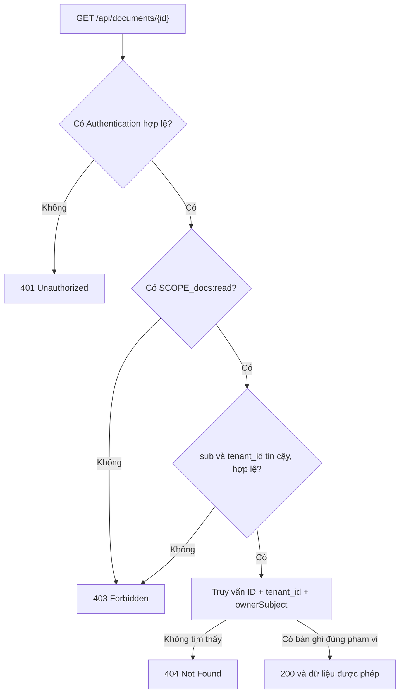

# Kiểm tra truy cập tài nguyên của người dùng hoặc tenant khác

## 1. Bài toán: đăng nhập đúng vẫn có thể đọc nhầm dữ liệu người khác

Một API trả về tài liệu theo mã định danh:

```http
GET /api/documents/101 HTTP/1.1
Authorization: Bearer <access-token-cua-alice>
```

Nếu controller chỉ kiểm tra rằng người gọi **đã đăng nhập**, rồi dùng `repository.findById(101)`, Alice có thể thay `101` bằng mã của Bob hoặc của một tenant khác. Đây là lỗi kiểm soát truy cập ở cấp đối tượng, thường được gọi là **Broken Object Level Authorization (BOLA)** hoặc **Insecure Direct Object Reference (IDOR)**. Việc có một ID khó đoán, JWT hợp lệ hay role `USER` không tự bảo đảm quyền đối với **từng tài nguyên**.

Trong hệ thống nhiều tenant, lỗi có thể xảy ra ở hai ranh giới độc lập:

- **Ranh giới người sở hữu:** Alice và Bob thuộc cùng tenant, nhưng một tài liệu chỉ cho phép chủ sở hữu đọc.
- **Ranh giới tenant:** Alice của tenant `alpha` không được đọc bản ghi thuộc tenant `beta`, kể cả khi trùng mã user, email, role hoặc có scope đọc tài liệu.

Bài học thuộc chương **Dữ liệu và cô lập** trong module **SPRING_SECURITY_TESTING**. Ta sẽ kiểm chứng chính sách truy cập dữ liệu bằng `spring-security-test`, `MockMvc` và `WebTestClient`, các danh tính giả lập qua `SecurityContext`, `@WithMockUser`, JWT/OAuth2/OIDC, cùng các tình huống HTTP **401/403/404/200**. Trọng tâm không chỉ là “API trả lỗi”, mà còn là **không đọc, sửa, xóa hoặc tiết lộ dữ liệu của người dùng/tenant khác**.

Sau bài học, người học có thể:

1. Xác định quyền truy cập ở **cấp bản ghi** thay vì chỉ kiểm tra role/scope chung.
2. Viết truy vấn luôn có `tenantId` và `ownerSubject` khi chính sách yêu cầu cả hai.
3. Dựng các fixture Alice/Bob và tenant alpha/beta để test truy cập chéo.
4. Giải thích khi nào từ chối bằng `403 Forbidden`, khi nào trả `404 Not Found` để hạn chế lộ sự tồn tại.
5. Kiểm thử Servlet bằng `MockMvc` với `jwt()` và Reactive bằng `WebTestClient.mutateWith(mockJwt())`.
6. Kiểm tra **tác động dữ liệu thực** sau PUT/PATCH/DELETE, không dừng ở status code.
7. Phân biệt mock authentication với kiểm chứng chữ ký JWT, tenant claim và ánh xạ quyền qua decoder thực.
8. Thiết kế test database/fixture để các test không lẫn dữ liệu hoặc phụ thuộc thứ tự chạy.

## 2. Mô hình ví dụ và hợp đồng phân quyền

Xét hệ thống quản lý tài liệu. Mỗi bản ghi có những trường tối thiểu:

| ID | Tenant | Người sở hữu (`ownerSubject`) | Tên tài liệu |
|---|---|---|---|
| `101` | `alpha` | `alice` | `alpha-alice-plan` |
| `102` | `alpha` | `bob` | `alpha-bob-budget` |
| `201` | `beta` | `alice` | `beta-alice-contract` |
| `202` | `beta` | `carol` | `beta-carol-notes` |

Ở đây có **hai người cùng subject `alice` nhưng thuộc hai tenant khác nhau**. Dữ liệu này được chọn có chủ đích: nếu truy vấn chỉ kiểm tra `ownerSubject = alice` mà quên tenant, phép thử phải phát hiện lỗi.

Giả sử chính sách của `GET /api/documents/{id}` là:

- Người gọi phải có JWT đã được xác thực.
- Authentication phải có authority `SCOPE_docs:read`.
- JWT phải mang `sub` và `tenant_id` có giá trị hợp lệ, được lấy từ nguồn tin cậy.
- Chỉ được đọc tài liệu có **`document.tenantId = principal.tenant_id` và `document.ownerSubject = principal.sub`**.
- Với tài liệu không tồn tại **hoặc** tồn tại nhưng không thuộc phạm vi được đọc, trả `404` theo chính sách che giấu sự tồn tại.
- Khi chưa được xác thực: `401`. Khi đã xác thực nhưng thiếu scope hoặc claim danh tính bắt buộc: `403`.

### 2.1. Ma trận quyền mong đợi

| Người gọi | Tenant claim | Authority | ID yêu cầu | Kết quả |
|---|---|---|---|---|
| Alice | `alpha` | `SCOPE_docs:read` | `101` | 200 |
| Alice | `alpha` | `SCOPE_docs:read` | `102` | 404: tài liệu Bob cùng tenant |
| Alice | `alpha` | `SCOPE_docs:read` | `201` | 404: Alice ở tenant khác |
| Alice | `beta` | `SCOPE_docs:read` | `201` | 200 |
| Bob | `alpha` | `SCOPE_docs:read` | `102` | 200 |
| Bob | `alpha` | `SCOPE_docs:read` | `101` | 404 |
| Alice | `alpha` | `SCOPE_profile` | `101` | 403: thiếu scope |
| Alice | thiếu `tenant_id` | `SCOPE_docs:read` | `101` | 403: danh tính không đủ thông tin |
| Anonymous | — | — | `101` | 401 |
| Alice | `alpha` | `SCOPE_docs:read` | `999` | 404: tài liệu không tồn tại |

Đây là **hợp đồng minh họa của ứng dụng**, không phải quy tắc HTTP cố định của mọi hệ thống. Một API khác có thể trả `403` khi người dùng đã xác thực nhưng không có quyền đọc một tài nguyên. Tuy nhiên, nên có chính sách nhất quán, không vô tình để status/body/thời gian phản hồi tiết lộ tài liệu ngoài phạm vi.

### 2.2. Authorization gồm nhiều lớp, không phải một if



Một role/scope chỉ là bước kiểm soát **chức năng**. Truy vấn có phạm vi tenant và owner mới kiểm soát **đối tượng cụ thể**. Phép thử cần kiểm chứng cả hai.

## 3. Tenant identity phải đến từ nguồn được tin cậy

Ở ví dụ này, danh tính được lấy từ authentication JWT:

```java
String subject = jwt.getSubject();
Object tenantClaim = jwt.getClaim("tenant_id");
```

Giá trị `tenant_id` chỉ đáng tin khi:

1. Request đã đi qua Resource Server, chữ ký/token hợp lệ được xác minh theo issuer, audience, thời gian và quy tắc của ứng dụng.
2. Claim được phát hành hoặc ánh xạ bởi nguồn định danh đáng tin, không được ghi đè bằng input tùy ý của người gọi.
3. Nếu ứng dụng cho phép **chuyển tenant đang hoạt động**, việc chuyển tenant phải kiểm tra membership/role thực tế; không chỉ tin một ID tenant do browser gửi.
4. Ánh xạ `sub` sang user nội bộ phải xét đúng phạm vi định danh; trong nhiều hệ thống, cần cặp `(issuer, subject)` để tránh nhầm người dùng giữa các issuer.

**Anti-pattern:**

```java
@GetMapping("/api/documents/{id}")
DocumentView read(@PathVariable Long id,
                  @RequestHeader("X-Tenant-Id") String tenantId) {
    // Sai nếu X-Tenant-Id có thể do client tùy ý chọn!
    return repository.findByIdAndTenantId(id, tenantId)
        .map(DocumentView::from)
        .orElseThrow();
}
```

Header `X-Tenant-Id` có thể hữu ích như **yêu cầu lựa chọn tenant**, nhưng không phải bằng chứng người gọi được phép truy cập tenant đó. Nếu sử dụng header, server phải đối chiếu lựa chọn với các tenant mà principal thực sự được cấp quyền, hoặc dùng tenant đã được xác lập từ authentication đáng tin.

Trong `spring-security-test`, helper `jwt()` hoặc `mockJwt()` có thể đặt claim `tenant_id` tùy ý để tạo fixture. Vì thế các phép thử dùng mock **không tự chứng minh claim của token thật đã được phát hành và xác minh đúng**. Cần bổ sung test decoder/token thực ở mức tích hợp.

## 4. Sai lầm thường gặp: tra cứu theo ID rồi mới xét chủ sở hữu

Mẫu code dễ dẫn đến IDOR:

```java
Document doc = repository.findById(id)
    .orElseThrow(() -> new ResponseStatusException(
        HttpStatus.NOT_FOUND));

return new DocumentView(doc.getId(), doc.getTitle());
```

Dù endpoint đã có `.authenticated()` hoặc `hasAuthority("SCOPE_docs:read")`, code vẫn chưa xét tenant và owner.

Một cải tiến nhưng còn nhiều rủi ro:

```java
Document doc = repository.findById(id)
    .orElseThrow(() -> notFound());

if (!doc.getTenantId().equals(tenantFromJwt)
        || !doc.getOwnerSubject().equals(subjectFromJwt)) {
    throw notFound();
}

return new DocumentView(doc.getId(), doc.getTitle());
```

Cách này có thể chặn response trái phép nếu kiểm tra cẩn thận, nhưng đã **tải một bản ghi ngoài phạm vi** vào application trước khi xét quyền. Các bước logging, cache, event hoặc mapping sai vị trí có thể khiến dữ liệu lộ ra. Với list/search/update/delete, việc phân quyền ở tầng ứng dụng sau truy vấn còn dễ bỏ sót.

**Ưu tiên mô hình truy vấn đã gắn phạm vi người dùng/tenant ngay từ đầu.**

```java
Optional<Document> document =
    repository.findByIdAndTenantIdAndOwnerSubject(
        id, tenantId, subject);
```

Nếu không thỏa đồng thời cả ba điều kiện, repository không trả bản ghi cho service. Đối với hệ thống có phân cấp quyền hoặc policy phức tạp, có thể cần predicate/specification động, row-level security ở database hoặc tầng policy chuyên dụng. Dù dùng kỹ thuật nào, test vẫn phải chứng minh **đọc chéo tenant và đọc chéo owner bị từ chối**.

## 5. Ví dụ Servlet + JPA: kiểm tra quyền ngay trong truy vấn

Đây là ứng dụng mẫu độc lập dùng Spring Boot 3, Java 17+, Spring MVC, Spring Security 6 và Spring Data JPA. Có thể sử dụng H2/Testcontainers làm database kiểm thử.

```kotlin
// build.gradle.kts — các dependency liên quan
dependencies {
    implementation("org.springframework.boot:spring-boot-starter-web")
    implementation("org.springframework.boot:spring-boot-starter-security")
    implementation("org.springframework.boot:spring-boot-starter-oauth2-resource-server")
    implementation("org.springframework.boot:spring-boot-starter-data-jpa")

    runtimeOnly("com.h2database:h2")

    testImplementation("org.springframework.boot:spring-boot-starter-test")
    testImplementation("org.springframework.security:spring-security-test")
}
```

### 5.1. Entity và repository

```java
@Entity
@Table(name = "documents")
class Document {

    @Id
    private Long id;

    @Column(nullable = false)
    private String tenantId;

    @Column(nullable = false)
    private String ownerSubject;

    @Column(nullable = false)
    private String title;

    protected Document() {}

    Document(Long id, String tenantId,
             String ownerSubject, String title) {
        this.id = id;
        this.tenantId = tenantId;
        this.ownerSubject = ownerSubject;
        this.title = title;
    }

    Long getId() { return id; }
    String getTenantId() { return tenantId; }
    String getOwnerSubject() { return ownerSubject; }
    String getTitle() { return title; }
}
```

```java
interface DocumentRepository extends JpaRepository<Document, Long> {

    Optional<Document> findByIdAndTenantIdAndOwnerSubject(
        Long id,
        String tenantId,
        String ownerSubject
    );
}
```

Spring Data JPA có thể tạo truy vấn từ tên method. Khi làm việc với schema thực, cần index phù hợp với mẫu truy vấn (`tenant_id`, `owner_subject`, `id`) và cân nhắc unique/primary key theo mô hình tenant. **Không** mặc định `id` luôn duy nhất toàn hệ thống nếu dữ liệu thực dùng khóa tổng hợp (`tenant_id`, `id`).

### 5.2. Service xác minh claim và chỉ trả tài liệu trong phạm vi

```java
@Service
class DocumentAccessService {

    private final DocumentRepository repository;

    DocumentAccessService(DocumentRepository repository) {
        this.repository = repository;
    }

    Optional<DocumentView> findVisible(Long id, Jwt jwt) {
        String subject = jwt.getSubject();
        Object tenantClaim = jwt.getClaim("tenant_id");

        if (subject == null || subject.isBlank()
                || !(tenantClaim instanceof String tenantId)
                || tenantId.isBlank()) {
            throw new AccessDeniedException(
                "Identity lacks required access attributes");
        }

        return repository
            .findByIdAndTenantIdAndOwnerSubject(
                id, tenantId, subject)
            .map(doc ->
                new DocumentView(doc.getId(), doc.getTitle()));
    }
}

record DocumentView(Long id, String title) {}
```

Quy tắc ở đây cố ý **fail closed**:

- `tenant_id` thiếu, rỗng hoặc không phải `String` → không truy cập dữ liệu.
- `sub` thiếu hoặc rỗng → không truy cập dữ liệu.
- Chỉ query bằng cả `id`, `tenantId`, `ownerSubject`.
- DTO chỉ chứa những trường được phép trả; không trả toàn bộ entity chứa tenant/owner hoặc dữ liệu mật ngoài nhu cầu.

`AccessDeniedException` có thể được xử lý thành 403 qua Spring Security exception handling trong filter chain. Nếu dự án sử dụng `@ControllerAdvice` riêng hoặc thay exception mapping, test phải theo hợp đồng thực tế.

### 5.3. Controller và SecurityFilterChain

```java
@RestController
@RequestMapping("/api/documents")
class DocumentController {

    private final DocumentAccessService access;

    DocumentController(DocumentAccessService access) {
        this.access = access;
    }

    @GetMapping("/{id}")
    ResponseEntity<DocumentView> get(
            @PathVariable Long id,
            @AuthenticationPrincipal Jwt jwt) {

        return access.findVisible(id, jwt)
            .map(ResponseEntity::ok)
            .orElseGet(() -> ResponseEntity.notFound().build());
    }
}
```

```java
@Configuration
@EnableWebSecurity
class DocumentSecurityConfig {

    @Bean
    SecurityFilterChain apiSecurity(HttpSecurity http)
            throws Exception {

        return http
            .authorizeHttpRequests(auth -> auth
                .requestMatchers(
                    HttpMethod.GET, "/api/documents/**")
                    .hasAuthority("SCOPE_docs:read")
                .anyRequest().denyAll()
            )
            .oauth2ResourceServer(oauth2 ->
                oauth2.jwt(Customizer.withDefaults()))
            .sessionManagement(session ->
                session.sessionCreationPolicy(
                    SessionCreationPolicy.STATELESS))
            .csrf(AbstractHttpConfigurer::disable)
            .build();
    }
}
```

Các package/import tiêu biểu: `jakarta.persistence.*`, `org.springframework.data.jpa.repository.JpaRepository`, `org.springframework.security.oauth2.jwt.Jwt`, `org.springframework.security.access.AccessDeniedException`, `org.springframework.security.core.annotation.AuthenticationPrincipal`, `org.springframework.security.config.annotation.web.builders.HttpSecurity`, `org.springframework.security.web.SecurityFilterChain`, `org.springframework.security.config.http.SessionCreationPolicy`, `org.springframework.security.config.annotation.web.configurers.AbstractHttpConfigurer`, `org.springframework.http.HttpMethod/ResponseEntity`, các annotation Spring MVC và `java.util.Optional`.

Bản minh họa tắt CSRF cho **API stateless chỉ dùng bearer token**; ứng dụng sử dụng session/cookie hoặc browser phải đánh giá CSRF riêng, không sao chép máy móc.

**Điểm rất quan trọng:** `SCOPE_docs:read` chỉ giải quyết quyền *đọc chức năng tài liệu*, còn `findByIdAndTenantIdAndOwnerSubject` giải quyết quyền *đọc bản ghi nào*. Một phép thử scope thành công không thay thế được phép thử ranh giới tenant/owner.

## 6. Dựng fixture dữ liệu có thể phân biệt mọi trường hợp

Một bộ test tốt không chỉ có “Alice sở hữu một bản ghi”. Nó cần **đặt các ID khác nhau giữa hai owner và hai tenant**, đồng thời dùng cùng subject ở hai tenant để phát hiện truy vấn thiếu điều kiện.

### 6.1. Seed bốn tài liệu trước mỗi test

```java
@Autowired
DocumentRepository repository;

@BeforeEach
void seedDocuments() {
    repository.deleteAll();

    repository.saveAll(List.of(
        new Document(101L, "alpha", "alice",
            "alpha-alice-plan"),
        new Document(102L, "alpha", "bob",
            "alpha-bob-budget"),
        new Document(201L, "beta", "alice",
            "beta-alice-contract"),
        new Document(202L, "beta", "carol",
            "beta-carol-notes")
    ));
}
```

Trong ví dụ này dùng H2 database test riêng và fixture được khởi tạo trước mỗi ca. Với test chạy song song, không nên `deleteAll()` trên một database chung, vì test này có thể xóa dữ liệu test khác. Có thể dùng schema/database riêng cho test, Testcontainers riêng theo lớp, transaction isolation phù hợp hoặc quy trình seed/cleanup không xung đột. Không dùng dữ liệu production làm fixture.

### 6.2. Tạo RequestPostProcessor JWT cho từng danh tính

```java
private static RequestPostProcessor reader(
        String subject, String tenant) {
    return jwt()
        .jwt(token -> token
            .subject(subject)
            .claim("tenant_id", tenant))
        .authorities(
            new SimpleGrantedAuthority("SCOPE_docs:read"));
}
```

`jwt()` từ `SecurityMockMvcRequestPostProcessors` tạo JWT authentication giả lập gắn vào mock Servlet request. Nó giúp tập trung test authorization. Nó **không gọi `JwtDecoder`**, không xác minh chữ ký, `iss`, `aud`, `exp` hoặc tính trung thực của `tenant_id`.

Vì `DocumentSecurityConfig` có bật Resource Server JWT, test context cũng cần một bean `JwtDecoder` hoặc cấu hình decoder/JWK set hợp lệ để khởi tạo filter chain. Có thể cấp decoder chỉ dành cho test và không cho phép nó xác minh token thực:

```java
@TestConfiguration
class DenyAllTestJwtDecoder {

    @Bean
    JwtDecoder jwtDecoder() {
        return token -> {
            throw new BadJwtException(
                "Signed JWT validation is tested separately");
        };
    }
}
```

Khi viết `@SpringBootTest` ở phần sau, import cấu hình này trong test context (ví dụ `@Import(DenyAllTestJwtDecoder.class)`). Phép thử `with(jwt())` vẫn tạo authentication giả lập mà không đi qua decoder; tuy nhiên bearer token thật sẽ bị test decoder này từ chối. **Không đưa bean này vào cấu hình production.**

## 7. MockMvc: kiểm chứng truy cập của từng owner và tenant

Ví dụ sau giả định context đã nạp `DocumentSecurityConfig`, repository JPA, service, controller và test decoder; test database được cấu hình riêng.

```java
@SpringBootTest
@AutoConfigureMockMvc
@Import(DenyAllTestJwtDecoder.class)
class DocumentIsolationMvcTest {

    @Autowired
    MockMvc mvc;

    @Autowired
    DocumentRepository repository;

    @BeforeEach
    void seedDocuments() {
        repository.deleteAll();
        repository.saveAll(List.of(
            new Document(101L, "alpha", "alice",
                "alpha-alice-plan"),
            new Document(102L, "alpha", "bob",
                "alpha-bob-budget"),
            new Document(201L, "beta", "alice",
                "beta-alice-contract"),
            new Document(202L, "beta", "carol",
                "beta-carol-notes")
        ));
    }

    private static RequestPostProcessor reader(
            String subject, String tenant) {
        return jwt()
            .jwt(token -> token
                .subject(subject)
                .claim("tenant_id", tenant))
            .authorities(new SimpleGrantedAuthority(
                "SCOPE_docs:read"));
    }

    @Test
    void ownerWithinTenantCanReadOwnDocument()
            throws Exception {
        mvc.perform(get("/api/documents/101")
                .with(reader("alice", "alpha")))
            .andExpect(status().isOk())
            .andExpect(jsonPath("$.id").value(101))
            .andExpect(jsonPath("$.title")
                .value("alpha-alice-plan"));
    }

    @Test
    void otherOwnerInSameTenantCannotReadDocument()
            throws Exception {
        mvc.perform(get("/api/documents/102")
                .with(reader("alice", "alpha")))
            .andExpect(status().isNotFound());
    }

    @Test
    void sameSubjectFromAnotherTenantCannotReadDocument()
            throws Exception {
        mvc.perform(get("/api/documents/201")
                .with(reader("alice", "alpha")))
            .andExpect(status().isNotFound());
    }

    @Test
    void aliceInBetaCanReadOnlyHerBetaDocument()
            throws Exception {
        mvc.perform(get("/api/documents/201")
                .with(reader("alice", "beta")))
            .andExpect(status().isOk())
            .andExpect(jsonPath("$.title")
                .value("beta-alice-contract"));

        mvc.perform(get("/api/documents/101")
                .with(reader("alice", "beta")))
            .andExpect(status().isNotFound());
    }

    @Test
    void bobCanReadHisOwnDocumentButNotAlices()
            throws Exception {
        mvc.perform(get("/api/documents/102")
                .with(reader("bob", "alpha")))
            .andExpect(status().isOk());

        mvc.perform(get("/api/documents/101")
                .with(reader("bob", "alpha")))
            .andExpect(status().isNotFound());
    }

    @Test
    void nonexistentAndOutOfScopeUseSameStatus()
            throws Exception {
        mvc.perform(get("/api/documents/999")
                .with(reader("alice", "alpha")))
            .andExpect(status().isNotFound());

        mvc.perform(get("/api/documents/102")
                .with(reader("alice", "alpha")))
            .andExpect(status().isNotFound());
    }

    @Test
    void anonymousIsUnauthorized() throws Exception {
        mvc.perform(get("/api/documents/101"))
            .andExpect(status().isUnauthorized());
    }

    @Test
    void authenticatedWithoutReadScopeIsForbidden()
            throws Exception {
        mvc.perform(get("/api/documents/101")
                .with(jwt()
                    .jwt(token -> token
                        .subject("alice")
                        .claim("tenant_id", "alpha"))
                    .authorities(
                        new SimpleGrantedAuthority(
                            "SCOPE_profile"))))
            .andExpect(status().isForbidden());
    }

    @Test
    void missingTenantClaimIsForbidden()
            throws Exception {
        mvc.perform(get("/api/documents/101")
                .with(jwt()
                    .jwt(token -> token.subject("alice"))
                    .authorities(
                        new SimpleGrantedAuthority(
                            "SCOPE_docs:read"))))
            .andExpect(status().isForbidden());
    }
}
```

Các static imports trong Servlet test: `SecurityMockMvcRequestPostProcessors.jwt`, `MockMvcRequestBuilders.get`, `MockMvcResultMatchers.status/jsonPath`. Các kiểu khác: `RequestPostProcessor`, `SimpleGrantedAuthority`, `MockMvc`, `@BeforeEach`, `@Test`, `@Import`, `@SpringBootTest` và `@AutoConfigureMockMvc`. Với Spring Boot 3, dùng `jakarta.servlet` cho Servlet API.

### 7.1. Hai test có giá trị đặc biệt

**Alice alpha đọc tài liệu của Bob alpha:** kiểm tra chính sách owner; chỉ so tenant không đủ.

**Alice alpha đọc tài liệu của Alice beta:** kiểm tra chính sách tenant; chỉ so subject không đủ.

Nếu bỏ một trong hai, implementation lỗi vẫn có thể qua hết các test còn lại. Việc tạo dữ liệu Alice ở cả alpha và beta là kỹ thuật fixture quan trọng để phát hiện truy vấn chỉ lọc `ownerSubject`.

### 7.2. Vì sao cần 404 cho cả “không có” và “không được xem”?

Theo contract minh họa, Alice không được biết tài liệu `102` có tồn tại hay không. Test kiểm tra status cho ID `102` và `999` đều là 404. Nếu hệ thống trả 403 cho ID `102` nhưng 404 cho ID `999`, caller có thể suy ra tài liệu `102` tồn tại dù không xem được.

Chính sách 404 chỉ **hạn chế tiết lộ sự tồn tại**, không bảo đảm đã loại bỏ mọi side channel. Cần xem thêm response body, header, thời gian phản hồi và cache. Với API có hợp đồng công khai trả 403 cho forbidden resource, có thể chấp nhận lựa chọn đó sau khi đánh giá rủi ro, miễn test nêu rõ chính sách.

### 7.3. Kiểm chứng bộ lọc và dữ liệu là hai việc khác nhau

- Test `authenticatedWithoutReadScopeIsForbidden` chủ yếu kiểm tra tầng **SecurityFilterChain**.
- Test truy cập chéo owner/tenant kiểm tra tầng **service/repository**.
- Test anonymous 401 kiểm tra authentication entry point.
- Test title của bản ghi hợp lệ giúp khẳng định service đọc **đúng dữ liệu**, không chỉ trả 200 rỗng.

`@WithMockUser(username = "alice")` hữu ích khi policy lấy user từ `Authentication.getName()` và role đơn giản. Tuy nhiên, `@WithMockUser` **không tự dựng JWT chứa `tenant_id`**. Nếu controller dùng `@AuthenticationPrincipal Jwt` như ví dụ, `@WithMockUser` không thay thế được `jwt()`. Cần chọn helper có **đúng loại principal** mà ứng dụng thực sự đọc.

## 8. Không chỉ GET: PUT/PATCH/DELETE phải kiểm tra cả hậu quả dữ liệu

IDOR/BOLA thường xuất hiện ở thao tác ghi, không chỉ ở thao tác đọc. Một API có thể trả `403` hoặc `404` nhưng đã thay đổi dữ liệu **trước khi kiểm tra quyền**. Vì vậy một test tốt cần xác nhận **database không bị biến đổi**.

### 8.1. Anti-pattern “ghi trước, kiểm tra sau”

```java
// Sai: thay đổi bản ghi trước rồi mới kiểm tra quyền.
Document doc = repository.findById(id).orElseThrow();
doc.setTitle(requestedTitle);
repository.save(doc);

if (!doc.getTenantId().equals(tenant)
        || !doc.getOwnerSubject().equals(subject)) {
    throw new AccessDeniedException("Forbidden");
}
```

Dù exception có làm rollback trong một transaction cụ thể, kiểu code này tạo cơ hội cho side effect trước khi kiểm tra: publish event, gửi message, audit sai, external HTTP call hoặc một đoạn code chạy ngoài transaction. Không dựa vào rollback ngầm để hợp thức hóa thứ tự kiểm tra này.

### 8.2. Ghi theo điều kiện quyền ngay trong câu lệnh

Một cách kiểm soát chặt là dùng conditional update đã được scope:

```java
interface DocumentRepository extends JpaRepository<Document, Long> {

    Optional<Document> findByIdAndTenantIdAndOwnerSubject(
        Long id, String tenantId, String ownerSubject);

    @Modifying
    @Query("""
        update Document d
           set d.title = :title
         where d.id = :id
           and d.tenantId = :tenantId
           and d.ownerSubject = :ownerSubject
        """)
    int renameIfOwned(
        @Param("id") Long id,
        @Param("tenantId") String tenantId,
        @Param("ownerSubject") String subject,
        @Param("title") String newTitle
    );
}
```

```java
@Transactional
void renameDocument(Long id, String newTitle,
                    String tenantId, String subject) {
    int updated = repository.renameIfOwned(
        id, tenantId, subject, newTitle);

    if (updated == 0) {
        throw new ResponseStatusException(
            HttpStatus.NOT_FOUND);
    }
}
```

Nhánh `updated == 0` gộp “không có bản ghi” và “không thuộc phạm vi” theo chính sách 404. Một câu update có đủ predicate tenant/owner cũng làm giảm rủi ro **check-then-act race** giữa việc đọc quyền và thực hiện ghi.

Tương tự với delete: dùng delete theo khóa **kèm tenant và owner**, sau đó kiểm tra affected rows. Nếu hệ thống hỗ trợ chia sẻ tài liệu, nhóm quyền, admin tenant hoặc owner chuyển nhượng, predicate cần thể hiện đúng policy của những vai trò đó thay vì luôn gắn cứng owner.

### 8.3. Test cả response lẫn trạng thái sau request

Giả sử ứng dụng có endpoint `PATCH /api/documents/102`. Test cần đọc bản ghi từ repository **sau** request để xác nhận dữ liệu Bob không thay đổi:

```java
@Test
void aliceCannotRenameBobsDocument() throws Exception {
    mvc.perform(patch("/api/documents/102")
            .with(reader("alice", "alpha"))
            .contentType(MediaType.APPLICATION_JSON)
            .content("{\"title\":\"hijacked\"}"))
        .andExpect(status().isNotFound());

    Document bob = repository.findById(102L)
        .orElseThrow();

    assertThat(bob.getTitle())
        .isEqualTo("alpha-bob-budget");
}
```

Đây là test **bổ sung khi endpoint PATCH đã được triển khai**; cấu hình hiện tại mới chỉ minh họa GET, vì vậy cần thêm matcher `PATCH`, controller/service, và JSON request handling đúng policy trước khi chạy. Với API dùng JWT Bearer stateless, có thể tắt CSRF theo quyết định bảo mật rõ ràng; nếu dùng cookie/session, test còn phải xử lý CSRF riêng.

Test tác động dữ liệu cũng cần cho **DELETE** (bản ghi vẫn tồn tại) và **POST tạo tài nguyên** (không cho phép tạo bản ghi cho tenant khác bằng cách gửi `tenantId` trong body).

## 9. Kiểm thử danh sách, tìm kiếm và thao tác hàng loạt

Một endpoint đọc chi tiết đã được bảo vệ không đủ nếu những đường đi khác vẫn trả dữ liệu chéo tenant:

- `GET /api/documents` trả danh sách.
- `GET /api/documents/search?q=...` tìm theo từ khóa.
- `GET /api/documents/export` xuất CSV/Excel.
- `GET /api/documents/{id}/attachments` truy cập tệp đính kèm.
- `POST /api/documents/batch` lấy hoặc sửa nhiều ID.
- Endpoint GraphQL hoặc WebSocket cho cùng loại tài nguyên.
- Cache/read-model, audit trail và event-driven projection.

### 9.1. Danh sách phải lọc trước phân trang

Ví dụ đúng về mặt ý tưởng:

```java
Page<Document> findByTenantIdAndOwnerSubject(
    String tenantId,
    String ownerSubject,
    Pageable pageable
);
```

Nếu code gọi `findAll(pageable)` rồi mới lọc ở Java, trang có thể thiếu bản ghi hợp lệ, total count sai hoặc rò thông tin qua pagination. Với multi-tenancy, phần **count query** cũng phải dùng đúng predicate quyền.

### 9.2. Batch phải lọc từng ID

Một request có thể chứa `[101, 102, 201]`. Với Alice alpha, kết quả chỉ được chứa tài liệu 101, hoặc toàn request phải bị từ chối nếu hợp đồng API áp dụng atomic authorization. Test cần xác nhận **không có bản ghi 102/201** trong body, metadata, log, event hoặc download.

Không chỉ kiểm tra status 200 cho batch. Cần kiểm tra chính xác tập ID trả về và chính sách khi người dùng đưa vào ID ngoài phạm vi.

### 9.3. Cache phải có khóa đủ ngữ cảnh

Nếu cache dùng key duy nhất `documentId` nhưng dữ liệu/response phụ thuộc tenant và quyền người gọi, có thể xuất hiện cross-tenant leakage do cache. Thiết kế cache phải cân nhắc `tenantId`, subject/permission hoặc phân tầng cache phù hợp. Test chuyển tuần tự Alice → Bob → Alice với cùng ID/đường dẫn có thể phát hiện lỗi cache dùng sai dữ liệu.

## 10. Reactive: áp dụng cùng chính sách với WebTestClient

Ở Spring WebFlux, HTTP security dùng `SecurityWebFilterChain`, còn repository có thể trả `Mono`/`Flux`. **Quy tắc tenant và owner không đổi** khi chuyển sang Reactive; chỉ thay cách khai báo pipeline và test client.

### 10.1. Repository và service Reactive minh họa

Nếu ứng dụng dùng Spring Data R2DBC, phương thức repository có thể trả `Mono<DocumentRow>`:

```java
interface ReactiveDocumentRepository
        extends ReactiveCrudRepository<DocumentRow, Long> {

    Mono<DocumentRow> findByIdAndTenantIdAndOwnerSubject(
        Long id, String tenantId, String ownerSubject);
}
```

`DocumentRow` ở đây đại diện bản ghi đã map với bảng tài liệu trong R2DBC, có các getter `getId()`/`getTitle()`; cần khai báo entity mapping `@Table`, `@Id` và các trường tương ứng theo driver của dự án. Đây là phiên bản riêng với entity JPA ở mục 5.

```java
@Service
class ReactiveDocumentAccessService {

    private final ReactiveDocumentRepository repository;

    ReactiveDocumentAccessService(
            ReactiveDocumentRepository repository) {
        this.repository = repository;
    }

    Mono<DocumentView> findVisible(Long id, Jwt jwt) {
        String subject = jwt.getSubject();
        Object tenantClaim = jwt.getClaim("tenant_id");

        if (subject == null || subject.isBlank()
                || !(tenantClaim instanceof String tenantId)
                || tenantId.isBlank()) {
            return Mono.error(new AccessDeniedException(
                "Identity lacks required access attributes"));
        }

        return repository
            .findByIdAndTenantIdAndOwnerSubject(
                id, tenantId, subject)
            .map(doc ->
                new DocumentView(doc.getId(), doc.getTitle()));
    }
}
```

```java
@RestController
@RequestMapping("/api/documents")
class ReactiveDocumentController {

    private final ReactiveDocumentAccessService access;

    ReactiveDocumentController(
            ReactiveDocumentAccessService access) {
        this.access = access;
    }

    @GetMapping("/{id}")
    Mono<ResponseEntity<DocumentView>> get(
            @PathVariable Long id,
            @AuthenticationPrincipal Jwt jwt) {
        return access.findVisible(id, jwt)
            .map(ResponseEntity::ok)
            .defaultIfEmpty(ResponseEntity.notFound().build());
    }
}
```

Điểm quan trọng là **truy vấn có phạm vi ngay từ repository**. Đừng gọi `findById(id)` rồi `filter(...)` sau khi đã chuyển entity sang DTO hoặc phát sinh side effect.

### 10.2. SecurityWebFilterChain minh họa

```java
@Configuration
@EnableWebFluxSecurity
class ReactiveDocumentSecurityConfig {

    @Bean
    SecurityWebFilterChain apiSecurity(
            ServerHttpSecurity http) {
        return http
            .authorizeExchange(auth -> auth
                .pathMatchers(
                    HttpMethod.GET, "/api/documents/**")
                    .hasAuthority("SCOPE_docs:read")
                .anyExchange().denyAll()
            )
            .oauth2ResourceServer(oauth2 ->
                oauth2.jwt(Customizer.withDefaults()))
            .httpBasic(
                ServerHttpSecurity.HttpBasicSpec::disable)
            .formLogin(
                ServerHttpSecurity.FormLoginSpec::disable)
            .csrf(ServerHttpSecurity.CsrfSpec::disable)
            .build();
    }
}
```

Trong test dùng `mockJwt()`, application context vẫn phải cung cấp `ReactiveJwtDecoder` hoặc cấu hình JWKS phù hợp để Spring khởi tạo security filter chain. Có thể dùng test bean trả lỗi cho bearer thật, tương tự Servlet:

```java
@TestConfiguration
class DenyAllReactiveTestJwtDecoder {

    @Bean
    ReactiveJwtDecoder reactiveJwtDecoder() {
        return token -> Mono.error(new BadJwtException(
            "Signed token validation is tested separately"));
    }
}
```

Không dùng bean decoder chỉ dành cho test trong production. Để kiểm tra header Bearer và xác minh JWT thực sự, tạo test tích hợp khác với decoder tin cậy khóa ký thử nghiệm.

### 10.3. WebTestClient với danh tính khác nhau ở từng request

```java
@SpringBootTest(
    webEnvironment = SpringBootTest.WebEnvironment.MOCK
)
@AutoConfigureWebTestClient
@Import(DenyAllReactiveTestJwtDecoder.class)
class ReactiveDocumentIsolationTest {

    @Autowired
    WebTestClient client;

    // Fixture R2DBC cần có cùng dữ liệu:
    // 101: alpha/alice; 102: alpha/bob;
    // 201: beta/alice; 202: beta/carol.

    @Test
    void alphaAliceReadsHerDocument() {
        client.mutateWith(mockJwt()
                .jwt(jwt -> jwt
                    .subject("alice")
                    .claim("tenant_id", "alpha"))
                .authorities(
                    new SimpleGrantedAuthority(
                        "SCOPE_docs:read")))
            .get()
            .uri("/api/documents/101")
            .exchange()
            .expectStatus().isOk()
            .expectBody()
            .jsonPath("$.title")
            .isEqualTo("alpha-alice-plan");
    }

    @Test
    void alphaAliceCannotReadOtherTenantSameSubject() {
        client.mutateWith(mockJwt()
                .jwt(jwt -> jwt
                    .subject("alice")
                    .claim("tenant_id", "alpha"))
                .authorities(
                    new SimpleGrantedAuthority(
                        "SCOPE_docs:read")))
            .get()
            .uri("/api/documents/201")
            .exchange()
            .expectStatus().isNotFound();
    }

    @Test
    void alphaAliceCannotReadBobsDocument() {
        client.mutateWith(mockJwt()
                .jwt(jwt -> jwt
                    .subject("alice")
                    .claim("tenant_id", "alpha"))
                .authorities(
                    new SimpleGrantedAuthority(
                        "SCOPE_docs:read")))
            .get()
            .uri("/api/documents/102")
            .exchange()
            .expectStatus().isNotFound();
    }

    @Test
    void authenticatedWithoutScopeIsForbidden() {
        client.mutateWith(mockJwt()
                .jwt(jwt -> jwt
                    .subject("alice")
                    .claim("tenant_id", "alpha"))
                .authorities(
                    new SimpleGrantedAuthority("SCOPE_profile")))
            .get()
            .uri("/api/documents/101")
            .exchange()
            .expectStatus().isForbidden();
    }

    @Test
    void anonymousIsUnauthorized() {
        client.get()
            .uri("/api/documents/101")
            .exchange()
            .expectStatus().isUnauthorized();
    }
}
```

Các kiểu/hàm liên quan: `WebTestClient`, `@SpringBootTest`, `@AutoConfigureWebTestClient`, `@Import`, `ReactiveJwtDecoder`, `Mono`; static import `SecurityMockServerConfigurers.mockJwt`.

Ví dụ test **giả định đã seed database R2DBC** với cùng bốn tài liệu. Cần thêm fixture rõ ràng (migration/test SQL hoặc `@BeforeEach` sử dụng repository reactive) khi đưa vào dự án. Nếu viết setup bằng `repository.deleteAll().thenMany(repository.saveAll(...)).then().block()`, chỉ dùng `block()` ở **test setup thread**, không gọi `block()` trong WebFlux handler hoặc event-loop.

Khi tự tạo client từ application context thay vì Boot autoconfiguration, hãy `apply(springSecurity())`:

```java
WebTestClient client = WebTestClient
    .bindToApplicationContext(applicationContext)
    .apply(springSecurity())
    .build();
```

`mockJwt()` chỉ gắn authentication vào **mock WebFlux exchange**. Nếu chạy `@SpringBootTest(webEnvironment = RANDOM_PORT)` qua HTTP thật, mock authentication trong JVM test không tự đi theo TCP; hãy gửi bearer token ký thật và cấu hình `ReactiveJwtDecoder` phù hợp.

## 11. Các phiên đăng nhập và SecurityContext không tự giải quyết tenant isolation

`spring-security-test` có nhiều cách dựng authentication. Cần chọn đúng helper theo principal ứng dụng thực sự đọc:

| Tình huống | Servlet | Reactive | Giới hạn |
|---|---|---|---|
| User/role đơn giản | `@WithMockUser`, `with(user(...))` | `mockUser()` | Không tự có tenant claim của JWT |
| JWT resource server | `with(jwt())` | `mockJwt()` | Bỏ qua JWT decoder, chữ ký, issuer/audience thực |
| OAuth2 Login | `with(oauth2Login())` | `mockOAuth2Login()` | Không chạy authorization-code flow |
| OIDC Login | `with(oidcLogin())` | `mockOidcLogin()` | Không xác minh ID Token/UserInfo qua network |
| Authentication tùy biến | `with(authentication(...))` / `securityContext(...)` | `mockAuthentication(...)` | Phải tự đặt principal/authorities nhất quán |
| JWT bearer thật | `Authorization: Bearer ...` + `JwtDecoder` | Header bearer + `ReactiveJwtDecoder` | Có kiểm chứng decoder/token khi cấu hình đầy đủ |

Các case cần có trong chiến lược test:

1. **Test nhanh object authorization** với JWT/OIDC/OAuth2 mock: kiểm tra tenant/owner filter và quyền ứng dụng.
2. **Test token và identity mapping thực:** issuer/audience hợp lệ, token thiếu/sai kiểu tenant, subject, chữ ký, scope mapping; các token lỗi cần bị từ chối trước service.
3. **Test database thật:** truy vấn có giữ điều kiện tenant/owner không, kể cả với list, update, delete, joins và count?
4. **Test dữ liệu người dùng khác:** bất kỳ đường đi nào cũng không được lộ tài liệu, metadata hoặc side effect ngoài phạm vi.

Với OIDC login, `sub` từ ID Token và thông tin user có thể không tương ứng trực tiếp với `Jwt` resource server. Ứng dụng phải xác lập một chính sách ánh xạ identity/tenant rõ ràng; không tùy tiện dùng `getEmail()` làm owner key vì email có thể thay đổi và không nhất thiết duy nhất.

## 12. Test isolation: tránh test PASS vì dữ liệu cũ hoặc thứ tự chạy

Một phép thử BOLA có thể báo 404 **vì tài liệu không có trong database**, chứ không phải vì tenant/owner đúng là bị chặn. Để tránh false positive, cần:

- Seed **trước ca** tài liệu của Bob và beta ở những ID đã biết.
- Xác nhận fixture tồn tại (qua repository hoặc truy vấn test-only) khi mục tiêu là kiểm tra 404 đối với tài liệu ngoài phạm vi.
- Dùng positive control: Bob alpha có thể đọc ID `102`; Alice beta có thể đọc `201`.
- Không đặt toàn bộ test dưới một `@WithMockUser` mang quyền admin, nếu cần có anonymous/ordinary user.
- Không cho test dữ liệu dùng chung tùy tiện giữa các lớp chạy parallel.
- Test sau ghi/xóa phải xác nhận trạng thái repository, chứ không chỉ status HTTP.

### 12.1. Vì sao positive control là bắt buộc?

Xem test:

```java
mvc.perform(get("/api/documents/102")
        .with(reader("alice", "alpha")))
    .andExpect(status().isNotFound());
```

Nếu fixture chưa seed tài liệu `102`, test vẫn có thể PASS dù service bỏ qua mọi kiểm tra owner. Bổ sung:

```java
assertThat(repository.findById(102L)).isPresent();

mvc.perform(get("/api/documents/102")
        .with(reader("bob", "alpha")))
    .andExpect(status().isOk());

mvc.perform(get("/api/documents/102")
        .with(reader("alice", "alpha")))
    .andExpect(status().isNotFound());
```

Như vậy test chứng minh **tài liệu tồn tại và người sở hữu được truy cập, nhưng người ngoài phạm vi không được truy cập**.

### 12.2. Chọn cơ chế cô lập dữ liệu phù hợp

| Cơ chế | Ưu điểm | Giới hạn cần chú ý |
|---|---|---|
| H2 in-memory DB riêng cho test | Nhanh, seed đơn giản | Có thể khác dialect và isolation với DB production |
| Testcontainers với DB tương đồng production | Phát hiện lỗi query, schema, RLS sát hơn | Khởi động chậm hơn, cần kiểm soát parallel fixtures |
| `@Transactional` ở test | Có thể rollback dữ liệu seed trong cùng transaction | Với live server/thread khác, transaction test có thể không bao phủ request |
| `@Sql` seed/cleanup | Dữ liệu rõ ràng, tách khỏi logic ứng dụng | Phải kiểm soát thứ tự, schema và transactional mode |
| Dataset độc lập per test/tenant | Hạn chế test ảnh hưởng lẫn nhau | Cần dọn dữ liệu và quản lý ID/unique key |

Đối với `@SpringBootTest(webEnvironment = RANDOM_PORT)`, HTTP server xử lý request trên thread/transaction khác test. Không giả định `@Transactional` trên method test sẽ rollback mọi thay đổi do server đã commit. Trong một test ghi thực, nên kiểm tra DB và cleanup theo cơ chế độc lập.

### 12.3. Kiểm tra thứ tự user/tenant luân phiên

Một regression test tốt có thể chạy các request theo thứ tự: Alice alpha → Bob alpha → Alice beta → Alice alpha. Cách này dễ phát hiện cache key thiếu tenant, SecurityContext rò rỉ qua thread pool hoặc fixture bị chia sẻ mutable. Dù vậy, cũng nên giữ **mỗi test độc lập** để không phụ thuộc test runner chạy theo thứ tự nào.

## 13. Những rủi ro ngoài response JSON

### 13.1. Lộ thông tin qua status, size hoặc timing

Việc trả 404 cho tài liệu ngoài phạm vi giúp giảm một kênh suy đoán, nhưng response vẫn có thể lộ thông tin nếu:

- JSON lỗi chứa tên tài liệu hoặc owner.
- Header `ETag`, `Last-Modified` hoặc `Content-Length` khác biệt theo bản ghi bị cấm.
- API trả total count, ID kế tiếp, gợi ý autocomplete hoặc vị trí trong phân trang.
- Cache thay đổi hành vi tùy có/không có tài liệu bí mật.
- Thời gian xử lý khác biệt có hệ thống giữa “không tồn tại” và “không được phép”.

Không nên biến unit test thành phép đo side-channel timing kém ổn định; cần đánh giá rủi ro có chủ đích và kết hợp các test bảo mật/phân tích phù hợp.

### 13.2. Mass assignment khi client gửi owner/tenant trong body

Một payload có thể cố tình đặt chủ sở hữu hoặc tenant khác:

```json
{
  "title": "New document",
  "tenantId": "beta",
  "ownerSubject": "carol"
}
```

Nếu API tạo tài liệu cho user thông thường, server phải **gán tenant/owner từ nguồn danh tính được phép**, không lấy trực tiếp hai trường này từ payload mà không kiểm tra quyền. Với admin hoặc thao tác chuyển sở hữu, phải có endpoint/policy rõ ràng và test trường hợp âm tính.

### 13.3. Database Row-Level Security và service account

Nếu sử dụng PostgreSQL Row-Level Security (RLS), cần test với **database role và session setting tương ứng production**. Test dùng superuser hoặc role `BYPASSRLS` có thể bỏ qua chính sách. RLS là lớp phòng vệ bổ sung; không thay thế việc kiểm thử security filter, service và query.

Đối với admin có quyền xem nhiều người dùng nhưng vẫn bị giới hạn tenant, không dùng query “bỏ mọi filter” chỉ vì có `ROLE_ADMIN`. Nên định nghĩa rõ `TENANT_ADMIN` (được xem trong tenant hiện hành) khác `GLOBAL_SUPPORT` (quyền truy cập đặc biệt có kiểm soát), và test cả hai ranh giới.

## 14. Các lỗi thường gặp và hướng chẩn đoán

| Hiện tượng | Nguyên nhân khả dĩ | Hướng xử lý/test |
|---|---|---|
| Alice đọc được tài liệu Bob | Chỉ kiểm tra `authenticated()` hoặc tenant, quên owner | Query/test thêm `ownerSubject` |
| Alice alpha đọc được tài liệu Alice beta | Query chỉ kiểm tra subject | Thêm `tenantId` vào mọi đường đọc/ghi |
| Test 404 PASS dù code sai | Dữ liệu ID khác không tồn tại trong fixture | Dùng positive control xác nhận owner đọc được |
| Có JWT nhưng trả 403 | Thiếu `SCOPE_docs:read` hoặc tenant claim | Tách test scope và test identity claim |
| Anonymous trả 302 thay vì 401 | Form/OAuth2 entry point đang được bật | Test theo security chain thực tế |
| Test @WithMockUser không cấp tenant | Principal không phải Jwt, không có claims | Dùng `jwt()`/`mockJwt()` hoặc identity fixture đúng loại |
| Mock JWT PASS nhưng token production bị từ chối | Mock bỏ qua decoder/chữ ký/audience | Test token ký thử nghiệm qua `JwtDecoder` |
| GET an toàn nhưng PATCH đổi tài liệu khác | Update không có predicate tenant/owner hoặc check quá muộn | Conditional update + assert DB không đổi |
| List có trang rỗng nhưng total count lộ | Lọc sau khi phân trang | Lọc ngay trong query và count query |
| API trả 404 nhưng log/event chứa dữ liệu cấm | Side effect xảy ra trước kiểm tra quyền | Di chuyển authorization trước side effect |
| Tenant được lấy từ `X-Tenant-Id` tùy ý | Tin input không xác thực quyền membership | Kiểm tra tenant claim hoặc membership nguồn tin cậy |
| Cache dùng chung ID gây lộ dữ liệu | Key không chứa tenant/permission context | Test request luân phiên và sửa cache policy |
| `RANDOM_PORT` không nhận mockJwt | Mock exchange không truyền authentication qua TCP | Gửi bearer token thật qua HTTP |
| Các test thất bại ngẫu nhiên | Fixture dùng chung DB/context, chạy parallel | Cô lập seed/schema và rollback/cleanup phù hợp |

## 15. Bài thực hành tổng hợp

Dựa trên bảng tài liệu ở mục 2, triển khai và kiểm thử ít nhất:

1. **Happy path:** Alice alpha có `SCOPE_docs:read` đọc ID 101 → 200, body đúng title.
2. **Cùng tenant, khác owner:** Alice alpha đọc ID 102 → 404; Bob alpha đọc 102 → 200.
3. **Khác tenant, cùng subject:** Alice alpha đọc 201 → 404; Alice beta đọc 201 → 200.
4. **Khác tenant, khác owner:** Bob alpha đọc 202 → 404; Carol beta đọc 202 → 200.
5. **Không tồn tại:** Alice alpha đọc 999 → 404; so sánh hợp đồng lỗi với 102/201.
6. **Thiếu authentication:** anonymous → 401 với Bearer entry point.
7. **Thiếu scope:** Alice alpha có `SCOPE_profile` nhưng không có `SCOPE_docs:read` → 403.
8. **Claim sai hoặc thiếu:** `tenant_id` rỗng, number hoặc không có; `sub` rỗng → không cấp quyền.
9. **PATCH vượt quyền:** Alice alpha cố sửa ID 102 hoặc 201 → bị từ chối, bản ghi không đổi.
10. **DELETE vượt quyền:** Alice alpha cố xóa ID 102 hoặc 201 → bị từ chối, bản ghi vẫn tồn tại.
11. **Tạo bản ghi giả tenant:** payload yêu cầu tenant beta khi principal thuộc alpha → bị từ chối hoặc được gán tenant alpha theo contract; không tạo dữ liệu cho beta trái phép.
12. **Reactive:** lặp lại các phép thử owner và tenant với `WebTestClient.mutateWith(mockJwt())`.
13. **Token thật:** dùng decoder và JWT ký bằng khóa thử nghiệm để kiểm tra issuer, audience, `tenant_id` và authority mapping, không dùng token production.
14. **DB integration:** test với database tương đồng production, bao gồm list/pagination, count, update/delete, join và cache.

### Checklist trước khi đánh dấu PASS

- [ ] Dữ liệu fixture của Bob và tenant beta thực sự tồn tại.
- [ ] Người sở hữu hợp lệ có thể đọc tài liệu của chính mình.
- [ ] Người khác cùng tenant không đọc được nếu policy là owner-only.
- [ ] Cùng subject nhưng tenant khác vẫn bị cô lập.
- [ ] Dữ liệu không tồn tại và ngoài phạm vi tuân theo cùng chính sách 404/403 đã chọn.
- [ ] Thiếu scope hoặc claim định danh dẫn đến từ chối, không fallback sang tenant mặc định có đặc quyền.
- [ ] Không có cập nhật/xóa, event, log nhạy cảm hoặc metadata ngoài phạm vi.
- [ ] Fixture và SecurityContext không phụ thuộc thứ tự test hoặc tài nguyên dùng chung.
- [ ] Kết quả của test mock JWT không bị đánh đồng với việc xác minh token thật.
- [ ] Mọi API phụ (list, search, export, attachment, batch) có cùng chính sách tenant/owner.

**Tiêu chí hoàn thành:** Bộ test phải chứng minh **authentication hợp lệ và scope đúng vẫn chưa đủ**; ứng dụng chỉ trả tài nguyên khi người gọi thỏa **đúng cả tenant lẫn quyền trên đối tượng**. Những ca truy cập chéo người dùng, chéo tenant, cùng subject ở tenant khác và cập nhật/xóa trái phép đều phải bị chặn; test cần kiểm chứng cả **phản hồi HTTP** lẫn **tính toàn vẹn của dữ liệu**. Với `MockMvc` và `WebTestClient`, phải chỉ rõ phạm vi của danh tính JWT/OAuth2/OIDC giả lập và bổ sung kiểm thử decoder/database thực khi cần khẳng định toàn bộ cơ chế bảo vệ.
