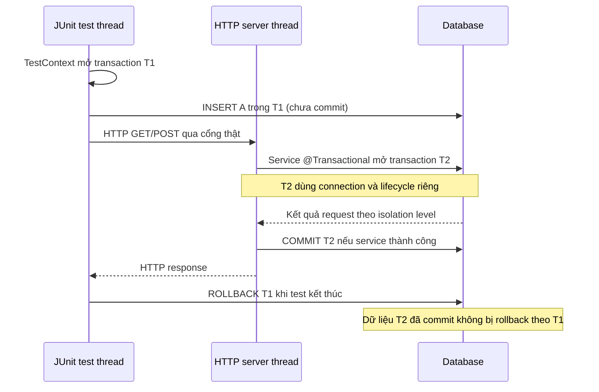

# Transaction của luồng test khác với transaction của request HTTP thật

Trong Spring Boot, `@Transactional` trên phương thức test thường khiến dữ liệu được tạo trong test **rollback khi test kết thúc**. Nhưng một test chạy với `@SpringBootTest(webEnvironment = RANDOM_PORT)` và gửi `POST` qua HTTP có thể tạo dữ liệu **vẫn còn trong database sau khi phương thức test đã rollback**.

Đây không nhất thiết là lỗi Spring: **transaction của luồng chạy JUnit không tự động lan sang luồng xử lý HTTP trên server**. Nếu controller gọi service `@Transactional` trong một HTTP request thật, transaction của service thường được mở và commit độc lập với transaction do Spring TestContext quản lý ở phía test.

Bài thuộc chương **Dữ liệu và cô lập** của module **SPRING_SECURITY_TESTING**. Mục tiêu là thiết kế phép kiểm thử bảo mật có dữ liệu nhất quán, tách rõ tình huống **MockMvc trong cùng test thread**, **WebTestClient/TestRestTemplate gọi server HTTP thật**, `@WithMockUser`/SecurityContext và các cơ chế JWT/OAuth2/OIDC. Ta sẽ viết test minh họa commit/rollback, đặt fixture đúng chỗ và dọn database theo vòng đời thật của transaction.

## 1. Hai luồng, hai ranh giới giao dịch

Sơ đồ dưới đây giả sử ứng dụng dùng Spring MVC và một database chung:



Đối chiếu với `MockMvc` đồng bộ:

```text
JUnit test thread
    |
    +-- Spring TestContext mở T1 (@Transactional trên test)
    |
    +-- mockMvc.perform(POST ...)
           |
           +-- SecurityFilterChain
           +-- Controller
           +-- Service @Transactional(REQUIRED)
                  |
                  +-- thường tham gia T1 trên cùng thread
    |
    +-- Kết thúc test: rollback T1
```

**Điểm then chốt:** `@Transactional` dựa trên context transaction gắn với đường thực thi, thường qua thread-local trong mô hình Servlet/JPA. Header HTTP, cookie phiên và body JSON không mang theo object transaction của JUnit. Việc server và test cùng JVM không thay đổi sự thật này.

| Kiểu gọi | Cách chạy | `@Transactional` của test có tự bao lấy thao tác database trong request? |
| --- | --- | --- |
| Test gọi trực tiếp một service `@Transactional(REQUIRED)` trong cùng thread | Lời gọi Java trong test | Thường **có**, service tham gia test transaction |
| `MockMvc.perform(...)` đồng bộ, filter/controller/service chạy trên test thread | Mock Servlet request | Thường **có**, nếu cùng transaction manager và propagation mặc định |
| `MockMvc` kích hoạt `Callable`, `@Async`, executor khác thread | Có thực thi bất đồng bộ | **Không bảo đảm**, transaction test không tự truyền sang worker |
| `WebTestClient.bindToServer()` tới `RANDOM_PORT` | HTTP thật đến server thread | **Không** |
| `TestRestTemplate` gọi `RANDOM_PORT` | HTTP thật đến server thread | **Không** |
| Browser / Postman / server ở container khác | HTTP ngoài tiến trình | **Không** |
| `WebTestClient.bindToApplicationContext(...)` của WebFlux | Mock exchange trong context | Không được suy từ quy tắc Servlet/JPA; xem phần Reactive |

Điều này vẫn đúng khi test dùng H2 in-memory trong **cùng application context**: server và test có thể kết nối cùng một database logic nhưng có **hai transaction/connection riêng**.

## 2. `@Transactional` trên test thực sự làm gì?

Với Spring TestContext, `TransactionalTestExecutionListener` có thể bắt đầu **test-managed transaction** trước khi thực thi phương thức test có `@Transactional`, rồi rollback sau test theo mặc định. Điều này hữu ích cho các integration test truy cập repository/service.

```java
@SpringBootTest
class NoteRepositoryTests {

    @Autowired NoteRepository notes;

    @Test
    @Transactional
    void insertIsRolledBackAfterTest() {
        notes.save(new NoteRecord("alice", "temporary"));
        assertThat(notes.countByOwner("alice")).isEqualTo(1L);
        // Sau phương thức test, Spring TestContext rollback T1.
    }
}
```

Nhưng có ba điều cần nhớ:

1. Transaction của test không phải `@Transactional` của **mọi thao tác** phát sinh trong hệ thống; nó có phạm vi theo luồng và transaction manager tương ứng.
2. Một method `@Transactional(propagation = REQUIRES_NEW)` có thể mở transaction riêng và **commit độc lập**, ngay cả khi được gọi đồng bộ trong MockMvc.
3. `@Commit`, `@Rollback(false)`, `TestTransaction.flagForCommit()` hoặc `TestTransaction.end()` có thể thay đổi vòng đời giao dịch test; không coi rollback là điều bất biến với mọi annotation.

Các phương thức `@BeforeEach` và `@AfterEach` của test có transaction-managed lifecycle thường chạy **bên trong test transaction**, nên một lệnh `repository.deleteAll()` đặt ở đó cũng có thể **bị rollback**. Khi cần hành động trước/sau ranh giới transaction, Spring Test cung cấp `@BeforeTransaction` và `@AfterTransaction`.

## 3. Dự án Servlet/JPA tối thiểu để tái hiện

Ví dụ dùng Java 17+, Spring Boot 3.x, Spring Security 6.x, Spring MVC, Spring Data JPA và một database riêng cho test. Nó có hai endpoint:

- `POST /api/notes`: tạo ghi chú thuộc người dùng đang được xác thực.
- `GET /api/notes/count`: đếm ghi chú của người dùng đang được xác thực.

Cấu hình phụ thuộc minh họa:

```gradle
dependencies {
    implementation("org.springframework.boot:spring-boot-starter-web")
    implementation("org.springframework.boot:spring-boot-starter-data-jpa")
    implementation("org.springframework.boot:spring-boot-starter-security")

    testImplementation("org.springframework.boot:spring-boot-starter-test")
    testImplementation("org.springframework.security:spring-security-test")
    testRuntimeOnly("com.h2database:h2")

    // Dùng WebTestClient làm HTTP client cho server Servlet thật.
    testImplementation("org.springframework.boot:spring-boot-starter-webflux")
}
```

Khi starter Web MVC và WebFlux cùng có mặt, trong ứng dụng huấn luyện này hãy giữ `spring.main.web-application-type=servlet` hoặc cấu hình Spring Boot xác định rõ Web MVC làm server; WebTestClient ở đây **chỉ là client gửi HTTP**, không biến server thành WebFlux. Dùng dữ liệu test độc lập, không trỏ test ghi dữ liệu vào database production.

### Entity và repository

```java
import jakarta.persistence.*;

@Entity
@Table(name = "note_records")
class NoteRecord {

    @Id
    @GeneratedValue(strategy = GenerationType.IDENTITY)
    private Long id;

    @Column(nullable = false)
    private String owner;

    @Column(nullable = false)
    private String text;

    protected NoteRecord() {}

    NoteRecord(String owner, String text) {
        this.owner = owner;
        this.text = text;
    }

    Long getId() {
        return id;
    }

    String getOwner() {
        return owner;
    }
}
```

```java
import org.springframework.data.jpa.repository.JpaRepository;

interface NoteRepository extends JpaRepository<NoteRecord, Long> {
    long countByOwner(String owner);
}
```

### Service có transaction nghiệp vụ

```java
import org.springframework.stereotype.Service;
import org.springframework.transaction.annotation.Transactional;

@Service
class NoteService {

    private final NoteRepository notes;

    NoteService(NoteRepository notes) {
        this.notes = notes;
    }

    @Transactional
    long create(String owner, String text) {
        return notes.save(new NoteRecord(owner, text)).getId();
    }

    @Transactional(readOnly = true)
    long count(String owner) {
        return notes.countByOwner(owner);
    }
}
```

`@Transactional` trên `NoteService.create()` là **chính sách dữ liệu của ứng dụng**, không phải annotation được thêm vào chỉ để hỗ trợ test. Khi request HTTP thật đến server thread, service sẽ tạo transaction độc lập phù hợp với Spring transaction manager.

### Controller dựa trên principal của request

```java
import java.security.Principal;

import org.springframework.http.HttpStatus;
import org.springframework.http.ResponseEntity;
import org.springframework.web.bind.annotation.*;

record CreateNote(String text) {}
record CreatedNote(long id) {}
record NoteCount(long count) {}

@RestController
@RequestMapping("/api/notes")
class NoteController {

    private final NoteService service;

    NoteController(NoteService service) {
        this.service = service;
    }

    @PostMapping
    ResponseEntity<CreatedNote> create(
            Principal principal, @RequestBody CreateNote request) {
        long id = service.create(principal.getName(), request.text());
        return ResponseEntity.status(HttpStatus.CREATED)
            .body(new CreatedNote(id));
    }

    @GetMapping("/count")
    NoteCount count(Principal principal) {
        return new NoteCount(service.count(principal.getName()));
    }
}
```

Service nhận `owner` từ principal **được Spring Security xác thực**, không lấy từ query parameter mà người gọi tự khai báo. Trong một hệ thống nhiều tenant, thiết kế này cần thêm kiểm tra tenant, role và ownership trước các thao tác truy xuất tài nguyên.

### Giữ nguyên SecurityFilterChain và CSRF

Ví dụ dùng HTTP Basic để có thể kiểm thử request HTTP thật bằng một tài khoản thử nghiệm. Người dùng huấn luyện có mật khẩu `{noop}`, **không phải mẫu cấu hình mật khẩu cho production**:

```java
import org.springframework.context.annotation.Bean;
import org.springframework.context.annotation.Configuration;
import org.springframework.security.config.Customizer;
import org.springframework.security.config.annotation.web.builders.HttpSecurity;
import org.springframework.security.core.userdetails.User;
import org.springframework.security.core.userdetails.UserDetailsService;
import org.springframework.security.provisioning.InMemoryUserDetailsManager;
import org.springframework.security.web.SecurityFilterChain;

@Configuration
class NotesSecurityConfig {

    @Bean
    SecurityFilterChain securityFilterChain(HttpSecurity http)
            throws Exception {
        return http
            .authorizeHttpRequests(auth -> auth
                .requestMatchers("/csrf").permitAll()
                .requestMatchers("/api/notes", "/api/notes/**")
                    .authenticated()
                .anyRequest().denyAll())
            .httpBasic(Customizer.withDefaults())
            // Giữ CSRF mặc định: POST phải có token hợp lệ.
            .build();
    }

    @Bean
    UserDetailsService trainingUsers() {
        return new InMemoryUserDetailsManager(
            User.withUsername("alice")
                .password("{noop}correct-pass")
                .roles("USER")
                .build(),
            User.withUsername("bob")
                .password("{noop}bob-pass")
                .roles("USER")
                .build());
    }
}
```

Để client HTTP lấy CSRF token đúng theo session thay vì tắt CSRF chỉ vì test POST phức tạp, ứng dụng huấn luyện có một endpoint công khai trả thông tin CSRF. Endpoint phải được đánh giá theo chính sách CORS, session và threat model khi đưa vào sản phẩm thực.

```java
import jakarta.servlet.http.HttpServletRequest;
import org.springframework.security.web.csrf.CsrfToken;
import org.springframework.web.bind.annotation.GetMapping;
import org.springframework.web.bind.annotation.RestController;

record CsrfView(String headerName, String token) {}

@RestController
class CsrfController {

    @GetMapping("/csrf")
    CsrfView csrf(HttpServletRequest request) {
        CsrfToken csrf = (CsrfToken) request.getAttribute(
            CsrfToken.class.getName());

        if (csrf == null) {
            throw new IllegalStateException("CSRF filter not configured");
        }

        // Đọc token khiến deferred CSRF token được tạo khi cần.
        return new CsrfView(csrf.getHeaderName(), csrf.getToken());
    }
}
```

Đối với ví dụ này, để `HttpSessionCsrfTokenRepository` mặc định quản lý token theo session. Test remote phải giữ `JSESSIONID` lấy ở `GET /csrf` và gửi cùng header CSRF trong POST. Không tự chế token hay gọi `csrf()` của MockMvc trên một WebTestClient gửi HTTP ra server thật.

## 4. MockMvc: request đồng bộ thường tham gia transaction của test

Ví dụ sau cố ý dùng `@Transactional` trên test; `MockMvc` chạy request đồng bộ qua filter chain/controller/service của cùng ApplicationContext.

```java
import org.junit.jupiter.api.Test;
import org.springframework.beans.factory.annotation.Autowired;
import org.springframework.boot.test.autoconfigure.web.servlet.AutoConfigureMockMvc;
import org.springframework.boot.test.context.SpringBootTest;
import org.springframework.http.MediaType;
import org.springframework.test.context.transaction.AfterTransaction;
import org.springframework.test.context.transaction.BeforeTransaction;
import org.springframework.test.web.servlet.MockMvc;
import org.springframework.transaction.annotation.Transactional;

import static org.assertj.core.api.Assertions.assertThat;
import static org.springframework.security.test.web.servlet.request.SecurityMockMvcRequestPostProcessors.csrf;
import static org.springframework.security.test.web.servlet.request.SecurityMockMvcRequestPostProcessors.user;
import static org.springframework.test.web.servlet.request.MockMvcRequestBuilders.post;
import static org.springframework.test.web.servlet.result.MockMvcResultMatchers.status;

@SpringBootTest
@AutoConfigureMockMvc
class MockMvcRollbackTests {

    @Autowired MockMvc mvc;
    @Autowired NoteRepository notes;

    @BeforeTransaction
    void initialState() {
        // Chỉ dùng database test riêng, không chạy song song.
        notes.deleteAll();
    }

    @Test
    @Transactional
    void mockMvcWriteJoinsTestTransaction() throws Exception {
        mvc.perform(post("/api/notes")
                .with(user("alice"))
                .with(csrf())
                .contentType(MediaType.APPLICATION_JSON)
                .content("""
                    {"text":"created inside test transaction"}
                    """))
            .andExpect(status().isCreated());

        assertThat(notes.countByOwner("alice")).isEqualTo(1L);
        // Không gọi commit: test transaction sẽ rollback sau test.
    }

    @AfterTransaction
    void rowIsGoneAfterRollback() {
        assertThat(notes.countByOwner("alice")).isZero();
    }
}
```

Ở test này, `user("alice")` là `spring-security-test` request postprocessor, tạo Authentication giả cho MockMvc; `csrf()` cung cấp CSRF token hợp lệ cho mock request. Các helper đó không phải chứng cứ về mật khẩu HTTP Basic thật, nhưng **SecurityFilterChain vẫn được áp dụng**.

Vì request là MockMvc **đồng bộ**, service có `@Transactional` propagation mặc định `REQUIRED` thường tham gia transaction đang gắn với test thread. Trong lúc test chạy, `countByOwner` có thể nhìn thấy bản ghi chưa commit của chính T1; khi test rollback, `@AfterTransaction` thấy dữ liệu không còn.

**Không tổng quát hóa quy tắc này sang mọi MockMvc test:** nếu controller trả `Callable`, gọi `@Async`, dùng một executor khác hoặc service `REQUIRES_NEW`, đường ghi database có thể diễn ra trong transaction độc lập. Test phải kiểm chứng đường đi thực tế.

## 5. HTTP thật: transaction của test không rollback commit của server

Giờ vẫn cùng controller/service/security configuration, nhưng `WebTestClient.bindToServer()` gọi ứng dụng trên **cổng thật**. Một HTTP request đến Tomcat/Servlet server thread, service tự mở transaction T2 và commit khi xử lý thành công.

Ta cố tình đặt `@Transactional` trên **test method** để chứng minh sự khác biệt, không dùng `@Transactional` làm phương án cleanup.

```java
import org.junit.jupiter.api.Test;
import org.springframework.beans.factory.annotation.Autowired;
import org.springframework.boot.test.context.SpringBootTest;
import org.springframework.boot.test.web.server.LocalServerPort;
import org.springframework.http.HttpHeaders;
import org.springframework.http.MediaType;
import org.springframework.http.ResponseCookie;
import org.springframework.test.context.transaction.AfterTransaction;
import org.springframework.test.context.transaction.BeforeTransaction;
import org.springframework.test.web.reactive.server.EntityExchangeResult;
import org.springframework.test.web.reactive.server.WebTestClient;
import org.springframework.transaction.annotation.Transactional;

import static org.assertj.core.api.Assertions.assertThat;

@SpringBootTest(webEnvironment = SpringBootTest.WebEnvironment.RANDOM_PORT)
class RealHttpTransactionBoundaryTests {

    @LocalServerPort
    int port;

    @Autowired
    NoteRepository notes;

    @BeforeTransaction
    void cleanDatabaseBeforeStartingTestTransaction() {
        notes.deleteAll();
    }

    @Test
    @Transactional
    void rollbackOfTestDoesNotUndoCommittedHttpPost() {
        WebTestClient http = WebTestClient.bindToServer()
            .baseUrl("http://127.0.0.1:" + port)
            .build();

        // Lấy CSRF token theo HTTP từ server, cùng cookie session.
        EntityExchangeResult<CsrfView> csrfResult = http.get()
            .uri("/csrf")
            .exchange()
            .expectStatus().isOk()
            .expectBody(CsrfView.class)
            .returnResult();

        CsrfView csrf = csrfResult.getResponseBody();
        assertThat(csrf).isNotNull();

        ResponseCookie session = csrfResult.getResponseCookies()
            .getFirst("JSESSIONID");
        assertThat(session).isNotNull();

        // Gửi request HTTP thật: Basic credentials + cookie + CSRF.
        http.post()
            .uri("/api/notes")
            .cookie("JSESSIONID", session.getValue())
            .headers(headers -> {
                headers.setBasicAuth("alice", "correct-pass");
                headers.set(csrf.headerName(), csrf.token());
            })
            .contentType(MediaType.APPLICATION_JSON)
            .bodyValue(new CreateNote("committed by HTTP server"))
            .exchange()
            .expectStatus().isCreated();

        // Không commit T1 ở test: Spring TestContext sẽ rollback T1.
        // Nhưng request HTTP đã chạy T2 trên server thread.
    }

    @AfterTransaction
    void verifyServerCommitAndCleanIndependently() {
        try {
            // T1 đã rollback, T2 vẫn commit: bản ghi vẫn tồn tại.
            assertThat(notes.countByOwner("alice")).isEqualTo(1L);
        } finally {
            // Chạy SAU test transaction; repository tự commit cleanup.
            notes.deleteAll();
        }
    }
}
```

**Giả định cụ thể:** ví dụ dùng database test riêng, schema đã được khởi tạo, không có test khác cùng lúc ghi vào bảng `note_records`. `JSESSIONID` là cookie của Servlet container dùng trong ví dụ. Nếu ứng dụng dùng session cookie tên khác hoặc CSRF repository khác, hãy điều chỉnh logic lấy token/cookie theo giao thức thật; không tắt CSRF để “chữa” test.

Tại sao `@AfterTransaction` mới kiểm tra còn bản ghi? Vì nó chạy **sau khi transaction của test đã rollback**. Nếu kiểm tra ngay trong T1, kết quả truy vấn có thể bị ảnh hưởng bởi isolation level/snapshot của T1 và không phải bằng chứng rõ ràng về trạng thái sau rollback.

### Không dùng @AfterEach để cleanup khi test đang @Transactional

Một cách tưởng đúng nhưng dễ sai:

```java
@AfterEach
void cleanup() {
    notes.deleteAll();
}
```

Nếu phương thức test có `@Transactional`, `@AfterEach` thường chạy **trong T1**. Lệnh xóa có thể bị rollback cùng T1, trong khi bản ghi do request HTTP tạo vẫn tồn tại.

Hai lựa chọn rõ ràng hơn:

- Với test có `@Transactional`, dùng `@AfterTransaction` hoặc transaction cleanup được mở độc lập, có chủ đích.
- Với test remote **không có `@Transactional` ở lớp/method test**, dùng `@AfterEach` gọi repository/service để xóa và commit, đồng thời xác minh rằng database đã sạch.

Không dùng `@DirtiesContext` như phép thay thế cleanup dữ liệu: đóng và khởi tạo lại ApplicationContext không có nghĩa đã xóa dữ liệu khỏi database bên ngoài.

## 6. Dữ liệu chưa commit trong test có thể vô hình với request HTTP

Chiều ngược lại cũng quan trọng. Nếu test `@Transactional` tự tạo một bản ghi rồi gọi HTTP GET thật, request ở server thread có thể **không nhìn thấy** bản ghi đó, dù test vừa `save()` thành công.

```java
@Test
@Transactional
void uncommittedFixtureMayBeInvisibleToRealHttp() {
    notes.save(new NoteRecord("alice", "not committed by test"));

    WebTestClient http = WebTestClient.bindToServer()
        .baseUrl("http://127.0.0.1:" + port)
        .build();

    http.get().uri("/api/notes/count")
        .headers(h -> h.setBasicAuth("alice", "correct-pass"))
        .exchange()
        .expectStatus().isOk()
        .expectBody()
        .jsonPath("$.count").isEqualTo(0);
}
```

Đặt ví dụ này trong một lớp `@SpringBootTest(RANDOM_PORT)` có `notes` và `port` như mục 5, nhưng **không dùng nguyên `@AfterTransaction` đếm một bản ghi của test POST trước đó**. Hãy dùng fixture/cleanup độc lập cho từng case.

Kỳ vọng `count = 0` áp dụng với một database transactional hỗ trợ isolation mặc định kiểu **READ_COMMITTED** và chỉ có bản ghi chưa commit của test. Nếu database, isolation level hoặc connection policy khác, hiện tượng cụ thể có thể khác. Điều quan trọng cần đo là **transaction riêng của server không đương nhiên thấy uncommitted write của test**.

Không dùng `flush()` để cố làm dữ liệu “xuất hiện” cho request HTTP. `flush` đẩy SQL tới database nhưng **không commit transaction**; kết nối khác vẫn tuân theo isolation level.

### Chuẩn bị dữ liệu đã commit cho integration test HTTP

Những cách thường dùng:

1. Tạo fixture **ngoài test-managed transaction**, ví dụ trong `@BeforeTransaction`, và làm sạch trong `@AfterTransaction`.
2. Không dùng `@Transactional` ở remote HTTP test; gọi repository/service setup từ `@BeforeEach`, rồi xóa trong `@AfterEach` sau khi request hoàn tất.
3. Dùng `TransactionTemplate` với transaction riêng kết thúc bằng commit trước khi gọi HTTP. Cần bảo đảm không vô tình mở transaction cha của test làm che hành vi.
4. Dùng `@Sql` với transaction mode `ISOLATED` và xác định rõ thời điểm setup/cleanup, nếu dự án đã quản lý schema/constraint và scripts phù hợp.
5. Với dữ liệu nhiều tenant hoặc test chạy song song, dùng khóa fixture duy nhất cho mỗi test, schema/database riêng hoặc reset an toàn để không xóa dữ liệu của test khác.

Ví dụ `@Sql` cleanup **độc lập** trong test database có bảng `note_records`:

```java
@Sql(
    statements = "DELETE FROM note_records",
    executionPhase = Sql.ExecutionPhase.AFTER_TEST_METHOD,
    config = @SqlConfig(
        transactionMode = SqlConfig.TransactionMode.ISOLATED))
```

Cần import `org.springframework.test.context.jdbc.Sql` và `SqlConfig`; `DELETE` chỉ chạy trên database test được cô lập. Nếu có khóa ngoại hoặc seed data dùng chung, thiết kế cleanup theo đúng quan hệ thay vì xóa toàn bảng. Một cleanup sai cũng là nguồn làm bài test khác thất bại.

## 7. Vai trò của @WithMockUser, SecurityContext, JWT và OAuth2/OIDC

Ranh giới transaction **không phải** ranh giới authentication, nhưng hai thứ thường bị nhầm trong security tests.

| Cơ chế test | Ảnh hưởng chính | Có được chuyển tới HTTP server thật chỉ nhờ annotation/helper không? |
| --- | --- | --- |
| `@WithMockUser("alice")` | Tạo Authentication giả trong test-managed SecurityContext | **Không** |
| `MockMvc.with(user("alice"))` | Gắn user cho mock request Servlet | **Không** |
| `MockMvc.with(jwt())` | Mô phỏng JWT authentication đã được chấp nhận | **Không**; không tự gửi JWT có chữ ký thật |
| `MockMvc.with(opaqueToken())` | Mô phỏng opaque principal đã introspect | **Không** |
| `WebTestClient.mutateWith(mockJwt())` trên mock server WebFlux | Gắn authentication trong mock exchange | **Không** khi gọi server qua `bindToServer()` |
| HTTP `Authorization: Basic ...` hoặc `Bearer ...` hợp lệ | Server tự kiểm tra credential trên request thật | **Có**, thông qua cơ chế xác thực server |
| Cookie phiên hợp lệ sau OAuth2/OIDC Login thật | Server tìm authentication từ session của chính nó | **Có**, nếu session/cookie và security config phù hợp |

Ví dụ trong mục 4 dùng `user("alice")` cho MockMvc; mục 5 dùng `headers.setBasicAuth("alice", "correct-pass")` cho HTTP thật. Kết quả cả hai có thể là 201 nhưng **bằng chứng về authentication khác nhau**.

Đối với ứng dụng dùng JWT, test remote cần gửi Bearer token có chữ ký hợp lệ, còn hạn, đúng issuer/audience/scope mà server tin cậy; `jwt()` chỉ phù hợp khi muốn kiểm thử authorization nhanh trong MockMvc. Đối với opaque token, phải để server gọi introspection endpoint test hoặc nguồn hợp lệ. OAuth2/OIDC Login cần redirect, callback, token exchange và cookie phiên thực nếu mục tiêu là kiểm chứng login end-to-end.

**Không thay cấu hình production bằng `permitAll()` hoặc tắt CSRF chỉ vì test gặp 401/403.** Hãy cung cấp credential và token CSRF thực ở mức HTTP khi test bảo mật thực sự, đồng thời setup data sao cho transaction đã commit đúng lúc.

## 8. Ma trận lỗi điển hình

| Hiện tượng | Nguyên nhân thường gặp | Cách điều tra |
| --- | --- | --- |
| MockMvc test qua nhưng test RANDOM_PORT không tìm thấy ghi chú | Fixture chỉ nằm trong test transaction chưa commit | Kiểm tra thread/connection/isolation, commit fixture trước HTTP |
| HTTP POST trả 201 nhưng dữ liệu còn sau rollback test | Server commit transaction T2 độc lập | Đặt cleanup ngoài T1; kiểm tra `@AfterTransaction` |
| `@AfterEach deleteAll()` dường như không dọn | `@AfterEach` cùng test transaction bị rollback | Dùng `@AfterTransaction` hoặc test không `@Transactional` |
| `@WithMockUser` có tác dụng với MockMvc nhưng HTTP GET trả 401 | Mock SecurityContext không đi qua network | Gửi Basic/Bearer/cookie hợp lệ |
| POST HTTP thật trả 403 dù Basic credentials đúng | Thiếu CSRF token/session hoặc thiếu quyền | Phân biệt AccessDenied với CSRF; thu thập CSRF và cookie thật |
| Test thấy row của mình nhưng HTTP server không thấy | Row chưa commit, `flush()` không đủ | Commit fixture ở transaction riêng |
| Test MockMvc có `@Transactional` vẫn để lại bản ghi | `REQUIRES_NEW`, `@Async`, event listener/executor khác, hoặc thao tác ngoài transaction | Truy vết propagation, thread và transaction manager |
| Test chạy riêng pass, chạy cả suite fail | Dữ liệu giữa các test không cô lập | Per-test schema/database, key duy nhất, cleanup có commit |
| Dữ liệu test biến mất sau request nhưng test báo thành công | Test dùng nhầm transactional fixture hoặc setup bị rollback | Kiểm tra thời điểm commit và query từ connection độc lập |
| `@DirtiesContext` mà dữ liệu vẫn còn | Database vẫn tồn tại ngoài Spring context | Dọn database rõ ràng, không coi context reset là DB reset |

### READ_COMMITTED không đồng nghĩa mọi truy vấn phải thấy nhau ngay lập tức

Ở isolation `READ_COMMITTED`, một transaction thường chỉ thấy các thay đổi đã commit từ transaction khác. Nhưng các cơ chế cache JPA, transaction snapshot, replica delay, `REPEATABLE_READ` và thiết lập datasource có thể thay đổi quan sát thực tế. Khi test fail vì không thấy dữ liệu, hãy kiểm tra **transaction đã commit chưa**, transaction manager nào quản lý, connection nào thực hiện query và liệu test có đọc từ replica/cache không.

Đừng chữa bằng cách đặt toàn database thành `READ_UNCOMMITTED`; điều đó có thể làm test đọc dirty data và che lỗi trong luồng production.

## 9. Khi service dùng REQUIRES_NEW hoặc gọi async

Ngay cả trong MockMvc đồng bộ, code nghiệp vụ có thể tạo transaction mới:

```java
@Service
class AuditService {

    @Transactional(propagation = Propagation.REQUIRES_NEW)
    public void writeAudit(String actor) {
        // Ghi bản ghi audit trong transaction độc lập.
    }
}
```

Đây là thiết kế hợp lệ nếu audit **cần commit độc lập**. Nhưng nếu test gọi nó trong T1 rồi rollback, audit trong T2 vẫn có thể còn lại. Cần test và cleanup theo hợp đồng nghiệp vụ, không thay `REQUIRES_NEW` thành `REQUIRED` chỉ cho dễ test.

Tương tự, `@Async`, `CompletableFuture.supplyAsync()`, message listener và scheduled task có thể chạy ở thread khác. Việc `SecurityContext` được truyền bằng `DelegatingSecurityContextExecutor` **không đồng nghĩa** database transaction của test cũng được truyền theo. Context bảo mật và transaction có lifecycle riêng.

Nếu service phát event sau commit (`@TransactionalEventListener(phase = AFTER_COMMIT)`), thì test-managed transaction rollback có thể khiến event **không chạy** dù HTTP thật sẽ commit và kích hoạt event. Muốn xác minh event sau commit, hãy dùng một setup có commit thực và test riêng hành vi event, không dựa vào rollback test để đo nó.

## 10. Reactive / WebFlux và R2DBC cần chiến lược riêng

Đối với WebFlux kết hợp R2DBC, Spring có thể quản lý transaction reactive qua **Reactor Context**, không dựa trên thread-local kiểu `JpaTransactionManager`. `TransactionalOperator` hoặc reactive `@Transactional` được thiết kế để đi cùng publisher/subscription tương ứng.

Ví dụ khái niệm:

```java
Mono<NoteRow> create = noteRepository.save(
    new NoteRow(null, "alice", "reactive"));

return transactionalOperator.transactional(create);
```

Một `Mono` không thực thi cho tới khi được subscribe; việc ghi data và commit/rollback phụ thuộc đường reactive subscription, không chỉ vào thread gọi phương thức tạo Mono. Nếu WebTestClient dùng `bindToServer()`, request server vẫn đi qua HTTP và có lifecycle database riêng. Đừng giả định `@Transactional` trên phương thức test JUnit sẽ rollback toàn bộ ghi R2DBC từ request HTTP.

Với WebTestClient, phân biệt hai mode:

- `bindToApplicationContext(...)`: mock handler chain, thích hợp thử `SecurityWebFilterChain` với `mockUser()`, `mockJwt()`, `mockOAuth2Login()`. Cần tìm hiểu transaction reactive trong subscription thực tế, **không suy luận** từ việc ứng dụng ở cùng JVM.
- `bindToServer()`: gửi HTTP thật qua network; cần token hoặc cookie hợp lệ, fixture đã commit và cleanup độc lập.

Khi cần kiểm tra database reactive, có thể dùng `StepVerifier` để chờ publisher hoàn tất, rồi đọc trạng thái từ một subscription/transaction độc lập. Để tránh leak qua test khác, dùng per-test database/schema hoặc cleanup reactive đã được subscribe và xác nhận hoàn tất. Không gọi `repository.deleteAll()` tạo `Mono<Void>` rồi bỏ qua không subscribe.

## 11. Thiết kế bộ kiểm thử ổn định và an toàn

Một bộ test có dữ liệu và security nên tách rõ từng mục tiêu:

| Mục tiêu | Kiểu test phù hợp | Cách cô lập |
| --- | --- | --- |
| Repository query, entity mapping, service synchronous | `@DataJpaTest` hoặc `@SpringBootTest` + `@Transactional` | Test-managed rollback thường phù hợp |
| Controller authorization không cần DB thật | MockMvc + `@WithMockUser`/`user()` và service mock | Mock behavior; không tuyên bố đã kiểm DB |
| Filter chain và JPA cùng request trong mock Servlet | `@AutoConfigureMockMvc` + `@Transactional` | Kiểm tra propagation thật; lưu ý async/`REQUIRES_NEW` |
| HTTP authentication + persistence thực | `RANDOM_PORT` + WebTestClient/TestRestTemplate | Fixture commit trước HTTP, cleanup commit sau HTTP |
| JWT hoặc opaque token được xác minh thật | HTTP hoặc MockMvc đi qua decoder/introspector thật | Token/IdP fixture riêng, dữ liệu có isolation |
| OAuth2/OIDC Login và session | Mock Authorization Server/IdP test + HTTP/browser | Cookie/session và database cần cleanup thực |
| R2DBC/reactive transaction | Reactive integration test riêng | `TransactionalOperator`, StepVerifier, subscribe cleanup |

Một quy trình ổn định cho HTTP integration test:

1. Chuẩn bị một **database thử nghiệm cô lập**, schema và người dùng thử nghiệm.
2. Tạo dữ liệu bằng transaction **đã commit** trước request; nếu không cần seed, xác minh baseline rỗng.
3. Gửi HTTP với authentication thật, cùng CSRF/session hợp lệ nếu endpoint yêu cầu.
4. Assert response (401/403/200/201) **và** trạng thái database sau khi server đã xử lý xong.
5. Thực hiện cleanup trong transaction riêng hoặc schema/database riêng, đảm bảo cleanup đã commit.
6. Chạy ca không xác thực và ca thiếu quyền để xác minh security; chúng không được tạo bản ghi.
7. Với suite chạy song song, không dùng `DELETE FROM` toàn bảng trong một test nếu nhiều test chia sẻ database; dùng dữ liệu có `runId` hoặc tài nguyên cô lập riêng.

**Tránh kết quả “xanh giả”:** Một test chỉ kiểm HTTP 201 mà không nhìn trạng thái database sau transaction, hoặc chỉ nhìn database trong T1 đang mở, chưa chứng minh dữ liệu được commit đúng như hành vi production.

## 12. Bài tập thực hành

1. Chạy test `MockMvcRollbackTests`; xác nhận `@AfterTransaction` thấy `count=0`. Giải thích vì sao service `@Transactional(REQUIRED)` tham gia T1.
2. Chạy `RealHttpTransactionBoundaryTests`; xác nhận `@AfterTransaction` thấy `count=1` trước khi cleanup. Giải thích T2 commit độc lập như thế nào.
3. Trong remote test, thử thay request HTTP bằng `MockMvc.perform()` nhưng giữ nguyên `@Transactional`. Dự đoán kết quả sau rollback và kiểm chứng.
4. Tạo một row bằng `repository.save()` trong T1 chưa commit, rồi gọi `GET /api/notes/count` qua HTTP. Giải thích vì sao server thường không thấy row khi isolation là READ_COMMITTED.
5. Thêm `@AfterEach deleteAll()` vào remote test `@Transactional`; quan sát vì sao xóa có thể bị rollback. Đổi sang `@AfterTransaction` hoặc transaction cleanup độc lập.
6. Dùng `@WithMockUser("alice")` cho MockMvc rồi thử HTTP server với cùng annotation nhưng không gửi Basic/Bearer. Phân tích phản hồi 401 và ranh giới SecurityContext.
7. Gửi `POST /api/notes` qua HTTP Basic **không có CSRF** và xác nhận 403; sau đó lấy `GET /csrf`, giữ session cookie và gửi token hợp lệ để nhận 201.
8. Bổ sung Bob với dữ liệu riêng. Assert Alice không nhìn thấy count của Bob; viết thêm test không xác thực không thể tạo ghi chú hoặc thấy dữ liệu.
9. Thử tạo audit record bằng service `REQUIRES_NEW` trong MockMvc test `@Transactional`; quan sát record audit vẫn tồn tại sau rollback và thiết kế cleanup riêng.
10. Chuyển một luồng ghi dữ liệu sang R2DBC. Dùng `TransactionalOperator` và StepVerifier để xác minh commit/rollback trong reactive subscription, không giả định test transaction JPA áp dụng cho WebFlux.

## 13. Ghi nhớ

- **`@Transactional` của test quản lý transaction trên đường chạy test**, không bao trùm mọi request HTTP thật hay mọi worker bất đồng bộ.
- **MockMvc đồng bộ và HTTP trên cổng thật có ranh giới transaction khác nhau** dù cùng ApplicationContext và database.
- **Rollback T1 không rollback được commit của T2.** HTTP POST thành công có thể để lại dữ liệu sau khi test kết thúc.
- **Dữ liệu test chưa commit có thể vô hình với server thread.** `flush()` không thay thế `commit()`.
- **Cleanup phải chạy đúng ngoài transaction cần rollback.** Dùng `@BeforeTransaction`/`@AfterTransaction`, fixture commit độc lập hoặc test remote không `@Transactional`.
- **SecurityContext giả không đi qua network.** Khi kiểm thử HTTP thực, phải gửi Basic/Bearer/cookie được server chấp nhận và tuân thủ CSRF/session.
- **`REQUIRES_NEW`, `@Async` và Reactive transaction tạo thêm ranh giới.** Phân tích từng đường thực thi, không áp dụng máy móc một quy tắc rollback cho mọi stack.
- **Isolation là một thuộc tính của cả dữ liệu lẫn bộ kiểm thử.** Fixture, user/tenant, token, session và database phải được chuẩn bị, xác minh và dọn theo cùng hợp đồng.

Trong **SPRING_SECURITY_TESTING**, điều cần chứng minh không phải chỉ là “test đã rollback” mà là **“sau mọi request và sau khi test kết thúc, database còn dữ liệu nào, quyền của ai đã tạo ra nó, và cleanup có thật sự được commit hay không?”**.

