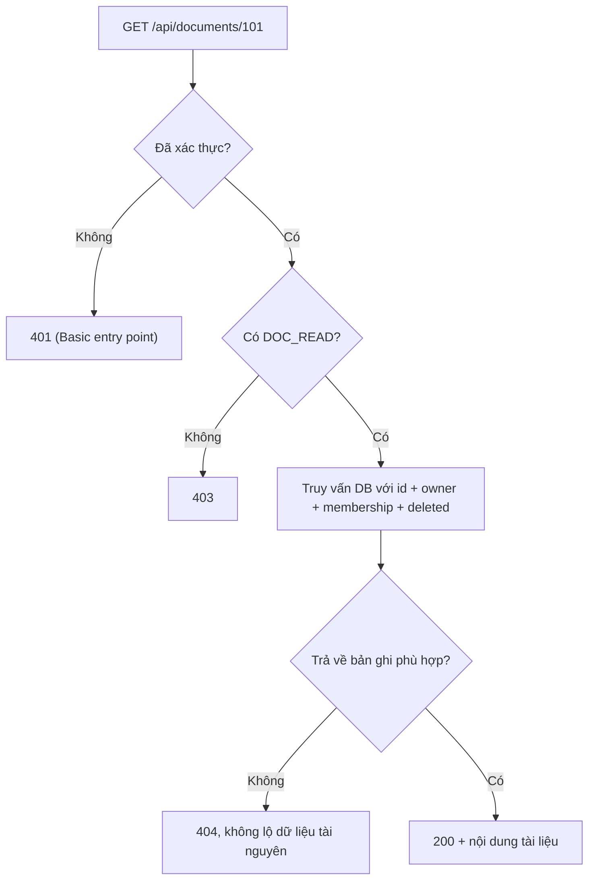

# Kho dữ liệu thật trong môi trường kiểm thử khi hành vi truy vấn ảnh hưởng quyền

Không phải mọi quyết định phân quyền đều được xác định chỉ bởi role hay authority trong `SecurityContext`. Ở nhiều ứng dụng, một người dùng có quyền chung `DOC_READ` nhưng chỉ được xem tài liệu **do chính họ sở hữu**, thuộc **tenant mà họ còn là thành viên**, chưa bị xóa mềm và có trạng thái cho phép truy cập. Khi đó **kết quả truy vấn cơ sở dữ liệu** trở thành một phần của hàng rào bảo mật.

Nếu test mock repository để luôn trả một tài liệu hợp lệ, test có thể xanh ngay cả khi câu truy vấn production đã quên điều kiện `tenant_id`, bỏ qua `owner_username` hoặc đọc cả bản ghi `deleted = true`. Muốn kiểm chứng đúng ranh giới bảo mật theo dữ liệu, cần một **kho dữ liệu thực sự hoạt động trong môi trường test**, schema có constraints và dialect gần với production, các hàng dữ liệu đối chứng được cô lập giữa các bài test.

Bài thuộc chương **Dữ liệu và cô lập** của module `SPRING_SECURITY_TESTING`. Trong phạm vi kiểm chứng xác thực, phân quyền và HTTP security trên Servlet/Reactive, ta sẽ dùng `MockMvc`, Spring Security filter chain thật, Spring Data JPA và PostgreSQL chạy qua Testcontainers để chứng minh quyết định cho phép/từ chối được tạo từ **truy vấn thật**. Bài cũng nêu khi nào dùng `@WithMockUser` hoặc JWT/OAuth2/OIDC giả lập, giới hạn của rollback, cache, dữ liệu seed và cách chuyển nguyên tắc này sang `WebTestClient` với R2DBC.

> **Mục tiêu:** Không chỉ assert HTTP 200, 403 hoặc 404. Cần biết người dùng nào đã được xác thực, quyền thô của họ là gì, **dữ liệu nào trong DB khiến họ được phép hoặc bị từ chối**, và liệu truy vấn thực tế có thể làm lộ tài nguyên của chủ sở hữu/tenant khác hay không.

## 1. Vì sao kho dữ liệu là một phần của chính sách bảo mật?

Giả sử hệ thống quản lý tài liệu có các quy tắc:

1. Endpoint `GET /api/documents/{id}` yêu cầu authority `DOC_READ`.
2. Người dùng chỉ được xem tài liệu khi `documents.owner_username` bằng username đã xác thực.
3. Người dùng phải là thành viên **đang hoạt động** của tenant chứa tài liệu, với quyền đọc tại tenant đó.
4. Tài liệu `deleted = true` không được trả ra, dù chủ sở hữu và tenant đều khớp.
5. Một bản ghi bị từ chối theo điều kiện dữ liệu trả **404** theo hợp đồng API minh họa, để không tiết lộ rằng tài liệu của tenant khác có tồn tại. Thiếu authority thô trả **403**; chưa đăng nhập trả **401** với HTTP Basic entry point của ví dụ.



Đây là **hai lớp kiểm soát bổ sung**:

- **Quyền thô trong Spring Security:** `Authentication` và authorities được kiểm tra bởi HTTP security hoặc method security.
- **Quyền phụ thuộc trạng thái dữ liệu:** repository/service chỉ chọn bản ghi phù hợp với owner, tenant membership và trạng thái tài liệu **ở thời điểm truy vấn**.

Một test chỉ tạo `@WithMockUser(authorities = "DOC_READ")` chưa chứng minh các điều kiện dữ liệu. Một test chỉ gọi `repository.findById(101)` bằng user test cũng chưa chứng minh HTTP filter bảo vệ endpoint. Cần chọn đúng tầng kiểm thử và có các ca tích hợp nối **authentication → authorization → query → response**.

## 2. Test double và database thật chứng minh những điều khác nhau

| Cách kiểm thử | Đi qua SQL/schema thật? | Có phát hiện thiếu điều kiện owner/tenant trong query? | Mục tiêu phù hợp |
|---|---|---|---|
| Mock repository trả `Optional.of(document)` | Không | **Không** | Unit test hành vi service khi repository đã trả kết quả hợp lệ. |
| Mock repository trả `Optional.empty()` | Không | **Không** | Unit test ánh xạ “không tìm thấy” thành 404/exception. |
| `@DataJpaTest` với database test thực | **Có** | **Có** nếu fixture có hàng đối chứng | Kiểm tra JPQL/SQL, mapping, joins, soft delete, query parameter. |
| `@SpringBootTest` + `MockMvc` + real repository | **Có** | **Có** và còn kiểm tra HTTP authorization | Luồng người dùng → filter chain → service → repository → DB. |
| `@SpringBootTest` + DB thật nhưng `@MockitoBean DocumentRepository` | **Không** cho query đó | **Không** | Kiểm tra các bước khác; không thể khẳng định ranh giới dữ liệu. |
| `WebTestClient` + repository R2DBC thật | **Có**, nếu dùng kết nối DB thật | **Có** | Tương đương trong WebFlux/Reactive. |

**Database “thật” trong test** không nhất thiết là cơ sở dữ liệu production. Thường nên chạy **cùng hệ quản trị và phiên bản tương thích với production** trong container có vòng đời kiểm soát được. Không dùng dữ liệu thật của khách hàng và không để bài test ghi vào DB production/staging chung.

### Vì sao H2 có thể chưa đủ?

H2 là công cụ hữu ích cho nhiều unit/slice test đơn giản, nhưng không có nghĩa tương đương PostgreSQL, MySQL hay SQL Server về cú pháp, kiểu dữ liệu, collation/case sensitivity, lock, RLS, JSON/array, index, transaction isolation và hành vi truy vấn native. Nếu **điều kiện truy vấn ảnh hưởng phân quyền**, các khác biệt đó có thể làm test xanh nhưng production trả hàng sai. Ví dụ bài học sẽ dùng PostgreSQL Testcontainers, không chỉ H2 in-memory.

## 3. Mô hình dữ liệu và fixture có đối chứng âm tính

Ta dùng hai bảng:

```text
documents
  id              BIGINT PRIMARY KEY
  tenant_id       VARCHAR NOT NULL
  owner_username  VARCHAR NOT NULL
  title           VARCHAR NOT NULL
  deleted         BOOLEAN NOT NULL

tenant_memberships
  id              BIGINT GENERATED BY DEFAULT AS IDENTITY PRIMARY KEY
  username        VARCHAR NOT NULL
  tenant_id       VARCHAR NOT NULL
  can_read        BOOLEAN NOT NULL
  active          BOOLEAN NOT NULL
```

Quyền xem một tài liệu `d` của người dùng `u` được mô tả bằng:

\[
\operatorname{CanRead}(u,d) =
\operatorname{HasAuthority}(u,\text{DOC\_READ})
\land (d.owner = u)
\land \neg d.deleted
\land \exists m\,[m.user=u \land m.tenant=d.tenant \land m.active \land m.canRead].
\]

Bộ fixture nên có **ít nhất một hàng bị loại bởi từng điều kiện**:

| Bản ghi | Tenant | Owner | Deleted | Membership liên quan | Alice có xem được? |
|---|---|---|---|---|---|
| Tài liệu 101 | A | alice | false | alice/A: active, canRead | **Có**, nếu Alice có `DOC_READ`. |
| Tài liệu 102 | A | bob | false | alice/A: active, canRead | **Không**: khác owner dù cùng tenant. |
| Tài liệu 103 | A | alice | true | alice/A: active, canRead | **Không**: đã xóa mềm. |
| Tài liệu 201 | B | alice | false | alice **không có** membership B | **Không**: sai phạm vi tenant. |
| Tài liệu 301 | A | carol | false | carol/A: inactive | Không cho Carol, dù Carol là owner. |

Ngoài ra, Bob là owner của 102 nhưng có `canRead=false` tại tenant A: Bob cũng **không** được xem chỉ nhờ sở hữu. Nhờ vậy mỗi nhánh âm tính có một nguyên nhân rõ ràng, tránh trường hợp một bản ghi cùng lúc sai ba điều kiện khiến test không phát hiện điều kiện nào bị xóa.

## 4. Entity và truy vấn JPA thực sự giới hạn phạm vi dữ liệu

Ví dụ sử dụng Java 17+, Spring Data JPA, PostgreSQL và Spring Security 6.x. Để giữ ví dụ dễ đọc, hai entity sau chỉ chứa các trường cần cho policy; ở production cần bổ sung ràng buộc unique/index, validation và migration schema thực tế.

### Tài liệu

```java
import jakarta.persistence.Column;
import jakarta.persistence.Entity;
import jakarta.persistence.Id;
import jakarta.persistence.Table;

@Entity
@Table(name = "documents")
public class DocumentEntity {
    @Id
    private Long id;

    @Column(name = "tenant_id", nullable = false)
    private String tenantId;

    @Column(name = "owner_username", nullable = false)
    private String ownerUsername;

    @Column(nullable = false)
    private String title;

    @Column(nullable = false)
    private boolean deleted;

    protected DocumentEntity() {}

    public Long getId() { return id; }
    public String getTenantId() { return tenantId; }
    public String getOwnerUsername() { return ownerUsername; }
    public String getTitle() { return title; }
    public boolean isDeleted() { return deleted; }
}
```

### Thành viên tenant

```java
import jakarta.persistence.Column;
import jakarta.persistence.Entity;
import jakarta.persistence.GeneratedValue;
import jakarta.persistence.GenerationType;
import jakarta.persistence.Id;
import jakarta.persistence.Table;

@Entity
@Table(name = "tenant_memberships")
public class TenantMembershipEntity {
    @Id
    @GeneratedValue(strategy = GenerationType.IDENTITY)
    private Long id;

    @Column(nullable = false)
    private String username;

    @Column(name = "tenant_id", nullable = false)
    private String tenantId;

    @Column(name = "can_read", nullable = false)
    private boolean canRead;

    @Column(nullable = false)
    private boolean active;

    protected TenantMembershipEntity() {}
}
```

### Repository: lọc theo ID, owner, membership và soft delete trong cùng query

```java
import java.util.Optional;
import org.springframework.data.jpa.repository.JpaRepository;
import org.springframework.data.jpa.repository.Query;
import org.springframework.data.repository.query.Param;

public interface DocumentRepository
        extends JpaRepository<DocumentEntity, Long> {

    @Query("""
        select d from DocumentEntity d
        where d.id = :id
          and d.deleted = false
          and d.ownerUsername = :username
          and exists (
              select 1 from TenantMembershipEntity m
              where m.username = :username
                and m.tenantId = d.tenantId
                and m.canRead = true
                and m.active = true
          )
        """)
    Optional<DocumentEntity> findVisibleTo(
            @Param("id") long id,
            @Param("username") String username);
}
```

Lưu ý **không** chỉ gọi `findById(id)` rồi kiểm tra role chung. Chính điều kiện truy vấn thực tế quyết định tài liệu có được đưa ra khỏi tầng persistence hay không. `exists` cho membership cũng tránh việc join nhiều hàng membership làm nhân bản tài liệu khi dữ liệu membership không duy nhất. Ở production, vẫn nên ràng buộc duy nhất `(username, tenant_id)` nếu mô hình yêu cầu.

Khi cần hỗ trợ người dùng có quyền quản trị xem tài liệu không thuộc sở hữu, đừng bỏ hẳn điều kiện owner. Hãy xây dựng quy tắc riêng được kiểm thử, ví dụ membership có `canReadAll` hoặc authority và phạm vi quản trị được xác nhận; mỗi đường bypass phải có ca âm tính riêng để tránh “admin toàn hệ thống” lấn sang tenant khác.

## 5. Đưa danh tính đã xác thực tới truy vấn, không tin tenant/owner từ client

HTTP controller không được nhận một `username` từ query param rồi dùng nó làm chủ sở hữu cần kiểm tra:

```java
// SAI về nguyên tắc: caller có thể truyền username=alice.
@GetMapping("/{id}")
DocumentResponse unsafe(
        @PathVariable long id,
        @RequestParam String username) {
    return reader.readFor(id, username);
}
```

Ví dụ đúng lấy username từ `Authentication` đã được Spring Security tạo:

```java
import org.springframework.http.HttpStatus;
import org.springframework.stereotype.Service;
import org.springframework.transaction.annotation.Transactional;
import org.springframework.web.server.ResponseStatusException;

record DocumentResponse(Long id, String title) {}

@Service
class DocumentReader {
    private final DocumentRepository documents;

    DocumentReader(DocumentRepository documents) {
        this.documents = documents;
    }

    @Transactional(readOnly = true)
    public DocumentResponse readFor(long id, String username) {
        DocumentEntity d = documents.findVisibleTo(id, username)
                .orElseThrow(() ->
                        new ResponseStatusException(HttpStatus.NOT_FOUND));
        return new DocumentResponse(d.getId(), d.getTitle());
    }
}
```

```java
import org.springframework.security.core.Authentication;
import org.springframework.web.bind.annotation.GetMapping;
import org.springframework.web.bind.annotation.PathVariable;
import org.springframework.web.bind.annotation.RequestMapping;
import org.springframework.web.bind.annotation.RestController;

@RestController
@RequestMapping("/api/documents")
class DocumentController {
    private final DocumentReader reader;

    DocumentController(DocumentReader reader) {
        this.reader = reader;
    }

    @GetMapping("/{id}")
    DocumentResponse read(
            @PathVariable long id,
            Authentication authentication) {
        return reader.readFor(id, authentication.getName());
    }
}
```

Ở đây `authentication.getName()` là danh tính đã được xác thực, không phải dữ liệu `username` do client tùy ý chọn. Khi ứng dụng dùng JWT/OIDC, cần xác định **claim định danh ổn định** hoặc ID nội bộ của tài khoản; không mặc định email, display name hay `preferred_username` luôn duy nhất và không đổi. Việc ánh xạ principal thành user/tenant nội bộ cần kiểm thử độc lập.

Không nên tin `X-Tenant-ID` hay `tenantId` trong URL như một bằng chứng quyền. Client có thể đề xuất tenant đang thao tác, nhưng service phải kiểm tra membership tương ứng trong DB (hoặc policy service tin cậy). Nếu một người dùng có nhiều tenant, quy tắc chọn tenant phải rõ ràng và được test với cả tenant hợp lệ lẫn tenant ngoài phạm vi.

## 6. SecurityFilterChain kiểm tra authority thô trước khi truy vấn

```java
import org.springframework.context.annotation.Bean;
import org.springframework.context.annotation.Configuration;
import org.springframework.http.HttpMethod;
import org.springframework.security.config.Customizer;
import org.springframework.security.config.annotation.web.builders.HttpSecurity;
import org.springframework.security.web.SecurityFilterChain;

@Configuration
class DocumentSecurityConfig {
    @Bean
    SecurityFilterChain securityFilterChain(HttpSecurity http)
            throws Exception {
        return http
                .authorizeHttpRequests(auth -> auth
                        .requestMatchers(
                                HttpMethod.GET, "/api/documents/**")
                        .hasAuthority("DOC_READ")
                        .anyRequest().denyAll())
                .httpBasic(Customizer.withDefaults())
                .build();
    }
}
```

Với cấu hình minh họa này, request chưa đăng nhập thường nhận 401 qua Basic entry point; người dùng đã xác thực nhưng thiếu `DOC_READ` nhận 403; người có `DOC_READ` được tiếp tục đến truy vấn và có thể nhận 200/404 tùy dữ liệu. Một người có authority không đồng nghĩa được phép xem mọi tài liệu.

Các ví dụ chỉ dùng `GET`; nếu thêm `POST`/`PUT`/`DELETE`, phải tính đến chính sách CSRF và thứ tự filter để không nhầm 403 do thiếu CSRF với 403 do thiếu quyền.

## 7. PostgreSQL Testcontainers: chạy database thật nhưng cô lập

Với Spring Boot 3.x, thêm dependency test cho `org.testcontainers:postgresql` và `org.testcontainers:junit-jupiter`; nếu dùng Spring Boot dependency management, nên để framework quản lý phiên bản tương thích. Testcontainers cần một Docker runtime tương thích tại máy chạy test hoặc CI.

Thay vì dùng một database chung dễ bị bẩn, tạo PostgreSQL container và chỉ đưa URL/user/password của container vào application test. Ví dụ dùng `@DynamicPropertySource`:

```java
import org.junit.jupiter.api.BeforeEach;
import org.junit.jupiter.api.Test;
import org.springframework.beans.factory.annotation.Autowired;
import org.springframework.boot.test.autoconfigure.web.servlet.AutoConfigureMockMvc;
import org.springframework.boot.test.context.SpringBootTest;
import org.springframework.http.HttpHeaders;
import org.springframework.jdbc.core.JdbcTemplate;
import org.springframework.security.core.authority.SimpleGrantedAuthority;
import org.springframework.test.context.DynamicPropertyRegistry;
import org.springframework.test.context.DynamicPropertySource;
import org.springframework.test.web.servlet.MockMvc;
import org.testcontainers.containers.PostgreSQLContainer;
import org.testcontainers.junit.jupiter.Container;
import org.testcontainers.junit.jupiter.Testcontainers;

import static org.assertj.core.api.Assertions.assertThat;
import static org.hamcrest.Matchers.not;
import static org.hamcrest.Matchers.containsString;
import static org.springframework.security.test.web.servlet.request
        .SecurityMockMvcRequestPostProcessors.user;
import static org.springframework.test.web.servlet.request.MockMvcRequestBuilders.get;
import static org.springframework.test.web.servlet.result.MockMvcResultMatchers.*;

@Testcontainers
@SpringBootTest(properties = {
        "spring.jpa.hibernate.ddl-auto=create-drop",
        "spring.sql.init.mode=never"
})
@AutoConfigureMockMvc
class DocumentDatabaseAuthorizationTest {
    @Container
    static final PostgreSQLContainer<?> POSTGRES =
            new PostgreSQLContainer<>("postgres:16-alpine");

    @DynamicPropertySource
    static void databaseProperties(DynamicPropertyRegistry registry) {
        registry.add("spring.datasource.url", POSTGRES::getJdbcUrl);
        registry.add("spring.datasource.username", POSTGRES::getUsername);
        registry.add("spring.datasource.password", POSTGRES::getPassword);
    }

    @Autowired
    MockMvc mockMvc;

    @Autowired
    JdbcTemplate jdbc;

    @BeforeEach
    void resetAndSeed() {
        // Không @Transactional trên test: fixture được commit
        // trước khi request được thực thi.
        jdbc.update("DELETE FROM documents");
        jdbc.update("DELETE FROM tenant_memberships");

        membership("alice", "A", true, true);
        membership("bob", "A", false, true);
        membership("carol", "A", true, false);

        document(101L, "A", "alice", "alice-own", false);
        document(102L, "A", "bob", "bob-secret", false);
        document(103L, "A", "alice", "deleted-secret", true);
        document(201L, "B", "alice", "tenant-b-secret", false);
        document(301L, "A", "carol", "inactive-secret", false);

        assertThat(jdbc.queryForObject(
                "SELECT COUNT(*) FROM documents",
                Integer.class)).isEqualTo(5);
    }

    private void membership(
            String userName,
            String tenant,
            boolean canRead,
            boolean active) {
        jdbc.update("""
                INSERT INTO tenant_memberships
                    (username, tenant_id, can_read, active)
                VALUES (?, ?, ?, ?)
                """, userName, tenant, canRead, active);
    }

    private void document(
            long id,
            String tenant,
            String owner,
            String title,
            boolean deleted) {
        jdbc.update("""
                INSERT INTO documents
                    (id, tenant_id, owner_username, title, deleted)
                VALUES (?, ?, ?, ?, ?)
                """, id, tenant, owner, title, deleted);
    }

    // Thêm các @Test của mục 8 vào chính lớp này.
}
```

Các ví dụ thành viên bên dưới phải được đặt **bên trong** `DocumentDatabaseAuthorizationTest`. Entity, repository, service, controller và security config từ các mục trước phải nằm trong phạm vi component scan của ứng dụng Spring Boot test. `@SpringBootTest` dùng context ứng dụng thật thay vì chỉ tạo `MockMvc` bằng `standaloneSetup` rồi bỏ qua security/repository production.

**Lưu ý về schema:** `spring.jpa.hibernate.ddl-auto=create-drop` chỉ thích hợp cho ví dụ trên database test có vòng đời riêng. Với hệ thống thật, nên dùng **Flyway/Liquibase migrations giống production** và kiểm tra schema/constraints bằng migration thay vì để Hibernate tự dựng. Không cấu hình create-drop lên database có dữ liệu cần giữ.

Nếu cùng một `ApplicationContext` được cache giữa nhiều test class nhưng PostgreSQL container bị dừng sau class đầu, context sau có thể giữ DataSource đã mất kết nối. Cần thiết kế **vòng đời container và Spring context thống nhất**: container singleton tồn tại đủ lâu, hoặc cô lập context tương ứng. Không giả định một static container per-class luôn an toàn với Spring test context caching xuyên lớp.

### Vì sao nên seed bằng JDBC trong ví dụ?

`JdbcTemplate` ở phần chuẩn bị giúp xác nhận các hàng đã được ghi thực vào PostgreSQL và hiển thị rõ dữ liệu đối chứng. Khi test không được bọc `@Transactional`, các lệnh update do JDBC thực hiện trong môi trường autocommit thông thường sẽ được commit trước request. Nếu seed bằng JPA, nên `saveAndFlush(...)` hoặc `EntityManager.flush()` khi cần xác minh SQL thật và bảo đảm dữ liệu quan sát được bởi giao dịch khác.

Ở production, migration, default values, unique constraints và index có thể làm thay đổi kết quả. Test nên dùng schema thật và fixture nhỏ nhưng đủ phân biệt từng nhánh quyền, thay vì snapshot lớn không biết quan hệ nguyên nhân-kết quả.

## 8. Các ca MockMvc chứng minh query thật quyết định quyền

Những test dưới đây dùng `.with(user(...))` để đưa `Authentication` giả lập vào Spring Security filter chain. Việc giả lập **danh tính** ở HTTP layer là có chủ đích; **repository và PostgreSQL vẫn là thật**. Các test này kiểm tra authorization theo dữ liệu sau xác thực, chưa kiểm chứng mật khẩu HTTP Basic, chữ ký JWT hay OIDC login protocol.

### 8.1. Cùng authority nhưng tài liệu hợp lệ và không hợp lệ cho kết quả khác nhau

```java
private static org.springframework.security.test.web.servlet.request
        .SecurityMockMvcRequestPostProcessors.UserRequestPostProcessor
        reader(String username) {
    return user(username).authorities(
            new SimpleGrantedAuthority("DOC_READ"));
}

@Test
void ownerWithActiveReadableMembership_receivesDocument()
        throws Exception {
    mockMvc.perform(get("/api/documents/101")
                    .with(reader("alice")))
            .andExpect(status().isOk())
            .andExpect(jsonPath("$.id").value(101))
            .andExpect(jsonPath("$.title").value("alice-own"));
}

@Test
void sameTenantButDifferentOwner_isNotVisible()
        throws Exception {
    mockMvc.perform(get("/api/documents/102")
                    .with(reader("alice")))
            .andExpect(status().isNotFound())
            .andExpect(content().string(
                    not(containsString("bob-secret"))));
}

@Test
void ownDocumentInTenantWithoutMembership_isNotVisible()
        throws Exception {
    mockMvc.perform(get("/api/documents/201")
                    .with(reader("alice")))
            .andExpect(status().isNotFound())
            .andExpect(content().string(
                    not(containsString("tenant-b-secret"))));
}

@Test
void deletedOwnDocument_isNotVisible() throws Exception {
    mockMvc.perform(get("/api/documents/103")
                    .with(reader("alice")))
            .andExpect(status().isNotFound())
            .andExpect(content().string(
                    not(containsString("deleted-secret"))));
}
```

Các test phân biệt từng điều kiện:

- Tài liệu 101 thỏa đủ owner, tenant membership, `can_read`, `active` và `deleted=false` nên trả 200.
- Tài liệu 102 chỉ sai owner, vẫn cùng tenant; câu query thiếu `d.ownerUsername=:username` sẽ làm lộ `bob-secret` và test phải thất bại.
- Tài liệu 201 cùng owner nhưng Alice không thuộc tenant B; query thiếu subquery membership sẽ có nguy cơ trả `tenant-b-secret`.
- Tài liệu 103 đúng owner và tenant nhưng bị xóa mềm; thiếu `d.deleted=false` làm test lộ `deleted-secret`.

**Kiểm tra không lộ dữ liệu trong response** là bổ sung quan trọng cho status. Tuy nhiên test này không thể bảo đảm tuyệt đối không có leakage qua timing/log/metadata; những kênh đó cần đánh giá riêng.

### 8.2. Membership bị vô hiệu hoặc không còn quyền đọc

```java
@Test
void ownerWithNoTenantReadPermission_isNotVisible()
        throws Exception {
    mockMvc.perform(get("/api/documents/102")
                    .with(reader("bob")))
            .andExpect(status().isNotFound());
}

@Test
void inactiveMembership_cannotReadOwnDocument()
        throws Exception {
    mockMvc.perform(get("/api/documents/301")
                    .with(reader("carol")))
            .andExpect(status().isNotFound());
}
```

Bob sở hữu 102 nhưng membership `can_read=false`. Carol sở hữu 301 và `can_read=true` nhưng `active=false`. Hai ca này khiến việc bỏ sót **một trong hai điều kiện membership** được phát hiện.

### 8.3. Phân biệt thiếu authority thô với bị loại bởi truy vấn

```java
@Test
void authenticatedWithoutDocRead_receives403()
        throws Exception {
    mockMvc.perform(get("/api/documents/101")
                    .with(user("alice").authorities(
                            new SimpleGrantedAuthority("DOC_WRITE"))))
            .andExpect(status().isForbidden());
}

@Test
void anonymousRequest_receives401() throws Exception {
    mockMvc.perform(get("/api/documents/101"))
            .andExpect(status().isUnauthorized());
}
```

Trong cấu hình `httpBasic()` minh họa, người dùng đã xác thực nhưng thiếu `DOC_READ` nhận 403, request anonymous nhận 401. Nếu dự án dùng form login thì người chưa xác thực có thể được redirect 302; nếu có custom entry point, mã HTTP có thể khác. Điều phải giữ là **không trả dữ liệu bảo vệ cho người chưa đủ điều kiện**.

### 8.4. Dữ liệu bị thu hồi: request sau phải phản ánh chính sách mới

```java
@Test
void membershipRevokedBetweenRequests_takesEffect()
        throws Exception {
    mockMvc.perform(get("/api/documents/101")
                    .with(reader("alice")))
            .andExpect(status().isOk());

    jdbc.update("""
            UPDATE tenant_memberships
               SET active = false
             WHERE username = ? AND tenant_id = ?
            """, "alice", "A");

    mockMvc.perform(get("/api/documents/101")
                    .with(reader("alice")))
            .andExpect(status().isNotFound());
}
```

Test này chứng minh trong cấu hình mẫu, việc thay đổi `active` trong DB ảnh hưởng request sau, thay vì bị giữ nguyên bởi một mock repository có kết quả cố định. Nó cũng là ca hồi quy quan trọng nếu ứng dụng bổ sung `@Cacheable` hoặc cache quyền: sau khi membership bị thu hồi, dữ liệu phân quyền phải được làm mới hoặc cache phải được vô hiệu hóa đúng hợp đồng.

### 8.5. Client không được tự chọn owner bằng query parameter

```java
@Test
void forgedOwnerParameter_doesNotExpandAccess()
        throws Exception {
    mockMvc.perform(get("/api/documents/102")
                    .param("username", "bob")
                    .header("X-Tenant-ID", "A")
                    .with(reader("alice")))
            .andExpect(status().isNotFound());
}
```

Trong `DocumentController` của ví dụ, client-supplied username/header bị bỏ qua; chỉ `authentication.getName()` được truyền xuống repository. Nếu dự án hỗ trợ tenant ID trong header, test phải chứng minh server **kiểm tra membership cho tenant đó**, không chỉ tin header.

## 9. Test riêng truy vấn với @DataJpaTest để chẩn đoán nhanh

`@SpringBootTest` + `MockMvc` xác nhận toàn bộ HTTP authorization và dữ liệu, nhưng khi một test fail, có thể chưa biết lỗi từ filter, controller, entity mapping hay JPQL. Thêm một lớp `@DataJpaTest` dùng **PostgreSQL test** sẽ cô lập lỗi repository:

```java
@DataJpaTest
@AutoConfigureTestDatabase(
        replace = AutoConfigureTestDatabase.Replace.NONE)
class DocumentRepositoryQueryTest {
    @Autowired
    DocumentRepository documents;

    // DataSource được nối tới PostgreSQL Testcontainers
    // bằng @DynamicPropertySource hoặc @ServiceConnection.
    // Insert fixture bằng TestEntityManager/JdbcTemplate,
    // flush để SQL thực được thực thi, rồi assert các ca:
    // findVisibleTo(101, "alice") -> present
    // findVisibleTo(102, "alice") -> empty
    // findVisibleTo(201, "alice") -> empty
    // findVisibleTo(103, "alice") -> empty.
}
```

Đây là **khung mô tả** yêu cầu cấu hình container và dữ liệu tương ứng, không phải test chạy độc lập nếu chưa có fixture. Spring Boot thường cấu hình `@DataJpaTest` có transaction rollback sau mỗi test, phù hợp để kiểm tra repository tại một tầng; nhưng rollback đó **không tự đảm bảo cô lập mọi hành vi** khi gửi HTTP thật sang thread/transaction khác.

Trước khi kết luận logic repository đúng, cần có cả hai lớp bằng chứng:

- **Repository test:** query với dữ liệu thật trả đúng tập kết quả và các điều kiện owner/tenant/soft delete.
- **HTTP integration test:** Authentication đúng được truyền xuống query, phản hồi 200/403/404 chính xác, dữ liệu tenant khác không bị lộ.

## 10. Cô lập dữ liệu, transaction và Spring Security context

Một bộ test có database thật có thể thất bại ngẫu nhiên hoặc xanh giả vì **trạng thái để lại từ test trước**. Cần tách các loại cô lập:

| Trạng thái | Nơi tồn tại | Cách kiểm soát trong test |
|---|---|---|
| Hàng dữ liệu nghiệp vụ | PostgreSQL/MySQL/... | Seed tập nhỏ có IDs rõ ràng; dọn trước/sau test, hoặc schema/database riêng. |
| Giao dịch và kết nối | JDBC/JPA hoặc R2DBC | Biết điểm commit/rollback; flush dữ liệu trước request nếu cần. |
| Authentication/SecurityContext | Request/session, ThreadLocal hoặc Reactor context | Dùng post-processor theo request; tránh để user test trước rò sang test sau. |
| Spring ApplicationContext | Test context cache | Đảm bảo các bean/security config và kết nối container không bị tái sử dụng sai. |
| Cache nghiệp vụ/phân quyền | `@Cacheable`, Redis, cache 2nd-level, local cache | Tắt hoặc reset cache theo hợp đồng, test thu hồi quyền sau khi dữ liệu đổi. |
| HTTP session/cookie | MockMvc hoặc server thật | Mỗi người dùng có session riêng; không tái sử dụng session admin cho user khác. |
| Event/job ngoài giao dịch | Queue, background worker, email, audit | Fake/test broker có kiểm soát; chờ xử lý hoàn tất nếu kiểm tra side effects. |

### 10.1. @Transactional trên test không phải đáp án cho mọi trường hợp

Một `@DataJpaTest` thông dụng chạy trong transaction và rollback sau test, phù hợp với repository slice. Nhưng với một bài HTTP integration:

- `MockMvc` đồng bộ có thể chạy trong cùng thread/test transaction tùy cấu hình, khiến controller nhìn thấy dữ liệu **chưa commit**; một server chạy qua HTTP thật có thể dùng thread và transaction khác nên không thấy dữ liệu đó.
- `@SpringBootTest(webEnvironment = RANDOM_PORT)` sử dụng server thực, giao dịch server không tự rollback chỉ vì test method có `@Transactional`.
- Reactive execution, async dispatch và background jobs có thể không chia sẻ transaction của thread test.
- Các side effects ngoài DB như message queue hoặc email không được rollback cùng transaction JDBC nếu không có cơ chế phối hợp.

Do đó ví dụ ở mục 7 **không** đặt `@Transactional` lên test class. Dữ liệu được tạo bằng JDBC trước request và cleanup theo từng test. Nếu hệ thống dựa vào commit/after-commit event, phải có test riêng để chứng minh thời điểm tác dụng phụ, thay vì dựa vào rollback test transaction.

### 10.2. Không chạy song song những test cùng xóa/sửa một bộ dữ liệu

`@BeforeEach` với `DELETE FROM documents` chỉ an toàn khi các bài test dùng chung database được chạy **tuần tự** hoặc được cách ly. Với parallel test, test A có thể xóa dữ liệu mà test B vừa seed.

Những chiến lược có thể chọn tùy quy mô:

1. **Database/schema riêng cho mỗi nhóm test chạy song song:** cô lập mạnh, ít nhiễu; tăng chi phí tạo môi trường.
2. **Dữ liệu có namespace riêng cho mỗi test:** IDs/tenant IDs độc lập, cleanup đúng phạm vi; vẫn phải xử lý unique constraints và cache.
3. **Chạy tuần tự nhóm test dùng chung schema:** đơn giản, phù hợp một số bộ test tích hợp nhỏ.
4. **Transactional rollback trong repository slice:** nhanh nhưng cần hiểu giới hạn như mục 10.1.

Không nên dùng `@DirtiesContext` như phương án dọn dữ liệu mặc định: annotation đó làm mới Spring context, **không tự xóa hàng đã commit trong PostgreSQL ngoài**. Khi cần dọn DB, phải dọn ở tầng DB.

### 10.3. Trạng thái cache có thể che quyết định từ database

Giả sử `DocumentReader` có `@Cacheable` theo `documentId` mà không bao gồm principal/tenant; request của Alice có thể cache tài liệu rồi request của Bob đọc lại entry đó mà không đi qua truy vấn. Đây là rủi ro dữ liệu nghiêm trọng.

Ngay cả cache key gồm username/tenant, khi membership bị thu hồi, entry cũ có thể vẫn còn cho đến khi hết TTL hoặc được invalidated. Bộ test nên có:

- Request ban đầu được phép.
- Cập nhật membership trong DB thành `active=false` và commit.
- Request sau phải bị từ chối theo chính sách thu hồi (ngay lập tức hoặc trong một khoảng thời gian đã được định nghĩa và kiểm chứng).
- Nếu một test yêu cầu “ngay lập tức”, không dùng một cache có độ trễ thu hồi mà không kiểm soát được.

Nếu test xóa cache trước mỗi request, nó có thể phát hiện query sai nhưng **không kiểm chứng đường cache production**. Nên tách một nhóm test riêng cho hành vi cache quyền sau cập nhật dữ liệu.

## 11. Kiểm tra dữ liệu trong @PreAuthorize và nguy cơ time-of-check/time-of-use

Một số ứng dụng sử dụng bean phân quyền được gọi từ SpEL:

```java
@PreAuthorize(
    "hasAuthority('DOC_READ') and " +
    "@documentAccessPolicy.canRead(authentication.name, #id)")
public DocumentResponse get(long id) {
    // ...
}
```

`DocumentAccessPolicy.canRead(...)` có thể gọi database để xét ownership/membership. Nếu test chỉ mock bean policy trả `true`/`false`, test kiểm tra được logic của `@PreAuthorize` nhưng **không kiểm tra SQL** trong policy. Nếu query là ranh giới bảo mật, phải thêm ca tích hợp với policy/repository thật và dữ liệu đối chứng.

Khi tham chiếu `#id` trong SpEL, đảm bảo tên tham số phương thức được Spring Security nhận diện (ví dụ biên dịch với `-parameters` hoặc sử dụng annotation chỉ định tên tham số phù hợp); không lấy kết quả do tên tham số không resolve làm bằng chứng từ chối hợp lệ.

### Tránh “kiểm tra xong rồi dùng truy vấn không giới hạn”

Mẫu dễ có race condition:

```java
// Ý tưởng không an toàn nếu quyền/dữ liệu có thể đổi giữa hai câu lệnh.
if (policy.canEdit(currentUser, documentId)) {
    DocumentEntity d = documents.findById(documentId).orElseThrow();
    d.setTitle(newTitle);
}
```

Giữa `canEdit` và `findById`/`save`, membership hoặc owner có thể thay đổi, nhất là khi có nhiều transaction đồng thời. Với thao tác ghi nhạy cảm, nên cân nhắc một **lệnh UPDATE có điều kiện quyền ngay trong WHERE**, hoặc transaction/locking/isolation phù hợp với yêu cầu nghiệp vụ.

Ví dụ query cập nhật có điều kiện (được đặt trong repository thích hợp):

```java
import org.springframework.data.jpa.repository.Modifying;

@Modifying(clearAutomatically = true, flushAutomatically = true)
@Query("""
    update DocumentEntity d
       set d.title = :newTitle
     where d.id = :id
       and d.deleted = false
       and d.ownerUsername = :username
       and exists (
           select 1 from TenantMembershipEntity m
           where m.username = :username
             and m.tenantId = d.tenantId
             and m.canRead = true
             and m.active = true
       )
    """)
int renameIfAllowed(
        @Param("id") long id,
        @Param("username") String username,
        @Param("newTitle") String newTitle);
```

Đoạn `@Modifying` cần được gọi trong transaction. Với action sửa tài liệu thực tế, nên dùng quyền `canEdit`/`DOC_WRITE` riêng thay vì tái sử dụng `canRead` như phép minh họa. Giá trị trả về `0` nghĩa là không có bản ghi nào đạt đủ điều kiện để cập nhật; HTTP mapping là 403/404 theo hợp đồng API. JPA bulk update bỏ qua trạng thái entity đã được nạp trong persistence context, do đó cần chú ý flush/clear và test đọc lại từ DB.

### Cách test thao tác ghi nhạy cảm

Đối với nhánh bị từ chối, ngoài status phải **đọc lại dữ liệu từ database** để bảo đảm tiêu đề, trạng thái hoặc số dư không thay đổi:

```java
String before = jdbc.queryForObject(
        "SELECT title FROM documents WHERE id = ?",
        String.class, 102L);

// Gửi request ghi dữ liệu bằng user không sở hữu document 102.
// Nếu CSRF đang bật, cung cấp CSRF hợp lệ để lỗi không bị che.

String after = jdbc.queryForObject(
        "SELECT title FROM documents WHERE id = ?",
        String.class, 102L);

assertThat(after).isEqualTo(before);
```

Đây là khung cho endpoint ghi cần được định nghĩa thêm. Không tạo một test giả lập kho dữ liệu rồi kết luận “không có tác dụng phụ” khi SQL UPDATE thật chưa chạy. Với operation có nhiều bước/side effects ngoài DB, kiểm tra cả queue/audit/events theo cách có kiểm soát.

## 12. Row-Level Security (RLS) và các cơ chế riêng của database

Nếu PostgreSQL production áp dụng **Row-Level Security**, Spring repository query có thể nhìn thấy các hàng khác nhau tùy database role/session settings. Một `@DataJpaTest` chạy bằng PostgreSQL superuser hoặc role có quyền `BYPASSRLS` có thể bỏ qua policy và cho kết quả không đại diện production.

Khi quyền phụ thuộc RLS, cần xác minh **hai phần**:

1. Test SQL/JPA chạy bằng **database role có chính sách RLS tương đương production**, không có quyền bypass.
2. Context tenant/user mà RLS sử dụng được thiết lập đúng trên **connection và transaction thực hiện truy vấn**, ví dụ thông qua một giá trị session/transaction-local đáng tin.

Với connection pool, tránh rò giá trị tenant từ request trước sang request sau. PostgreSQL `SET LOCAL` có phạm vi transaction, phù hợp cho một số mô hình nhưng chỉ hoạt động khi transaction và connection được kiểm soát đúng; không đơn giản gọi `SET` ở một connection rồi hy vọng connection khác tự nhận.

Nếu ứng dụng dùng native query, view, function, trigger, partitioning hoặc collation để quyết định row visibility, bộ test cần chạy **dialect và schema tương ứng**, không chỉ thay thế bằng H2 rồi tự giả định tương đương. Các migration và DB permissions cũng là một phần cần thử.

## 13. Reactive: WebTestClient cùng R2DBC và dữ liệu thật

Trong WebFlux, `WebTestClient` có thể gửi request qua `SecurityWebFilterChain`, còn `R2dbcEntityTemplate` hoặc `DatabaseClient` thực hiện truy vấn không blocking. **Không trộn JPA repository blocking vào đường Reactor event loop** chỉ để tái sử dụng ví dụ Servlet; nếu ứng dụng thực sự dùng R2DBC, hãy test chính repository/query R2DBC ấy.

Một truy vấn có điều kiện tương tự có thể viết:

```java
import org.springframework.http.HttpStatus;
import org.springframework.r2dbc.core.DatabaseClient;
import org.springframework.web.server.ResponseStatusException;
import reactor.core.publisher.Mono;

class ReactiveDocumentReader {
    private final DatabaseClient db;

    ReactiveDocumentReader(DatabaseClient db) {
        this.db = db;
    }

    Mono<DocumentResponse> readFor(long id, String username) {
        return db.sql("""
                    SELECT d.id, d.title
                    FROM documents d
                    WHERE d.id = :id
                      AND d.owner_username = :username
                      AND d.deleted = FALSE
                      AND EXISTS (
                          SELECT 1
                          FROM tenant_memberships m
                          WHERE m.username = :username
                            AND m.tenant_id = d.tenant_id
                            AND m.can_read = TRUE
                            AND m.active = TRUE
                      )
                    """)
                .bind("id", id)
                .bind("username", username)
                .map((row, metadata) -> new DocumentResponse(
                        row.get("id", Long.class),
                        row.get("title", String.class)))
                .one()
                .switchIfEmpty(Mono.error(
                        new ResponseStatusException(HttpStatus.NOT_FOUND)));
    }
}
```

Đây là ví dụ Reactive sử dụng cùng policy và schema SQL; tùy driver, kiểu ánh xạ `Long`/`BIGINT` và tên cột có thể cần điều chỉnh. Phần controller lấy username từ `Authentication`/`ReactiveSecurityContextHolder` do Spring Security WebFlux cung cấp, **không** lấy từ query parameter của client.

```java
import org.springframework.security.core.authority.SimpleGrantedAuthority;
import static org.springframework.security.test.web.reactive.server
        .SecurityMockServerConfigurers.mockJwt;

webTestClient
        .mutateWith(mockJwt()
                .jwt(jwt -> jwt.subject("alice"))
                .authorities(new SimpleGrantedAuthority("DOC_READ")))
        .get()
        .uri("/api/documents/101")
        .exchange()
        .expectStatus().isOk();
```

Ca này giả định WebFlux Resource Server được cấu hình kiểm tra `DOC_READ`, controller truy vấn R2DBC thật và `WebTestClient` đã bind đúng context với `apply(springSecurity())`. `mockJwt()` chỉ dựng Authentication giả lập; test vẫn phải dùng PostgreSQL/R2DBC thật để bảo vệ **điều kiện dữ liệu**. Nó **không** kiểm tra chữ ký JWT hay converter production. Đối với kiểm thử decoder thật, gửi Bearer JWT ký thật và JWKS test server, không chỉ dựa vào `mockJwt()`.

Trong Reactive, các thao tác setup/cleanup DB phải hoàn tất (subscribe và đợi terminal signal) **trước** khi gửi request. Một `Mono<Void> seed = ...` chỉ được tạo mà không subscribe sẽ không sinh dữ liệu, dễ khiến tất cả ca bị từ chối trả 404 và tạo cảm giác policy đúng.

## 14. Ma trận bảo vệ hồi quy khi truy vấn ảnh hưởng quyền

| Ca | Authority | Dữ liệu DB | Kỳ vọng HTTP trong ví dụ |
|---|---|---|---|
| A. Alice đọc 101 | `DOC_READ` | Owner khớp, tenant A active/canRead, chưa xóa | **200**, trả đúng document 101. |
| B. Alice đọc 102 | `DOC_READ` | Cùng tenant, khác owner | **404**, không lộ tài liệu Bob. |
| C. Alice đọc 201 | `DOC_READ` | Cùng owner, khác tenant và không có membership B | **404**. |
| D. Alice đọc 103 | `DOC_READ` | Đã xóa mềm | **404**. |
| E. Bob đọc 102 | `DOC_READ` | Owner đúng nhưng `can_read=false` | **404**. |
| F. Carol đọc 301 | `DOC_READ` | Owner đúng nhưng membership inactive | **404**. |
| G. Alice đọc 101 | Chỉ `DOC_WRITE` | DB cho phép nhưng HTTP thiếu authority đọc | **403**. |
| H. Anonymous đọc 101 | Không xác thực | DB có bản ghi hợp lệ | **401** qua Basic entry point ví dụ. |
| I. Giả username/header tenant | `DOC_READ` | Client tự khai owner khác | Không được thay đổi kết quả query. |
| J. Thu hồi membership sau 200 | `DOC_READ` | `active` đổi thành false, commit | Request tiếp theo **404** theo chính sách tức thời ví dụ. |
| K. Ghi bị từ chối | `DOC_WRITE` hoặc quyền thiếu | Khác owner/tenant | Không thay đổi hàng DB hoặc side effect. |
| L. DB query lỗi | `DOC_READ` | DB unavailable/constraint lỗi | Không tự cấp quyền; xử lý lỗi theo cấu hình, không lộ dữ liệu. |

**Đừng chỉ test tất cả các ca âm tính.** Một ứng dụng hoặc query luôn trả rỗng sẽ làm nhiều bài test 404 xanh dù người hợp lệ không thể sử dụng hệ thống. Ca A và test thay đổi trạng thái có vai trò đối chứng tích cực.

## 15. Các sai lầm cần tránh

1. **Mock repository ngay trong bài test muốn xác minh query bảo mật.** Mock không thể phát hiện thiếu `tenant_id`/owner/soft-delete predicate trong SQL thật.
2. **Dùng một fixture chỉ có tài liệu hợp lệ.** Không có hàng thuộc tenant/owner khác, query thiếu predicate vẫn trả đúng và test xanh.
3. **Dùng H2 rồi mặc nhiên kết luận PostgreSQL RLS/native SQL đúng.** Hệ quản trị và schema phải tương ứng với policy cần kiểm chứng.
4. **Dùng username/tenant header của client làm điều kiện quyền mà không xác minh membership.** Người dùng có thể giả mạo giá trị.
5. **Gộp 403 và 404 không có hợp đồng rõ.** Thiếu authority thô và dữ liệu không hiển thị là hai cơ chế khác nhau; tránh lộ sự tồn tại tài liệu qua response.
6. **Dùng rollback test transaction để khẳng định đã dọn mọi trạng thái.** Transaction của server thật và side effect ngoài DB không nhất thiết rollback theo test.
7. **Chạy parallel test cùng DELETE/TRUNCATE một schema.** Test khác có thể mất fixture; dùng isolation phù hợp.
8. **Không flush/commit seed trước khi request qua transaction khác.** Controller có thể thấy DB rỗng vì dữ liệu chưa hiển thị.
9. **Mock service đang mang `@PreAuthorize`.** Điều này bỏ qua method-security proxy; giữ bean bảo vệ thật và mock dependency phía sau.
10. **Chỉ kiểm tra response status.** Bổ sung assertion nội dung không lộ, dữ liệu sau mutation không bị sửa và cache không cho phép dùng quyền cũ.
11. **Đọc rồi ghi không điều kiện sau khi check quyền.** Có nguy cơ TOCTOU, cần kiểm soát transaction/locking hoặc câu update có điều kiện.
12. **Bỏ qua cache theo principal/tenant.** Cache key sai hoặc không invalidated sau thu hồi membership có thể làm rò dữ liệu.
13. **Kiểm thử RLS với role database được bypass policy.** Kết quả không chứng minh production RLS đã hoạt động.
14. **Dùng `mockJwt()`/`@WithMockUser` để tuyên bố đã test chữ ký hoặc OIDC flow.** Chúng chỉ giả lập identity cho bước authorization; cần bài test giao thức riêng.

## 16. Checklist hoàn thành

- [ ] Xác định rõ những cột/trạng thái DB tác động tới quyền: owner, tenant, membership, active, soft delete, role phạm vi tenant.
- [ ] Repository/policy service kiểm tra dữ liệu là **bean thật** trong bài integration test; không mock tầng query cần xác minh.
- [ ] Có positive fixture và các negative fixture khác nhau **đúng một điều kiện quan trọng** để phát hiện predicate bị bỏ quên.
- [ ] Test dùng database đúng dialect/schema cần thiết; migration và constraints của production được áp dụng khi phù hợp.
- [ ] `MockMvc` hoặc `WebTestClient` có security chain thật, đưa principal giả lập vào đúng tầng và không suy diễn đã test cơ chế login/JWT signature.
- [ ] Kiểm tra 200/403/404/401 theo entry point/hợp đồng API và bảo đảm không lộ nội dung tenant khác.
- [ ] Mỗi test có fixture và cleanup cô lập; không có chạy song song xóa nhầm dữ liệu của test khác.
- [ ] Seed đã commit/flush trước khi request dùng transaction khác; không dựa mù quáng vào `@Transactional` test rollback.
- [ ] Có ca thu hồi membership/thay trạng thái và kiểm tra cache/policy cập nhật đúng thời điểm.
- [ ] Với mutation, kiểm tra DB không thay đổi khi bị từ chối; tránh time-of-check/time-of-use.
- [ ] Với RLS/Reactive, kiểm tra đúng DB role/connection context hoặc subscription/transaction của truy vấn thật.
- [ ] Không dùng dữ liệu hoặc credentials production trong test; Testcontainers/schema test có vòng đời kiểm soát được.

**Kết luận:** Khi một câu `SELECT`, `JOIN`, `EXISTS` hay policy database trực tiếp quyết định quyền truy cập, **kho dữ liệu test cũng là một thành phần của bài kiểm thử bảo mật**. Giả lập Authentication vẫn hữu ích, nhưng repository cần chạy với các hàng thật có đối chứng và query thật. Chỉ khi kết hợp **security chain + danh tính đúng + dữ liệu cô lập + trạng thái DB sau request**, ta mới có bằng chứng đáng tin rằng một quyền rộng như `DOC_READ` không vô tình mở dữ liệu của owner hoặc tenant khác.
