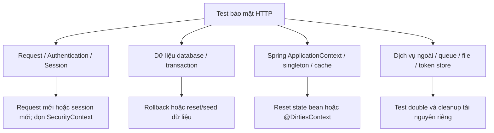
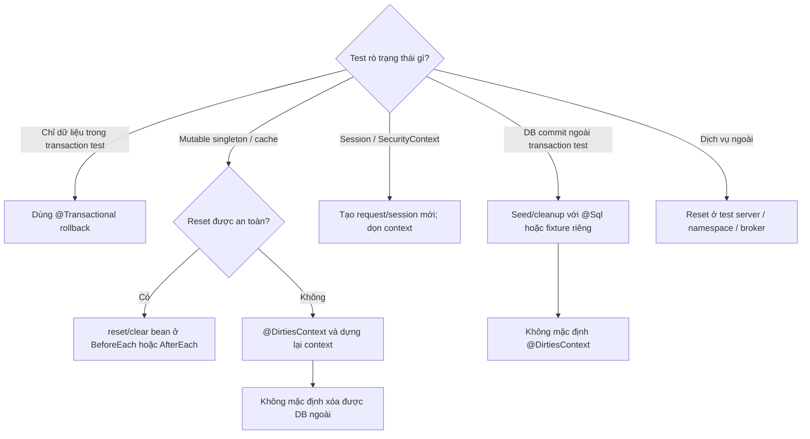

# Lựa chọn reset dữ liệu hoặc tạo context mới theo ranh giới cần cô lập

Trong chương **Dữ liệu và cô lập** của module **SPRING_SECURITY_TESTING**, chúng ta kiểm chứng xác thực, phân quyền và bảo vệ HTTP bằng `spring-security-test` trên ứng dụng Servlet và Reactive. Khi dùng `MockMvc`, `WebTestClient`, `@WithMockUser`, `SecurityContext` hoặc JWT/OAuth2/OIDC giả lập để kiểm tra yêu cầu được phép hay bị từ chối, một bài test chỉ đáng tin nếu kết quả **không phụ thuộc vào test chạy trước đó**.

Một lỗi điển hình: test A tạo báo cáo cho tenant A, test B gửi request với danh tính tenant B và mong `403` hoặc `404`; nhưng test B chỉ PASS khi chạy một mình vì dữ liệu tenant A đã bị test trước ghi đè. Một lỗi khác: test thay đổi cấu hình bảo mật trong một singleton/cache rồi test tiếp theo nhận role, principal hoặc kết quả authorization cũ. Cả hai đều là **rò rỉ trạng thái**, nhưng không thể xử lý giống nhau.

Quy tắc trọng tâm của bài học là **cô lập đúng lớp sở hữu trạng thái**. Nếu vấn đề chỉ là dữ liệu database, hãy rollback hoặc dọn dữ liệu; nếu vấn đề là session, hãy tạo session/request độc lập; nếu vấn đề nằm trong bean hoặc cấu hình của `ApplicationContext` dùng chung, hãy reset thành phần liên quan hoặc tạo context mới một cách có chủ đích. `@DirtiesContext` là công cụ hữu ích nhưng không nên là phản xạ mặc định cho mọi test thất bại.

## 1. Bốn ranh giới trạng thái dễ bị nhầm lẫn



| Ranh giới | Ví dụ trạng thái thay đổi | Cách cô lập thường phù hợp | Khi nào không đủ? |
| --- | --- | --- | --- |
| **Request / danh tính** | Header Bearer, `SecurityContext`, CSRF, session cookie, `MockHttpSession` | Dựng request mới, dùng `mockUser()`/`jwt()` riêng từng test; không tái sử dụng session tùy tiện | Khi ứng dụng lưu phiên hoặc token ngoài request |
| **Transaction / database** | Hàng dữ liệu báo cáo, owner ID, tenant ID, bảng phân quyền | `@Transactional` rollback, `@Sql` seed/cleanup, repository cleanup có kiểm soát | Khi dữ liệu được commit ở transaction khác hoặc server thread khác |
| **Spring context** | Singleton mutable, bean cache, property động, filter chain được thay đổi | Reset bean/cache hoặc `@DirtiesContext` nếu thực sự phải hủy context | Context mới không tự xóa database ngoài, queue hay file |
| **Hệ thống ngoài** | Mock HTTP server, Redis, message broker, object storage, OAuth2 test server | Reset fixture/namespace riêng; dọn side effect tại hệ thống tương ứng | Spring rollback chỉ áp dụng cho tài nguyên tham gia transaction đó |

**Tư duy lựa chọn:** không hỏi ngay “có nên thêm `@DirtiesContext` không?”, mà hỏi “trạng thái nào làm test B biết việc test A vừa chạy?”. Câu trả lời quyết định giải pháp.

## 2. Spring Test cache ApplicationContext để làm gì?

Spring Test thường **cache và tái sử dụng `ApplicationContext`** giữa các test có cùng bộ khóa cấu hình. Điều này tiết kiệm thời gian khởi động context, tạo datasource, chạy auto-configuration và xây dựng `SecurityFilterChain`.

Ví dụ hai test class cùng `@SpringBootTest`, cùng profile và cùng cấu hình có thể nhận một context được cache. Điều này là bình thường và thường đáng giữ. Mỗi request của `MockMvc` có thể độc lập mà các bean trong context vẫn là **cùng instance singleton**.

Những thành phần có thể tạo khóa cache khác nhau gồm cấu hình class, active profiles, property sources, context customizers và một số cấu hình test khác. Đổi `@ActiveProfiles("test")` sang một profile khác có thể dẫn tới context riêng theo khóa, nhưng **không có nghĩa database thật hoặc token store cũng tự tách biệt**.

```text
Test class A --------\
                      > ApplicationContext #1 --- Singleton/cache chung
Test class B --------/

Test class C (config khác) --> ApplicationContext #2

Database ngoài / Redis / broker:
    Có thể vẫn dùng chung cho cả #1 và #2!
```

Nếu test thay nội dung một bảng, không cần nạp lại toàn bộ Spring context. Nếu test thay hẳn trạng thái của bean không thể reset hoặc cơ chế security bị tái cấu hình bằng cách mutate object được chia sẻ, context mới có thể phù hợp — nhưng phải hiểu chi phí.

## 3. Cây quyết định: rollback, reset dữ liệu hay context mới?



Hai tiêu chí giúp chọn phương án:

1. **Độ rộng thay đổi:** dữ liệu chỉ thuộc một test, hay có tác động đến toàn bộ bean/chain/khóa cấu hình?
2. **Phạm vi transaction thực tế:** code chạy trên cùng thread/transaction do Spring Test mở, hay ở servlet server thật, async executor, `REQUIRES_NEW` hoặc một nguồn dữ liệu khác?

Test về **phân quyền theo dữ liệu** thường cần seed chính xác rồi cleanup database. Test về **biến đổi cấu hình security** hoặc bean singleton không thể hoàn nguyên mới thường cân nhắc context mới.

## 4. Dùng rollback khi mọi thao tác thật sự cùng transaction

Với test repository/service trực tiếp, Spring Test hỗ trợ transaction dành cho test. Nếu được quản lý bằng một `PlatformTransactionManager` và không commit thủ công, transaction test có thể được rollback sau mỗi method:

```java
import static org.assertj.core.api.Assertions.assertThat;

import org.junit.jupiter.api.Test;
import org.springframework.beans.factory.annotation.Autowired;
import org.springframework.boot.test.autoconfigure.orm.jpa.DataJpaTest;

@DataJpaTest
class ReportRepositoryIsolationTest {

    @Autowired
    ReportRepository reports;

    @Test
    void truyVanChiTraVeDuLieuCuaTenantDuocChon() {
        ReportRecord a = reports.saveAndFlush(
                new ReportRecord("tenant-a", "alice", "Báo cáo A"));
        ReportRecord b = reports.saveAndFlush(
                new ReportRecord("tenant-b", "bob", "Báo cáo B"));

        assertThat(reports.findByIdAndTenantId(
                a.getId(), "tenant-a")).isPresent();
        assertThat(reports.findByIdAndTenantId(
                b.getId(), "tenant-a")).isEmpty();
    }
}
```

Ví dụ giả định `ReportRecord` là entity JPA và `ReportRepository` có method `findByIdAndTenantId(Long id, String tenantId)`. `@DataJpaTest` mặc định tạo test có transaction và rollback theo cấu hình thường dùng, nên dữ liệu thêm trong test không tồn tại sau khi transaction test kết thúc.

### Điều rollback không bảo đảm

- Code mở transaction mới bằng `REQUIRES_NEW` có thể commit độc lập, nằm ngoài rollback của transaction test.
- Code gọi dịch vụ ngoài hoặc ghi queue/file không thuộc transaction JPA sẽ không tự rollback.
- Khi test gửi HTTP qua `@SpringBootTest(webEnvironment = RANDOM_PORT)`, server chạy ở thread khác; transaction test của client **không** bao trùm transaction request server.
- Tác vụ `@Async`, `CompletableFuture` hay worker tự quản lý có thể chạy ngoài transaction test.
- Một số test ghi dữ liệu ở lifecycle method trước thời điểm transaction test được mở; phải kiểm tra quy tắc callback của Spring Test.

Không nên chỉ thêm `@Transactional` vào class rồi tuyên bố mọi side effect đã được cô lập. Hãy xác định chính xác transaction nào chứa việc ghi.

## 5. Khi kiểm thử HTTP thay đổi database: seed và cleanup rõ ràng

Với bài test `MockMvc` có request tạo/sửa dữ liệu, cách dễ kiểm chứng là **chuẩn bị tập dữ liệu cố định và dọn lại trước/sau mỗi method**. Có thể dùng `@Sql` với `statements` ngay trong test mà không cần tạo file SQL phụ.

Ví dụ giả định bảng `report_record(id, tenant_id, owner_id, title)` và endpoint `GET /api/tenants/{tenantId}/reports/{id}` đã áp dụng kiểm tra role/scope và ràng buộc dữ liệu theo tenant:

```java
import static org.springframework.security.test.web.servlet.request
        .SecurityMockMvcRequestPostProcessors.jwt;
import static org.springframework.test.web.servlet.request.MockMvcRequestBuilders.get;
import static org.springframework.test.web.servlet.result.MockMvcResultMatchers.status;

import org.junit.jupiter.api.Test;
import org.springframework.beans.factory.annotation.Autowired;
import org.springframework.boot.test.autoconfigure.web.servlet.AutoConfigureMockMvc;
import org.springframework.boot.test.context.SpringBootTest;
import org.springframework.security.core.authority.SimpleGrantedAuthority;
import org.springframework.test.context.jdbc.Sql;
import org.springframework.test.context.jdbc.SqlConfig;
import org.springframework.test.web.servlet.MockMvc;

@SpringBootTest
@AutoConfigureMockMvc
@Sql(
    statements = {
        "DELETE FROM report_record WHERE id IN (91001, 91002)",
        "INSERT INTO report_record (id, tenant_id, owner_id, title) "
            + "VALUES (91001, 'tenant-a', 'alice', 'A')",
        "INSERT INTO report_record (id, tenant_id, owner_id, title) "
            + "VALUES (91002, 'tenant-b', 'bob', 'B')"
    },
    executionPhase = Sql.ExecutionPhase.BEFORE_TEST_METHOD,
    config = @SqlConfig(transactionMode =
            SqlConfig.TransactionMode.ISOLATED)
)
@Sql(
    statements =
        "DELETE FROM report_record WHERE id IN (91001, 91002)",
    executionPhase = Sql.ExecutionPhase.AFTER_TEST_METHOD,
    config = @SqlConfig(transactionMode =
            SqlConfig.TransactionMode.ISOLATED)
)
class ReportTenantIsolationHttpTest {

    @Autowired
    MockMvc mockMvc;

    @Test
    void tenantA_xemBaoCaoCuaMinh() throws Exception {
        mockMvc.perform(get("/api/tenants/tenant-a/reports/91001")
                .with(jwt().jwt(token -> token
                    .subject("alice")
                    .claim("tenant_id", "tenant-a"))
                    .authorities(new SimpleGrantedAuthority(
                        "SCOPE_reports.read"))))
            .andExpect(status().isOk());
    }

    @Test
    void tenantA_khongDuocDocDuLieuTenantB() throws Exception {
        mockMvc.perform(get("/api/tenants/tenant-b/reports/91002")
                .with(jwt().jwt(token -> token
                    .subject("alice")
                    .claim("tenant_id", "tenant-a"))
                    .authorities(new SimpleGrantedAuthority(
                        "SCOPE_reports.read"))))
            .andExpect(status().isForbidden());
    }
}
```

**Tiền đề:** endpoint đang áp dụng đúng quy tắc ví dụ — token có `SCOPE_reports.read`, nhưng chỉ được yêu cầu dữ liệu của `tenant_id` tương ứng. Nếu API cố tình dùng `404` để che giấu tài nguyên của tenant khác, thay assertion `403` bằng `404` theo hợp đồng ứng dụng; **không được** trả dữ liệu tenant B. Test trên giả lập JWT authentication bằng `jwt()` để tập trung vào role/claim và database; nó không xác minh chữ ký hoặc tính hợp lệ của Bearer token thật.

Đoạn `@Sql` dùng `ISOLATED` để fixture được ghi vào một transaction riêng, có thể quan sát ngoài transaction test nếu ứng dụng xử lý request ở transaction khác. Cần có datasource và transaction manager tương thích. Nếu hệ thống có nhiều datasource, phải chỉ rõ transaction manager/dataSource phù hợp; nếu fixture phụ thuộc foreign key, dọn theo đúng thứ tự.

Đây là ví dụ cho bảng/tài nguyên được mô tả. **Không lấy hai ID cố định dùng chung cho nhiều test chạy song song** hoặc áp dụng `DELETE` lên toàn bộ bảng production. Trong bộ test chạy song song, nên dùng ID/namespace riêng cho mỗi test, fixture builder và database/schema cô lập, hoặc sắp xếp việc chạy tuần tự khi thật sự dùng chung tài nguyên.

## 6. Vì sao `@DirtiesContext` không thay thế cleanup database?

`@DirtiesContext` thông báo Spring Test rằng `ApplicationContext` đã “bẩn”, cần bị loại khỏi cache và đóng để test sau không dùng lại context đó. Ví dụ:

```java
import org.junit.jupiter.api.Test;
import org.springframework.test.annotation.DirtiesContext;
import org.springframework.test.context.junit.jupiter.SpringJUnitConfig;

@SpringJUnitConfig(AppSecurityConfig.class)
class SecurityConfigurationMutationTest {

    @Test
    @DirtiesContext(methodMode = DirtiesContext.MethodMode.AFTER_METHOD)
    void thayDoiBeanKhongTheResetAnToan() {
        // Test tác động vào bean shared mà không có cách hoàn nguyên chắc chắn.
    }
}
```

Các mode thường gặp:

| Cách dùng | Hiệu lực | Phù hợp khi |
| --- | --- | --- |
| `@DirtiesContext(methodMode = AFTER_METHOD)` | Evict/đóng context sau một method | Một method làm bẩn bean cấu hình không thể reset |
| `@DirtiesContext(classMode = AFTER_CLASS)` | Evict/đóng context sau cả class | Nhiều method cùng làm bẩn context; chấp nhận hủy context khi kết thúc class |
| `@DirtiesContext(classMode = BEFORE_EACH_TEST_METHOD)` | Tạo context mới trước từng method theo lifecycle Spring Test | Cần state bean/cấu hình thực sự mới cho mỗi test; chi phí cao |
| Không dùng `@DirtiesContext` | Tiếp tục hưởng cache context | State có thể được reset độc lập và test vẫn đúng |

**Không có bảo đảm rằng đóng context sẽ xóa dữ liệu của database ngoài.** Nếu hai context cùng kết nối một PostgreSQL instance, các hàng đã commit vẫn còn sau khi context thứ nhất bị đóng. Điều này cũng đúng với Redis, Kafka, thư mục file, message queue và các hệ thống ngoài khác.

Ngược lại, `@DirtiesContext` có thể khiến hàng loạt test phải khởi động lại Spring context, làm chậm CI mà không giải quyết rò dữ liệu gốc. Chỉ dùng nó khi **vấn đề thật sự nằm ở trạng thái context hoặc khi test bắt buộc cần một context không bị mutate**.

## 7. Reset singleton/cache thay vì tải lại toàn bộ context

Nếu bean có state có thể xóa an toàn, reset state là lựa chọn nhanh hơn context mới. Ví dụ một cache quyền in-memory dành cho test:

```java
import java.util.Map;
import java.util.concurrent.ConcurrentHashMap;
import org.springframework.stereotype.Component;

@Component
final class TestableAuthorizationCache {

    private final Map<String, Boolean> decisions =
            new ConcurrentHashMap<>();

    boolean allowed(String key) {
        return decisions.getOrDefault(key, false);
    }

    void record(String key, boolean allowed) {
        decisions.put(key, allowed);
    }

    void clear() {
        decisions.clear();
    }
}
```

Test có thể reset trước và sau để tránh trường hợp test trước thất bại khiến cleanup bị bỏ qua:

```java
import org.junit.jupiter.api.AfterEach;
import org.junit.jupiter.api.BeforeEach;
import org.springframework.beans.factory.annotation.Autowired;
import org.springframework.boot.test.context.SpringBootTest;

@SpringBootTest
class CachePermissionTest {

    @Autowired
    TestableAuthorizationCache cache;

    @BeforeEach
    void before() {
        cache.clear();
    }

    @AfterEach
    void after() {
        cache.clear();
    }
}
```

Việc reset này phù hợp khi **không có request bất đồng bộ còn đang sử dụng cache** và test không chạy song song trên cùng instance với dữ liệu test khác. Nếu có parallel execution, cần cô lập cache theo key/namespace riêng hoặc khóa tài nguyên thích hợp. `clear()` trên singleton dùng chung trong một test đang chạy có thể phá kết quả test khác; không phải mọi phép dọn state đều an toàn nếu concurrent.

Với cache Caffeine/Redis, session store hoặc application-level cache khác, dùng API invalidation tương ứng thay vì viết lại bean bằng reflection. Không tự xóa toàn bộ Redis/database dùng chung của môi trường khác.

## 8. SecurityContext, principal và session phải được cô lập theo request

Các bài test bảo mật HTTP thường rò trạng thái khi chia sẻ `MockHttpSession` hoặc vô tình dùng một `WebTestClient` mang cookie/session từ ca trước. Phân biệt rõ:

- `SecurityContextHolder` dùng context gắn với thread/request Servlet. Spring Security Test thường thiết lập và dọn mock context theo lifecycle, nhưng code test tự ghi context thủ công vẫn phải dọn đúng cách.
- `MockHttpSession` là một đối tượng có thể được tái sử dụng có chủ đích giữa nhiều lần `MockMvc.perform(...)`, ví dụ khi kiểm tra login + logout; không nên dùng lại trong những ca cần độc lập.
- `@WithMockUser` và `SecurityMockMvcRequestPostProcessors.user()/jwt()` tạo authentication giả giúp test rule; mỗi case nên khai báo principal và authorities cần thiết một cách minh bạch.
- `csrf()` cung cấp CSRF test fixture cho request cần token. CSRF session state nếu được lưu trong session cũng cần cô lập khi test có nhiều phiên.

Ví dụ hai request độc lập:

```java
mockMvc.perform(get("/api/admin")
        .with(user("admin").roles("ADMIN")))
    .andExpect(status().isOk());

mockMvc.perform(get("/api/admin"))
    .andExpect(status().isUnauthorized());
```

Kết quả thứ hai giả định security chain yêu cầu đăng nhập và entry point trả `401` (ví dụ HTTP Basic hoặc Bearer). Với form login, response có thể là redirect. **Đừng** sử dụng lại `MockHttpSession` của người `admin` cho request thứ hai nếu mục tiêu là test anonymous.

Nếu một unit test tự đụng `SecurityContextHolder` (không thông qua test listener), cần dọn trong `@AfterEach`:

```java
import org.junit.jupiter.api.AfterEach;
import org.springframework.security.core.context.SecurityContextHolder;
import org.springframework.security.test.context.TestSecurityContextHolder;

@AfterEach
void clearAuthentication() {
    TestSecurityContextHolder.clearContext();
    SecurityContextHolder.clearContext();
}
```

Đây là biện pháp dọn cho **test tự quản lý context thủ công**; không phải lời khuyên đặt hai lệnh này vào mọi test Spring Security mà chưa xem lifecycle hiện có. Không dùng chiến lược global security context để “giữ” identity từ test này sang test khác.

## 9. Ví dụ xác minh không rò danh tính hoặc dữ liệu giữa các ca

Một test về bảo mật và cô lập nên kiểm tra **cả phản hồi** và **trạng thái dữ liệu**, không chỉ mã HTTP.

Ví dụ một endpoint tạo báo cáo của tenant B bị từ chối nếu caller thuộc tenant A:

```java
import static org.junit.jupiter.api.Assertions.assertEquals;
import static org.springframework.security.test.web.servlet.request
        .SecurityMockMvcRequestPostProcessors.csrf;
import static org.springframework.security.test.web.servlet.request
        .SecurityMockMvcRequestPostProcessors.jwt;
import static org.springframework.test.web.servlet.request.MockMvcRequestBuilders.post;
import static org.springframework.test.web.servlet.result.MockMvcResultMatchers.status;

// Giả định trong test đã seed tenant-a/tenant-b, và endpoint
// POST /api/tenants/{tenantId}/reports từ chối caller sai tenant.
long before = countReportsOfTenant("tenant-b");

mockMvc.perform(post("/api/tenants/tenant-b/reports")
        .with(jwt().jwt(token -> token
            .subject("alice")
            .claim("tenant_id", "tenant-a")))
        .with(csrf())
        .contentType("application/json")
        .content("{\"title\":\"should-not-exist\"}"))
    .andExpect(status().isForbidden());

long after = countReportsOfTenant("tenant-b");
assertEquals(before, after);
```

`countReportsOfTenant(...)` là helper test do ứng dụng triển khai (ví dụ dùng `JdbcTemplate` đếm theo tenant). Code là đoạn test minh họa gắn vào một test context phù hợp; phải cấp đủ scope/role khác để yêu cầu không bị từ chối vì một lý do độc lập với tenant. Dùng `csrf()` giúp tránh nhầm `403` do thiếu CSRF với `403` do chính sách tenant khi CSRF được bật.

Một bài test có thể trả `403` nhưng vẫn đã ghi dữ liệu trước khi kiểm tra quyền — đây là lỗi nghiêm trọng. Assertion rằng số lượng bản ghi và nội dung dữ liệu không đổi giúp phát hiện side effect trái phép. Với nghiệp vụ cần audit event hay message, cần xác minh cả các side effect ngoài database.

## 10. Cách chọn giữa context test chung và cấu hình khác biệt

Nếu hai test cần **cấu hình security thật sự khác nhau**, chẳng hạn một test chạy policy JWT stateless và test khác chạy form login/session, hãy cấu hình chúng một cách tường minh bằng test configuration hoặc profile/property khác. Spring Test sẽ xác định context cần dùng dựa trên cấu hình:

```java
@SpringBootTest
@ActiveProfiles("jwt-test")
class JwtResourceServerIT {
    // Test filter chain dành cho JWT.
}

@SpringBootTest
@ActiveProfiles("session-test")
class SessionLoginIT {
    // Test filter chain dành cho form login/session.
}
```

Ví dụ chỉ minh họa cách tách cấu hình; cần tồn tại cấu hình profile tương ứng và không kích hoạt đồng thời các chain xung đột. Test này có thể tạo hai context cache keys khác nhau, nhưng **chưa chắc** tạo hai database độc lập. Đừng dùng `@DirtiesContext` để mô phỏng “đổi profile” trong cùng một context đang chạy; các bean và chain bảo mật thường đã được dựng khi khởi tạo.

Nếu mục tiêu chỉ là **thay user/authority** cho từng request, không cần context mới:

```java
mockMvc.perform(get("/api/reports")
        .with(user("alice").roles("READER")))
    .andExpect(status().isOk());

mockMvc.perform(get("/api/reports")
        .with(user("bob").roles("GUEST")))
    .andExpect(status().isForbidden());
```

Việc tạo một `ApplicationContext` mới chỉ để thay `alice` thành `bob` sẽ làm test tốn thời gian nhưng không thêm giá trị kiểm chứng.

## 11. Với Reactive và server HTTP thật, transaction khác ranh giới

Trong WebFlux, `ReactiveSecurityContextHolder` dùng **Reactor Context**, không dùng thread-local theo cùng cách với Servlet. Để test rule, ta có thể tạo client biến thể cho từng request:

```java
WebTestClient viewer = webTestClient.mutateWith(
        SecurityMockServerConfigurers.mockUser("bob").roles("VIEWER"));

WebTestClient analyst = webTestClient.mutateWith(
        SecurityMockServerConfigurers.mockUser("alice").roles("ANALYST"));

viewer.get().uri("/api/reports")
        .exchange().expectStatus().isForbidden();

analyst.get().uri("/api/reports")
        .exchange().expectStatus().isOk();
```

Giả định `webTestClient` được gắn với `SecurityWebFilterChain` và endpoint yêu cầu `ROLE_ANALYST`. Mỗi client biến thể dùng cho một nhóm request có cùng principal; không lưu một client đã mutate quyền admin vào biến dùng chung rồi tiếp tục gọi đó là “anonymous test”.

Với `@SpringBootTest(webEnvironment = RANDOM_PORT)` và `WebTestClient.bindToServer()`, HTTP request đi qua server thật. Transaction test ở client không tự bao trùm database writes của server. Tương tự, thao tác reactive qua `R2dbcTransactionManager` có thể cần reactive transaction riêng, không thể mặc định áp dụng rollback do một test dùng JPA `@Transactional`.

Khi cần test DB state của luồng HTTP Reactive/Servlet chạy server thật, hãy chuẩn bị fixture đã commit, dùng cleanup độc lập và assert không có dữ liệu rò sau mỗi test. Nếu dùng Testcontainers, container có thể được tạo cho cả suite hoặc test class; mỗi test vẫn cần dữ liệu riêng hoặc cleanup theo ranh giới đã định. **Mỗi container mới không tự chứng minh isolation đúng nếu test còn chia sẻ Redis, event broker hoặc filesystem khác.**

## 12. Test chạy song song: cô lập theo namespace thay vì “xóa sạch”

Một phương án cleanup thường thấy là:

```sql
DELETE FROM report_record;
```

Trong môi trường có test chạy song song hoặc nhiều worker, lệnh này có thể xóa fixture đang được test khác sử dụng. Một chiến lược an toàn hơn là tạo data **có ownership rõ ràng**:

```text
testRunId = "run-7f2c"
reportId = "run-7f2c-report-1"
tenantId = "run-7f2c-tenant-a"
```

Sau test, cleanup theo `testRunId`/tenant ID/ID fixture do test sở hữu thay vì xóa tất cả. Nếu schema không hỗ trợ namespace, cân nhắc database/schema riêng hoặc không chạy song song các test dùng chung bảng. Với mock HTTP server, Redis hoặc broker cũng nên dùng key, topic, queue hoặc prefix riêng cho từng test khi có thể.

Ngoài ra, những test đổi cấu hình system property/global clock/static singleton hoặc chiến lược `SecurityContextHolder` không thể “cô lập” chỉ bằng transaction. Hãy phục hồi global state trong `finally`/`@AfterEach`, hoặc tránh chia sẻ tài nguyên/không chạy song song trong phạm vi đó. `@DirtiesContext` chỉ đóng Spring context, không tự reset mọi biến static/global của JVM.

## 13. Ma trận lựa chọn theo tình huống

| Hiện tượng hoặc mục tiêu | Ưu tiên | Tránh dùng sai |
| --- | --- | --- |
| Unit test repository tạo vài entity | `@DataJpaTest` / rollback | `@DirtiesContext` chỉ để xóa rows |
| MockMvc đồng bộ, service join transaction test | `@Transactional` rollback nếu đã xác nhận cùng transaction | Giả định không có transaction mới/async |
| MockMvc hoặc server thật commit dữ liệu ngoài test transaction | `@Sql` seed/cleanup hoặc fixture builder + cleanup | Chỉ gắn `@Transactional` lên test |
| Test tenant A/B phải độc lập | Seed data theo tenant/test ID, kiểm tra response và DB invariants | Dùng chung record ID hoặc token/session cũ |
| Test đã đăng nhập/anonymous ở hai request | Request và session độc lập; mock identity từng request | Tạo context mới cho từng principal |
| Mutable singleton cache có API clear | `@BeforeEach`/`@AfterEach` clear | Khởi động lại toàn context mỗi lần |
| Bean/cấu hình singleton bị mutate không thể hoàn nguyên | `@DirtiesContext` theo method/class | Cố reset DB để sửa bean |
| Cần profile, property hoặc filter chain khác thật sự | Context config riêng; Spring Test cache theo khóa | Đổi cấu hình runtime sau khi chain đã dựng |
| Redis/broker/mock server chứa state | Cleanup tại hệ thống ngoài hoặc namespace riêng | Cho rằng Spring rollback/context mới xóa external state |
| Test chạy song song, cùng database | Fixture/namespace riêng hoặc điều phối serial | `DELETE FROM all_tables` sau mỗi test |

## 14. Lỗi thường gặp trong kiểm thử Spring Security

**Thêm `@DirtiesContext` vì một test `403` thất thường.** Lỗi có thể đến từ record phân quyền còn sót trong database, session bị dùng lại hoặc mock chưa reset. Hãy xác định trạng thái gây sai trước khi hủy context.

**Cho rằng `@Transactional` rollback mọi HTTP request.** Với server có cổng thật hoặc tác vụ chạy transaction/thread khác, dữ liệu có thể đã commit. Phải kiểm tra transaction boundary thực.

**Reset database nhưng không reset cache quyền.** Row thay đổi nhưng cache `user → authorities` hoặc quyết định `permission` vẫn cũ. Phải dọn cả thành phần sở hữu state.

**Tạo context mới nhưng giữ Redis hoặc bảng dữ liệu cũ.** Context mới kết nối cùng resource ngoài nên lỗi rò vẫn tồn tại.

**Dùng chung `MockHttpSession` cho các ca không liên quan.** Một principal đăng nhập từ request trước có thể khiến test anonymous trả `200`. Chỉ chia sẻ session khi mục tiêu là kiểm tra chính lifecycle session.

**Dùng `jwt()` rồi nghĩ đang kiểm tra dữ liệu identity provider thật.** `jwt()` và `opaqueToken()` giả lập authentication cho request. Chúng giúp test authorization/tenant mapping, nhưng không chứng minh decoder/introspection hoặc dữ liệu từ IdP.

**Chỉ assert status, không assert side effect.** Một request `403` có thể vẫn để lại hàng dữ liệu, event hoặc thay đổi trạng thái nếu ứng dụng xử lý quyền quá muộn. Kiểm tra cả database và phụ thuộc ngoài khi tác vụ ghi.

**Cleanup toàn bộ bảng khi chạy song song.** Có thể xóa fixture của test khác và gây flakiness. Cô lập theo ID/namespace hoặc điều phối việc chạy.

**Dùng test context chung nhưng thay singleton không khôi phục.** Spring cache giúp tăng tốc, nhưng mutable singleton có thể gây phụ thuộc thứ tự test. Reset bean hoặc đánh dấu context bẩn khi cần thiết.

**Mặc định WebFlux có cùng transaction và SecurityContext như Servlet.** Reactor context và reactive transaction có cách lan truyền khác. Phải kiểm chứng với đúng WebTestClient/R2DBC stack đang dùng.

## 15. Checklist trước khi chốt phương án cô lập

- Xác định trạng thái cần cô lập thuộc **request/session, DB transaction, Spring context hay hệ thống ngoài**.
- Dùng rollback khi chắc chắn các thay đổi tham gia transaction test; xác nhận các nhánh `REQUIRES_NEW`, async và real server.
- Với HTTP integration test ghi dữ liệu, có fixture/cleanup rõ và không xóa dữ liệu test khác.
- Không dùng `@DirtiesContext` để chữa rò DB; chỉ dùng khi context thật sự đã bẩn hoặc cấu hình cần context riêng.
- Kiểm tra singleton, cache, static field, token store hoặc session có cần reset độc lập.
- Test được phép/bị từ chối sử dụng **authentication riêng cho từng request**, và session chỉ được chia sẻ có chủ đích.
- Có test dữ liệu theo tenant/owner và kiểm tra không có side effect sau yêu cầu trái quyền.
- Nếu có nhiều profile/filter chains, tạo context theo cấu hình đúng thay vì mutate chain runtime.
- Với WebFlux/real HTTP server, xác nhận database writes của server không nằm ngoài chiến lược cleanup.
- Nếu chạy song song, dùng dữ liệu sở hữu riêng hoặc cơ chế điều phối để cleanup không ảnh hưởng test khác.
- Các test qua `MockMvc`, `WebTestClient`, `@WithMockUser`, JWT/OAuth2/OIDC giả lập đều có phạm vi kiểm chứng được diễn đạt chính xác.

**Kết luận:** **reset dữ liệu** và **tạo ApplicationContext mới** không phải hai cách có thể hoán đổi tùy ý. Reset hoặc rollback giải quyết dữ liệu thuộc giao dịch/tài nguyên được dọn; context mới giải quyết bean và cấu hình trong Spring Test cache. Khi xác định đúng ranh giới sở hữu state và bổ sung assertion cho cả quyền truy cập lẫn side effect, bộ kiểm thử Spring Security sẽ ổn định hơn, chạy nhanh hơn và phát hiện được lỗi rò dữ liệu hoặc danh tính giữa các ca thử.
