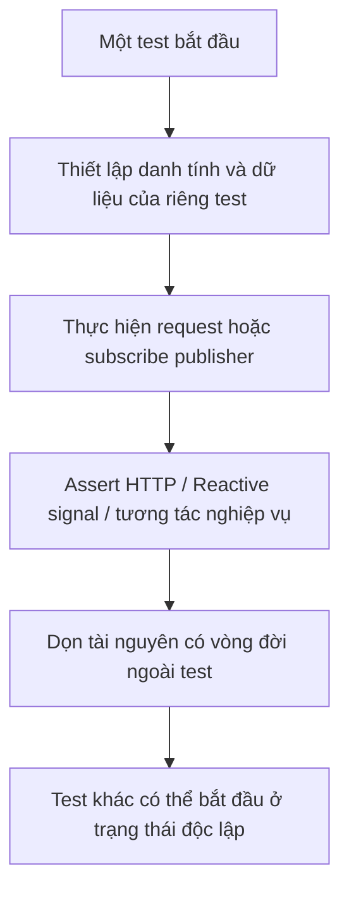

# Tránh phụ thuộc thứ tự chạy và trạng thái còn lại từ ca trước

Trong kiểm thử bảo mật, một test có thể **xanh khi chạy riêng** nhưng **đỏ khi chạy cả suite**, hoặc ngược lại: test kiểm tra người dùng ẩn danh lại xanh vì nó vô tình kế thừa danh tính quản trị từ ca trước. Lỗi này không chỉ gây mất ổn định CI; nó có thể che giấu sai sót phân quyền thật. Một test đúng phải tự tạo được điều kiện đầu vào và tự xác minh kết quả, không dựa trên việc một test khác đã đăng nhập, lưu token, khởi tạo dữ liệu hoặc dọn dẹp giúp mình.

Bài học thuộc chương **Dữ liệu và cô lập** của module **SPRING_SECURITY_TESTING**. Mục tiêu của module là kiểm chứng xác thực, phân quyền và bảo vệ HTTP thực tế bằng `spring-security-test` trên Servlet và Reactive, sử dụng MockMvc, WebTestClient, `@WithMockUser`, SecurityContext, JWT/OAuth2/OIDC giả lập và các ca được phép hoặc bị từ chối. Nội dung tập trung vào việc **ngăn test phụ thuộc thứ tự thực thi và trạng thái còn sót lại**, từ `SecurityContextHolder`, HTTP session, mock và database cho tới Reactor Context và OAuth2 authorized clients.

## 1. Một test độc lập phải bảo đảm điều gì?

Giả sử API có `GET /api/me` và `POST /api/notes`:

- Alice đã xác thực gọi `/api/me` thì nhận tên **alice**.
- Bob gọi cùng endpoint thì nhận **bob**, không phải Alice.
- Request ẩn danh phải bị từ chối, bất kể trước đó test nào đã chạy.
- Người dùng `ROLE_EDITOR` có CSRF token hợp lệ được tạo note.
- Người dùng `ROLE_VIEWER` không thể tạo note, dù test EDITOR vừa chạy.
- Trạng thái database, cache hoặc kho token do test A tạo không được làm test B thay đổi kết quả.

**Nguyên tắc:** cùng một ca kiểm thử, cùng dữ liệu đầu vào và cùng môi trường đã khai báo thì phải có cùng kết quả **dù chạy đầu tiên, cuối cùng, riêng lẻ hay cùng nhiều test khác**.



Không có bảo đảm rằng việc hoàn tất test sẽ tự xóa *mọi* dạng trạng thái. Spring Test có những cơ chế reset/rollback tiện lợi, nhưng cần biết rõ ranh giới của từng cơ chế.

| Nguồn trạng thái | Thường nằm ở đâu? | Nguy cơ giữa các test | Cách cô lập |
| --- | --- | --- | --- |
| `SecurityContextHolder` | ThreadLocal trên Servlet/thread hiện tại | Giữ lại `Authentication` cũ nếu tự thiết lập không dọn | `@WithMockUser` theo từng test hoặc `clearContext()` trong `finally` |
| `MockHttpSession` | Session/cookie do test giữ tham chiếu | Test Bob dùng lại session của Alice | Tạo session riêng; chỉ chia sẻ trong test kiểm tra session có chủ đích |
| Mock/stubbing | Mockito mock được Spring Test quản lý | Stub hoặc interaction cũ khiến assertion sai | `@MockitoBean` reset theo cấu hình; mock riêng cho mỗi test |
| Database | H2/PostgreSQL/MySQL/Testcontainers | Hàng dữ liệu của ca trước làm test sau khác kết quả | Transaction rollback hoặc fixture/cleanup được kiểm soát |
| Cache, singleton | ApplicationContext được cache giữa test | Dữ liệu hoặc biến mutable trong bean tồn tại lâu hơn một test | Tránh mutable singleton; clear đúng kho; tách key |
| OAuth2 authorized client | Service/repository/session/database | Token Alice có thể được Bob đọc nhầm | Cô lập theo registration/principal/session, xóa fixture |
| Reactor Context | Context theo subscription | Gắn sai danh tính vào một pipeline khác | `contextWrite(...)` trên mỗi publisher được subscribe |
| HTTP downstream | Mock server, message queue, API giả | Request/event cũ còn tồn tại | Reset mock server/queue và dùng ID riêng |

## 2. Những anti-pattern tạo phụ thuộc thứ tự

### Test B giả định test A đã tạo dữ liệu

```java
// Không nên viết hai test như sau:
static String noteId;

@Test
void testA_createsNote() {
    noteId = "note-100"; // Thực tế có thể lấy từ DB/API.
}

@Test
void testB_readsNoteCreatedByA() {
    assertNotNull(noteId);
}
```

JUnit không bảo đảm `testA` chạy trước `testB` khi không có cấu hình thứ tự rõ ràng. Và dù dùng `@Order(1)`, `@Order(2)` để ép thứ tự, test B vẫn **không độc lập**: chạy riêng, chạy song song hoặc xóa test A là hỏng.

Cách đúng là test B **tự chuẩn bị note cần đọc** bằng fixture, setup ở `@BeforeEach` hoặc một phương thức tạo dữ liệu rõ ràng trong chính test. Một test có thể thực hiện cả "tạo rồi đọc" nếu mục tiêu là kiểm tra **một workflow có nhiều bước**; điều cần tránh là chia workflow của một kịch bản thành các test phụ thuộc nhau.

### Đặt user mặc định cho toàn bộ test class

```java
// Không phù hợp nếu lớp này còn kiểm tra request anonymous.
@WithMockUser(username = "admin", roles = "ADMIN")
class AccountSecurityTests {
    // ...
}
```

Khi đặt `@WithMockUser` ở cấp class, mọi method mặc định nhận danh tính admin, trừ khi override. Một test "anonymous phải nhận 401" mà quên xóa/override annotation sẽ không còn đang kiểm tra anonymous.

Ưu tiên `@WithMockUser` **trên từng phương thức** cần đăng nhập. Nếu muốn chủ động override class-level setup bằng anonymous, Spring Security Test cung cấp `@WithAnonymousUser`.

### Chia sẻ HTTP session tĩnh

```java
// Sai về mặt isolation:
static final MockHttpSession SHARED_SESSION = new MockHttpSession();
```

Đây là một session có thể tồn tại xuyên suốt nhiều test. Việc test Alice dùng session rồi test Bob dùng lại sẽ làm trạng thái của trình duyệt giả lập bị chia sẻ ngoài ý muốn.

## 3. Spring Test làm sạch điều gì và không làm sạch điều gì?

Các cơ chế thường gặp:

| Công cụ | Thường giúp gì? | Không tự bảo đảm điều gì? |
| --- | --- | --- |
| JUnit 5, `@TestInstance(PER_METHOD)` mặc định | Tạo instance test class mới cho từng method | Không tạo Spring ApplicationContext mới cho mỗi method |
| `@BeforeEach` | Chuẩn bị input/fixture ở đầu từng test | Không tự xóa dữ liệu ngoài DB/cache/session |
| `@AfterEach` | Dọn dẹp tài nguyên do test mở | Không thay thế cleanup chắc chắn khi crash process |
| `@WithMockUser` + Spring Security Test listeners | Đặt SecurityContext cho một test và dọn theo vòng đời TestContext | Không reset mọi cache/session, token đã lưu hay singleton mutable |
| `@MockitoBean` | Đưa mock vào Spring context, có thể reset sau test theo mặc định | Không tự hoàn nguyên DB hay side effect ngoài mock |
| `@Transactional` trên test | Rollback thay đổi trong transaction do test quản lý | Không tự rollback request HTTP chạy trong transaction/thread riêng, `REQUIRES_NEW` hoặc side effect ngoài DB |
| `@DirtiesContext` | Đánh dấu ApplicationContext cần loại khỏi context cache | Không xóa database/queue bên ngoài context; rất tốn tài nguyên |

Spring Test có **ApplicationContext cache**: nhiều test cùng cấu hình có thể dùng chung context để tăng tốc. Các bean singleton có trạng thái mutable do test ghi vào có thể tồn tại lâu hơn một phương thức. Không nên dựa vào giả định “JUnit tạo test instance mới nên mọi bean Spring cũng mới”.

**Chiến lược tốt:** ưu tiên tạo fixture nhỏ, cleanup tại đúng lớp sở hữu dữ liệu; dùng `@DirtiesContext` chỉ khi test thực sự thay đổi cấu hình/trạng thái context mà không thể hoàn nguyên hợp lý.

## 4. Ứng dụng Spring MVC mẫu dùng cho kiểm thử cô lập

Để minh họa, xây một controller chỉ trả tên principal hoặc tạo note. Mỗi request được bảo vệ bởi `SecurityFilterChain`.

```java
import java.util.Map;
import org.springframework.http.HttpStatus;
import org.springframework.http.ResponseEntity;
import org.springframework.security.core.Authentication;
import org.springframework.web.bind.annotation.*;

record CreateNoteRequest(String title) {}
record NoteReceipt(String id) {}

interface NoteService {
    NoteReceipt create(String title, String owner);
}

@RestController
@RequestMapping("/api")
class IsolationController {

    private final NoteService notes;

    IsolationController(NoteService notes) {
        this.notes = notes;
    }

    @GetMapping("/me")
    Map<String, String> me(Authentication authentication) {
        return Map.of("name", authentication.getName());
    }

    @PostMapping("/notes")
    ResponseEntity<NoteReceipt> create(
            @RequestBody CreateNoteRequest request,
            Authentication authentication) {
        NoteReceipt receipt = notes.create(
            request.title(), authentication.getName());
        return ResponseEntity.status(HttpStatus.CREATED).body(receipt);
    }
}
```

Security config cho ví dụ:

```java
import org.springframework.context.annotation.Bean;
import org.springframework.context.annotation.Configuration;
import org.springframework.http.HttpMethod;
import org.springframework.security.config.Customizer;
import org.springframework.security.config.annotation.web.builders.HttpSecurity;
import org.springframework.security.config.annotation.web.configurers.AbstractHttpConfigurer;
import org.springframework.security.web.SecurityFilterChain;

@Configuration
class IsolationSecurityConfig {

    @Bean
    SecurityFilterChain isolationSecurity(HttpSecurity http)
            throws Exception {
        return http
            .authorizeHttpRequests(auth -> auth
                .requestMatchers(HttpMethod.POST, "/api/notes")
                    .hasRole("EDITOR")
                .requestMatchers(HttpMethod.GET, "/api/me")
                    .authenticated()
                .anyRequest().denyAll())
            .httpBasic(Customizer.withDefaults())
            .formLogin(AbstractHttpConfigurer::disable)
            // Giữ CSRF mặc định để có test CSRF riêng.
            .build();
    }
}
```

Trong ví dụ:

- Anonymous gọi `GET /api/me` nhận `401` vì HTTP Basic entry point được bật và form login đã tắt.
- USER/VIEWER đã xác thực có thể gọi `/api/me`.
- Chỉ `ROLE_EDITOR` có thể `POST /api/notes`; với CSRF đang bật, POST còn cần token CSRF hợp lệ.
- Các ca từ chối phải xác minh `NoteService` **chưa được gọi**.

Trong ứng dụng thật, status phụ thuộc entry point/handler và chính sách CSRF đã cấu hình; không nên sao chép giá trị status của ví dụ vào một ứng dụng có login redirect hoặc bearer resource server khác.

## 5. Dùng @WithMockUser theo phương thức thay vì chia sẻ danh tính

Đặt các ca test trong một lớp `@WebMvcTest`. Import security config cần kiểm tra và mock đúng collaborator nghiệp vụ:

```java
import org.junit.jupiter.api.Test;
import org.springframework.beans.factory.annotation.Autowired;
import org.springframework.boot.test.autoconfigure.web.servlet.WebMvcTest;
import org.springframework.context.annotation.Import;
import org.springframework.test.context.bean.override.mockito.MockitoBean;
import org.springframework.test.web.servlet.MockMvc;
import org.springframework.security.test.context.support.WithMockUser;
import org.springframework.security.test.context.support.WithAnonymousUser;

import static org.springframework.test.web.servlet.request.MockMvcRequestBuilders.get;
import static org.springframework.test.web.servlet.result.MockMvcResultMatchers.*;

@WebMvcTest(IsolationController.class)
@Import(IsolationSecurityConfig.class)
class IsolationControllerTest {

    @Autowired MockMvc mvc;
    @MockitoBean NoteService notes;

    @Test
    @WithMockUser(username = "alice", roles = "EDITOR")
    void aliceHasHerOwnIdentity() throws Exception {
        mvc.perform(get("/api/me"))
            .andExpect(status().isOk())
            .andExpect(jsonPath("$.name").value("alice"));
    }

    @Test
    @WithMockUser(username = "bob", roles = "VIEWER")
    void bobHasHisOwnIdentity() throws Exception {
        mvc.perform(get("/api/me"))
            .andExpect(status().isOk())
            .andExpect(jsonPath("$.name").value("bob"));
    }

    @Test
    @WithAnonymousUser
    void anonymousDoesNotInheritAliceOrBob() throws Exception {
        mvc.perform(get("/api/me"))
            .andExpect(status().isUnauthorized());
    }
}
```

Cách này không đòi Alice chạy trước Bob, hay Bob chạy trước anonymous. Mỗi test tự khai báo security identity của nó. Spring Security Test sử dụng các TestExecutionListener để đưa `SecurityContext` vào vòng đời của test, thay vì bạn phải đặt thủ công một biến dùng chung.

**Chú ý:** `@WithMockUser` tạo một người dùng giả lập kiểu `UsernamePasswordAuthenticationToken` / `UserDetails`. Nó không tạo `OAuth2User`, `OidcUser` hoặc `Jwt`. Nếu controller dùng các kiểu đó, hãy dùng `oauth2Login()`, `oidcLogin()`, `jwt()` hoặc công cụ Reactive tương ứng để dựng đúng authentication.

## 6. Với nhiều người trong cùng test: cấu hình theo từng request

Để chứng minh Alice và Bob không lẫn dữ liệu trong cùng một method, dùng `SecurityMockMvcRequestPostProcessors.user(...)` và `anonymous()` theo request, thay vì sửa một `SecurityContext` toàn cục:

```java
import static org.springframework.security.test.web.servlet.request
    .SecurityMockMvcRequestPostProcessors.user;
import static org.springframework.security.test.web.servlet.request
    .SecurityMockMvcRequestPostProcessors.anonymous;

@Test
void aliceBobAndAnonymousAreIndependentWithinOneTest()
        throws Exception {

    mvc.perform(get("/api/me").with(user("alice").roles("EDITOR")))
        .andExpect(status().isOk())
        .andExpect(jsonPath("$.name").value("alice"));

    mvc.perform(get("/api/me").with(user("bob").roles("VIEWER")))
        .andExpect(status().isOk())
        .andExpect(jsonPath("$.name").value("bob"));

    // Lặp lại Alice sau Bob để bắt lỗi rò rỉ identity.
    mvc.perform(get("/api/me").with(user("alice").roles("EDITOR")))
        .andExpect(status().isOk())
        .andExpect(jsonPath("$.name").value("alice"));

    mvc.perform(get("/api/me").with(anonymous()))
        .andExpect(status().isUnauthorized());
}
```

Khi dùng các request postprocessor của Spring Security Test, hãy bảo đảm `MockMvc` đã tích hợp Spring Security filters và context repository. Với `@WebMvcTest` / `@AutoConfigureMockMvc` thường có tích hợp qua context; khi tự tạo `MockMvcBuilders`, dùng `.apply(springSecurity())` hoặc đăng ký security filters một cách có chủ đích.

Chỉ assert `isOk()` chưa đủ để chứng minh principal đúng. Việc kiểm tra `$.name` là bằng chứng request thực sự được xử lý dưới đúng identity.

## 7. Tách các nhánh 403 do thiếu role và 403 do CSRF

Một lỗi thường gặp là dùng cùng một kết quả 403 để kết luận hai điều khác nhau. Với POST có CSRF bật:

1. VIEWER thiếu quyền dù CSRF đã hợp lệ → 403 vì authorization.
2. EDITOR đủ quyền nhưng thiếu CSRF → 403 vì CSRF.
3. EDITOR đủ quyền **và** CSRF hợp lệ → 201, service được gọi.

```java
import org.springframework.http.MediaType;
import static org.mockito.Mockito.*;
import static org.springframework.security.test.web.servlet.request
    .SecurityMockMvcRequestPostProcessors.csrf;
import static org.springframework.test.web.servlet.request.MockMvcRequestBuilders.post;

@Test
void viewerCannotCreateEvenWithCsrf() throws Exception {
    mvc.perform(post("/api/notes")
            .with(user("viewer").roles("VIEWER"))
            .with(csrf())
            .contentType(MediaType.APPLICATION_JSON)
            .content("{\"title\":\"A\"}"))
        .andExpect(status().isForbidden());

    verifyNoInteractions(notes);
}

@Test
void editorCannotCreateWithoutCsrf() throws Exception {
    mvc.perform(post("/api/notes")
            .with(user("editor").roles("EDITOR"))
            .contentType(MediaType.APPLICATION_JSON)
            .content("{\"title\":\"B\"}"))
        .andExpect(status().isForbidden());

    verifyNoInteractions(notes);
}

@Test
void editorCanCreateWhenCsrfIsPresent() throws Exception {
    when(notes.create("C", "editor"))
        .thenReturn(new NoteReceipt("note-123"));

    mvc.perform(post("/api/notes")
            .with(user("editor").roles("EDITOR"))
            .with(csrf())
            .contentType(MediaType.APPLICATION_JSON)
            .content("{\"title\":\"C\"}"))
        .andExpect(status().isCreated())
        .andExpect(jsonPath("$.id").value("note-123"));

    verify(notes, times(1)).create("C", "editor");
    verifyNoMoreInteractions(notes);
}
```

Trong `@WebMvcTest`, mock `NoteService` được Spring Test quản lý với cơ chế reset phù hợp cho các test mặc định của `@MockitoBean`. Mỗi test tự stub phương thức cần dùng; không nên giả định test trước đã gọi `when(...)` giúp test sau.

Khi test fail vì dữ liệu tương tác cũ, kiểm tra xem bạn có đang dùng mock `static` hoặc cấu hình reset bị tắt hay không. Không gọi `reset(notes)` một cách tùy tiện giữa các assertion vì có thể che giấu interaction thật trong chính request đang được kiểm tra.

## 8. SecurityContextHolder do test tự đặt: phải dọn trong finally

Có những unit test không chạy qua `MockMvc` và chủ động tạo `Authentication`. Khi đó, cần đặt và dọn context đúng vòng đời:

```java
import java.util.List;
import org.junit.jupiter.api.Test;
import org.springframework.security.authentication.UsernamePasswordAuthenticationToken;
import org.springframework.security.core.Authentication;
import org.springframework.security.core.authority.SimpleGrantedAuthority;
import org.springframework.security.core.context.*;

import static org.junit.jupiter.api.Assertions.assertEquals;

@Test
void manualSecurityContextMustBeCleared() {
    Authentication alice =
        UsernamePasswordAuthenticationToken.authenticated(
            "alice", null,
            List.of(new SimpleGrantedAuthority("ROLE_USER")));

    SecurityContext context = SecurityContextHolder.createEmptyContext();
    context.setAuthentication(alice);

    try {
        SecurityContextHolder.setContext(context);
        assertEquals("alice",
            SecurityContextHolder.getContext()
                .getAuthentication().getName());
    } finally {
        SecurityContextHolder.clearContext();
    }
}
```

Nếu bạn sử dụng `TestSecurityContextHolder` trong unit test, hãy đọc tài liệu về lifecycle của nó và gọi `TestSecurityContextHolder.clearContext()` khi tự đặt context. Việc dọn cả test security context và context tiêu chuẩn giúp tránh “người dùng từ ca trước” trong thread đang chạy.

**Không thay việc dọn dẹp bằng thứ tự test.** Một test `@Order(2)` làm nhiệm vụ xóa context của `@Order(1)` vẫn dễ hỏng khi test 1 ném exception hoặc chạy riêng.

Với WebFlux, không dùng cách đặt `ThreadLocal` này làm chiến lược duy trì identity xuyên pipeline; phần Reactive được trình bày riêng ở mục 12.

## 9. HTTP session: khi nào cần chung và khi nào phải tách?

`MockMvc` không phải một browser giữ session/cookie tự động theo cách bạn có thể suy đoán. Nếu muốn mô phỏng hai request **cùng phiên**, cần truyền `MockHttpSession` có chủ đích; nếu không, hãy giữ các request độc lập.

Ví dụ phân biệt hai session:

```java
import org.springframework.mock.web.MockHttpSession;

@Test
void aliceAndBobUseDifferentExplicitSessions() throws Exception {
    MockHttpSession aliceSession = new MockHttpSession();
    MockHttpSession bobSession = new MockHttpSession();

    mvc.perform(get("/api/me")
            .session(aliceSession)
            .with(user("alice")))
        .andExpect(status().isOk())
        .andExpect(jsonPath("$.name").value("alice"));

    mvc.perform(get("/api/me")
            .session(bobSession)
            .with(user("bob")))
        .andExpect(status().isOk())
        .andExpect(jsonPath("$.name").value("bob"));
}
```

**Giới hạn của ví dụ:** `.with(user(...))` giả lập danh tính **trên chính request**; nó không chứng minh quá trình form login đã lưu authentication vào session và request tiếp theo có thể tự khôi phục đăng nhập. Muốn kiểm thử **session persistence**, hãy thực hiện một luồng login thực sự trong test với session và credential fixture phù hợp, giữ session/cookie từ response, rồi gửi request tiếp theo **không có `user(...)`**.

Những câu hỏi nên có trong test session thật:

- Session của Alice có bị Bob đọc được không?
- Sau logout/invalidation, session cũ còn truy cập endpoint riêng tư không?
- Nếu đổi người dùng trong cùng browser, ứng dụng có xóa hoặc thay session liên quan không?
- Với session fixation protection, session ID có được đổi theo chính sách không?
- Có data cache hoặc OAuth2 authorized client nào vẫn gắn với session cũ không?

Không dùng chung một `MockHttpSession` tĩnh giữa nhiều test. Đối với test cố tình đánh giá đổi tài khoản trong **cùng session**, giữ việc chia sẻ này **trong một method** và assert rõ hành vi của từng bước.

## 10. Mockito: stub, interaction và reset là các trạng thái khác nhau

Trong một suite bảo mật, mock có thể làm test phụ thuộc thứ tự theo ba cách:

- Test A stub `notes.create(...)` trả dữ liệu; test B không stub nhưng vô tình được hưởng kết quả.
- Test A gọi `notes.create(...)`; test B dùng `verifyNoInteractions(notes)` và thấy interaction cũ.
- Cùng một static mock được tái sử dụng ở nhiều context hoặc thread làm trạng thái test khó đoán.

Ví dụ anti-pattern:

```java
static NoteService notes = mock(NoteService.class);

// test B đang trông chờ test A đã gọi when(...).
```

Dùng một trong hai chiến lược:

1. Với Spring Test: sử dụng `@MockitoBean`, để framework quản lý mock và reset lifecycle mặc định; tự stub trong từng phương thức.
2. Với unit test thuần: tạo `@Mock` và `@ExtendWith(MockitoExtension.class)`, hoặc tự tạo mock mới trong `@BeforeEach`; không giữ static mock dùng chung không có lý do.

Khi test lời từ chối, kết hợp:

```java
mvc.perform(/* request thiếu quyền */)
    .andExpect(status().isForbidden());

verifyNoInteractions(notes);
```

Khi test thành công, dùng `verify(notes, times(1)).create(...)`. Hai nhóm assertion ngăn các trường hợp bị chặn giả và “thành công” giả.

## 11. Dữ liệu database: @Transactional không phải phép xóa toàn năng

`@Transactional` trên Spring integration test thường mở một test-managed transaction và rollback khi test kết thúc. Điều này có ích khi code thao tác DB cùng transaction mà Spring Test đang quản lý. Nhưng nó **không phải bảo đảm cô lập mọi side effect**.

Ví dụ:

```java
import org.springframework.transaction.annotation.Transactional;

@Test
@Transactional
void repositoryExampleRollsBackTestTransaction() {
    // Nếu thao tác DB cùng test-managed transaction,
    // thay đổi thường được rollback sau method.
}
```

Các ngoại lệ cần lưu ý:

- Request HTTP đến server chạy cổng thật ở thread/process khác có thể dùng transaction riêng; rollback transaction của test **không** tự rollback thay đổi đã commit từ server.
- Code dùng `@Transactional(propagation = REQUIRES_NEW)` có thể commit trong transaction khác; không suy luận rằng test transaction bao phủ tất cả.
- Message broker, file, cache, SMTP, HTTP downstream và công việc bất đồng bộ không nằm trong DB transaction test.
- Dữ liệu trong `@BeforeAll` hay script chạy ngoài test transaction có thể tồn tại nhiều test.
- Kiểm thử phát sinh dữ liệu có cùng khóa cố định (ví dụ `id=1`) dễ lỗi khi chạy song song hoặc sau khi dữ liệu cũ không được dọn.

Với integration test thật, có thể chọn:
 
| Cách | Khi phù hợp | Cần bảo đảm |
| --- | --- | --- |
| Rollback test transaction | Repository/unit-of-work đồng bộ cùng transaction | Không có commit ngoài transaction |
| `@Sql` trước/sau mỗi test | Cần seed và cleanup SQL xác định | Script đúng thứ tự khóa ngoại; chỉ xóa data fixture |
| Fixture với ID duy nhất theo test | Chạy song song, nhiều test chung DB | Query và cleanup luôn giới hạn theo test ID |
| Database/schema riêng cho test | Cần độc lập cao, kiểm thử migration | Không chia sẻ dữ liệu với test khác |
| Testcontainers | DB thật được tạo cho môi trường test | Nếu container dùng chung, vẫn phải tách dữ liệu bên trong |

Không viết cleanup kiểu xóa tất cả bảng dùng chung khi nhiều test đang chạy song song. Cleanup phải nhắm đúng tài nguyên test sở hữu hoặc cấp schema/database riêng.

## 12. Reactive: đặt danh tính trên từng subscription

Reactive SecurityContext không được truyền qua một ThreadLocal ổn định mà thông qua **Reactor Context**. Khi kiểm thử trực tiếp service trả `Mono` hoặc `Flux`, dùng `ReactiveSecurityContextHolder.withAuthentication(...)` kết hợp `contextWrite(...)` trên publisher được subscribe.

```java
import java.util.List;
import org.springframework.security.authentication.UsernamePasswordAuthenticationToken;
import org.springframework.security.core.Authentication;
import org.springframework.security.core.authority.SimpleGrantedAuthority;
import org.springframework.security.core.context.ReactiveSecurityContextHolder;
import reactor.core.publisher.Mono;
import reactor.test.StepVerifier;

static Authentication reader(String name) {
    return UsernamePasswordAuthenticationToken.authenticated(
        name, null,
        List.of(new SimpleGrantedAuthority("SCOPE_notes.read")));
}

static Mono<String> currentName() {
    return ReactiveSecurityContextHolder.getContext()
        .map(context -> context.getAuthentication().getName());
}

@Test
void eachSubscriptionHasItsOwnIdentity() {
    StepVerifier.create(currentName()
            .contextWrite(
                ReactiveSecurityContextHolder.withAuthentication(
                    reader("alice"))))
        .expectNext("alice")
        .verifyComplete();

    StepVerifier.create(currentName()
            .contextWrite(
                ReactiveSecurityContextHolder.withAuthentication(
                    reader("bob"))))
        .expectNext("bob")
        .verifyComplete();

    StepVerifier.create(currentName())
        .verifyComplete(); // Không có context thì Mono rỗng.
}
```

Hai context được gắn cho **hai subscription khác nhau**, không có thao tác “đăng nhập Alice toàn cục rồi thay bằng Bob”. Nếu cần xác minh `@PreAuthorize` ở Reactive service, bật `@EnableReactiveMethodSecurity`, gọi bean qua Spring proxy và dùng `StepVerifier` để assert `onNext` hoặc `AccessDeniedException`.

**Cẩn trọng với `Mono.cache()` / `Flux.cache()`:** nếu cache một publisher trả dữ liệu phụ thuộc danh tính mà không chia khóa theo người dùng, subscriber sau có thể nhận kết quả của subscriber đầu. Reactor Context giúp truyền identity theo subscription, **không tự làm sạch mọi cache kết quả**.

## 13. WebTestClient: client nền không được mang identity của test trước

Với WebFlux HTTP tests, dùng `WebTestClient` nền được bind vào application context và áp dụng `springSecurity()`. Tạo client local từ nền bằng `mutateWith(mockUser(...))` hoặc `mutateWith(mockJwt())`.

```java
import org.springframework.test.web.reactive.server.WebTestClient;
import static org.springframework.security.test.web.reactive.server
    .SecurityMockServerConfigurers.mockUser;

// baseClient đã được tạo từ bindToApplicationContext(context)
// và apply(springSecurity()) trong @BeforeEach.
WebTestClient aliceClient =
    baseClient.mutateWith(mockUser("alice").roles("USER"));

WebTestClient bobClient =
    baseClient.mutateWith(mockUser("bob").roles("USER"));

aliceClient.get().uri("/api/me")
    .exchange()
    .expectStatus().isOk();

bobClient.get().uri("/api/me")
    .exchange()
    .expectStatus().isOk();

// Với HTTP Basic entry point, baseClient vẫn là anonymous:
baseClient.get().uri("/api/me")
    .exchange()
    .expectStatus().isUnauthorized();
```

Đây là minh họa **phạm vi của các client tùy biến**. Khi kiểm tra chính xác Alice/Bob, endpoint nên trả tên principal hoặc dữ liệu định danh không nhạy cảm để assertion kiểm chứng được identity, không chỉ status 200.

Đừng viết:

```java
// Không nên đặt ngược vào field nền dùng chung.
baseClient = baseClient.mutateWith(mockUser("admin").roles("ADMIN"));
```

Cũng đừng gọi `baseClient.mutateWith(...)` rồi **bỏ qua object được trả về**: request gửi từ `baseClient` cũ không tự mang authentication mới.

`mockJwt()`, `mockOAuth2Login()` và `mockOidcLogin()` mô phỏng security context, không tự thực hiện xác minh chữ ký JWT hay luồng OAuth2/OIDC thật. Nếu mục tiêu là kiểm tra token thực, tạo request Bearer với test decoder/provider phù hợp.

## 14. OAuth2 authorized client cũng là trạng thái cần cô lập

Một ứng dụng OAuth2 Client có thể giữ `OAuth2AuthorizedClient` trong:

- `OAuth2AuthorizedClientService`: thường tra cứu bằng cặp `(registrationId, principalName)`.
- `HttpSessionOAuth2AuthorizedClientRepository`: lưu trong `HttpSession`, cần quan sát ranh giới session và thao tác đổi tài khoản.
- Các implementation database/cache tùy biến: có vòng đời dài hơn một request và có thể còn lại sau test.

Đây là **dữ liệu access/refresh token**, không chỉ authentication trong `SecurityContext`. Việc `@WithMockUser` được gỡ sau test không tự xóa authorized client đã lưu.

Một test nên chủ động tạo fixture:

```text
(registrationId = "reports", principalName = "alice") -> alice-token
(registrationId = "reports", principalName = "bob")   -> bob-token
(registrationId = "drive",   principalName = "alice") -> alice-drive
```

Sau đó xác minh Bob không thể đọc Alice token và truy vấn `drive` không trả nhầm `reports`. Cleanup đúng khóa tương ứng; tránh một client cache chung chỉ khóa theo registration ID. Token trong fixture là chuỗi giả, không sử dụng credential thật hoặc log token production.

**Tình huống đổi user trong cùng session:** repository lưu thuần theo session có thể không tự kiểm tra `principalName` của authorized client khi đọc. Nếu ứng dụng cho phép đổi tài khoản, cần có chính sách invalidate/clear session hoặc kiểm tra owner rõ ràng, và viết test chứng minh không lộ authorized client cũ.

## 15. Spring ApplicationContext cache và @DirtiesContext

Spring Test tái sử dụng ApplicationContext để tăng tốc suite. Điều này thường là **điều tốt**: nếu bean không có trạng thái mutable tùy test, việc reuse không gây lỗi. Nhưng một test sửa singleton cache, đăng ký feature flag động hoặc thay đổi một bean global mà không hoàn nguyên có thể ảnh hưởng test khác.

Có thể dùng:

```java
import org.springframework.test.annotation.DirtiesContext;

@DirtiesContext(classMode = DirtiesContext.ClassMode.AFTER_CLASS)
class ContextMutatingIntegrationTest {
    // Test chủ động thay đổi trạng thái ApplicationContext
    // và không thể hoàn nguyên an toàn.
}
```

Nhưng **không lạm dụng** `@DirtiesContext` trên mọi test: tạo lại context làm suite chậm hơn nhiều và vẫn không xóa được dữ liệu đã commit ở DB, message broker, file hoặc hệ thống ngoài.

Ưu tiên thiết kế bean stateless, tách cache bằng test-owned keys, dùng mock reset hợp lý và tự cleanup. Chỉ đánh dấu context dirty khi bản thân context không còn phù hợp để tái sử dụng.

## 16. Chạy song song và chạy lại theo thứ tự ngẫu nhiên

Những test phụ thuộc thứ tự rất dễ bị bỏ sót khi IDE luôn thực thi theo cùng thứ tự. Có thể thử suite với:

- Chạy một test bị nghi ngờ **một mình**, sau đó chạy toàn lớp, rồi toàn module.
- Thực thi lại cùng suite nhiều lần khi có bất đồng bộ, cache và concurrency.
- Thử sắp xếp phương thức test theo thứ tự khác hoặc dùng JUnit method ordering ngẫu nhiên nhằm **phát hiện** phụ thuộc thứ tự, không dùng nó làm cách sửa.
- Nếu bật JUnit parallel execution, đảm bảo fixture data, mock và môi trường bên ngoài không chia sẻ mutable state ngoài ý muốn.
- Với tài nguyên thật sự không thể cô lập, áp dụng cơ chế đồng bộ/cấp phát riêng như `@ResourceLock` hoặc test suite tách biệt; đây là giải pháp cuối cùng, không thay được ranh giới dữ liệu rõ ràng.

```java
// Ví dụ tùy chọn để chủ động phát hiện phụ thuộc thứ tự:
import org.junit.jupiter.api.MethodOrderer;
import org.junit.jupiter.api.TestMethodOrder;

@TestMethodOrder(MethodOrderer.Random.class)
class OrderIndependenceChecks {
    // Mỗi test vẫn phải tự tạo và cleanup fixture.
}
```

Đừng sửa test bằng cách thêm `@TestMethodOrder(OrderAnnotation.class)` cho Alice chạy trước Bob. Điều đó chỉ cố định một sự phụ thuộc đang có.

## 17. Ma trận ca kiểm thử bắt lỗi trạng thái còn sót

| Kịch bản | Trạng thái do test tự chuẩn bị | Điều cần xác minh |
| --- | --- | --- |
| Alice gọi `/api/me` | `@WithMockUser("alice")` hoặc `user("alice")` | 200 và principal **alice** |
| Bob gọi `/api/me` | Identity Bob độc lập | 200 và principal **bob** |
| Anonymous sau Alice | Không gắn identity, hoặc `anonymous()` | 401/redirect theo entry point, không kế thừa Alice |
| VIEWER POST có CSRF | ROLE_VIEWER và CSRF hợp lệ | 403 do quyền, service không gọi |
| EDITOR POST thiếu CSRF | ROLE_EDITOR, không có CSRF | 403 do CSRF, service không gọi |
| EDITOR POST có CSRF | ROLE_EDITOR, CSRF hợp lệ, stub riêng | 201, service gọi một lần |
| Hai HTTP session | Hai `MockHttpSession` độc lập | Không nhận nhầm trạng thái phiên kia |
| Tạo dữ liệu DB | Fixture ID riêng cho test | Không còn sau cleanup hoặc rollback có kiểm chứng |
| JWT mock Alice/Bob | Hai request/clients riêng | Không lẫn claims/authorities |
| Reactive subscriber Alice/Bob | Hai `contextWrite` độc lập | Mỗi subscription có đúng identity |
| OAuth2 authorized client | Kho dữ liệu theo registration + principal | Không đọc nhầm token giữa users hoặc providers |
| Chạy lại suite | Không dựa vào test khác tạo dữ liệu | Kết quả không đổi theo thứ tự |

Chú ý: một số request được từ chối bởi filter trước khi controller chạy. Vì vậy test nhánh bị từ chối nên có **cả HTTP assertion lẫn xác minh service không được gọi**. Một test chỉ assert 403 có thể xanh do thiếu CSRF dù rule role đã bị bỏ.

## 18. Bài thực hành: phát hiện và loại bỏ phụ thuộc thứ tự

Giả sử API `POST /api/transfers` yêu cầu `ROLE_TRANSFER` và ghi một bản ghi giao dịch. Hãy xây suite gồm:

1. **Alice được phép**: tạo authentication Alice có role, dùng CSRF phù hợp, stub service trả receipt riêng; assert thành công và service được gọi đúng một lần.
2. **Bob không có role**: request Bob bị 403 dù test Alice vừa chạy; service không được gọi.
3. **Anonymous**: request không có Authentication bị từ chối theo entry point; không dùng `@WithMockUser` cấp class làm che trường hợp này.
4. **CSRF**: một ca đủ role nhưng thiếu CSRF, một ca thiếu role nhưng có CSRF; phân biệt đúng nguyên nhân 403.
5. **Phiên độc lập**: tạo session của Alice và Bob trong cùng test; xác minh dữ liệu/identity theo từng session; khi mô phỏng login thực, không tự thêm user vào request sau để “giả vờ” kiểm tra session persistence.
6. **Database**: tạo record fixture với ID do test sở hữu; kiểm chứng rollback/cleanup và chạy lại test mà không vướng record cũ.
7. **Reactive**: viết một helper đọc principal từ `ReactiveSecurityContextHolder`; subscribe Alice → Bob → Alice với ba context độc lập, assert từng giá trị.
8. **OAuth2**: lưu `OAuth2AuthorizedClient` fixture cho hai user cùng registration, kiểm tra truy vấn chéo trả null và cleanup đúng khóa.
9. **Chạy theo thứ tự khác**: thay đổi thứ tự test hoặc chạy từng test riêng; mọi assertion phải giữ nguyên. Nếu không, tìm nguồn trạng thái được chia sẻ thay vì chỉ thêm `@Order`.

**Tiêu chí đạt:** mỗi test có setup/expected result độc lập; không để credential, role, mock interaction, dữ liệu DB/session/cache hoặc authorized client của test trước ảnh hưởng test tiếp; hiểu giới hạn của `@WithMockUser`, `@Transactional`, `@MockitoBean`, `@DirtiesContext`; và biết kiểm tra cô lập trên cả Servlet/MockMvc lẫn Reactive/WebTestClient.

### Tài liệu tham khảo

- [Spring Security — Servlet Test Support](https://docs.spring.io/spring-security/reference/servlet/test/index.html): vòng đời security test, MockMvc, `@WithMockUser` và mock authentication.
- [Spring Security — Testing Method Security](https://docs.spring.io/spring-security/reference/servlet/test/method.html): `@WithMockUser`, `@WithAnonymousUser` và Spring Security Test listeners.
- [Spring Security — Reactive Test Support](https://docs.spring.io/spring-security/reference/reactive/test/index.html): WebFlux, `WebTestClient` và security context Reactive.
- [Spring Framework — TestContext Transaction Management](https://docs.spring.io/spring-framework/reference/testing/testcontext-framework/tx.html): transaction rollback, giới hạn và lifecycle.
- [Spring Framework — Context Caching](https://docs.spring.io/spring-framework/reference/testing/testcontext-framework/ctx-management/caching.html): cơ chế tái sử dụng ApplicationContext và `@DirtiesContext`.
- [JUnit 5 — Test Instance Lifecycle](https://docs.junit.org/current/user-guide/#writing-tests-test-instance-lifecycle): `PER_METHOD`, `PER_CLASS` và tác động của việc dùng chung state.
